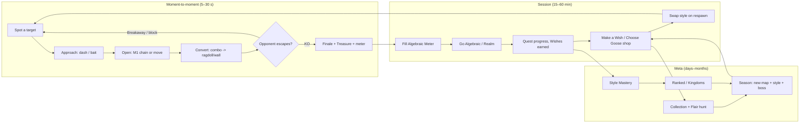
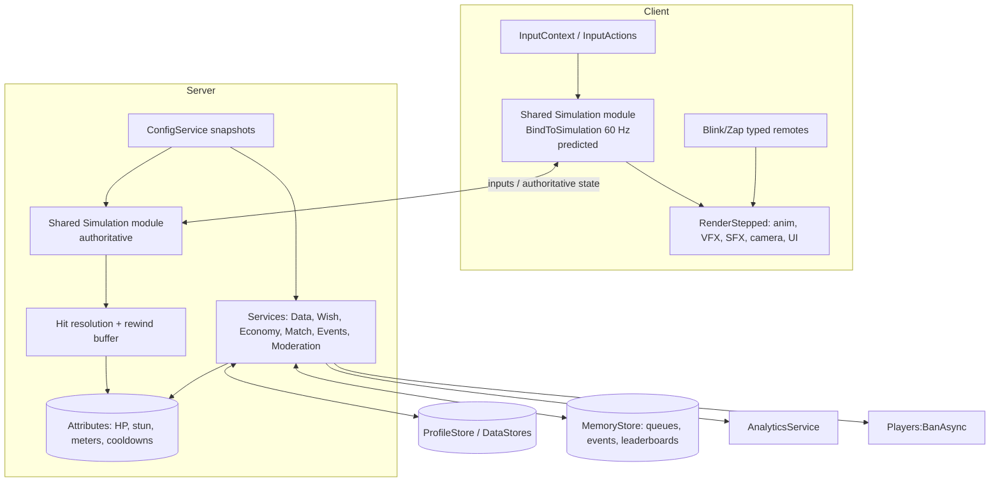
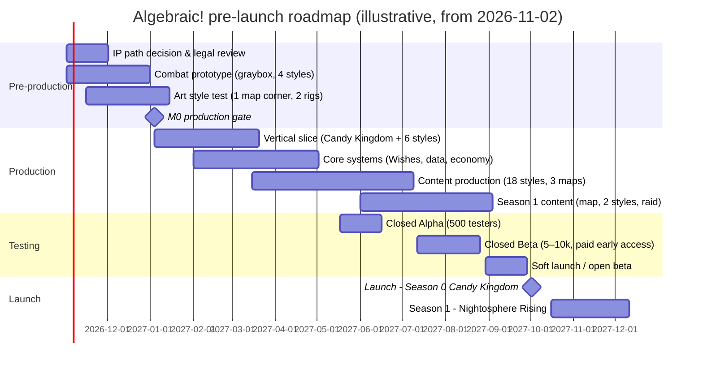

# ALGEBRAIC! — Game Design Document

**An Adventure Time–themed battlegrounds fighting game for Roblox**

| | |
|---|---|
| **Project codename** | Project ALGEBRAIC |
| **Working title** | *Algebraic!* (Track A: *Adventure Time: Algebraic!*. See §5 for naming by IP track.) |
| **Genre** | Battlegrounds PvP brawler (Jujutsu Shenanigans-style) with a rolling/collection meta-layer |
| **Platform** | Roblox: mobile (iOS/Android), PC, Mac, Xbox, PlayStation. VR not supported at launch. |
| **Target maturity** | Roblox **Mild** |
| **Document version** | 1.1, first complete draft with editorial review applied |
| **Date** | 12 October 2026 |
| **Status** | Concept greenlight (entry to pre-production). M0 production gate: 4 Jan 2027 (§21.2). |

> **How to read this document.**
> - **Leadership:** read §1 (Executive Summary), §5 (IP strategy, decision required), §17.7 (business case) and §22 (risks).
> - **Designers:** §6–§11.
> - **Artists:** §12–§14.
> - **Engineers:** §18.
>
> Values marked as tuning targets live in remote config and are expected to change. Facts about the market, the show and the Roblox platform come from research done in October 2026 (§2, Appendix E). Items still to verify are listed in Appendix F.

---

## Table of Contents

1. [Executive Summary](#1-executive-summary)
2. [Research Summary](#2-research-summary)
3. [Vision and Design Pillars](#3-vision-and-design-pillars)
4. [Game Structure and Core Loops](#4-game-structure-and-core-loops)
5. [IP, Licensing and Legal Strategy](#5-ip-licensing-and-legal-strategy)
6. [Combat System](#6-combat-system)
7. [Fighting Styles (Roster)](#7-fighting-styles-roster)
8. [The Wish System (Rolling)](#8-the-wish-system-rolling-for-fighting-styles)
9. [Progression](#9-progression)
10. [Game Modes and World Events](#10-game-modes-and-world-events)
11. [Maps, Arenas and Seasonal World](#11-maps-arenas-and-seasonal-world)
12. [Art Direction](#12-art-direction)
13. [Animation and VFX](#13-animation-and-vfx)
14. [Audio](#14-audio)
15. [UI/UX, Controls and Onboarding](#15-uiux-controls-and-onboarding)
16. [Player Safety, Maturity and Accessibility](#16-player-safety-maturity-and-accessibility)
17. [Monetization and Economy](#17-monetization-and-economy)
18. [Technical Design](#18-technical-design)
19. [Live Operations](#19-live-operations)
20. [Analytics, KPIs and Success Criteria](#20-analytics-kpis-and-success-criteria)
21. [Production Plan](#21-production-plan)
22. [Risk Register](#22-risk-register)
- [Appendix A — Move Data Template](#appendix-a--move-data-template)
- [Appendix B — Balance Sheet Schema](#appendix-b--balance-sheet-schema)
- [Appendix C — Glossary](#appendix-c--glossary)
- [Appendix D — Episode Reference Index](#appendix-d--episode-reference-index)
- [Appendix E — Research Sources](#appendix-e--research-sources)
- [Appendix F — Open Questions and Items to Verify](#appendix-f--open-questions-and-items-to-verify)

---


## 1. Executive Summary

**The game.** *Algebraic!* is a free-to-play Roblox battlegrounds brawler set in the Land of Ooo. Twenty players drop into a hand-painted arena (the Candy Kingdom, the Tree Fort, the Ice Kingdom) and fight using **Fighting Styles** inspired by *Adventure Time* characters. Each style has:
- the shared 4-hit M1 chain, block, Perfect Block, dashes and **Breakaway** escape
- 4 moves (one of them a ★ signature) and a unique **Quirk**
- a show-accurate **Awakening** that swaps in 4 new moves
- for Legendary styles and above, a **Realm**: a show location projected as a rules-changing bubble that can **Realm Clash** with another

Combat follows the grammar that made Jujutsu Shenanigans the #1 battlegrounds game on Roblox (~628K peak CCU in 2026). It adds cartoon art direction, duos and a world that changes every season.

**The hook.** Players unlock styles by **making Wishes**, a rolling system with seven rarities from Common to a secret Cosmic tier:
- every Wish also rolls a cosmetic **Flair** (1-in-50 Shiny up to 1-in-100,000 Glitched), giving a Sol's RNG-style long-tail chase
- **rarity is prestige, not power**: every style is tuned into the same 47–53% win-rate band
- every style can be tried for free in Training Grounds
- generous visible pity and a Treasure-only shop (Choose Goose) guarantee a non-random path to every non-Cosmic style. The secret Cosmic style has a bounded Cosmic Spark path.

That design is what makes rolling compatible with a fair PvP game. The research found it is also what Roblox's 2026 paid-random-item rules effectively require.

**Launch content (≈ 12 months from greenlight):**
- **18 Fighting Styles:**
  - Starters: Finn, Jake
  - Common: Banana Guard, Tree Trunks, Lumpy Space Princess
  - Uncommon: Lemongrab, BMO, Susan Strong
  - Rare: Princess Bubblegum, Flame Princess, Peppermint Butler
  - Epic: Marceline, Ice King, Huntress Wizard
  - Legendary: The Lich, Hunson Abadeer
  - Mythic: Prismo
  - Cosmic: a secret style
- **3 Battlegrounds maps:** Candy Kingdom, Grasslands & Tree Fort, Ice Kingdom
- **5 ranked duel arenas** and **1 raid** (The Lich's Well)
- **Modes:** FFA Battlegrounds, Duels, Ranked 1v1/2v2, Party Modes, Training Grounds

**Live plan:** weekly Saturday updates, a new style or mechanic every 2 weeks, and 8-week seasons that transform the world:
- Nightosphere Halloween
- Holly Jolly winter
- Lumpy Space
- the *Elements* four-realm spring event
- *Islands* summer
- the *Gum War* finale

**Business model:** cosmetic and convenience passes (genre-standard), Wish bundles (odds-disclosed and `PolicyService`-gated), an 8-week Adventure Pass, an "Algebraic Club" subscription, cheap private servers (paid out by Roblox Plus), and rewarded ads. No sale of combat power, ever.

**Decision required now (§5).** *Adventure Time* is owned by Cartoon Network. Its parent, Warner Bros. Discovery, merged with Paramount into **Skydance** on 6 Oct 2026, so the IP now sits next to Paramount's Roblox program, the most active Western enforcer of fan games on Roblox. Research found **no Adventure Time listing in Roblox's License Manager**. Cartoon Network runs its own Roblox games, and the franchise is in active production (*Side Quests*, 2026; a film in development).

We recommend a **"license-ready, IP-separable" build**:
- pursue an official license with a playable vertical slice
- keep every IP-bearing asset in a swappable skin layer
- if no license exists by Alpha, launch on an original world with the same mechanics
- do **not** publicly launch a monetized, unlicensed *Adventure Time* game; the takedown risk would wipe out the game, progress and revenue

**Team and budget (§21, §17.7).** The studio-quality target is ~42 people at Beta peak (39 core plus QA scale-up). Break-even at that size needs roughly **30K–65K average CCU** for a globally distributed team, or **70K–150K** if US-based. We recommend a **lean-plus-contractors** team (8–12 core) through Closed Beta and scaling only on retention data (D1 ≥ 35%, D7 ≥ 15% targets).

**Top risks:** IP/licensing, genre saturation versus JJS/TSB, gacha perception in PvP, mobile performance with 20-player VFX, and the maturity of Roblox's new Server Authority netcode. Mitigations are in §22.


## 2. Research Summary

This section condenses the research behind the design. Full source lists are in **Appendix E**.

> **Method and caveats.** Research ran in October 2026 across five tracks: the genre, the rolling/monetization/policy landscape, *Adventure Time* lore, locations and art direction, and Roblox engineering. Player counts come from third-party trackers (RoMonitor, Rolimons, Rotrends and others), which measure differently, so treat them as estimates. Roblox policy items should be re-checked against the live Creator Hub pages before launch, because several changed in 2026.

### 2.1 The genre benchmark: Jujutsu Shenanigans (JJS)

| Fact | Data (Oct 2026) |
|---|---|
| Developer | Tze (group "Tze's Shenanigans") |
| Created | April 2022 |
| Lifetime visits | ~6.2–7 billion |
| All-time peak CCU | **~628K** (Feb 2026, during the Jump Showdown collab) |
| Typical CCU | ~130–235K. The **#1 battlegrounds game by live players**, about 2–3× The Strongest Battlegrounds. |
| Update cadence | **Roughly every 2 weeks**. Update names are tagged into the game title ("[SKY ASSASSIN] Jujutsu Shenanigans"). |
| Est. gross player spend | ~$1.3M per 30 days (third-party estimate) |
| Roster | ~22 regular + ~5 special characters, **all free once finished**. New characters ship unfinished behind a ~300 R$ **Early Access** pass, then become free. |
| Monetization | Light and cosmetic: Early Access, custom kill sound, emote slots and pages, build saves, awakening outfits. **Private servers are free.** |

**JJS combat model (what the genre expects):**
- **4-hit M1** with three finisher branches: a knockback Ender, Space + M1 uppercut, and an air downslam.
- **Directional block** (front only), **perfect block** (added in v1.62), and many block-break moves.
- **Dash on Q.** Side dash is the core dodge.
- **Evasive**: a side dash *while ragdolled* gives about 1 s of i-frames. It is **gated by a meter** that fills from damage taken and dealt. Some "true ragdoll" moves disable it.
- **Awakening on G.** The meter fills from damage dealt (~286 damage). It **heals**, swaps in a **second 4-move kit**, and some awakenings include a **domain expansion** (a sure-hit zone).
- **Per-character "special" on R** with its own cooldown or resource. For example, True Cannon has an **overheat** meter.
- **Per-character HP** (70–117) is used as a hidden balance lever.

**JJS modes:** FFA public servers on a destructible city map, casual duels (3 lives in 1v1, 5 team lives), Elo **ranked** (3 lives, 5-minute timer), **Roulette** party minigames, free private servers with **Build Mode/Workshop**, and a "Creator Clash" mode using community-made characters. There are also seasonal events, like a Halloween candy currency, and cross-game collabs.

**Naming convention:** characters use **descriptive epithets** instead of names ("Vessel," "Honored One," "Ten Shadows"). The Strongest Battlegrounds ("The Strongest Hero") and Heroes Battlegrounds ("Green Hero") follow the same pattern.

### 2.2 Other genre references

| Game | Takeaway |
|---|---|
| **The Strongest Battlegrounds** (Yielding Arts, 2022) | ~19B visits, the most in the genre. Live CCU has slid to ~70–100K. Free roster, perfect block causes a "Critical" bonus window, and the evasive has a long cooldown (~20–30 s). Its pass set is nearly identical to JJS's, which makes it the genre's monetization template. |
| **Heroes Battlegrounds** (2023) | A **mastery-unlock** grind (5 free characters; others unlocked by mastering another). It fell from ~152K peak (Nov 2025) to ~14K (Aug 2026). **Cadence and novelty matter more than grind systems.** |
| **Fruit Battlegrounds** | **Spins for characters** with pity at 80/160/320 spins. Proves gacha-for-characters works in battlegrounds, at mid-tier scale. |
| **Untitled Boxing Game** | **Style spins** (Uncommon 63 / Rare 27 / Mythic 9 / Legendary 1%), a pity meter, and **Shiny variants** at 1/6,666. The closest analogue to our Wish + Flair model. |
| **Sol's RNG** | Free time-gated rolls. Monetizes **luck and speed**, not rolls. Reveal theatre and long-tail rarity drive retention. |
| **Shindo Life** | Paid and free spins with a **spin storage cap** (500 → 1,000 with a pass). Rare bloodlines are PvP-relevant, which is the main source of "P2W" sentiment. |
| **Blox Fruits** | A Beli gacha (not a paid random item) **plus deterministic Robux purchases** of specific fruits. Widely seen as the "fair escape hatch." |

### 2.3 What the research means for us

| Finding | Design response |
|---|---|
| The two biggest battlegrounds games **avoid character gacha**. In the genre, gacha shows up in mid-tier titles, and players link it to P2W. | Rolling stays (it's the brief), but **rarity ≠ power** (Pillar P3). Every style can be tried free in Training Grounds, 3 styles rotate free weekly, and Choose Goose offers a deterministic path (§8). |
| Cosmetic RNG (Sol's RNG auras, UBG Shinies) is the **least controversial** form of rolling | **Flairs**: a long-tail cosmetic roll layer on every Wish (§8.7) |
| JJS's escape meter, awakening, R special and domains are the genre's grammar | Adopted and themed: **Breakaway**, **Algebraic Meter → Awakening**, **Quirk (R)** and **Realms** (§6) |
| Content cadence drives CCU spikes; Heroes BG declined without it | A **biweekly** style/mechanic cadence, title-tagged updates and 8-week seasons that transform the maps (§11.3, §19) |
| Collabs set all-time peaks (JJS × Jump Showdown) | A cross-game collab slot every second season (§19.1) |
| Free private servers plus Build Mode create a UGC engine | Paid-cheap private servers that leverage Roblox Plus payouts, plus a Year-2 **Ooo Workshop** (§10.1) |
| Toxicity complaints center on teaming, kill-stealing and exploiters | Pile-on protection, a party cap of 2 in FFA, server-authoritative hits and the Ban API (§6, §16, §18) |
| 2026 Roblox **PRI rules** require full per-item odds, live-updating pity and luck odds, no empty outcomes and PolicyService gating. PRIs are blocked for UK under-18s, all Australians, Brazilian minors and unverified Brazilian adults. | §8.8 compliance table: odds are generated from server config, restricted players get free and fixed-price paths only |
| **Chat requires age checks** (Jan 2026). Roblox Kids/Select launched in June 2026. | A social layer that doesn't depend on chat (Quick-Chat, emotes, structured invites). Target the **Mild** label (§16). |
| No *Adventure Time* license is listed on Roblox's License Manager. Cartoon Network runs first-party Roblox games, and the franchise is in active production (*Side Quests*, a film). | A **license-ready, IP-separable** build with an original-IP fallback, and no public unlicensed launch (§5) |


## 3. Vision and Design Pillars

### 3.1 High concept

> **Algebraic!** is a free-to-play Roblox brawler set in the Land of Ooo. You drop into a hand-painted Ooo arena with 15–23 other players, pick a **Fighting Style** inspired by a character from the show, and brawl. Every style has 4 moves (one of them a ★ signature), a Quirk, a passive, and a show-accurate **Awakening** that turns the fight upside down. You unlock styles by **making Wishes**, a rolling system with rarities from Common to Cosmic. A style's rarity sets how complex and spectacular it is. It never makes the style stronger.

### 3.2 The 10-second pitch for players

*"Roll Marceline. Turn into a giant bat. Drop a whole Nightosphere on the server. Get one-tapped by a Banana Guard who perfect-blocked you. Mathematical."*

### 3.3 Design pillars

Every feature, asset and tuning change has to serve at least one pillar and break none. Reviewers reject work that breaks a pillar.

| # | Pillar | What it means | What it rules out |
|---|---|---|---|
| P1 | **Easy to start, deep to master** | A new player lands a satisfying combo inside 60 seconds. A veteran still finds new tech after 300 hours. | Moves with no counterplay. Inputs mobile players physically can't perform. Mechanics that only live in a wiki. |
| P2 | **Every fight feels like an episode** | Moves, voice barks, VFX and maps cite real moments from the show. A fan should recognize the episode a move comes from. | Generic anime-battlegrounds VFX with a pink tint. Moves that only make sense in another franchise. |
| P3 | **Rarity is prestige, not power** | Rarer styles are flashier, more mechanically unusual and rarer to see. Every style lands in the same 47–53% win-rate band. | Stat bonuses tied to rarity. Paid power. "This Mythic is just better." |
| P4 | **Chaos with readable fairness** | 20 players and 5 awakenings at once should look gorgeous and still be legible. Every hit is telegraphed, every stun has an exit, every death has a cause. | Unblockable instant-kill moves. Endless stunlocks. VFX that hide hitboxes. |
| P5 | **Ooo is alive** | Maps react to fights through destruction, NPCs and world events. Seasons change the world itself, not only the shop. | Static grey boxes. Seasons that are only a battle-pass reskin. |
| P6 | **Respect the player** | Odds are always disclosed. Pity is generous. Every non-Cosmic style can be bought at a fixed Treasure price, and Cosmic has a guaranteed long path through Cosmic Sparks. Ethical monetization, short timers, no dark patterns. | Fake "limited" pressure. Paid Breakaway/revive. Selling advantage in ranked. |

### 3.4 Target audience

| Segment | Share (target) | Who they are | What they need |
|---|---|---|---|
| **Battlegrounds regulars** | ~45% | 11–17, play JJS/TSB/Heroes BG, mostly mobile + PC, clip & share | Tight combat, tech to learn, a reason to switch from their current main game |
| **Adventure Time fans** | ~30% | 13–25 (incl. adults who grew up with the show and the Fionna & Cake audience) | Faithfulness, lore Easter eggs, art style, collection completion |
| **Collectors / RNG players** | ~25% | 9–16, play Sol's RNG / Anime Vanguards-type rolling games | Roll excitement, rare-pull flexing, Flair hunting, trade-adjacent social status |

**Platform split assumption:** ~70% mobile, ~24% PC, ~5% console, ~1% VR (unsupported at launch). Roblox's own performance documentation says **~65% of all Roblox players are on Android**, and ~60% of those devices have 2–4 GB of RAM. **Mobile is a first-class target, not a port.**

**Maturity target:** Roblox **"Mild"** content maturity label. The violence is cartoon slapstick: no blood and no gore, defeated players "poof" into a cloud of sparkles and candy. See §16.

### 3.5 Unique selling points versus the genre

1. **Real cartoon art direction.** The genre is dominated by default Roblox avatars and anime VFX. Algebraic! uses gouache-painted maps, ink-line outlines and squash-and-stretch animation. It is recognizable from a single thumbnail.
2. **Rolling with ethics.** The game borrows the RNG thrill that makes Sol's RNG and Shindo Life sticky. It removes the power-gating that makes those systems toxic in PvP.
3. **Realms.** Legendary and higher awakenings can project a *Realm*, a show-location bubble that changes the rules inside it (the Nightosphere, the Time Room, the Lich's Well). When two Realms collide they **Realm Clash**. This is the genre's "domain expansion" moment, rebuilt around Adventure Time locations.
4. **A world that changes with the seasons.** Every 8-week season transforms a map or adds a new one (Ice Kingdom winter, Nightosphere Halloween, *Elements* spring, *Islands* summer), with a seasonal style and a world boss.
5. **Duos.** Finn & Jake, Fionna & Cake and Marceline & Bubblegum are paired by the show itself. Duo styles get **Bond Moves** when partied together, making 2v2 a first-class mode.

### 3.6 Comparable titles and positioning

| Title | What we take | What we do differently |
|---|---|---|
| Jujutsu Shenanigans | 4-move kits plus awakening, the evasive/escape meter, character-as-moveset, domain clashes, codename IP strategy | Rolling meta layer, authored cartoon art, seasonal maps, duos |
| The Strongest Battlegrounds | Movement tech, ultimate bar, kill-streak flex, clip culture | Stronger fiction, mobile-first UI, deeper onboarding |
| Sol's RNG | Rarity reveal theatre, long-tail cosmetic chase, luck boosts | Rolls feed a real game, not just a collection |
| Shindo Life / Project Slayers | Style rolling with rarities, slots, spin economy | No power gating, generous pity, deterministic shop path |
| Brawl Stars / Smash Bros. (off-platform) | Readable silhouettes, telegraphs, character fantasy in 4 moves | Roblox-native social and live-ops |


## 4. Game Structure and Core Loops

### 4.1 Loop overview



### 4.2 Moment-to-moment (seconds)

This is the JJS/TSB rhythm: **neutral → opener → combo → ender → reset**.

1. **Neutral.** You read the opponent's spacing and meters. Do they have Breakaway? Is their block cracked? Is their Algebraic Meter full?
2. **Opener.** A dash-in M1, a projectile poke, a command grab (beats block) or a bait for their move.
3. **Combo.** M1 chain into a move, or ragdoll into a follow-up. Combo scaling and **Stun Decay** (§6.6) cap how long a combo lasts, so every combo ends.
4. **Ender.** Knockback toward a wall, a hazard or an ally, or an uppercut for an air combo.
5. **Reset.** The defender may spend Breakaway, and the attacker re-reads.

**Design target:** a 1v1 between equal players lasts **25–45 seconds** at 100 HP. Average time-to-kill from a clean opener, if the defender never escapes, is **≈ 7–9 seconds**. Any style that drops below 6 s TTK in telemetry gets flagged for review.

### 4.3 Session (minutes)

- **Join** a 16–24 player Battlegrounds server on a seasonal map. Time to first fight should be under 20 seconds after load.
- **Pick or swap** a style. Every respawn shows the Style Wheel, and you can switch styles mid-life at the **Style Totem** in each spawn hub.
- **Earn** Treasure, Wishes and quest progress from kills, assists, damage, world events and "style moments" (landing a style's signature combo).
- **World events every 4–6 minutes** (§10.4) pull the server into shared moments: a Gumball Guardian awakens, the Lich's shadow falls, Choose Goose shows up with his shop, a Rainicorn rainbow buff appears.
- **Make Wishes** between lives. Results pop as a 1–8 second reveal (§8.6) you can skip after the first view. Rarer pulls broadcast to the server feed.
- A **session ends** naturally after a quest set (≈ 25–40 min). Daily quests fit in one session. Weekly quests are tuned to finish in about 3 sessions per week for a casual player.

### 4.4 Meta (days to months)

| System | Cadence | Purpose |
|---|---|---|
| Account Level (1–100, prestige after) | Continuous | Long-term progress feeling; Wish rewards |
| Style Mastery (1–30 per style) | Per style | Cosmetic unlocks, Finales, titles; signals main identity |
| Collection Book (Styles × Flairs × Variants) | Long-tail | The RNG chase that never ends (cosmetic only) |
| Adventure Pass | 8-week season | Habit + monetization; free and paid tracks |
| Ranked Duels / Duos | Season | Competitive identity; top-100 "Hero of Ooo" |
| Kingdoms (guilds) | Weekly | Social retention; Kingdom Wars weekend |
| Seasonal world | Every 8 weeks | Map transformation, seasonal style, world boss |

### 4.5 Places and server topology

| Place | Role | Players/server | Notes |
|---|---|---|---|
| **Battlegrounds** (start place) | Core FFA brawling on the current map | 20 (tunable 16–24) | Map rotates every 20 min in "Rotation" servers; "Classic" servers keep the seasonal flagship map |
| **Duel Grounds** | Ranked/unranked 1v1 & 2v2 | 2–4 + spectators | Reserved servers via TeleportService; small authored arenas |
| **Training Grounds** | Practice mode, frame data, dummies, combo recorder | 1–6 | Free trial of *any* style here (incl. unowned) |
| **Raid Instance** | Seasonal PvE boss raids (2–6 players) | 2–6 | Reserved servers |
| **Kingdom Keep** | Guild hall, social, cosmetics showcase | up to 40 | Low-combat social space; emote stage |
| **Preview** (Sneak Peek) | Upcoming styles in Battlegrounds and Duels before they join the Wish pool | 20 | Sneak Peek pass holders and creators. Feeds the Wish-pool balance gate (§19.2). |

All places are in one Roblox *experience* (universe). Matchmaking uses MemoryStore queues and reserved-server teleports (§18).


## 5. IP, Licensing and Legal Strategy

> **This is the most important business decision in the document, and it comes before any content production.** *Adventure Time* is owned by Cartoon Network Studios. Its parent, Warner Bros. Discovery, was reported in October 2026 to have completed a merger into Paramount ("Skydance"). The franchise is being actively produced. This section explains why the game must be built so it can ship **with or without** a license, and how to do that.
>
> *Not legal advice. Engage entertainment/IP counsel before M0 (§21.2).*

### 5.1 Facts that shape the decision (research as of Oct 2026)

| Fact | Implication |
|---|---|
| **No official *Adventure Time* game exists on Roblox**, and research found **no Warner Bros. Discovery / Cartoon Network listing in Roblox's License Manager catalog**. Absence is "not found," not confirmed; re-check the live catalog. | There is no off-the-shelf license to click "apply" on today. |
| Cartoon Network **does run first-party Roblox games**: *Ben 10: Super Hero Time* (~557M visits), *Cartoon Network Game On!*, *Gumball Haunted House*. WBD executives have publicly called Roblox a brand-affinity channel. | The rights holder values Roblox **and** has products to protect. Historically, takedowns are most likely when a rights holder has a licensed or first-party product in the space. |
| **The franchise is live:** *Fionna and Cake* S2 (Oct–Dec 2025); *Adventure Time: Side Quests* (US premiere 29 Jun 2026 on Disney+/Hulu; S2 from 2 Oct 2026); an *Adventure Time* feature film in development; *Heyo BMO* preschool spin-off in development. | There is a fresh young audience that matches Roblox's core demographic, so licensing appetite is plausible. Active production also means active brand policing. |
| **Roblox License Manager** launched in July 2025 (Lionsgate, Netflix, Sega, Kodansha) and opened self-serve to eligible IP holders in November 2025. Rights holders take **0–95% (typically 10–25%)** of creator payouts automatically. Roblox **scans experiences for IP use** and can offer *reactive* licenses to existing unlicensed games. | There is a credible path for a rights holder to license the game *after* it exists. Conversely, the same scanning makes an unlicensed game easy to find. |
| **Precedents for unlicensed fan games:** *Pokémon Brick Bronze* (removed after a Nintendo DMCA in 2018, with players demanding Robux refunds); *Shinobi Life 2* (Viz Media claim in 2020, relaunched as *Shindo Life*); *Anime Adventures / Anime Fighting Simulator* (taken private in Dec 2023 amid alleged DMCA claims tied to a licensed partner). | An unlicensed game can lose everything overnight: the game, Robux-backed progress, and community trust. |
| **JJS's codenames** ("Vessel," "Honored One") are a **community convention, not a legal shield**. JJS has had no known rights-holder action, but it also still uses "Jujutsu" in its title. | Codenames reduce *trademark-style* confusion, but **character likeness, art and story elements are copyrighted** regardless of name. |

### 5.2 The three tracks

| | **Track A: Licensed** | **Track B: Original "inspired-by" IP** | **Track C: Unlicensed codename fan game** |
|---|---|---|---|
| What ships | Real names, likenesses, locations, catchphrases, possibly official VO | An original cartoon world with the same *tone* and an original cast built on the same archetypes | AT characters under JJS-style epithets ("The Hero," "Vampire Queen") |
| Legal risk | Low (contractual) | Low (original work; avoid substantial similarity) | **High**: DMCA takedown at any time |
| Audience pull | Highest (brand + fandom) | Lower; must earn its brand | High until removed |
| Cost / speed | Slower: approvals add ~2–3 weeks per content beat; royalty share | Fastest; full creative control | Fast, but everything is at risk |
| Monetization safety | Safe | Safe | Unsafe: PRI revenue and progress can vanish, with refund backlash |
| **Recommendation** | ✅ **Target** | ✅ **Fallback (and the default build architecture)** | ❌ **Do not launch publicly** |

### 5.3 Recommended plan: "license-ready, IP-separable"

1. **Build every system IP-separable from day one.** All IP-bearing content lives in a **data-driven skin layer**: names, likeness models, VO, catchphrases, map dressing, lore cards. The game's mechanics are original. Each Fighting Style is defined by an **IP-neutral archetype** (e.g., *Sword Hero*, *Stretchy Companion*, *Candy-Science Monarch*, *Vampire Rocker*, *Ice Wizard*). Swapping a skin pack swaps the franchise without touching combat code.
2. **Approach the rights holder with the vertical slice (M1),** not with a pitch deck. Cartoon Network Games / WBD (Skydance) Global Consumer Products is the direct route. In parallel, monitor License Manager for an *Adventure Time* listing. Lead with:
   - a playable Candy Kingdom slice with 6 faithful styles,
   - the **"rarity is prestige, not power"** ethics stance and odds transparency (rights holders protecting a kids' brand care about this),
   - Mild maturity compliance and the Kids/Select publishing plan (§16),
   - a marketing tie-in calendar aligned with *Side Quests* seasons and the film.
3. **Decision gate at Alpha (M2):** if no license term sheet exists, switch the skin layer to **Track B** (original IP, §5.5) and launch on schedule. Keep the door open for a later reactive license.
4. **Never put Track C on a public, monetized server.** Internal playtests with AT placeholder art are fine. Public launch with paid Wishes on unlicensed IP is not.

### 5.4 What a license would require from us (plan for it)

- **Approval pipeline:** licensor review of every character model, animation set, VO line, map and marketing asset. Budget **2–3 extra weeks per content beat** and a dedicated licensing producer (part of the Producer role, §21.1).
- **Brand guidelines:** official style guide, color references, logo usage, character "do's and don'ts" (for example, no character depicted doing something off-model).
- **VO:** official cast or approved sound-alikes, under contract. **Never use AI voice cloning of the cast.**
- **Music:** original score only, unless the license grants specific tracks.
- **Revenue share:** model 10–25% of payouts (License Manager norm). Direct deals may include a minimum guarantee.
- **Brand-safety commitments:** no casino imagery, Mild maturity, transparent odds, kid-safe social features. The design already meets all of these.

### 5.5 Track B fallback: same game, original world

If the license fails, *Algebraic!* ships in an original world: the **"Land of Whatever,"** a candy-and-moss post-apocalyptic dreamland. Each archetype gets an original character with distinct silhouette, colors, name and lore. For example, the *Sword Hero* becomes a kid in a frog-ear hood with a seed-sword, and the *Stretchy Companion* becomes a rubbery capybara. Maps keep their *function* (a candy capital, an ice fortress, a lava kingdom, a demon dimension) with original landmarks.

**Avoid substantial similarity:** no copied silhouettes, no exact catchphrases, no recognizable locations like the Tree Fort.

### 5.6 How this document uses names

This GDD uses **canonical Adventure Time names** throughout (Track A), because that is the target and it is the clearest way to communicate design intent. Every style in §7 also lists:
- its **IP-neutral archetype** (Track B foundation), and
- a **public epithet** in the JJS convention. Epithets are used in-game *even on Track A*, as playful style titles ("Finn — *The Last Human*"), and they double as the codename fallback for internal tests.


## 6. Combat System

### 6.1 Combat philosophy

- **Readable, fast and punishable.** Every move has a visible wind-up, a committed active window and a recovery that can be punished.
- **Shared fundamentals, unique styles.** Every style uses the same M1 chain, block, dash and Breakaway, so skill transfers between styles. Styles differ in their 4 moves, passive and Awakening.
- **Equal HP, equal chassis.** Every style has **100 HP**, the same walk/run speed (except style-specific mobility moves) and the same hurtbox. Player avatar size never changes the hurtbox (§12.3).
- **Units:** time is given in **frames at 60 Hz** (1f ≈ 16.7 ms) and in seconds. Distances are in **studs**. All values are launch tuning targets, live in the balance sheet (Appendix B), and can be changed through remote config without a client update (§18.6).

### 6.2 Character chassis

| Stat | Value | Notes |
|---|---|---|
| Max HP | 100 | Same for all styles at launch; some passives grant temporary shields (capped 20). JJS uses per-character HP (70–117) as a hidden balance lever. We **reserve** an 85–115 band for live balance, but only change it when move tuning can't fix an outlier, and the value is always shown in the Style Wheel. |
| Walk speed | 18 studs/s | Roblox default is 16 |
| Run speed | 26 studs/s | Double-tap W / hold Ctrl (PC); full stick push (mobile/console) |
| Jump | 7.5 studs height | Some styles have double-jump/glide as a passive |
| Hurtbox | Fixed capsule 2.2 × 5.2 studs | Independent of avatar cosmetics. Some awakenings **scale the hurtbox up, never down**, as the trade-off for bigger moves: Kaiju Jake ×1.5, Giant Lich / Chaos Demon ×1.3, Inferno Flame Princess ×1.2. |
| Out-of-combat regen | 2 HP/s after 8 s without taking/dealing damage | Disabled inside Realms |
| Respawn | 4 s at a random safe spawn hub | 8 s spawn protection, broken by attacking |

### 6.3 M1 chain (basic attack)

A 4-hit chain on LMB / Punch. Each style re-skins its M1 (sword slashes for Finn, stretchy fists for Jake, bass swings for Marceline). **Frame data and damage are identical across styles** so the fundamentals stay universal.

| Hit | Startup | Active | Recovery | Damage | On hit | On block |
|---|---|---|---|---|---|---|
| M1-1 | 6f | 3f | 12f | 3.5 | 27f hitstun (0.45 s) | −2f, drains 12 guard |
| M1-2 | 6f | 3f | 12f | 3.5 | 27f hitstun | −2f, 12 guard |
| M1-3 | 7f | 3f | 13f | 3.5 | 27f hitstun | −3f, 12 guard |
| M1-4 (Ender) | 10f | 4f | 22f | 5.0 | Knockback 38 studs → ragdoll 60f (1.0 s) | −10f (punishable), 20 guard |

- **Chain window:** the next M1 must be pressed within 36f (0.6 s) of the previous hit's recovery, or the chain resets to M1-1.
- **End lag:** after the Ender, M1 is locked for **60f (1.0 s)**. This prevents infinite M1 loops, as in genre convention.
- **Ender variants**, input on the 4th hit:
  - **Uppercut**: hold Jump. Launches the target 22 studs up with no ragdoll. The attacker gets 48f of reduced-gravity "hang time" to land up to 3 **air M1s** (2.5 dmg each) or an air-capable move.
  - **Downslam**: press M1 while airborne. Spikes the target into the ground with a 54f knockdown and a small bounce. It can only be used **once per combo**.
  - **Side Ender**: hold A/D. Knockback goes 45° to the side, which is useful for steering a target into walls and hazards.
- **Wall Splat:** if a knocked-back target hits terrain or a wall within 0.3 s of the Ender, they **stick for 30f** and the attacker can extend the combo. Limited to **once per combo**.

### 6.4 Block, guard and Perfect Block

| Mechanic | Rule |
|---|---|
| **Block** (hold F) | Covers the **front 180°**. Negates 100% of M1 damage and 80% of move damage (20% chip). Walk speed drops to 8. Hits from behind ignore block, which matters in 20-player chaos. |
| **Guard meter** | 100 points. Each M1 drains 12 and the Ender drains 20. Each move has its own guard damage (20–60). After 1.0 s without blocking, guard regenerates at 25/s. |
| **Guard Break** | At 0 guard: the shield shatters with a big glass-candy VFX, and the target is stunned for **84f (1.4 s)**, takes +10% damage and cannot Breakaway for the first 30f. |
| **Perfect Block** | Pressing block **≤ 9f (0.15 s) before** a hit lands negates it completely. Against an M1, the attacker is staggered for 36f (0.6 s). Against a melee move, the attacker staggers for 18f. Grants +6 Algebraic Meter. VFX: a ringing "ding!" and a star flash. |
| **Anti-mash** | A block tap that perfect-blocks nothing locks block for 20f, so players can't mash for parries. |
| **Command grabs** | Ignore block. They lose to dashes with i-frames, Perfect Block (on grabs flagged *parryable*) and jumping (ground grabs). |

### 6.5 Movement and dashes

Each dash has its **own cooldown** so players can chain movement into tech:

| Dash | Distance | Duration | I-frames | Cooldown | Notes |
|---|---|---|---|---|---|
| **Front dash** | 30 studs | 18f | None | 2.0 s | Can lead into a **Dash M1** (a lunge hit, 4 dmg, 30f hitstun) |
| **Side dash** | 20 studs, curved | 15f | Frames 1–7 | 1.6 s | The main defensive dodge; can **cancel M1 recovery** after a hit on M1-2 or M1-3 (*Hop Cancel*) |
| **Back dash** | 16 studs | 14f | Frames 1–5 | 2.0 s | Escapes pressure; can't cancel anything |
| **Air dash** | 14 studs | 12f | None | Once per airtime | Only for styles with the *Aerial* tag |

**Movement tech.** These are intentional, documented in Training Grounds and teachable:

1. **Hop Cancel.** Side dash out of M1-2/M1-3 recovery to reposition behind an opponent who is blocking. Hits from behind ignore block.
2. **Dash-Ender.** Front dash, Dash M1, then continue the M1 chain from hit 2. Range extension.
3. **Wall Carry.** Use Side Enders to carry targets into walls for a Wall Splat extension.
4. **Tech Roll.** Press Jump within 12f of a ragdoll landing to quick-rise with 18f of i-frames. This rewards defense skill and gives an alternative to spending Breakaway.

### 6.6 Hitstun, ragdoll and combo limits

| Rule | Value | Why |
|---|---|---|
| Hitstun (M1) | 27f, refreshed per hit | Standard |
| Ragdoll (Ender) | 60f, then 30f of **wake-up i-frames** | Stops ragdoll loops |
| OTG (hits on a downed target) | Max **1 OTG hit per combo** | Stops ground loops |
| **Stun Decay** | After **2.5 s** of continuous stun, further hitstun is ×0.6. At **3.5 s** of continuous stun, the defender gets an automatic **Shake-Off**: an 18f i-frame pushback of 6 studs | Every combo ends |
| **Damage scaling** | ×1.0 for hits 1–8, ×0.85 for 9–14, ×0.70 for 15+ (floor ×0.5) | Long combos are flashy, not lethal |
| **Pile-on protection** | Hit by 3+ different players within 4 s → 25% damage reduction and Breakaway refills 2× faster for 4 s | Softens third-partying |

**Design target:** a max-damage, no-meter, no-wall combo from a clean opener should deal **28–36 damage**. An awakened combo with a wall should deal **40–50**. Nothing deals more than **55** without a Realm.

### 6.7 Moves (keys 1–4)

Every style has **4 base moves (1–4)**, **1 Quirk (R)**, **1 passive**, and an **Awakening** that replaces moves 1–4 with **4 awakened moves** (§6.9).

**Quirk (R).** This adopts the JJS "special" key. A Quirk is a style's unique mechanic, with a short cooldown (3–8 s; up to 12 s for random-outcome Quirks) or its own mini-resource. Examples: Jake-style's *Stretch Grapple*, Prismo-style's *Twisted Wish*, Ice King-style's *Gunter Call*. Quirks carry style identity. They are never a primary damage source (≤ 6 damage).

**Kit composition rules.** Every base kit must contain:
- ≥ 1 **opener**: a projectile, a rush or a grab that starts offense from neutral
- ≥ 1 **extender**: a move that combos from M1s or from ragdoll
- ≥ 1 **defensive/mobility** tool (in moves 1–4 *or* the Quirk): a counter, an i-frame move, a reposition or a zone
- exactly 1 **signature**: the move fans clip, most faithful to the show

**Move tags** (shown in the UI, used by balance tools):

| Tag | Meaning | Counterplay |
|---|---|---|
| `Projectile` | Travels; blockable | Block, side dash, reflect moves |
| `Rush` | Moves the user; melee hit | Perfect Block, side dash |
| `Grab` | Ignores block; short range | I-frame dash, jump (ground grabs), Perfect Block if *parryable* |
| `Counter` | Stance that punishes incoming hits | Grabs, projectiles from range, waiting it out |
| `Zone` | Persistent area | Leave the area; some are destructible |
| `Summon` | Spawns ally NPCs: max 3 bodies per summon move, combined HP 20–60, 6–12 s life. Ultimate (A4) summons may be untargetable set pieces lasting ≤ 6 s. | Kill them; summons take 2× M1 damage |
| `Buff` / `Debuff` | Self or target modifiers | Cleansing moves, wait out timers |
| `Mobility` | Movement tool | — |
| `AoE` | Instant area burst around the user or a point | Spacing; block (front-facing) |
| `Utility` | Information or setup with no direct damage | — |
| `Stealth` | Invisibility (always with a close-range shimmer/outline) | Proximity reveal, AoE |
| `Ultimate` | The awakened A4 move; ≤ 30 damage, cinematic but telegraphed | As per its other tags |
| `Realm` | Legendary+ A4 bubble with rule changes (§6.10) | Escape the ring, Stubborn Heart, Realm Clash |
| `Music` | A musical move. Interacts with GOLB (§7.3.18). | — |
| `Demon` | A Nightosphere move. Amplified inside the Nightosphere Realm. | — |

Parenthetical qualifiers such as *Zone (trap)*, *Projectile (lob)* or *Grab (multi)* refine a tag without creating a new one.

**Cooldown bands:** basic moves 6–10 s, utility 10–16 s, signature 14–22 s. **Global rule:** no base move deals more than **18 damage** on its own.

### 6.8 Breakaway (escape meter)

Breakaway is the genre's "evasive." It is what keeps 20-player brawls from becoming helpless stunlocks.

- **2 pips.** While stunned, ragdolled or grabbed, press Dash (Q) to spend 1 pip. You burst out in a ring of sparkles that knocks all adjacent attackers back 8 studs, then get **20f of i-frames** and return to neutral.
- **Refill:** each pip refills over **25 s**. Taking damage speeds the refill (−1 s per 2 damage taken).
- **Lockout:** Breakaway is unavailable for the first **12f** after being hit, so an attacker always gets *something* for a clean opener. It is also unavailable during an **awakened ultimate's cinematic phase**, which is capped at 2.0 s with telegraphed, dodgeable startup.
- **Mind game:** an attacker who sees an empty Breakaway pip can commit to a longer combo. A defender with a full pip can bait. Pips show on the enemy nameplate.

### 6.9 Algebraic Meter and Awakening

| Parameter | Value |
|---|---|
| Meter size | 100 |
| Gain: damage dealt | +1.0 per HP (Realm damage ×0.5) |
| Gain: damage taken | +0.5 per HP (comeback lever) |
| Gain: Perfect Block | +6 |
| Gain: signature combo landed | +10 (style-specific "style moment") |
| Gain: KO / assist | +15 / +7 |
| Activation | **G** at 100. 72f activation; **invulnerable**, with a shockwave that pushes enemies back 10 studs. The local camera plays a 1.2 s mini-cinematic, which observers see as a pose and burst. |
| On activation | Heal **10 HP**, refill **1 Breakaway pip**, swap to the 4 awakened moves, play the style's awakening music sting. The base passive persists unless the kit lists an awakened modifier (e.g., Finn's +3 M1 range, Kaiju Jake's size). |
| Duration | **60 s**. Each KO while awakened adds **+5 s** (max 90 s). |
| End | 1 s "power-down" animation with no vulnerability penalty. The meter starts again from 0. |

**Expected fill time:** ≈ 2–3 minutes of active fighting for an average player. That is about 1 awakening per life for skilled players and 1 every other life for new ones.

### 6.10 Realms (Legendary+ "domain" equivalent)

Legendary, Mythic and Cosmic styles carry a **Realm** as their awakened move 4. A Realm projects a show location as a bubble that rewrites the rules inside it.

| Parameter | Value |
|---|---|
| Cast | 90f wind-up with a clearly visible expanding ring and an audio cue. The caster **can be interrupted** by Guard Break, grabs or a parryable hit during the first 45f. |
| Radius / duration | 40 studs / 12 s |
| Effect | A unique rule set per Realm (e.g., *Nightosphere*: chaotic gravity flips and amplified damage for demon-tagged moves; *Time Room*: enemies' cooldowns tick 50% slower) |
| Escape | Anyone outside the ring when it closes is safe. The ring closes at the end of the 90f cast. |
| **Stubborn Heart** (universal counter) | Inside an enemy Realm, hold Block for 1 s and spend 1 Breakaway pip to raise a ward that **negates the Realm's rule effects on you for 5 s**. Usable once per Realm per player. |
| **Realm Clash** | If two Realm casts overlap, both casters enter a 3 s **clash minigame**: alternating directional prompts, mobile-friendly with large arrows, judged on timing accuracy. The winner's Realm opens with +2 s. The loser's Awakening loses 15 s. Spectators see a split-screen "fake-out" animation, one of the genre's best clip moments. |
| Limits | One Realm per caster per Awakening. Max **2 active Realms per server** (a third cast is queued until one ends), for performance and readability. |

### 6.11 KOs, assists, streaks and Finales

- **KO credit** goes to the last hit. An **assist** requires ≥ 15 damage dealt in the 10 s before the KO.
- **Defeat presentation:** no blood or gore. The defeated player **poofs** into a cloud of candy sparkles (Mild maturity, §16.1). The attacker can equip a **Finale**: a 1.2 s cosmetic flourish that plays on the defeated body and the attacker's pose, *never* locking the attacker in place.
- **Kill streaks:** at 3, 5 and 10 KOs without dying, the server is notified ("Finn-style is on a RAMPAGE!"). The player gets a cosmetic aura and a **Treasure bounty** that grows with the streak (25 → 60 → 150). This rewards whoever ends the streak and creates natural anti-snowball dynamics.
- **Rookie protection:** see §15.5.

### 6.12 Parties and teaming in FFA

- Parties of **up to 2** are allowed in Battlegrounds FFA, with no friendly fire. **Bond Moves** unlock for show-paired duos (§7.4).
- Larger teaming is reportable. Telemetry flags clusters of players who never damage each other for 10+ minutes, and those flags go to moderation review. There are no automated punishments.

### 6.13 Feel and juice (non-negotiable quality bar)

| Layer | Spec |
|---|---|
| **Hitstop** | M1 3f; Ender 6f; signature moves 8–10f; Perfect Block 6f (both players); Realm opening 12f (server-wide time-dilation VFX only) |
| **Camera shake** | Light (M1), medium (Ender/moves), heavy (awakening, Realm). Respects the reduced-motion setting (§16.3). |
| **Squash & stretch** | Every hit-reaction animation uses smear frames and 2–3 frame squash, in keeping with the show's animation (§13) |
| **Impact frames** | On signature hits: 2 frames of inverted/flat-color "impact frame" over the impact area only (never full-screen), off in reduced-motion |
| **Audio** | Layered hit SFX per style (sword clink, rubbery *boing*, crunchy candy); a rising pitch on combo counters |
| **Prediction** | The attacker's own animation, VFX and SFX play instantly on input (client-side). Hit confirmation and damage are server-authoritative (§18.2). |

### 6.14 Fairness checklist (applied to every move in review)

1. Is there a visible tell of **≥ 8 frames** before any hit that deals > 10 damage?
2. Can it be **blocked, dodged or out-ranged**? If it's a grab, does it lose to i-frames?
3. Does it respect **Stun Decay** and **OTG** limits?
4. Can VFX be dimmed by the **"Reduced VFX"** setting *without hiding the hitbox*?
5. Does it work identically on **mobile** (no precise aim requirements without aim assist)?
6. Is its damage within the move band (§6.7) and its cooldown within its band?


## 7. Fighting Styles (Roster)

### 7.1 Roster design rules

1. **Rarity = complexity + spectacle + collection prestige, never power** (Pillar P3). Fan power rankings put GOLB, Prismo and the Lich at the top, and our rarities nod to that. In-game, every style lives in the same 47–53% win-rate band.

   | Rarity | Mechanical complexity | Visual spectacle | Realm |
   |---|---|---|---|
   | Starter / Common | Straightforward kits | Grounded VFX | No |
   | Uncommon / Rare | One signature mechanic | Clean VFX | No |
   | Epic | Two interacting mechanics | Flashy awakening | No |
   | Legendary+ | Unique resources and rules-bending | Cinematic awakening | **Yes** |

2. **Starters:** Finn and Jake are owned by everyone. Like JJS's default character, they are the most-played styles and get the **highest animation polish**. They are not in the Wish pool. Their Variants and Flairs are earned through Mastery, Choose Goose and events.
3. **Every kit cites canon.** Each move lists the episode it comes from. Items marked *(verify)* had low confidence in research and must be checked against the wiki or licensor bible before production (Appendix F9).
4. **Damage bands** (§6.7): base moves ≤ 18; awakened moves 1–3 ≤ 20; awakened ultimate (A4) ≤ 30. Realm effects are rules, not burst damage.
5. **Telegraphs:** every move > 10 damage has ≥ 8f startup and a ground telegraph.

### 7.2 Launch roster at a glance (18 styles)

| # | Style | Rarity | Epithet (in-game title) | IP-neutral archetype | Role | Difficulty | Awakening | Realm |
|---|---|---|---|---|---|---|---|---|
| 1 | Finn | Starter | *The Last Human* | Sword Hero | All-rounder rushdown | ★★ | Grass Arm | — |
| 2 | Jake | Starter | *The Magic Dog* | Stretchy Companion | Range grappler | ★★★ | Kaiju Jake | — |
| 3 | Banana Guard | Common | *The Royal Banana* | Comic Spearman | Poke / traps | ★ | Banana Guard 500 | — |
| 4 | Tree Trunks | Common | *The Crystal Granny* | Baker Granny | Lob zoner | ★★ | Crystal Queen | — |
| 5 | Lumpy Space Princess | Common | *The Lumpy Royal* | Floaty Diva | Aerial harasser | ★★ | Totally Lumping Out | — |
| 6 | Earl of Lemongrab | Uncommon | *The Sour Earl* | Shrieking Tyrant | Interrupt / punish | ★★★ | Fused Lemongrab | — |
| 7 | BMO | Uncommon | *The Living Console* | Gadget Console | Trickster | ★★★ | Game Mode | — |
| 8 | Susan Strong | Uncommon | *The Hyooman* | Super-strong Grappler | Grappler | ★★★ | Seeker Kara | — |
| 9 | Princess Bubblegum | Rare | *The Candy Monarch* | Candy-Science Monarch | Summoner / zoner | ★★★★ | Gum War Commander | — |
| 10 | Flame Princess | Rare | *The Flame Queen* | Fire Elemental | Pressure zoner | ★★★ | Inferno Form | — |
| 11 | Peppermint Butler | Rare | *The Dark Butler* | Necromancer Butler | Curses / summons | ★★★★ | Demon Summoning Ritual | — |
| 12 | Marceline | Epic | *The Vampire Queen* | Vampire Rocker | Aerial rushdown / drain | ★★★★ | Vampire Queen Ascendant | — |
| 13 | Ice King | Epic | *The Crowned Hermit* | Ice Wizard | Control zoner | ★★★ | The Wishing Eye | — |
| 14 | Huntress Wizard | Epic | *The Forest Huntress* | Forest Archer-Mage | Ranged / stealth | ★★★★ | Variant Bloom | — |
| 15 | The Lich | Legendary | *The Undying End* | Decay Lich | Attrition / control | ★★★★★ | Giant Lich | The Well of Power |
| 16 | Hunson Abadeer | Legendary | *The Lord of Evil* | Demon Lord | Brawler / drain | ★★★★ | Chaos Demon | The Nightosphere |
| 17 | Prismo | Mythic | *The Wishmaster* | Cosmic Wish-Granter | Trickster / tempo | ★★★★★ | Cosmic Wishmaster | The Time Room |
| 18 | GOLB *(secret)* | Cosmic | *Discord Incarnate* | God of Chaos | Chaos zoner | ★★★★★ | GOLBetty | The Void Within |

**Role coverage:**

| Role | Styles |
|---|---|
| Rushdown | Finn, Marceline, Hunson |
| Grappler | Jake, Susan, Lemongrab (interrupt) |
| Zoner | Tree Trunks, Flame Princess, Ice King, Huntress Wizard, GOLB |
| Summoner | Princess Bubblegum, Peppermint Butler |
| Trickster | BMO, Prismo, LSP |
| Control | Lich, Banana Guard |

**Wish pool at launch:** 16 styles (Starters excluded). Per-style odds are listed in §8.3.

**Move table legend:** **Dmg** is damage, **CD** is cooldown in seconds. *Tags* use the vocabulary in §6.7.

---

### 7.3 Style kits

#### 7.3.1 Finn: *"The Last Human"* (Starter)

**Archetype:** Sword Hero · **Role:** all-rounder rushdown · **Difficulty:** ★★☆☆☆

> The hero of Ooo, with a huge heart, a backpack full of swords and a right arm with a history (flesh, grass, telekinetic, flower, robot). Every awakened move uses a different sword from his canon arsenal.

| Slot | Name | Tags | Effect | Dmg | CD | Canon |
|---|---|---|---|---|---|---|
| Passive | **Hero's Heart** | — | Below 30 HP: Breakaway refills 50% faster and the Ender deals +2 | — | — | Finn's never-give-up streak |
| Quirk (R) | **Sword Swap** | Buff | Toggle *Scarlet* (golden; move 1 startup −3f) / *Demon Blood Sword* (red; move 1 +30% guard damage) | — | 3 | Scarlet: "The Real You" (S2); Demon Blood Sword: "Dad's Dungeon" (S3) |
| 1 | **Hero Leap** | Rush, Mobility | Leaps 20 studs into an overhead slash with a small bounce | 8 | 7 | Finn's flying attacks |
| 2 | **Flurry of Fists** | Rush, Extender | 6-hit punch barrage; the final hit launches. Combos from M1-3. | 11 | 9 | Finn the brawler |
| 3 | **Grass Sword Lash** | Projectile, Extender | The living grass blade whips out 28 studs and **yanks** the target toward Finn | 6 | 12 | "Blade of Grass" (S5) |
| 4 | **Shmowzow! Flying Kick** ★ | Rush, Opener | Battle-cry dropkick with projectile armor during startup; wall splat on hit | 14 | 16 | "Shmowzow!" catchphrase |
| **Awakening** | **Grass Arm** | — | Finn's right arm becomes writhing grass; the Finn Sword glows. M1 range +3 studs. | heal 10 | — | "Escape from the Citadel" (S6) |
| A1 | **Grass Whip Barrage** | Rush | 4 lashes in a forward arc | 14 | 8 | "Blade of Grass" |
| A2 | **Tower Arm** | Grab | A floating debris arm grabs and slams | 16 | 12 | "The Tower" (S6) *(verify)* |
| A3 | **Paradox Slash** | Rush | Dash-through slash that leaves an **echo slash** 0.5 s later | 12 + 6 | 12 | Finn Sword: "Is That You?" (S6) |
| A4 | **Every Sword I've Ever Swung** | Zone, Ultimate | Spectral Scarlet, Root, Demon Blood, Grass and Finn swords rain on a 15-stud circle (1.0 s telegraph), then a Night Sword downstrike | 26 | 25 | Root Sword: "Mystery Train" (S2); Night Sword: "Marcy & Hunson" |

- **Style Moment:** Grass Sword Lash → pull → Shmowzow! Flying Kick → Wall Splat.
- **Variants:** Farmworld Finn ("Finn the Human", S5), Robot-Arm Finn ("Two Swords" / "Do No Harm", S8), Hug Wolf Finn ("Hug Wolf", S4).
- **Bond:** *Jake Suit* with Jake (§7.4).

#### 7.3.2 Jake: *"The Magic Dog"* (Starter)

**Archetype:** Stretchy Companion · **Role:** range grappler · **Difficulty:** ★★★☆☆

> Finn's laid-back brother, who can stretch, shrink, grow to kaiju size and shapeshift into almost anything. Long reach and wacky shapes, with the **largest awakened hurtbox** in the game as the trade-off.

| Slot | Name | Tags | Effect | Dmg | CD | Canon |
|---|---|---|---|---|---|---|
| Passive | **Rubber Body** | — | Jake's ragdolls end 10f earlier (he bounces back up) | — | — | Stretchy Powers |
| Quirk (R) | **Stretch Grapple** | Mobility | Stretches an arm to terrain up to 40 studs away and yanks himself there | — | 6 | Stretchy Powers |
| 1 | **Long Arm Jab** | Projectile, Opener | A 25-stud stretchy punch | 7 | 6 | — |
| 2 | **Giant Fist** ★ | Rush, AoE | Fist swells to boulder size and smashes a 10-stud cone; launches | 15 | 16 | Jake's size-changing gags |
| 3 | **Stretchy Shield** | Counter | Flattens into a bouncy wall for 1.2 s: **reflects projectiles**; melee attackers bounce off (18f stagger) | — | 12 | Jake shapeshifting into shields |
| 4 | **Wrap-Up** | Grab, Extender | Coils around the target, squeezes 3 times, then throws in the held direction | 9 | 13 | — |
| **Awakening** | **Kaiju Jake** | — | Grows to 2× size. **Hurtbox ×1.5**, walk −15%, all move AoEs ×1.5. | heal 10 | — | Jake's giant forms |
| A1 | **Stomp** | AoE | Ground-pound shockwave, 12-stud radius | 14 | 8 | — |
| A2 | **Pick-Up** | Grab | Grabs a player and tosses them 30 studs | 12 | 11 | — |
| A3 | **Belly Bounce** | Counter | Launches melee attackers skyward | 10 | 12 | — |
| A4 | **Starchild Shapeshift** | AoE, Ultimate | Alien DNA flares: a tentacled stretchy whirlwind for 3 s, hitting everything within 25 studs | ≤ 28 | 25 | "Jake the Starchild" (S9) *(verify season)* |

- **Style Moment:** reflect a projectile back into its owner with Stretchy Shield.
- **Variants:** Starchild Jake, Abstract Jake ("Abstract", S8), Jake the Brick ("Jake the Brick", S6).
- **Bond:** *Jake Suit* with Finn (§7.4).

#### 7.3.3 Banana Guard: *"The Royal Banana"* (Common)

**Archetype:** Comic Spearman · **Role:** poke / traps · **Difficulty:** ★☆☆☆☆

> The Candy Kingdom's least competent, most determined soldier. Long spear, slippery tricks, and an arrest that every streamer will meme.

| Slot | Name | Tags | Effect | Dmg | CD | Canon |
|---|---|---|---|---|---|---|
| Passive | **Strength in Numbers** | — | +5% damage per other Banana Guard-style player within 30 studs (max +10%) | — | — | Banana Guard squads |
| Quirk (R) | **Call for Backup** | Summon | An NPC Banana Guard runs in, pokes the nearest enemy, then trips over itself | 3 | 8 | Banana Guard incompetence |
| 1 | **Spear Poke** | Rush, Opener | 12-stud lunge | 7 | 6 | — |
| 2 | **Banana Peel** | Zone (trap) | Drops a peel (max 2). The first enemy to step on it slips (ragdoll 48f). | 4 | 10 | Slapstick |
| 3 | **Formation Charge** | Rush | Spear-first charge 30 studs, carries the target; armor vs M1s | 10 | 12 | — |
| 4 | **You're Under Arrest!** ★ | Grab | Handcuffs the target: **rooted 2 s** (can still block and attack) | 6 | 18 | The Candy Dungeon, "What Have You Done?" (S1) |
| **Awakening** | **Banana Guard 500** | — | Suits up in the post-Gum War Banana Guard 500 gear *(verify design)*. Spear range +4. | heal 10 | — | "Come Along With Me" era |
| A1 | **Spear Volley** | Projectile | Throws 3 spears in a fan | 12 | 8 | — |
| A2 | **Rocket Charge** | Rush | Boosted charge with a wall splat | 14 | 11 | — |
| A3 | **Siren Alarm** | Zone | 20-stud siren: enemies −20% speed for 6 s | — | 14 | — |
| A4 | **The Whole Squad** | Zone, Ultimate | After a 1.0 s whistle telegraph, the entire Banana Guard squad dogpiles a 12-stud circle | 24 | 25 | Banana Guard squads |

- **Style Moment:** slip a target on a peel, then arrest them.
- **Variants:** Captain Banana Guard, Banana Guard 16 (gold helmet).

#### 7.3.4 Tree Trunks: *"The Crystal Granny"* (Common)

**Archetype:** Baker Granny · **Role:** lob zoner · **Difficulty:** ★★☆☆☆

> The sweetest elephant in Ooo, with deadly apple pies and a secret crystal past.

| Slot | Name | Tags | Effect | Dmg | CD | Canon |
|---|---|---|---|---|---|---|
| Passive | **Baked Goods** | — | When anyone is KO'd within 20 studs of her, a pie drops that heals the **first player** to grab it for 8 HP (enemies included) | — | — | Tree Trunks' apple pies |
| Quirk (R) | **Apple Toss** | Projectile | A quick apple with a 12f flinch | 3 | 3 | — |
| 1 | **Hot Apple Pie** | Projectile (lob) | Arcing pie that splashes a 12-stud area and slows 1 s | 9 | 8 | — |
| 2 | **Trunk Swat** | Rush, Extender | Trunk sweep that launches | 9 | 8 | — |
| 3 | **Stampede** | Rush, Mobility | 35-stud elephant charge; armor vs M1s | 11 | 13 | — |
| 4 | **Crystal Gem Apple** ★ | Projectile | On hit, the target is **encased in crystal for 60f** (stunned; counts toward Stun Decay) | 8 | 18 | "Tree Trunks" (S1) |
| **Awakening** | **Crystal Queen** | — | She becomes Quartzion, ruler of the Crystal Dimension, with a crystal crown and a prism aura | heal 10 | — | "Crystals Have Power" (S2) |
| A1 | **Crystal Guardians** | Summon | 2 crystal guards (25 HP each, 8 s) | 6 each | 15 | Crystal Guardians, "Crystals Have Power" |
| A2 | **Crystal Spike Line** | Projectile (ground) | A line of erupting spikes | 14 | 9 | — |
| A3 | **Prism Beam** | Projectile (beam) | Beam that **refracts off her Crystal Guardians** to new angles | 12 | 10 | — |
| A4 | **Crystal Dimension** | Zone, Ultimate | Crystals erupt in a 30-stud radius after a 1.0 s telegraph; everyone hit is encased for 60f | 20 | 25 | Crystal Dimension |

- **Style Moment:** encase a target, then shatter the crystal with Stampede.
- **Variants:** Quartzion (crystal skin), Mrs. Trunks (wedding outfit).

#### 7.3.5 Lumpy Space Princess: *"The Lumpy Royal"* (Common)

**Archetype:** Floaty Diva · **Role:** aerial harasser · **Difficulty:** ★★☆☆☆

> Dramatic, floaty and *so* over it. She spreads the lumps and opens portals to Lumpy Space.

| Slot | Name | Tags | Effect | Dmg | CD | Canon |
|---|---|---|---|---|---|---|
| Passive | **Floaty** | — | Double jump plus slow-fall glide; immune to the first ground hazard per life | — | — | LSP floats |
| Quirk (R) | **Oh My Glob!** | Counter | A dramatic shriek pushes adjacent enemies back 6 studs | — | 8 | "Oh my glob!" catchphrase |
| 1 | **Lump Bite** | Rush, Debuff | Applies **Lumps** for 6 s: the target's dashes cost +0.5 s cooldown, and they *look* lumpy | 6 | 8 | "Trouble in Lumpy Space" (S1) |
| 2 | **Drama Slap** | Rush, Extender | Double slap | 8 | 6 | — |
| 3 | **Cloud Hop** | Mobility | Rises and floats to a target point (20 studs) | — | 10 | Lumpy Space clouds |
| 4 | **Portal Drop** ★ | Zone | After a 0.6 s telegraph, a Lumpy Space portal opens under a 10-stud area. Enemies inside vanish for 1.2 s, then drop from above (juggle state). | 10 | 18 | Portal password "Whatevers2009" ("Trouble in Lumpy Space") |
| **Awakening** | **Totally Lumping Out** | — | She swells into a giant, lumpy storm-cloud diva form | heal 10 | — | LSP's dramatic outbursts |
| A1 | **Lump Storm** | Zone | A 15-stud cloud burst that applies Lumps to everyone hit | 10 | 10 | — |
| A2 | **Body Slam** | Rush (aerial) | Dive bomb from the air | 15 | 9 | — |
| A3 | **Fake Faint** | Counter | Fakes being KO'd. The next attacker is shoved away and stunned for 48f. | 6 | 14 | — |
| A4 | **The Lumpy Abyss** | Zone, Ultimate | The ground in a 25-stud area becomes the Lumpy Abyss. Enemies fall for 1.5 s and pop back out. | 22 | 25 | Lumpy Abyss, Lumpy Space |

- **Style Moment:** land Lump Bite on 3 different players in one life.
- **Variants:** Prom LSP, Lumpy Space hobo-era LSP.

#### 7.3.6 Earl of Lemongrab: *"The Sour Earl"* (Uncommon)

**Archetype:** Shrieking Tyrant · **Role:** interrupt / punish · **Difficulty:** ★★★☆☆

> UNACCEPTABLE! A sour monarch whose scream stops wind-ups cold. His kit is the highest-skill interrupt tool in the game.

| Slot | Name | Tags | Effect | Dmg | CD | Canon |
|---|---|---|---|---|---|---|
| Passive | **Sour Disposition** | — | When Perfect Blocked, he screams (cosmetic) and gains +5 meter | — | — | — |
| Quirk (R) | **UNACCEPTABLE!** | Counter | 15-stud scream cone. **Interrupts enemy moves still in their startup frames** (not active frames). A tight-timing skill tool. | — | 7 | "Too Young" (S3) |
| 1 | **Lemon Squirt** | Projectile | Acid squirt that briefly tints the target's screen sour (1 s, mild, accessibility-safe) | 8 | 7 | — |
| 2 | **Sour Slap** | Rush | — | 10 | 8 | — |
| 3 | **Shock Collar** | Grab, Debuff | Attaches a collar for 4 s. If the target dashes, they're shocked (24f stun, 6 dmg). | 4 | 14 | "Too Old" (S5) |
| 4 | **ONE MILLION YEARS DUNGEON!** ★ | Zone | After a 0.6 s telegraph, a trapdoor drops enemies into a cell for 1.5 s, then they pop out | 12 | 20 | "Too Young" (S3) |
| **Awakening** | **Fused Lemongrab** | — | Two Lemongrabs in one body | heal 10 | — | "Too Old" (S5) |
| A1 | **Double Scream** | Counter | Front and back interrupt cones | — | 8 | — |
| A2 | **Lemon Children** | Summon | 3 lemon kids (8 HP each) cling to an enemy: −30% speed for 3 s | 6 | 12 | Lemon People |
| A3 | **Sour Dash** | Rush | — | 14 | 9 | — |
| A4 | **Earldom Decree** | Zone, Ultimate | A 30-stud sour field: **enemies inside can't block for 4 s**, with tick damage | 12 | 25 | Earldom of Lemongrab |

- **Style Moment:** interrupt 3 moves with UNACCEPTABLE! in one life.
- **Variants:** Lemongrab 2 ("You Made Me", S4), Lemonhope-era Earl.

#### 7.3.7 BMO: *"The Living Console"* (Uncommon)

**Archetype:** Gadget Console · **Role:** trickster · **Difficulty:** ★★★☆☆

> Finn and Jake's adorable game console and roommate: camera, games, robots and an extra life.

| Slot | Name | Tags | Effect | Dmg | CD | Canon |
|---|---|---|---|---|---|---|
| Passive | **Pause Menu** | — | Once per life, BMO's first Breakaway costs no pip | — | — | — |
| Quirk (R) | **Snapshot** | Debuff | A camera snap overlays a polaroid frame on enemies in front for 30f, briefly obscuring their view. **No bright flash**, so it is photosensitivity-safe. | — | 8 | BMO's camera |
| 1 | **Pixel Blaster** | Projectile | 3 pixel shots | 3 × 3 | 6 | — |
| 2 | **BMO Chop!** | Rush | Karate chop | 9 | 7 | "BMO Chop!" line *(verify episode)* |
| 3 | **Cartridge Swap** | Buff, Mobility | 6f of i-frames on activation, then an 8 s cartridge: *Racer* (+20% speed) / *Fighter* (+6f M1 hitstun) / *Shield* (absorbs 10) | — | 15 | — |
| 4 | **MO Factory Swarm** ★ | Summon | 3 tiny MO robots (8 HP each) rush the nearest enemies and pop | 4 each | 18 | "Be More" (S5) |
| **Awakening** | **Game Mode** | — | BMO's screen lights up with an 8-bit HUD; moves become "video game" attacks | heal 10 | — | BMO's games |
| A1 | **8-Bit Sword** | Rush | 3-hit pixel sword combo | 13 | 8 | — |
| A2 | **Combo Breaker** | Counter | Pixel burst on hit | 10 | 12 | — |
| A3 | **Rocket Boots** | Mobility, Rush | Rocket dash and stomp | 10 | 10 | Distant Lands: "BMO" (2020) |
| A4 | **Game Over** | Grab, Ultimate | Captures an enemy "into the screen" for up to 2 s (the target mashes to escape early), then spits them out | ≤ 20 | 25 | — |

- **Style Moment:** Snapshot into BMO Chop!
- **Variants:** Space BMO (Distant Lands), Detective BMO ("BMO Noire", S4), Football.

#### 7.3.8 Susan Strong: *"The Hyooman"* (Uncommon)

**Archetype:** Super-strong Grappler · **Role:** grappler · **Difficulty:** ★★★☆☆

> A super-strong human with a hidden past as **Kara**, a cybernetic Seeker from Founders' Island.

| Slot | Name | Tags | Effect | Dmg | CD | Canon |
|---|---|---|---|---|---|---|
| Passive | **Hyooman Strength** | — | Shoulder Rush and Ground Pound deal +20% guard damage to blocking targets, setting up her block-ignoring grabs | — | — | "Susan Strong" (S1) |
| Quirk (R) | **Seeker Sense** | Utility | Outlines the nearest enemy through walls for 3 s | — | 8 | Seekers, *Islands* (S8) |
| 1 | **Shoulder Rush** | Rush, Mobility | 20-stud charge; armor vs M1s | 9 | 8 | — |
| 2 | **Ground Pound** | AoE | 10-stud shockwave | 10 | 10 | — |
| 3 | **Suplex** | Grab | — | 14 | 14 | — |
| 4 | **Giant Swing** ★ | Grab | Spins the target and throws them 40 studs. Bodies hit along the way take 6. | 12 | 16 | — |
| **Awakening** | **Seeker Kara** | — | Her Seeker gear reactivates (purple glow) *(verify design)* | heal 10 | — | *Islands* (S8) |
| A1 | **Seeker Blade** | Rush | — | 14 | 8 | — |
| A2 | **Dark Purple** | Buff | 6 s berserk: +15% damage, **cannot block** | — | 16 | "Dark Purple" (S6) |
| A3 | **Grapple Line** | Grab (ranged) | Pull-grab from 25 studs | 12 | 11 | — |
| A4 | **Founders' Fury** | Grab, Ultimate | Leaps to height for a cinematic piledriver (12f telegraph; parryable) | 28 | 25 | — |

- **Style Moment:** Giant Swing a target into another player.
- **Variants:** Kara (*Islands*), Hyooman tribe chief.


#### 7.3.9 Princess Bubblegum: *"The Candy Monarch"* (Rare)

**Archetype:** Candy-Science Monarch · **Role:** summoner / zoner · **Difficulty:** ★★★★☆

> A centuries-old genius who rules the Candy Kingdom through science, Banana Guards and very large gumball robots.

| Slot | Name | Tags | Effect | Dmg | CD | Canon |
|---|---|---|---|---|---|---|
| Passive | **Scientific Method** | — | Landing two *different* moves within 4 s reduces all her cooldowns by 1 s | — | — | — |
| Quirk (R) | **Analyze** | Utility | Scans a target: shows their move cooldowns and Algebraic Meter to PB for 5 s | — | 8 | PB the scientist |
| 1 | **Gum Blaster** | Projectile | Sticky bubblegum shot that **roots for 36f** | 7 | 7 | PB's Gum War gear *(verify)* |
| 2 | **Banana Guard Squad** | Summon | 2 Banana Guard NPCs (20 HP, 8 s) | 3 per poke | 15 | Banana Guards |
| 3 | **Chemistry Flask** | Zone | A 12-stud candy-fume cloud: 2 dmg/s and −15% speed for 5 s | ≤ 10 | 12 | Her lab |
| 4 | **Gumball Guardian Beam** ★ | Projectile (beam) | A Gumball Guardian looms behind her and fires an eye-beam along a line (42f telegraph) | 16 | 18 | Gumball Guardians *(verify beam)* |
| **Awakening** | **Gum War Commander** | — | Battle armor from the Gum War | heal 10 | — | "Come Along With Me" (S10) |
| A1 | **Candy Mortar** | Projectile (lob) | 3 shells on telegraphed spots | 15 | 9 | — |
| A2 | **Rattleballs Strike** | Summon, Rush | Her swordsman robot Rattleballs dashes through a target line | 14 | 11 | "Rattleballs" (S5) |
| A3 | **Goliad Link** | Zone | Psychic lift: enemies within 15 studs float, stunned for 60f | 8 | 14 | "Goliad" (S4) |
| A4 | **Royal Gumball Guardian** | Summon, Ultimate | A full Gumball Guardian stomps in for 6 s (untargetable set piece) and fires at targets PB marks | ≤ 24 | 25 | Gumball Guardians |

- **Style Moment:** Gum Blaster root into Gumball Guardian Beam.
- **Variants:** Distant Lands Bonnibel ("Obsidian"), Gum War armor, Young Bonnibel ("Bonnibel Bubblegum", S10).
- **Bond:** *Obsidian Duet* with Marceline (§7.4).

#### 7.3.10 Flame Princess: *"The Flame Queen"* (Rare)

**Archetype:** Fire Elemental · **Role:** pressure zoner · **Difficulty:** ★★★☆☆

> A fire elemental who went from a sealed-away "dangerous" princess to the honest ruler of the Fire Kingdom. When her emotions spike, her elemental matrix destabilizes.

| Slot | Name | Tags | Effect | Dmg | CD | Canon |
|---|---|---|---|---|---|---|
| Passive | **Elemental Heat** | — | Enemies within 5 studs of her for over 2 s burn (1 dmg/s). M1s she blocks scorch the attacker for 1 dmg. | — | — | Fire elemental |
| Quirk (R) | **Flame Flight** | Mobility | Bursts upward and hovers for 2 s | — | 8 | Flame flight |
| 1 | **Fireball** | Projectile | — | 8 | 6 | — |
| 2 | **Flame Whip** | Rush, Extender | 18-stud lash | 10 | 8 | — |
| 3 | **Heat Wave** | AoE, Zone | A 10-stud burst that leaves burning ground for 3 s | 9 (+3) | 12 | — |
| 4 | **Incendium Eruption** ★ | Zone | After a 0.7 s telegraph, a pillar of flame erupts under a target point | 16 | 16 | "Incendium" (S3) |
| **Awakening** | **Inferno Form** | — | Her matrix destabilizes: she grows to 1.4× size (hurtbox ×1.2) with a permanent burn aura | heal 10 | — | "Burning Low" (S4) |
| A1 | **Meteor Volley** | Projectile | 3 falling fireballs | 15 | 9 | — |
| A2 | **Lava Tide** | Projectile (wave) | A rolling lava wave | 14 | 10 | — |
| A3 | **Dragon Dive** | Rush | A brief fire-dragon form dives through a line | 16 | 12 | *Elements* (S9) |
| A4 | **Matrix Meltdown** | AoE, Ultimate | A 25-stud explosion after a 1.0 s fuse | 26 | 25 | "Burning Low" (S4) |

- **Style Moment:** Fireball → Flame Whip → Incendium Eruption.
- **Variants:** Flame Queen (crowned; "The Red Throne", S5), *Elements* Fire Elemental, *Fionna and Cake* S2 ("The Lion of Embers").

#### 7.3.11 Peppermint Butler: *"The Dark Butler"* (Rare)

**Archetype:** Necromancer Butler · **Role:** curses / summons · **Difficulty:** ★★★★☆

> The Candy Kingdom's polite butler and part-time dark-magic necromancer. He's friends with Death, and he forged the Night Sword.

| Slot | Name | Tags | Effect | Dmg | CD | Canon |
|---|---|---|---|---|---|---|
| Passive | **Dark Arts** | — | His curses last 25% longer on targets below 50 HP | — | — | — |
| Quirk (R) | **Shadow Step** | Mobility | Sinks into a shadow and reappears 15 studs away | — | 7 | — |
| 1 | **Hex Bolt** | Projectile, Debuff | Curse: −10% damage dealt for 4 s | 7 | 7 | — |
| 2 | **Skeleton Servants** | Summon | 2 skeletons (25 HP, 8 s) | 4 per hit | 15 | Land of the Dead, "Death in Bloom" (S2) |
| 3 | **Candy Cane Strike** | Rush, Extender | — | 9 | 7 | — |
| 4 | **Night Sword Forge** ★ | Rush | Conjures a dark blade for one heavy slash that **drains 5 Algebraic Meter** from the target | 15 | 18 | Forging the Night Sword, "Marcy & Hunson" |
| **Awakening** | **Demon Summoning Ritual** | — | Summoning circles orbit him; his eyes glow | heal 10 | — | His dark-magic rituals |
| A1 | **Summoning Circle** | Zone, Summon | Spawns 1 imp (10 HP, 6 s life) every 2 s (max 3) | 3 per imp hit | 14 | — |
| A2 | **Soul Bind** | Grab | Binds the target in place for 72f | 10 | 12 | Binding Hunson, "Marcy & Hunson" |
| A3 | **Grave Hands** | Zone (trap) | Hands burst from the ground | 12 | 10 | — |
| A4 | **Rite of Dark Candy** | Zone, Ultimate | A 2 s channel (interruptible). A demon maw then erupts under **every cursed enemy** within 40 studs. | 18 each | 25 | — |

- **Style Moment:** curse a target, then KO them with Night Sword Forge.
- **Variants:** Wizard School Pep But (Distant Lands: "Wizard City"), Death's-friend formal wear.

#### 7.3.12 Marceline: *"The Vampire Queen"* (Epic)

**Archetype:** Vampire Rocker · **Role:** aerial rushdown / drain · **Difficulty:** ★★★★☆

> A thousand-year-old half-demon vampire rocker. She floats, turns invisible, shapeshifts into monsters and eats the color red. Her awakening channels the five great vampires whose essences she absorbed.

| Slot | Name | Tags | Effect | Dmg | CD | Canon |
|---|---|---|---|---|---|---|
| Passive | **Color Drain** | — | Each Ender she lands drains red from the target and heals her 2 HP. She can hover for 3 s per jump. | — | — | Eating the color red, "Henchman" (S2) |
| Quirk (R) | **Bat Shift** | Mobility | Turns into a small bat and flies 25 studs, with i-frames on frames 1–6 | — | 5 | Shapeshifting |
| 1 | **Axe Bass Swing** | Rush, Extender, Music | — | 9 | 8 | Her axe-bass |
| 2 | **Invisible Ambush** | Mobility, Buff | Invisible for 2 s (shimmer visible within 12 studs). Her next hit deals +5. | +5 | 14 | Invisibility |
| 3 | **Red Drain** | Grab | Drains the red out of the target in 3 ticks; heals 5 | 10 | 14 | "Henchman" (S2) |
| 4 | **Monster Scare** ★ | Zone (cone) | Flashes a horrifying monster face. Enemies in front are spooked: a 48f backward stumble. | 12 | 16 | Monster forms, "Evicted!" (S1) |
| **Awakening** | **Vampire Queen Ascendant** | — | The five vampire essences swirl around her, and each awakened move channels one | heal 10 | — | *Stakes* (S7) |
| A1 | **Empress Eyes** | Projectile (gaze) | Hypnotic gaze: target −50% speed and can't use moves for 60f | 8 | 12 | "The Empress Eyes" (*Stakes*) |
| A2 | **Moon Beast Pounce** | Rush | Beast-form leap | 16 | 9 | The Moon *(verify powers)* |
| A3 | **Fool's Frenzy** | Buff | 5 s: her M1 chain becomes 6 hits | — | 16 | The Fool *(verify powers)* |
| A4 | **Giant Bat** | Grab, Ultimate | Becomes a giant bat, swoops through a line, carries the enemies she catches upward and drops them | 26 | 25 | Giant-bat forms, "Evicted!" |

- **Style Moment:** Bat Shift → Invisible Ambush → Red Drain.
- **Variants:** *Stakes* Marceline, *Obsidian* rocker outfit (Distant Lands), Young Marcy ("Simon & Marcy", S5).
- **Bonds:** *Obsidian Duet* with PB; *I Remember You* with Ice King (§7.4).

#### 7.3.13 Ice King: *"The Crowned Hermit"* (Epic)

**Archetype:** Ice Wizard · **Role:** control zoner · **Difficulty:** ★★★☆☆

> A lonely, princess-obsessed ice wizard with a beard that flies and a penguin who is secretly an ancient cosmic tyrant. Underneath is Simon Petrikov, a gentle scholar the crown drove mad.

| Slot | Name | Tags | Effect | Dmg | CD | Canon |
|---|---|---|---|---|---|---|
| Passive | **Beard Flight** | — | Hold Jump to hover for 2.5 s by flapping his beard | — | — | Ice King's beard flight |
| Quirk (R) | **GUNTER!** | Summon | Gunter waddles to the nearest enemy and smashes a bottle on them (18f flinch) | 3 | 6 | Gunter's bottle-smashing |
| 1 | **Ice Lightning** | Projectile | Zig-zag frost bolt; −20% speed for 2 s | 8 | 6 | Ice King's frost lightning |
| 2 | **Ice Prison** | Zone | After a 0.5 s telegraph, an ice block encases a 6-stud area: **frozen 60f** | 8 | 14 | — |
| 3 | **Ice Slide** | Mobility | Lays an ice trail and slides 30 studs | — | 9 | — |
| 4 | **Ice Golem** ★ | Summon | An ice monster construct (40 HP, 10 s) that smashes | 8 per smash | 20 | Ice King's conjured monsters |
| **Awakening** | **The Wishing Eye** | — | The crown's gem flares and the madness takes hold. His beard and crown crackle with frost. | heal 10 | — | The Demonic Wishing Eye, "Evergreen" (S6) |
| A1 | **Blizzard** | Zone | 20-stud storm for 5 s: −30% speed, 2 dmg/s | ≤ 10 | 14 | — |
| A2 | **Penguin Avalanche** | Projectile (wave) | A tumbling penguin swarm sweeps a line | 14 | 10 | "Reign of Gunters" (S5) *(verify)* |
| A3 | **Frozen Blades** | Zone (orbit) | A ring of ice blades orbits him for 4 s | 3 per touch | 12 | "The Chamber of Frozen Blades" (S2) |
| A4 | **Ice Kingdom Rising** | AoE, Ultimate | An ice-castle spire erupts at the target point and launches everyone within 15 studs | 24 | 25 | The Ice Kingdom |

- **Style Moment:** freeze a target in Ice Prison, then land Gunter on them.
- **Variants:** Simon Petrikov (scholar), **Winter King** (*Fionna and Cake*, "The Winter King"), **The Ice Thing** (*Fionna and Cake*).
- **Bond:** *I Remember You* with Marceline (§7.4).

#### 7.3.14 Huntress Wizard: *"The Forest Huntress"* (Epic)

**Archetype:** Forest Archer-Mage · **Role:** ranged / stealth · **Difficulty:** ★★★★☆

> A solitary forest mage with a bow and nature magic. In *Fionna and Cake* S2 she slew the Cosmic Owl and channelled the life force of her multiverse variants.

| Slot | Name | Tags | Effect | Dmg | CD | Canon |
|---|---|---|---|---|---|---|
| Passive | **Wild Hunt** | — | After 3 s without being hit, her next projectile is *Stalked*: +30% speed and +2 damage | — | — | "The Wild Hunt" *(verify)* |
| Quirk (R) | **Leaf Fade** | Mobility, Stealth | Dissolves into leaves: invisible for 1.5 s (outline visible within 15 studs) | — | 8 | Dissolving into foliage |
| 1 | **Magic Arrow** | Projectile | Tap: 8 dmg. Hold 0.6 s: 12 dmg. | 8–12 | 6 | — |
| 2 | **Thorn Snare** | Zone (trap) | Roots the first enemy for 60f | 6 | 10 | — |
| 3 | **Vine Lash** | Rush, Extender | 22-stud vine pull | 9 | 9 | — |
| 4 | **Flute Spell** ★ | Zone | A haunting tune *charms* enemies within 20 studs, pulling them toward her for 72f, then she fires a fan of arrows | 14 | 18 | "Flute Spell" (S6) |
| **Awakening** | **Variant Bloom** | — | Spectral versions of herself from across the multiverse appear around her | heal 10 | — | *Fionna and Cake* S2, "The Bear and the Rose" |
| A1 | **Variant Volley** | Projectile | 3 spectral huntresses fire at once | 15 | 9 | — |
| A2 | **Owl-Slayer Shot** | Projectile | A piercing charged arrow that ignores 50% of guard | 18 | 14 | *Fionna and Cake* S2, "The Bird in the Clock" |
| A3 | **Forest Step** | Mobility | Teleports through foliage or terrain up to 30 studs | — | 8 | — |
| A4 | **Multiverse Rain** | Zone, Ultimate | A 25-stud arrow storm for 3 s | ≤ 26 | 25 | — |

- **Style Moment:** a charged arrow fired straight out of Leaf Fade.
- **Variants:** Witch-hunt Huntress, *Fionna and Cake* S2 look.


#### 7.3.15 The Lich: *"The Undying End"* (Legendary)

**Archetype:** Decay Lich · **Role:** attrition / control · **Difficulty:** ★★★★★

> The embodiment of extinction: decay magic, hypnotic whispers, possession and a body that keeps coming back. The game's spooky-cute ceiling: green goo, petals and dread, never gore.

| Slot | Name | Tags | Effect | Dmg | CD | Canon |
|---|---|---|---|---|---|---|
| Passive | **Extinction** | — | His hits apply **Decay** (max 5 stacks, 8 s). Each stack blocks out-of-combat regen and adds +1 damage to his next hit (max +5). | — | — | The Lich's decay |
| Quirk (R) | **Hypnotic Whisper** | Debuff | A target within 20 studs is *Whispered* for 4 s: their camera sways gently and their next block raises 6f later | — | 8 | Hypnotized prisoners, "Escape from the Citadel" (S6) |
| 1 | **Decay Bolt** | Projectile | +1 Decay | 8 | 6 | — |
| 2 | **Thrall Grasp** | Grab | +2 Decay | 12 | 12 | — |
| 3 | **Well of Power** | Zone | A 10-stud green pool for 6 s. **The Lich** heals 1 HP/s inside it; **enemies** take 2 dmg/s. | ≤ 12 | 16 | The Well of Power, "Mortal Folly" / "Mortal Recoil" (S2) |
| 4 | **Possession** ★ | Projectile (spectral) | A 10f telegraphed spectral strike. On hit, the target is *Possessed* for 72f: pulled toward the Lich and loses 15 meter. Breakaway works. | 12 | 20 | Possessing Princess Bubblegum, "Mortal Recoil" (S2) |
| **Awakening** | **Giant Lich** | — | He grows into his towering form: hurtbox ×1.3, decay aura | heal 10 | — | The giant Lich, "Escape from the Citadel" (S6) |
| A1 | **Extinction Wave** | Projectile (cone) | +2 Decay | 16 | 10 | "I wish for the extinction of all life," "Finn the Human" (S5) |
| A2 | **Grey Slime** | Zone | Citadel slime: −40% speed, 3 dmg/s for 5 s | ≤ 15 | 14 | Citadel thrall slime, "Escape from the Citadel" |
| A3 | **Decay Swarm** | Projectile (homing) | 3 homing skulls | 15 | 10 | — |
| A4 | **REALM: The Well of Power** | Realm | See below | rules | once | "Mortal Folly" / "Mortal Recoil" |

**Realm: The Well of Power.** The subway station rises around the Lich (40 studs, 12 s). Inside:
- **enemy healing is reversed** (heals deal damage instead)
- every enemy gains +1 Decay every 2 s
- the Lich's move cooldowns are −30%

**Counterplay:** Stubborn Heart, leaving before the ring closes, or Realm Clash.

- **Style Moment:** stack 5 Decay on a target, then KO them.
- **Variants:** Billy-body Lich ("The Lich", S4), Sweet P ("Escape from the Citadel" onward; a cosmetic that flips between cute and Lich).

#### 7.3.16 Hunson Abadeer: *"The Lord of Evil"* (Legendary)

**Archetype:** Demon Lord · **Role:** brawler / drain · **Difficulty:** ★★★★☆

> Marceline's dad: ruler of the Nightosphere, soul-sucker, chaotic evil, and also kind of a businessman. He collects souls (rendered as cute ghost wisps) and spends them.

| Slot | Name | Tags | Effect | Dmg | CD | Canon |
|---|---|---|---|---|---|---|
| Passive | **Soul Collector** | — | KOs and assists grant a **Soul** (max 3, lost on death). Souls empower Soul Suck. | — | — | Soul-sucking |
| Quirk (R) | **Maloso Vobiscum** | Mobility | Chants and steps through a small Nightosphere portal 30 studs away | — | 8 | The summoning chant, "It Came from the Nightosphere" (S2) |
| 1 | **Demon Swipe** | Rush, Demon | — | 9 | 7 | — |
| 2 | **Tentacle Lash** | Rush, Extender, Demon | Multi-hit tentacle flurry | 10 | 9 | Demon form |
| 3 | **Amulet Flare** | Counter, Demon | The amulet glows. If hit, he bursts with demonic flame. | 12 | 14 | The Nightosphere Amulet, "Daddy's Little Monster" (S4) |
| 4 | **Soul Suck** ★ | Zone (cone), Demon | A 0.8 s telegraphed inhale pulls in enemies within 15 studs. Heals 6. | 12 (+2/Soul, max 18) | 18 | Soul-sucking, "It Came from the Nightosphere" |
| **Awakening** | **Chaos Demon** | — | He becomes a huge tentacled demon (hurtbox ×1.3) | heal 10 | — | His demon form |
| A1 | **Nightosphere Geysers** | Zone, Demon | 3 fire geysers erupt at telegraphed spots | 15 | 9 | Nightosphere |
| A2 | **Tentacle Prison** | Grab (multi), Demon | Grabs up to 2 enemies | 14 | 12 | — |
| A3 | **"Ate Your Fries"** | Debuff, Demon | Steals 20 Algebraic Meter from the target and gains 10 | 6 | 14 | "Daddy, why'd you eat my fries?", "It Came from the Nightosphere" |
| A4 | **REALM: The Nightosphere** | Realm | See below | rules | once | "It Came from the Nightosphere"; "Return to the Nightosphere" (S4) |

**Realm: The Nightosphere.** A Bosch-like chaos bubble (40 studs, 12 s). Inside:
- gravity flips every 3 s, and everyone floats for 0.5 s
- Hunson's demon-tagged moves deal +20%
- souls of players KO'd inside go to Hunson, even past the cap, for the Realm's duration. Souls above 3 do not add Soul Suck damage.

**Counterplay:** Stubborn Heart, or leaving before the ring closes. Floating windows also give enemies free aerial dashes.

- **Style Moment:** Soul Suck 2 or more enemies at once.
- **Variants:** Business-suit Hunson, Chaos-Hunson (amulet form).

#### 7.3.17 Prismo: *"The Wishmaster"* (Mythic)

**Archetype:** Cosmic Wish-Granter · **Role:** trickster / tempo · **Difficulty:** ★★★★★

> The chill, pickle-loving cosmic being who grants wishes, literally and with a twist, from the Time Room. He's a flat gradient figure, the dream of a sleeping old man.

| Slot | Name | Tags | Effect | Dmg | CD | Canon |
|---|---|---|---|---|---|---|
| Passive | **Paper-Thin** | — | Prismo is 2D. Hits from his **sides** deal 70%; hits from front or back deal 110%. Positioning matters. | — | — | Flat-gradient body |
| Quirk (R) | **Twisted Wish** | Buff (random) | Grants one of 6 disclosed outcomes, ~16.7% each: +20% speed 4 s / 8 HP shield / +8 meter / −2 s on all cooldowns / heal 6 / **a pickle** (nothing, just a pickle, as a twisted-wish joke) | — | 12 | Twisted wishes; Prismo's pickles |
| 1 | **Gradient Beam** | Projectile (beam) | — | 8 | 6 | — |
| 2 | **Pickle Jar Portal** | Mobility | Places a jar. Reactivate within 10 s to teleport back to it. | — | 12 | Prismo's pickle jar portal |
| 3 | **Time Wave** | Projectile (wave) | Enemies hit act at **70% animation speed** for 90f | 8 | 12 | The Time Room's time waves |
| 4 | **Literal Wish** ★ | Projectile (beam) | 10f telegraph, parryable. "You wished to be a pickle?" The target becomes a **pickle for 60f** and can be hit. | 6 | 20 | One wish per being, granted literally ("The Lich" / "Finn the Human", S4–S5) |
| **Awakening** | **Cosmic Wishmaster** | — | Full cosmic gradient form; floating stairs appear beneath him | heal 10 | — | Prismo's true form |
| A1 | **Rewrite** | Utility | Mark a moment. Within 3 s, snap back to that position, with HP restored to the marked value (max +20). | heal ≤ 20 | 16 | Reality-rewriting wishes |
| A2 | **Wish Storm** | Projectile | 3 Literal Wish beams; each hit turns the target into a random object for 36f | 12 | 12 | — |
| A3 | **Old Man's Nap** | Zone | A 15-stud zone. Enemies who stay still for 0.5 s inside it fall asleep for 60f. | 10 | 14 | Prismo is the dream of a sleeping old man |
| A4 | **REALM: The Time Room** | Realm | See below | rules | once | The Time Room; "Is That You?" (S6) |

**Realm: The Time Room.** Escher stairs and cubes (40 studs, 12 s). Inside:
- **enemy cooldowns tick 50% slower**; Prismo's tick 50% faster
- gravity rotates once at the 6 s mark
- Prismo gets **one free Wish Storm**

**Counterplay:** Stubborn Heart, Realm Clash, or out-spacing the free Wish Storm.

- **Style Moment:** turn someone into a pickle, then finish them after a Pickle Jar teleport.
- **Variants:** *Fionna and Cake* Prismo ("Prismo the Wishmaster"), Pickle-suit Prismo.

#### 7.3.18 GOLB: *"Discord Incarnate"* (Cosmic, secret)

**Archetype:** God of Chaos · **Role:** chaos zoner · **Difficulty:** ★★★★★

> The god of chaos and disharmony, a vast devouring entity that warps reality and recoils from harmony. The player channels GOLB's form: void-dark silhouettes, impossible shapes and glitch edges, on a 1-in-10,000 Wish.
>
> **Hidden until the first server-wide pull**, then revealed globally.

| Slot | Name | Tags | Effect | Dmg | CD | Canon |
|---|---|---|---|---|---|---|
| Passive | **Disharmony** | — | GOLB's hits apply *Discord* (the target's next move cooldown +1 s). **Weakness:** GOLB takes +15% damage from **music-tagged** moves (Axe Bass, Bond duets). | — | — | GOLB is repelled by harmony, "Come Along With Me" (S10) |
| Quirk (R) | **Devour** | Counter | Swallows one projectile within 15 studs in front; +5 meter | — | 6 | GOLB devours |
| 1 | **Void Maw** | Projectile | A slow void orb | 10 | 7 | — |
| 2 | **Reality Tear** | Zone | A rift line for 6 s: 2 dmg/s and blocks projectiles | ≤ 12 | 12 | Reality-warping |
| 3 | **Chaos Step** | Mobility | Teleports up to 15 studs in the chosen direction, landing within ±3 studs of the aim point | — | 8 | Chaos |
| 4 | **Unmaking** ★ | Projectile | The target glitches: displaced 10 studs (to a destination known in advance and telegraphed) | 14 | 18 | — |
| **Awakening** | **GOLBetty** | — | Betty's mind steers the chaos: harmony and chaos in balance (gold-and-void palette) | heal 10 | — | Betty fuses with GOLB, "Come Along With Me" |
| A1 | **Stolen Magic** | Projectile | A barrage of transformation bolts; hit targets briefly become a giant foot | 14 | 9 | Betty took Magic Man's magic, "You Forgot Your Floaties" (S6); the foot gag, "Freak City" (S1) |
| A2 | **Chaos Wings** | Rush (aerial) | — | 15 | 10 | — |
| A3 | **Harmonic Shield** | Counter | Reflects projectiles, staggers melee | 10 | 14 | Harmony vs chaos |
| A4 | **REALM: The Void Within** | Realm | See below | rules | once | GOLB, "Come Along With Me" |

**Realm: The Void Within.** A colorless, reality-torn bubble (40 studs, 12 s). Inside:
- every 3 s a *Chaos Pulse* swaps the positions of the two enemies nearest GOLB
- 10% of all damage dealt inside heals GOLB
- **harmony counter:** each music-tagged move used inside shortens the Realm by 2 s

**Counterplay:** Stubborn Heart, music styles, or leaving before the ring closes.

- **Style Moment:** Devour 3 projectiles in one life.
- **Variants:** GOLBetty (*Fionna and Cake*), Glitch-Glob (Flair-locked).

### 7.4 Bond Moves (duo synergies)

When two players with a canon-paired duo are **in a party** and within 20 studs, a shared **Bond Meter** fills from damage either of them deals (100 points, roughly 90 s of fighting). When it is full:
- one player presses Quirk + Block to **offer** the Bond Move
- the partner confirms within 1.5 s
- each Bond Move is usable once per fill and replaces neither player's kit

A Bond Move is balanced to equal the combined value of both players' signature moves, never more. Both signatures go on cooldown when a Bond Move is used.

| Bond | Duo | Effect | Canon |
|---|---|---|---|
| **Jake Suit** | Finn + Jake | Jake wraps Finn as living armor for 6 s. Finn's M1s gain super armor (absorbs 1 hit every 2 s). The Jake player controls a giant **Jake-fist slam** (20 dmg) to end it. Both players' HP is shared as a pool for the duration. | "Jake Suit" (S5) |
| **Obsidian Duet** | Marceline + Princess Bubblegum | A 2 s duet. Both heal 10, and enemies within 20 studs are knocked back and take 12. Counts as a **music** move. | Distant Lands: "Obsidian" (2020) |
| **I Remember You** | Marceline + Ice King | A 3 s duet. Enemies within 20 studs get **−30% speed** for 3 s, and both players heal 8. Counts as a **music** move. | "I Remember You" (S4) |
| *(Season 2)* **Fionna & Cake** | Fionna + Cake | Cake carries Fionna on a stretchy-cat slingshot dive | *Fionna and Cake* (2023) |

### 7.5 Year-1 style pipeline (2 per season)

| Season | New styles (rarity) | Kit fantasy | Canon anchor |
|---|---|---|---|
| S1 Nightosphere Rising | **Death** (Mythic, Realm: *Land of the Dead*), **Ghost Princess** (Uncommon) | Death: reaper judgment and drum-beat rhythm attacks. Ghost Princess: intangible phasing. | "Death in Bloom" (S2); "Ghost Princess" (S3) |
| S2 Holly Jolly | **Fionna** (Epic), **Cake** (Epic) | Fionna: crystal-sword hero. Cake: stretchy cat. Bond: Fionna & Cake. | *Fionna and Cake* (2023–25); "Fionna and Cake" (S3) |
| S3 Lumps & Love | **Lady Rainicorn** (Rare), **Slime Princess** (Uncommon) | Rainicorn: flight and color-changing horn beams. Slime: absorb-grab, bouncy terrain. | "Her Parents" (S2); "Love Games" (S5) |
| S4 Elements | **Patience St. Pim** (Legendary, Realm: *Winter Light*), **Fern** (Epic) | St. Pim: elemental ice commander. Fern: grass-sword Finn duplicate. | *Elements* (S9); "Two Swords" (S8) |
| S5 Islands | **Billy** (Epic), **Martin Mertens** (Rare) | Billy: Gauntlet of the Hero brawler. Martin: escape-artist con man (decoys, slip-outs). | "His Hero" (S1), "Mortal Folly" (S2); "Escape from the Citadel" (S6), "Min & Marty" (S8) |
| S6 Gum War | **Uncle Gumbald** (Epic), **Magic Man** (Legendary, Realm: *Mars*) | Gumbald: rival candy-genius gadgets. Magic Man: polymorph trickster. | "Bonnibel Bubblegum," "Gumbaldia" (S10); "Freak City" (S1), "Sons of Mars" |

**Year-2 candidates:** Orgalorg/Gunter (Mythic), the Vampire King (Legendary), the Scarab (Mythic, *Fionna and Cake*), Grob Gob Glob Grod (Mythic), Betty (Legendary), Kee-Oth (Epic), Shoko (Epic), the Cosmic Owl (Mythic), Sweet P (Legendary), Goliad (Epic), Me-Mow (Rare), Ricardio (Rare), Cinnamon Bun (Common), Hot Dog Knight (Common), Breakfast Princess (Common).

Also tie-ins with **Side Quests** (2026) young Finn and Jake as Variants, and a **Heyo BMO** Variant when that show launches.


## 8. The Wish System (rolling for Fighting Styles)

### 8.1 Design goals

1. **The thrill of RNG.** Reveal theatre, rare-pull flexes and server-wide announcements, as in Sol's RNG and Shindo Life.
2. **Rolls never gate power** (Pillar P3). Every style is balanced, every style can be *tried* for free in Training Grounds, and 3 styles rotate free every week.
3. **There is always a deterministic path.** Choose Goose's Shop sells every non-Cosmic style for Treasure, which is earned only by playing (§8.5). Cosmic is guaranteed through 10 Cosmic Sparks (§8.4).
4. **Rolls stay meaningful after collection completion** through a cosmetic long-tail: **Flairs** and **Variants**.
5. **Policy-compliant and transparent.** Odds are always one tap away, pity counters are always visible, and region rules are respected (§8.8).

### 8.2 Collection model: rolls *add*, never *replace*

A key decision that differs from Shindo-style slot games: **every style you roll is yours permanently**. You can equip any owned style on respawn. Rolls never overwrite a slot.

*Rationale:* slot-replacement ("I rolled over my Legendary by accident") produces the most negative sentiment in the rolling genre, and it pushes storage-slot monetization that feels predatory in a PvP game. A collection model also means every Wish has non-negative value.

### 8.3 Rarity table

| Rarity | Shape | Color | Odds per Wish | Launch styles | Per-style odds |
|---|---|---|---|---|---|
| Common | ○ | Grass green | 50.00% | Banana Guard, Tree Trunks, LSP | 16.667% each |
| Uncommon | ◇ | Candy blue | 28.00% | Lemongrab, BMO, Susan Strong | 9.333% each |
| Rare | △ | Bubblegum pink | 14.00% | Princess Bubblegum, Flame Princess, Peppermint Butler | 4.667% each |
| Epic | ☆ | Nightosphere purple | 6.00% | Marceline, Ice King, Huntress Wizard | 2.000% each |
| Legendary | ✦ | Flame gold | 1.60% | The Lich, Hunson Abadeer | 0.800% each |
| Mythic | ❂ | Rainicorn prismatic | 0.39% | Prismo | 0.390% |
| Cosmic | ✺ | Glitched void (animated) | 0.01% | ??? (secret until the first global pull) | 0.010% |

The **Starter** styles (Finn and Jake, ♥) are owned by everyone and are **not** in the Wish pool.

When a new style is added to a tier, the per-style odds re-divide, and the odds screen updates automatically from the same config the server uses.

### 8.4 Pity: Wishmaker's Promise

Counters are visible on the Wish screen, persist across sessions and never expire.

| Guarantee | Rule |
|---|---|
| **Epic+ every 30 Wishes** | Hard pity. Resets when any Epic+ is pulled. |
| **Legendary+ soft pity** | From Wish 60 without a Legendary+, the Legendary+ rate rises +0.5% per Wish |
| **Legendary+ hard pity** | Guaranteed at Wish 120 |
| **Mythic+ hard pity** | Guaranteed at Wish 400 |
| **New-style priority** | When a pity triggers, an **unowned** style in that tier is selected if one exists |
| **Cosmic** | No pity (it's the flex). Every Mythic duplicate grants 1 **Cosmic Spark**. **10 Sparks** craft a guaranteed Cosmic. Because Mythic+ has a 400-Wish hard pity, this path is bounded at ≤ 4,400 Wishes. |

**Expected time-to-unlock** for a casual player (≈ 14 Wishes/day, §17.5). Values come from a 4,000-run Monte Carlo simulation of these exact pity rules, and they exclude the 3 tutorial Wishes.

| Milestone | Mean (median) | Worst case / 95th percentile |
|---|---|---|
| First Epic | Day 1.4 (Day 1) | Day 3 (hard pity) |
| First Legendary | Day 3.2 (Day 3) | Day 9 (hard pity at 120) |
| First Mythic | Day 12.6 (Day 10) | Day 29 (hard pity at 400) |
| Full launch roster except Cosmic | Day 16 (Day 14) | Day 29 for 95% of players. Choose Goose closes any remaining gap. |

### 8.5 Choose Goose's Shop (deterministic path)

A rotating shop with Choose Goose, a merchant from the show who speaks in rhyme:
- **3 style slots** refresh every 12 hours, drawn from all non-Cosmic styles (weighted toward styles the player *doesn't* own).
- **Treasure only.** Robux can never buy styles here directly.
- Prices: Common 1,500 · Uncommon 3,000 · Rare 6,000 · Epic 12,000 · Legendary 30,000 · Mythic 75,000 Treasure.
- A casual player earns about 1,775 Treasure/day (§17.5), so a targeted Legendary is ≈ 17 days of play. That's slower than the average Wish path but **certain**.
- It also has 4 cosmetic slots (Variants, emotes, Finales).

### 8.6 Reveal theatre

| Rarity | Reveal (first view) | Repeat view |
|---|---|---|
| Common / Uncommon | 1.2 s card flip with a light chime | 0.5 s |
| Rare | 2.0 s, pink shimmer, style pose | 0.8 s |
| Epic | 3.0 s, screen tint, style silhouette tease, **local** announcement | 1.2 s |
| Legendary | 4.5 s, the "wish jar" cracks, a full-body animated pose with VO bark; **server-wide** announcement | 2.0 s |
| Mythic | 6.0 s, Time-Room-style cosmic backdrop, a cinematic, **cross-server** announcement ("❂ Someone just wished for the Wishmaker!") | 3.0 s |
| Cosmic | 8.0 s, a reality-tear glitch effect, music cuts, the game "breaks"; a **global** announcement plus a permanent entry in the Hall of Cosmic Wishes in Kingdom Keep | 4.0 s |

- **10× Wish** shows a summary grid with the best pull's reveal. Duplicates render faded with "+Shards".
- **Skip** after the first time you've seen a given rarity's reveal. Repeat views are short by default.
- **Fake-outs** are pre-announced as a feature, never deceptive. For example, a Rare can "glitch" into an Epic in 3% of Epic pulls. Fake-outs only ever *upgrade*. The game never shows a high-rarity tease and then delivers a lower rarity.

### 8.7 Flairs (the infinite cosmetic chase)

Every Wish independently rolls a **Flair**, a cosmetic finish for that style's VFX, outline and nameplate. You keep the **best Flair ever rolled per style** and can equip any Flair you've unlocked for that style.

| Flair | Odds | Look |
|---|---|---|
| Standard | 97.475% | Normal |
| Shiny | 1 in 50 (2%) | Sparkle trail, brighter outline |
| Golden | 1 in 250 (0.4%) | Gold-leaf outline and VFX tint |
| Crystal | 1 in 1,000 (0.1%) | Crystal Dimension refraction shader on VFX |
| Rainbow | 1 in 5,000 (0.02%) | Animated prismatic hue cycle |
| Nightosphere | 1 in 25,000 (0.004%) | Chaotic demonic flame outline, red-black VFX |
| Glitched | 1 in 100,000 (0.001%) | Glitch-art outline with "static" VFX and corrupted-text nameplate |

A Flair is **purely cosmetic**, so luck boosts (§17.3) are ethically safe: they can't buy power.

### 8.8 Policy and ethics compliance

Robux Wish bundles (§17.3) make every Wish a **Paid Random Item (PRI)** under Roblox policy, including Wishes bought indirectly. Roblox's 2026 "Clarifying Requirements for Paid Random Items" guidance requires the following, and our design meets each point:

| Requirement (Roblox PRI policy, 2026) | How Algebraic! complies |
|---|---|
| Show odds **before purchase**, for **every possible item**, as numbers that **sum to 100%** | The Wish screen's **Odds** button lists every style's per-style odds *and* every Flair's odds. The screen is generated from the same `WishConfig` module the server rolls from, so UI and server cannot drift. |
| Luck boosts, pity and rate-ups must be disclosed **numerically**, and the displayed odds must **update live** while active | The odds panel shows "Current effective odds" including pity ramp, banner rate-up and any luck boost, recomputed every Wish |
| **No empty outcomes** | Every Wish gives a style (new = unlock; duplicate = Style Shards + Variant chance) **and** a Flair roll |
| Gate PRIs via `PolicyService` → **`ArePaidRandomItemsRestricted`** (never hard-code countries) | When the flag is true, Robux Wish bundles and paid luck boosts are **hidden**. Those players keep free Wishes, Choose Goose's fixed-price shop and all cosmetics sold at fixed prices. As of 2026 this covers UK under-18s, all Australian users, Brazilian under-18s and unverified Brazilian adults, and Roblox can extend it at any time. |
| Trading of paid items must respect **`IsPaidItemTradingAllowed`** | Styles and Flairs are **account-bound** (no trading) at launch, which side-steps the issue. Any future cosmetic trading checks the flag. |
| Accurate **Content Maturity Questionnaire** declaration | PRIs are declared. The Wish UI avoids slot machines, casino chips and roulette wheels, because gambling imagery risks a Moderate label. The theme is a magical *wish jar*. |

**Our extra ethics rules:**
- **No pay-to-roll-only content.** Every style is obtainable through free Wishes. Every non-Cosmic style is also sold in Choose Goose's fixed-price Treasure shop, and Cosmic has the Cosmic Spark path.
- **Spending guardrails:** a soft confirmation appears on the 4th Wish purchase within 24 hours, and a "spent this week" summary shows in the store. Wish offers are never shown right after a lost fight.
- **Published audits:** a monthly community "Wish Report" compares the server's observed pull distribution with the configured odds.


## 9. Progression

Progression has **five interlocking tracks**. Each has a different time horizon, and none of them grants combat power.

| Track | Horizon | Earned by | Rewards |
|---|---|---|---|
| Account Level | Weeks–months | All play | Wishes, Treasure, titles, cosmetics |
| Style Mastery | Per style | Playing that style + Style Shards | Cosmetics, Finales, lore, prestige |
| Adventure Pass | 8-week season | Quests | Seasonal cosmetics, Wishes |
| Collection Book | Forever | Wishes (styles × Flairs × Variants) | Completion rewards, titles |
| Ranked | Season | Ranked wins | Rank badge, seasonal rewards |

### 9.1 Account Level (1–100, then Prestige)

- **XP sources:** 10 XP per minute of active combat (AFK-detected and zeroed), KO 25, assist 10, world-event participation 40, daily quest 150, weekly quest 600.
- **Curve:** `XP_to_next(n) = 300 + 45·n` → Level 100 ≈ 252k XP. That is roughly **110–130 hours** for an average player.
- **Rewards:** 3 Wishes and 250 Treasure every level; a cosmetic (emote/Finale/nameplate) every 10 levels.
- **Prestige** (after 100): resets the level number, keeps everything, and adds a prestige star to the nameplate (★ to ★★★★★, then animated). Prestige grants an exclusive Flair dye per star.

### 9.2 Style Mastery (1–30 per style)

- **Mastery XP:** damage dealt with the style (1 XP/HP), KOs (50), **Style Moments** (100). A Style Moment is a style's showcase combo or interaction. Examples: Jake reflecting a projectile into its owner with Stretchy Shield, or Marceline's Bat Shift → Invisible Ambush → Red Drain.
- **Style Shards** (from duplicate Wishes) convert to Mastery XP at 1 shard = 60 XP, but only up to **Mastery 20**. **Mastery 21–30 must be earned in combat**, so a Master title always means real play.

| Mastery | Reward |
|---|---|
| 1 | Style lore card (episode references, concept art) |
| 5 | Title (e.g., *"Hero-in-Training"* for Finn-style) |
| 10 | Style Finale #1 + alternate **character palette** for the Character Look (§12.3) |
| 15 | M1 trail recolor |
| 20 | Style emote (signature pose with VO bark) |
| 25 | Awakening tint (alternate awakening aura colors) + choice of one Variant |
| 30 | **Master** nameplate frame, animated banner, Master title, Finale #2 |

### 9.3 Variants (cosmetic alternate looks)

Each style has 2–4 **Variants**: canon alternate outfits or universes that change appearance, VFX palette and some VO lines, **never moves or stats**. Examples (licensed track): Farmworld Finn, *Stakes*-era Marceline, Distant Lands Bubblegum, Fionna & Cake-era Simon for Ice King. They can be obtained through:
- a **5%** chance on a duplicate Wish (the duplicate also still gives its shards)
- a Mastery 25 choice of one Variant
- the seasonal Adventure Pass premium track (1 per season)
- Choose Goose's Shop rotation, for Treasure

### 9.4 Adventure Pass (seasonal)

| Element | Free track | Premium track |
|---|---|---|
| Tiers | 50 | 50 (same tiers) |
| Pass XP | Only from quests and events (no buying tiers in the first 2 weeks of a season, to protect the leaderboard of "first to 50") | — |
| Rewards | 30 Wishes total, 2,000 Treasure, 1 emote, 1 Finale, title | Seasonal Variant, 2 Finales, 3 emotes, Flair dye, animated nameplate, 40 extra Wishes, "Season" profile badge |
| Price | — | See §17.3 |
| After tier 50 | Repeatable "bonus chests" every 5k Pass XP (Treasure + cosmetic shard) | Same |

### 9.5 Quests

| Type | Count | Refresh | Examples |
|---|---|---|---|
| **Daily** | 3 (+1 reroll) | 00:00 UTC | "Deal 600 damage", "Perfect Block 10 hits", "Win 2 duels" |
| **Weekly** | 7 | Monday 00:00 UTC | "Play 5 different styles", "Participate in 3 world events" |
| **Style Quests** | 5 per style | Permanent | "Land 3 Downslams as Jake-style" |
| **Episode Quests** | 4–6 per season | Seasonal | Recreate a show moment for a lore reward. Example: *"Jake Suit"*: land the Finn + Jake Bond Move. *"One Million Years Dungeon"*: drop 3 players into Lemongrab-style's dungeon in one life. |
| **Kingdom Quests** | 3 | Weekly | Shared guild goals (§10.6) |

### 9.6 Achievements and titles

Around 150 achievements, named with show catchphrases where licensed. Examples: *"Mathematical!"* (first Awakening), *"Algebraic!"* (10-hit combo), *"What Time Is It?"* (play on 7 consecutive days), *"Unacceptable!"* (get Perfect Blocked 100 times), *"Everything Burrito"* (own every style in a rarity tier). Achievements give titles and Collection Book stamps. Nothing affects power.


## 10. Game Modes and World Events

### 10.1 Mode overview

| Mode | Players | Format | Launch? | Purpose |
|---|---|---|---|---|
| **Battlegrounds** (FFA) | 20 | Open map, drop-in/drop-out, world events | ✅ | The core loop; the JJS/TSB experience |
| **Duels** (casual) | 1v1, 2v2 | 3 stocks (1v1) / 5 shared team stocks (2v2) | ✅ | Settling scores; practicing for ranked |
| **Ranked Duels / Duos** | 1v1, 2v2 | 3 stocks, 5-min timer, Glicko-2 rating | ✅ | Competitive identity |
| **Party Modes** (Game Night) | 8–20 | Rotating minigame playlist | ✅ (4 modes) | Variety, streamer content, casual fun |
| **Raids** | 2–6 | PvE boss | ✅ (1 raid) | Co-op, seasonal climax |
| **Training Grounds** | 1–6 | Dummies, frame data, combo recorder, free trial of all styles | ✅ | Learning; "try before you wish" |
| **Kingdom Wars** | Kingdom vs Kingdom | Weekend points race in Battlegrounds | Season 1 | Guild retention |
| **Ooo Workshop** | Private servers | Custom movesets from building blocks | Year 2 | The UGC engine, like JJS Build Mode (licensor-dependent) |

### 10.2 Battlegrounds (FFA)

- **20 players** on the current map. Players join at any time, pick a style, and drop at a safe spawn hub.
- **No rounds, no timers.** A persistent sandbox. Leaderboards show KOs this session, the longest streak and damage.
- **World events every 4–6 minutes** (§10.4) give the server a shared rhythm.
- **Server types:** *Classic* (the season's flagship map only), *Rotation* (map changes every 20 min with a 30 s transition cinematic: the world folds like a page in a storybook) and *Rookie* (first 3 sessions, low skill).

### 10.3 Ranked Duels and Duos

| Rule | 1v1 | 2v2 |
|---|---|---|
| Stocks | 3 per player | 5 shared |
| Timer | 5 min. On timeout: stocks remaining, then damage dealt | Same |
| Style choice | Blind pick. After losing a stock, the loser may **swap style** (counter-pick). | Same, per player |
| Arenas | 5 compact authored arenas (Time Room, Tree Fort Roof, Candy Castle Throne Room, Ice Kingdom Balcony, Marceline's Cave) | The same 5 arenas in ×1.4-scaled Duo layouts |
| Restrictions | Auto-target assist off for everyone; Realms allowed; Breakaway as normal | Same |
| Rating | Glicko-2, hidden MMR plus visible tier | Separate ladder |
| Eligibility | Account Level 15 and ≥ 3 playable styles (owned + free rotation) | Same |
| Season | 8 weeks with a soft reset | Same |

**Tiers:** Grass → Candy → Ice → Flame → Crystal → Nightosphere → Cosmic, each with divisions III/II/I. The **Top 100** worldwide are *Hero of Ooo*. Season rewards are a tier-colored nameplate, a ranked Finale and an animated tier badge. All cosmetic.

**Integrity:** dodge penalties (escalating queue lockouts), smurf detection (high-MMR performance on a new account fast-tracks rating), region-based matchmaking with a ping ceiling of 120 ms where population allows, and reporting for win-trading.

### 10.4 World events (Battlegrounds)

| Event | Map(s) | What happens | Reward |
|---|---|---|---|
| **The Gumball Guardian Awakens** | Candy Kingdom | A giant guardian powers up and fires telegraphed eye-lasers at the **player with the highest streak**. Everyone else can hit its glowing core to stagger it. | Treasure to everyone who hits the core; a bounty bonus for the streak-ender |
| **The Lich's Shadow** | Any (rare, about 1 per 30 min) | The sky darkens, decay pools spawn, and a giant Lich hand reaches into the arena. The server must "seal" it by standing on 4 runes. A temporary truce: PvP damage is −50% for 60 s. | Wishes plus a Lich-themed Collection stamp |
| **Choose Goose Arrives** | Any | A merchant pops in for 3 min with a special rhyming-riddle quest and a limited shop slot | Riddle prize; shop access |
| **Rainicorn Rainbow** | Grasslands, Candy Kingdom | A rainbow bridge arcs across the map. The first 3 players to ride it get +15 Algebraic Meter and a rainbow trail for 2 min. | Meter (contested) |
| **Banana Guard Bounty Hunt** | Candy Kingdom | NPC guards chase the top-bounty player. The bounty player gets +20% speed. | Big bounty |
| **Treasure Shower** | Any | Chests rain down. Opening one takes 2 s of channeling, so it's contested. | Treasure, Wish shards |
| **Lemongrab's Inspection** | Any | For 60 s a random rule applies ("NO BLOCKING!", "ONLY SWORDS!"). Breaking it sends you to the Lemon Dungeon for 5 s. | Rule-followers get a bonus |
| **Catalyst Comet** | Grasslands / seasonal | A comet strikes and permanently cratering part of the map for the rest of the server's life. A destruction showcase. | A *Comet* Flair dye (cosmetic) |

### 10.5 Party Modes: "Game Night" (rotating playlist)

| Mode | Rules | Episode inspiration |
|---|---|---|
| **Everything Burrito** | Your style is randomized every life; first to 12 KOs wins | Jake's everything-burrito gag |
| **Floor Is Fire Kingdom** | Platforms sink into lava one by one; last player standing wins | Fire Kingdom episodes |
| **Ice King's Princess Grab** | One Ice King hunter "freezes" tagged players; frozen players can be thawed by teammates. The hunter wins if everyone is frozen within 3 min; otherwise the runners win. | Ice King's princess-kidnapping running gag |
| **Giant Jake Juggernaut** | One player is an enormous Jake with 1,000 HP; everyone else teams up. The team wins by KO'ing Jake within 3 min; Jake wins on timeout. | Jake's giant-size gags |
| **Card Wars Arena** *(Season 1)* | Each round, everyone draws a "card" that sets their style and one modifier. The UI is styled as the show's Card Wars board game, never casino cards. First to 10 KOs wins. | "Card Wars" (S3) |
| **Lumpy Low-Grav Brawl** *(Season 2)* | Low gravity and bouncy clouds; KOs only by ring-out. First to 10 ring-outs wins. | Lumpy Space |

### 10.6 Kingdoms (guilds)

- Up to **30 members**; founding costs 5,000 Treasure. Names and crests are built from curated word and icon lists for chat safety.
- **Weekly Kingdom Quests** pool member progress and pay out Treasure and cosmetic crests.
- **Kingdom Wars** (Season 1 onward): on weekends, every KO a member earns in Battlegrounds adds points to their Kingdom on a seasonal leaderboard. The top Kingdoms get a banner displayed in the Kingdom Keep hub and on the season map.
- **Kingdom Keep:** a social place where members show off Flairs and emotes. It has a Collection museum and a **Hall of Cosmic Wishes** that lists every Cosmic pull.


## 11. Maps, Arenas and Seasonal World

### 11.1 Map design rules

| Rule | Spec |
|---|---|
| **Playable footprint** | Battlegrounds maps: ~600 × 600 studs playable, with a soft boundary (painted fog wall plus a gentle push-back, never a death plane) |
| **Zones** | 4–6 named zones per map, each with a distinct silhouette, palette accent and verticality. You should know where you are from a 1-second glance. |
| **Spawn hubs** | 4 per map at the edges, each with a **Style Totem** (swap style) and 8 s spawn protection |
| **Sightlines** | No sniper-length sightlines over 150 studs. Projectile zoners must not dominate. |
| **Walls** | Every zone has wall-splat surfaces (§6.3). They are marked subtly by a darker ink border at the base, so players learn where walls are. |
| **Destruction** | Hero props (candy houses, ice pillars, trees) shatter into **stylized chunks** that despawn in 6–10 s and rebuild over 90 s with a "storybook redraw" effect. Destruction never opens new sightlines into spawns. |
| **Verticality** | ≥ 2 vertical layers per zone (rooftops, branches, castle balconies) for aerial styles |
| **Hazards** | Always telegraphed ≥ 1.5 s. They deal ≤ 15 damage and **never grant KO credit to nobody**: the last attacker within 5 s gets the KO. |
| **Performance** | Per-map budgets in §18.7 (draw calls, triangles, texture memory) |

### 11.2 Launch maps

#### A. Candy Kingdom (flagship, launch)

- **Fantasy:** Princess Bubblegum's capital, all cake walls and frosting, candy citizens hiding in windows as heroes brawl through their streets.
- **Zones:**
  1. **Castle Plaza.** The giant cake castle at the center, with tiered frosting balconies (vertical) and the Lich-in-amber statue room as an Easter egg.
  2. **Candy Streets.** Narrow gumdrop-house streets that are good for wall combos. The houses are destructible.
  3. **Banana Guard Barracks.** An open training yard with dummies and a Banana Guard NPC patrol.
  4. **Royal Gardens.** Cotton-candy trees and a licorice hedge maze.
  5. **The Dungeon** (sub-level). Dark, lit by grates. It's reachable through two breakable hatches, a high-risk shortcut.
  6. **Earldom border.** A sour yellow corner with a view of Castle Lemongrab, the Lemongrab's Inspection event trigger.
- **Interactables:** gumdrop springs (launch pads), a chocolate river (slows), Gumball Guardians at two gates (world event), sugar-rush candies (a small speed buff on rebuild sites).
- **Palette:** bubblegum pink, mint, lavender, cream. A clear blue sky with painted cumulus clouds.
- **Music:** bouncy bubblegum synth-pop with a toy piano, shifting to march-band brass during Gumball Guardian events.
- **Episodes referenced:** "Slumber Party Panic," "Too Young," "Goliad," "Princess Cookie," "Candy Streets," "Mortal Recoil."

#### B. Grasslands and Tree Fort (launch)

- **Fantasy:** Finn and Jake's home turf, rolling fields and the iconic tree house with a lookout boat on top.
- **Zones:**
  1. **Tree Fort.** A multi-level interior and exterior (living room, kitchen, treasure room, branches, lookout boat). The best vertical brawl in the game.
  2. **The Treasure Hoard** (inside). A destructible gold pile that spills Treasure pickups when shattered, then rebuilds.
  3. **Grass Fields.** Open rolling hills with a pond and the Ice Kingdom peaks on the horizon.
  4. **Cotton Candy Forest edge.** Dense pastel trees and the **Lumpy Space portal frog** (a teaser for Season 3).
  5. **The Old Ruins.** Mushroom-War debris, a rusted tank and a half-buried bus. The rust-and-moss counterpoint palette.
- **Interactables:** a rope swing, a pond (knock-in splash with a 0.5 s slow), BMO's arcade machine (a once-per-server "video game" mini-event that briefly applies 8-bit filters and chiptune).
- **Palette:** saturated yellow-green, warm wood and sky blue. Golden hour lighting variant.
- **Episodes referenced:** "Slumber Party Panic," "Furniture & Meat" (the treasure), "Ocean of Fear" (the pond), "Rite of Forest Justice."

#### C. Ice Kingdom (launch; winter flagship)

- **Fantasy:** the Ice King's hollow mountain castle and its snowy foothills.
- **Zones:**
  1. **Castle Interior.** The throne room, the princess "guest rooms" (cages) and the secret tunnels.
  2. **Face Windows.** High exterior ledges at the face-shaped windows, the best spot for ring-out kills.
  3. **Penguin Slopes.** Slippery ice ramps with low friction, where momentum matters and dashes slide 30% further.
  4. **Frozen Lake.** Thin ice that cracks under heavy hits. Fall in for a 1.5 s freeze status.
  5. **Spirit-World Basement** (event-only). Opens during the *Robot Castle* super-event (below), while the castle is standing.
- **Interactables:** penguin swarm (harmless pushers, but Gunter is mean), ice spikes (telegraphed falling stalactites), cold zones (snow piles that slow).
- **Super-event: Robot Castle.** About once per 45 min the castle stands up as a giant robot ("Frost & Fire") and stomps a zone with telegraphed footprints.
- **Palette:** pale cyan, white and lavender shadows, with the aurora skybox at night.
- **Episodes referenced:** "Prisoners of Love," "The Chamber of Frozen Blades," "Holly Jolly Secrets," "Frost & Fire," "Reign of Gunters."

#### D. Duel arenas (launch, ranked)

| Arena | Size | Feature |
|---|---|---|
| **Prismo's Time Room** | 120 × 120 | Escher-like stairs and cubes; **no hazards**; the competitive standard |
| **Tree Fort Roof** | 100 × 80 | The lookout boat in the middle, branches as walls, a ring-out edge |
| **Candy Throne Room** | 110 × 90 | Pillars for wall combos, a carpet runway |
| **Ice Kingdom Balcony** | 100 × 100 | Slippery edges, so movement skill matters |
| **Marceline's Cave House** | 120 × 100 | The porch, the lagoon edge (ring-out splash) and falling stalactites |

#### E. Raid: The Lich's Well (launch)

- **Setting:** the pre-war subway station with the glowing Well of Power ("Mortal Folly," "Mortal Recoil," "The Lich").
- **Structure:** 2–6 players, 3 phases, about 12 minutes.
  1. **Decay Halls:** waves of the Lich's thralls.
  2. **The Well:** the Lich fights at human scale, possessing a random player for 5 s (allies must Perfect Block the possessed player's attacks).
  3. **Giant Lich:** the arena breaks apart and a giant Lich reaches from the dark. Players destroy its gem anchors while dodging decay rain.
- **Rewards:** Wishes, Treasure, a Lich-themed Finale (first clear), and a weekly raid chest.

### 11.3 Seasonal world: Year-1 calendar

Seasons are **8 weeks**, six per year. Two are **seasonal transformations** of existing maps (S2, S4) and four add **new maps** (S1, S3, S5, S6). Each season brings 2 new styles (§7.5), an Adventure Pass, a world event and, usually, a raid.

| # | Season (dates, illustrative) | Theme and canon | Map work | Signature event | Raid / boss |
|---|---|---|---|---|---|
| S0 | **Launch** (2 Oct – 15 Oct 2027) | Welcome to Ooo | Candy Kingdom, Grasslands, Ice Kingdom | All launch events + a free *Welcome to Ooo* event track (no pass; the Adventure Pass starts with S1) | The Lich's Well |
| S1 | **Nightosphere Rising** (16 Oct – 10 Dec) — *Halloween* | "It Came from the Nightosphere," "Return to the Nightosphere," "Slumber Party Panic," "The Creeps," "Ghost Princess," "Death in Bloom" | **NEW: Nightosphere** map (Bosch-inspired chaos wasteland, Nightosphere Jail shaft, soul-suck vortex). Candy Kingdom **candy-zombie** night overlay. | *Slumber Party Panic*: an infection party mode (zombified players convert others; last uninfected wins). Candy-corn event currency. | **Hunson's Amulet** (a boss that swaps between demon forms) |
| S2 | **Holly Jolly** (11 Dec 2027 – 4 Feb 2028) — *Winter* | "Holly Jolly Secrets," "The Winter King" (Fionna & Cake), "Reign of Gunters," "Frost & Fire" | Ice Kingdom **snowed-in** variant (VHS-tape collectible hunt); **Winterworld Candy Kingdom** reskin (canon from Fionna & Cake) | *Simon's Tapes*: a server-wide hunt for the Ice King's video diaries, which unlock lore cinematics | **Frost & Fire** (split ice/lava arena boss) |
| S3 | **Lumps & Love** (5 Feb – 31 Mar 2028) — *Valentine's* | "Trouble in Lumpy Space," "Love Games" (Trials of Glarb), "Prisoners of Love" | **NEW: Lumpy Space** (floating lump platforms over the Lumpy Abyss, bouncy clouds, drive-by car hazards) | *Trials of Glarb*: a Slime Kingdom gauntlet mode | **Glarb's Trials** (gauntlet) |
| S4 | **Elements** (1 Apr – 26 May) — *Spring; the show's anniversary is 5 Apr* | The *Elements* miniseries: Patience St. Pim splits Ooo into **Candy, Ice, Fire and Slime** realms | The **whole Grasslands map splits into four elemental quadrants**. Entering a quadrant **transforms your style's skin** to that element (e.g., Candy Finn, Fire Jake), cosmetic only, with small quadrant physics (slime bounce, ice slide, fire vents, candy springs). | *Elemental Control*: Kingdom-vs-Kingdom quadrant capture that rotates weekly | **Patience St. Pim** |
| S5 | **Islands** (27 May – 21 Jul) — *Summer* | The *Islands* miniseries, "Water Park Prank," "Ocean of Fear" | **NEW: Founders' Island** (tropical city, Helper robots, the Guardian sentinel) and a **Water Park ruins** party map | *Helpers' Uprising*: protect Founders' Island from rogue Helper robots | **The Guardian** |
| S6 | **Gum War** (22 Jul – 15 Sep) — *Late summer; the finale's anniversary is 3 Sep* | "Come Along With Me": Candy Kingdom vs **Gumbaldia** | **NEW: Gumbaldia** (the ziggurat temple candy city) joined to Candy Kingdom across Lake Butterscotch | *The Gum War*: a 20-player **team mode** (10v10) with a payload (the Gumbaldia ziggurat siege) | **GOLB's Shadow** (event finale) |

**Year 2 plans:** S7 *Stakes* vampire season (16 Sep – 10 Nov 2028, covering Halloween with a vampire boss rush), the Fire Kingdom map, Mount Cragdor (a vertical trial-climb map), the Crystal Dimension, Mars (low gravity, Grob Gob Glob Grod temple), the Dead Worlds, Distant Lands-themed seasons (The Drift, the Glass Kingdom, Wizard City), and a **Side Quests** "young era" storybook-filter event.

### 11.4 Map lighting and day/night

- **Lighting style:** Roblox `Lighting.LightingStyle = Soft` (a flatter look) as the base for every map, with `EnvironmentSpecularScale ≈ 0` and boosted ambient so the scene reads painted, not rendered. `Realistic` is only for showcase moments such as Fire Kingdom glow and Nightosphere set pieces, gated by device tier.
- **Time of day:** Battlegrounds maps cycle **day → golden hour → night** over 45 minutes. Each phase has its own **color-model swap**: different painted textures and tints, not dynamic lights (§12.4). For example, night Candy Kingdom has candle-lit windows and a candy-zombie variant in Season 1.
- **Weather:** map-scripted only (snow in the Ice Kingdom, ash in the Nightosphere, sun showers in the Grasslands), all particle-budgeted.


## 12. Art Direction

### 12.1 North star: "a playable episode"

Algebraic! should look like a frame of the show turned 3D:
- **simple, appealing characters** with flat fills and clean ink lines
- **pattern-rich painted backgrounds**
- **color that sets mood** through per-scene color models, not realistic lighting

The test: **a screenshot posted on social media should be recognizable as "the Adventure Time game" with the UI cropped out.**

### 12.2 Reference library (for the art team)

| Source | What to take |
|---|---|
| *Adventure Time: The Art of Ooo* (Chris McDonnell; Abrams/CN) | Show bible pages, early sketches, background paintings |
| *The Original Cartoon Title Cards Vol. 1* | Painterly key art (many by art director **Nick Jennings**), for loading screens and lore cards |
| **Ghostshrimp** (Dan James) backgrounds, Seasons 1–4 and *Stakes* | The Tree Fort, Candy Kingdom and Ice Kingdom designs. "Simple at first glance, but very sophisticated"; **mastery of pattern**. This is our environment language. |
| **Andy Ristaino**'s character rules | "Make the main characters as appealing as possible in as simple a way as possible." Define rules for a family of characters, then play with size and proportion. Check front, side and back. |
| *Susan Strong* (color styling) | Designers and color stylists made **four color versions of each character for different cave lighting**. This is our per-map color-model technique (§12.4). |
| *Distant Lands* | Cinematic lighting for awakening and Realm moments |
| *Side Quests* (2026) | The current canon look: "painterly, almost like a fantasy novel or storybook," with crayon/VHS touches. Use for loading-screen and Wish-reveal illustration. |
| *Elements*, *Stakes*, *Islands* | Arc-specific palettes for seasons |
| The Nightosphere's **Bosch reference** (*Garden of Earthly Delights*, right panel) | Nightosphere map composition |

### 12.3 Characters: who you are on screen

**Decision: the character look is optional. Each player chooses, with a simple toggle, whether they appear as the show character or as themselves.**

| Setting | Options | Default | Notes |
|---|---|---|---|
| **Character Look** | **On**: become the full on-model character (Finn, Marceline…) for whichever style is equipped · **Off**: appear as yourself | On | Available **for every style you own (or are trialing) from the moment you get it**. Not gated behind Mastery. Can be set globally and overridden per style. |
| **Your look** (when Character Look is Off) | **Ooo-sona**: a custom character from a stylized creator (species templates such as Human, Candy Person, Dog, Cat, Vampire, Flame, Lumpy, Wizard, Ghost, Penguin-in-a-suit; color; dot-eye faces; hats, hair, outfits) · **Roblox Avatar**: your own Roblox avatar with our toon post-process | Ooo-sona | Identity and self-expression, like JJS/TSB players fighting as their avatars. Some players value their avatar purchases. |
| **Style Gear** (when Character Look is Off) | On / Off: adds the style's signature props to your look (Finn-style: bear hat, backpack, sword; Marceline-style: axe-bass, boots) | On | Keeps a "my look" player readable as their style at 50 studs |
| **Show other players as** (viewer-side, local only) | Their choice · Always characters · Always their own looks | Their choice | Lets competitive players force maximum style readability without affecting anyone else |

**Readability guarantee:** whatever look a player picks, the **style emblem** above their nameplate, the style's **VFX shape language** (§13.4) and its silhouette props when Style Gear is on always identify the style. Ranked Duels show the opponent's style card during the 3 s pre-round intro.

**Mastery and Variants:** Mastery 10 now grants an alternate **character palette** instead of unlocking the look (§9.2). Variants (§9.3) are alternate versions of the character look, such as Farmworld Finn.

**Fairness rule:** in every mode **the hurtbox is a fixed capsule** (§6.2). Avatar scale, accessories and species never change hit detection. **R15-compatible rigs throughout**, which also keeps the game eligible for Roblox's US 18+ DevEx rate (R15-only requirement, §17.6).

**Rig spec:**
- Custom skinned-mesh, R15-compatible skeleton with **3–4 extra bones per limb** so arms bend like the show's **noodle limbs**: smooth arcs, no hard elbows.
- Roblox animations don't reliably support bone *scale*. **Squash and stretch is faked** with translation bones (spine and limb offsets), corrective blend meshes, and short **mesh swaps** for extreme poses such as Jake-style's giant fist.
- **Faces:** 2D face decal atlases (dot eyes, single-line mouths, 24 expressions) swapped by animation events. FACS dynamic heads are **not** used, because they look wrong for the style.

**Silhouette rules (from the show):**
1. Primitive-first shapes: rounded rectangles, ovals, triangles.
2. One signature read per style (Finn's ears, Ice King's crown and beard, Marceline's long hair and bass).
3. Minimal interior detail; detail goes in the props.
4. Every style must read in **pure black silhouette at 64 px** (enforced in art review).

### 12.4 Shading and outlines

| Element | Technique |
|---|---|
| **Base lighting** | `Lighting.LightingStyle = Soft` for a flatter look. Boosted `Ambient` / `OutdoorAmbient`, `EnvironmentSpecularScale ≈ 0`, mild shadows. |
| **Character shading** | `SurfaceAppearance` with hand-painted **ColorMaps that bake in one hard shadow shape**: roughness 1, metalness 0, no normal maps on skin/cloth. Props may use subtle normals. |
| **Color models** (the show's technique) | Each character ships **4 ColorMap variants**: Day, Shade/Cave, Night and Special (map-specific, such as Nightosphere red or Ice Kingdom cyan). The map's lighting zone swaps variants instead of relying on dynamic lights. This mirrors how the show's color stylists re-colored characters per scene. |
| **Character outlines** | **Inverted hull**: a slightly inflated, normal-flipped duplicate skinned to the same rig, ink-colored, with no collision, queries or shadows. Thickness scales with camera distance through 3 LOD hulls (none beyond 120 studs). |
| **Environment outlines** | **Painted into textures** (designed linework), as in the show's backgrounds. No real-time outline pass. |
| **`Highlight`** | **Gameplay feedback only**: hit flash, lock-on, block crack and Perfect Block ding. The client renders at most **31 simultaneous Highlights**, and adding or removing them can hitch, so they are pooled and capped at 12. |
| **Post-processing** | Per-map `ColorCorrectionEffect` (saturation and tint), mild `BloomEffect` only on magic and fire, `Atmosphere` for painted depth haze, no depth of field, no lens effects |

### 12.5 Environments

- **Hand-painted `MaterialVariant`s** through MaterialService replace every realistic material: candy stucco, frosting, painted grass, ice and lava. Realistic terrain decoration (3D grass) stays off.
- **Ghostshrimp pattern language:** repeated motifs (sprinkles, wood grain, scales, bricks) are **painted into atlas textures** (1024 px max), not modeled.
- **Painted skyboxes** per map and time of day, plus `Clouds`. The Ice Kingdom peaks are visible from the Grasslands for world cohesion.
- **The post-apocalyptic counterpoint:** every map hides Mushroom-War debris (rusted cars, half-buried tech) in rust/moss tones. This contrast is core to the show's identity.

### 12.6 Color scripts (per map)

| Map | Dominant | Accent | Shadow | Mood |
|---|---|---|---|---|
| Candy Kingdom | Bubblegum pink, cream | Mint, lavender | Warm mauve | Joyful, sugary |
| Grasslands / Tree Fort | Yellow-green | Sky blue, warm wood | Teal-green | Home, adventure |
| Ice Kingdom | Pale cyan, white | Lavender, crown gold | Periwinkle | Lonely, whimsical |
| Nightosphere | Black-red | Sulfur yellow, toxic pink | Deep crimson | Chaotic, spooky-fun |
| Lumpy Space | Purple-lilac | Electric blue | Indigo | Dreamy, dramatic |
| Founders' Island | Tropical teal | Sterile white, coral | Sea blue | Uncanny paradise |
| The Lich's Well (raid) | Black-green | Sickly glow green | Pure black | Dread |

### 12.7 UI art

- **Hand-inked panels:** wobbly 3 px ink borders, paper grain, slightly off-register color fills, as on a title card.
- **Typography:** a rounded hand-lettered display face for headers (original, or licensed under Track A; never a ripped show logo font) and a highly legible sans for body text and numbers.
- **Icons:** style icons are painted head busts at 256 px with rarity shape frames (○ ◇ △ ☆ ✦ ❂ ✺).
- **Motion:** UI elements "boing" in with a 2-frame squash, mirroring the show's snappy timing. Reduced Motion turns this off.

### 12.8 Art pipeline

Blender → FBX (rigs, hulls, LODs) → Roblox Studio import (Asset Manager / Open Cloud bulk upload).

| Asset | Triangle budget | Texture budget |
|---|---|---|
| Characters | ≤ 6k tris (+ hull ≤ 6k), 3 LODs | 1 × 1024² atlas ×4 color models |
| Hero props | ≤ 3k tris | Shared 1024² atlases |
| Map total (on screen) | ≤ 220k tris (low) / 450k (mid) / 800k (high), leaving room for 20 characters | ≤ 180 MB texture memory |

- **Naming convention:** `STY_<Style>_<Asset>_<Variant>`, `MAP_<Map>_<Zone>_<Asset>`.
- Every asset passes **silhouette review**, **mobile performance review** and (Track A) **licensor review** before merge.


## 13. Animation and VFX

### 13.1 Animation principles (from the show)

1. **Snappy holds.** Poses hit hard and hold. Anticipation is short but always readable, in service of telegraphs (§6.14).
2. **Smears and noodle arcs.** Limbs travel in smooth arcs with 1–2 frame smear meshes on fast swings.
3. **Squash and stretch everywhere** (faked per §12.3): on hit reactions, landings, dashes and awakenings.
4. **Comedic secondary motion.** Hats bounce, Jake-style's body wobbles, Ice King-style's beard trails.
5. **Faces sell everything.** Swap the 2D face on every hit, block and Finale.

### 13.2 Animation set per style (production checklist)

| Category | Clips | Notes |
|---|---|---|
| Locomotion | Idle (×2 fidgets), walk, run, jump, fall, land, double-jump/glide (if any) | Style-specific personality in idle and run |
| M1 | 4 hits × 3 Ender variants + air M1 ×3 | **Timing is locked** to the shared frame data (§6.3). Only the art changes. |
| Moves | 4 base + Quirk + 4 awakened (+ Realm cast) | Each with wind-up/active/recovery markers as animation events |
| Awakening | Activation (72f), power-down | Plus a 1.2 s local-camera mini-cinematic |
| Defense | Block, Perfect Block, guard break, Breakaway burst, tech roll | |
| Hit reactions | Light, heavy, launch, wall splat, ragdoll get-up | Shared across styles, with style-flavored faces |
| Social | Style emote (Mastery 20), Finales (×2), victory pose | |
| **Total** | ≈ **45–55 clips per style** | |

### 13.3 Ragdolls: "cartoon physics"

Ragdolls are **hybrid**:
1. An authored **tumble animation** plays for the first 10–14f so the launch reads clearly.
2. Then a **physics ragdoll** takes over: BallSocket constraints with high damping and stylized limits, so noodle limbs flop instead of breaking.
3. Then an authored **get-up**.

Ragdoll physics runs **client-side, cosmetic only**. The server owns position and state (§18.2).

### 13.4 VFX language

| Rule | Spec |
|---|---|
| **2D in 3D** | Hand-drawn flipbook `ParticleEmitter`s at **12 fps ("on twos")**, `Beam`s for lightning and magic streams, `Trail`s for sword smears, `BillboardGui` sprites for impact stars |
| **Flat color tiers** | Every effect uses 3 tones (core, mid, edge) with a dark ink rim. No photoreal smoke and no realistic fire. |
| **Unlit** | `LightInfluence = 0` on stylized VFX. `LightEmission` only for magic and fire glows. |
| **Shape language per style** | Finn = crisp stars and slash arcs; Jake = rubbery rings and *boing* lines; PB = hex grids and bubbles; Marceline = bat wisps and red-to-grey color-drain; Ice King = zig-zag lightning and snowflake sparks; Lich = decay petals and green smoke; Prismo = flat gradient planes and pickle-shaped sparkles |
| **Telegraphs** | Hit areas are shown with a **ground decal in the user-selected telegraph color** (default warm orange) with a 4.5:1 contrast outline, *never* obscured by other VFX (they render on a dedicated top layer) |
| **Impact frames** | 2 frames of inverted or flat color, local to the impact (§6.13) |
| **Flair overlay** | Flairs (§8.7) tint and outline the VFX without changing shape or readability |

### 13.5 VFX budgets (per client, worst case: 20 players and 2 Realms)

| Budget | Low tier (mobile) | Mid | High (PC/console) |
|---|---|---|---|
| Active particle emitters | 120 | 220 | 400 |
| Max particles on screen | 1,500 | 3,000 | 6,000 |
| Beams/trails | 40 | 80 | 150 |
| Per-move emitter cap | Starter–Common 3 / Uncommon–Rare 5 / Epic 6 / Legendary 7 / Mythic–Cosmic 8 | same | same |

**LOD policy:**
- **Your own** moves and those of your **current target** render at full quality.
- Other players' VFX beyond **80 studs** use simplified variants.
- Beyond **160 studs**, only the telegraphs render.

A **VFX scheduler** on the client degrades gracefully under load: it lowers emitter rates first and never drops telegraphs.


## 14. Audio

### 14.1 Musical identity

The show's music, by composers **Casey James Basichis and Tim Kiefer**, has been described as "chiptune with metal, J-pop with beatboxing." The genre is chosen per character and scene; the Ice King's scenes in "Ricardio," for instance, got opera. The theme is a ukulele song sung by creator Pendleton Ward. Rebecca Sugar's songs ("I'm Just Your Problem," "Everything Stays") give the show its emotional core.

**Our score is 100% original.** It captures that *handmade, genre-hopping* spirit without melodic soundalikes of the theme, "Island Song" or any show song. Track A may license specific cues; that is a licensor conversation, not an assumption.

### 14.2 Score direction

| Context | Instrumentation / genre |
|---|---|
| Menus, Wish screen, Kingdom Keep | Ukulele, nylon guitar, toy piano, glockenspiel, kazoo, lo-fi tape warmth |
| Candy Kingdom | Bubblegum/J-pop synths, hand claps; brass march for Guardian events |
| Grasslands / Tree Fort | Folk-pop adventure: ukulele + upright bass + whistling |
| Ice Kingdom | Wonky chamber music, warbly operatic vocalise, celesta |
| Nightosphere | Sludgy metal bass riffs (an axe-bass nod), demonic choir chops |
| Lumpy Space | Valley-girl synth-pop, gated reverb |
| BMO moments, Drift | Chiptune |
| Founders' Island | Steel-string and marimba, uncanny pads |
| The Lich | Low drones, reversed choir, sub-bass pulses |

### 14.3 Adaptive music system

- **Stems per map:** Explore (ambient), Fight (adds percussion and bass when you are in combat), Awakened (a style-specific motif layered on top) and Event (world-event stinger and loop).
- **Awakening motifs:** every style has a **4-bar leitmotif** that plays when that player Goes Algebraic, heard locally at full volume and spatially by nearby players. Example: a Marceline-style awakening brings in a distorted bass riff.
- **Realm themes:** each Realm swaps the in-bubble music entirely, a strong audio cue that you are inside someone's Realm.
- **Implementation:** Roblox's newer audio API (`AudioPlayer` → `AudioFader`/effects → `AudioEmitter`, connected with `Wire`s) supports stem crossfades and spatial emitters.

### 14.4 Sound design palette

- **Hits:** soft, rubbery cartoon foley. *Bonks*, *boings*, crunchy candy and glassy ice. Each style has a 3-layer hit set (transient, body, sweetener).
- **Perfect Block:** a bright, ringing *ding* that is unique and instantly recognizable. It is the most important competitive sound.
- **Telegraphs:** every move above 10 damage has a **distinct wind-up cue** with a hearing-impaired visual equivalent (§16.3).
- **UI:** chunky 8-bit blips plus paper rustles.
- **Wishes:** a rising glass-chime arpeggio whose **length and key** encode rarity (it ends on a higher, brighter chord for rarer pulls). For Cosmic, the music cuts and a glitch tone plays.

### 14.5 Voice

| Track | Approach |
|---|---|
| **A (licensed)** | Official cast where available under contract, or licensor-approved voice talent. Catchphrase barks ("Mathematical!", "UNACCEPTABLE!"). **No AI voice cloning of cast members, ever.** |
| **B (original)** | Original characters with original actors. |

**Bark rules (both tracks):**
- Max 1 bark per 4 s per player.
- Barks are proximity-limited to 40 studs.
- "Quiet barks" setting (own barks only).
- All barks are subtitled.

### 14.6 Mix priorities

Highest to lowest:
1. Telegraph cues
2. Perfect Block / Guard Break
3. Hits on/from you
4. Your VO
5. Nearby hits
6. Music
7. Ambience

Ducking reduces music by 4 dB during your combos and by 8 dB during Realm casts. Loudness target is −16 LUFS integrated on mobile.


## 15. UI/UX, Controls and Onboarding

### 15.1 UX principles

1. **The fight is the UI.** Combat-critical information goes on characters and in the world: block-crack glow, Breakaway sparkle, awakening aura. HUD chrome is secondary.
2. **One glance, one decision.** Every HUD element answers exactly one question: *Can I move? Can I escape? Can I awaken? Am I dying?*
3. **The show's hand-drawn charm, with modern clarity.** Panels have wobbly ink borders and paper texture, but hit targets, contrast and typography meet accessibility minimums (§16.3).
4. **Mobile defines the layout.** Every screen is designed at 1334×750 (iPhone SE-class) first, then scaled up.

### 15.2 Control scheme

| Action | PC (KB+M) | Mobile (touch) | Console (gamepad) |
|---|---|---|---|
| Move | WASD | Left thumbstick | Left stick |
| Camera | Mouse (Shift-Lock default ON) | Right-side drag | Right stick |
| M1 (basic attack) | LMB | Big "Punch" button | X / □ |
| Moves 1–4 | 1, 2, 3, 4 | 4 radial buttons around Punch | Y/△, B/○, RB, LB (configurable) |
| Quirk | R | Small button above the move ring | D-pad right |
| Go Algebraic (Awakening) | G | Glowing meter button (top of cluster) | LS+RS click |
| Block / Perfect Block | F (hold / tap on hit) | Shield button (hold) | LT |
| Dash (direction-aware) | Q (+ direction) | Dash button + stick direction | RT + direction |
| Jump / Double-jump (style-dependent) | Space | Jump button | A / ✕ |
| Breakaway | Q *while stunned/ragdolled* (context swap) | Dash button turns into Breakaway when stunned | RT when stunned |
| Emote wheel | B | Emote bubble | D-pad up |
| Style Wheel (respawn/Totem) | Tab | Style button | View/Touchpad |

- **Hold-vs-tap variants** (uppercut and downslam on the final M1) follow genre convention: **hold Space** during the final M1 for an uppercut, and **M1 in the air** on the final hit for a downslam. On mobile, a "Launcher" toggle appears beside Punch on the 3rd hit, so the variant is a tap and not a chord.
- **Auto-target assist (mobile/console only, toggleable):** a soft cone magnetism of 12° that only rotates the character, never moves it. Off in Ranked for everyone, so input methods stay at parity.
- Full **input remapping** on PC and console. On mobile, players can drag-and-resize the layout and save 3 layout presets.

### 15.3 HUD layout (Battlegrounds)

```
┌──────────────────────────────────────────────────────────────────────┐
│ [Kill feed ▸ top-right, 4 lines, style icons + Flair glints]         │
│                                                                      │
│ [World-event banner: "The Lich's shadow is falling…" ▸ top-center]   │
│                                                                      │
│                            (the fight)                               │
│                                                                      │
│ [HP bar + Breakaway pips ▸ bottom-center, above the hotbar]          │
│ [Hotbar: M1 · 1 · 2 · 3 · 4 with radial cooldown wipes]              │
│ [Algebraic Meter ▸ wraps the G button; rainbow fill at 100%]         │
│ [Treasure/Wish pickup toasts ▸ bottom-left, auto-stacking]           │
└──────────────────────────────────────────────────────────────────────┘
```

- **HP bar:** 100 HP shown as a hand-inked bar. Recent damage drains in white over 0.4 s, which reads "how much that combo did."
- **Breakaway pips:** 2 pips under the HP bar (§6.8). A full pip has a sparkle animation. An empty pip shows a refill sweep.
- **Enemy info:** overhead nameplates show the style icon, Flair glint, HP, Breakaway pips and a block-crack indicator, but only for the current lock/last-hit target and players within 25 studs. This keeps 20-player chaos readable.
- **Damage numbers:** off by default. They can be enabled in Training Grounds and accessibility settings.
- **Combo counter:** appears at 3+ hits ("3 HIT! … ALGEBRAIC 12 HIT!"), drawn in the show's hand-lettered style.

### 15.4 Menus and flows

| Screen | Key content | Notes |
|---|---|---|
| **Style Wheel** | Owned styles by rarity ring; free-rotation styles marked; Mastery level; equipped Flair; a quick **Character Look** toggle per style | Opens on death; 3 s auto-confirm last style |
| **Make a Wish** | 1× / 10× wish, odds button (always visible), pity counters, current banner | Reveal theatre §8.6; skip after first view of a rarity |
| **Collection Book** | Styles × Flairs × Variants grid, completion %, lore cards with episode references | The "museum"; drives the long-tail chase |
| **Choose Goose's Shop** | 3 rotating styles + 4 cosmetics for Treasure; refresh timer | Deterministic path to every non-Cosmic style (§8.5) |
| **Adventure Pass** | 50 tiers, free and paid tracks, quest list | §9.4 |
| **Mastery** | Per-style track: titles, Finales, emotes, VFX tints, lore unlocks | §9.2 |
| **Ranked** | Queue, rank badge, season rewards, match history | §10.3 |
| **Kingdom** | Members, weekly goals, Kingdom War standings | §10.6 |
| **Settings** | Graphics tier, camera shake, outline thickness, colorblind modes, input remap, audio buses, chat filters | §16 |
| **Appearance** | Character Look On/Off (global + per style), Your Look (Ooo-sona / Roblox Avatar), Style Gear, Show other players as…, Ooo-sona creator | §12.3 |

### 15.5 First-time user experience (FTUE)

The goal is a player who has **landed a combo, felt an awakening, made a wish and joined a live server in under 4 minutes**, with no forced reading.

| Time | Beat | Teaches |
|---|---|---|
| 0:00 | Cold open: a 6-second animated title card in the show's style. Plays once, skippable. | Tone |
| 0:06 | Spawn on a training path near the Tree Fort. A friendly narrator NPC (licensed track: BMO; codename track: "Console Buddy") greets you. You already have **Finn-style and Jake-style**. | Ownership: "these two are yours" |
| 0:20 | Punch a training log 4 times. The 4th hit sends it flying into a tree, which breaks. | M1 chain, the last hit knocks back, the world reacts |
| 0:40 | A slow Banana Guard dummy swings at you. A prompt tells you to *Hold block*, then *tap block on the flash* for a Perfect Block. | Block, Perfect Block |
| 1:05 | Use moves on two dummies: Move 1 (Hero Leap) closes distance, and Move 3 (Grass Sword Lash) pulls a dummy to you. Then dash. | Moves, dash |
| 1:30 | The narrator hits you into a ragdoll, and a big prompt says **"BREAKAWAY!"** | Escape meter |
| 1:50 | Your meter is filled for you, and a "Press G" prompt shows the Finn awakening cinematic on a giant Gumball dummy. | Awakening fantasy |
| 2:30 | The narrator hands you **3 free Wishes**. The first wish is **guaranteed Rare** (Princess Bubblegum or Flame Princess style, weighted 50/50). | Rolling, rarity reveal |
| 3:10 | "Want to fight real heroes?" leads to a teleport into a **low-skill matchmaking bucket** Battlegrounds server: new-player servers for the first 3 sessions, with bots filling in if CCU is low. | Join the real game |
| 3:30+ | Contextual tips appear for 10 minutes: "You can swap styles on respawn", "World event: Choose Goose has arrived!" | Session systems |

**FTUE guardrails:**
- New players get **protected spawn** (no damage for 8 s, or until they attack) and a **"Rookie" nameplate** for the first 2 hours. Veterans earn no Treasure from killing Rookies more than twice per 10 minutes, which discourages spawn-farming newbies.
- Every tutorial step can be skipped. Skipping still grants the 3 wishes.


## 16. Player Safety, Maturity and Accessibility

### 16.1 Content maturity target: **Mild**

Roblox's labels run **Minimal → Mild → Moderate → Restricted**. *Mild* allows **repeated mild violence** and **unrealistic** blood, and it keeps the game eligible for **Roblox Kids (5–8, if selected)** and **Roblox Select (9–15)**. Those account types rolled out globally in June 2026.

| Content rule | Implementation |
|---|---|
| Violence is cartoon slapstick | Bonks, boings, stars and candy sparks; defeated players **poof** into sparkles and respawn |
| No blood, no gore | Even "blood" styles (e.g., the Lich's decay) use stylized green/purple goo and petals |
| Fear | The Lich and Nightosphere content is *spooky-cute*. Jump scares are limited to opt-in event modes. |
| **No gambling imagery** | The Wish UI uses a wish jar and shooting stars. No slots, chips, cards or roulette wheels, because "unplayable gambling content" pushes a game to Moderate. |
| Crude humor | Show-level only (e.g., LSP's attitude), reviewed against the label |

**Publishing to Kids/Select:**
- Requirements: an ID-verified creator account with 2-Step Verification, a per-game fee or an established Plus/Premium subscription, and an evaluation window of **500 unique plays by engaged, age-checked 16+ users** (30-day window per the official AMA; verify current terms).
- **Plan:** launch on standard accounts, pass evaluation in the first month, then market to Select.

### 16.2 Social features under 2026 age-check rules

Since January 2026, **chat requires a facial age estimate or ID check globally**, and players can only chat **within their own and adjacent age bands**. Under-9s have chat off unless a parent consents. Players who skip the age check get no communication features.

The game must therefore be fully social **without chat**:
- **Quick-Chat wheel** (non-free-text): "GG!", "Algebraic!", "Rematch?", "Nice combo!", "Help!", "Over here!", plus style-specific barks.
- **Emotes and Finales** as expression.
- **Structured invites** for parties, Kingdoms and duels through UI buttons, never through typed requests.
- **No player-to-player trading at launch.** This side-steps scams, PRI trading rules (`IsPaidItemTradingAllowed`) and chat-dependent haggling. Gifting fixed-price cosmetics to friends may come later (gated by policy flags).
- **Text** uses `TextChatService` with Roblox filtering everywhere. Kingdom names and nameplate titles are picked from curated word lists, not typed.

**Moderation and anti-grief:**
- In-game report (exploits, teaming, harassment) with an automatic replay snapshot: the server stores 30 s of position/hit history per player.
- Server-side bans through the **Roblox Ban API** (`Players:BanAsync`), including alt-account detection where Roblox supports it.
- **Anti-farming:** reduced Treasure for repeat kills on the same player, AFK detection that zeroes XP, and Rookie protections (all in §15.5).


### 16.3 Accessibility

| Feature | Detail |
|---|---|
| **Reduced Motion** | Disables camera shake, impact frames and screen-space flashes; replaces them with outline pulses |
| **Reduced VFX** | Global particle budget ×0.4, enemy VFX opacity 60%. **Hitbox telegraphs are never reduced**, so they still render at full contrast. |
| **Photosensitivity** | Static safeguard: no full-screen flash brighter than 3 flashes/s anywhere in the game (checked in VFX review). The "Glitched" Flair has a calm variant toggle. |
| **Colorblind modes** | Deuteranopia, protanopia and tritanopia palettes for rarity colors, team colors and telegraphs. **Rarity is also encoded by shape and border** (Common ○, Uncommon ◇, Rare △, Epic ☆, Legendary ✦, Mythic ❂, Cosmic ✺), so color is never the only cue. |
| **Telegraph contrast** | Hit telegraphs use a user-selectable color (default warm orange) with an outline at 4.5:1 contrast to the map |
| **Text** | UI text scale 80–150%; minimum 14 px at 1334×750; dyslexia-friendly UI font option |
| **Audio** | Separate volume buses (music, SFX, VO, UI). **Visual sound indicators** for off-screen Realms, world events and attacks from behind. Subtitles for every bark and cinematic. |
| **Input** | Full remapping; hold-to-toggle for block and run; mobile layout editor; one-hand mobile preset (moves on a radial wheel) |
| **Cognitive** | "Simple HUD" preset; move tooltips with looping GIF previews in the Style Wheel; tutorials can be replayed from Training Grounds |
| **Localization** | Launch: EN, ES, PT-BR, FR, DE, TR, ID, TH. Fan-favorite catchphrases keep a localized variant, using the official dub translation where licensed. |


## 17. Monetization and Economy

### 17.1 Principles

1. **Sell expression, convenience and collection speed. Never sell combat power.** This is the JJS/TSB template, the two largest battlegrounds games, plus a rolling layer that is ethical because rarity ≠ power.
2. **Every paid random item is disclosed and gated** (§8.8), and every style also has a non-paid path. For every non-Cosmic style that path is non-random (Choose Goose). Cosmic is guaranteed by Cosmic Sparks.
3. **Prices come from `MarketplaceService`**, never hard-coded. Roblox **Managed Pricing** (regional pricing plus price optimization, enrolled by default since 2025–2026) can tune prices per region.
4. **No dark patterns.** No fake countdowns, no confirm-shaming, no "last chance" re-pops, no purchase prompts after a loss, and no premium currency that hides real prices. Robux prices are shown directly.

### 17.2 Currencies

| Currency | Earned by | Spent on | Tradeable | Bought with Robux? |
|---|---|---|---|---|
| **Treasure** (soft) | Combat, quests, events, level-ups, streak bounties | Choose Goose (styles, cosmetics), quest rerolls, Kingdom founding, dyes | No | **No.** Earn-only, so the deterministic path stays a *play* path |
| **Wishes** | Levels, quests, login, events, codes, Pass; **also sold** | Making a Wish (1 Wish = 1 roll) | No | **Yes** (dev products; PRI-gated) |
| **Style Shards** | Duplicate Wishes | Mastery XP (up to M20), Variant crafting (400 shards) | No | No |
| **Cosmic Sparks** | Mythic duplicates | 10 = guaranteed Cosmic | No | No |
| **Event tokens** (seasonal, e.g., *Candy Corn*, *Snowflakes*) | Seasonal events | Event shop; expire into Treasure at season end (1:5) | No | No |

**Wish storage cap: 1,000.** Wish purchases that would exceed the cap are blocked. *Earned* Wishes over the cap convert to 10 Treasure each, so Robux can never become Treasure. This is an anti-hoarding brake following the Shindo Life model, and it protects future banners from players "saving 3,000 wishes."

### 17.3 Catalog (launch)

**Game passes (one-time, permanent):**

| Pass | Price (R$, before Managed Pricing) | Contents | Power? |
|---|---|---|---|
| **Royal VIP** | 299 | +10% Treasure, VIP nameplate frame, 1 extra daily quest reroll, VIP-only emote | No |
| **Sneak Peek** (Early Access) | 299 | Play *upcoming* styles in Training Grounds and Preview servers 2 weeks before they join the Wish pool. This adapts the JJS/TSB Early Access pass without paywalling ownership. | No |
| **Quick Wish** | 99 | Instant reveals, auto-10× wishing, wish-history export | No |
| **Lucky Jar** | 349 | ×1.5 luck on **Flairs only** (never on style rarity). Hidden when `ArePaidRandomItemsRestricted`. | No (cosmetic) |
| **Custom KO Sound** | 149 | Choose a KO jingle from a curated list | No |
| **Emote Wheel+** | 149 | 2nd emote wheel page (8 → 16 slots) | No |
| **Awakening Wardrobe** | 199 | Toggle alternate awakening outfits unlocked through Mastery | No |

**Developer products (repeatable):**

| Product | Price (R$) | Notes |
|---|---|---|
| 10 Wishes | 99 | PRI. Hidden when restricted. |
| 55 Wishes (+10%) | 449 | |
| 120 Wishes (+20%) | 899 | Equals the Legendary+ hard pity |
| 300 Wishes (+33%) | 1,999 | |
| **Adventure Pass Premium** (per season) | 449 | A dev product, because passes are permanent and seasons are not |
| Adventure Pass Premium + 10 tiers | 999 | Tier purchases are disabled for the first 14 days of a season |
| Single tier | 49 | Same 14-day rule |
| Direct cosmetics | 75–499 | Emotes 75–149, Finales 149–249, Variants 299–499, bundles |

**Subscription: "Algebraic Club"** (Roblox in-experience subscription, ≈ $4.99/month tier):
- 3 bonus Wishes/day. For PRI-restricted players this is swapped for 300 Treasure/day.
- +1 daily quest slot, a monthly exclusive emote, a Club nameplate, and 5% Pass XP.
- Value check: ~90 Wishes/month for ≈ $4.99, about +20% on a casual player's free income. That's a strong deal that drives habit, and Creator Rewards pays per daily Active Spender (§17.6).

**Private servers:** **49 R$/month**, with a full custom-rules editor (style bans, meter rates, map choice, Realm toggles, party-mode playlists). Roblox Plus members get paid private servers free, and Roblox pays creators up to 100 R$ per Plus subscriber who spends 60+ minutes in our paid private servers per 30 days. A cheap paid private server is better than a free one because of that Plus payout.

**Rewarded video ads** (13+ users, where eligible): watch an ad for **1 free Wish**, up to 3 per day. Never Robux, never during combat.

**UGC / avatar items** (licensed track): official accessories (Finn's hat, Marceline's axe-bass back item, Jake's stretchy arm shoulder pet) sold in-experience and on the Marketplace, earning creator commission. These are **avatar cosmetics only** and have no in-game power.

### 17.4 Pricing sanity checks

| Goal | Free player | Paying player |
|---|---|---|
| Specific Legendary | ~6–17 days (Wishes, or 30,000 Treasure in Choose Goose) | 899 R$ guarantees a Legendary+ (may not be the specific one; pity prefers unowned) |
| Mythic | ~13 days average, ≤ 29 days | ≤ ~2,900 R$ worst case (400-Wish hard pity: 300 + 55 + 55 Wish packs) |
| Whole launch roster except Cosmic | ~16 days average, ≤ ~29 days for 95% | Purchasable in a weekend. Acceptable because rarity ≠ power |
| A specific Glitched Flair | Months of play | Still luck-based. Luck boosts are capped at ×1.5 |

### 17.5 Earn-rate model (casual player, 45 min/day)

| Source | Wishes/day | Treasure/day |
|---|---|---|
| Active combat (KOs, assists, damage) | 3 (1 per 15 min active) | ~350 |
| World events (≈ 6 joined) | 1 | ~500 |
| Daily quests (3) | 4 | 450 |
| Daily login (streak avg) | 2 | 100 |
| Weekly quests (amortized: 18/week) | 2.5 | 250 |
| Level-ups (amortized: ~0.5 levels/day × 3) | 1.5 | ~125 (250 per level) |
| **Total** | **≈ 14** | **≈ 1,775** |

**Sinks:** Choose Goose (styles 1.5k–75k), cosmetics (500–8k), quest rerolls (100), Kingdom founding (5,000), event shops, Variant crafting. The economy designer reviews the **sources/sinks ratio weekly**. The target ratio is 1.0–1.2, with ≤ 15% of players holding > 100k Treasure.

### 17.6 Roblox platform revenue levers (2026)

| Lever | How we use it |
|---|---|
| **Creator Rewards** (replaced Premium Payouts in July 2025) | Pays per **daily Active Spender** who plays ≥ 10 minutes. Our daily quests and Club Wishes are built to earn this. |
| **Roblox Plus** (launched 30 Apr 2026; replaces Premium for new sign-ups) | Prompt via `PromptRobloxSubscriptionPurchase` from the store page. The creator sign-up bonus is 250 R$/month for 3 months per converted subscriber. Plus members' private servers are free, and those minutes pay us. |
| **Managed Pricing** | Enrolled by default. Regional pricing raised the share of paying users in early tests (e.g., +26% Brazil, +52% Philippines). |
| **DevEx** | $0.0038/R$ standard; **$0.0054/R$ for qualifying spend by age-checked US 18+ players** (since 8 Jun 2026), which requires R15-only play. Our rigs are R15-compatible (§12.3). |
| **Rewarded video ads** | Requires ≥ 2,000 monthly unique visitors. Turn on after launch. |

### 17.7 Business case (illustrative, not a forecast)

The benchmark is JJS, at an estimated **~$1.3M gross player spend per 30 days** with **~126K average CCU** (third-party estimate, Oct 2026). That is ≈ **$10 gross per average-concurrent user per month** with a *light*, cosmetic-only model. A rolling-plus-pass model typically monetizes 1.5–2.5× better per user.

Creator net ≈ **22–28% of gross player spend** after Roblox's purchase pricing, the 30% marketplace fee and the DevEx conversion. It is higher for US 18+ spend.

| Scenario (steady-state avg CCU) | Gross spend / month | Creator net (DevEx) / month |
|---|---|---|
| Niche (5K) | $75K–$125K | $17K–$35K |
| Solid (20K) | $300K–$500K | $66K–$140K |
| Hit (80K) | $1.2M–$2.0M | $260K–$560K |

**Break-even reality check.** This model gives creator net of about **$3.3–$7 per average CCU per month**.

| Team | Monthly burn | Break-even average CCU |
|---|---|---|
| Studio scale, globally distributed (~42 people at peak, §21.1) | ~$210K | ~30K–64K |
| Studio scale, US-based | ~$494K | ~71K–150K |
| Lean team (§21.5) | $50K–$100K | ~7K–30K |

A licensed track must also subtract the royalty (model 10–25%).

**Recommendation:** staff to the lean-plus-contractors profile until Closed Beta retention data (§20) justifies scaling up.


## 18. Technical Design

> Status of platform features is as documented in Roblox's official creator docs (snapshot of 10 Oct 2026). Items marked *(beta)* must be prototyped with a fallback.

### 18.1 Architecture overview



### 18.2 Netcode and combat authority: Roblox **Server Authority** (SA)

Roblox's Server Authority went to **full release around July 2026**. The server owns all state, including characters. Clients send only `InputAction` inputs, predict ahead, and **roll back and resimulate** on mismatch. This is the right foundation for a competitive fighter. Without it, the victim's client owns its own physics and can ignore knockback, which is the root of the genre's exploit and desync complaints.

| Topic | Decision |
|---|---|
| **Mode** | `Workspace.AuthorityMode = Server`, set by a human in the Properties window (it is not script-settable). This auto-enables NextGenerationReplication, the Input Action System, Deferred signals, fixed simulation and streaming. |
| **Simulation** | All combat state machines (movement, dashes, M1 chain, stun, block/guard, Breakaway, knockback, grabs, ragdoll *state*) live in one shared `Simulation` ModuleScript, run via `RunService:BindToSimulation` at **60 Hz** on both client and server **Always pass `Enum.StepFrequency.Hz60` explicitly: the API default is 30 Hz**, which would silently halve all frame data. |
| **State storage** | Gameplay state lives in **attributes on predicted instances** (`HP`, `Stun`, `ComboIndex`, `Guard`, `Breakaway`, `Meter`, `CD_<move>`, `HitstopUntil`). **Not** `Humanoid.Health`, which has no simulation access. Up to 64 attributes replicate per instance, with names ≤ 50 characters. |
| **Time** | Only `time()` inside the simulation; never `tick()` / `os.clock()` |
| **Inputs** | `InputContext`/`InputAction`/`InputBinding` for every simulation-affecting input. This also gives us cross-platform bindings, including touch UI buttons, for free. **Poll** input state inside the simulation rather than relying on change signals, which can fire during rollback. |
| **Knockback** | `LinearVelocity` / `ApplyImpulse` inside the simulation, so it is authoritative and predicted |
| **Grabs** | `AlignPosition`/`AlignOrientation` to an attacker attachment, toggled through `Constraint.Enabled` (simulation-accessible) |
| **Projectiles** | Created inside the simulation via `Instance.new`/`Clone`, so they are *stitched* (client-predicted, merged with the server copy by deterministic GUID) |
| **Hit resolution** | Server-side, at the input's intended frame. `GetPartBoundsInBox` for melee frames, `Blockcast`/`Spherecast`/`Shapecast` for dashes and fast projectiles (no tunnelling), `GetPartsInPart` only for odd-shaped Realms and zones. Queries target a dedicated **Hurtbox** collision group of fixed capsules (§6.2). Collision groups are registered with `workspace:RegisterCollisionGroup` (the `PhysicsService` collision APIs are deprecated; max 32 groups). |
| **Lag compensation (we build it)** | SA has **no built-in hit rewind**. We keep a per-character **1 s ring buffer of hurtbox CFrames at 60 Hz** and rewind targets by *(client-server step delta + interpolation delay)*, **capped at 200 ms**, before running the query. Damage, stun and knockback apply in present time. Above 200 ms the attacker gets no rewind beyond the cap, so high-ping players can't hit across the map. |
| **Latency-friendly design** | Visible wind-ups (≥ 6f startup on M1s, ≥ 8f for big hits), a "fuse" before AoEs, and modest knockback acceleration, so rollbacks land on unremarkable frames. This follows Roblox's own SA techniques guidance. |
| **Rendering** | Animations, VFX, SFX and camera react to simulated state in `RenderStepped`, and can **undo** mispredicted effects (e.g., cancel a hit spark if the server rejects the hit) |
| **Animation under SA** | `Animator:GetTrackByAnimationId` (no cached tracks). Move timing is sampled from `TimePosition`, because `GetMarkerReachedSignal` has no simulation access. **Verify the per-Animator playing-track limit** under SA (8 was reported in beta). Fighting characters layer tracks, so the animation graph is designed to stay within that limit. Note: the "8 playing tracks" figure comes from community reports, not the official docs, so it is an M0 spike item. Placeholder animations must be **published** for any Server Authority playtest, because Studio-only temporary animation IDs work only in the DataModel that registered them. |
| **Server CPU** | SA-heavy games exceed default CPU limits. Budget **Extended Services for Compute** (>2× per-player CPU; first 100K playtime hours/month free, then $0.001/playtime hour). |

**Fallback (if SA blockers appear in pre-production):** run the classic battlegrounds model. The client detects hits, and the server validates attacker origin, range, angle, cooldown, state, rate and static line of sight. Use server-set network ownership during knockback windows. The Simulation module is written so either model can drive it.

**Prototype gate (M0):** 20 bots + 4 humans under the Studio **Network Simulator** at 150 ms ±30 ms jitter and 1% loss. Pass criteria: prediction success ≥ 97%, no visible rubber-banding on dashes, and Perfect Block success rates within 5 points of the 30 ms baseline.

### 18.3 Networking for non-simulation events

| Channel | Use |
|---|---|
| **InputActions** | All simulation inputs (SA requirement) |
| **Blink** (or Zap) IDL-generated buffer remotes | Discrete events: Wish requests, shop purchases, UI actions, quest updates. Validated, typed, buffer-packed; ability IDs as enums; CFrames quantized. |
| **`UnreliableRemoteEvent`** | Cosmetic streams only (VFX cues for distant players, emote sync). Payloads ≤ 900 B. Never for damage. |
| **Rate limits** | A leaky bucket per remote per player. Violations are logged as anti-cheat signals, not insta-banned. |

### 18.4 Characters, movement and avatars

- **Controller:** the **Character Controller Library** *(beta)* fits our rules well. Its ability labels (`StartsWhen`/`RunsWhile`, `Blocks`/`Stops`/`Suspends`, `ExclusiveGroup`, timed labels such as `DashCooldown`) map directly onto stun, guard break, Hop Cancel and Breakaway, and its state restores on rollback. Fallback: a custom `ControllerManager`-based controller.
- **Avatar fairness:** Avatar Settings **"Consistent Gameplay"** preset + **Single Collider** with hit/touch on colliders. Every player gets the same collider regardless of avatar. Avatar Settings are **not accessible to scripts**, so this is a human setup step (the build spec lists it as H-05).
- **Rigs:** R15-compatible custom rigs (§12.3). `AvatarJointUpgrade` with `AnimationConstraint` + `BallSocketConstraint` joints for powered ragdolls, because constraint joints are simulation-accessible and Motor6D toggling is not. Death and cosmetic ragdolls are client-side.
- **Animation:** the **Animation Graph Editor** (blend trees, state machines; graph state replicates under SA) for locomotion and hit reactions. `Animator.PreferLodEnabled = false` for characters in combat range, so startups are never throttled. `IKControl` for grab alignment and foot planting.
- **Input:** Input Action System bindings for KB+M, touch (UI-button bindings), gamepad, and Windows handhelds. `HapticEffect` waveforms for hits on phones and pads.

### 18.5 Data and persistence

| Concern | Decision |
|---|---|
| **Player profiles** | **ProfileStore** (the maintained successor to ProfileService): session locking, auto-save, `Reconcile` for schema migrations, `MessageAsync` for offline gifts and compensation |
| **Schema** | Versioned `PlayerData` (v1…n) with migrations in code. Owned styles as a bitset plus per-style records (mastery XP, best Flair, variants). Wish pity counters. Currencies. Pass progress. Settings. Kept well under the 4 MB per-key limit (target < 64 KB). |
| **Wish integrity** | Rolls happen **only on the server**. A per-player **Wish ledger** (rolling last 500 Wishes, with seed, odds snapshot hash and result) supports support tickets and the monthly Wish Report. A Robux purchase is granted through `ProcessReceipt` with idempotent receipt IDs stored in the profile. |
| **Trading** | None at launch (§16.2). If added later: same-server trades only, both profiles session-locked, item UUIDs, a trade record written to both profiles, force-save, nightly duplicate-UUID audits, and gating by `IsPaidItemTradingAllowed`. |
| **MemoryStore** | Ranked queues (SortedMap by MMR bucket), cross-server world-event state, global announcements, leaderboard caches. Within quota (64 KB + 1.2 KB × users; 1,000 + 120 × CCU requests/min). |
| **MessagingService** | Best-effort announcements only (Cosmic pulls, global events). Never authoritative economy. |
| **Leaderboards** | OrderedDataStore for seasonal ranked and Kingdom points, cached in MemoryStore |

### 18.6 Live configuration: ConfigService (balance without updates)

- **ConfigService** (GA) is the feature-flag and tuning system. It is **server-only** (it errors on clients), so the server publishes a frozen, versioned snapshot of combat values to clients, and new values apply only at respawn/round boundaries so both peers simulate identical frame data. Server-only reads (`GetConfigAsync`, `GetConfigForPlayerAsync`) with snapshots that refresh live. There are up to 1,000 keys, with JSON values up to 100k characters, staged publishing (≈ 15 s – 1 min, or a gradual 15-min rollout), history and restore.
- **What lives in config:** all frame data, damage, cooldowns, meter rates, Wish odds and pity values (§8; the same values feed the odds UI), shop rotations, event schedules, kill switches per style and move, and price display experiments.
- **A/B tests:** Roblox **Experiments** over config values (up to 2 variants + control, 14–60 days). Matchmaking experiments for server-fill logic.
- **Safety:** any config change to Wish odds triggers an automatic **odds UI regeneration check**, and a **two-person approval** rule is enforced through our Open Cloud tooling.

### 18.7 Performance budgets

Roblox's device data says **~65% of players are on Android, ~60% of those on 2–4 GB RAM devices**, and over half of all players are on mid/low-tier hardware. Our reference low-end device is a 3 GB Android phone at 30 fps.

| Budget | Low (reference) | Mid | High |
|---|---|---|---|
| Target fps (20 players, 5 awakenings, 2 Realms) | 30 | 45–60 | 60+ |
| Draw calls | ≤ 600 | ≤ 900 | ≤ 1,500 |
| Triangles on screen | ≤ 350k | ≤ 600k | ≤ 1M |
| Client memory | ≤ 1.1 GB | ≤ 1.6 GB | ≤ 2.5 GB |
| Unique flipbook textures loaded | ≤ 40 | ≤ 70 | ≤ 120 |
| Server heartbeat | ≥ 55 Hz P95 at 20 players with SA | — | — |

- **Engine settings:** StreamingEnabled (SA requires it), `EnableSLIMAvatars`, `MeshStreamingAndImprovedLods`, `ClientAnimatorThrottling` for distant players.
- **Profiling:** on-device MicroProfiler (Ctrl+Alt+F6), render stats, F9 memory, plus the live Performance dashboard by device class. **Flipbooks auto-disable under memory pressure** on old phones, so every flipbook effect must still read with its mesh/beam fallback.

### 18.8 Destruction

- **Pre-fractured hero props.** At map load, `GeometryService:GenerateFragmentSites` + `FragmentAsync` (Voronoi into MeshParts) run **once per template** and are cached. There is no CSG at hit time.
- The server holds a compact **destroyed-chunk bitset** per map. Clients spawn **cosmetic debris** locally from pooled meshes, with capped counts, physics sleep and 6–10 s despawn.
- **Rebuild:** a 90 s "storybook redraw" restores chunks (§11.1). Map-scale craters (the Catalyst Comet) use `SubtractAsync` once per event.
- **Parallel Luau** (Actors) handles fracture-site computation and heavy validation. Instance creation stays serial.

### 18.9 Codebase and tooling

| Area | Choice | Status (Oct 2026) |
|---|---|---|
| Language | Luau, `--!strict` everywhere; `--!native` on hot server modules | New type solver rolling out |
| Sync | **Rojo** 7.7 (full-repo source of truth). Studio Script Sync for designers' quick edits. | Active |
| Toolchain | **Rokit** (tool versions), **Wally** or **pesde** (packages) | Active |
| Quality | **luau-lsp** analyze, **Selene**, **StyLua** | Active |
| Scripting/build | **Lune**, **darklua** | Active |
| Tests | **Lune** on the host for pure-logic modules (combat core, Wish odds/pity, lints); Studio playtests driven through the Studio MCP server for anything needing physics or Server Authority. Open Cloud Luau Execution has no physics and does not run place scripts. | Active |
| Networking | **Blink** (or Zap) | Active |
| UI | **react-lua** (official) or **Vide**; **Charm** for state | Active |
| ECS (projectiles/debris only) | **jecs** | Active |
| Cleanup | Trove / Janitor | Active |
| Framework | **None.** Plain typed module services. **Knit is archived** (no longer maintained). | — |

**Repository layout:**
```
src/
  shared/   Simulation/ (state machines), Combat/Styles/<Style>.luau (data-driven kits),
            Config/ (typed config schemas), Net/ (Blink-generated)
  server/   Services/ Data, Wish, Economy, Match, Events, Moderation, Analytics
  client/   Controllers/ Input, Camera, VFX, Audio, UI (react-lua)
assets/     (git-LFS) source art, flipbooks, audio stems
tools/      Lune scripts: frame-data export, odds-table generator, balance sim
```

**Styles are data.** Each kit is a typed table (frames, hitboxes, damage, tags, VFX/SFX IDs) plus small per-move behavior hooks. Designers tune in config without code changes. The **frame-data export** (Lune) generates the Training Grounds frame-data screens and the balance sheet (Appendix B) from the same source.

**CI/CD (GitHub Actions):**
1. `rokit install`
2. `selene` + `stylua --check`
3. `rojo sourcemap` + `luau-lsp analyze`
4. `rojo build`
5. Open Cloud **Place Publishing** to a test place
6. Lune unit tests and lints (Studio playtests stay agent- or human-driven, because GitHub-hosted Linux runners can't run Studio)
7. On `main`: publish to staging, then a manual promote to prod and a rolling `restartServers` (old versions only)

### 18.10 Live-ops, analytics and moderation tooling

- **AnalyticsService:**
  - Funnels: `LogOnboardingFunnelStepEvent` for the FTUE, `LogFunnelStepEvent` for the Wish/shop flow
  - Economy: `LogEconomyEvent` for every currency source and sink
  - Progression: `LogProgressionEvent` for Pass and Mastery
  - Custom: `LogCustomEvent` for combat telemetry (rolled up per match), within 120 + 20 × CCU requests/min
  - All AnalyticsService events are **server-only and only recorded in published games**. In Studio the wrapper mirrors them to Output as `[ALG][TEL]` lines for verification.
- **Monitoring:** Error Report (by version and platform), the crash chart with OOM snapshots, and **Alerts** with webhooks to Discord/PagerDuty. Open Cloud game-server logs and an analytics-query API feed our internal live-ops dashboard.
- **Moderation:**
  - `Players:BanAsync`: alts banned by default, escalating durations from `GetBanHistoryAsync`, `ApplyDeviceBlock` (blocks the device for 24 h)
  - `ModerationService` for report captures
  - `TextChatService` + `TextService` filtering
  - **Quick Words**/preset chat for cross-age communication
- **Anti-cheat signals:** remote rate violations, impossible input cadence, simulation rejection rate, Wish-ledger anomalies and economy velocity outliers. Signals are combined before action, and every automated action goes to human review.

### 18.11 AI-assisted production (allowed, bounded)

- The Studio **Assistant** (bring-your-own LLM keys, MCP) and Studio's **built-in MCP server** (Assistant → ⋯ → Manage MCP Servers; the older open-source `studio-rust-mcp-server` is deprecated) are allowed for tooling, scaffolding and test generation. All code is reviewed like human code.
- **GenerationService** (Cube 3D mesh/model generation) is allowed for **graybox and prototype props only**. Final, character and IP assets are authored by artists. Under Track A, licensor approval is mandatory, and generated assets would not pass it.

### 18.12 Agentic build

The agent-executable build plan lives in **`docs/STUDIO_BUILD_SPEC.md`** and **`docs/agent/TASKS.md`**. The harness is Roblox's official coding harness:
- **Script Sync** keeps code on disk in sync with Studio.
- An **external agent** (e.g., Claude Code) edits the code.
- The **built-in Studio MCP server** covers instances, playtests, console output, screenshots and input simulation.

The plan covers milestones M0 (feel prototype) and M1-G (graybox vertical slice). Every step the agent cannot do is a human checklist item: Avatar Settings, `AuthorityMode`, asset publishing, product creation, prices and publishing.


## 19. Live Operations

### 19.1 Cadence

| Rhythm | What ships | Why |
|---|---|---|
| **Weekly (Saturday 15:00 UTC)** | Balance tweaks via ConfigService, Choose Goose featured rotation, a code drop, QoL fixes | Genre audience expects weekend updates; JJS ships about every 2 weeks with hotfixes between |
| **Biweekly** | Alternating: **one new Fighting Style** *or* **one new mechanic/mode/event** | Character drops are proven CCU spikes in the genre (JJS update days reached 338K–357K CCU in 2026) |
| **Every 8 weeks** | **Season**: Adventure Pass, ranked reset, featured banner, a seasonal map transformation or new map (§11.3), a raid | Habit and the main revenue beat |
| **Every second season** | **Collab slot** (licensor-approved). Natural partners are Cartoon Network's own Roblox titles (*Ben 10: Super Hero Time*, *Cartoon Network Game On!*), plus cross-game events with other battlegrounds titles. | JJS × Jump Showdown (Feb 2026) set JJS's all-time peak of ~628K CCU |

**Title tags:** the experience name carries the current update, e.g. **"[NIGHTOSPHERE] Algebraic!"** or **"[MARCELINE] Algebraic!"**. This is a proven genre discovery hook.

**Balance-only patches** get a branded name to make them events too. The genre precedent is JJS's "The Nothing Update"; ours is **"The Bacon Pancakes Patch."**

### 19.2 Content pipeline

1. **Season planning runs 3 seasons ahead.** Licensor review (Track A) adds 2–3 weeks per beat, so a style's **kit and frame data lock at Week 4**. Licensor review runs Weeks 5–7, alongside final VFX/SFX/VO.
2. **Style production cadence** (pipelined; 3 styles in flight at any time):
   - **Week 1:** concept, kit design, frame-data draft
   - **Week 3:** graybox kit in Training Grounds
   - **Week 5:** animation and first-pass VFX
   - **Week 7:** final VFX/SFX/VO, balance pass, licensor approval
   - **Week 8:** ship to **Sneak Peek** servers (§17.3) for 2 weeks, then to the Wish pool and Choose Goose
3. **Balance gate:** a style can't enter the Wish pool until its Sneak Peek data shows a duel win rate of 45–55% with ≥ 2,000 matches.

### 19.3 Balance process

| Metric | Band / trigger |
|---|---|
| Ranked duel win rate per style | Target **47–53%**. Outside 45–55% for 7 days triggers an automatic review ticket. |
| FFA K/D per style (normalized by player MMR) | Within ±12% of the mean |
| Pick rate | No style above 18% of ranked picks for 14 days |
| TTK distribution | Median 7–9 s from a clean opener (§4.2) |
| Combo length | P95 ≤ 3.5 s (Stun Decay working) |
| Perfect Block rate | 4–12% of incoming M1s in ranked (too high means windows are too generous) |

- **Tooling:** a Lune-based **balance simulator** replays recorded combat logs against new frame data to predict damage and TTK shifts before a change ships.
- **Hotfix policy:** numeric changes ship via ConfigService **without a client update**. Every change is logged in in-game patch notes the same day.

### 19.4 Events and community

- **Weekend events** (2 per season): Double Mastery XP, Party Mode marathon, Kingdom Wars finals. **No "double Wishes" events**, which would wreck the Wish economy's pacing and train players to wait.
- **Codes:**
  - Released at update and milestone moments, shown **in-game on a lobby board**, so Kids/Select players without off-platform access aren't excluded.
  - We never reward the act of liking or favoriting.
  - Typical value: 5–15 Wishes + Treasure. Codes expire in 2–4 weeks.
- **Creator program:** creator codes (Roblox Creator Rewards attributes Audience Expansion to links and name search), early Sneak Peek access, monthly creator showcase.
- **Official channels:** Discord (announcements, bug reports, balance feedback threads), an official wiki with frame data exported from the same source as the game (§18.9), and in-game patch notes.
- **Tournaments:** a monthly community **"Hero of Ooo Cup"** (1v1 and 2v2) run in reserved private servers with a spectator camera mode. The rewards are cosmetic.

### 19.5 Live-ops team and on-call

- **Live-Ops Producer** owns the calendar. The **Data Analyst** owns the weekly balance and economy review. The **Community Manager** owns codes, patch notes and Discord.
- **On-call:** an engineer rotation during the 48 h after every Saturday release. Error Report and Alerts webhook into the on-call channel. Rollbacks happen via restoring the previous ConfigService revision or place version, then a rolling restart.


## 20. Analytics, KPIs and Success Criteria

### 20.1 North-star metric

**Weekly Active Fighters (WAF):** unique players who land ≥ 50 hits in a week. This counts *engaged combat*, not idle visits or AFK farming. The metric fits the game's purpose and correlates with Creator Rewards payouts (daily Active Spenders who play ≥ 10 min).

### 20.2 Launch KPI targets

These are internal targets, not platform benchmarks. Compare against the **Creator Hub analytics benchmarks** for similar experiences once live.

| Area | KPI | Target (first 90 days) |
|---|---|---|
| **Retention** | D1 / D7 / D30 | ≥ 35% / ≥ 15% / ≥ 7% |
| **Engagement** | Avg session length | ≥ 25 min |
| | Sessions per DAU | ≥ 1.8 |
| **Onboarding** | FTUE completion (to first live fight) | ≥ 85% |
| | First-Wish completion | ≥ 95% |
| | Time to first fight after load | ≤ 20 s (P50) |
| **Monetization** | Monthly payer conversion | ≥ 2.5% of MAU |
| | Adventure Pass attach rate | ≥ 6% of WAF |
| | Club subscription | ≥ 0.8% of MAU |
| **Quality** | Crash-free sessions | ≥ 99.5% |
| | Client fps (P50, low tier) | ≥ 30 |
| | Server heartbeat (P95) | ≥ 55 Hz |
| **Community health** | Reports per 1,000 sessions | Downward trend |
| | Rage-quit rate (leave within 10 s of death) | ≤ 6% |

### 20.3 Go/No-go gates

| Gate | Requirement | If missed |
|---|---|---|
| **Closed Beta → Soft launch** | D1 ≥ 30%, D7 ≥ 12% with ≥ 5,000 testers; FTUE ≥ 80% | Iterate on onboarding and combat feel; delay soft launch |
| **Soft launch → Launch** | D7 ≥ 14%; crash-free ≥ 99.5%; win-rate band respected for ≥ 80% of styles | Fix before marketing spend |
| **Scale-up decision** (≈ Day 60) | Average CCU at or above the break-even band for the current team size (§17.7) | Hold at lean staffing; refocus the roadmap |

### 20.4 Telemetry dictionary (core events)

| Event | API | Key fields |
|---|---|---|
| `ftue_step` | `LogOnboardingFunnelStepEvent` | step_id (1–9), elapsed_s, skipped |
| `wish_made` | `LogCustomEvent` + `LogEconomyEvent` | count (1/10), source (free/paid), rarity_result, style_id, flair, pity_counters, banner_id, odds_snapshot_hash |
| `currency_flow` | `LogEconomyEvent` | currency, amount, flow (source/sink), reason |
| `match_summary` (per life) | `LogCustomEvent` (rolled up) | style_id, flair, map, damage_dealt/taken, kos, assists, life_s, awakened, realm_cast, breakaways_used, perfect_blocks, killer_style |
| `duel_result` | `LogCustomEvent` | mode, style_a/b, mmr_a/b, stocks_left, duration_s, swaps |
| `realm_clash` | `LogCustomEvent` | styles, winner, input_device |
| `world_event` | `LogCustomEvent` | event_id, participants, completion |
| `pass_progress` | `LogProgressionEvent` | tier, season, premium |
| `store_view` / `purchase` | `LogFunnelStepEvent` | product_id, price_shown, region, entry_point |
| `perf_sample` (1% of clients) | `LogCustomEvent` | device_tier, fps_p50, fps_p5, memory_mb, vfx_degrade_level |

**Privacy:** no personal data in analytics. All events are keyed by Roblox user ID through the platform API, and roll-ups stay within the rate limits (120 + 20 × CCU per minute).


## 21. Production Plan

### 21.1 Team (studio scale)

The plan assumes a **studio-scale team of 39 core people, rising to about 42 at Beta peak** when QA scales up. A lean alternative is in §21.5.

| Discipline | Roles (headcount) | Notes |
|---|---|---|
| **Leadership** | Game Director (1), Producer (1), Lead Designer (1), Art Director (1), Lead Engineer (1) | Director owns pillars; producer owns schedule & IP-approval pipeline |
| **Design** | Combat Designers (2), Systems & Economy Designer (1), Level Designers (2), UX Designer (1) | Combat designers own frame data + balance sheet |
| **Engineering** | Gameplay/Combat (3), Networking & Backend (1), UI (2), Tools & Build/CI (1) | Luau strict, Rojo pipeline (§18) |
| **Tech Art** | Technical Artist (1), Shader/Materials & Perf (shared with TA) | Owns outline/toon pipeline, VFX budgets |
| **Art** | Concept (2), Character/Prop 3D (2), Environment 3D (3), Animators (3), VFX (2), UI/2D illustrator (1) | Art team largest during map/style production |
| **Audio** | Sound Designer (1), Composer (contract), VO director + cast (contract) | Original score; licensed VO only on licensed track |
| **QA** | QA Lead (1), Testers (2 → 5 at beta) | Device lab: low-end Android, older iPhone, Xbox |
| **Live** | Community Manager (1), Data Analyst (1), Live-Ops Producer (1, from Beta) | Discord, codes, patch notes, creator program |

### 21.2 Milestones and timeline (12 months to launch)



| Milestone | Exit criteria (all must pass) |
|---|---|
| **M0 – Production gate** (4 Jan 2027; this document is the concept greenlight that starts pre-production) | IP path chosen (§5); pillars signed; Server Authority network gate passed (§18.2); prototype shows the M1 chain, block, dash, Breakaway and 1 awakening with good *feel* on mobile |
| **M1 – Vertical Slice** | Candy Kingdom map at final art quality; 6 styles complete (Finn, Jake, PB, Marceline, Ice King, Lich); 20-player server runs at ≥ 30 fps on the low-end device reference; Wish system end-to-end with mock economy |
| **M2 – Alpha** | All 18 launch styles playable (first-pass anim/VFX; ≥ 8 at final quality); 3 maps blocked-in, 1 final; ranked duel prototype; data persistence with session locking; analytics events firing |
| **M3 – Beta** | Launch content complete (Season 1 content in final production); Adventure Pass ready for **Season 1**. The 2-week launch window (S0) runs a free "Welcome to Ooo" event track instead of a pass; monetization live (test prices); full FTUE; localization (EN, ES, PT-BR, FR, DE, TR, ID, TH); win rates within band in internal data |
| **M4 – Launch** | Crash-free sessions ≥ 99.5%; P95 server heartbeat ≥ 55 Hz under load; no S1/S2 bugs; odds disclosure audited; moderation tooling live |

### 21.3 Content production estimates

| Asset | Unit effort (approx.) | Launch quantity | Total |
|---|---|---|---|
| Fighting Style (design + anim + VFX + SFX + balance) | ~22 person-days design/eng + ~30 person-days art/anim/VFX | 18 | ~940 person-days |
| Battlegrounds map (blockout → final + destruction + events) | ~90 person-days | 3 | ~270 person-days |
| Duel arena (1v1 layout + ×1.4 Duo layout) | ~25 person-days | 5 | ~125 person-days |
| Raid (map + boss + phases) | ~70 person-days | 1 (The Lich's Well) | ~70 person-days |
| **Season 1 pre-launch content**: Nightosphere map (90), Death + Ghost Princess (104), Hunson's Amulet raid boss (60), candy-zombie party mode (15), Candy Kingdom night overlay (35) | — | 1 season | ~304 person-days |
| Finale (cosmetic KO flourish) | ~4 person-days | 41 (36 Mastery + 5 Pass/raid/ranked) | ~164 |
| Emote | ~1.5 person-days | 30 | ~45 |
| World event | ~8 person-days | 9 (8 in §10.4 + Robot Castle) | ~72 |

### 21.4 Post-launch cadence

See §19.1:
- weekly Saturday updates
- a new style *or* mechanic every 2 weeks
- an 8-week season with a seasonal map transformation or new map, an Adventure Pass and usually a raid
- a collab slot every second season

### 21.5 Lean alternative (8–12 people)

If budget is constrained:
- Launch with **10 styles**:
  - Starters (Finn, Jake)
  - Common×2, Uncommon×2, Rare×2
  - Epic (Marceline)
  - Legendary (The Lich)

  Push Mythic and Cosmic to Season 1 as "the first big secret."
- **2 maps** (Candy Kingdom + Ice Kingdom). Seasonal transforms only on Candy Kingdom.
- Outsource VFX packs and animations to vetted Roblox contractors. Keep combat design and engineering in-house: **feel is the product**.
- Timeline: about 8–9 months to launch.


## 22. Risk Register

| # | Risk | Likelihood | Impact | Mitigation | Owner |
|---|---|---|---|---|---|
| R1 | **IP: no license; a takedown or forced license offer on an unlicensed AT game** | High (if unlicensed and successful; see the §5.7 likelihood table) | Critical | Track A/B strategy (§5). Skin-pack architecture with a publish gate (build spec Part 8). The owner decides on public Codename use with informed consent. Legal counsel at M0. | Director + Producer |
| R2 | **Licensor reorganization** (the Paramount–WBD "Skydance" merger closed 6 Oct 2026; Cartoon Network is being combined with Nickelodeon) stalls approval | Medium | High | Lead with a playable slice. Set a decision gate at Alpha with an automatic switch to Track B. Monitor License Manager listings. | Producer |
| R3 | **Genre saturation**: JJS and TSB own the audience | High | High | Clear differentiation (art direction, Wishes + Flairs, Realms, duos, seasonal world). Target AT fans and RNG players, not just battlegrounds regulars. | Director |
| R4 | **Gacha backlash / P2W perception** in a PvP game | Medium | High | Rarity ≠ power with *published* win-rate data. Training Grounds trials. Free rotation. Choose Goose deterministic path. Monthly Wish Report. | Systems Designer |
| R5 | **PRI policy tightens further** or more regions restrict | Medium | Medium | All gating reads `PolicyService` (no hard-coded countries). A complete non-paid path. Cosmetic and pass revenue does not depend on Wishes. | Systems + Eng |
| R6 | **Server Authority maturity**: rollback bugs, animation-track limit, CPU cost | Medium | High | M0 prototype gate under the Network Simulator (§18.2). Classic-model fallback. Extended Services budget. | Lead Engineer |
| R7 | **Mobile performance** with 20 players and heavy VFX | High | High | Budgets (§13.5, §18.7). VFX scheduler. Low-end device lab from pre-production. Telegraphs never degrade. | Tech Artist |
| R8 | **Exploits** (hitbox extenders, auto-parry macros, economy dupes) | Medium | High | SA plus server-side hit resolution. Server-only Wishes with a ledger. No trading at launch. Ban API. Signal-based detection with human review. | Eng + Live |
| R9 | **Burn rate vs. revenue** at studio scale | Medium | Critical | Lean-plus-contractors staffing until beta data (§17.7, §21.5). Scale-up gate at Day 60. | Producer |
| R10 | **Content cadence burnout** (biweekly styles) | Medium | Medium | Pipelined production with 3 styles in flight. Data-driven kits. Alternate style and mechanic drops. Seasonal map *transformations* reuse base maps. | Producer |
| R11 | **Toxicity**: teaming, spawn-farming, third-partying | High | Medium | Party cap of 2, pile-on protection, Rookie protection, anti-farming Treasure decay, reports with replay snapshots | Combat Design + Live |
| R12 | **Age-check rules shrink social reach** | Medium | Low | Chat-independent social layer (Quick-Chat, emotes, structured invites) | UX |
| R13 | **Kids/Select evaluation fails** (Mild label) | Low | Medium | Mild-compliant content rules (§16.1). No gambling imagery. Pre-review of Wish UI. | Producer |
| R14 | **Balance volatility** across 18+ styles | High | Medium | Live config tuning. Balance simulator. Sneak Peek gate. Reserved HP lever. | Combat Design |


## Appendix A — Move Data Template

Every move is data (§18.9). Designers author it once. The same table drives the simulation, the Training Grounds frame-data screen, the wiki export and the balance simulator.

```lua
--!strict
-- src/shared/Combat/Styles/Marceline.luau (excerpt)
return {
  id = "marceline",
  rarity = "Epic",
  archetype = "VampireRocker",        -- IP-neutral archetype (Track B), §5.3
  epithet = "The Vampire Queen",
  hp = 100,                           -- reserved balance lever, §6.2
  passive = "ColorDrain",
  quirk = { id = "BatShift", cooldown = 5.0 },
  moves = {
    {
      id = "AxeBassSwing",
      key = 1,
      tags = { "Rush", "Extender", "Music" },
      startup = 10, active = 5, recovery = 20,     -- frames @60 Hz
      damage = 9, guardDamage = 30, chip = 0.2,
      hitstun = 30, knockback = { dist = 18, angle = 10, ragdoll = false },
      hitbox = { shape = "Box", size = Vector3.new(7, 5, 6), offset = CFrame.new(0, 0, -4) },
      cooldown = 8.0,
      cancelsInto = { "M1_2" }, cancelWindow = { 21, 30 },
      parryable = true, superArmor = false,
      vfx = "VFX_Marceline_BassArc", sfx = "SFX_Marceline_BassHit", bark = "VO_Marceline_Swing",
      meterGain = 1.0,
      telegraph = { decal = "Arc90", leadFrames = 8 },
    },
    -- ...
  },
}
```

## Appendix B — Balance Sheet Schema

A single source of truth, generated from the data files by a Lune script. Columns:

| Column | Meaning |
|---|---|
| style_id, rarity, archetype | Identity |
| move_id, key, tags | Move identity |
| startup / active / recovery (f) | Frame data |
| on_hit / on_block advantage (f) | Computed: hitstun − (active remaining + recovery); blockstun − … |
| damage, chip, guard_damage | Damage model |
| cooldown_s, dps_theoretical | dps = damage / max(cooldown, animation length) |
| combo_routes | Recorded optimal routes (from the Training Grounds combo recorder) with total damage and duration |
| ranked_wr, ffa_kd_norm, pick_rate | Live data (§19.3), joined nightly |
| last_change, change_reason | Balance history |

**Automatic flags:**
- any base move > 18 damage
- any route > 36 damage without meter (§6.6)
- any move with a < 8f tell and > 10 damage (§6.14)
- any style outside the 45–55% win-rate band for 7 days

## Appendix C — Glossary

| Term | Meaning |
|---|---|
| **Algebraic Meter** | 0–100 ultimate meter; full lets you **Go Algebraic** (Awakening) |
| **Awakening** | 60 s powered state: heal 10, +1 Breakaway pip, 4 awakened moves (the passive changes only where the kit says) |
| **Breakaway** | 2-pip escape meter; break out of stun or ragdoll with i-frames (the genre's "evasive") |
| **Choose Goose's Shop** | Rotating Treasure-only shop that sells specific non-Cosmic styles (deterministic path) |
| **Ender** | The 4th M1 hit; knockback, uppercut, downslam or side variants |
| **Finale** | Cosmetic KO flourish; never locks the attacker |
| **Flair** | Cosmetic finish rolled with every Wish (Standard → Glitched) |
| **Hop Cancel** | Side dash out of M1-2/M1-3 recovery after a hit |
| **Character Look** | Per-player toggle: appear as the full show character (On) or as yourself (Off) |
| **Ooo-sona** | The player's custom on-model character, used when Character Look is Off |
| **Perfect Block** | Block pressed ≤ 9f before a hit: full negate + attacker stagger |
| **Quirk** | A style's unique R-key mechanic |
| **Realm** | A Legendary+ awakened move that projects a show-location bubble with special rules |
| **Realm Clash** | Minigame when two Realm casts overlap |
| **Stubborn Heart** | Universal counter to an enemy Realm (hold block, spend 1 Breakaway pip) |
| **Stun Decay** | Hitstun reduction and forced Shake-Off after long continuous stun |
| **Style Moment** | A style's showcase interaction; grants meter and Mastery XP |
| **Track A / B / C** | Licensed / original-IP fallback / unlicensed codename (not for public launch) |
| **Wish** | One roll for a Fighting Style (+ Flair) |
| **Wishmaker's Promise** | The pity system |
| **WAF** | Weekly Active Fighters, the north-star metric |


## Appendix D — Episode Reference Index

Every canon reference used in the design, grouped by series. Season numbers follow common broadcast numbering; post-S5 numbering varies between sources. **(v)** means verify before production (Appendix F9).

| Episode | Series / season | Used for |
|---|---|---|
| "Slumber Party Panic" | AT S1 | Candy Kingdom map; S1 candy-zombie party mode |
| "Trouble in Lumpy Space" | AT S1 | LSP *Lump Bite*, *Portal Drop* ("Whatevers2009"); Lumpy Space map |
| "Tree Trunks" | AT S1 | Tree Trunks *Crystal Gem Apple* |
| "The Enchiridion!" | AT S1 | Mount Cragdor (Year 2 map); lore cards |
| "Evicted!" | AT S1 | Marceline *Monster Scare*, *Giant Bat*; Marceline's Cave House arena |
| "Freak City" | AT S1 | GOLBetty *Stolen Magic* (foot gag); Magic Man (S6 style) |
| "What Have You Done?" | AT S1 | Banana Guard *You're Under Arrest!*; Candy Dungeon zone |
| "Susan Strong" | AT S1 | Susan Strong style |
| "His Hero" | AT S1 | Billy (S5 style) |
| "Ocean of Fear" | AT S1 | Grasslands pond; *Islands* season |
| "The Real You" | AT S2 | Finn *Sword Swap* (Scarlet) |
| "Mystery Train" | AT S2 | Finn A4 (Root Sword) |
| "Mortal Folly" / "Mortal Recoil" | AT S2 | The Lich *Well of Power*, *Possession*; Lich's Well raid; Realm |
| "Henchman" | AT S2 | Marceline *Color Drain*, *Red Drain* |
| "It Came from the Nightosphere" | AT S2 | Hunson *Maloso Vobiscum*, *Soul Suck*, *"Ate Your Fries"*; Nightosphere map and Realm |
| "Death in Bloom" | AT S2 | Peppermint Butler *Skeleton Servants*; Death (S1 style) |
| "Crystals Have Power" | AT S2 | Tree Trunks *Crystal Queen* awakening, Crystal Guardians |
| "The Chamber of Frozen Blades" | AT S2 | Ice King *Frozen Blades* |
| "Her Parents" | AT S2 | Lady Rainicorn (S3 style) |
| "Dad's Dungeon" | AT S3 | Finn *Sword Swap* (Demon Blood Sword) |
| "Too Young" | AT S3 | Lemongrab *UNACCEPTABLE!*, *ONE MILLION YEARS DUNGEON!* |
| "Incendium" | AT S3 | Flame Princess *Incendium Eruption* |
| "Holly Jolly Secrets" | AT S3 | S2 *Holly Jolly* season; Simon's Tapes event |
| "Ghost Princess" | AT S3 | Ghost Princess (S1 style) |
| "Fionna and Cake" | AT S3 | Fionna (S2 style) |
| "Hug Wolf" | AT S4 | Finn Variant |
| "Burning Low" | AT S4 | Flame Princess *Inferno Form*, *Matrix Meltdown* |
| "Goliad" | AT S4 | PB *Goliad Link* |
| "I Remember You" | AT S4 | Bond *I Remember You* (Marceline + Ice King) |
| "BMO Noire" | AT S4 | BMO Variant |
| "You Made Me" | AT S4 | Lemongrab Variant |
| "The Lich" | AT S4 | Lich Variant; Prismo wish lore |
| "Return to the Nightosphere" / "Daddy's Little Monster" | AT S4 | Hunson *Amulet Flare*; Nightosphere season |
| "Blade of Grass" | AT S5 | Finn *Grass Sword Lash*, *Grass Whip Barrage* |
| "Jake Suit" | AT S5 | Bond *Jake Suit* |
| "Be More" | AT S5 | BMO *MO Factory Swarm* |
| "Rattleballs" | AT S5 | PB *Rattleballs Strike* |
| "Too Old" | AT S5 | Lemongrab *Shock Collar*, *Fused Lemongrab* |
| "Finn the Human" / "Jake the Dog" | AT S5 | Lich *Extinction Wave* quote; Prismo *Literal Wish*; Farmworld Finn Variant |
| "Simon & Marcy" | AT S5 | Young Marcy Variant |
| "The Red Throne" | AT S5 | Flame Queen Variant |
| "Love Games" | AT S5 | Trials of Glarb (S3 event); Slime Princess |
| "Reign of Gunters" | AT S5 (v) | Ice King *Penguin Avalanche* |
| "Escape from the Citadel" | AT S6 | Finn *Grass Arm* awakening; Lich *Hypnotic Whisper*, *Giant Lich*, *Grey Slime*; Sweet P Variant |
| "The Tower" | AT S6 (v) | Finn *Tower Arm* |
| "Is That You?" | AT S6 | Finn *Paradox Slash* (Finn Sword); Prismo Realm |
| "Evergreen" | AT S6 | Ice King *The Wishing Eye* awakening |
| "Flute Spell" | AT S6 | Huntress Wizard *Flute Spell* |
| "Dark Purple" | AT S6 | Susan *Dark Purple* |
| "You Forgot Your Floaties" | AT S6 | GOLBetty *Stolen Magic* |
| "Jake the Brick" | AT S6 | Jake Variant |
| *Stakes* (8 parts, incl. "The Empress Eyes") | AT S7 | Marceline *Vampire Queen Ascendant*, *Empress Eyes*; Year 2 vampire season |
| "The Wild Hunt" | AT (v) | Huntress Wizard *Wild Hunt* passive |
| *Islands* (8 parts) | AT S8 | Susan *Seeker Kara*; S5 *Islands* season |
| "Two Swords" / "Do No Harm" | AT S8 | Robot-Arm Finn Variant; Fern |
| "Abstract" | AT S8 | Abstract Jake Variant |
| *Elements* (8 parts) | AT S9 | Flame Princess *Dragon Dive*; S4 *Elements* season; Patience St. Pim |
| "Jake the Starchild" | AT (v) | Jake *Starchild Shapeshift* |
| "Marcy & Hunson" | AT S10 | Finn A4 (Night Sword); Pep But *Night Sword Forge*, *Soul Bind* |
| "Bonnibel Bubblegum" / "Gumbaldia" | AT S10 | Gumbaldia map; Uncle Gumbald |
| "Come Along With Me" | AT S10 | PB *Gum War Commander*; GOLB/GOLBetty; S6 *Gum War* season |
| "BMO" | *Distant Lands* (2020) | BMO *Rocket Boots*; Space BMO Variant |
| "Obsidian" | *Distant Lands* (2020) | Bond *Obsidian Duet*; Glass Kingdom (Year 2) |
| "Wizard City" | *Distant Lands* (2021) | Pep But Variant |
| "Prismo the Wishmaster" | *Fionna and Cake* S1 | Prismo Variant |
| "The Winter King" | *Fionna and Cake* S1 | Winter King Variant; Winterworld Candy Kingdom |
| "The Lion of Embers" | *Fionna and Cake* S2 | Flame Princess Variant |
| "The Bird in the Clock" | *Fionna and Cake* S2 | Huntress Wizard *Owl-Slayer Shot* |
| "The Bear and the Rose" | *Fionna and Cake* S2 | Huntress Wizard *Variant Bloom* |
| *Side Quests* | 2026 series | Young Finn and Jake Variants; storybook art reference |


## Appendix E — Research Sources

Research was conducted in October 2026.
- **Roblox platform facts** were read from the official `Roblox/creator-docs` repository (the source of create.roblox.com/docs, snapshot of 10 Oct 2026) or from official DevForum and newsroom posts surfaced in search.
- **Market numbers** come from third-party trackers and are estimates.
- **Lore** comes primarily from the *Adventure Time* Fandom wiki (fan-maintained) and should be confirmed against licensor material under Track A.

### E.1 Genre and market
- Jujutsu Shenanigans: https://www.rolimons.com/game/9391468976 · https://romonitorstats.com/experience/9391468976/ · https://rotrends.com/game/3508322461 · https://jujutsu-shenanigans.fandom.com/wiki/Game_Controls · https://jujutsu-shenanigans.fandom.com/wiki/Characters · https://jujutsu-shenanigans.fandom.com/wiki/Gamemodes · https://jujutsu-shenanigans.fandom.com/wiki/Gamepasses · https://jujutsu-shenanigans.fandom.com/wiki/Build_Mode · https://jujutsu-shenanigans.fandom.com/wiki/Update_Log · https://en.namu.wiki/w/Jujutsu%20Shenanigans · https://rowatcher.com/news/jujutsu-shenanigans-surges-past-338k-peak-players-after-disaster-plants-update · https://deltiasgaming.com/roblox-jujutsu-shenanigans-x-jump-showdown-update-guide/ · https://bloxrant.com/roblox-game-revenue-calculator
- The Strongest Battlegrounds: https://romonitorstats.com/experience/10449761463/ · https://the-strongest-battlegrounds-rblx.fandom.com/wiki/Awakening · https://the-strongest-battlegrounds-rblx.fandom.com/wiki/Gamepasses
- Heroes Battlegrounds: https://www.rolimons.com/game/13076380114 · https://heroes-battlegrounds.fandom.com/wiki/Mastery
- Rolling systems: https://official-fruit-battlegrounds.fandom.com/wiki/Pity_System · https://bloxodes.com/wiki/untitled-boxing-game/styles · https://sol-rng.fandom.com/wiki/Luck · https://shindo-life-rell.fandom.com/wiki/Bloodline · https://shindo-life-rell.fandom.com/wiki/Gamepasses · https://blox-fruits.fandom.com/wiki/Shop

### E.2 Roblox policy, monetization and IP
- Paid random items: https://create.roblox.com/docs/production/monetization/paid-random-items · https://devforum.roblox.com/t/clarifying-requirements-for-paid-random-items/4654622 · https://devforum.roblox.com/t/update-on-paid-random-items-restriction-for-uk-users-under-18/3072183 · https://devforum.roblox.com/t/update-on-paid-random-items-restriction-for-australian-users/3153602 · https://en.help.roblox.com/hc/cs/articles/48706630819476-Brazil-Digital-ECA-Updates
- Maturity and safety: https://create.roblox.com/docs/production/promotion/content-maturity · https://create.roblox.com/docs/production/publishing/kids-and-select · https://en.help.roblox.com/hc/en-us/articles/39143693116052-Understanding-Age-Checks-on-Roblox · https://techcrunch.com/2026/04/13/roblox-introduces-kids-and-select-accounts-for-age-appropriate-access-to-games-and-chat/
- Monetization: https://create.roblox.com/docs/production/monetization/roblox-plus · https://create.roblox.com/docs/production/monetization/robux-transfers · https://create.roblox.com/docs/creator-rewards · https://create.roblox.com/docs/production/monetization/managed-pricing · https://create.roblox.com/docs/production/promotion/rewarded-video-ads · https://create.roblox.com/docs/production/monetization/developer-exchange · https://devforum.roblox.com/t/introducing-the-us-18-devex-rate-earn-42-more-on-spend-from-18-us-players/4607091
- Licensing and takedowns: https://create.roblox.com/docs/ip-licensing/license-manager · https://about.roblox.com/newsroom/2025/07/roblox-launches-new-licensing-platform-for-experiences · https://about.roblox.com/newsroom/2025/11/roblox-self-serve-ip-licensing · https://devforum.roblox.com/t/introducing-rights-manager/2880717 · https://create.roblox.com/docs/production/publishing/dmca-guidelines · https://progameguides.com/roblox/roblox-shinobi-life-2-deleted-for-copyright-issues/ · https://kidscreen.com/2024/04/15/warner-bros-discovery-bets-on-roblox-with-new-games/
- Franchise status: https://deadline.com/2026/05/adventure-time-side-quests-disney-plus-hulu-premiere-date-1236914480/ · https://www.cartoonbrew.com/distribution/adventure-time-fionna-and-cake-season-2-255602.html · https://en.wikipedia.org/wiki/Adventure_Time_(franchise) · https://www.axios.com/2026/10/06/paramount-warner-bros-discovery-deal-skydance

### E.3 Adventure Time: locations, art and audio
- Locations: https://adventuretime.fandom.com/wiki/Candy_Kingdom · https://adventuretime.fandom.com/wiki/Gumball_Guardian · https://adventuretime.fandom.com/wiki/Ice_Kingdom · https://adventuretime.fandom.com/wiki/Fire_Kingdom · https://adventuretime.fandom.com/wiki/Nightosphere · https://adventuretime.fandom.com/wiki/Lumpy_Space · https://adventuretime.fandom.com/wiki/Tree_House · https://adventuretime.fandom.com/wiki/Marceline's_house · https://adventuretime.fandom.com/wiki/The_Lich's_lair · https://adventuretime.fandom.com/wiki/Time_Room · https://adventuretime.fandom.com/wiki/Crystal_Dimension · https://adventuretime.fandom.com/wiki/Gumbaldia_(location) · https://adventuretime.fandom.com/wiki/Founders'_Island · https://en.wikipedia.org/wiki/Elements_(miniseries) · https://en.wikipedia.org/wiki/Islands_(miniseries)
- Art and production: https://en.wikipedia.org/wiki/Nick_Jennings_(artist) · https://en.wikipedia.org/wiki/Ghostshrimp · https://pastemagazine.com/design/behind-the-design-ghostshrimp · https://en.wikipedia.org/wiki/Andy_Ristaino · https://creativebloq.com/character-design/3-tips-adventure-time-71515912 · https://www.cartoonbrew.com/books/adventure-time-the-art-of-ooo-preview-exclusive-104276.html · https://www.awn.com/animationworld/adventure-time-side-quests-crew-gets-experimental-and-emotional
- Audio: https://vice.com/da/article/we-spoke-to-the-musical-masterminds-behind-adventure-time · https://avclub.com/read-this-the-men-behind-the-music-on-adventure-time-1798279451

### E.4 Roblox engineering
- Server Authority: https://create.roblox.com/docs/projects/server-authority · https://create.roblox.com/docs/projects/server-authority/techniques · https://devforum.roblox.com/t/full-release-ship-fair-and-competitive-games-with-server-authority/4727993
- Engine: https://create.roblox.com/docs/reference/engine/classes/RunService · https://create.roblox.com/docs/reference/engine/classes/WorldRoot · https://create.roblox.com/docs/characters/character-controller-library · https://create.roblox.com/docs/animation/graph-editor · https://create.roblox.com/docs/reference/engine/classes/GeometryService · https://create.roblox.com/docs/effects/particle-emitters · https://create.roblox.com/docs/reference/engine/classes/Highlight · https://create.roblox.com/docs/en-us/environment/lighting · https://create.roblox.com/docs/studio/avatar-settings · https://create.roblox.com/docs/input/input-action-system · https://create.roblox.com/docs/performance-optimization/design
- Services: https://create.roblox.com/docs/production/configs · https://create.roblox.com/docs/production/experiments · https://create.roblox.com/docs/cloud-services/memory-stores · https://create.roblox.com/docs/cloud-services/extended-services · https://create.roblox.com/docs/production/bans · https://create.roblox.com/docs/reference/engine/classes/AnalyticsService · https://create.roblox.com/docs/matchmaking
- Libraries: https://github.com/rojo-rbx/rojo · https://github.com/rojo-rbx/rokit · https://github.com/MadStudioRoblox/ProfileStore · https://github.com/1Axen/blink · https://github.com/red-blox/zap · https://github.com/Ukendio/jecs · https://github.com/jsdotlua/jest-lua · https://github.com/Roblox/react-lua · https://github.com/Sleitnick/Knit (archived)

## Appendix F — Open Questions and Items to Verify

| # | Item | Why it matters | Owner |
|---|---|---|---|
| F1 | Live License Manager catalog: any *Adventure Time* / Cartoon Network / Skydance listing? | Decides Track A path (§5) | Producer |
| F2 | Who now runs Cartoon Network licensing after the Skydance merger (6 Oct 2026): Skydance Games & Experiences (Tony Driscoll) or consumer products? | Outreach target | Producer |
| F11 | Trademark clearance for the title **"Algebraic!"** (an AT catchphrase). Pick a backup title. | Title risk on every track | Counsel + Producer |
| F12 | Is an official AT Roblox game in development (Skydance in-house or with partners such as Gamefam / Wonder Works)? | Biggest enforcement trigger (§5) | Producer |
| F3 | Full text and any enforcement dates of the 2026 PRI clarification; NL/BE flag status | §8.8 compliance | Systems + Legal |
| F4 | Kids/Select publishing fee and evaluation window (30 vs 60 days) | §16.1 plan | Producer |
| F5 | Server Authority: per-Animator playing-track limit in full release; any server-side lag-comp helper | §18.2 animation and hit design | Lead Engineer |
| F6 | Whether Roblox animations support bone scale (squash & stretch) | §12.3 rig plan | Tech Artist |
| F7 | `Highlight` simultaneous-instance cap (31 per art research) | §12.4 | Tech Artist |
| F8 | JJS block durability and Black Flash mechanics (unverified in research) | Competitive parity checks | Combat Design |
| F9 | Character lore details marked "verify" in §7 against licensor bible | Track A approvals | Narrative/IP liaison |
| F10 | Roblox benchmark retention figures for the fighting genre | Calibrate §20 targets | Data Analyst |


