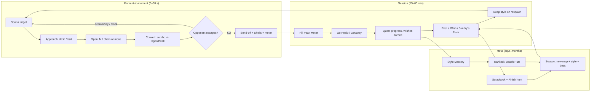
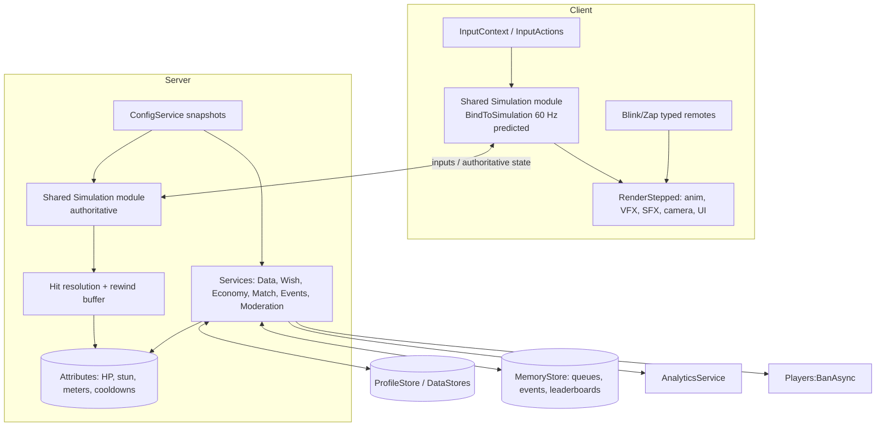
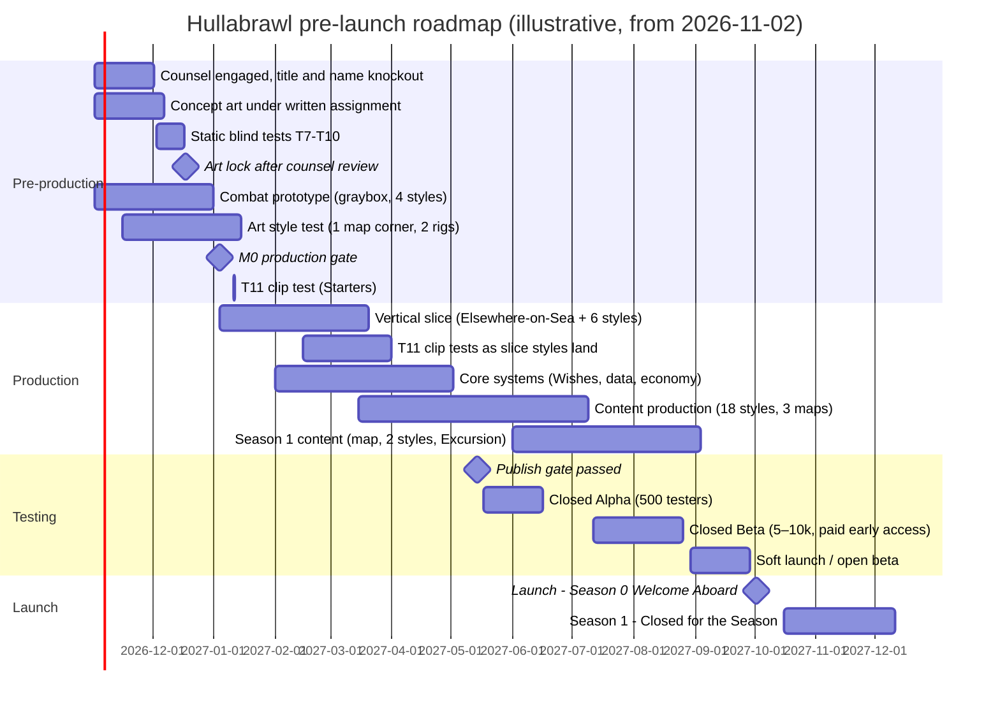

# HULLABRAWL — Game Design Document

**An original battlegrounds brawler for Roblox, set in a seaside world of its own: the Wishaway Isles**

| | |
|---|---|
| **Project codename** | Project HULLABRAWL |
| **Title** | *Hullabrawl*. Logo lockup: "HULLABRAWL · Greetings from the Wishaway Isles". The title knockout and counsel sign-off are still open (§5, Appendix F). |
| **World** | The Wishaway Isles: a chain of seaside holiday islands run by Staff who are animals and woken-up objects (§3.7) |
| **Genre** | Battlegrounds PvP brawler (Jujutsu Shenanigans-style) with a rolling/collection meta-layer |
| **Platform** | Roblox: mobile (iOS/Android), PC, Mac, Xbox, PlayStation. VR not supported at launch. |
| **Target maturity** | Roblox **Mild** |
| **Document version** | 2.0: the Wishaway Isles world bible (§3.7–§3.8), the 18-style roster (§7), maps and seasons (§11), and the IP and originality strategy (§5) |
| **Date** | 16 October 2026 |
| **Status** | Concept greenlight (entry to pre-production). M0 production gate: 4 Jan 2027 (§21.2). |

> **How to read this document.**
> - **Leadership:** read §1 (Executive Summary), §5 (IP and originality strategy; the decision record is §5.8), §17.7 (business case) and §22 (risks).
> - **Designers:** §6–§11.
> - **Writers:** §3.7–§3.8 (world bible, tone and words) and §7 (roster).
> - **Artists:** §12–§14.
> - **Engineers:** §18. The step-by-step build plan for an AI agent working in Roblox Studio is the companion [Studio Build Spec](STUDIO_BUILD_SPEC.md).
>
> Values marked as tuning targets live in remote config and are expected to change. Facts about the market and the Roblox platform come from research done in October 2026 (§2, Appendix E). Open questions and items still to verify are listed in Appendix F.

---

## Table of Contents

1. [Executive Summary](#1-executive-summary)
2. [Research Summary](#2-research-summary)
3. [Vision and Design Pillars](#3-vision-and-design-pillars)
4. [Game Structure and Core Loops](#4-game-structure-and-core-loops)
5. [IP and Originality Strategy](#5-ip-and-originality-strategy)
6. [Combat System](#6-combat-system)
7. [Fighting Styles (Roster)](#7-fighting-styles-roster)
8. [The Wish System (Rolling)](#8-the-wish-system-rolling-for-fighting-styles)
9. [Progression](#9-progression)
10. [Game Modes and World Events](#10-game-modes-and-world-events)
11. [Maps, Arenas and Seasonal World](#11-maps-arenas-and-seasonal-world)
12. [Art Direction](#12-art-direction)
13. [Animation and VFX](#13-animation-and-vfx)
14. [Audio](#14-audio)
15. [UI/UX, Controls and Onboarding](#15-uiux-controls-and-onboarding)
16. [Player Safety, Maturity and Accessibility](#16-player-safety-maturity-and-accessibility)
17. [Monetisation and Economy](#17-monetisation-and-economy)
18. [Technical Design](#18-technical-design)
19. [Live Operations](#19-live-operations)
20. [Analytics, KPIs and Success Criteria](#20-analytics-kpis-and-success-criteria)
21. [Production Plan](#21-production-plan)
22. [Risk Register](#22-risk-register)
- [Appendix A — Move Data Template](#appendix-a--move-data-template)
- [Appendix B — Balance Sheet Schema](#appendix-b--balance-sheet-schema)
- [Appendix C — Glossary](#appendix-c--glossary)
- [Appendix D — Lineage Index](#appendix-d--lineage-index)
- [Appendix E — Research Sources](#appendix-e--research-sources)
- [Appendix F — Open Questions and Items to Verify](#appendix-f--open-questions-and-items-to-verify)

---

## 1. Executive Summary

**The game.** *Hullabrawl* is a free-to-play Roblox battlegrounds brawler set in **the Wishaway Isles**, a chain of seaside holiday islands. The islands' **Staff**, animals and woken-up objects, kept the beds made for 365 summers after the Guests stopped coming. Now a ferry horn has sounded and the Guests are back. Players arrive as Guests with their own avatars, and the Staff sign them up as Entertainers for the **Grand Hullabrawl**. Twenty players drop into a sunlit battleground (the pier town of Elsewhere-on-Sea, the wild cliffs of Gullcliff, the snowy peak of Mount Cocoa) and fight with **Charms**: souvenirs from the Staff that each grant a **Fighting Style** (in the fiction, a *knack*). Each style has:
- the shared 4-hit M1 chain, block, Perfect Block, dashes and **Breakaway** escape
- 4 moves (one of them a ★ signature) and a unique **Quirk**
- a **Peak** ("**Go Peak!**"): for 60 seconds the staff member's uniform appears on you and 4 new moves swap in. Nobody grows.
- for Legendary styles and above, a **Getaway**: a giant "Greetings from…" postcard of the character's home, unfolded round the fight with house rules inside. Two Getaways that meet become a **Double Booking**.

By default, in a fight you are your own avatar plus that style's **Charm Gear**: one oversized prop (a deckchair, a ring buoy, an accordion) and a head piece. The full character look is optional (**Full Uniform**, default Off).

Combat follows the grammar that made Jujutsu Shenanigans the #1 battlegrounds game on Roblox (~628K peak CCU in 2026). It adds an original cast, cartoon art direction, duos and a world that changes every season.

**The hook.** Players collect Charms by **making Wishes**, a rolling system with seven rarities from Common to a secret Cosmic tier. Every Wish is a postcard posted through **Pip-Pip**, the postbox mascot, and a staff member writes back with their Charm. The stamp lands first, and its colour shows the rarity before the card flips.
- every Wish also rolls a cosmetic **Finish** (1-in-50 Glossy up to 1-in-100,000 Misprint), giving a Sol's RNG-style long-tail chase
- **rarity is prestige, not power**: every style is tuned into the same 47–53% win-rate band
- every style can be tried for free in **the Staff Room** (the training area)
- generous visible pity (**Guaranteed Delivery**) and a Shells-only shop (**Sundry's Rack**) guarantee a non-random path to every non-Cosmic style. The secret Cosmic style has a bounded path through **Messages in a Bottle** (10 of them guarantee the Cosmic).

That design is what makes rolling compatible with a fair PvP game. The research found it is also what Roblox's 2026 paid-random-item rules effectively require.

**Launch content (≈ 12 months from greenlight):**
- **18 Fighting Styles** (§7):
  - Starters: Sonny (an otter who rents deckchairs), Paddles (a hippo lifeguard who can't swim)
  - Common: Skimmer, Kneady, Pocket
  - Uncommon: Stilts, Fret, Shutter
  - Rare: Burrows, Dollop, Plunge
  - Epic: Bellows, Flicker, Yodel
  - Legendary: Mothball, Bluster
  - Mythic: Seldom
  - Cosmic: a secret style
- **3 Battlegrounds maps:** Elsewhere-on-Sea (the flagship pier town), Gullcliff, Mount Cocoa
- **5 ranked duel arenas** (The Bandstand, Pier's End, The Diving Tower, The Sun Lounge, Lighthouse Gallery) and **1 Excursion** (a co-op rescue raid): The Lighthouse in the Fog
- **Modes:** FFA Battlegrounds, Duels, Ranked 1v1/2v2, Evening Entertainments (party modes), the Staff Room

**Live plan:** weekly Saturday updates, a new style or mechanic every 2 weeks, and 8-week seasons that transform the world. Launch opens with *Welcome Aboard*, then:
- *Closed for the Season* (Halloween; the Tidings hotel opens under its dust sheets)
- *Winter Illuminations*
- *Spring Clean* (Steamwell Spa)
- *The Grand Regatta*
- *High Summer* (the Lido)
- *Last Night of the Season*, the Year-1 finale

**Business model:** cosmetic and convenience passes (genre-standard: Lucky Stamp, First Class, Quick Post), Wish bundles (odds-disclosed and `PolicyService`-gated), an 8-week **Holiday Pass**, a **Deckchair Club** subscription, official Charm Gear avatar items (direct purchase only), cheap private servers (paid out by Roblox Plus), and rewarded ads. No sale of combat power, ever.

**IP decision (§5.8).** On 16 Oct 2026 the owner chose to ship *Hullabrawl* as an original IP: its world, cast, names, kits, art, music and words are our own. Earlier themed drafts are archived with counsel. Originality guardrails apply to every character, place and kit (§5): a distance rubric scored against any existing show, film or game, an ensemble rule, blind recognition tests T7–T11, a neighbour check, a title knockout and counsel clearance before art lock. No public build ships until the publish gate passes: string lints, complete asset provenance, T7–T11 signed off, the title clearance signed, and no third-party names in any metadata. Core characters are drawn by people under written assignment, never generated by AI, and registered before launch UGC so we can remove knock-offs. Owning the cast also opens official UGC, plush, books and crossovers (§2.4). With the tests and counsel clearance passed, we estimate the chance of an adverse rights-holder action within 12 months of launch at under 1% for a small game, 1–3% at breakout scale and 3–6% for a hit with a trigger event (§5.7; judgement estimates, not statistics).

**Team and budget (§21, §17.7).** The studio-quality target is ~42 people at Beta peak (39 core plus QA scale-up). Break-even at that size needs roughly **30K–65K average CCU** for a globally distributed team, or **70K–150K** if US-based. We recommend a **lean-plus-contractors** team (8–12 core) through Closed Beta and scaling only on retention data (D1 ≥ 35%, D7 ≥ 15% targets).

**Top risks:** title clearance and originality (the cast must read as our own), genre saturation versus JJS/TSB, gacha perception in PvP, mobile performance with 20-player VFX, and the maturity of Roblox's new Server Authority netcode. Mitigations are in §22.

## 2. Research Summary

This section condenses the research behind the design. Full source lists are in **Appendix E**.

> **Method and caveats.** Research ran in October 2026 across four tracks: the genre, the rolling/monetisation/policy landscape, original-character games on Roblox (market, discovery and naming, §2.4), and Roblox engineering. Player counts come from third-party trackers (RoMonitor, Rolimons, Rotrends and others), which measure differently and often disagree, so treat them as estimates. Revenue figures are third-party models, never official. Roblox policy items should be re-checked against the live Creator Hub pages before launch, because several changed in 2026.

### 2.1 The genre benchmark: Jujutsu Shenanigans (JJS)

| Fact | Data (Oct 2026) |
|---|---|
| Developer | Tze (group "Tze's Shenanigans") |
| Created | April 2022 |
| Lifetime visits | ~6.2–7 billion |
| All-time peak CCU | **~628K** (Feb 2026, during the Jump Showdown collab) |
| Typical CCU | ~130–235K. The **#1 battlegrounds game by live players**, about 2–3× The Strongest Battlegrounds. |
| Update cadence | **Roughly every 2 weeks**. Update names are tagged into the game title ("[SKY ASSASSIN] Jujutsu Shenanigans"). |
| Est. gross player spend | ~$1.3M per 30 days (third-party estimate) |
| Roster | ~22 regular + ~5 special characters, **all free once finished**. New characters ship unfinished behind a ~300 R$ **Early Access** pass, then become free. |
| Monetisation | Light and cosmetic: Early Access, custom kill sound, emote slots and pages, build saves, awakening outfits. **Private servers are free.** |

**JJS combat model (what the genre expects):**
- **4-hit M1** with three finisher branches: a knockback Ender, Space + M1 uppercut, and an air downslam.
- **Directional block** (front only), **perfect block** (added in v1.62), and many block-break moves.
- **Dash on Q.** Side dash is the core dodge.
- **Evasive**: a side dash *while ragdolled* gives about 1 s of i-frames. It is **gated by a meter** that fills from damage taken and dealt. Some "true ragdoll" moves disable it.
- **Awakening on G.** The meter fills from damage dealt (~286 damage). It **heals**, swaps in a **second 4-move kit**, and some awakenings include a **domain expansion** (a sure-hit zone).
- **Per-character "special" on R** with its own cooldown or resource. For example, True Cannon has an **overheat** meter.
- **Per-character HP** (70–117) is used as a hidden balance lever.

**JJS modes:** FFA public servers on a destructible city map, casual duels (3 lives in 1v1, 5 team lives), Elo **ranked** (3 lives, 5-minute timer), **Roulette** party minigames, free private servers with **Build Mode/Workshop**, and a "Creator Clash" mode using community-made characters. There are also seasonal events, like a Halloween candy currency, and cross-game collabs.

**Naming convention:** genre characters use **descriptive epithets** ("Vessel," "Honored One," "Ten Shadows"). The Strongest Battlegrounds ("The Strongest Hero") and Heroes Battlegrounds ("Green Hero") follow the same pattern. Our styles carry a short name plus an epithet of their own (Sonny, *Take a Seat*; §7).

### 2.2 Other genre references

| Game | Takeaway |
|---|---|
| **The Strongest Battlegrounds** (Yielding Arts, 2022) | ~19B visits, the most in the genre. Live CCU has slid to ~70–100K. Free roster, perfect block causes a "Critical" bonus window, and the evasive has a long cooldown (~20–30 s). Its pass set is nearly identical to JJS's, which makes it the genre's monetisation template. |
| **Heroes Battlegrounds** (2023) | A **mastery-unlock** grind (5 free characters; others unlocked by mastering another). It fell from ~152K peak (Nov 2025) to ~14K (Aug 2026). **Cadence and novelty matter more than grind systems.** |
| **Fruit Battlegrounds** | **Spins for characters** with pity at 80/160/320 spins. Proves gacha-for-characters works in battlegrounds, at mid-tier scale. |
| **Untitled Boxing Game** | **Style spins** (Uncommon 63 / Rare 27 / Mythic 9 / Legendary 1%), a pity meter, and **Shiny variants** at 1/6,666. Its 28+ styles carry original names, on the player's own avatar. The closest analogue to our Wish + Finish model. |
| **Sol's RNG** | Free time-gated rolls. Monetises **luck and speed**, not rolls. Reveal theatre and long-tail rarity drive retention. |
| **Shindo Life** | Paid and free spins with a **spin storage cap** (500 → 1,000 with a pass). Rare bloodlines are PvP-relevant, which is the main source of "P2W" sentiment. |
| **Blox Fruits** | A Beli gacha (not a paid random item) **plus deterministic Robux purchases** of specific fruits. Widely seen as the "fair escape hatch." |

### 2.3 What the research means for us

| Finding | Design response |
|---|---|
| The two biggest battlegrounds games **avoid character gacha**. In the genre, gacha shows up in mid-tier titles, and players link it to P2W. | Rolling stays (it's the brief), but **rarity ≠ power** (Pillar P3). Every style can be tried free in the Staff Room, 3 styles rotate free weekly, and Sundry's Rack offers a deterministic path (§8). |
| Cosmetic RNG (Sol's RNG auras, UBG Shinies) is the **least controversial** form of rolling | **Finishes**: a long-tail cosmetic roll layer on every Wish (§8.7) |
| JJS's escape meter, awakening, R special and domains are the genre's grammar | Adopted and given our own names: **Breakaway**, **Peak Meter → Peak**, **Quirk (R)** and **Getaways** (§6) |
| Content cadence drives CCU spikes; Heroes BG declined without it | A **biweekly** style/mechanic cadence, title-tagged updates and 8-week seasons that transform the maps (§11.3, §19) |
| Collabs set all-time peaks (JJS × Jump Showdown); crossovers between original games set platform records (§2.4) | A cross-game collab slot every second season (§19.1). We own every character we lend. |
| Free private servers plus Build Mode create a UGC engine | Paid-cheap private servers that leverage Roblox Plus payouts, plus a Year-2 creator workshop, **the Sandpit** (§10.1) |
| Toxicity complaints centre on teaming, kill-stealing and exploiters | Pile-on protection, a party cap of 2 in FFA, server-authoritative hits and the Ban API (§6, §16, §18) |
| 2026 Roblox **PRI rules** require full per-item odds, live-updating pity and luck odds, no empty outcomes and PolicyService gating. PRIs are blocked for UK under-18s, all Australians, Brazilian minors and unverified Brazilian adults. | §8.8 compliance table: odds are generated from server config, restricted players get free and fixed-price paths only |
| **Chat requires age checks** (Jan 2026). Roblox Kids/Select launched in June 2026. | A social layer that doesn't depend on chat (Quick-Chat, emotes, structured invites). Target the **Mild** label (§16). |
| The biggest Roblox games of 2025–2026 **own their characters**. Owned casts sign toy, book and screen deals, sell official UGC and join crossovers; a borrowed cast can do none of this (§2.4) | An original world and cast (§3.7, §7), drawn by people under written assignment, registered before launch UGC, and cleared by the originality guardrails and counsel (§5) |
| Character hits share **one readable gimmick and one sound per character**, names that are fun to say, and plush-ready shapes (§2.4) | Each Charm reads from one oversized prop at 48 px and has one sound sting; short, chantable names; six merch-grade faces, the other 12 promotable (§7, §12, §14) |
| Players invest in **their own avatars** (274M avatar updates a day; §2.4) | Avatar first: you fight as your own avatar plus Charm Gear; the full character look is optional (Full Uniform, default Off; §12) |
| Discovery runs on **clicks and return visits**, not keywords. Thumbnails are personalised; icons cannot be A/B tested | One mascot icon, five real-gameplay thumbnails, a constant title with a bracketed update tag, plain genre words only (§5.6, §19) |

### 2.4 Original-character games on Roblox

> **Method.** Web searches on 15 Oct 2026, quoting trackers and press as reported. Peak CCU figures disagree between trackers and several launch-era peaks were never captured. Revenue figures are third-party models.

**The hits own their characters.** The biggest Roblox games of 2025–2026 are original IP built around a cast. None borrows a TV show.

| Game (studio) | Peak CCU (approx.) | What made the characters stick | How the characters earn |
|---|---|---|---|
| **Steal a Brainrot** (2025) | ~25.9M (Oct 2025, a Guinness record) | Absurd, chantable names, each with its own sound | The characters are the items. Film deal (Story Kitchen, Jan 2026) |
| **Grow a Garden** (2025) | ~22.4M (Aug 2025, during a crossover event) | Simple, toy-like pets and crops; live admin events | Global toy rights (PhatMojo), with in-game codes in the packs; film in development |
| **99 Nights in the Forest** (2025) | ~14.2M | A recurring antagonist and kids to rescue | Film rights to 20th Century Studios (Apr 2026) |
| **Dandy's World** (2024) | ~867K (Apr 2025); 6B+ visits | A colour-coded cast whose abilities make the choice of character matter | ~75 official UGC items (heads ~90–95 R$); global merch (CultureFly), Japan merch (InfoLens), books (Scholastic). It removed paid random skin tickets over paid-random-item rules |
| **Forsaken** (2024) | ~0.6–1.2M (trackers conflict) | Personalities and relationships; 21,000+ fan-fiction works | Characters and event skins |
| **Doors** (2022) | ~382K (Jan 2023) | One readable gimmick and one sound per monster; lore released through updates | Plush (Makeship), figures (Youtooz), UGC heads |
| **Untitled Boxing Game** (2023) | not captured | Rolled fighting styles in rarity tiers, on your own avatar, under original names | Style spins |
| **Sol's RNG** (2024) | ~194K (May 2024) | No cast: your aura is the character | Luck boosts and rolls |

**What original characters give a Roblox game.**
- **Money off the platform.** In the 14 months to Oct 2026, original-character games signed toy and plush deals, a Japanese merch deal, a book deal and three film deals, and an animation studio bought the screen rights to three Roblox games. Only a studio that owns its cast can sign these.
- **Physical plus digital bundles.** Roblox's Approved Merchandiser Program (May 2025) lets a store-bought plush unlock a matching avatar item, for US users 13+ in all-ages experiences.
- **Brand integrations and crossovers.** Paid brand integrations must be registered and labelled from May 2026, and Roblox takes a fee from Jan 2027. Brand-safety teams are likely to avoid games with IP disputes. A crossover between two original games helped push Roblox past 47M CCU; that is only possible when both sides own what they lend.
- **Enforcement on our side.** Rights Manager is open to any rights holder with a **registered** copyright or trademark. Unofficial knock-off heads appeared quickly for several original hits; official items at launch capture that demand, and registration lets us remove the copies.
- **The moat is the cast, not the loop.** A Fortnite Creative clone of one hit's loop reached about 1M CCU. Mechanics get copied; owned characters, names and lore do not.

**Ownership must be real.** One top game is in a legal dispute over who owns an AI-generated meme character, and AI output may not be copyrightable. Every core character must be drawn by a person under written assignment and registered once final.

**Patterns across the hits.**
- **One readable gimmick per character** (a shape, a sound, a rule) that a child can repeat in one line (Doors, Slap Battles).
- **A face players meet every session**, such as a shopkeeper or host, becomes a fan favourite and a natural plush (Dandy's World, Pressure).
- **Names that are fun to say** and **one sound per character** spread through TikTok voice-overs (Steal a Brainrot, Regretevator).
- **Plush-ready shapes:** three fabric colours or fewer, no thin parts, head-heavy.
- **Relationships and slow lore** (rivals, mentors, lore cards, map details that change between seasons) produce fan art, fiction and theory videos (Forsaken, Doors).
- **TikTok is the ignition.** Blade Ball grew from ~15K to over 100K CCU in three days (Sep 2023). Design 3–6 second clip moments that read in a vertical crop.
- **Trust is fragile.** One 2024 hit reportedly fell away in 2025 after monetisation concerns and an ownership change.

**Cartoon battlegrounds is an open lane.** The genre is dominated by anime-derived games. The only notable cartoon entries are a licensed TV tie-in and a stickman fighter. No original fighter has yet built a merch-grade cast, so there is no proven template, only proven parts. Untitled Boxing Game and Sol's RNG show that rolling for styles and looks on your own avatar, under original names, carries a game on its own.

**Avatar first.** Players make about **274M avatar updates** and **50M item searches** a day; identity (38%) and creativity (47%) are top reasons to change an avatar (Roblox, Dec 2025). A battlegrounds game that hides the avatar works against that. So by default a style is something your own avatar wears (§12), and the full staff member appears on the Wish postcard, in the lobby and on victory screens; during Peak their uniform appears on you.

**Keep the merch-grade cast small.** One mascot plus five core faces (both Starters, a Legendary, the Mythic and the secret Cosmic) are plush- and hat-ready at launch; the secret Cosmic's official item goes on sale only after its Cosmic Arrival (§17.3). The other 12 styles are cheaper designs with one strong gimmick each, and can be promoted if fans adopt them.

**Discovery.**
- **Home recommendations** are the main traffic source. They optimise for long-term retention and return frequency (qualified play-through rate; 7-day qualified play sessions per user), averaged per user, so a small game with engaged players is not penalised.
- **Thumbnail personalisation** (since Nov 2024) tests up to about five thumbnails per game and shows each audience the best one. Every thumbnail must show real gameplay. **Icons cannot be A/B tested**, so the icon (one mascot face, mid-yell, two or three flat colours, no text, readable at 64 px) is the most important image.
- **Metadata:** keyword stuffing can be demoted; "Roblox" and "Blox" are banned in titles; some emoji are filtered. Keywords barely matter; clicks and return visits decide reach.
- **Title habit:** a constant base name plus a bracketed update tag ("[NEW STYLE] Hullabrawl"; §19.1).

**Naming.** A strong title is short, says "fight" or "silly commotion", is a coined word (a stronger trademark and cleaner search), can be spelled after hearing it once, needs no punctuation, works with an update tag, and is not confusable with a big game mark (Brawl Stars, Brawlhalla and similar). A first, web-indexed knockout on 15 Oct 2026 found **no game called *Hullabrawl***. The full knockout (Roblox in-app search, Steam, app stores, USPTO classes 9/41/28/25/16, WIPO, domains and handles) and backup titles are open (§5, Appendix F).

**Maturity.** Since June 2026, Roblox Kids (5–8) and Select (9–15) accounts see only games that pass a three-step screening, and Kids accounts see only Minimal or Mild content. A cartoon brawler with slapstick KOs fits **Mild**; darker lore stays implied (§16).

## 3. Vision and Design Pillars

### 3.1 High concept

> **Hullabrawl** is a free-to-play Roblox brawler set in the Wishaway Isles, a chain of seaside holiday islands whose Staff waited 365 summers for their Guests to come back. You arrive as a Guest, wearing your own avatar, and drop into a sunlit battleground with 15–23 other players. You pick a **Charm**, a souvenir from one of the Staff that grants their **Fighting Style**, and brawl. Every style has 4 moves (one of them a ★ signature), a Quirk, a passive, and a **Peak** that puts you in the staff member's uniform for 60 seconds and turns the fight upside down. You collect Charms by **making Wishes**: postcards posted through Pip-Pip the postbox, with rarities from Common to Cosmic. A style's rarity sets how complex and spectacular it is. It never makes the style stronger.

**Logline.** The holiday islands waited 365 summers for their Guests to come back. Now the ferry horn has sounded, the Staff have restarted the Grand Hullabrawl, and they need Entertainers. That's you.

**North star: "A souvenir you could fight with."** Someone who sees a screenshot should call it sunny, cosy, a bit spooky and like an old postcard, and should think of no other show or game. It moves like a cartoon and looks like a souvenir.

### 3.2 The 10-second pitch for players

*"Roll Bellows. Go Peak and get the whole pier swaying to Sing-Along! Then get sat on by a Sonny who perfect-blocked you. Checked out!"*

### 3.3 Design pillars

Every feature, asset and tuning change has to serve at least one pillar and break none. Reviewers reject work that breaks a pillar.

| # | Pillar | What it means | What it rules out |
|---|---|---|---|
| P1 | **Easy to start, deep to master** | A new player lands a satisfying combo inside 60 seconds. A veteran still finds new tech after 300 hours. | Moves with no counterplay. Inputs mobile players physically can't perform. Mechanics that only live in a wiki. |
| P2 | **Every move comes from the world** | Moves, voice barks, VFX and maps come from the Isles' own jobs, objects and places. A player can tell whose Charm a move belongs to from what it does: a deckchair snapping shut, a ring buoy landing, the tide surging down a channel. | Generic anime-battlegrounds VFX with a colour tint. Moves borrowed from any existing show, film or game. |
| P3 | **Rarity is prestige, not power** | Rarer styles are flashier, more mechanically unusual and rarer to see. Every style lands in the same 47–53% win-rate band. | Stat bonuses tied to rarity. Paid power. "This Mythic is just better." |
| P4 | **Chaos with readable fairness** | 20 players and 5 Peaks at once should look gorgeous and still be legible. Every hit is telegraphed, every stun has an exit, every death has a cause. | Unblockable instant-kill moves. Endless stunlocks. VFX that hide hitboxes. |
| P5 | **The Isles are alive** | Maps react to fights through breakable beach huts, the tide, the Staff and world events. Seasons change the world itself, not only the shop: new islands open, and the Haar Line on the horizon moves with the community's play. | Static grey boxes. Seasons that are only a battle-pass reskin. |
| P6 | **Respect the player** | Odds are always disclosed. Pity is generous. Every non-Cosmic style can be bought at a fixed Shells price at Sundry's Rack, and Cosmic has a guaranteed long path through Messages in a Bottle. Ethical monetisation, short timers, no dark patterns. | Fake "limited" pressure. Paid Breakaway/revive. Selling advantage in ranked. |

### 3.4 Target audience

| Segment | Share (target) | Who they are | What they need |
|---|---|---|---|
| **Battlegrounds regulars** | ~45% | 11–17, play JJS/TSB/Heroes BG, mostly mobile + PC, clip & share | Tight combat, tech to learn, a reason to switch from their current main game |
| **Cartoon and character fans** | ~30% | 11–25 (including older teens and young adults), follow character-led Roblox hits and hand-made cartoon art; make fan art and theory videos | Characters to love and quote, slow lore to puzzle over, a distinctive art style, Scrapbook completion, official Charm Gear items |
| **Collectors / RNG players** | ~25% | 9–16, play Sol's RNG / Anime Vanguards-type rolling games | Roll excitement, rare-pull flexing, Finish hunting, trade-adjacent social status |

**Platform split assumption:** ~70% mobile, ~24% PC, ~5% console, ~1% VR (unsupported at launch). Roblox's own performance documentation says **~65% of all Roblox players are on Android**, and ~60% of those devices have 2–4 GB of RAM. **Mobile is a first-class target, not a port.**

**Maturity target:** Roblox **"Mild"** content maturity label. The violence is cartoon slapstick: no blood and no gore. A KO is "**Checked out!**": the defeated player vanishes in a puff of sand with a waving hankie. Spooky-cute moments (the Haar, the Sleepwalkers) are eerie while they last and safe when they end. See §16.

### 3.5 Unique selling points versus the genre

1. **Real cartoon art direction.** The genre is dominated by default Roblox avatars and anime VFX. Hullabrawl uses flat travel-poster colour, soft-toy bodies that bend in rubber-hose arcs, a sun-faded seaside palette against salt and rust, and one warm ink line. It is recognisable from a single thumbnail (§12).
2. **Rolling with ethics.** The game borrows the RNG thrill that makes Sol's RNG and Shindo Life sticky. It removes the power-gating that makes those systems toxic in PvP. Every roll is a postcard: the stamp lands first and its colour tells you the rarity before the card flips (§8.6).
3. **Getaways.** Legendary and higher Peaks can unfold a *Getaway*: a giant "Greetings from…" postcard of the character's home, dropped round the fight, with house rules inside (*Greetings from the Closed Season*, *Greetings from a Wet Weekend*, *Greetings from the Deep Bay*). When two Getaways collide it's a **Double Booking**. This is the genre's "domain" moment, built around our own places.
4. **A world that changes with the seasons.** Every 8-week season transforms a map or adds a new one (the Tidings hotel for *Closed for the Season*, *Winter Illuminations* on the promenade, Steamwell Spa for *Spring Clean*, the Lido for *High Summer*), with a seasonal style and a world boss. Between seasons, the Haar Line on the horizon creeps in or is pushed back by the community.
5. **Duos.** Sonny and Paddles, Burrows and Paddles, and Mothball and Dollop get **Double Acts** when partied together (*Tide Line*, *Beach Patrol*, *Last Orders*), making 2v2 a first-class mode.
6. **Your avatar, our cast.** By default you fight as your own avatar with the style's **Charm Gear** (one oversized prop and a head piece). The full staff member stars on the Wish postcard, in the lobby and on victory screens, and every Charm doubles as an official avatar item (§17.3). The full character look is an option (**Full Uniform**, default Off).

### 3.6 Comparable titles and positioning

| Title | What we take | What we do differently |
|---|---|---|
| Jujutsu Shenanigans | 4-move kits plus awakening, the evasive/escape meter, character-as-moveset, domain clashes, descriptive epithets | Rolling meta layer, an original cast and world, authored cartoon art, seasonal maps, duos |
| The Strongest Battlegrounds | Movement tech, ultimate bar, kill-streak flex, clip culture | Stronger fiction, mobile-first UI, deeper onboarding |
| Sol's RNG | Rarity reveal theatre, long-tail cosmetic chase, luck boosts | Rolls feed a real game, not just a collection |
| Shindo Life / Project Slayers | Style rolling with rarities, slots, spin economy | No power gating, generous pity, deterministic shop path |
| Untitled Boxing Game | Rolled fighting styles under original names, on the player's own avatar | Seven rarities with a secret tier, Peaks and Getaways, cartoon art, seasonal maps |
| Original-character Roblox hits (Steal a Brainrot, Grow a Garden, Dandy's World, Doors) | Owning the cast as the moat: official UGC, plush, books and crossovers (§2.4) | A competitive PvP fighter, in a genre where no original cast has broken through yet |
| Brawl Stars / Smash Bros. (off-platform) | Readable silhouettes and telegraphs; a full kit expressed in 4 moves | Roblox-native social and live-ops |

### 3.7 The world: the Wishaway Isles

**Premise.** The Wishaway Isles are an archipelago of holiday resorts in a warm, shallow sea. Each island is a different kind of holiday. The locals are the **Staff**: animals and woken-up objects. Players are **Guests**: ordinary holidaymakers from **the Mainland**, which is simply home. The Staff hire them as **Entertainers**. Your own avatar is part of the story. The emotional question under everything is **"Will you come back?"**

**History.**

| Era | What happened |
|---|---|
| **The Long Summers** | Ferries brought Guests from the Mainland. Anything loved or used for a whole summer woke up (deckchairs, kites, a postbox, a skimming stone, a raincloud) and joined the Staff |
| **The Last Night of the Season** | After the closing fireworks, the Last Ferry, the *Homeward*, sailed into the fog. The post stopped |
| **The Off-Season** | 365 summers of waiting. A cold sea fog, **the Haar**, settled over places closed too long. Staff caught in it fell into a long doze and sleepwalk their old rounds (**the Sleepwalkers**). Mothball covered the Tidings hotel in dust sheets. Things nobody came back for woke up cross in the Lost & Found |
| **The Horn (launch)** | A horn sounds from the fog. Next morning the Guests are on the pier. They say they came on the morning boat; nobody on the Isles saw it arrive |
| **Now** | The Staff restart the Entertainments and the Grand Hullabrawl. Light, music and company push the Haar back |

**Geography.** The Isles are shown as a navigation chart: separate islands joined by ferry routes (maps in §11).

| Place | What it is |
|---|---|
| **Elsewhere-on-Sea** | The hub: a pier town with the Pavilion, the promenade, the beach, the Jubilee Clock, a funicular and Pip-Pip's sorting office |
| **Gullcliff** | Dunes, chalk cliffs with natural sea caves at their foot, and bathing machines. The lighthouse stands on an offshore sea stack, reached at low tide |
| **Mount Cocoa** | A snowy peak in a warm sea: rack railway, bobsleigh run, cable cars, frozen tarn |
| **Steamwell** | A volcanic spa of hot springs and mud baths |
| **The Lido** | Art Deco swimming baths with a diving tower |
| **The Tidings** | A seafront hotel on a tidal islet, half under dust sheets: a causeway at low tide, a sea tractor at high tide |
| **Low Island** | Exists only at low tide (Year 2) |
| **The Deep Bay** | Open water where Seldom the sea serpent is (seldom) seen |
| **The Haar Line** | The fog bank at the edge of the chart. The Mainland beyond it is never shown |

**Factions** (one joke each, played straight).

| Faction | The joke | The sad bit (lore cards only) |
|---|---|---|
| **The Pier Committee** | Has debated the colour of the railings for 365 summers; chaired by **the Chair**, an elderly deckchair | They fear that if they decide, the work will be over |
| **Staff of the Tidings** | Serve breakfast at seven sharp, obeying **the Management**, who is never seen and speaks only in notices pushed under doors | They still fold a towel animal for every empty bed |
| **The Lido Guild** | Lifeguards ranked by the pitch of their whistles | Nobody has needed rescuing in 365 summers |
| **The Ski School** | Awards a badge for everything, including standing still | The badge cabinet is full; the register is empty |
| **The Steamwell Matrons** | Relaxation is compulsory; tension is a crime | They have forgotten how to stop working |
| **The Gull Syndicate** | Officially a busking collective; unofficially snack thieves | They still save a sandwich for a Guest who fed them long ago |
| **The Lost & Found** | Lost property that woke up cross: odd gloves, single sandals, umbrellas (minor Excursion enemies) | Nobody came back for them |

**Who runs the show.** **Pip-Pip**, the mascot: a pear-shaped postbox on stubby legs, striped coral and cream like a beach hut, with a mouth-slot and a little flag that pops up when it is happy. It eats your postcard (*thunk*) and asks "Same time tomorrow?" when you leave. **Sundry** runs the shop: a woken spinning postcard rack under a striped awning, plain-spoken and fair. **The Haar** is the old menace and the Excursion boss. It wants everything closed and quiet for ever, and it misprints the Management's notices ("The Management regrets… that you came back").

**Rules of the world.**
1. **Waking:** anything loved or used for a whole summer wakes up. Anything forgotten wakes up cross. Animals were always people.
2. **Charms:** a staff member presses some holiday spirit into a souvenir of themselves. A Guest who wears it gains their **knack** (their Fighting Style). Staff cannot wear Charms: "You can't be a souvenir of yourself."
3. **The post:** a postcard always arrives in the end. Staff who live further out are harder to reach, so their Charms are rarer.
4. **Peak:** when the Peak Meter fills, the staff member's uniform appears on the Guest for 60 seconds. Nobody grows.
5. **Getaways:** the strongest Staff unfold a giant "Greetings from…" postcard of their home around a fight, with house rules inside.
6. **The machines:** the Staff built the funiculars, wave machines, illuminations and cable cars themselves, and keep them running with spanners and stubbornness.
7. **The Haar never destroys.** It only closes. Places inside it doze; light, music and company wake them. Nothing is erased. While it lasts, it can be eerie.

**Why players roll.** Every Wish is a "Wish you were here!" postcard posted through Pip-Pip, and a staff member writes back with their Charm. Near Staff answer quickly (Common). Staff at the fog's edge rarely get mail (Legendary). The serpent almost never surfaces (Mythic). Nobody has heard from the Last Ferry in 365 summers (Cosmic). Underneath is the hope that a Guest who keeps a Charm will come back.

**Adventure and strangeness.** The Isles are weird and a little scary, not only cosy.
- **Excursions are rescues** (an excursion is the seaside word for a day trip): crawl into a place the Haar has closed, wake the Staff inside, beat the boss and bring the lights back.
- **Surreal touches:** the Management is never seen; the Jubilee Clock stopped at closing time; lost property wakes up cross; one island exists only at low tide; nobody has photographed the Deep Bay's serpent.
- **Spooky-cute:** inside the Haar, Sleepwalkers do their old rounds with eyes open and smiles fixed, whispering "Enjoy your stay… enjoy your stay…". Wake them and they yawn, embarrassed.
- **One gross-out or nonsense gag per island:** a gull coughs up a whole sandwich and politely hands it back; a Steamwell mud bath burps.

**Motifs.** Postcards and postmarks; souvenir Charms; bunting; deckchair stripes; the ferry horn; the lighthouse beam; dust sheets; the tide line; gulls stealing snacks; the stopped clock; the empty deckchair.

### 3.8 Tone, humour and words

**Tone rules.**
1. **Sincere first, silly second.** Nobody is cynical about Guests.
2. **Punch at pomp, never at grief.** Committees are fair game; the Sleepwalkers, the empty deckchair and the Last Ferry are not.
3. **The sad stays implied:** a towel animal on an empty bed; one empty deckchair with an open book on every map.
4. **Slapstick, not violence.** A KO is "**Checked out!**": a puff of sand and a waving hankie. Target the Roblox **Mild** label (§16).
5. **Spooky-cute is allowed:** eerie while it lasts, safe when it ends.
6. **Hospitality-speak as menace:** "Enjoy your stay!" "The Management regrets…"
7. **No winks** at other shows or films.

**Our words.** "**Checked out!**" (the only KO bark), "**Go Peak!**", "**Fully booked**" (a Getaway is open) and "**off-season**" (gloomy). We add two or three **coined words** from a workshop with 9–15-year-olds, then knockout-search them. Candidates: "**Gullcrumbs!**" (a mild oath) and "**ploff**" (the soft flop of a KO into sand).

**Writing and voice.**
- **Lore cards are postcards**, postmarked "Summer 1" to "Summer 365", so theorists can build a timeline.
- Never name the Mainland or explain the Haar. The *Homeward* appears only through Wishes, sightings and its arrival event until the Year-1 finale.
- One catchphrase per style ("TAKE A SEAT!", "RELAAAX!", "You're SAFE now!"). Voices are original and group-recorded; briefs describe characters, never actors; no AI voice cloning.
- **Plain words for players.** The Isles' seaside flavour lives in signs and props. Move names must work for kids in the US, Brazil and Southeast Asia. Test jokes with 9–15-year-olds and swap any that fail.
- **Relationships for fan art:** Sonny and Paddles (frenemies who argue over the tide line); Bellows and Stilts (thief and angler); Flicker and Bluster (light against storm); Mothball and Pocket (hotel keepers); Plunge and Dollop (poolside neighbours); Seldom and the *Homeward* (the last to see each other).

## 4. Game Structure and Core Loops

### 4.1 Loop overview



### 4.2 Moment-to-moment (seconds)

This is the JJS/TSB rhythm: **neutral → opener → combo → ender → reset**.

1. **Neutral.** You read the opponent's spacing and meters. Do they have Breakaway? Is their block cracked? Is their Peak Meter full?
2. **Opener.** A dash-in M1, a projectile poke, a command grab (beats block) or a bait for their move.
3. **Combo.** M1 chain into a move, or ragdoll into a follow-up. Combo scaling and **Stun Decay** (§6.6) cap how long a combo lasts, so every combo ends.
4. **Ender.** Knockback toward a wall, a hazard or an ally, or an uppercut for an air combo.
5. **Reset.** The defender may spend Breakaway, and the attacker re-reads.

**Design target:** a 1v1 between equal players lasts **25–45 seconds** at 100 HP. Average time-to-kill from a clean opener, if the defender never escapes, is **≈ 7–9 seconds**. Any style that drops below 6 s TTK in telemetry gets flagged for review.

### 4.3 Session (minutes)

- **Join** a 16–24 player Battlegrounds server on a seasonal map. Time to first fight should be under 20 seconds after load. A new player's first session opens on the ferry horn and the Entertainer sign-up (§15).
- **Pick or swap** a style. Every respawn shows the Charm Ring, and you can switch styles mid-life at the **Charm Rack** in each spawn hub.
- **Earn** Shells, Wishes and quest progress from KOs, assists, damage, world events and **Snapshots** (landing a style's signature combo).
- **World events every 4–6 minutes** (§10.4) pull the server into shared moments such as a Gull Raid, The Haar Rolls In, Sundry's Pop-Up or a Storm Warning.
- **Make Wishes** between lives. You post a postcard through Pip-Pip; the stamp lands first and its colour shows the rarity, then the card flips. The reveal takes 1–8 seconds (§8.6) and can be skipped after the first view. Rarer pulls broadcast to the server feed.
- A **session ends** naturally after a quest set (≈ 25–40 min). Daily quests fit in one session. Weekly quests are tuned to finish in about 3 sessions per week for a casual player.

### 4.4 Meta (days to months)

| System | Cadence | Purpose |
|---|---|---|
| Account Level (1–100, prestige after) | Continuous | Long-term progress feeling; Wish rewards |
| Style Mastery (1–30 per style) | Per style | Cosmetic unlocks, Send-offs, titles; signals main identity |
| Scrapbook (Charms × Finishes × Off-Duty Looks) | Long-tail | The RNG chase that never ends (cosmetic only) |
| Holiday Pass | 8-week season | Habit + monetisation; free and paid tracks |
| Ranked Duels / Duos | Season | Competitive identity; ranks run from Day Tripper to Grand Tourer, and the top 100 are the **Headliners** |
| Beach Huts (guilds) | Weekly | Social retention; **Bunting Wars** weekend |
| Seasonal world | Every 8 weeks | Map transformation, seasonal style, world boss; the Haar Line moves |

### 4.5 Places and server topology

| Place | Role | Players/server | Notes |
|---|---|---|---|
| **Battlegrounds** (start place) | Core FFA brawling on the current map | 20 (tunable 16–24) | Map rotates every 20 min in "Rotation" servers; "Classic" servers keep the seasonal flagship map |
| **Duel Grounds** | Ranked/unranked 1v1 & 2v2 | 2–4 + spectators | Reserved servers via TeleportService; small authored arenas (The Bandstand and others, §11) |
| **The Staff Room** | Practice mode, frame data, dummies, combo recorder | 1–6 | Free trial of *any* style here (incl. unowned) |
| **Excursion** | Seasonal PvE rescue raids against a boss (2–6 players) | 2–6 | Reserved servers |
| **The Winter Gardens** | Beach Hut (guild) hall, social, cosmetics showcase | up to 40 | Low-combat social space; emote stage |
| **Preview** (Sneak Peek) | Upcoming styles in Battlegrounds and Duels before they join the Wish pool | 20 | Sneak Peek pass holders and creators. Feeds the Wish-pool balance gate (§19.2). |

All places are in one Roblox *experience* (universe). Matchmaking uses MemoryStore queues and reserved-server teleports (§18).

## 5. IP and Originality Strategy

> ***Hullabrawl* is an original IP.** Its world, cast, names, kits, art, music and words are our own, and we intend to own, register and protect them. This section covers:
> - the facts that shape the strategy (§5.1) and the one track we ship on (§5.2);
> - how the world and cast were built (§5.3) and who owns the work (§5.4);
> - the originality guardrails every new character, place and kit must pass (§5.5);
> - how names, marketing and metadata are handled (§5.6);
> - the risk that remains (§5.7) and the owner's decision, with the publish gate (§5.8).
>
> *This is not legal advice. Counsel clears the title, names, cast and store assets before art lock and before any public build (§21.2).*

### 5.1 Facts that shape the strategy (research as of Oct 2026)

| Fact | Implication |
|---|---|
| **Ideas are free; expression is owned.** Copyright protects a specific expression, not ideas, moods, genres or styles. Genre staples (a leap slam, a slowing shot, a raid boss, flat colour, bendy limbs) are free to use. Rules and mechanics are free to copy, but the specific look and feel of a game is not (*Data East v. Epyx*, *DaVinci v. ZiKo*, *Tetris v. Xio*). | We use the genre's grammar freely. Everything a player sees and hears (characters, places, lines, music) is our own expression. |
| **Strong characters are protected even when renamed or redrawn.** Consistent, distinctive traits survive a change of name or costume (*DC Comics v. Towle*). A move set that shows a character's defining power in play counts as part of that character. | A character is its name, look, personality **and kit**. Kits are checked for originality too (§5.5), not only names and art. |
| **The real danger is the one-for-one reskin.** Courts have found substantial similarity where one game copied another's cast and structure piece by piece under new names (*Spry Fox v. LOLApps*). Internal notes that map one work onto another can become evidence. | The world and cast were built from a new premise (§5.3). Working documents, code and assets describe only our own design. |
| **Titles and slang are trademark questions.** A title cannot be copyrighted, but it can conflict with a registered mark. A "for fans of…" line in marketing can hand a rights holder a trademark claim. | Full title knockout and counsel sign-off before any announcement (§5.5, Appendix F11). Marketing names only our own sources (§5.6). |
| **Voices and melodies are owned.** Sound-alike voices have lost in court (*Midler v. Ford*, *Waits v. Frito-Lay*), AI voice copies are being litigated (*Lehrman v. Lovo*), and melodies are protected like any other expression. | Original voices and music only, under written agreements; no sound-alike briefs; no AI voice cloning (§5.4, §14). |
| **Roblox enforcement is cheap and fast.** **Rights Manager** lets a verified rights holder with a registered copyright or trademark request removal of up to **250 links** at once. **License Manager** matches public, actively played games **daily, by keyword and by image**; a standard licence offer **auto-activates after 14 days** unless disputed, at a revenue share the rights holder sets (0–95 %). A DMCA counter-notice generally restores content within about 14 business days unless the claimant sues. | With no third-party words, designs or move sets, a matcher has nothing to grab, a reviewer watching clips sees our own characters, and we can counter-notice in good faith. We never let a licence offer auto-activate by inaction. |
| **The same tools protect us.** Rights Manager is open to any rights holder with a **registered** copyright or trademark. Unofficial knock-off heads of several original Roblox hits appeared within weeks of launch (§2.4). | We register the core characters before launch UGC, so we can remove copies (§5.4). |
| **Ownership must be real.** One top Roblox game is in a dispute over who owns an AI-generated character, and AI output may not be copyrightable at all (§2.4). | Core characters are drawn by people under written assignment, never generated (§5.4). |
| **Owning the cast pays.** Original-character hits sign toy, book and screen deals, sell official UGC and join crossovers. Only an owner can sign these (§2.4). | The cast is the moat: six merch-grade faces, official Charm Gear items (§17.3), a crossover slot every second season (§19.1). |

Sources are in Appendix E.2 and E.3. The case summaries come from secondary sources; counsel verifies them before anyone outside the team relies on them.

### 5.2 One original track

*Hullabrawl* ships one way: as an original game. There is no licensed edition and no alternate theme.

| | Our approach |
|---|---|
| What ships | An original world (the Wishaway Isles), 18 original styles with their kits, original maps, music, voices, lore and UI words |
| Who owns it | We do. Every contributor assigns their work to us in writing, and the core characters are registered before launch UGC (§5.4) |
| Naming layer | One shipped text pack, **`Base`**. Every player-visible string comes from it (§5.6) |
| Legal risk | Low, and kept low by the guardrails (§5.5), the metadata rules (§5.6) and the publish gate (§5.8). Estimates in §5.7 |
| Cost and speed | No outside approvals and full creative control. The originality review runs inside the normal 8-week style pipeline (§19.2) |
| Monetisation safety | Safe: Wishes, passes and UGC sell characters we own |
| Upside | Official UGC, plush, books, crossovers and screen deals, which only an owner can sign (§2.4) |

### 5.3 How the world and cast were built

- **From a premise, not a cast list.** The world started from one question, "Will you come back?", and one setting: seaside holiday islands whose Staff waited 365 summers for their Guests (§3.7). Places came from kinds of holiday: a pier town, wild cliffs, a snowy peak, a spa, a lido, a seafront hotel.
- **Characters from trades, objects and one joke each.** Each of the 18 styles is a seaside job (deckchair attendant, lifeguard, bellhop, angler, ice-cream seller, high diver, busker, lamplighter) or a woken-up object (a skimming stone, a hot-water bottle, a kite, a box camera, a cuckoo clock, a dust sheet, a storm cloud, a ferry), plus one joke played straight. The roster is 10 animals and 8 woken objects.
- **Kits from the character's own verbs.** A deckchair attendant plants, folds, throws and sits on chairs. A lifeguard vaults, throws buoys, carries people and raises the red flag. Every move is then built from the shared behaviour library and stays inside the bands in §6.7.
- **Avatar first.** By default, in a fight you are your own avatar plus **Charm Gear** (one oversized prop and a head piece). The full staff member appears on the Wish postcard, in the lobby, as the Peak uniform and on victory screens (§12.3).
- **A small merch-grade cast.** Six faces carry the brand: Pip-Pip, Sonny, Paddles, Bluster, Seldom and the *Homeward*. The other 12 are cheaper designs that can be promoted if fans adopt them. The *Homeward*'s official item stays off sale until its Cosmic Arrival, so it never gives away the secret (§17.3).
- **Our own words.** Hospitality slang ("Checked out!", "Fully booked", "off-season"), "Go Peak!", and two or three coined words from a workshop with 9–15-year-olds, each knockout-searched before use (§3.8).
- **Mechanics are ours.** The combat chassis, the behaviour library, the Wish odds and pity, the economy and the modes are our own design and do not depend on the theme.
- **Written fresh and dated.** The world and roster bibles are dated, written from scratch and describe only our own design. Together with the concept sketches and the Lineage Index (Appendix D), they form our **independent-creation record**. Comparisons with other works are made only in the originality audit, which is held with counsel outside the repository (§5.5).

### 5.4 Ownership: contributors, voice, music and AI

- **Written assignment.** Every artist, writer, composer and actor signs a written agreement that assigns their work to us before work starts. Concept art is commissioned on these terms (Appendix F9).
- **People draw the cast.** Pip-Pip, every staff member and every core face are drawn by people, never generated by AI. The six ★ faces are registered for copyright before launch UGC, so Rights Manager can remove knock-offs (§12.8).
- **AI policy.** AI tools may make generic props and graybox placeholders only. They are never prompted with a character, place or third-party name, and every AI-made asset is recorded as AI-made in the asset provenance log (§18.11).
- **Voice.** Original voices, recorded by actors under written agreements that assign the recordings to us. Briefs describe the character (age, mood, energy), never an existing actor or character. **No AI voice cloning or voice conversion of any person, and no sound-alike direction** (§14.5).
- **Music.** A 100 % original score. Briefs name moods and instruments only. Composers sign originality warranties, and a musicologist checks the main theme against well-known themes before release. No covers and no samples of other recordings (§14.1).
- **Type and UI.** The display face is drawn for us under assignment or licensed from a type foundry, with the licence recorded (§12.7).
- **Asset provenance.** Every non-code asset has a provenance record (source, author, assignment or licence, AI flag) before it can enter a public build (§5.8).
- **Collabs.** Counsel clears every partner name and asset, and we lend only characters we own (§19.1).

### 5.5 Originality guardrails

Every new style, Off-Duty Look, map, landmark, lore card, icon and thumbnail passes these checks. They are written in general terms: we test against **any existing show, film or game**, never against one work only. Names of third-party works and characters to watch for live in a local denylist supplied by the owner or counsel, outside the repository (§5.6).

**1. Distance rubric (13 factors).** Each subject is scored against the nearest existing character, place or work a neutral reader might think of.

| # | Factor | What is compared |
|---|---|---|
| 1 | Name | Name, epithet, catchphrase |
| 2 | Silhouette | Body shape in pure black at 48 px |
| 3 | Palette | Main colours, especially combined with the prop |
| 4 | Prop | The signature object |
| 5 | Personality | Temperament and defining habits |
| 6 | Relationships | Who the character is paired, related or contrasted with |
| 7 | Lore | Backstory beats and history |
| 8 | Ensemble position | The slot it fills in the cast (Starter, mascot, final boss, key art) |
| 9 | Setting | Places and landmarks |
| 10 | Episode restaging | Whether a move, quest or event restages a specific scene |
| 11 | Voice | Delivery, accent and lines |
| 12 | Music | Melody, lyric shape and signature instrumentation |
| 13 | Kit | The 11 kit slots (passive, Quirk, moves 1–4, Peak, A1–A4), compared as a set |

- **Scoring.** Each factor scores 0 (clear), 1 (a genre echo) or 2 (specific to one existing work). **Clear** = a total of 0–3 and no 2. **Caution** = 4–6: redesign the highest-scoring factors and re-score. **Fail** = 7 or more, or any 2: redesign.
- **The kit factor.** A slot matches when a neutral reader would call the two effects the same move. 0 = 0–2 matches, all generic. 1 = 3–5 matches, all generic. 2 = 6 or more matches, or any slot that shows a known character's defining power in play. Target: 3 or fewer generic matches.
- **Drift changes are re-scored.** A drift change is a change to what a move does or shows, a style palette, a Charm Gear or summon recipe, a style icon, a built map's landmark, the icon or a thumbnail. Each one re-runs the kit and look factors before merge and re-opens the subject's T8 (and T11 for a style). Numbers tuned inside the §6.7 bands are not drift changes (§22, R15).
- **Where scores live.** Scores are kept in a dated audit file held with counsel, outside the repository. Working documents never carry comparisons.

**2. Ensemble rule.**
- No character is designed to stand in for any existing character.
- At most 3 of the 18 styles may be genre echoes (a familiar archetype at a familiar tier). None of them may sit in a Starter, Mythic, Cosmic, mascot, final-boss or key-art slot.
- No relationship in the cast recreates a well-known pairing.
- The Starters are two adult workers of the same height: rivals who team up.
- The rarity ladder follows our own fiction (postal distance, §3.7 and §8.3).
- The world has its own geography, history and cosmology (§3.7).

**3. Blind tests T7–T11.** The producer runs them; the agent only prepares captures. T7, T8 and T11 each use at least 10 testers aged 9–15, recruited with a parent's or guardian's permission, who know popular cartoons and Roblox games and see no title, names or context. If 2 or more name the same existing work or character, the subject is redesigned and retested. Nobody writes a named work into the repository; counsel keeps the notes. The Starter pair goes first in every test, because players see it most.

| Test | What it checks | When |
|---|---|---|
| **T7** Full-lineup recognition | Testers see the 18-style lineup and the six ★ faces and say what, if anything, they recognise | Before art lock |
| **T8** Blind art comparison | Testers see each subject alone, without context (character sheets, Charm Gear silhouettes at 48 px, the mascot, map frames with Elsewhere-on-Sea and Gullcliff first, the icon and every thumbnail), and say where they think it comes from | Before art lock; again after a drift change |
| **T9** Neighbour check | The producer and counsel list the well-known works that share each subject's setting, archetype or premise, and write a guardrail for each (what we will never include). The list stays with counsel, outside the repository | Before art lock; again for each new map and style |
| **T10** Lineage Index | Every reference image, recording and text source is labelled public domain, generic or ours (Appendix D) | Before anyone works from a reference; re-checked at art lock |
| **T11** Gameplay-clip test | Testers watch 30 s of play per style, with every character masked as a flat black silhouette and names hidden | After M0 for the Starters, before any public footage; again for each slice style as it lands in M1-G, and for every later style before its footage (§19.2) |

Humans sign the results in `docs/agent/RECOGNIZABILITY.md` (build spec Part 8 §8.5.3).

**4. Title and name knockout.** Before any public announcement: Roblox in-app search (exact name, spaced and misspelled variants), Steam, both app stores, USPTO classes 9, 41, 28, 25 and 16, WIPO, domains and social handles. The same search covers the world name, place names, the 18 style names, Pip-Pip, Sundry, factions, currencies, pass names and coined words. Results go into `docs/agent/TITLE_CLEARANCE.md`, signed by counsel and the owner (Appendix F1, F11).

**5. Counsel clearance.** Before art lock, counsel reviews:
- the title and names;
- the dated world and roster bibles, and the audit file;
- the T7–T10 results;
- key art, the mascot, the Starters and the Cosmic;
- Pip-Pip's design against real postal trade dress (no national postbox shape, colour or royal cypher);
- music and voice agreements, contributor assignments and the AI-asset policy.

Counsel reviews again before the first public build, with the T11 results.

**When each check runs.**

| Stage | Checks |
|---|---|
| Concept (any new style, look, map or landmark) | Built from the Isles' own rules (§3.7); distance rubric and ensemble rule; references logged in the Lineage Index |
| Before art lock | T7, T8, T9, T10; title and name knockout; counsel clearance |
| After M0 and before any public footage | T11 for each playable style |
| Every drift change | Kit and look factors re-scored before merge; T8 re-run, and T11 for a style |
| Before any public build | The publish gate (§5.8) |

### 5.6 Names, marketing and metadata

**How this document uses names.** Prose uses the **player-facing names** (Getaway, Peak, Sundry's Rack, Shells). The build spec and code use **internal identifiers**: generic words that players never see, such as the style IDs (`attendant`, `lifeguard`, `sandcastle`, `scoop`, `busker`, `dustsheet`, …), move IDs (`attendant.4`) and the map key `hub`. Where a term has both, Appendix C gives both.

**How the build handles names.**
- One shipped text pack, **`Base`** (`src/Shared/Skin/Packs/Base.luau`), holds the roster names and epithets, map names and every UI string. Code reads them through `Skin.text(key)` and `Skin.style(id)`. The pack API stays, so locale or seasonal text overrides can be added later.
- Style IDs, move IDs and map keys are internal and never shown to players.
- A string lint checks every player-visible string and the store metadata against a local denylist of third-party names (`tools/denylist.local.txt`, supplied by the owner or counsel and kept out of the repository). The denylist is optional in development and **required for a public publish**. The repository itself never contains third-party names.
- A retired-keys lint keeps outdated identifiers out of code and out of anything that replicates to clients. Its key list is supplied by the owner and, like the denylist, kept out of the repository: without it the lint skips in development, and a public publish requires it.

**Marketing rules.**

| We may | We may not |
|---|---|
| Lead with the hand-made cartoon look in the icon and thumbnails | Use any third-party name, character, slang or logo lettering in the title, description, tags, thumbnails, update names, badges, passes, group, Discord, social handles, ads or search keywords |
| Use genre words: cartoon, battlegrounds, brawl, toon | Write "for fans of…", "spiritual successor" or "inspired by…", or name any show, film, game or decade of cartoons as an influence |
| Seed creators with **our** characters and clip moments | Use another work's hashtags, run "which character is this?" or "what does this remind you of?" posts, or repost fan comparisons |
| If asked about influences, give the approved press line, which names only our own sources: "Old seaside postcards, music hall and travel posters. Our world is our own." (Appendix F15) | Use another work's key-art colour pairings, title cards or logo style |

**Icon and thumbnails.**
- **Icon:** Pip-Pip mid-yell, with a boxing glove punching out of its slot, impact lines and postcards flying. Three flat colours, no text, readable at 64 px. It must say "fighting game" at a glance. Three sketches are tested offline with 9–15-year-olds ("What kind of game is this?") before art lock.
- **Five thumbnails**, all real gameplay: (1) Pip-Pip punching a postcard out over a beach brawl; (2) a gilt Legendary stamp landing; (3) the tide coming in over twenty avatars brawling on the beach; (4) Plunge's Perfect Ten scorecards; (5) Pocket's Wrong Room! trunk landing.
- Starter and Legendary moves (Take a Seat!, Belly Flop, Bluster's Getaway) join the thumbnails only after their T11 clip test passes. Mothball appears in no thumbnail and no key art.
- **Store title:** a constant base name with a bracketed update tag ("[NEW STYLE] Hullabrawl", or the season name; §19.1).

### 5.7 Risk for this build

**Definition.** The chance of at least one adverse rights-holder action within 12 months of public launch: a DMCA or Rights Manager removal, a cease-and-desist letter, or a licence offer we cannot accept. Assumptions: a monetised game with paid Wishes, launched in 2027, with T7–T11 passed, counsel clearance signed and the marketing rules kept. These are **judgement estimates from precedent, not statistics**; read them as a gradient.

| Scenario | Small (< ~500 CCU) | Breakout (~5k–50k CCU) | Hit + trigger event | Most likely form |
|---|---|---|---|---|
| ***Hullabrawl* as designed** | **< 1 %** | **1–3 %** | **3–6 %** | An exploratory letter after coverage calls the game "like" something. Most stop at our reply, and a good-faith counter-notice is available |

**Why it is not zero.** Any bright cartoon world invites "it looks like…" coverage, and brand-protection vendors sometimes send letters to anything that resembles their client's work. Most stop at a clear reply.

**Why it is low.**
- A keyword or image matcher has nothing to grab: no third-party word, design or move set.
- No borrowed relationship, lore beat or kit for a reviewer to point to.
- A valid DMCA notice needs a sworn statement that protected expression was copied.
- The independent-creation record (dated bibles, concept sketches, the Lineage Index and the audit held with counsel) supports a counter-notice.

**Triggers that raise it** (strongest first):
1. Press or creators calling the game a copy of a specific work, especially while that work is being promoted.
2. A style or look that drifts toward a known character through later tuning, Off-Duty Looks or seasonal content (§22).
3. Marketing or metadata that names another work, or fan comparisons we repost. A single "for fans of…" line would hand a rights holder a trademark lever and raise every figure several times over.
4. Front-page scale and creator coverage.
5. A title conflict with a registered mark (§22).

**What keeps it low:**
- the guardrails (§5.5) on every new style, look, map and landmark;
- the marketing and metadata rules (§5.6);
- the publish gate (§5.8);
- registration of the core characters before launch UGC;
- a response playbook agreed with counsel: reply promptly, counter-notice in good faith, and never let a licence offer auto-activate by inaction.

**What a removal would cost:**
- the game;
- Robux-backed player progress and refund goodwill;
- the publishing group's standing under Roblox's repeat-infringer policy.

### 5.8 Owner's decision and the publish gate

**Decision record (16 Oct 2026).** The owner chose to ship *Hullabrawl*, set in the Wishaway Isles, as an **original IP**. Its world, cast, names, kits, art, music and words are our own. Earlier themed drafts of this design are archived with counsel and are not part of it. With the decision, the owner:
- approved *Hullabrawl* as the title, subject to the full knockout and counsel sign-off (Appendix F1, F11);
- set one shipped naming pack, `Base`, for every build;
- agreed to engage counsel, fund concept art under written assignment, and run the static blind tests (T7–T10) before art lock (Appendix F2, F9);
- agreed that the T11 gameplay-clip test runs after M0 and before any public footage.

The combat chassis, Wish odds and pity, prices, economy, modes and Server Authority are our own systems and stand as specified in §6, §8, §17 and §18.

**The publish gate.** No build is published to the public until a human runs the gate and every check passes. The agent never publishes.

| Check | Pass condition | Who |
|---|---|---|
| String lints | The string lint (player-visible strings and store metadata against the local denylist, which must be present) and the retired-keys lint (its owner-supplied key list must be present) both pass | Human runs; the same lints run in the host gate on every change |
| Asset provenance | Every non-code asset has a complete provenance record (source, author, assignment or licence, AI flag); no unvetted third-party asset | Human |
| Blind tests | T7–T11 signed off in `docs/agent/RECOGNIZABILITY.md` for the lineup, every implemented style, the Starter pair, the mascot, every built map, the icon and every thumbnail, plus the neighbour check (T9) and the Lineage Index (T10) | Producer runs; humans sign |
| Title clearance | `docs/agent/TITLE_CLEARANCE.md` signed by counsel and the owner | Counsel and owner |
| Metadata | No third-party names in the title, description, tags, thumbnails, update names, badges, passes, ads or search keywords (§5.6) | Human |

In M0 and M1-G no public build is possible anyway, because graybox placeholders block release (build spec Part 7). The gate is built and dry-run now, so that every check already has evidence when the game is ready to publish.

## 6. Combat System

### 6.1 Combat philosophy

- **Readable, fast and punishable.** Every move has a visible wind-up, a committed active window and a recovery that can be punished.
- **Shared fundamentals, unique styles.** Every style uses the same M1 chain, block, dash and Breakaway, so skill transfers between styles. Styles differ in their 4 moves, Quirk, passive and Peak.
- **Equal HP, equal chassis.** Every style has **100 HP**, the same walk/run speed (except style-specific mobility moves) and the same hurtbox. Player avatar size, Charm Gear and the Full Uniform never change the hurtbox (§12.3).
- **Units:** time is given in **frames at 60 Hz** (1f ≈ 16.7 ms) and in seconds. Distances are in **studs**. All values are launch tuning targets, live in the balance sheet (Appendix B), and can be changed through remote config without a client update (§18.6).
- **Names.** This section uses the player-facing names. The build spec keeps generic internal identifiers: **Peak** is *Awakening* and the **Peak Meter** is the `Meter` attribute (§6.9); a **Getaway** is a *Realm*, **Double Booking** is *Realm Clash* and **Do Not Disturb** is the universal Realm counter (§6.10); a **Snapshot** is a *style moment* (§6.9); a **Send-off** is a *Finale* (§6.11); a **Double Act** is a *Bond Move* (§6.12).

### 6.2 Character chassis

| Stat | Value | Notes |
|---|---|---|
| Max HP | 100 | Same for all styles at launch; some passives grant temporary shields (capped 20). Some genre games vary HP per character as a hidden balance lever. We **reserve** an 85–115 band for live balance, but only change it when move tuning can't fix an outlier, and the value is always shown in the Charm Ring. |
| Walk speed | 18 studs/s | Roblox default is 16 |
| Run speed | 26 studs/s | Double-tap W / hold Ctrl (PC); full stick push (mobile, console) |
| Jump | 7.5 studs height | Some styles have double-jump/glide as a passive |
| Hurtbox | Fixed capsule 2.2 × 5.2 studs | Independent of avatar cosmetics, Charm Gear and the Full Uniform. **No Peak changes the hurtbox** (`hurtboxScale = 1` for every style): a Peak changes clothes, never size. |
| Out-of-combat regen | 2 HP/s after 8 s without taking/dealing damage | Disabled inside Getaways |
| Respawn | 4 s at a random safe spawn point | 8 s spawn protection, broken by attacking |

### 6.3 M1 chain (basic attack)

A 4-hit chain on LMB / Punch. Each style re-skins its M1 (chair jabs for Sonny, buoy slaps for Paddles, wing slaps for Bellows, spade swipes for Burrows). **Frame data and damage are identical across styles** so the fundamentals stay universal.

| Hit | Startup | Active | Recovery | Damage | On hit | On block |
|---|---|---|---|---|---|---|
| M1-1 | 6f | 3f | 12f | 3.5 | 27f hitstun (0.45 s) | −2f, drains 12 guard |
| M1-2 | 6f | 3f | 12f | 3.5 | 27f hitstun | −2f, 12 guard |
| M1-3 | 7f | 3f | 13f | 3.5 | 27f hitstun | −3f, 12 guard |
| M1-4 (Ender) | 10f | 4f | 22f | 5.0 | Knockback 38 studs → ragdoll 60f (1.0 s) | −10f (punishable), 20 guard |

- **Chain window:** the next M1 must be pressed within 36f (0.6 s) of the previous hit's recovery, or the chain resets to M1-1.
- **End lag:** after the Ender, M1 is locked for **60f (1.0 s)**. This prevents infinite M1 loops, as in genre convention.
- **Ender variants**, input on the 4th hit:
  - **Uppercut**: hold Jump. Launches the target 22 studs up with no ragdoll. The attacker gets 48f of reduced-gravity "hang time" to land up to 3 **air M1s** (2.5 dmg each) or an air-capable move.
  - **Downslam**: press M1 while airborne. Spikes the target into the ground with a 54f knockdown and a small bounce. It can only be used **once per combo**.
  - **Side Ender**: hold A/D. Knockback goes 45° to the side, which is useful for steering a target into walls and hazards.
- **Wall Splat:** if a knocked-back target hits terrain or a wall within 0.3 s of the Ender, they **stick for 30f** and the attacker can extend the combo. Limited to **once per combo**.

### 6.4 Block, guard and Perfect Block

| Mechanic | Rule |
|---|---|
| **Block** (hold F) | Covers the **front 180°**. Negates 100% of M1 damage and 80% of move damage (20% chip). Walk speed drops to 8. Hits from behind ignore block, which matters in a 20-player brawl. |
| **Guard meter** | 100 points. Each M1 drains 12 and the Ender drains 20. Each move has its own guard damage (20–60). After 1.0 s without blocking, guard regenerates at 25/s. |
| **Guard Break** | At 0 guard: the guard bursts like a kicked sandcastle (a big puff of sand and sea-glass chips), and the target is stunned for **84f (1.4 s)**, takes +10% damage and cannot Breakaway for the first 30f. |
| **Perfect Block** | Pressing block **≤ 9f (0.15 s) before** a hit lands negates it completely. Against an M1, the attacker is staggered for 36f (0.6 s). Against a melee move, the attacker staggers for 18f. Grants +6 Peak Meter. VFX: a bright bell "ding!" and a starfish-shaped flash. |
| **Anti-mash** | A block tap that perfect-blocks nothing locks block for 20f, so players can't mash for parries. |
| **Command grabs** | Ignore block. They lose to dashes with i-frames, Perfect Block (on grabs flagged *parryable*) and jumping (ground grabs). |

### 6.5 Movement and dashes

Each dash has its **own cooldown** so players can chain movement into tech:

| Dash | Distance | Duration | I-frames | Cooldown | Notes |
|---|---|---|---|---|---|
| **Front dash** | 30 studs | 18f | None | 2.0 s | Can lead into a **Dash M1** (a lunge hit, 4 dmg, 30f hitstun) |
| **Side dash** | 20 studs, curved | 15f | Frames 1–7 | 1.6 s | The main defensive dodge; can **cancel M1 recovery** after a hit on M1-2 or M1-3 (*Hop Cancel*) |
| **Back dash** | 16 studs | 14f | Frames 1–5 | 2.0 s | Escapes pressure; can't cancel anything |
| **Air dash** | 14 studs | 12f | None | Once per airtime | Only for styles with the *Aerial* tag |

**Movement tech.** These are intentional, documented in the Staff Room and teachable:

1. **Hop Cancel.** Side dash out of M1-2/M1-3 recovery to reposition behind an opponent who is blocking. Hits from behind ignore block.
2. **Dash-Ender.** Front dash, Dash M1, then continue the M1 chain from hit 2. Range extension.
3. **Wall Carry.** Use Side Enders to carry targets into walls for a Wall Splat extension.
4. **Tech Roll.** Press Jump within 12f of a ragdoll landing to quick-rise with 18f of i-frames. This rewards defence skill and gives an alternative to spending Breakaway.

### 6.6 Hitstun, ragdoll and combo limits

| Rule | Value | Why |
|---|---|---|
| Hitstun (M1) | 27f, refreshed per hit | Standard |
| Ragdoll (Ender) | 60f, then 30f of **wake-up i-frames** | Stops ragdoll loops |
| OTG (hits on a downed target) | Max **1 OTG hit per combo** | Stops ground loops |
| **Stun Decay** | After **2.5 s** of continuous stun, further hitstun is ×0.6. At **3.5 s** of continuous stun, the defender gets an automatic **Shake-Off**: an 18f i-frame pushback of 6 studs | Every combo ends |
| **Damage scaling** | ×1.0 for hits 1–8, ×0.85 for 9–14, ×0.70 for 15+ (floor ×0.5) | Long combos are flashy, not lethal |
| **Pile-on protection** | Hit by 3+ different players within 4 s → 25% damage reduction and Breakaway refills 2× faster for 4 s | Softens third-partying |

**Design target:** a max-damage, no-meter, no-wall combo from a clean opener should deal **28–36 damage**. A Peak combo with a wall should deal **40–50**. Nothing deals more than **55** without a Getaway.

### 6.7 Moves (keys 1–4)

Every style has **4 base moves (1–4)**, **1 Quirk (R)**, **1 passive**, and a **Peak** that replaces moves 1–4 with **4 Peak moves (A1–A4)** (§6.9).

**Quirk (R).** This is the genre's "special" key. A Quirk is a style's unique mechanic, with a short cooldown (3–8 s; up to 12 s for random-outcome Quirks) or its own mini-resource. Examples: Sonny's *Reserved* (plants a deckchair that snaps shut on the first enemy to come close), Paddles' *Pole Vault*, Bellows' *Pass the Hat* (skims his cap like a frisbee). Quirks carry style identity. They are never a primary damage source (≤ 6 damage).

**Kit composition rules.** Every base kit must contain:
- ≥ 1 **opener**: a projectile, a rush or a grab that starts offence from neutral
- ≥ 1 **extender**: a move that combos from M1s or from ragdoll
- ≥ 1 **defensive/mobility** tool (in moves 1–4 *or* the Quirk): a counter, an i-frame move, a reposition or a zone
- exactly 1 **signature**: the move players clip, built from the character's own job and joke (Sonny's *Take a Seat!*, Paddles' *Belly Flop*, Bellows' *Cymbal Crash!*)

**Move tags** (shown in the UI, used by balance tools):

| Tag | Meaning | Counterplay |
|---|---|---|
| `Projectile` | Travels; blockable | Block, side dash, reflect moves |
| `Rush` | Moves the user; melee hit | Perfect Block, side dash |
| `Grab` | Ignores block; short range | I-frame dash, jump (ground grabs), Perfect Block if *parryable* |
| `Counter` | Stance that punishes incoming hits | Grabs, projectiles from range, waiting it out |
| `Zone` | Persistent area | Leave the area; some are destructible |
| `Summon` | Spawns ally NPCs: max 3 bodies per summon move, combined HP 20–60, 6–12 s life. Ultimate (A4) summons may be untargetable set pieces lasting ≤ 6 s. | Kill them; summons take 2× M1 damage |
| `Buff` / `Debuff` | Self or target modifiers | Cleansing moves, wait out timers |
| `Mobility` | Movement tool | — |
| `AoE` | Instant area burst around the user or a point | Spacing; block (front-facing) |
| `Utility` | Information or setup with no direct damage | — |
| `Stealth` | Invisibility (always with a close-range shimmer/outline) | Proximity reveal, AoE |
| `Ultimate` | The Peak A4 move; ≤ 30 damage, cinematic but telegraphed | As per its other tags |
| `Realm` | Shown to players as **Getaway**: a Legendary+ A4 postcard bubble with house rules (§6.10) | Leave the ring, Do Not Disturb, Double Booking |
| `Music` | A musical move (e.g., Bellows' *Squeezebox Puff*) | As per its other tags |

Parenthetical qualifiers such as *Zone (trap)*, *Projectile (lob)* or *Grab (multi)* refine a tag without creating a new one.

**Cooldown bands:** basic moves 6–10 s, utility 10–16 s, signature 14–22 s. **Global rule:** no base move deals more than **18 damage** on its own.

### 6.8 Breakaway (escape meter)

Breakaway is the genre's "evasive." It is what keeps 20-player brawls from becoming helpless stunlocks.

- **2 pips.** While stunned, ragdolled or grabbed, press Dash (Q) to spend 1 pip. You burst out in a ring of sea spray that knocks all adjacent attackers back 8 studs, then get **20f of i-frames** and return to neutral.
- **Refill:** each pip refills over **25 s**. Taking damage speeds the refill (−1 s per 2 damage taken).
- **Lockout:** Breakaway is unavailable for the first **12f** after being hit, so an attacker always gets *something* for a clean opener. It is also unavailable during a **Peak ultimate's cinematic phase**, which is capped at 2.0 s with telegraphed, dodgeable startup.
- **Mind game:** an attacker who sees an empty Breakaway pip can commit to a longer combo. A defender with a full pip can bait. Pips show on the enemy nameplate.

### 6.9 Peak Meter and "Go Peak!"

When the **Peak Meter** fills, the player can **Go Peak!**: the staff member's uniform appears on their avatar for 60 s and their moves change. Nobody grows. (Internal identifiers: Awakening, attribute `Meter`.)

| Parameter | Value |
|---|---|
| Meter size | 100 |
| Gain: damage dealt | +1.0 per HP (Getaway damage ×0.5) |
| Gain: damage taken | +0.5 per HP (comeback lever) |
| Gain: Perfect Block | +6 |
| Gain: Snapshot landed | +10 (the style's signature combo, e.g., Sonny's *Front Row Seat*: Hop In, then Ticket Punch on the same Guest) |
| Gain: KO / assist | +15 / +7 |
| Activation | **G** at 100; call-out "**Go Peak!**". 72f activation; **invulnerable**, with a shockwave that pushes enemies back 10 studs. The local camera plays a 1.2 s mini-cinematic, which observers see as a pose and a burst of bunting. |
| On activation | Heal **10 HP**, refill **1 Breakaway pip**, swap to the 4 Peak moves, put on the Peak uniform pieces (e.g., Sonny's striped blazer and megaphone, Paddles' red flag on a pole) and play the style's Peak music sting. The base passive persists unless the kit lists a Peak modifier (e.g., Sonny's *Rush Hour*: +10 % walk speed; Paddles' *Red Flag Day*: Breakaway refills 50 % faster). A Peak never changes size or hurtbox. |
| Duration | **60 s**. Each KO while at Peak adds **+5 s** (max 90 s). |
| End | 1 s "power-down" animation (the uniform packs itself away) with no vulnerability penalty. The meter starts again from 0. |

**Expected fill time:** ≈ 2–3 minutes of active fighting for an average player. That is about 1 Peak per life for skilled players and 1 every other life for new ones.

### 6.10 Getaways (Legendary+ house-rule rings)

Legendary, Mythic and Cosmic styles carry a **Getaway** as their Peak move 4 (A4). The staff member unfolds a giant "Greetings from…" postcard of their home around the fight, and the ring inside it runs on that place's **house rules**. The call-out is "**Fully booked!**" (Internal identifier: Realm.)

| Parameter | Value |
|---|---|
| Cast | 90f wind-up with a clearly visible expanding postcard frame and an audio cue. The caster **can be interrupted** by Guard Break, grabs or a parryable hit during the first 45f. |
| Radius / duration | 40 studs / 12 s |
| Effect | A unique house-rule set per Getaway. Examples: *Greetings from the Closed Season* (Mothball): sheets tangle enemies' ankles, a bell hushes them for 0.5 s, and the lights go out one quarter of the ring at a time; *Greetings from a Wet Weekend* (Bluster): puddles slow enemies and telegraphed lightning bolts strike where they stood. |
| Escape | Anyone outside the ring when it closes is safe. The ring closes at the end of the 90f cast. |
| **Do Not Disturb** (universal counter) | Inside an enemy Getaway, hold Block for 1 s and spend 1 Breakaway pip to hang a Do Not Disturb sign: a ward that **negates the Getaway's rule effects on you for 5 s**. Usable once per Getaway per player. |
| **Double Booking** | If two Getaway casts overlap, the venue is double-booked: both casters enter a 3 s **clash minigame**: alternating directional prompts, mobile-friendly with large arrows, judged on timing accuracy. The winner's Getaway opens with +2 s. The loser's Peak loses 15 s. Spectators see a split-screen "fake-out" animation of two postcards fighting for the frame, one of the genre's best clip moments. |
| Limits | One Getaway per caster per Peak. Max **2 active Getaways per server** (a third cast is queued until one ends), for performance and readability. |

### 6.11 KOs, assists, streaks and Send-offs

- **KO credit** goes to the last hit. An **assist** requires ≥ 15 damage dealt in the 10 s before the KO.
- **Defeat presentation:** no blood or gore. The defeated player is "**Checked out!**": they flop into a puff of sand and a hankie waves goodbye (Mild maturity, §16.1). The attacker can equip a **Send-off**: a 1.2 s cosmetic flourish that plays on the defeated body and the attacker's pose, *never* locking the attacker in place.
- **Kill streaks:** at 3, 5 and 10 KOs without dying, the server is notified ("[name] is on a 3-KO streak!" up to "[name] is the talk of the pier: 10 KOs!"). The player gets a cosmetic aura and a **Shell bounty** that grows with the streak (25 → 60 → 150). This rewards whoever ends the streak and creates natural anti-snowball dynamics.
- **Rookie protection:** see §15.5.

### 6.12 Parties and teaming in FFA

- Parties of **up to 2** are allowed in Battlegrounds FFA, with no friendly fire. **Double Acts** unlock for the Charm pairs listed in §7.4 (e.g., Sonny and Paddles' *Tide Line*).
- Larger teaming is reportable. Telemetry flags clusters of players who never damage each other for 10+ minutes, and those flags go to moderation review. There are no automated punishments.

### 6.13 Feel and juice (non-negotiable quality bar)

| Layer | Spec |
|---|---|
| **Hitstop** | M1 3f; Ender 6f; signature moves 8–10f; Perfect Block 6f (both players); Getaway opening 12f (server-wide time-dilation VFX only) |
| **Camera shake** | Light (M1), medium (Ender/moves), heavy (Peak, Getaway). Respects the reduced-motion setting (§16.3). |
| **Squash & stretch** | Every hit-reaction animation uses smear frames and 2–3 frame squash, in keeping with our soft-toy rubber-hose motion (§13) |
| **Impact frames** | On signature hits: 2 frames of inverted/flat-colour "impact frame" over the impact area only (never full-screen), off in reduced-motion |
| **Audio** | Layered hit SFX per style (Sonny's deckchair *clack!*, Paddles' whistle *FWEEET!*, Bellows' wheezy accordion); a rising pitch on combo counters |
| **Prediction** | The attacker's own animation, VFX and SFX play instantly on input (client-side). Hit confirmation and damage are server-authoritative (§18.2). |

### 6.14 Fairness checklist (applied to every move in review)

1. Is there a visible tell of **≥ 8 frames** before any hit that deals > 10 damage?
2. Can it be **blocked, dodged or out-ranged**? If it's a grab, does it lose to i-frames?
3. Does it respect **Stun Decay** and **OTG** limits?
4. Can VFX be dimmed by the **"Reduced VFX"** setting *without hiding the hitbox*?
5. Does it work identically on **mobile** (no precise aim requirements without aim assist)?
6. Is its damage within the move band (§6.7) and its cooldown within its band?

## 7. Fighting Styles (Roster)

### 7.1 Roster design rules

1. **Rarity = complexity + spectacle + collection prestige, never power** (Pillar P3). In play, every style lives in the same 47–53% win-rate band. In the fiction, rarer staff live further out on the Isles, so their postcards travel further (the postal zone on the stamp, §8.3).

   | Rarity | Mechanical complexity | Visual spectacle | Getaway |
   |---|---|---|---|
   | Starter / Common | Straightforward kits | Grounded VFX | No |
   | Uncommon / Rare | One signature mechanic | Clean VFX | No |
   | Epic | Two interacting mechanics | Flashy Peak | No |
   | Legendary+ | Unique resources and rules-bending | Cinematic Peak | **Yes** |

2. **Starters:** Sonny and Paddles are owned by everyone. They are the most-played styles and get the **highest animation polish**. They are not in the Wish pool. Their Off-Duty Looks and Finishes are earned through Mastery, Sundry's Rack and events.
3. **Built from the Isles, never from a cast list.** Every style starts from a combat role, a seaside trade or a woken-up object, plus one joke played straight (§3.7, §5.3). The launch roster is 10 animals and 8 woken objects; the Common, Uncommon, Epic, Legendary and Cosmic tiers each include at least one object. Charms are souvenirs, not companions: no staff member follows a Guest around or talks in a fight.
4. **Damage bands** (§6.7): base moves ≤ 18; Quirk ≤ 6; Peak moves A1–A3 ≤ 20; Peak A4 ≤ 30. Getaway effects are house rules, not burst damage. Cooldowns: basic 6–10 s, utility 10–16 s, signature 14–22 s, Quirk 3–8 s, A4 25 s.
5. **Telegraphs:** every move > 10 damage has ≥ 8f startup and a ground telegraph.
6. **Every kit is original and audited.** A kit comes from the character's own verbs: a deckchair attendant plants, folds, throws and sits on chairs; a lifeguard vaults, throws buoys, carries people and raises the red flag. Every move uses the shared behaviour library (build spec Part 4 §4.2). Before concept art, each kit is scored on the kit factor of the distance rubric (§5.5) in the dated audit held with counsel. Each playable style also passes the T11 gameplay-clip test before any public footage. A change to what a move does or shows is a drift change and is re-scored before merge. Kits never cite or borrow from another work.
7. **Avatar first.** In a fight a Guest is their own avatar plus the style's **Charm Gear**: one oversized held or back prop that defines the silhouette (it must read in pure black at 48 px), plus a head piece. The full staff member appears on the Wish postcard, in the lobby, as the Peak uniform and on victory screens. The full look is optional (**Full Uniform**, default Off; §12.3).
8. **Peaks change clothes, never size.** A Peak puts uniform pieces on the Guest and carries exactly one modifier from build spec Part 3's recognised keys. No Peak scales the hurtbox (`hurtboxScale = 1` for every style; §6.2, §6.9).
9. **Plain words.** Move names, epithets and catchphrases are plain English that works for players in the US, Brazil and Southeast Asia (§3.8). Britishness lives in props and signs.
10. **Six merch-grade faces (★):** Pip-Pip (the mascot, not a style), Sonny, Paddles, Bluster, Seldom and Homeward. Homeward's official item waits for the Cosmic Arrival, so it never gives away the secret (§8.6, §17.3). The other 12 styles are cheaper designs that can be promoted if fans adopt them.

### 7.2 Launch roster at a glance (18 styles)

| # | Rarity | Style ID | Name | Epithet (in-game title) | Concept | Silhouette · palette · prop | Role |
|---|---|---|---|---|---|---|---|
| 1 | Starter ★ | `attendant` | **Sonny** | *Take a Seat* | Otter deckchair attendant, sure the beach is his | Tall S-curve otter, straw boater · stripe red, cream, chocolate · folded striped deckchair on his back | All-rounder (set-up brawler) |
| 2 | Starter ★ | `lifeguard` | **Paddles** | *The Lifeguard Who Can't Swim* | Hippo lifeguard who wades, vaults and hauls | Round O, same height as Sonny, visor · sea-teal, lifeguard red, white · big ring buoy on her back | Rescue grappler / area control |
| 3 | Common | `skimstone` | **Skimmer** | *Never Sinks* | A skimming stone that refuses to sink | Flat blue-slate disc with a chip out of one edge · slate blue, tide-mark white, ammonite ochre · the stone itself, worn on the back | Bouncing rushdown |
| 4 | Common | `masseur` | **Kneady** | *The Mandatory Massage* | Hot-water-bottle masseur who relaxes you by force | Rubber bottle in a knitted cover, towel headband · rose pink, cream, spa-mud brown · big hot-water bottle on the back, steaming towel | Grappler |
| 5 | Common | `bellhop` | **Pocket** | *The Express Bellhop* | Hamster who still delivers luggage to rooms under dust sheets | Round cheeks, pillbox cap · bottle green, brass, hamster ginger · oversized suitcase | Trickster |
| 6 | Uncommon | `angler` | **Stilts** | *The Patient Hook* | Heron who claims he once hooked the Last Ferry's anchor chain | Tall, thin, rain hat · heron grey, rain-hat yellow, float red · long fishing rod | Poke / traps |
| 7 | Uncommon | `kite` | **Fret** | *The Kite Afraid of Heights* | Living kite with vertigo, tied to the pier rail | Diamond, bow tail · kite orange, cobalt, paper white · big diamond kite on the back | Aerial harasser |
| 8 | Uncommon | `boxcamera` | **Shutter** | *Say Cheese* | Woken box camera on tripod legs, the pier photographer | Box body, folding lens, black hood · saddle tan, camera black, brass · camera on its folded tripod, flash bulb | Ranged / stealth |
| 9 | Rare | `sandcastle` | **Burrows** | *The Tide-Proof Architect* | Mole who builds the perfect sandcastle daily; the tide takes it nightly | Stout mole, yellow hard hat with a pennant · navy, sand, flag red · long spade | Builder (turret + terrain) |
| 10 | Rare | `scoop` | **Dollop** | *Every Flavour Ever* | Cheerful spotted harbour seal who stocks every flavour a guest ever asked for | Spotted seal, paper cap · raspberry, mint, cream · giant cone | Sticky zoner (slows) |
| 11 | Rare | `diver` | **Plunge** | *The Perfect Ten* | Dolphin high-diver who scores everything | Arched dolphin, swim cap with goggles · aqua, coral, white · fan of scorecards | Counter / punish |
| 12 | Epic | `busker` | **Bellows** | *The Pier Busker* | Accordion-busking gull and snack thief | Gull in a feathered flat cap · mustard, gull grey, teal · accordion on his chest | Heckler / meter thief |
| 13 | Epic | `lamplighter` | **Flicker** | *The Light That Never Went Out* | Puffin who kept the clockwork lighthouse lens wound so the ferry could find home | Puffin, peaked cap · lamp-glow yellow, puffin black, lens white · wind-up lens lantern | Light zoner (Dazzle) |
| 14 | Epic | `cablecar` | **Yodel** | *The Summit Echo* | Cuckoo clock that runs the cable cars and yodels the hours | Clock-house body, cuckoo on a spring · alpine green, cream, gondola red · alpenhorn | Line control / summoner |
| 15 | Legendary | `dustsheet` | **Mothball** | *Under Wraps* | Dust-sheet spirit keeping things safe till next season | Sheet with two eyeholes and two mothballs peeking through; no drawn face · lavender, linen, amber · HANDS OFF tag | Attrition (Dust stacks) |
| 16 | Legendary ★ | `raincloud` | **Bluster** | *Rain Stopped Play* | Grumpy storm cloud who fears his storm made the ferry leave | Flat-topped anvil storm cloud, rain-streak legs, two eyes, nothing on top · storm grey, lightning yellow, rain blue · small storm cloud on the back | Storm brawler |
| 17 | Mythic ★ | `serpent` | **Seldom** | *The Seldom Seen* | Shy sea serpent nobody has photographed clearly | Three humps and a head · deep teal, pearl, sea-glass green · two humps rising from the back | Ambush grappler |
| 18 | Cosmic ★ *(secret)* | `ferry` | **Homeward** | *The Last Ferry* | The lost ferry back from the fog: a gentle ship-creature with one porthole eye and two searchlights | White hull, funnel · hull white, brass, fog grey · foghorn | Juggernaut |

**Not playable:** Pip-Pip (★ mascot, the Wish-giver), Sundry (the shop: a woken spinning postcard rack), the Chair, the Management (never seen) and the Haar (the Excursion boss).

**Make-up:** 10 animals and 8 woken objects. **Tier mix:** Common = bouncing rushdown, grappler, trickster. Uncommon = poke/traps, aerial harasser, ranged/stealth. Rare = builder, sticky zoner, counter/punish. Epic = heckler/thief, light zoner, line control/summoner. Legendary = attrition, storm brawler. Mythic = ambush grappler (Seldom). Cosmic = juggernaut (Homeward).

**Role coverage:**

| Role | Styles |
|---|---|
| Rushdown / brawler | Sonny (all-rounder), Skimmer, Bluster, Homeward (juggernaut) |
| Grappler | Paddles, Kneady, Seldom (ambush) |
| Zoner / control | Dollop (slows), Flicker (Dazzle), Yodel (lines), Mothball (attrition) |
| Poke / traps / builder | Stilts, Burrows |
| Trickster / heckler | Pocket, Bellows |
| Ranged / aerial | Fret, Shutter |
| Counter / punish | Plunge |

**Palettes.** Style primaries are saturated so the Style Tell reads on cream, chalk and sand maps. Every pair of primaries is at least 40 apart in RGB (closest pair: Stilts and Bluster, 55). Each kit lists its palette (build spec Part 4 §4.7.1).

**Wish pool at launch:** 16 styles (Starters excluded). Per-style odds are listed in §8.3.

**Move table legend:** **Dmg** is damage, **CD** is cooldown in seconds. **Behaviour** names the build spec Part 4 behaviour, its key parameters and its section, and carries the move's §6.7 tags. ★ after a move name marks the style's signature move; ★ after a rarity marks a merch-grade face. "3 per bonk (18)" means 3 per hit, at most 18 to one target from one use; "0 (+5)" means no damage, but the next hit gains +5. A move marked *Extender* or *extender* combos from the M1 chain (§6.7); build spec Part 4 proves it with the `Extender` tag or by frame data. **td** = tuning default: frame data, sizes and status lengths not shown are tuning defaults. Every Peak also heals 10 HP and refills one Breakaway pip (§6.9). **E1–E7** are engine items listed in build spec Part 4 §4.9. Every kit is written to pass build spec Part 4's kit rules (§4.1.4).

---

### 7.3 Style kits

The six vertical-slice kits (Sonny, Paddles, Burrows, Dollop, Bellows and Mothball) are built first, in M0 and M1-G. The other 12 are built from these tables in Year 1; until then they are stubs in the build spec.

#### 7.3.1 Sonny: *"Take a Seat"* (Starter ★)

**Style ID:** `attendant` · **Archetype:** `DeckchairAttendant` · **Role:** all-rounder (set-up brawler) · **Difficulty:** 2 / 5

> An otter who rents out deckchairs and is quite sure the beach is his. For 365 summers he has argued with Paddles about the tide line, where his beach ends and her sea begins: each morning one redraws it, each afternoon the other moves it. He plants chairs, folds them, throws them and sits on you. He carries a chair, never a blade.
>
> **M1:** chair jabs; the Ender snaps the chair open under the target. **Sound:** *clack!* and "TAKE A SEAT!"

| Slot | Name | Behaviour (Part 4) | Effect | Dmg | CD |
|---|---|---|---|---|---|
| Passive | **Seen It All** | hook `onPerfectBlocked` (§4.3.1) | Each Perfect Block knocks 1 s off his move cooldowns | — | — |
| Quirk (R) | **Reserved** | Summon, `chase` at speed 0, `once` (§4.2.7; E2) | Plants a deckchair (20 HP, 6 s). The first enemy to step within 4 studs gets the chair snapped on its ankles: 18f flinch | 3 | 6 |
| 1 | **Hop In** | Rush, `leap`, Mobility (§4.2.2) | Leaps 20 studs and lands seat-first on the target; small bounce back | 8 | 7 |
| 2 | **Ticket Punch** | Rush, multi-hit, Extender (§4.2.2) | Three clips of his ticket punch (2.5 each), then a stamp (3.5) that spins the target away | 11 | 9 |
| 3 | **Chair Toss** | Projectile `bullet` (§4.2.3) | Hurls a folded chair 40 studs; knocks the target flat (short ragdoll) | 6 | 12 |
| 4 | **Take a Seat!** ★ | Grab, Opener (§4.2.4) | 14f startup, arc telegraph. The chair snaps shut round the target; he sits on it (4), then tips them out onto the sand (10, ragdoll) | 14 | 16 |
| **Peak** | **Rush Hour** | modifier `walkSpeedMult = 1.1` (§4.3.3) | Striped blazer and megaphone appear; he walks 10 % faster | — | — |
| A1 | **Not on My Beach** | Counter, `launch` (§4.2.5) | 8f startup with a self circle telegraph. Holds the open chair up for 0.8 s; a melee attacker gets it snapped shut on them and is launched | 14 | 8 |
| A2 | **Domino Deckchairs** | Projectile `wave` (§4.2.3) | Kicks the end of a row of chairs; they topple down a 30-stud line, knocking everyone over | 16 | 12 |
| A3 | **Tea Break** | Buff, self `nh` (§4.2.8) | Pours a cuppa: his next hit within 3 s deals +5 | 0 (+5) | 12 |
| A4 | **Musical Chairs!** | Zone `line`, self, Ultimate (§4.2.6) | A tinny tune plays along a 40-stud line for 1 s (the telegraph). When it stops, every chair on the line snaps shut at once: one 26-damage launch | 26 | 25 |

- **Snapshot:** *Front Row Seat*: Hop In, then Ticket Punch on the same Guest (`seq = {"attendant.1:hit", "attendant.2:hit"}`, 180f).
- **Charm Gear:** striped deckchair on the back (`model.attendant.gear_chair`, BodyBackAttachment) + straw boater (`model.attendant.gear_boater`). The Peak adds the striped blazer and megaphone (`model.attendant.peak_blazer`). **Summon model:** `model.attendant.summon_chair`.
- **Palette:** stripe red (214, 58, 48) · cream (245, 236, 214) · chocolate (110, 70, 45). Shape language: canvas stripes, snap lines.
- **Off-Duty Looks:** scarf and earmuffs (Winter Illuminations); a stripy bathing suit with a knotted sun hat (High Summer).
- **Double Act:** *Tide Line* with Paddles (§7.4).

#### 7.3.2 Paddles: *"The Lifeguard Who Can't Swim"* (Starter ★)

**Style ID:** `lifeguard` · **Archetype:** `HippoLifeguard` · **Role:** rescue grappler / area control · **Difficulty:** 2 / 5

> A hippo lifeguard who guards the shallows. Hippos can't swim, so she wades, vaults and hauls. She is the same height as Sonny, his rival over the tide line for 365 summers; when the Guests arrived, the two grudgingly teamed up to run the Hullabrawl. She never changes shape and never grows.
>
> **M1:** buoy slaps; the Ender is a whistle-blast shove. **Sound:** *FWEEET!* and *SPLOOSH*.

| Slot | Name | Behaviour (Part 4) | Effect | Dmg | CD |
|---|---|---|---|---|---|
| Passive | **Walk, Don't Run!** | hook `onHitDealt` (Ender) (§4.3.1) | Her Ender blows the whistle: the target is slowed 20 % for 1 s | — | — |
| Quirk (R) | **Pole Vault** | Rush, `leap`, Mobility (§4.2.2) | Vaults 20 studs in a high arc on her lifeguard pole and lands feet-first | 3 | 6 |
| 1 | **Buoy Toss** | Zone, `aim` (§4.2.6) | Lobs a ring buoy up to 30 studs. It bonks on landing (7) and bobs there for 4 s; enemies within 4 studs of it are slowed 15 % | 7 | 6 |
| 2 | **Belly Flop** ★ | Rush, `leap`, AoE (§4.2.2) | 18f startup, circle telegraph on the landing spot. Leaps 12 studs and lands belly-first: everyone within 8 studs is splashed flat (ragdoll) | 15 | 16 |
| 3 | **Ring Toss** | Projectile `bullet` (§4.2.3) | Throws the life ring like a quoit, 40 studs; it hoops the target: rooted 0.6 s | 4 | 12 |
| 4 | **Rescue Hold** | Grab, Extender (§4.2.4) | Fireman's carry: hoists the target onto her shoulder ("You're SAFE now!"), jogs a step (4), then heaves them the way you hold the stick (5) | 9 | 13 |
| **Peak** | **Red Flag Day** | modifier `breakawayRefillMult = 1.5` (§4.3.3) | A red flag goes up on a pole on her back; Breakaway refills 50 % faster. **No size change** | — | — |
| A1 | **No Swimming!** | Zone, `aim` (§4.2.6) | Spikes the red flag into the sand (4 to anyone under it). For 5 s a 16-stud circle round it slows enemies 30 % and stings 2/s | 14 | 8 |
| A2 | **Wave Machine** | Projectile `wave` (§4.2.3) | Cranks the wave machine: a wall of water rolls 30 studs and washes everyone back | 12 | 11 |
| A3 | **Bodyboard** | Rush, ground, `passThrough` (§4.2.2) | Belly-surfs 24 studs on a bodyboard, bowling over everyone in her path | 10 | 12 |
| A4 | **Whirlpool** | Zone, `aim`, pull, Ultimate (§4.2.6) | Pulls the plug: a whirlpool opens at a spot within 40 studs for 3 s and drags enemies toward its middle (8 ticks of 3.5) | 28 | 25 |

- **Snapshot:** *Ring and Rescue*: Ring Toss, then Rescue Hold on the same Guest (`seq = {"lifeguard.3:hit", "lifeguard.4:hit"}`, 180f).
- **Charm Gear:** big ring buoy on the back (`model.lifeguard.gear_buoy`) + visor (`model.lifeguard.gear_visor`). The Peak adds the flagpole (`model.lifeguard.peak_flag`). Her float belt sits at the waist, never at the neck.
- **Palette:** sea-teal (0, 150, 150) · lifeguard red (230, 60, 50) · white (245, 245, 240). Shape language: rings, splash crowns.
- **Off-Duty Looks:** a striped rowing blazer (The Grand Regatta); a towelling robe and flip-flops (Spring Clean).
- **Double Acts:** *Tide Line* with Sonny; *Beach Patrol* with Burrows (§7.4).

#### 7.3.3 Skimmer: *"Never Sinks"* (Common)

**Style ID:** `skimstone` · **Archetype:** `SkimmingStone` · **Role:** bouncing rushdown · **Difficulty:** 2 / 5

> A flat blue-slate skimming stone with a chip out of one edge. It refuses to sink, counts every skip out loud, and is always one skip short of its personal best.
>
> **M1:** quick cuts with its flat rim; the Ender spins it like a flipped coin into the target. **Sound:** a bright *plip!* and the count "ONE! TWO! THREE!"

| Slot | Name | Behaviour (Part 4) | Effect | Dmg | CD |
|---|---|---|---|---|---|
| Passive | **Bobs Back Up** | hook `onHitTaken` (Ender) (§4.3.1) | Whenever an enemy Ender knocks it flat, its move cooldowns tick 1 s down. No heal | — | — |
| Quirk (R) | **Plip** | Rush, `leap`, `selfBounce`, Mobility (§4.2.2) | A low, flat skip of 12 studs. On a hit (18f) it skips straight back off the target 8 studs, ready to go again | 3 | 5 |
| 1 | **Pebble Flick** | Projectile `bullet`, extender (§4.2.3) | Flicks a beach pebble sidearm. It skips along the ground for 35 studs and stings the first Guest it meets | 7 | 6 |
| 2 | **Edge On** | Strike, Extender (§4.2.1) | Flips up onto its edge and cuts across the target in front, popping them up just enough for the M1 chain to carry on | 9 | 8 |
| 3 | **Ripple** | Zone `ring`, self (§4.2.6) | Slaps down flat on the spot. After 18f a ripple rings out: everyone between 3 and 12 studs away is knocked off their feet (30f ragdoll) | 6 | 12 |
| 4 | **Third Skip** ★ | Rush, `leap`, multi-hit (§4.2.2) | 16f startup, circle telegraph on the landing spot. Skips 18 studs onto the target, then skips off their head three times while counting out loud (3 + 3 + 8). The third skip launches them | 14 | 16 |
| **Peak** | **Fossil Mode** | modifier `airDash` (§4.3.3) | Cracks open along its tide mark to show a curled ammonite inside. Nobody knows why. While open it can skip once off thin air (one air dash). **No size change** | — | — |
| A1 | **Wake** | Zone `line`, self, instant burst (§4.2.6) | 12f startup, line telegraph. Spins on the spot so fast that its wake sprays out in a 16-stud line ahead, knocking everyone in it flat | 14 | 9 |
| A2 | **Uncurl** | Projectile `beam` (§4.2.3) | 12f startup, line telegraph. The ammonite uncurls like a party blower and bops the first Guest within 20 studs (knockdown) | 14 | 10 |
| A3 | **Bob Up** | Counter, `launch` (§4.2.5) | 8f startup with a self circle telegraph. Lies flat as a stone on still water for 0.8 s. A melee attacker hits only water, and Skimmer bobs up under them and pops them skyward. Projectiles pass | 12 | 12 |
| A4 | **Never Sinks!** | Summon `line`, untargetable set piece, Ultimate (§4.2.7) | Skimmer whistles, and a 40-stud line telegraph shows for 40f. Then every skimming stone on the beach skips past in one long line, flattening everyone in its path (knockdown). At the end of the line they all sink. Skimmer never does | 26 | 25 |

- **Snapshot:** *Skip Count*: Plip, then Third Skip on the same Guest (`seq = {"skimstone.q:hit", "skimstone.4:hit"}`, 180f).
- **Charm Gear:** a giant flat slate skimming stone on the back, chip and white tide mark showing (`model.skimstone.gear_stone`, BodyBackAttachment) + a sweatband with a record-attempt rosette (`model.skimstone.gear_sweatband`). In Peak the stone splits open to show the ammonite. **Summon model:** `model.skimstone.summon_stones` (the A4 set piece: 1 body, untargetable, at most 360f).
- **Palette:** slate blue (84, 120, 160) · tide-mark white (240, 242, 238) · ammonite ochre (196, 140, 60). Shape language: flat discs, skip arcs, ripple rings.
- **Off-Duty Looks:** a knitted bobble hat with a dusting of snow (Winter Illuminations); painted with "A Present from the Isles" like a souvenir stone (High Summer).

#### 7.3.4 Kneady: *"The Mandatory Massage"* (Common)

**Style ID:** `masseur` · **Archetype:** `BottleMasseur` · **Role:** grappler · **Difficulty:** 1 / 5

> A rubber hot-water bottle in a knitted cover who runs the treatment rooms at Steamwell. Relaxation is compulsory and tension is a crime, so she will relax you whether you like it or not.
>
> **M1:** warm rubber slaps that slosh; the Ender is a firm pat on the back, a bit too firm. **Sound:** a warm *slosh* and "RELAAAX!"

| Slot | Name | Behaviour (Part 4) | Effect | Dmg | CD |
|---|---|---|---|---|---|
| Passive | **Deep Breaths** | data `breakawayRefillMult = 1.25` (§4.3.3) | "In, two, three. Out, two, three." She never panics: her Breakaway refills 25 % faster | — | — |
| Quirk (R) | **Hot Towel** | Projectile `bullet`, flinch (§4.2.3) | Flicks a steaming towel 20 studs. It flops over the first Guest's face: 18f flinch and −20 % speed for 1.5 s | 3 | 6 |
| 1 | **Deep Tissue** | Grab, `sweep`, Opener (§4.2.4) | Bustles forward 10 studs with her thumbs out. The first Guest she reaches gets two firm kneads (3 + 5), then stumbles away (30f). Ground only | 8 | 8 |
| 2 | **Back Crack** | Grab, slam, Extender (§4.2.4) | 10f startup, arc telegraph. Leans the target back over her rubber tummy (4) and cracks their back, *CRRK!* (9). Slammed flat (ragdoll) | 13 | 13 |
| 3 | **Mud Bath** | Zone `circle`, `selfFollow` (§4.2.6) | Warm mud bubbles round her for 4 s (8-stud radius; it moves with her). Enemies inside are slowed 25 %. At the end the mud bath burps (6, small push) | 6 | 12 |
| 4 | **You WILL Relax** ★ | Grab, hold (§4.2.4) | 16f startup, arc telegraph. Sits the target down and drums on their shoulders (3 + 3 + 3), then gives one firm press (5): "RELAAAX!" The finish slows them 20 % for 2 s | 14 | 18 |
| **Peak** | **Spa Day** | modifier `m1RangeAdd = 2` (§4.3.3) | A fluffy white robe, slippers and a long-handled back brush appear; her M1s reach 2 studs further. **No size change** | — | — |
| A1 | **Belly Bump** | Strike, `wallSplat` (§4.2.1) | 12f startup, arc telegraph. A huge sloshing belly-bump knocks the target 18 studs; they splat on any wall they reach | 14 | 8 |
| A2 | **Mud Mask** | Projectile `lob`, Debuff `si` (§4.2.3) | Lobs a dollop of spa mud onto a marked spot up to 30 studs away (landing circle shown for 24f). Everyone under it gets a face mask (12) and feels far too relaxed to use moves for 0.75 s | 12 | 12 |
| A3 | **Slipper Toss** | Projectile `bullet` ×2 (§4.2.3) | Throws both fluffy slippers, one after the other (5 + 5), up to 30 studs | 10 | 10 |
| A4 | **The Full Treatment** | Grab, Ultimate (§4.2.4) | 14f startup, arc telegraph; cinematic up to 2 s. Lays the target on a fold-out massage table: kneads (4), drums (4), hot towel (4), back crack (4), then a full-body flop that bounces them off the table (12, ragdoll) | 28 | 25 |

- **Snapshot:** *Booked In*: Hot Towel, then You WILL Relax on the same Guest (`seq = {"masseur.q:hit", "masseur.4:hit"}`, 180f).
- **Charm Gear:** a big rubber hot-water bottle in a knitted cover, worn on the back (`model.masseur.gear_bottle`, BodyBackAttachment) + a towel headband (`model.masseur.gear_headband`). The Peak adds the robe, slippers and back brush. **Summon model:** none.
- **Palette:** rose pink (226, 110, 140) · cream (248, 236, 220) · spa-mud brown (120, 84, 60). Shape language: steam curls, cable-knit stitches, soft blobs.
- **Off-Duty Looks:** a tartan winter cover (Winter Illuminations); a cucumber eye mask and shower cap (Spring Clean).

#### 7.3.5 Pocket: *"The Express Bellhop"* (Common)

**Style ID:** `bellhop` · **Archetype:** `HamsterBellhop` · **Role:** trickster · **Difficulty:** 2 / 5

> A hamster bellhop at the Tidings who still carries luggage, at a run, up to rooms that sit under dust sheets. He keeps spare cases in his cheeks, and Mothball is his only friend.
>
> **M1:** brisk paw jabs; the Ender bonks the target with a suitcase pulled from his cheek. **Sound:** a front-desk bell, *ding!*, and "Express delivery!"

| Slot | Name | Behaviour (Part 4) | Effect | Dmg | CD |
|---|---|---|---|---|---|
| Passive | **Next Guest, Please!** | hook `onKO` (§4.3.1) | Each time he checks a Guest out, his move cooldowns tick 4 s down | — | — |
| Quirk (R) | **Revolving Door** | Mobility `dash`, i-frames 1–8 (§4.2.9) | Whirls 14 studs through a revolving door that is suddenly there, untouchable for the first 8 frames | 0 | 6 |
| 1 | **Cheek Case** | Projectile `lob` (§4.2.3) | Puffs his cheeks and spits a small suitcase onto a marked spot up to 30 studs away (landing circle shown in flight). Bonk, and a short knockdown | 7 | 6 |
| 2 | **Room Service** | Rush, ground, Extender (§4.2.2) | Scoots in 14 studs with a silver tray and clangs the lid on the target, *ding!* They stumble back | 9 | 8 |
| 3 | **Decoy Case** | Summon, `chase` at speed 0, `once` (§4.2.7; E2) | Sets down a suitcase wearing his cap (30 HP, 8 s). When the first enemy comes within 6 studs, the lid flies open and a tangle of holiday socks springs out (stumble 30f) | 4 | 12 |
| 4 | **Wrong Room!** ★ | Projectile `lob`, slow (§4.2.3) | Squints at the label, frowns, and lobs a steamer trunk onto a marked spot up to 35 studs away (landing circle shown for 30f). Everyone under it is bonked (12), spun round dizzy (stumble 30f) and slowed 30 % for 2 s. No teleport | 12 | 18 |
| **Peak** | **Express Service** | modifier `walkSpeedMult = 1.1` (§4.3.3) | A gold-braided jacket and a brass luggage trolley appear; he scurries 10 % faster. **No size change** | — | — |
| A1 | **Going Up!** | Zone, `aim`, instant burst (§4.2.6) | Rings for the lift, *ding!* An 8-stud lift floor is marked at a spot up to 30 studs away for 36f, then shoots up and launches everyone standing on it | 14 | 9 |
| A2 | **Trolley Dash** | Rush, ground, `passThrough` (§4.2.2) | 12f startup, line telegraph. Rides a laden luggage trolley 22 studs, bowling over everyone in his path | 15 | 11 |
| A3 | **Wake-Up Call** | Buff, `front` debuff `si` (§4.2.8) | Rings a brass hand-bell right in the ear of the first Guest within 12 studs in front: too startled to use moves for 0.75 s | 0 | 12 |
| A4 | **Mind the Luggage!** | Projectile `wave`, Ultimate (§4.2.3) | Throws open the luggage-room doors (40f line telegraph). A tumbling wall of suitcases and hatboxes rolls 40 studs, widening from 8 to 20 studs, and bowls over everyone it meets | 26 | 25 |

- **Snapshot:** *Room Mix-Up*: Wrong Room!, then Room Service on the same Guest (`seq = {"bellhop.4:hit", "bellhop.2:hit"}`, 180f).
- **Charm Gear:** an oversized brown suitcase with brass corners, held (`model.bellhop.gear_suitcase`, RightGripAttachment) + a pillbox cap (`model.bellhop.gear_cap`). **Summon model:** `model.bellhop.summon_decoy`.
- **Palette:** bottle green (30, 110, 70) · brass (200, 160, 70) · hamster ginger (215, 140, 75). Shape language: luggage tags, brass corners, round cheeks.
- **Off-Duty Looks:** a night-shift waistcoat with a carriage lamp (Closed for the Season); a straw hat and luggage-label bunting (The Grand Regatta).

#### 7.3.6 Stilts: *"The Patient Hook"* (Uncommon)

**Style ID:** `angler` · **Archetype:** `HeronAngler` · **Role:** poke / traps · **Difficulty:** 3 / 5

> A heron angler who has stood on the same spot at the end of the pier for longer than anyone remembers. He swears he once hooked the Last Ferry's anchor chain, and Bellows keeps stealing his catch.
>
> **M1:** long rod-tip taps; the Ender swings the rod round in a wide, whistling sweep. **Sound:** a reel's *zzzzip* and a flat "Patience."

| Slot | Name | Behaviour (Part 4) | Effect | Dmg | CD |
|---|---|---|---|---|---|
| Passive | **Patience** | hook `onBlocked` (§4.3.1) | At most once per second, a hit he blocks knocks 0.5 s off his move cooldowns. Herons wait | — | — |
| Quirk (R) | **Shoo!** | Zone `circle`, self, instant burst (§4.2.6) | Flaps his great wings: everyone within 8 studs is shooed back 10 studs | 3 | 6 |
| 1 | **Cast and Reel** | Projectile `bullet`, extender (§4.2.3) | Casts a weighted line 40 studs and reels it straight back in; the sinker bonks the first Guest it meets | 7 | 7 |
| 2 | **Floats** | Summon, `chase` at speed 0, 2 bodies (§4.2.7; E2) | 10f startup, circle telegraphs on both spots. Sets two red-and-white floats bobbing 6 studs apart (15 HP each, 8 s). Each one trips any enemy who comes within 5 studs (stumble 24f; a 10f arc telegraph first), at most twice per Guest | 3 per trip (12) | 14 |
| 3 | **Still as a Post** | Counter, `launch` (§4.2.5) | Stands stock-still on one leg for 1 s. A melee attacker gets a lightning beak-flick and is sent flying 14 studs (ragdoll). Projectiles pass | 10 | 12 |
| 4 | **Hooked!** ★ | Projectile `bullet`, root (§4.2.3) | 14f startup, line telegraph. A long cast, 45 studs: the hook catches the first Guest by the collar. They are rooted for 2 s on the end of his line, flapping like a fish. Breakaway works | 8 | 20 |
| **Peak** | **Gone Fishing** | modifier `enderDamageAdd = 2` (§4.3.3) | Waders, a vest covered in fishing flies and a landing net on his back appear; his Ender deals +2. **No size change** | — | — |
| A1 | **Spinner Lure** | Projectile `homing` (§4.2.3) | 12f startup, line telegraph. A glinting spinner lure wobbles out 40 studs and turns toward the nearest enemy in front (up to 120° a second) | 11 | 10 |
| A2 | **Tackle Box** | Zone `cone`, self, instant burst (§4.2.6) | 12f startup, cone telegraph. Flips open his tackle box: floats, sinkers and an old boot burst out over a 12-stud cone, knocking everyone flat | 15 | 10 |
| A3 | **Fish Slap** | Rush, ground, multi-hit (§4.2.2) | 10f startup, arc telegraph. Steps in 6 studs and slaps the target with a fresh fish: two slaps (4 + 4), then a big one (6) that knocks them flat | 14 | 10 |
| A4 | **The One That Got Away** | Zone, `aim`, Ultimate (§4.2.6) | Something enormous takes the bait, and the line snaps. A 16-stud circle is marked at a spot up to 40 studs away for 1 s. Then a giant fish leaps out of the sea and lands on it with a slap (22, knocked flat), and flops about for 1 s (two ticks of 3) | 28 | 25 |

- **Snapshot:** *Catch of the Day*: a Float trips a Guest, then Hooked! lands on the same Guest (`seq = {"angler.2:hit", "angler.4:hit"}`, 240f, td; a float's trip counts as an `angler.2:hit` token).
- **Charm Gear:** a long fishing rod, held (`model.angler.gear_rod`, RightGripAttachment) + a rain hat (`model.angler.gear_hat`). The Peak adds the waders, fly vest and landing net. **Summon model:** `model.angler.summon_float`. The A4 fish is a VFX set piece (`vfx.angler.a4`), not a summon.
- **Palette:** heron grey (128, 132, 124) · rain-hat yellow (245, 205, 50) · float red (220, 60, 50). Shape language: long thin lines, float circles, hook curves.
- **Off-Duty Looks:** a padded parka and ice-fishing stool on the Frozen Tarn (Winter Illuminations); a regatta marshal's armband and whistle (The Grand Regatta).

#### 7.3.7 Fret: *"The Kite Afraid of Heights"* (Uncommon)

**Style ID:** `kite` · **Archetype:** `NervousKite` · **Role:** aerial harasser · **Difficulty:** 3 / 5

> A diamond kite with a bow tail that stayed tied to the pier rail for 365 summers because it was too scared to go up. Every move ends in a small "eep!", and Flicker is patiently teaching it to look down.
>
> **M1:** tail flicks; the Ender is a panicky spin that bats the target away with the whole kite. **Sound:** a papery *frrrp* and "EEP!"

| Slot | Name | Behaviour (Part 4) | Effect | Dmg | CD |
|---|---|---|---|---|---|
| Passive | **Don't Look Down** | hover `passiveStep`, `hoverSec = 1.5` (§4.3.4) | In the air, hold Jump to hang on the breeze for up to 1.5 s per jump, eyes squeezed shut. It can drift at walking pace while it hangs | — | — |
| Quirk (R) | **Tangle** | Projectile `beam`, root, `air` (§4.2.3) | Flicks out the loose end of its string, 20 studs. The first Guest it touches gets it round the ankles: rooted 30f. Works in the air | 2 | 6 |
| 1 | **Nosedive** | Rush, ground, `air`, Mobility, Extender (§4.2.2) | Tips nose-first and darts 18 studs, bonking the first Guest it meets into a short tumble. Used in the air, it dives down along the same line | 9 | 8 |
| 2 | **Paper Kite** | Projectile `homing`, `air` (§4.2.3) | Folds a little paper kite from one of its bows and lets it go. The paper kite flutters after the nearest enemy in front, up to 40 studs. Works in the air | 8 | 9 |
| 3 | **Tripwire** | Zone `line`, self, instant burst (§4.2.6) | Drops low and snaps its string taut along the ground. Everyone on the 20-stud line ahead trips and stumbles 30f | 6 | 12 |
| 4 | **Loop the Loop** ★ | Rush, `leap`, multi-hit (§4.2.2) | 16f startup, line telegraph. Shuts its eyes and loops the loop over 14 studs. The climb clips the target (6), and the swoop at the bottom of the loop flattens them (9, ragdoll). "EEEEEP!" | 15 | 16 |
| **Peak** | **Flying Ace** | modifier `airDash` (§4.3.3) | A leather flying cap, goggles and a long scarf appear. It can dash once in mid-air. It still won't look down | — | — |
| A1 | **Snagged!** | Projectile `lob`, `air` (§4.2.3) | Its string snagged a lost picnic basket on the way up. It drops the basket on a marked spot up to 30 studs away (landing circle shown in flight, 30f). Everyone under it is knocked flat | 14 | 9 |
| A2 | **All My Bows** | Projectile `bullet` ×3, `air` (§4.2.3) | Flicks three bows off its tail in quick succession (3 + 3 + 4) | 10 | 10 |
| A3 | **Hold On Tight!** | Grab (§4.2.4) | 10f startup, arc telegraph. Lands on the target's head and clings on, eyes shut (4). Then it loses its nerve and flops down, flattening them (10, ragdoll) | 14 | 12 |
| A4 | **Kite Festival!** | Summon `line`, 3 bodies, untargetable, Ultimate (§4.2.7) | Fret whistles up the Kite Festival. After a 1 s telegraph over three side-by-side lanes, three big festival kites swoop 40 studs down them. They flatten everyone they pass, then sail away | 9 per kite (27) | 25 |

- **Snapshot:** *Tied Up in Knots*: Tangle, then Loop the Loop on the same Guest (`seq = {"kite.q:hit", "kite.4:hit"}`, 180f).
- **Charm Gear:** a big diamond kite on the back with its bow tail streaming (`model.kite.gear_kite`, BodyBackAttachment) + a paper bow on the head (`model.kite.gear_bow`, HatAttachment). The Peak uniform adds the flying cap, goggles and scarf. **Summon model:** `model.kite.summon_festival`.
- **Palette:** kite orange (245, 115, 30) · cobalt (40, 70, 190) · paper white (250, 245, 230). Shape language: diamonds, ribbon loops.
- **Engine:** first user of the hover `passiveStep` (build spec Part 4 §4.3.4).
- **Off-Duty Looks:** a bunting tail and regatta pennants (The Grand Regatta); a paper-lantern kite that glows at dusk (Last Night of the Season).

#### 7.3.8 Shutter: *"Say Cheese"* (Uncommon)

**Style ID:** `boxcamera` · **Archetype:** `BoxCamera` · **Role:** ranged / stealth · **Difficulty:** 3 / 5

> The pier photographer: a woken box camera on tripod legs, endlessly polite and fussy about framing ("A little to the left… lovely!"). It took one last photograph on the Last Night of the Season and has never developed it.
>
> **M1:** tripod-leg jabs; the Ender is a point-blank flash that pops the target back. **Sound:** a shutter *ka-chik* and "HOLD STILL!"

| Slot | Name | Behaviour (Part 4) | Effect | Dmg | CD |
|---|---|---|---|---|---|
| Passive | **Under the Hood** | hook `onStep` + status `iv` (§4.3.1–§4.3.2) | After 2 s standing still on the ground, it ducks under its black cloth and goes unnoticed. Enemies more than 12 studs away cannot see it; closer ones see a faint shimmer. Moving, jumping, being hit or attacking ends it. Telegraphs and hit flashes always show | — | — |
| Quirk (R) | **Flash Bulb** | Projectile `lob`, status `dz` (§4.2.3; E3) | Lobs a spent flash bulb onto a marked spot up to 20 studs away. *POOF!* Everyone within 5 studs flinches 18f and is **Dazzled**: their next block comes up 6f late | 3 | 6 |
| 1 | **Fresh Print** | Projectile `bullet`, extender (§4.2.3) | Flicks a still-wet photo 30 studs, like a playing card | 6 | 6 |
| 2 | **Self-Timer** | Summon, `chase` at speed 0, beam attack (§4.2.7; E2) | Sets a spare camera on its tripod (20 HP, 8 s). Every 1.5 s it clicks at the nearest enemy within 20 studs of it: a thin flash beam (max 3 snaps a target) | 3 per snap (9) | 14 |
| 3 | **Tripod Kick** | Strike, Extender (§4.2.1) | All three tripod legs kick out at once. The target in front is knocked back 14 studs | 9 | 8 |
| 4 | **Hold Still!** ★ | Zone `cone`, self, `freeze` stun (§4.2.6) | 10f startup. Shutter ducks under the hood and counts down, "Three… two… one…", while a 16-stud, 70° cone telegraph fills (45f). Then the flash: everyone in the cone takes 14 and is held, posed, inside a white photo border for 45f | 14 | 18 |
| **Peak** | **Darkroom** | modifier `walkSpeedMult = 1.1` (§4.3.3) | A red safelight glows under the hood and strips of film hang from the tripod. It scuttles 10 % faster. Its Peak photos take 2 s to develop | — | — |
| A1 | **Photo Strip** | Projectile `lob` ×3 (§4.2.3) | Three fresh prints flutter down onto three marked spots in a row across the aim, 8 studs apart. They take 2 s to land (circles shown all the way down). Then each slaps everyone under it flat | 6 per print (18) | 12 |
| A2 | **Red Eye** | Counter, `stagger` (§4.2.5) | The lens glows red for 1 s. A melee attacker who swings at it gets a red flash in the face: staggered 30f. Projectiles get through | 0 | 12 |
| A3 | **Runaway Bulb** | Projectile `homing` (§4.2.3) | 12f startup, line telegraph. A loose flash bulb bounces along after the nearest enemy in front, up to 35 studs, and pops | 12 | 10 |
| A4 | **Say Cheese!** | Zone `aim`, Ultimate (§4.2.6) | A giant viewfinder settles over a spot up to 30 studs away: a 28-stud circle that develops for 2 s while Shutter calls "Everybody… say… CHEESE!" Then the flash knocks everyone inside flat | 26 | 25 |

- **Snapshot:** *Picture Perfect*: Flash Bulb, then Hold Still! on the same Guest (`seq = {"boxcamera.q:hit", "boxcamera.4:hit"}`, 180f).
- **Charm Gear:** the box camera, lens out, perched on its folded tripod over the shoulder (`model.boxcamera.gear_camera`, BodyBackAttachment) + the black focusing cloth over the head with a flash bulb on top (`model.boxcamera.gear_hood`, HatAttachment). **Summon model:** `model.boxcamera.summon_tripod`. Hold Still! renders as a white photo border round a held pose (no motion, even mid-jump).
- **Palette:** saddle tan (190, 130, 70) · camera black (35, 32, 36) · brass (200, 160, 70). Shape language: square frames, flash starbursts.
- **Engine:** first user of the stealth `iv` render (build spec Part 4 §4.7.6), the `freeze` stun flavour and the Dazzled status (E3).
- **Off-Duty Looks:** a sepia studio camera with a velvet cloth (Closed for the Season); a waterproof beach camera with a snorkel (High Summer).

#### 7.3.9 Burrows: *"The Tide-Proof Architect"* (Rare)

**Style ID:** `sandcastle` · **Archetype:** `MoleBuilder` · **Role:** builder (turret + terrain) · **Difficulty:** 3 / 5

> A mole who builds the perfect sandcastle on the beach every day; every night the tide takes it. A craftsperson through and through: "Tomorrow's will be better."
>
> **M1:** spade swipes; the Ender upends a bucket on the target's head. **Sound:** *shink* and "Measure twice!"

| Slot | Name | Behaviour (Part 4) | Effect | Dmg | CD |
|---|---|---|---|---|---|
| Passive | **Hard Hat** | hook `onBlocked` (§4.3.1) | At most once per second, a hit she blocks heals her 1 HP | — | — |
| Quirk (R) | **Spirit Level** | Buff, self `nh` (§4.2.8) | Checks her spirit level: her next hit within 3 s deals +4 | 0 (+4) | 8 |
| 1 | **Wet Sand** | Projectile `bullet`, extender (§4.2.3) | A clod of wet sand roots the target 36f | 7 | 7 |
| 2 | **Sandcastle** | Summon, `chase` at speed 0 (§4.2.7; E2) | Builds one sandcastle (40 HP, 8 s) beside her; its flag-spade bonks any enemy within 6 studs every 1.2 s (max 6 bonks a target) | 3 per bonk (18) | 15 |
| 3 | **Dig a Moat** | Zone `line`, self (§4.2.6) | Digs a 20-stud trench ahead of her for 5 s: enemies in it are slowed 30 % and take 1/s | 5 | 12 |
| 4 | **Let the Tide In!** ★ | Projectile `wave` (§4.2.3) | Scratches a channel (42f line telegraph); the sea surges 45 studs down it, hitting **everyone** in the line once (ragdoll) | 16 | 18 |
| **Peak** | **Topping Out** | modifier `enderDamageAdd = 2` (§4.3.3) | Hard-hat lamp on, blueprints swirl; her Ender deals +2 | — | — |
| A1 | **Drawbridge!** | Zone `line`, self, instant burst (§4.2.6) | A sand drawbridge slams down in front of her (12 × 4 studs) | 15 | 9 |
| A2 | **Grand Castle** | Summon, `chase` at speed 0 (§4.2.7; E2) | Builds the deluxe castle (60 HP, 8 s); it bonks harder (max 2 bonks a target) | 7 per bonk (14) | 11 |
| A3 | **Sandbags** | Counter, `stagger` (§4.2.5) | Throws up sandbags for 0.8 s: melee attackers thump into them and stagger 24f. Projectiles still get through | 0 | 14 |
| A4 | **Castle Keep** | Zone `ring`, self, Ultimate (§4.2.6) | Raises a sand keep round herself; three tide waves break against it, each hitting everyone between 8 and 25 studs for 8 and pushing them out | 24 | 25 |

- **Snapshot:** *Flood the Moat*: Dig a Moat, then Let the Tide In! on a Guest in the trench (`seq = {"sandcastle.3:hit", "sandcastle.4:hit"}`, 180f; td: a zone tick counts as a `:hit` token).
- **Charm Gear:** long spade (`model.sandcastle.gear_spade`, RightGripAttachment) + hard hat with pennant (`model.sandcastle.gear_hardhat`). No bucket-and-spade head. The Peak adds the hard-hat lamp (`model.sandcastle.peak_lamp`). **Summon models:** `model.sandcastle.summon_castle`, `model.sandcastle.summon_grandcastle`.
- **Palette:** navy (40, 60, 120) · sand (222, 196, 140) · flag red (200, 40, 40). Shape language: crenellations, sand puffs.
- **Off-Duty Looks:** snow goggles and an ice-block builder's apron on Mount Cocoa (Winter Illuminations); a harbour-master's cap for building the regatta jetty (The Grand Regatta).
- **Double Act:** *Beach Patrol* with Paddles (§7.4).

#### 7.3.10 Dollop: *"Every Flavour Ever"* (Rare)

**Style ID:** `scoop` · **Archetype:** `SealScooper` · **Role:** sticky zoner (slows) · **Difficulty:** 3 / 5

> A cheerful, slightly flustered spotted harbour seal who runs an ice-cream kiosk-trike and stocks every flavour a guest ever asked for. Plunge is her poolside neighbour. Her moves are ice-cream verbs: scoop, drip, melt, sprinkle, wafer. Nothing she does freezes anyone. One mechanic, right for a Rare: sticky slows that feed her Toppings.
>
> **M1:** cone bops; the Ender plops a scoop on the head. **Sound:** a kiosk chime and "Brrr!"

| Slot | Name | Behaviour (Part 4) | Effect | Dmg | CD |
|---|---|---|---|---|---|
| Passive | **Toppings** | hook `onHitDealt` (§4.3.1) | Once per move use, a hit on a target that was already slowed knocks 0.5 s off her cooldowns (td: the slowing hit itself does not count) | — | — |
| Quirk (R) | **Ding-Ding!** | Zone `circle`, self, instant burst (§4.2.6) | Rings her kiosk-trike bell: enemies within 8 studs flinch 18f | 3 | 6 |
| 1 | **Scoop Shot** | Projectile `lob` (§4.2.3) | Lobs a scoop onto a marked spot up to 35 studs away; it splats: −20 % speed for 2 s | 8 | 6 |
| 2 | **Brain Freeze** | Grab, Extender (§4.2.4) | Pops a cone on the target's face: two ticks (3 + 5), then they stagger back clutching their head (stumble 30f) | 8 | 14 |
| 3 | **Melt Away** | Mobility `dash`, i-frames 1–8 (§4.2.9) | Melts into a puddle and slides out 18 studs, untouchable for the first 8 frames | 0 | 9 |
| 4 | **Meltdown** ★ | Zone, `aim` (§4.2.6) | A giant scoop drops on a marked spot after a 0.5 s telegraph (12) and melts into a sticky puddle for 4 s (−40 % speed) | 12 | 20 |
| **Peak** | **Soft Serve** | modifier `breakawayRefillMult = 1.25` (§4.3.3) | Kiosk shutters fly up and bunting unfurls; Breakaway refills 25 % faster | — | — |
| A1 | **Sprinkle Shower** | Projectile `lob` ×3 (§4.2.3) | Three handfuls of sprinkles burst on telegraphed spots (3 + 3 + 4) | 10 | 14 |
| A2 | **Squirty Cream** | Zone `cone`, self, instant burst (§4.2.6) | A squirt of cream fills a 12-stud cone: enemies stumble back 36f | 14 | 10 |
| A3 | **Wafer Volley** | Projectile `bullet` ×3 (§4.2.3) | Flicks three wafers, 4 each | 12 | 12 |
| A4 | **Last Call** | Summon `line`, Ultimate (§4.2.7) | The ice-cream van plays its chime and rolls down a 40-stud line, flattening everyone in its path, then parks (40 HP) until it melts away | 24 | 25 |

- **Snapshot:** *Brain Freeze Special*: Scoop Shot, then Brain Freeze on the same Guest (`seq = {"scoop.1:hit", "scoop.2:hit"}`, 240f, td).
- **Charm Gear:** giant cone held (`model.scoop.gear_cone`) + paper cap (`model.scoop.gear_cap`). The Peak adds the kiosk backpack, shutters up and bunting out (`model.scoop.peak_kiosk`). **Summon model:** `model.scoop.summon_van`. The van's chime is an original tune (§14).
- **Palette:** raspberry (200, 40, 110) · mint (160, 225, 195) · cream (250, 240, 215). Shape language: drips, sprinkles.
- **Off-Duty Looks:** a hot-chocolate stall apron and bobble hat (Winter Illuminations); a striped Lido kiosk visor (High Summer).
- **Double Act:** *Last Orders* with Mothball (§7.4).

#### 7.3.11 Plunge: *"The Perfect Ten"* (Rare)

**Style ID:** `diver` · **Archetype:** `DolphinDiver` · **Role:** counter / punish · **Difficulty:** 4 / 5

> A dolphin high-diver from the Lido who scores everything (your entrance, your haircut, your fall) and has never given anyone a ten, except the ones who try to hit her. Strict but fair; Dollop's poolside neighbour.
>
> **M1:** flipper slaps; the Ender is a tail flip that sends the target spinning. **Sound:** a springboard *boing* and "TEN!"

| Slot | Name | Behaviour (Part 4) | Effect | Dmg | CD |
|---|---|---|---|---|---|
| Passive | **Marks Out of Ten** | hook `onHitDealt` (§4.3.1) | When Perfect Ten connects, or a shot she bounced back with Nose Ball hits the Guest who threw it, the judges hold up their cards: her move cooldowns tick 1 s down | — | — |
| Quirk (R) | **Nose Ball** | Counter, `reflectProjectiles` (§4.2.5) | Balances a beach ball on her nose for 0.4 s. A shot that hits the ball bounces straight back at its thrower. Beams are stopped. A melee attacker just bumps off (18f stagger) | 0 | 7 |
| 1 | **Swan Dive** | Rush, `leap`, Opener (§4.2.2) | A soaring swan dive: she arcs 22 studs, 10 studs high, and comes down head-first on the target (short knockdown) | 9 | 8 |
| 2 | **Tail Slap** | Strike, Extender (§4.2.1) | Flips round and slaps with her tail. The target spins 10 studs away | 8 | 7 |
| 3 | **Springboard** | Summon, `chase` at speed 0, `once` (§4.2.7; E2) | Plants a springboard (20 HP, 6 s). The first enemy to step within 4 studs of it is bounced sky-high (launch) | 6 | 12 |
| 4 | **Perfect Ten** ★ | Counter, `launch` (§4.2.5) | 8f startup; the pose is the tell. She poses on the end of the board for 1 s. A melee attacker who swings at her is flipped sky-high (launch) while three cardboard judges pop up holding 10s. She can follow up while they hang (30f) | 10 | 16 |
| **Peak** | **Final Round** | modifier `enderDamageAdd = 2` (§4.3.3) | Her competition costume appears: a sequinned swimsuit and a towel cape. Her Ender deals +2 | — | — |
| A1 | **Splash Rings** | Zone `ring`, `aim` (§4.2.6) | She tail-slaps the water and a ring of splash rises round a spot up to 30 studs away (30f ring telegraph). Everyone between 4 and 12 studs from the spot is washed outwards | 14 | 10 |
| A2 | **Beach Ball** | Projectile `lob` (§4.2.3) | Noses a beach ball up and over onto a marked spot up to 30 studs away (landing circle shown in flight, 36f). It bonks everyone under it into a knockdown | 12 | 9 |
| A3 | **Flip Turn** | Mobility `dash`, i-frames 1–6 (§4.2.9) | Tucks, flips and pushes off: 16 studs, untouchable for the first 6 frames | 0 | 10 |
| A4 | **The Judges** | Summon `marked`, 3 bodies, untargetable, Ultimate (§4.2.7) | Three judges set up a bench behind her for 5 s. Every second, each holds up a card at the enemy closest to where she is aiming: a scorecard flies along a locked line, shown 0.5 s ahead (max 2 cards from each judge a target) | 4 per card (24) | 25 |

- **Snapshot:** *Encore*: Perfect Ten, then Swan Dive on the same Guest (`seq = {"diver.4:hit", "diver.1:hit"}`, 180f).
- **Charm Gear:** a fan of three oversized scorecards held up in one hand (`model.diver.gear_scorecards`, RightGripAttachment) + a swim cap with goggles (`model.diver.gear_cap`, HatAttachment). **Summon models:** `model.diver.summon_springboard`, `model.diver.summon_judge`. There is no score meter.
- **Palette:** aqua (40, 200, 215) · coral (245, 120, 95) · white (250, 250, 245). Shape language: dive arcs, ripple rings.
- **Engine:** first user of the Counter reflect path and Summon `marked` (build spec Part 4 §4.2.5, §4.2.7).
- **Off-Duty Looks:** a winter sea-swim club robe and woolly hat (Winter Illuminations); a gold-trimmed championship costume (High Summer).

#### 7.3.12 Bellows: *"The Pier Busker"* (Epic)

**Style ID:** `busker` · **Archetype:** `GullBusker` · **Role:** heckler / meter thief · **Difficulty:** 3 / 5

> A gull from the Gull Syndicate, officially a busking collective and unofficially a ring of snack thieves. He busks for coins and steals your chips while you clap, and he keeps stealing Stilts' catch. He squeezes the accordion; he never swings it.
>
> **M1:** wing slaps; the Ender is a wheezing accordion blast. **Sound:** "SQUAWK!" and a wheezy sting.

| Slot | Name | Behaviour (Part 4) | Effect | Dmg | CD |
|---|---|---|---|---|---|
| Passive | **Tip Jar** | hook `onHitDealt` (Ender) (§4.3.1) | Each Ender he lands drops a coin in his hat: his move cooldowns tick 1 s down. No heal, no hover | — | — |
| Quirk (R) | **Pass the Hat** | Projectile `bullet`, flinch (§4.2.3) | Skims his cap 30 studs like a frisbee: 18f flinch. Grounded, no i-frames | 3 | 5 |
| 1 | **Squeezebox Puff** | Projectile `bullet`, extender, Music (§4.2.3) | Squeezes the accordion: a puff of air shoots 20 studs and shoves the target back 6 studs | 9 | 8 |
| 2 | **Heckler** | Summon, `chase` (§4.2.7) | A fellow gull lands and heckles the nearest enemy for 6 s (20 HP, always visible): a peck every 1.2 s, max 2 | 3 per peck (6) | 14 |
| 3 | **Snack Snatch** | Grab, hold, `meterDrain` (§4.2.4) | Snatches the target's chips: two pecks (3 + 7); the target loses 15 Peak Meter. No heal | 10 | 14 |
| 4 | **Cymbal Crash!** ★ | Zone `circle`, self, instant burst (§4.2.6) | 14f startup. Crashes a pair of cymbals: everyone within 10 studs is blasted back 12 studs | 12 | 16 |
| **Peak** | **One-Man Band** | modifier `airDash` (§4.3.3) | Bass drum on his back, cymbals at his knees; he can dash once in mid-air | — | — |
| A1 | **Off-Key** | Projectile `wave` (§4.2.3) | A sour note warbles out 30 studs as a widening wave and knocks everyone back | 8 | 12 |
| A2 | **Drum Roll** | Rush, ground, multi-hit (§4.2.2) | Drums his way 16 studs forward: four beats of 4 | 16 | 9 |
| A3 | **Gull Gang** | Summon, `chase`, 3 bodies (§4.2.7) | Three Syndicate gulls (7 HP each, 6 s) mob the nearest enemies (max 2 pecks each per target) | 2 per peck (12) | 16 |
| A4 | **Sing-Along!** | Zone `circle`, self (stationary), Ultimate (§4.2.6) | Strikes up the pier's favourite song for 3 s: everyone within 18 studs sways along (−40 % speed) and takes 3 on each of four beats, then the big finish knocks them flat (14) | 26 | 25 |

- **Snapshot:** *Snatch and Crash*: Snack Snatch, then Cymbal Crash! on the same Guest (`seq = {"busker.3:hit", "busker.4:hit"}`, 180f; the Snatch release pushes only 5 studs, td, so the 10-stud crash reaches).
- **Charm Gear:** accordion on the chest (`model.busker.gear_accordion`, BodyFrontAttachment) + feathered flat cap (`model.busker.gear_cap`). The Peak adds the bass drum and knee cymbals (`model.busker.peak_drum`). **Summon models:** `model.busker.summon_heckler`, `model.busker.summon_gull`. The pier's favourite song is an original tune (§14).
- **Palette:** mustard (222, 170, 40) · gull grey (150, 156, 165) · teal (40, 140, 140). Shape language: coins, sound rings.
- **Off-Duty Looks:** a carol singer's muffler (Winter Illuminations); a brass-band bandsman's jacket (The Grand Regatta).

#### 7.3.13 Flicker: *"The Light That Never Went Out"* (Epic)

**Style ID:** `lamplighter` · **Archetype:** `PuffinLamplighter` · **Role:** light zoner (Dazzle) · **Difficulty:** 4 / 5

> A puffin lighthouse keeper who wound the clockwork lens every night for 365 summers so the ferry could find its way home. Calm and stubborn: Bluster's storms have never once put her light out. She is patiently teaching Fret to look down. Nothing she does burns; the light is all clockwork and glass.
>
> **M1:** lantern bonks; the Ender holds the lantern up to the target's face and *ting!*s them backwards. **Sound:** clockwork *tick-tick-tick*, a bright *ting!* and "MIND THE LIGHT!"

| Slot | Name | Behaviour (Part 4) | Effect | Dmg | CD |
|---|---|---|---|---|---|
| Passive | **Caught in the Light** | hook `onHitDealt`, status `dz` (§4.3.1; E3) | Once per move use, a move hit on a **Dazzled** Guest also roots them 20f (td: the hit that Dazzles them does not count) | — | — |
| Quirk (R) | **Signal Light** | Zone `aim`, status `dz` (§4.2.6; E3) | Flashes the lantern at a spot up to 30 studs away (18f telegraph). Everyone in the 10-stud circle flinches 18f and is Dazzled: their next block comes up 6f late | 2 | 6 |
| 1 | **Lens Beam** | Projectile `beam`, extender (§4.2.3) | Swings the lens round: a beam reaches 30 studs and pushes the first Guest it touches back 6 studs | 8 | 7 |
| 2 | **Hang a Lantern** | Zone `aim`, status `dz` (§4.2.6; E3) | Hangs a storm lantern in the air over a spot up to 30 studs away for 8 s. Enemies inside its 16-stud pool of light stay Dazzled | 0 | 14 |
| 3 | **Whirr** | Mobility `flight`, `air` (§4.2.9) | Whirrs her wings and flies 18 studs along the aim, up to 30° up or down. Works in the air | 0 | 9 |
| 4 | **Sweeping Beam** ★ | Zone `cone`, self, status `dz` (§4.2.6; E3) | 12f startup. The lighthouse beam sweeps across a 35-stud, 90° cone in front; the 30f telegraph fills as it sweeps. Everyone in it takes 14, is pushed back 10 studs and is Dazzled | 14 | 18 |
| **Peak** | **Full Beam** | modifier `m1RangeAdd = 3` (§4.3.3) | The great clockwork lens unfolds on her back and starts to turn. Her M1s reach 3 studs further in the glare | — | — |
| A1 | **Long Beam** | Projectile `beam`, `superArmor` (§4.2.3; §4.2.0.8) | 14f startup, line telegraph. She plants her feet and fires the full beam 45 studs; hits don't stagger her while it fires. The first Guest it touches is knocked flat | 16 | 10 |
| A2 | **Leading Lights** | Zone `line`, self, status `dz` (§4.2.6; E3) | Lights a 40-stud lane ahead for 4 s. When it lights (18f telegraph), everyone in the lane flinches (8). Enemies inside stay Dazzled | 8 | 12 |
| A3 | **The Lamp Turns** | Zone `circle`, `selfFollow`, status `dz` (§4.2.6; E3) | She winds the lens. For 4 s it turns on her back and pulses light every second to 10 studs round her. Enemies inside take 2 a pulse (max 4) and stay Dazzled | 2 per pulse (8) | 14 |
| A4 | **Light the Way Home** | Zone `circle`, self, Ultimate (§4.2.6) | The great lens swings all the way round her, twice. After a 1 s ring telegraph, each sweep hits everyone within 24 studs: 12, then 14 a second later with a knockdown. Everyone hit is Dazzled | 26 | 25 |

- **Snapshot:** *Found You!*: Signal Light, then Lens Beam on the same Guest (`seq = {"lamplighter.q:hit", "lamplighter.1:hit"}`, 180f; the passive roots them as the beam lands).
- **Charm Gear:** the wind-up lens lantern held high, its brass key turning (`model.lamplighter.gear_lantern`, RightGripAttachment) + the keeper's peaked cap (`model.lamplighter.gear_cap`, HatAttachment). **Summon models:** none; the hanging lantern is the zone's VFX (`vfx.lamplighter.2`). No oil, no fire, no fuel meter.
- **Palette:** lamp glow (255, 215, 90) · puffin black (34, 34, 44) · lens white (250, 250, 245). Shape language: beam fans, clockwork cogs.
- **Engine:** first user of Mobility `flight` (build spec Part 4 §4.2.9) and of a `superArmor` move (§4.2.0.8); the Dazzled status is E3.
- **Off-Duty Looks:** a string of illuminations round her cap (Winter Illuminations); a fisher's jumper and a sou'wester (The Grand Regatta).

#### 7.3.14 Yodel: *"The Summit Echo"* (Epic)

**Style ID:** `cablecar` · **Archetype:** `CuckooClock` · **Role:** line control / summoner · **Difficulty:** 4 / 5

> A cuckoo clock with a carved clock-house body who runs the Mount Cocoa cable cars to the second and yodels the hours from the summit. Everything on his mountain runs on time except his echo, which always comes back exactly one second late, and he has never forgiven it.
>
> Two mechanics work together. **Echoes:** each yodel lands, then lands again on the same spot exactly 1 s later. **Gondolas:** cars run down a cable and then hang at the end of it, in everyone's way.
>
> **M1:** brass pendulum taps; the Ender: the little door bangs open and the cuckoo springs out on its spring, *CUCKOO!*, bonking the target back. **Sound:** a steady *tick-tock*, the cuckoo call and a summit yodel, "Yo-de-lay-ee-HOO!"

| Slot | Name | Behaviour (Part 4) | Effect | Dmg | CD |
|---|---|---|---|---|---|
| Passive | **Late Again!** | hook `onHitDealt` (§4.3.1) | When the echo of one of his yodels hits a Guest the first blast already hit, the cuckoo pops out in protest, "Late again!": his move cooldowns tick 1 s down (at most once per move use, td). Echo moves: Hello-o-o!, Down the Valley, Echo! and The Big Echo | — | — |
| Quirk (R) | **Hello-o-o!** | Zone `aim`, two bursts, Music (§4.2.6) | Yodels at a spot up to 30 studs away (18f circle telegraph). Everyone in the 12-stud circle flinches 18f (2). Exactly 1 s later the echo comes back to the same spot and flinches whoever is still there (2) | 4 (2 + 2) | 6 |
| 1 | **Tick-Tock** | Rush, multi-hit, Opener, Extender (§4.2.2) | Steps in 4 studs and swings his brass pendulum: *tick* across the target (4), *tock* back again (5), knocking them 8 studs away | 9 | 8 |
| 2 | **Doors Closing!** | Summon `line` (§4.2.7) | 14f startup. He rings the station bell and a cable strings out ahead (line telegraph). A red gondola swoops 30 studs down it and flattens everyone it passes (12, knockdown). Then it stops and hangs at the end of the line, doors shut, in everyone's way (40 HP, 8 s) | 12 | 14 |
| 3 | **Down the Valley** | Zone `line`, self, two bursts, Music (§4.2.6) | Yodels down a 30-stud lane ahead (24f line telegraph). The yodel shoves everyone in it 6 studs further down the lane (5). One second later the echo rolls back up the same lane (5) and knocks them flat | 10 (5 + 5) | 12 |
| 4 | **Echo!** ★ | Zone `aim`, two bursts, Music (§4.2.6) | 12f startup. Yodels at a spot up to 35 studs away; a 14-stud circle is marked for 36f and stays marked until the echo. The yodel lands (6, 18f flinch). Exactly 1 s later the echo comes back off the mountains and lands again (10, knockdown). Step out between the two | 16 (6 + 10) | 18 |
| **Peak** | **Top of the Hour** | modifier `walkSpeedMult = 1.1` (§4.3.3) | The clock strikes the hour. The cable-car guard's red tunic, a ticket satchel and a pocket watch on a chain appear. Running to time, he walks 10 % faster. **No size change** | — | — |
| A1 | **Express Car** | Summon `line` (§4.2.7) | 14f startup, line telegraph. The non-stop express, a long two-car gondola, swoops 40 studs down a fresh cable, flattening everyone it passes (16, knockdown). Then it hangs at the end (30 HP, 6 s) | 16 | 12 |
| A2 | **Chairlift** | Grab, lift (§4.2.4) | 10f startup, arc telegraph. A chairlift seat swings down beside him and he sits the Guest in front on it (4). It carries them up the cable for a moment, then tips them off (10, ragdoll). "Mind your step!" | 14 | 11 |
| A3 | **Wait for It...** | Counter, `launch` (§4.2.5) | 8f startup with a self circle telegraph. He stands as still as a clock on a wall, door shut, for 0.8 s. A melee attacker who swings at him sets him off: the clock strikes, the door bangs open and the cuckoo springs into their chin (11, launch). Projectiles pass | 11 | 13 |
| A4 | **The Big Echo** | Zone `cone`, self, two bursts, Music, Ultimate (§4.2.6) | He takes the deepest breath a clock ever took while a 40-stud, 70° cone is marked for 1 s. Then he yodels across the valley: everyone in the cone is blown 8 studs back (11). One second later the echo comes roaring back off the far mountains (16) and knocks the whole cone flat. "...Late AGAIN!" | 27 (11 + 16) | 25 |

- **Snapshot:** *Mind the Doors*: Doors Closing!, then Echo! on the same Guest (`seq = {"cablecar.2:hit", "cablecar.4:hit"}`, 240f, td).
- **Charm Gear:** a long wooden alpenhorn carried across the back, its bell end over one shoulder (`model.cablecar.gear_alpenhorn`, BodyBackAttachment) + a carved clock-house roof with a little cuckoo door, worn as a hat (`model.cablecar.gear_roof`, HatAttachment). The Peak adds the guard's tunic, satchel and pocket watch. **Summon models:** `model.cablecar.summon_gondola`, `model.cablecar.summon_express`. The chairlift seat is a VFX set piece (`vfx.cablecar.a2`), not a summon.
- **Palette:** alpine green (70, 160, 50) · cream (245, 235, 210) · gondola red (200, 40, 40). Shape language: gables, cable lines, echo rings.
- **Off-Duty Looks:** a snow-capped roof hung with icicles (Winter Illuminations); a fresh coat of paint and a window box of spring flowers (Spring Clean).

#### 7.3.15 Mothball: *"Under Wraps"* (Legendary)

**Style ID:** `dustsheet` · **Archetype:** `DustSheetSpirit` · **Role:** attrition (Dust stacks) · **Difficulty:** 4 / 5

> A dust-sheet spirit who covered the Tidings hotel in dust sheets during the long Off-Season, keeping everything safe till next season. Not evil: she covers things so they keep. Pocket is her only friend. The game's spooky-cute ceiling: soft sheets, moths and hush, never fright for its own sake.
>
> **M1:** sheet flicks; the Ender wraps and spins the target. **Sound:** a soft "shhh" and moth flutter.

| Slot | Name | Behaviour (Part 4) | Effect | Dmg | CD |
|---|---|---|---|---|---|
| Passive | **Gathering Dust** | hook `onHitDealt` + status `du` (§4.3.1–4.3.2) | Her move hits and her Ender add **Dust** (max 5, 8 s). Dust blocks regen; each stack adds +1 to her first hit on that target per move (max +5, clamped to the band) | — | — |
| Quirk (R) | **Hands Off!** | Buff, `front` debuff `rt` (§4.2.8) | Hangs a HANDS OFF tag on a target within 20 studs: rooted 0.5 s | 0 | 8 |
| 1 | **Moth Puff** | Projectile `bullet`, extender (§4.2.3) | A puff of moths; +1 Dust | 8 | 6 |
| 2 | **Peekaboo** | Counter, `stagger` (§4.2.5) | Ducks under her sheet for 1 s: melee attackers get tangled (stagger 30f); projectiles pass through | 0 | 12 |
| 3 | **Left Behind** | Summon, `chase`, 2 bodies (§4.2.7) | Two pieces of unclaimed luggage (10 HP each, 6 s) shuffle after the nearest enemy and trip them (max 2 bumps each) | 3 per bump (12) | 16 |
| 4 | **Draped!** ★ | Projectile `lob` (§4.2.3) | Flings a sheet onto a marked spot (landing circle shown in flight): everyone under it is draped where they stand, rooted 48f, +2 Dust | 12 | 20 |
| **Peak** | **All Covered** | modifier `walkSpeedMult = 1.1` (§4.3.3) | Moth lanterns glow inside the sheet; she glides 10 % faster. **No size change** | — | — |
| A1 | **Sheet Flap** | Projectile `beam` (§4.2.3) | Flaps a long sheet out 25 studs: knockdown, +2 Dust | 16 | 10 |
| A2 | **Haunt** | Rush, ground, `passThrough` (§4.2.2) | Drifts straight through everyone on a 20-stud line; +1 Dust | 15 | 14 |
| A3 | **Linen Whirl** | Zone `ring`, `selfFollow` (§4.2.6) | Sheets whirl round her for 4 s; touching them stings 3 | 3 per touch (18) | 10 |
| A4 | **Greetings from the Closed Season** | RealmCast (§4.2.10) | Getaway: see the house rules below | house rules | once per Peak |

**Getaway: *Greetings from the Closed Season*** (40 studs, 12 s; `Realm.rules["dustsheet.a4"]`). A postcard frame slams down, sheets cover the arena, a sign flips to CLOSED. Inside:
1. **Dust Sheets** (existing `tick`): every 4 s, sheets tangle round the ankles: each enemy is slowed 30 % for 1 s.
2. **Quiet Hours** (existing `tick`, alternating with rule 1, so a pulse every 2 s): a bell tinkles 0.5 s ahead, then each enemy is hushed: no moves for 0.5 s.
3. **Lights Out** (engine item E1): every 3 s the lights go out in one quarter of the ring, clockwise, with the next quarter flickering 1 s ahead. Enemies caught in the dark bump into covered furniture: 3 damage. M1-G can ship this as darkness only if E1 slips.

**Counterplay:** Do Not Disturb, leaving the ring, or Double Booking. No healing rules, no Dust ticking, no caster cooldown cut.

- **Snapshot:** *Put Away for Winter*: Draped!, then Moth Puff on the same Guest (`seq = {"dustsheet.4:hit", "dustsheet.1:hit"}`, 180f).
- **Charm Gear:** hooded dust sheet draped over the avatar (`model.dustsheet.gear_sheet`) + HANDS OFF tag held (`model.dustsheet.gear_tag`). The Peak adds the moth lanterns (`model.dustsheet.peak_lanterns`). **Summon model:** `model.dustsheet.summon_luggage`. Mothball is not a ★ face and appears in no thumbnail or key art (§5.6).
- **Palette:** lavender (150, 120, 200) · linen (235, 228, 210) · amber (230, 160, 50). Shape language: folds, moth wings.
- **Off-Duty Looks:** a patchwork winter quilt (Winter Illuminations); a freshly laundered sheet with a lace hem, revealed in the Dust-Off (Spring Clean).
- **Double Act:** *Last Orders* with Dollop (§7.4).

#### 7.3.16 Bluster: *"Rain Stopped Play"* (Legendary ★)

**Style ID:** `raincloud` · **Archetype:** `StormCloud` · **Role:** storm brawler · **Difficulty:** 4 / 5

> A grumpy storm cloud with a flat anvil top, two eyes and legs made of rain streaks. He rains on every outing and grumbles at everyone, because deep down he fears his storm on the Last Night of the Season is why the ferry never came home. Flicker's light is the one thing he has never managed to put out.
>
> **M1:** damp, cloudy jabs; the Ender: a clap of his fists, *BOOM*, that knocks the target back. **Sound:** a thunderclap, rain on a tin roof and a grumbled "Typical."

| Slot | Name | Behaviour (Part 4) | Effect | Dmg | CD |
|---|---|---|---|---|---|
| Passive | **Blown Away** | hook `onWallSplat` (§4.3.1) | Whenever he splats a Guest against a wall, thunder rolls round the sky: his move cooldowns tick 1.5 s down | — | — |
| Quirk (R) | **Squall** | Rush, ground, `passThrough`, Mobility (§4.2.2) | A sudden squall blows him 16 studs forward. Anyone in his way is shoved aside (3) | 3 | 6 |
| 1 | **Thunderclap** | Rush, ground, Opener, `wallSplat` (§4.2.2) | Drifts in 10 studs and claps his cloudy fists together on the first Guest he meets, *BOOM!* They are blasted 14 studs back and splat on any wall they reach | 10 | 8 |
| 2 | **Thunderhead** | Strike, Extender (§4.2.1) | A flat-topped headbutt, *bonk*: the target pops up off their feet for a moment (`hangFrames` 18), so the M1 chain carries on | 8 | 8 |
| 3 | **Lightning Rod** | Zone `aim` (§4.2.6) | 10f startup. Jabs a bent old umbrella into the ground at a spot up to 30 studs away; it fizzes for 40f (circle telegraph). Then lightning strikes it: everyone within 8 studs is knocked flat (12). The umbrella is never seen again | 12 | 12 |
| 4 | **Rain on Your Parade** ★ | Rush, Opener (§4.2.2) | 14f startup, arc telegraph. He ducks low and comes up with a thunderclap uppercut, *KRA-KOOM!* The target is launched (14) and lands drenched: slowed 30 % for 2 s | 14 | 18 |
| **Peak** | **Storm Brewing** | modifier `airDash` (§4.3.3) | The sky darkens over him. A storm-grey rain cape with lightning-yellow trim and a brass barometer on a strap appear, and thunder grumbles inside the cape. He can ride a gust once in mid-air (one air dash). **No size change** | — | — |
| A1 | **Crack of Thunder** | Strike, `wallSplat` (§4.2.1) | 12f startup, arc telegraph. One enormous thunder-punch, *CRACK!* The target flies 20 studs and splats on any wall they reach | 15 | 9 |
| A2 | **Little Black Cloud** | Projectile `homing`, slow (§4.2.3) | 12f startup, line telegraph. He tears a small black cloud off himself and sends it after the nearest enemy in front (up to 35 studs, turning up to 100° a second). It bursts right over them: a cold soaking (12) and slowed 30 % for 2 s | 12 | 11 |
| A3 | **Puddle Jump** | Zone `circle`, self, instant burst (§4.2.6) | 10f startup, circle telegraph. He jumps into a puddle with both rain-streak feet, *SPLOOSH!* Everyone within 10 studs is splashed flat (13) | 13 | 11 |
| A4 | **Greetings from a Wet Weekend** | RealmCast (§4.2.10) | Getaway: see the house rules below | house rules | once per Peak |

**Getaway: *Greetings from a Wet Weekend*** (40 studs, 12 s; `Realm.rules["raincloud.a4"]`, added when the style is built). The postcard frame slams down, the sky goes black and rain pours. The huge beat: a giant painted Bluster looms over the top edge of the frame, glowering down at the ring (painted scenery; the caster keeps the size of their avatar). Inside, the music gives way to rain drumming on a tin roof.
1. **Puddles** (existing `tick`): every 2 s (`k = 120, 240, 360, 480, 600`), puddles splash round every enemy: slowed 15 % for 2.5 s, so they stay slowed while they are in the ring.
2. **Forked Lightning** (E5): every 3 s (`k = 180, 360, 540`), lightning strikes where each enemy stood 1 s earlier. At the lock frame (60f before) a crackling ring appears round that spot. An enemy still within 4 studs of it when the bolt lands takes 5 damage.

**Counterplay:** Do Not Disturb, staying out of the ring, or Double Booking. Inside, keep moving: each bolt lands where you were, not where you are. At `k = 360` both rules fall together; one tick returns the slow and the hit.

- **Snapshot:** *Head in the Clouds*: Thunderhead, then Rain on Your Parade on the same Guest (`seq = {"raincloud.2:hit", "raincloud.4:hit"}`, 180f).
- **Charm Gear:** a small, flat-topped storm cloud riding on the back, rain streaming down behind it (`model.raincloud.gear_cloud`, BodyBackAttachment) + a jagged yellow lightning bolt standing up from a grey headband (`model.raincloud.gear_bolt`, HatAttachment). **Summon models:** none. **Getaway VFX:** `vfx.raincloud.getaway_sky`, `vfx.raincloud.getaway_ring` (the strike rings).
- **Palette:** storm grey (90, 95, 110) · lightning yellow (250, 220, 50) · rain blue (110, 160, 220). Shape language: anvil tops, rain streaks, zigzag bolts.
- **Engine:** first user of the `onWallSplat` hook; the Getaway needs E5.
- **Off-Duty Looks:** a snow cloud in knitted mittens (Winter Illuminations); a small white fair-weather cloud that he hates (High Summer).

#### 7.3.17 Seldom: *"The Seldom Seen"* (Mythic ★)

**Style ID:** `serpent` · **Archetype:** `SeaSerpent` · **Role:** ambush grappler · **Difficulty:** 5 / 5

> A shy sea serpent from the Deep Bay: three humps and a head, and not one clear photograph. She surfaces to see who is visiting and dives the moment anyone points. She was the last on the Isles to see the *Homeward* sail into the fog, and she still keeps watch for it. Everything she does comes from underneath: she dives, swims under the sand and comes up under you.
>
> **M1:** quick tail flicks; the Ender: she bobs up under the target and tips them over. **Sound:** a deep, soft *hooo* and a bubbling *blorp*.

| Slot | Name | Behaviour (Part 4) | Effect | Dmg | CD |
|---|---|---|---|---|---|
| Passive | **Gone Again** | hook `onLowHP` (§4.3.1) | When her HP drops below 40, she takes fright and ducks: her move cooldowns tick 8 s down. It fires again only after she has healed back above 40 | — | — |
| Quirk (R) | **No Photos!** | Mobility `dash`, i-frames 1–16 (§4.2.9) | Ducks under the sand and swims 18 studs. Only the line of her wake shows. Untouchable for the first 16 frames | 0 | 8 |
| 1 | **Breach** | Rush, ground, Opener (§4.2.2) | 16f startup. She swims 14 studs under the sand during the startup; her wake is the line telegraph. Then she breaches straight up under whoever is in front: launched | 10 | 9 |
| 2 | **Hump Bump** | Rush, Extender (§4.2.2) | A hump rises under the target's feet just in front of her and bumps them up off the ground for a moment (`hangFrames` 18), so the M1 chain carries on | 7 | 7 |
| 3 | **Was That Her?** | Summon, `chase` at speed 0, 3 bodies, `once` (§4.2.7; E2) | Three humps surface round her, 5 studs to her left, right and back (10 HP each, 8 s). They just sit there looking like her. The first enemy to come within 5 studs of a hump gets a tail flick (10f arc telegraph first) and stumbles 24f. Each hump flicks once | 3 per flick (9) | 14 |
| 4 | **Coil** ★ | Grab, lift (§4.2.4) | 14f startup; a ring of bubbles boils up round the feet of the Guest in front (arc telegraph). A loop of her body springs up under them and lifts them high on her middle hump (4). She has a long, shy look at them, then the coil springs straight: they are flung sky-high (11, launch) and she ducks back under, embarrassed | 15 | 18 |
| **Peak** | **Deep Water** | modifier `airDash` (§4.3.3) | The ground round her ripples like dark water. A pearl circlet and a long kelp-green scarf appear, and bubbles rise round her. In the air she can flick her tail and dart once more (one air dash). **No size change** | — | — |
| A1 | **From Below** | Grab, `sweep`, lift (§4.2.4) | 12f startup, line telegraph (her wake). She swims 16 studs just under the sand. The first Guest she passes under is hoisted up on her head (5), held there blinking for a moment, then dropped flat as she dives (11, ragdoll). Ground only | 16 | 12 |
| A2 | **Three Humps** | Projectile `wave` (§4.2.3) | 12f startup, line telegraph. Her three humps roll out across the sand one behind another for 30 studs, widening from 6 to 14 studs, and bowl over everyone they meet | 13 | 11 |
| A3 | **Sea Mist** | Zone `aim`, status `fg` (§4.2.6; E3) | She breathes a bank of cold sea mist onto a spot up to 30 studs away (24f circle telegraph). The cold puff makes everyone in the 16-stud circle flinch 18f (4). The mist hangs there for 5 s, and enemies inside are **Fogged**: they cannot see other players' nameplates or Style Tells beyond 12 studs (telegraphs and hit flashes always show) | 4 | 12 |
| A4 | **Greetings from the Deep Bay** | RealmCast (§4.2.10) | Getaway: see the house rules below | house rules | once per Peak |

**Getaway: *Greetings from the Deep Bay*** (40 studs, 12 s; `Realm.rules["serpent.a4"]`, added when the style is built). The postcard frame slams down on the bay at dusk. The huge beat: her coils rise out of the sand all the way round the ring, hump after hump, and the inside goes quiet and misty.
1. **Bay Fog** (existing `tick` + E3 `fg`): 1 s after the ring opens, and every 2 s after that (`k = 60, 180, 300, 420, 540, 660`), sea fog rolls over every enemy: Fogged for 2.5 s, so the fog never lifts while they are inside.
2. **Surfacing** (E5): every 3 s (`k = 180, 360, 540`) a ripple appears 1 s ahead at the next point of a fixed loop: four points 15 studs from the centre, one in the middle of each quarter, clockwise from quarter 1. When it lands, Seldom dives where she is and comes up at the ripple; her wake runs there across the sand during the 1 s tell. Every enemy within 6 studs of the ripple is splashed: 4 damage. (td: she is not moved while she is in a move or holding a Guest.)
3. **Hump Rings** (E1): three hump rings, each 12 studs across, stand fixed in the ring for the whole Getaway, 20 studs from the centre and evenly spaced. Every 2 s (`k = 90, 210, 330, 450, 570, 690`), any enemy standing inside a hump ring is stung: 2 damage.

**Counterplay:** Do Not Disturb, staying out of the ring, or Double Booking. Inside, watch the ripples and keep out of the hump rings. At `k = 180` and `k = 540` Bay Fog and Surfacing fall together; one tick returns the status and the hit. Hump Rings never share a frame with either rule.

- **Snapshot:** *Sighting*: Was That Her?, then Coil on the same Guest (`seq = {"serpent.3:hit", "serpent.4:hit"}`, 240f, td; a hump's flick counts as a `serpent.3:hit` token).
- **Charm Gear:** two teal humps arching up from the back, like a sea serpent breaking the surface (`model.serpent.gear_humps`, BodyBackAttachment) + a teal swim cap with a frill of fins and a pearl at the brow (`model.serpent.gear_fins`, HatAttachment). **Summon model:** `model.serpent.summon_hump`. **Getaway VFX:** `vfx.serpent.getaway_coils`, `vfx.serpent.getaway_ripple`.
- **Palette:** deep teal (0, 100, 120) · pearl (235, 230, 220) · sea-glass green (120, 200, 170). Shape language: humps, ripple rings, bubbles.
- **Engine:** first user of the `onLowHP` hook; Sea Mist and the Getaway need E1, E3 and E5.
- **Off-Duty Looks:** regatta bunting strung between her humps (The Grand Regatta); a glow-in-the-dark night-swim look (Closed for the Season).

#### 7.3.18 Homeward: *"The Last Ferry"* (Cosmic ★, secret)

**Style ID:** `ferry` · **Archetype:** `LastFerry` · **Role:** juggernaut · **Difficulty:** 5 / 5

> The lost ferry, back out of the fog: a gentle white ship-creature with one round porthole eye, two searchlights and a tall funnel. She never says where she has been. She only knows that everyone was waiting at the pier, so she sounds her horn at dusk, just in case. She is slow to start and hard to stop: her runs carry super armour, and every hit she shrugs off brings her next move sooner.
>
> **Hidden until the first pull anywhere** (the Cosmic Arrival, §8.6), then revealed to every server.
>
> **M1:** slow, heavy nudges of her bow; the Ender: a short *toot* and a shove that sends the target skidding back. **Sound:** the deep foghorn, *HOOOO-OONK*, a ship's bell and water slapping the hull.

| Slot | Name | Behaviour (Part 4) | Effect | Dmg | CD |
|---|---|---|---|---|---|
| Passive | **Steady As She Goes** | hook `onHitTaken` (§4.3.1) | Each hit she shrugs off under super armour knocks 0.5 s off her move cooldowns (at most once every 0.5 s) | — | — |
| Quirk (R) | **Foghorn** | Buff, `front` debuff `si` (§4.2.8) | Sounds her foghorn right at the nearest Guest in front, within 15 studs, *HOOOONK*: they are too startled to use moves for 0.5 s | 0 | 7 |
| 1 | **Make Way!** | Rush, ground, `passThrough`, `superArmorFrames`, Opener, Mobility (§4.2.2; §4.2.0.8) | 16f startup, line telegraph. She steams 22 studs straight ahead. From startup to the end of the run, hits don't stagger her (super armour). Everyone in her path is shouldered aside by her bow (knockdown) | 12 | 12 |
| 2 | **Bumper** | Strike, Extender (§4.2.1) | Swings round and bumps the target with the big rubber fender on her side, *bwomp*: they bounce 10 studs back | 9 | 8 |
| 3 | **Lifeboat Drill** | Summon `line`, 2 bodies (§4.2.7) | Rings the ship's bell. Two lifeboats drop from their davits and skid 24 studs ahead in two lanes 6 studs apart (line telegraphs), bumping whoever they pass (5 each). Then they sit there as cover (15 HP each, 6 s) | 5 per boat (10) | 14 |
| 4 | **All Aboard!** ★ | Projectile `wave`, `onHit.pull` (§4.2.3) | 14f startup, line telegraph. She lowers her gangway with a clang and calls "All aboard!" A gangway-wide wave rolls out 30 studs (8 studs wide). Everyone it touches is swept up and dragged toward her, stopping 4 studs from her bow | 13 | 20 |
| **Peak** | **Full Steam Ahead** | modifier `walkSpeedMult = 1.1` (§4.3.3) | Every porthole lights up and her funnel pours steam. A white ferry captain's jacket with brass buttons appears. She steams along 10 % faster. **No size change** | — | — |
| A1 | **Cargo Hook** | Grab, lift, `superArmorFrames` (§4.2.4; §4.2.0.8) | 12f startup, arc telegraph; super armour during the startup. Her cargo crane swings round and hooks the Guest right in front by the collar (4) and hoists them high. Then it swings them out over the side and lets go: they fly the way you hold the stick (12, ragdoll) | 16 | 12 |
| A2 | **There You Are!** | Zone `line`, self, status `rt` (§4.2.6) | She swings a searchlight down a 40-stud lane, 6 studs wide (18f line telegraph as the lamp warms up). For 0.75 s, everyone caught in the beam stands stock-still in the glare: rooted while they are in it. They can still block and attack | 0 | 12 |
| A3 | **Drop Anchor** | Zone `aim` (§4.2.6) | 10f startup. She drops anchor on a spot up to 30 studs away; its shadow grows for 40f (circle telegraph). *CLANG!* Everyone within 8 studs is slammed flat (14). The chain piles up round it for 2 s, and enemies in the circle are slowed 30 % | 14 | 12 |
| A4 | **Greetings from Everywhere** | RealmCast (§4.2.10) | Getaway: see the house rules below | house rules | once per Peak |

**Getaway: *Greetings from Everywhere*** (40 studs, 12 s; `Realm.rules["ferry.a4"]`, added when the style is built). The postcard frame slams down and fog rolls over the ring. The huge beat: the giant *Homeward* looms out of the fog over the top of the frame, both searchlights sweeping across the ring (painted scenery; the caster keeps the size of their avatar). A departure board stands at the ring's edge. Every 3 s it calls the next "port", shown 1 s ahead (E4), and the house rule changes. The board reads Fog Bank, Calm Water, The Swell, then Fog Bank again: out of the fog and back into it.
1. **Fog Bank** (existing `tick` + E3 `fg`; `k` 0–180 and 540–720): fog rolls in, and every 1 s enemies are Fogged for 1.5 s.
2. **Calm Water** (existing `tick`; `k` 180–360): the sea goes flat calm and enemies are becalmed: every 1 s they are slowed 25 % for 1.5 s.
3. **The Swell** (E6, optional; `k` 360–540): the deck tilts, and every enemy drifts 4 studs per second toward the edge of the ring the board names (fixed by the pattern, td). The caster keeps her footing. **If E6 is cut,** the Swell sends spray over the deck instead: 2 damage to every enemy at `k = 360, 420, 480`.

**Counterplay:** Do Not Disturb, staying out of the ring, or Double Booking. Inside, read the board: it always shows the next port 1 s early. No healing rules and no caster cooldown cut.

- **Snapshot:** *Boarding Call*: All Aboard!, then Bumper on the same Guest (`seq = {"ferry.4:hit", "ferry.2:hit"}`, 180f; the gangway stops them 4 studs from her bow, inside Bumper's reach).
- **Charm Gear:** a big brass foghorn carried on the back, its bell rising over one shoulder (`model.ferry.gear_foghorn`, BodyBackAttachment) + a brass headband with two little searchlights (`model.ferry.gear_lamps`, HatAttachment). The Peak adds the captain's jacket. **Summon model:** `model.ferry.summon_lifeboat`. **Getaway VFX:** `vfx.ferry.getaway_board`, `vfx.ferry.getaway_fog`.
- **Palette:** hull white (245, 245, 240) · brass (200, 160, 70) · fog grey (150, 160, 170). Shape language: portholes, funnel stripes, searchlight beams.
- **Engine:** first user of a custom `superArmorFrames` window (super armour for a whole run; build spec Part 4 §4.2.0.8) and of the `onHitTaken` hook on armour; the Getaway needs E3, E4 and (optionally) E6.
- **Off-Duty Looks** (after the Cosmic Arrival): strung with illuminations from bow to stern (Winter Illuminations); dressed overall with signal flags (The Grand Regatta).

### 7.4 Double Acts (duo moves)

When two players whose Charms form a Double Act pair are **in a party** and within 20 studs, a shared **Double Act meter** fills from damage either of them deals (100 points, roughly 90 s of fighting). When it is full:
- one player presses Quirk + Block to **offer** the Double Act
- the partner confirms within 1.5 s
- each Double Act is usable once per fill and replaces neither player's kit

A Double Act is balanced to equal the combined value of both players' signature moves, never more. Both signatures go on cooldown when a Double Act is used. Every Double Act uses existing behaviours, never shares HP between players and never attaches one player's body to another's. The numbers below are tuning defaults. (Internal identifier: Bond Move.)

| Double Act | Pair | Effect | Why they pair |
|---|---|---|---|
| **Tide Line** | Sonny + Paddles | They finally agree on the tide line. She lays a row of buoys and he pegs it with chairs (a 30-stud line zone). When it arms, a breaking wave hits everyone on it (14, knockback); for 4 s after, enemies on the line are slowed 30 % | Rivals for 365 summers over where his beach ends and her sea begins |
| **Beach Patrol** | Burrows + Paddles | Both blow whistles: each heals 6 and gains +5 on their next hit for 5 s | The builder and the lifeguard keep the beach safe, one sandcastle at a time |
| **Last Orders** | Mothball + Dollop | Kiosk shutters slam: enemies within 20 studs take 12, are knocked back and gain +2 Dust; both heal 6 | Closing time: one covers the furniture, the other pulls down the shutters |

**Year-1 candidates** (designed when both styles are in the game, then scored like any kit, §5.5): Flicker + Bluster (light against storm), Mothball + Pocket (the Tidings' last staff), Plunge + Dollop (poolside neighbours), Bellows + Stilts (the thief and the angler). Seldom and Homeward, the last to see each other, are saved for the Year-1 finale (§11.3, S6).

### 7.5 Year-1 style pipeline (2 per season)

Each season adds two styles (§11.3, §19.1), in the order below. Names are working names. Every concept is built from the Isles' own rules (§3.7), scored on the distance rubric, kit factor included, before concept art, and its name is knockout-searched before announcement (§5.5, §19.2). Each kit is written in the §7.3 format when the style enters production and stays inside the §6.7 bands.

| Season | New styles (rarity) | Concept | Kit fantasy | Season tie-in |
|---|---|---|---|---|
| S1 Closed for the Season | **Latch** (Epic), **Brolly** (Uncommon) | Latch: a badger night porter who still answers every bell at the Tidings at three in the morning. Brolly: a lost umbrella from the Lost & Found that woke up cross and wants its owner back | Latch: keys and doors: a jangling key-ring throw, a "Staff Only" door dash, a "Ssh!" that hushes, and lanes he locks for a moment. Brolly: tip jabs, snapping open to catch a hit (counter), and a handle that hooks ankles; its Peak turns it inside out with temper. Its feet stay on the ground | The Tidings map; the lost-luggage event |
| S2 Winter Illuminations | **Bobbin** (Rare), **Hoofer** (Common) | Bobbin: a beaver who runs the Mount Cocoa bobsleigh run and has never once braked. Hoofer: a woken pantomime-horse costume whose front and back halves never agree | Bobbin: sledge charges, snowball lobs and packed-snow ramps that launch. Hoofer: the front half kicks, the back half bucks, and its Peak finally gets both halves dancing in step | Mount Cocoa snowed in; the winter show on the promenade |
| S3 Spring Clean | **Wallow** (Common), **Suds** (Rare) | Wallow: a Steamwell frog who has not left the mud bath in 365 summers. Suds: a bar of bathhouse soap desperate to scrub something | Wallow: mud lobs, belly cannonballs that splash mud wide, and a "too comfy to move" counter. Suds: slippery suds that make enemies slide, bubble shots and a squeaky-clean dash | Steamwell Spa; the Dust-Off |
| S4 The Grand Regatta | **Heave-Ho** (Rare), **Gracie** (Uncommon) | Heave-Ho: four rowing mice in one boat, steered by a tiny cox who calls the stroke. Gracie: a woken swan pedalo who has paddled round the boating lake for 365 summers | Heave-Ho: oar sweeps and charges that land on the cox's "Row!", so timing is the skill. Gracie: slow and sturdy: wing buffets, wake waves and a backwards-pedal dodge | Regatta Day; the harbour full of boats |
| S5 High Summer | **Basker** (Legendary; Getaway *Greetings from the Lido*), **Squint** (Uncommon) | Basker: a crocodile on the Lido's sun terrace who has been "just about to turn over" for 365 summers. Squint: a coin-operated pier telescope that has watched for Seldom since the Last Ferry | Basker: lazy, then sudden: snapping lunges, a sun-lounger counter and a heat haze that slows; the Getaway turns the ring into the Lido at noon, with house rules about shade and the deep end. Squint: a ranged spotter: coin-flick shots, a "Look over there!" decoy, and a lens that shows hidden Guests nearby | The Lido; Sightings |
| S6 Last Night of the Season | **Hitch** (Legendary; Getaway *Greetings from the Quay*), **Fizzwheel** (Epic) | Hitch: a cormorant deckhand left on the quay on the Last Night, still holding the *Homeward*'s mooring line. Fizzwheel: a woken firework wheel nailed to the end of the pier for the closing display | Hitch: a dock worker: heaving-line throws (a weighted knot that bonks, never wraps), a hauling pull and a wet-deck slide; the Getaway is the quay at dusk, with a departure bell and a rising tide. Fizzwheel: sparks spinning round itself, rocket bursts on telegraphed spots, and a grand finale that lights the sky and Dazzles (E3) | The Ferry Terminal; the Fireworks Finale; the *Homeward*'s story |

Year 1 adds 2 Common, 3 Uncommon, 3 Rare, 2 Epic and 2 Legendary styles, 6 animals and 6 woken objects. The Mythic and Cosmic tiers stay with Seldom and Homeward. Per-style odds re-divide automatically when a style joins a tier (§8.3).

**Year-2 candidates** come from the factions and places in §3.7: a Pier Committee member, a Ski School instructor with a badge for everything, a Steamwell Matron, a Lido Guild whistle-captain, the boss of the Gull Syndicate, an odd glove from the Lost & Found, and the first style from Low Island. The Management and the Haar are never playable.

## 8. The Wish System (rolling for Fighting Styles)

Every **Wish** is a "Wish you were here!" postcard posted through **Pip-Pip**, the postbox mascot. A staff member writes back and mails you their **Charm**: a souvenir that lets you fight in their style. Staff who live close by answer quickly; staff at the edge of the fog rarely get mail. That distance is the rarity.

### 8.1 Design goals

1. **The thrill of RNG.** Reveal theatre, rare-pull flexes and server-wide announcements, as in Sol's RNG and Shindo Life. Ours is postal: **the stamp lands first** and its colour shows the rarity before the card flips (§8.6).
2. **Rolls never gate power** (Pillar P3). Every style is balanced, every style can be *tried* for free in the Staff Room, and 3 styles rotate free every week.
3. **There is always a deterministic path.** Sundry's Rack sells every non-Cosmic style for Shells, which are earned only by playing (§8.5). Cosmic is guaranteed through 10 Messages in a Bottle (§8.4).
4. **Rolls stay meaningful after collection completion** through a cosmetic long-tail: **Finishes** and **Off-Duty Looks**.
5. **Policy-compliant and transparent.** Odds are always one tap away, pity counters are always visible, and region rules are respected (§8.8).

### 8.2 Collection model: rolls *add*, never *replace*

A key decision that differs from Shindo-style slot games: **every Charm you roll is yours permanently**. It goes on your Charm Rack and into your Scrapbook, and you can equip any owned style on respawn. Rolls never overwrite a slot.

*Rationale:* slot-replacement ("I rolled over my Legendary by accident") produces the most negative sentiment in the rolling genre, and it pushes storage-slot monetisation that feels predatory in a PvP game. A collection model also means every Wish has non-negative value.

### 8.3 Rarity table

Rarity is always shown by its plain name (Common … Cosmic), its shape and its colour. The **postal zone** printed on the stamp is flavour only: it says how far the postcard had to travel.

| Rarity | Shape | Colour | Postal zone (stamp) | Odds per Wish | Launch styles | Per-style odds |
|---|---|---|---|---|---|---|
| Common | ○ | Seafoam | Local | 50.00% | Skimmer, Kneady, Pocket | 16.667% each |
| Uncommon | ◇ | Sky | Island | 28.00% | Stilts, Fret, Shutter | 9.333% each |
| Rare | △ | Coral | Inter-Island | 14.00% | Burrows, Dollop, Plunge | 4.667% each |
| Epic | ☆ | Twilight | Far Isles | 6.00% | Bellows, Flicker, Yodel | 2.000% each |
| Legendary | ✦ | Sun Gold | Fog's Edge | 1.60% | Mothball, Bluster | 0.800% each |
| Mythic | ❂ | Deep Sea | Deep Water | 0.39% | Seldom | 0.390% |
| Cosmic | ✺ | Fog-and-Starlight (animated) | Beyond the Haar | 0.01% | ??? (secret until the first pull anywhere; §7.3.18) | 0.010% |

The **Starter** styles (Sonny and Paddles, ♥, Stripe Red) are owned by everyone and are **not** in the Wish pool.

When a new style is added to a tier, the per-style odds re-divide, and the odds screen updates automatically from the same config the server uses.

### 8.4 Pity: Guaranteed Delivery

*A postcard always arrives in the end.* Counters are visible on the Wish screen, persist across sessions and never expire.

| Guarantee | Rule |
|---|---|
| **Epic+ every 30 Wishes** | Hard pity. Resets when any Epic+ is pulled. |
| **Legendary+ soft pity** | From Wish 60 without a Legendary+, the Legendary+ rate rises +0.5% per Wish |
| **Legendary+ hard pity** | Guaranteed at Wish 120 |
| **Mythic+ hard pity** | Guaranteed at Wish 400 |
| **New-style priority** | When a pity triggers, an **unowned** style in that tier is selected if one exists |
| **Cosmic** | No pity (it's the flex). Every Mythic duplicate grants 1 **Message in a Bottle**. **10 Messages in a Bottle** craft a guaranteed Cosmic. Because Mythic+ has a 400-Wish hard pity, this path is bounded at ≤ 4,400 Wishes. |

**Expected time-to-unlock** for a casual player (≈ 14 Wishes/day, §17.5). Values come from a 4,000-run Monte Carlo simulation of these exact pity rules, and they exclude the 3 tutorial Wishes.

| Milestone | Mean (median) | Worst case / 95th percentile |
|---|---|---|
| First Epic | Day 1.4 (Day 1) | Day 3 (hard pity) |
| First Legendary | Day 3.2 (Day 3) | Day 9 (hard pity at 120) |
| First Mythic | Day 12.6 (Day 10) | Day 29 (hard pity at 400) |
| Full launch roster except Cosmic | Day 16 (Day 14) | Day 29 for 95% of players. Sundry's Rack closes any remaining gap. |

### 8.5 Sundry's Rack (deterministic path)

A rotating shop run by **Sundry**, a woken spinning postcard rack under a striped awning by the pier. Sundry is plain-spoken and never pushy: each slot is a postcard on the rack, and a spin shows the next one.
- **3 style slots** refresh every 12 hours, drawn from all non-Cosmic styles (weighted toward styles the player *doesn't* own).
- **Shells only.** Robux can never buy styles here directly.
- Prices: Common 1,500 · Uncommon 3,000 · Rare 6,000 · Epic 12,000 · Legendary 30,000 · Mythic 75,000 Shells.
- A casual player earns about 1,775 Shells/day (§17.5), so a targeted Legendary is ≈ 17 days of play. That's slower than the average Wish path but **certain**.
- It also has 4 cosmetic slots (Off-Duty Looks, emotes, Send-offs).

### 8.6 Reveal theatre

You drop the postcard into Pip-Pip's slot (*thunk*) and the reply comes back through the letterbox. **The stamp lands first**: its colour, shape and postal zone show the rarity before the card flips to show the Charm. Higher rarities travel further, so their replies take longer and arrive with more ceremony.

| Rarity | Reveal (first view) | Repeat view |
|---|---|---|
| Common / Uncommon | 1.2 s: the reply drops onto the mat, a Seafoam or Sky stamp *thunks* down, card flip with a light chime | 0.5 s |
| Rare | 2.0 s, Coral stamp, coral shimmer across the card, the staff member waves from the picture | 0.8 s |
| Epic | 3.0 s, Twilight stamp, screen tint, the staff member's silhouette in the picture before it flips, **local** announcement | 1.2 s |
| Legendary | 4.5 s, a **gilt** Sun Gold stamp slams down, the postcard unfolds into a full-body animated pose with a VO bark; **server-wide** announcement | 2.0 s |
| Mythic | 6.0 s, Deep Sea stamp; night falls over the picture and a hump surfaces in the bay before the card turns; a cinematic, **cross-server** announcement ("❂ A Guest just had a reply from the Deep Bay!") | 3.0 s |
| Cosmic | 8.0 s, a Beyond the Haar stamp; the ferry horn sounds, fog rolls across the screen and the music cuts; a **global** announcement plus a permanent entry on the Bottle Wall in the Winter Gardens (§10.6) | 4.0 s |

- **Mailbag** (10× Wish): the bag tips out ten postcards in a summary grid, with the best pull's reveal. Duplicates render faded with "+Stamps".
- **Skip** after the first time you've seen a given rarity's reveal. Repeat views are short by default.
- **Fake-outs** are pre-announced as a feature, never deceptive. For example, a Coral (Rare) stamp can be **re-stamped** Twilight (Epic) in 3% of Epic pulls. Fake-outs only ever *upgrade*. The game never shows a high-rarity stamp and then delivers a lower rarity.
- **Cosmic Arrival** (once per game). The **first time anyone pulls the Cosmic**, every server hears the ferry horn: fog rolls in over the map for 60 s (visual only; no gameplay effect), the music cuts, a server-wide message goes out, and the Summer Board on the pier adds "SIGHTINGS OF THE HOMEWARD: 1". This is the lore payoff, not a leak; later Cosmic pulls use the normal Cosmic reveal above.

### 8.7 Finishes (the infinite cosmetic chase)

Every Wish independently rolls a **Finish** (data field `Flair`), a cosmetic finish for that style's VFX, outline and nameplate, like the print finish on a postcard. You keep the **best Finish ever rolled per style** and can equip any Finish you've unlocked for that style.

| Finish | Odds | Look |
|---|---|---|
| Plain | 97.475% | Normal |
| Glossy | 1 in 50 (2%) | Fresh-varnish sheen, sparkle trail, brighter outline |
| Gilt | 1 in 250 (0.4%) | Gold-leaf outline and VFX tint (the one gilt material) |
| Sea-Glass | 1 in 1,000 (0.1%) | Frosted sea-glass refraction shader on VFX |
| Pearl | 1 in 5,000 (0.02%) | Animated pearly hue cycle |
| Glowtide | 1 in 25,000 (0.004%) | Glowing night-tide outline, deep blue VFX with drifting sparks of light |
| Misprint | 1 in 100,000 (0.001%) | Off-register outline with doubled colour plates, "smudged ink" VFX and a misprinted-text nameplate |

A Finish is **purely cosmetic**, so luck boosts such as the Lucky Stamp (§17.3) are ethically safe: they can't buy power.

### 8.8 Policy and ethics compliance

Robux Wish bundles (§17.3) make every Wish a **Paid Random Item (PRI)** under Roblox policy, including Wishes bought indirectly. Roblox's 2026 "Clarifying Requirements for Paid Random Items" guidance requires the following, and our design meets each point:

| Requirement (Roblox PRI policy, 2026) | How Hullabrawl complies |
|---|---|
| Show odds **before purchase**, for **every possible item**, as numbers that **sum to 100%** | The Wish screen's **Odds** button lists every style's per-style odds *and* every Finish's odds. The screen is generated from the same `WishConfig` module the server rolls from, so UI and server cannot drift. |
| Luck boosts, pity and rate-ups must be disclosed **numerically**, and the displayed odds must **update live** while active | The odds panel shows "Current effective odds" including pity ramp, banner rate-up and any luck boost, recomputed every Wish |
| **No empty outcomes** | Every Wish gives a Charm (new = unlock; duplicate = Stamps + Off-Duty Look chance) **and** a Finish roll |
| Gate PRIs via `PolicyService` → **`ArePaidRandomItemsRestricted`** (never hard-code countries) | When the flag is true, Robux Wish bundles and paid luck boosts are **hidden**. Those players keep free Wishes, Sundry's fixed-price rack and all cosmetics sold at fixed prices. As of 2026 this covers UK under-18s, all Australian users, Brazilian under-18s and unverified Brazilian adults, and Roblox can extend it at any time. |
| Trading of paid items must respect **`IsPaidItemTradingAllowed`** | Charms and Finishes are **account-bound** (no trading) at launch, which side-steps the issue. Any future cosmetic trading checks the flag. |
| Accurate **Content Maturity Questionnaire** declaration | PRIs are declared. The Wish UI avoids slot machines, casino chips and roulette wheels, because gambling imagery risks a Moderate label. The theme is a **postcard and a postbox**. |

**Our extra ethics rules:**
- **No pay-to-roll-only content.** Every style is obtainable through free Wishes. Every non-Cosmic style is also sold on Sundry's fixed-price Shell rack, and Cosmic has the Messages in a Bottle path.
- **Spending guardrails:** a soft confirmation appears on the 4th Wish purchase within 24 hours, and a "spent this week" summary shows in the store. Wish offers are never shown right after a lost fight.
- **Published audits:** a monthly community "Wish Report" compares the server's observed pull distribution with the configured odds.

## 9. Progression

Progression has **five interlocking tracks**. Each has a different time horizon, and none of them grants combat power.

| Track | Horizon | Earned by | Rewards |
|---|---|---|---|
| Account Level | Weeks–months | All play | Wishes, Shells, titles, cosmetics |
| Style Mastery | Per style | Playing that style + Stamps | Cosmetics, Send-offs, lore postcards, prestige |
| Holiday Pass | 8-week season | Quests | Seasonal cosmetics, Wishes |
| Scrapbook | Forever | Wishes (Charms × Finishes × Off-Duty Looks) | Completion rewards, titles |
| Ranked | Season | Ranked wins | Rank badge, seasonal rewards |

### 9.1 Account Level (1–100, then Prestige)

- **XP sources:** 10 XP per minute of active combat (AFK-detected and zeroed), KO 25, assist 10, world-event participation 40, daily quest 150, weekly quest 600.
- **Curve:** `XP_to_next(n) = 300 + 45·n` → Level 100 ≈ 252k XP. That is roughly **110–130 hours** for an average player.
- **Rewards:** 3 Wishes and 250 Shells every level; a cosmetic (emote/Send-off/nameplate) every 10 levels.
- **Prestige** (after 100): resets the level number, keeps everything, and adds a prestige star to the nameplate (★ to ★★★★★, then animated). Prestige grants an exclusive Finish dye per star.

### 9.2 Style Mastery (1–30 per style)

- **Mastery XP:** damage dealt with the style (1 XP/HP), KOs (50), **Snapshots** (100). A Snapshot is a style's showcase combo, tracked by the game. Examples: Sonny's *Front Row Seat* (Hop In, then Ticket Punch on the same Guest), Paddles' *Ring and Rescue* (Ring Toss, then Rescue Hold), or Mothball's *Put Away for Winter* (Draped!, then Moth Puff).
- **Stamps** (from duplicate Wishes) convert to Mastery XP at 1 Stamp = 60 XP, but only up to **Mastery 20**. **Mastery 21–30 must be earned in combat**, so a Master title always means real play.

| Mastery | Reward |
|---|---|
| 1 | Style lore postcard (postmarked lore, concept art) |
| 5 | Title (e.g., *"Sonny's Pen Pal"*) |
| 10 | Style Send-off #1 + alternate **uniform palette** for the Full Uniform (§12.3) |
| 15 | M1 trail recolour |
| 20 | Style emote (signature pose with VO bark) |
| 25 | Peak tint (alternate Peak uniform trim colours) + choice of one Off-Duty Look |
| 30 | **Master** nameplate frame, animated banner, Master title (e.g., *"Sonny's Understudy"*), Send-off #2 |

### 9.3 Off-Duty Looks (cosmetic alternate looks)

Each style has 2–4 **Off-Duty Looks**: what the staff member wears on a day off or for a season's festivities. They change appearance, VFX palette and some VO lines, **never moves or stats**. Every Off-Duty Look is an original design for that staff member. Examples: Sonny in a scarf and earmuffs for the Winter Illuminations, Paddles in a striped rowing blazer for the Grand Regatta, Burrows in snow goggles on Mount Cocoa, Bellows in a carol singer's muffler. They can be obtained through:
- a **5%** chance on a duplicate Wish (the duplicate also still gives its Stamps)
- a Mastery 25 choice of one Off-Duty Look
- the seasonal Holiday Pass premium track (1 per season)
- Sundry's Rack rotation, for Shells
- crafting, for **400 Stamps** (§17.2)

### 9.4 Holiday Pass (seasonal)

| Element | Free track | Premium track |
|---|---|---|
| Tiers | 50 | 50 (same tiers) |
| Pass XP | Only from quests and events (no buying tiers in the first 2 weeks of a season, to protect the leaderboard of "first to 50") | — |
| Rewards | 30 Wishes total, 2,000 Shells, 1 emote, 1 Send-off, title | Seasonal Off-Duty Look, 2 Send-offs, 3 emotes, Finish dye, animated nameplate, 40 extra Wishes, "Season" luggage-label profile badge |
| Price | — | See §17.3 |
| After tier 50 | Repeatable "bonus parcels" every 5k Pass XP (Shells + Stamps) | Same |

### 9.5 Quests

| Type | Count | Refresh | Examples |
|---|---|---|---|
| **Daily** | 3 (+1 reroll) | 00:00 UTC | "Deal 600 damage", "Land 10 Perfect Blocks", "Win 2 duels" |
| **Weekly** | 7 | Monday 00:00 UTC | "Play 5 different Charms", "Take part in 3 world events" |
| **Style Quests** | 5 per style | Permanent | "Land 3 Downslams with Paddles' Charm" |
| **Postmark Quests** | 4–6 per season | Seasonal | Play out a moment from the Isles' story for a lore postcard. Examples: *"Tide Line"*: land Sonny and Paddles' Double Act. *"Closing Time"*: drape 3 Guests with Mothball's Draped! in one life. |
| **Beach Hut Quests** | 3 | Weekly | Shared guild goals (§10.6) |

### 9.6 Achievements and titles

Around 150 achievements, named in the Isles' own words. Examples: *"Go Peak!"* (first Peak), *"The Grand Hullabrawl"* (10-hit combo), *"Same Time Tomorrow?"* (play on 7 consecutive days), *"The Management Regrets"* (get Perfect Blocked 100 times), *"Full Set"* (own every style in a rarity tier). Achievements give titles and Scrapbook postmarks. Nothing affects power.

## 10. Game Modes and World Events

### 10.1 Mode overview

| Mode | Players | Format | Launch? | Purpose |
|---|---|---|---|---|
| **Battlegrounds** (FFA) | 20 | Open map, drop-in/drop-out, world events | ✅ | The core loop; the classic battlegrounds experience |
| **Duels** (casual) | 1v1, 2v2 | 3 stocks (1v1) / 5 shared team stocks (2v2) | ✅ | Settling scores; practising for ranked |
| **Ranked Duels / Duos** | 1v1, 2v2 | 3 stocks, 5-min timer, Glicko-2 rating | ✅ | Competitive identity |
| **Evening Entertainments** (party modes) | 8–20 | Rotating minigame playlist | ✅ (4 modes) | Variety, streamer content, casual fun |
| **Excursions** (raids) | 2–6 | PvE rescue with a boss | ✅ (1 Excursion: *The Lighthouse in the Fog*, §11.2) | Co-op, seasonal climax |
| **The Staff Room** (training) | 1–6 | Dummies, frame data, combo recorder, free trial of all styles | ✅ | Learning; "try before you wish" |
| **Bunting Wars** | Beach Hut vs Beach Hut | Weekend points race in Battlegrounds | Season 1 | Guild retention |
| **The Sandpit** | Private servers | Custom movesets from building blocks | Year 2 | The UGC engine: players build their own kits |

### 10.2 Battlegrounds (FFA)

- **20 players** on the current map. Players join at any time, pick a style, and drop at a safe spawn point.
- **No rounds, no timers.** A persistent sandbox. Leaderboards show KOs this session, the longest streak and damage.
- **World events every 4–6 minutes** (§10.4) give the server a shared rhythm. On Elsewhere-on-Sea the tide also turns every 4 minutes on a fixed server schedule (§11.2).
- **Server types:** *Classic* (the season's flagship map only), *Rotation* (map changes every 20 min with a 30 s transition cinematic: the view shrinks into a postcard, Pip-Pip posts it, and the next island's card opens) and *Rookie* (first 3 sessions, low skill).

### 10.3 Ranked Duels and Duos

| Rule | 1v1 | 2v2 |
|---|---|---|
| Stocks | 3 per player | 5 shared |
| Timer | 5 min. On timeout: stocks remaining, then damage dealt | Same |
| Style choice | Blind pick. After losing a stock, the loser may **swap style** (counter-pick). | Same, per player |
| Arenas | 5 compact authored arenas (The Bandstand, Pier's End, The Diving Tower, The Sun Lounge, Lighthouse Gallery) | The same 5 arenas in ×1.4-scaled Duo layouts |
| Restrictions | Auto-target assist off for everyone; Getaways allowed; Breakaway as normal | Same |
| Rating | Glicko-2, hidden MMR plus visible tier | Separate ladder |
| Eligibility | Account Level 15 and ≥ 3 playable styles (owned + free rotation) | Same |
| Season | 8 weeks with a soft reset | Same |

**Tiers:** Day Tripper → Weekender → Holidaymaker → Regular → Old Hand → Local Legend → Grand Tourer, each with divisions III/II/I. The **Top 100** worldwide are the **Headliners**, and the monthly **Headliner Cup** (§19.4) is their tournament. Season rewards are a tier-coloured nameplate, a ranked Send-off and an animated tier badge in the shape of a luggage label. All cosmetic.

**Integrity:** dodge penalties (escalating queue lockouts), smurf detection (high-MMR performance on a new account fast-tracks rating), region-based matchmaking with a ping ceiling of 120 ms where population allows, and reporting for win-trading.

### 10.4 World events (Battlegrounds)

| Event | Map(s) | What happens | Reward |
|---|---|---|---|
| **Gull Raid** | Elsewhere-on-Sea | The Gull Syndicate's biggest gull lands on the Pavilion dome and dive-bombs **the player with the highest streak** with telegraphed swoops, after their snacks. Everyone else can bop the stolen picnic basket it guards to send it flapping (stagger). | Shells to everyone who bops the basket; a bounty bonus for the streak-ender |
| **The Haar Rolls In** | Any (rare, about 1 per 30 min) | The sky turns grey, cold fog pools spawn, and a long arm of the Haar, the sea fog, reaches into the map. The server must push it back by lighting 4 beacon lamps (stand by each one). A temporary truce: PvP damage is −50% for 60 s. | Wishes plus a Haar postmark for the Scrapbook |
| **Sundry's Pop-Up** | Any | Sundry wheels in for 3 min with one "Where was this taken?" postcard and a limited rack slot. The first Guests to find the spot on the map shown on the card win. | Postcard prize; rack access |
| **Kite Festival** | Gullcliff, Elsewhere-on-Sea | A giant festival kite's string runs across the map like a zip line. The first 3 players to ride it get +15 Peak Meter and a ribbon trail for 2 min. | Meter (contested) |
| **Bounty Bellhop** | Elsewhere-on-Sea | A team of NPC bellhops chases the top-bounty player to hand over an enormous bill on a silver tray. The bounty player gets +20% speed. | Big bounty |
| **Shell Tide** | Any | A freak tide washes giant clams up across the map. Opening one takes 2 s of channelling, so it's contested. | Shells, Stamps |
| **The Management Regrets** | Any | A notice from the Management (never seen) slides under every door, and for 60 s a random house rule applies ("THE MANAGEMENT REGRETS: NO BLOCKING", "M1s ONLY, PLEASE"). Breaking it sends you to the Lost & Found cupboard for 5 s. | Rule-followers get a bonus |
| **Storm Warning** | Gullcliff / seasonal | Storm flags go up, and a telegraphed lightning strike brings down part of the chalk cliffs. The cliff stays changed for the rest of the server's life. A destruction showcase. | A *Storm* Finish dye (cosmetic) |

The **Cosmic Arrival** (§8.6) is a one-off, game-wide moment, not part of this rotation.

### 10.5 Evening Entertainments: party modes (rotating playlist)

The Staff put on an evening bill of games for their Guests, as the resorts always did in the Long Summers.

| Mode | Rules | On the bill |
|---|---|---|
| **Lucky Dip** | Your Charm is drawn from the lucky-dip barrel every life; first to 12 KOs wins | The Pavilion's lucky-dip barrel |
| **The Tide's Coming In** | Sandbanks go under one by one as the tide rises; the last Guest on dry sand wins | The tide line Sonny and Paddles argue about |
| **Freeze Frame** | One pier photographer "snaps" tagged players, who freeze inside a picture frame; teammates free them by touching the frame. The photographer wins if everyone is framed within 3 min; otherwise the runners win. | The pier photographer's "Hold still!" |
| **King of the Pool** | Two teams fight for the bathing raft in the middle of the pool. A team scores 1 point per second while only its members stand on the raft; the first team to 100 points, or the leader after 4 min, wins (tuning defaults). | The Lido Guild's raft races |
| **Pick a Postcard** *(Season 1)* | Each round, everyone picks a face-down postcard from a rack; it sets their Charm and one modifier. The UI is styled as a postcard rack, never casino cards. First to 10 KOs wins. | Sundry's rack |
| **Bouncy Castle Brawl** *(Season 2)* | Low gravity on a giant bouncy castle with springy turrets; KOs only by ring-out. First to 10 ring-outs wins. | The beach's bouncy castle |

### 10.6 Beach Huts (guilds)

- Up to **30 members**; founding costs 5,000 Shells. Hut names, colours and bunting flags are built from curated word, colour and icon lists for chat safety.
- **Weekly Beach Hut Quests** pool member progress and pay out Shells and cosmetic bunting.
- **Bunting Wars** (Season 1 onward): on weekends, every KO a member earns in Battlegrounds adds points to their Beach Hut on a seasonal leaderboard. The top Beach Huts get their bunting flown in the Winter Gardens and along the promenade on the season map.
- **The Winter Gardens:** a glass-roofed social hall where members show off Finishes and emotes. It has a Scrapbook museum and **the Bottle Wall**, which lists every Cosmic pull with one message in a bottle each.

## 11. Maps, Arenas and Seasonal World

Every map is a different kind of holiday, like the pages of an old travel brochure. Each one has a clear gameplay job: a dense hub, an open wild map and a low-friction cold map at launch, plus small duel arenas and one Excursion.

### 11.1 Map design rules

| Rule | Spec |
|---|---|
| **Playable footprint** | Battlegrounds maps: ~600 × 600 studs playable, with a soft boundary (a painted wall of sea fog plus a gentle push-back, never a death plane) |
| **Zones** | 4–6 named zones per map, each with a distinct silhouette, palette accent and verticality. You should know where you are from a 1-second glance. |
| **Spawn hubs** | 4 per map at the edges, each with a **Charm Rack** (swap style) and 8 s spawn protection |
| **Sightlines** | No sniper-length sightlines over 150 studs. Projectile zoners must not dominate. |
| **Walls** | Every zone has wall-splat surfaces (§6.3). They are marked subtly by a darker ink border at the base, so players learn where walls are. |
| **Destruction** | Feature props (beach huts, kiosks, deckchair stacks, sandcastles, bathing machines) shatter into **stylised chunks** that despawn in 6–10 s and rebuild over 90 s with a "fresh paint" effect: the outline sketches back in, then the colour is painted on, as if the Staff had put it right overnight. Destruction never opens new sightlines into spawns. |
| **Verticality** | ≥ 2 vertical layers per zone (roofs, balconies, cliff ledges, the bandstand roof) for aerial styles |
| **Hazards** | Always telegraphed ≥ 1.5 s. They deal ≤ 15 damage and **never grant KO credit to nobody**: the last attacker within 5 s gets the KO. |
| **Story touches** | Every map shows the Haar Line on its horizon (§11.3) and hides one empty deckchair with an open book. Neither ever affects play. |
| **Performance** | Per-map budgets in §18.7 (draw calls, triangles, texture memory) |

### 11.2 Launch maps

#### A. Elsewhere-on-Sea (flagship hub, launch)

- **Fantasy:** the Isles' favourite pier town and the first place every Guest sees. A domed Pavilion stands at the head of the pier, beach huts line the promenade, and the Jubilee Clock has said closing time for 365 summers. Staff peer out of kiosk hatches and beach-hut doors as Guests brawl along the front.
- **Zones:**
  1. **The Pavilion.** The domed Pavilion on its broad pier head in the middle of the bay, with tiered balconies (vertical). The planked pier deck has railings that break: knock a Guest through them for a splash. A little secret on the top balcony: one empty deckchair with an open book.
  2. **The Promenade.** A curved seafront of beach huts and kiosks, good for wall combos. The huts are breakable.
  3. **The Beach.** Open sand with rows of deckchairs and sandcastles that Burrows rebuilds after every break. A Lido Guild lifeguard walks the tide line with a whistle (ambient NPC).
  4. **Bandstand Gardens.** Flower beds, low hedges and a bandstand whose roof gives a second layer for aerial play.
  5. **Under the Pier** (sub-level). Rock pools among the pier's iron legs, dim and lit by sunlight through the gaps between the planks. It is reachable through two breakable trapdoors, a high-risk shortcut.
  6. **The Jubilee Clock.** A corner of dunes and sea-worn rocks under the chalk cliff. The climbable Jubilee Clock tower stands here on its plinth, stopped at closing time. Beside it the funicular climbs from the beach to a clifftop lookout that faces the Haar Line, and *The Haar Rolls In* begins there (§10.4).
- **Landmarks:** Pip-Pip's sorting office on the Promenade (where Wishes are posted), Sundry's Rack beside the Pavilion, and the Summer Board on the pier (§11.3).
- **The tide:** the tide turns every **4 minutes** on a fixed server timetable. At high tide the shallows spread over the lower beach and the rock pools under the pier fill; at low tide the sand comes back. A harbour bell and a water-line marker on the sand warn **10 s** before each turn (tuning default). The tide only changes where the slowing water is: it never deals damage and never moves anyone. The timetable comes from the server clock, never from player input, so every player sees the same tide.
- **Interactables:** trampolines set into the sand and the gardens (launch pads), the shallows (they slow walking; their size follows the tide), the funicular car (a moving platform on a fixed timetable), lifeguard towers at the two beach entrances (tall chairs where Lido Guild lifeguards call world events; a future hook), and picnic hampers on rebuild sites (a small speed buff; a future hook).
- **Palette:** cream stucco and sea-glass, with coral bunting and lemon accents and periwinkle shadows. A clear travel-poster sky with flat painted clouds.
- **Music:** a music-hall waltz on accordion and melodica over the seaside brass band; full brass for the Gull Raid (§10.4).
- **Story touches:** the Pier Committee sits in the Pavilion window, still voting on the colour of the railings; the tally on their blackboard changes every season. The Gull Raid's biggest gull lands on the Pavilion dome (§10.4).

#### B. Gullcliff (wild, launch)

- **Fantasy:** the wild island. Dunes, white chalk cliffs and a lonely lighthouse on its sea stack, where the wind never stops and the gulls are in charge.
- **Zones:**
  1. **The Dunes.** Open rolling sand and marram grass. The place for long, mobile fights.
  2. **Chalk Cliffs.** Ledges and soft-sand landings, a two-layer climb. The cliff face is natural rock, with nothing carved into it.
  3. **Sea Caves.** Natural caves at the cliff foot: tight, lantern-lit and good for wall combos.
  4. **Bathing Machine Row.** Wheeled bathing huts to climb on. They are breakable.
  5. **The Lighthouse.** It stands on an offshore sea stack, reached by a causeway at low tide. It is the highest point on the map, and its beam sweeps the map at night.
  6. **The Gull Colony.** A nesting ledge above the caves. The flock is a telegraphed hazard.
- **Interactables:** the causeway (open at low tide, awash and slowing at high tide, on the same tide timetable as Elsewhere-on-Sea), the gull flock (a swoop telegraphed by a gathering shadow), rock pools (a knock-in splash with a 0.5 s slow) and the lighthouse stair (vertical).
- **Palette:** sand gold and chalk, with marram green and brass accents and slate-teal shadows. A golden-hour lighting variant.
- **Music:** windswept folk: concertina, fiddle, low whistle, wind and gulls.
- **Story touches:** Flicker the puffin keeps the lighthouse's clockwork lens wound so the ferry can find home; the lighthouse is the setting of the launch Excursion (E below). In the Gull Colony, a gull coughs up a whole sandwich and politely hands it back. *Storm Warning* (§10.4) can bring down part of the chalk cliffs for the rest of a server's life.

#### C. Mount Cocoa (cold, launch)

- **Fantasy:** a snowy peak in a warm sea, drawn like a 1930s alpine-railway poster. A rack railway climbs it, cable cars cross it, and the Ski School awards badges for everything.
- **Zones:**
  1. **Rack Railway Station.** Platforms, a waiting room and a parked train as cover. Good vertical play.
  2. **Nursery Slopes.** Deep drifts slow walking by 15% (the same map-zone mechanism as the shallows on Elsewhere-on-Sea).
  3. **The Bobsleigh Run.** A curved ice chute that works as a launch run.
  4. **Cable Car Station.** High platforms with gondolas passing overhead, the best spot for knock-offs from a height.
  5. **The Frozen Tarn.** Thin ice that cracks under heavy hits. Fall in for a cold splash: slowed 30% for 1.5 s (tuning default).
  6. **Summit Hut.** The top of the mountain, with a view across the sea to the Haar Line.
- **Interactables:** cable-car gondolas (moving platforms), icicles on the station eaves (telegraphed falling hazards), deep drifts (slow) and the bobsleigh chute (launch).
- **Super-event: Avalanche Warning.** About once per 45 min the Ski School's horn sounds and a telegraphed snow slide comes down a marked lane.
- **Palette:** timber and snow cream, with red-check and pine accents and peach alpenglow shadows. A starry sky over lamp-lit chalet windows at night.
- **Music:** oompah and cowbells: tuba, accordion, alpenhorn and a yodelling chorus.
- **Story touches:** the Ski School awards a badge for falling over with style. Yodel the cuckoo clock runs the cable cars and yodels the hours.

#### D. Duel arenas (launch, ranked)

| Arena | Size | Feature |
|---|---|---|
| **The Bandstand** | 120 × 120 | A round bandstand in the middle of a lawn inside clipped hedges, with four painted kiosks in the corners as cover; **no hazards**; the competitive standard and the M0 arena |
| **Pier's End** | 100 × 80 | The pier head: a shuttered kiosk in the middle, railings as walls, and a ring-out edge into the sea |
| **The Diving Tower** | 100 × 100 | The Lido's diving tower in the middle and wet tiles round the pool, so movement skill matters |
| **The Sun Lounge** | 110 × 90 | A glass-roofed conservatory: potted palms as pillars for wall combos, a strip of carpet down the middle, wicker chairs at the edges |
| **Lighthouse Gallery** | 100 × 100 | The lamp gallery on the Gullcliff sea stack; the beam sweeps overhead (visual only) |

#### E. Excursion: The Lighthouse in the Fog (launch)

- **Setting:** the Haar has rolled over Gullcliff and hidden the lighthouse. Flicker's clockwork lens has wound down, and the ferry has nothing to steer by. Excursions are rescues: go in, wake the Staff and bring the light back.
- **Structure:** 2–6 players, 3 phases, about 12 minutes.
  1. **Fog on the Dunes:** waves of Sleepwalkers (Staff dozing in the fog, doing their old rounds with eyes open and smiles fixed, whispering "Enjoy your stay…") and Lost & Found strays (odd gloves, single sandals, umbrellas). A checked-out Sleepwalker wakes up, yawns, and waves thanks.
  2. **The Causeway and the Keeper's Stair:** cross to the sea stack at low tide and climb the stair while the fog rises behind the party. Anyone left in the fog is stung for 2 HP per second (tuning default). Flicker, now awake, fights alongside the Guests.
  3. **The Lamp Room:** the Haar gathers into a vast fog shape wrapped round the lighthouse and sweeps the gallery with telegraphed swells. Guests take turns winding the lens crank (stand in its circle to wind); each full wind pushes the fog back a stage, and the fourth lights the beam.
- **Rewards:** Wishes, Shells, a Foghorn Send-off (first clear) and a weekly Excursion chest.

### 11.3 Seasonal world: Year-1 calendar

Seasons are **8 weeks**, six per year. Two are **seasonal transformations** of existing maps (S2, S4) and four add **new maps** (S1, S3, S5, S6). Each season brings 2 new styles (§7.5), a Holiday Pass, a world event and, usually, an Excursion.

| # | Season (dates, illustrative) | Theme | Map work | Signature event | Excursion / boss |
|---|---|---|---|---|---|
| S0 | **Welcome Aboard** (2 Oct – 15 Oct 2027) | The ferry horn sounds and the Guests arrive | Elsewhere-on-Sea, Gullcliff, Mount Cocoa | All launch events + a free *Welcome Aboard* event track (no pass; the Holiday Pass starts with S1) | The Lighthouse in the Fog |
| S1 | **Closed for the Season** (16 Oct – 10 Dec) — *Halloween* | The Tidings hotel stirs under its dust sheets, and lost luggage starts to whisper | **NEW: The Tidings** (a seafront hotel on a tidal islet, half under dust sheets: a causeway at low tide, a sea tractor at high tide; sheeted lounges, a luggage hall stacked with unclaimed trunks, a breakfast room still laid for seven sharp, moths in the lampshades). Elsewhere-on-Sea **foggy-night** overlay. | *Sheet Tag*: an infection party mode (draped players drape others; the last undraped Guest wins). Lost luggage tags as event currency. | **The Unclaimed** (a towering heap of luggage nobody came back for, labels flapping, whispering "Enjoy your stay") |
| S2 | **Winter Illuminations** (11 Dec 2027 – 4 Feb 2028) — *Winter* | The promenade lights go back on | Elsewhere-on-Sea **in winter** (snow on the huts, illuminations strung along the front); Mount Cocoa **snowed in** | *Light Up the Prom*: the server relights **365 promenade bulbs**; each relit section starts a light show and fills in a community light map | **The Snowplough** (a forgotten rack-railway snowplough that woke up cross and wants every path shut) |
| S3 | **Spring Clean** (5 Feb – 31 Mar 2028) — *Spring* | Windows open, sheets come off, and relaxation is compulsory | **NEW: Steamwell Spa** (volcanic hot springs, mud baths, steam vents that launch, the Matrons' towel stations) | *Dust-Off*: the sheets come off the Tidings' rooms one by one, revealing Off-Duty Looks (§9.3) | Excursion: **The Lost & Found** (into the cupboard where cross lost property waits) |
| S4 | **The Grand Regatta** (1 Apr – 26 May) — *Spring* | The first regatta since the Last Ferry | Elsewhere-on-Sea's harbour **full of boats and bunting**, with wobbly floating pontoons | *Regatta Day*: Beach Hut teams race boats round the harbour and capture moorings; the capture point rotates weekly | **The Regatta Gauntlet** (a co-op obstacle course across the moored boats) |
| S5 | **High Summer** (27 May – 21 Jul) — *Summer* | The Lido reopens for the hottest weeks | **NEW: The Lido** (Art Deco swimming baths with a diving tower, a wave machine and sun terraces) | *Sightings*: screenshot Seldom in the Deep Bay to add to a community total | **The Wave Machine** (the Lido's wave machine, woken up cross after 365 summers switched off) |
| S6 | **Last Night of the Season** (22 Jul – 15 Sep) — *Late summer; the Year-1 finale* | The ferry's story: what happened to the *Homeward* | **NEW: The Ferry Terminal** (the quay, the departure board, the waiting room, the fog bank close offshore) | *Fireworks Finale*: a 20-player **team mode** (10v10) pushing a fireworks barge along the quay. Pip-Pip's letter is answered, and the Twelve Lost Labels reveal the passenger list (§19) | **The Haar's Heart** (the *Homeward*'s story climax) |

**World clock.** The **Summer Board** on the pier reads "SUMMERS SINCE THE LAST FERRY: 365", then "GUESTS CHECKED IN", a live count of unique players. The **Haar Line**, a grey fog band on every map's horizon, moves each season: community play (Excursion clears, relit bulbs) pushes it back, and off-season events let it creep in. It is visual only and never changes play. The **Cosmic Arrival** (§8.6) rolls fog over every hub for 60 s the first time anyone pulls the Cosmic.

**Year 2 plans:** Low Island (a map that exists only at low tide), a Lost & Found island, snow-globe Getaway frames, a night event where the hub disappears under dust sheets, and an arc that wakes every Sleepwalker. The pier that is longer at night stays a rumour on lore postcards. Whether the Mainland is ever shown is an open question (Appendix F).

### 11.4 Map lighting and day/night

- **Lighting style:** Roblox `Lighting.LightingStyle = Soft` (a flatter look) as the base for every map, with `EnvironmentSpecularScale ≈ 0` and boosted ambient so the scene reads painted, not rendered. `Realistic` is only for showcase moments such as the lighthouse beam at night and the Winter Illuminations, gated by device tier.
- **Time of day:** Battlegrounds maps cycle **day → golden hour → night** over 45 minutes. Each phase has its own **colour-model swap**: different painted textures and tints, not dynamic lights (§12.4). For example, night on Elsewhere-on-Sea has the promenade bulbs lit and the Pavilion windows glowing, and in Season 1 it gets a foggy-night overlay.
- **The Haar Line:** every map's sky carries the fog band on the horizon as an `Atmosphere` and skybox layer; its distance is set per season (§11.3).
- **Weather:** map-scripted only (a sea mist rolling off the water at Gullcliff, snow on Mount Cocoa, sun showers over Elsewhere-on-Sea), all particle-budgeted.

## 12. Art Direction

### 12.1 North star: "a souvenir you could fight with"

Hullabrawl should look like a seaside souvenir come to life:
- **soft-toy characters** that bend in smooth rubber-hose arcs, with flat fills and one warm ink line
- **travel-poster backgrounds**: flat colour planes, rich pattern taken from the place, sun-faded seaside colour against salt and rust
- **colour that sets mood** through per-scene colour models, not realistic lighting

The test: **a screenshot posted on social media, with the UI cropped out, should make people say "sunny, cosy, a bit spooky, like an old postcard", and should remind them of no other show or game.** It moves like a cartoon and looks like a souvenir.

### 12.2 Reference library (for the art team)

We paint only from **public-domain and generic sources, and from our own photographs**. Every image goes into the shared reference folder with a label (public domain, generic or ours) and a source line in the **Lineage Index** (Appendix D) before anyone works from it. That label check is blind test T10 (§5.5).

| Source | What to take | Label |
|---|---|---|
| **European travel posters, 1920s–1930s** (railway and resort posters whose rights have expired, checked image by image) | Flat colour planes, big simple skies, sun-faded palettes, lettering set into the picture. This is our background language (§12.5). | Public domain |
| **Large-letter "Greetings from…" postcards** (the general format) | Big block letters filled with little scenes. For the Getaway frame (§13.4), loading screens and lore postcards. Our lettering is always drawn new. | Generic |
| **Edwardian and interwar seaside photographs** | Piers, bathing machines, promenades, bandstands, deckchairs and beach huts at real scale | Public domain |
| **Art Deco lidos and seaside pavilions** (archive photos, or photographed by us) | Sunbursts, curved diving boards, tiled pools, domed pavilions. For the Lido, the Pavilion and the Sun Lounge. | Public domain / ours |
| **Enamel signs and painted shop signs** | Lettering, colour blocks, chipped-enamel wear. For UI panels and map signage (§12.7). | Generic |
| **Soft-toy construction** (sewing patterns, felt and fabric swatches, our own test sews) | Seams, panels, how stuffing squashes and springs back. For the character base body (§12.3). | Generic / ours |
| **Tidal-island hotels, causeways and sea tractors** (archive photos, or photographed by us) | The Tidings and the Gullcliff causeway | Public domain / ours |
| **Old nautical charts** | Soundings, compass roses and route lines. For the map screen (§12.7). | Public domain |
| **Alpine railway posters and rack railways** | Mount Cocoa | Public domain |
| **Our own photo shoots** (beaches, piers, rust, sea-glass, salt-worn paint) | Material and texture reference for MaterialVariants (§12.5) | Ours |

**Rules.** Never use another studio's cartoon, film, game, art book or fan art as reference, mood-board image or paint-over base, and never trace or re-compose any frame. If an image's status is unclear, leave it out.

### 12.3 Characters: who you are on screen

**Decision: you fight as your own avatar, and the full character look is optional.** In a fight you are your avatar plus **Charm Gear**: one oversized held or back prop that defines your silhouette, plus a head piece. Each player chooses, with a simple toggle, whether they also appear as the full staff member (**Full Uniform**, default **Off**). The full staff member always appears on the Wish postcard, in the lobby, as the Peak uniform and on victory screens.

| Setting | Options | Default | Notes |
|---|---|---|---|
| **Full Uniform** | **On**: wear the staff member's whole look, like a holiday entertainer in full costume (Sonny the otter, Paddles the hippo…), for whichever style is equipped · **Off**: appear as yourself with Charm Gear | **Off** | Available **for every style you own (or are trialling) from the moment you get it**. Not gated behind Mastery. Can be set globally and overridden per style. |
| **Your look** (when Full Uniform is Off) | **Postcard Look**: your own avatar drawn in the postcard toon style, set up in a simple creator (four body styles, `classic`, `round`, `tall` and `tiny`; a skin palette of at least six tones covering a wide range; a colour; enamel-pin eye faces; hats; outfits). Every body style is a person. · **Roblox Avatar**: your own Roblox avatar as it is | Postcard Look | Identity and self-expression, as in other battlegrounds games where players fight as their avatars. Some players value their avatar purchases. |
| **Charm Gear** (when Full Uniform is Off) | On / Off: adds the Charm's oversized prop and head piece to your look (Sonny: striped deckchair on the back and straw boater; Paddles: big ring buoy on the back and visor; Burrows: long spade and hard hat with a pennant; Bellows: accordion on the chest and feathered flat cap; Dollop: giant cone and paper cap; Mothball: hooded dust sheet and a HANDS OFF tag) | On | Keeps a "my look" player readable as their style at 50 studs. The plush keyring sold with each Charm is a cosmetic extra and never the read. |
| **Show other players as** (viewer-side, local only) | Their choice · Always Full Uniform · Always their own looks · Simplified (flat bodies in the style's colours) | Their choice | Lets competitive players force maximum style readability without affecting anyone else |

**Readability guarantee:** whatever look a player picks, the **Style Tell** (the stamp-shaped Charm badge and colour chip on their nameplate), the style's **VFX shape language** (§13.4) and its Charm Gear prop, when on, always identify the style. Ranked Duels show the opponent's Charm postcard during the 3 s pre-round intro.

**Peak uniform:** during Peak (§6.9) the staff member's uniform pieces appear on whatever look you have, for example Sonny's striped blazer and megaphone, Paddles' red flag on a pole, or Bellows' bass drum and knee cymbals. The trim uses the one gilt material (§12.7). Nobody grows. Viewers who chose Simplified keep seeing flat bodies.

**Mastery and Off-Duty Looks:** Mastery 10 grants an alternate **uniform palette** for the Full Uniform (§9.2). Off-Duty Looks (§9.3) are alternate versions of a staff member's look, such as Sonny in a scarf and earmuffs.

**Fairness rule:** in every mode **the hurtbox is a fixed capsule** (§6.2). Avatar scale, accessories, body style, Charm Gear, the Full Uniform and the Peak uniform never change hit detection. **R15-compatible rigs throughout**, which also keeps the game eligible for Roblox's US 18+ DevEx rate (R15-only requirement, §17.6).

**Bodies:** every staff member is built on one shared base: a pear-shaped, head-heavy soft toy that could be sewn from three fabrics or fewer, with seams where a toy would bend. Their look comes from their animal or object, their prop and their palette, never from extra detail.

**Rig spec:**
- Custom skinned-mesh, R15-compatible skeleton with **3–4 extra bones per limb** so limbs bend in smooth rubber-hose arcs: no hard elbows.
- Roblox animations don't reliably support bone *scale*. **Squash and stretch is faked** with translation bones (spine and limb offsets), corrective blend meshes, and short **mesh swaps** for extreme poses such as Paddles' Belly Flop landing or Sonny's chair snapping shut.
- **Faces:** 2D face decal atlases (glossy oval enamel-pin eyes with one highlight, simple line mouths, 24 expressions) swapped by animation events. Eyes are never pie-cut. FACS dynamic heads are **not** used, because they look wrong for the style.
- **Lines:** one warm navy-plum ink everywhere (§12.4), never black.

**Silhouette rules:**
1. Primitive-first shapes: rounded rectangles, ovals, triangles, on the shared pear-shaped base.
2. One signature read per style: **one oversized seaside prop** (Sonny's deckchair, Paddles' ring buoy, Burrows' spade, Bellows' accordion, Dollop's cone, Mothball's dust sheet).
3. Minimal interior detail; detail goes in the props.
4. Every style must read from its oversized prop in **pure black silhouette at 48 px** (enforced in art review). The 18-style silhouette sheet is tested before art lock.

**Originality checks:** the 18-style lineup and the six ★ faces (Pip-Pip, Sonny, Paddles, Bluster, Seldom and the *Homeward*) go through the blind tests (T7 lineup, T8 blind art comparison, T9 neighbour check, T10 lineage; §5.5) before art lock. Any design that testers link to an existing character from any show, film or game is redrawn.

### 12.4 Shading and outlines

| Element | Technique |
|---|---|
| **Base lighting** | `Lighting.LightingStyle = Soft` for a flatter look. Boosted `Ambient` / `OutdoorAmbient`, `EnvironmentSpecularScale ≈ 0`, mild shadows. |
| **Character shading** | `SurfaceAppearance` with hand-painted **ColorMaps that bake in one hard shadow shape**: roughness 1, metalness 0, no normal maps on fabric and fur. Props may use subtle normals. Painted seam lines sell the soft-toy material. |
| **Colour models** | Each character ships **4 ColorMap variants**: Day, Shade, Night and Special (map-specific, such as Haar-fog grey or the warm glow of the Winter Illuminations). The map's lighting zone swaps variants instead of relying on dynamic lights, the way a printed poster recolours a scene for evening. |
| **Character outlines** | **Inverted hull**: a slightly inflated, normal-flipped duplicate skinned to the same rig, in the warm navy-plum ink (`#241C33`, tuning default), with no collision, queries or shadows. Thickness scales with camera distance through 3 LOD hulls (none beyond 120 studs). |
| **Environment outlines** | **Painted into textures** (designed linework, like the key line on a printed poster). No real-time outline pass. |
| **`Highlight`** | **Gameplay feedback only**: hit flash, lock-on, block crack and Perfect Block ding. A client can render only a limited number of Highlights, and adding or removing them can hitch, so they are pooled and capped at 12. |
| **Post-processing** | Per-map `ColorCorrectionEffect` (saturation and tint), mild `BloomEffect` only on lamps, illuminations and lightning, `Atmosphere` for poster-like depth haze, no depth of field, no lens effects, no film grain or old-film filters |

### 12.5 Environments

- **Hand-painted `MaterialVariant`s** through MaterialService replace every realistic material: weathered planks, cream stucco, painted iron, sand, shingle, chalk, snow, striped canvas and enamel. Realistic terrain decoration (3D grass) stays off.
- **Pattern language:** repeated motifs taken from the place (deckchair stripes, bunting, pier ironwork, Art Deco sunbursts, roof tiles, shingle) are **painted into atlas textures** (1024 px max), not modelled.
- **Poster depth:** backgrounds are three or four flat poster planes with `Atmosphere` haze between them. **Painted skyboxes** per map and time of day, plus `Clouds`. Neighbouring islands sit on the horizon for world cohesion (Mount Cocoa's peak from Elsewhere-on-Sea, the Gullcliff lighthouse from the pier), and the Haar Line is a grey fog band on every horizon (§11.3).
- **Salt and rust:** every map shows its 365 summers of waiting: rusted funicular wheels, bleached deckchairs, posters peeling off the walls, verdigris on the bandstand. Every map also hides one empty deckchair with an open book. This bright-and-worn contrast is core to the Isles' look.

### 12.6 Colour scripts (per map)

Six to eight sun-faded poster colours per scene, plus salt and rust.

| Map | Dominant | Accent | Shadow | Mood |
|---|---|---|---|---|
| Elsewhere-on-Sea | Cream stucco, sea-glass | Coral bunting, lemon | Periwinkle | Breezy, nostalgic |
| Gullcliff | Sand gold, chalk | Marram green, brass | Slate teal | Wild, lonely |
| Mount Cocoa | Timber, snow cream | Red check, pine | Peach alpenglow | Cosy, crisp |
| The Tidings (S1) | Faded mint, linen | Brass, rose | Dusty lavender | Hushed, spooky-sweet |
| Steamwell (S3) | Warm terracotta, steam white | Mineral turquoise, towel pink | Basalt plum | Drowsy, bubbling |
| The Lido (S5) | Pool cobalt, Deco white | Coral, lemon | Deep aqua | Bright, splashy |
| The Lighthouse in the Fog (Excursion) | Fog grey, chalk | Lamp amber | Cold slate | Eerie, then hopeful |

### 12.7 UI art

- **Postcard and ticket stock:** panels are cream card with perforated edges, a thin border in the navy-plum ink (§12.4), postmarks and slightly off-register colour fills, like a printed postcard or a pier ticket.
- **Typography:** an original sign-painter display face for headers (drawn for us under written assignment, or licensed from a type foundry; never lettering copied from another game, show or brand) and a highly legible sans for body text and numbers.
- **Icons:** style icons are painted head busts at 256 px inside **stamp-shaped frames**, with the rarity shape (♥ for Starters, then ○ ◇ △ ☆ ✦ ❂ ✺) and rarity colour (§8.3) on the stamp.
- **Gold is meaning:** there is one gilt material, used only for Legendary-and-up stamps, rarity frames, the Gilt Finish, Peak trim and currency.
- **Map screen:** a navigation chart (soundings, ferry routes, compass rose), with each island's postcard pinned to it.
- **Motion:** UI elements "boing" in with a 2-frame squash, like a card snapping onto a rack. Reduced Motion turns this off.

### 12.8 Art pipeline

Blender → FBX (rigs, hulls, LODs) → Roblox Studio import (Asset Manager / Open Cloud bulk upload).

| Asset | Triangle budget | Texture budget |
|---|---|---|
| Characters | ≤ 6k tris (+ hull ≤ 6k), 3 LODs | 1 × 1024² atlas ×4 colour models |
| Feature props | ≤ 3k tris | Shared 1024² atlases |
| Map total (on screen) | ≤ 220k tris (low) / 450k (mid) / 800k (high), leaving room for 20 characters | ≤ 180 MB texture memory |

- **Naming convention:** `STY_<Style>_<Asset>_<Variant>`, `MAP_<Map>_<Zone>_<Asset>`.
- Every asset passes **silhouette review** (48 px, §12.3), **mobile performance review** and **lineage review** (every reference listed in the Lineage Index, Appendix D) before merge.
- **Ownership:** all final character art (Pip-Pip and every staff member) is drawn by people under written assignment, never generated by AI, and the six ★ faces are registered for copyright before launch UGC. AI tools may make generic props only (never characters, Pip-Pip, Charm Gear or summon models), recorded as AI-made in the asset provenance log.

## 13. Animation and VFX

### 13.1 Animation principles (soft-toy rubber hose)

1. **Snappy holds.** Poses hit hard and hold. Anticipation is short but always readable, in service of telegraphs (§6.14).
2. **Smears and rubber-hose arcs.** Limbs travel in smooth arcs with 1–2 frame smear meshes on fast swings. No hard elbows.
3. **Squash and stretch everywhere** (faked per §12.3): on hit reactions, landings, dashes and Peaks. It is a drawing trick only: nobody grows, and the hurtbox never changes.
4. **Soft-toy weight.** Bodies squash like stuffed fabric and spring back; seams crease where a toy would bend. It moves like a cartoon and looks like a souvenir.
5. **Comedic secondary motion.** Hats bounce (Sonny's boater lifts off and lands back on his head), Paddles' ring buoy wobbles, Mothball's sheet trails behind her, and Bellows' accordion wheezes open and shut.
6. **Faces sell everything.** Swap the 2D face on every hit, block and Send-off.

### 13.2 Animation set per style (production checklist)

| Category | Clips | Notes |
|---|---|---|
| Locomotion | Idle (×2 fidgets), walk, run, jump, fall, land, double-jump/glide (if any) | Style-specific personality in idle and run (Sonny strolls as if the beach is his; Paddles wades even on dry land) |
| M1 | 4 hits × 3 Ender variants + air M1 ×3 | **Timing is locked** to the shared frame data (§6.3). Only the art changes. |
| Moves | 4 base + Quirk + 4 Peak moves (+ Getaway cast) | Each with wind-up/active/recovery markers as animation events |
| Peak | Activation (72f), power-down | The **uniform reveal** (§13.4) plays during activation, plus a 1.2 s local-camera mini-cinematic. At power-down the uniform packs itself away. |
| Defence | Block, Perfect Block, guard break, Breakaway burst, tech roll | |
| Hit reactions | Light, heavy, launch, wall splat, ragdoll get-up | Shared across styles, with style-flavoured faces |
| Social | Style emote (Mastery 20), Send-offs (×2), victory pose (held like a postcard picture) | |
| **Total** | ≈ **45–55 clips per style** | |

### 13.3 Ragdolls: "cartoon physics"

Ragdolls are **hybrid**:
1. An authored **tumble animation** plays for the first 10–14f so the launch reads clearly.
2. Then a **physics ragdoll** takes over: BallSocket constraints with high damping and stylised limits, so rubber-hose limbs flop like stuffed fabric instead of breaking.
3. Then an authored **get-up**.

**KO: "Checked out!"** When a KO lands, the tumble ends in a **sand puff**: the body flops into a puff of sand, a hankie pops out of the puff and waves goodbye, and the sand settles. Nothing is left behind and nothing looks hurt (§6.11, §16.1).

Ragdoll physics runs **client-side, cosmetic only**. The server owns position and state (§18.2).

### 13.4 VFX language

| Rule | Spec |
|---|---|
| **2D in 3D** | Hand-drawn flipbook `ParticleEmitter`s at **12 fps ("on twos")**, `Beam`s for lightning, lamp beams and water jets, `Trail`s for prop swings, `BillboardGui` sprites for impact stars and postmarks |
| **Flat colour tiers** | Every effect uses 3 tones (core, mid, edge) with a rim in the warm navy-plum ink (§12.4). No photoreal smoke, water or fire. |
| **Unlit** | `LightInfluence = 0` on stylised VFX. `LightEmission` only for lamps, illuminations and lightning. |
| **Shape language per style** | Sonny = canvas stripes and snap lines; Paddles = rings and splash crowns; Burrows = crenellations and sand puffs; Bellows = coins and sound rings; Dollop = drips and sprinkles; Mothball = folds and moth wings. Every other style defines its own shape language in its kit sheet (§7.3) and never borrows another style's. |
| **Defensive bursts** | Breakaway: a ring of sea spray (§6.8). Guard Break: the guard bursts like a kicked sandcastle, in sand and sea-glass chips (§6.4). Perfect Block: a starfish-shaped flash with the bell *ding* (§6.4, §14.4). |
| **Peak uniform reveal** | On "**Go Peak!**", a postmark ring stamps the ground under the player and a burst of bunting whips round them like a beach changing screen. When it clears, the uniform is on, its trim catching the one gilt material (§12.7). The reveal never shows the avatar any larger. |
| **Getaway postcard frame** | A giant "Greetings from…" postcard frame slams down on the ring's 40-stud edge, with a perforated border, a stamp and a postmark. Large block letters on the camera-facing edge name the place, the place's poster palette replaces the map's inside the ring, and a "FULLY BOOKED" sign flips on. In a Double Booking, two postcards fight for the frame (§6.10). |
| **KO sand puff** | A puff of sand, a waving hankie and the "**Checked out!**" call-out (§13.3). Never smoke, sparks or pieces of the body. |
| **Telegraphs** | Hit areas are shown with a **ground decal in the user-selected telegraph colour** (default warm orange) with a 4.5:1 contrast outline, *never* obscured by other VFX (they render on a dedicated top layer) |
| **Impact frames** | 2 frames of inverted or flat colour, local to the impact (§6.13) |
| **Finish overlay** | Finishes (§8.7) tint and outline the VFX without changing shape or readability |

### 13.5 VFX budgets (per client, worst case: 20 players and 2 Getaways)

| Budget | Low tier (mobile) | Mid | High (PC and console) |
|---|---|---|---|
| Active particle emitters | 120 | 220 | 400 |
| Max particles on screen | 1,500 | 3,000 | 6,000 |
| Beams/trails | 40 | 80 | 150 |
| Per-move emitter cap | Starter–Common 3 / Uncommon–Rare 5 / Epic 6 / Legendary 7 / Mythic–Cosmic 8 | same | same |

**LOD policy:**
- **Your own** moves and those of your **current target** render at full quality.
- Other players' VFX beyond **80 studs** use simplified variants.
- Beyond **160 studs**, only the telegraphs render.

A **VFX scheduler** on the client degrades gracefully under load: it lowers emitter rates first and never drops telegraphs.

## 14. Audio

### 14.1 Musical identity

The Isles sound handmade and seaside: **accordion and melodica over a seaside brass band**. The genre changes from island to island, the way one holiday differs from the next (§14.2). Every Charm has one signature sound that players learn by heart (§14.4), and each of the six ★ faces gets its own sting: Pip-Pip's *thunk*, Sonny's chair *clack*, Paddles' whistle, Bluster's thunderclap, Seldom's low *hooo* and the *Homeward*'s horn.

**Main theme: "Welcome Aboard".** An original crowd chorus, sung by the team over the brass band and a ferry horn. Its lyric tells the Isles' own story (the horn, the pier, the post arriving) and is easy for a lobby full of players to sing along to.

**Our score is 100% original.** Every melody is written for this game. Briefs name only moods, instruments and the Isles' own places. They never name an existing song, score, composer or performer, and never ask for anything that "sounds like" one. Composers sign originality warranties, and a musicologist checks the main theme against well-known themes before release. No covers and no samples of other recordings.

### 14.2 Score direction

| Context | Instrumentation / genre |
|---|---|
| Menus, Wish screen, the Winter Gardens | Accordion, melodica, glockenspiel, upright piano, a little tape warmth |
| Elsewhere-on-Sea | Music-hall waltz: accordion, melodica and the seaside brass band; full brass for the Gull Raid |
| Gullcliff | Windswept folk: concertina, fiddle, low whistle, wind and gulls |
| Mount Cocoa | Oompah and cowbells: tuba, accordion, alpenhorn and a yodelling chorus |
| The Tidings (S1) | A lonely, slightly-too-slow lounge piano |
| Steamwell (S3) | Drowsy spa lounge: vibraphone, harp, bubbling percussion |
| The Lido (S5) | Surf guitar with bright brass and handclaps |
| Mothball's Getaway and moments | A slowed-down music box |
| The Haar, Excursions | Foghorn drones, low brass pedal notes, a far-off bell |
| The Cosmic Arrival, the *Homeward* | The ferry horn, then silence |

### 14.3 Adaptive music system

- **Stems per map:** Explore (ambient), Fight (adds percussion and bass when you are in combat), Peak (a style-specific motif layered on top) and Event (world-event stinger and loop).
- **Peak motifs:** every style has a **4-bar leitmotif** that plays when that player Goes Peak, heard locally at full volume and spatially by nearby players. Example: Bellows' Peak brings in a one-man-band bass drum and cymbal crashes; Sonny's brings in a brisk brass march.
- **Getaway themes:** each Getaway swaps the music inside its ring entirely (Mothball's slowed music box, rain drumming on a tin roof for Bluster), a strong audio cue that you are inside someone's Getaway.
- **Implementation:** Roblox's newer audio API (`AudioPlayer` → `AudioFader`/effects → `AudioEmitter`, connected with `Wire`s) supports stem crossfades and spatial emitters.

### 14.4 Sound design palette

- **Hits:** soft, rubbery cartoon foley. *Bonks*, *boings*, canvas snaps, splashes and thumps into sand. Each style has a 3-layer hit set (transient, body, sweetener) built round its signature sound: Sonny's deckchair *clack!*, Paddles' whistle *FWEEET!*, Bellows' wheezy accordion (§6.13).
- **Perfect Block:** a bright, ringing bell *ding* that is unique and instantly recognisable. It is the most important competitive sound.
- **Telegraphs:** every move above 10 damage has a **distinct wind-up cue** with a hearing-impaired visual equivalent (§16.3).
- **UI:** paper rustles, stamp thunks and ticket-punch clicks.
- **Wishes:** Pip-Pip's *thunk* as the postcard goes in, then a rising chime arpeggio whose **length and key** encode rarity (it ends on a higher, brighter chord for rarer pulls). The stamp's thump lands before the card flips. A Legendary's gilt stamp rings; a Mythic brings a deep *hooo* as a hump surfaces in the bay; for a Cosmic the ferry horn sounds and the music cuts (§8.6).
- **KO:** a soft flump into sand and a hankie flutter under the "**Checked out!**" call-out.
- **World:** the harbour bell before each tide turn (§11.2 A), gulls, the funicular's bell. The ferry horn is saved for the Cosmic and for story moments.

### 14.5 Voice

| Area | Approach |
|---|---|
| **Casting** | Every staff member has an original voice, performed by actors under written agreements that assign the recordings to us. Briefs describe the character (age, mood, energy), never an existing actor or character. |
| **Barks** | One catchphrase per style ("TAKE A SEAT!", "You're SAFE now!", "RELAAAX!"). "**Go Peak!**" at Peak, and "**Checked out!**" is the only KO bark. "**Fully booked!**" is a banner, not a bark: it shows to everyone inside a Getaway when it opens (§6.10, §15.3). Crowd lines (the pier, the Sleepwalkers' "Enjoy your stay…") are group-recorded. |
| **AI** | **No AI voice cloning, ever**, and no sound-alike direction. |

**Bark rules:**
- Max 1 bark per 4 s per player.
- Barks are proximity-limited to 40 studs.
- "Quiet barks" setting (own barks only).
- All barks are subtitled.

### 14.6 Mix priorities

Highest to lowest:
1. Telegraph cues
2. Perfect Block / Guard Break
3. Hits on/from you
4. Your VO
5. Nearby hits
6. Music
7. Ambience

Ducking reduces music by 4 dB during your combos and by 8 dB during Getaway casts. Loudness target is −16 LUFS integrated on mobile.

## 15. UI/UX, Controls and Onboarding

### 15.1 UX principles

1. **The fight is the UI.** Combat-critical information goes on characters and in the world: block-crack glow, Breakaway sparkle, the Peak uniform. HUD chrome is secondary.
2. **One glance, one decision.** Every HUD element answers exactly one question: *Can I move? Can I escape? Can I Go Peak? Am I dying?*
3. **Postcard charm, with modern clarity.** Panels are perforated postcard and ticket stock, with stamp-shaped rarity frames and an original sign-painter display face (§12), but hit targets, contrast and typography meet accessibility minimums (§16.3).
4. **Mobile defines the layout.** Every screen is designed at 1334×750 (iPhone SE-class) first, then scaled up.

### 15.2 Control scheme

| Action | PC (KB+M) | Mobile (touch) | Console (gamepad) |
|---|---|---|---|
| Move | WASD | Left thumbstick | Left stick |
| Camera | Mouse (Shift-Lock default ON) | Right-side drag | Right stick |
| M1 (basic attack) | LMB | Big "Punch" button | X / □ |
| Moves 1–4 | 1, 2, 3, 4 | 4 radial buttons around Punch | Y/△, B/○, RB, LB (configurable) |
| Quirk | R | Small button above the move ring | D-pad right |
| Go Peak! (Peak) | G | Peak Meter button (top of cluster) | LS+RS click |
| Block / Perfect Block | F (hold / tap on hit) | Shield button (hold) | LT |
| Dash (direction-aware) | Q (+ direction) | Dash button + stick direction | RT + direction |
| Jump / Double-jump (style-dependent) | Space | Jump button | A / ✕ |
| Breakaway | Q *while stunned/ragdolled* (context swap) | Dash button turns into Breakaway when stunned | RT when stunned |
| Emote wheel | B | Emote bubble | D-pad up |
| Charm Ring (respawn / Charm Rack) | Tab | Opens by itself on a KO, or from a Charm Rack's prompt; the Scrapbook button on the menu strip works anywhere | View/Touchpad |

- **Hold-vs-tap variants** (uppercut and downslam on the final M1) follow genre convention: **hold Space** during the final M1 for an uppercut, and **M1 in the air** on the final hit for a downslam. On mobile, a "Launcher" toggle appears beside Punch on the 3rd hit, so the variant is a tap and not a chord.
- **Auto-target assist (mobile and console only, toggleable):** a soft cone magnetism of 12° that only rotates the character, never moves it. Off in Ranked for everyone, so input methods stay at parity.
- Full **input remapping** on PC and on consoles. On mobile, players can drag-and-resize the layout and save 3 layout presets.

### 15.3 HUD layout (Battlegrounds)

```
┌──────────────────────────────────────────────────────────────────────┐
│ [KO feed ▸ top-right, 4 lines, Charm icons + Finish glints]          │
│                                                                      │
│ [World-event banner: "The Haar is rolling in…" ▸ top-centre]         │
│                                                                      │
│                            (the fight)                               │
│                                                                      │
│ [HP bar + Breakaway pips ▸ bottom-centre, above the hotbar]          │
│ [Hotbar: M1 · 1 · 2 · 3 · 4 with radial cooldown wipes]              │
│ [Peak Meter ▸ wraps the G button; gilt fill at 100%]                 │
│ [Shell/Wish pickup toasts ▸ bottom-left, auto-stacking]              │
└──────────────────────────────────────────────────────────────────────┘
```

- **HP bar:** 100 HP shown as a bar on ticket stock. Recent damage drains in white over 0.4 s, which reads "how much that combo did."
- **Breakaway pips:** 2 pips under the HP bar (§6.8). A full pip has a sparkle animation. An empty pip shows a refill sweep.
- **Enemy info:** overhead nameplates show the Style Tell (the Charm icon in the style's colour), Finish glint, HP, Breakaway pips and a block-crack indicator, but only for the current lock/last-hit target and players within 25 studs. This keeps 20-player chaos readable.
- **Damage numbers:** off by default. They can be enabled in the Staff Room and in accessibility settings.
- **Combo counter:** appears at 3+ hits ("3 HIT!", "4 HIT!" …). From 10 hits it reads "10 HITS! WHAT A HULLABRAWL!", and a 10-hit combo earns the *"The Grand Hullabrawl"* achievement (§9.6). It is drawn in the sign-painter display face.
- **KO call-out:** a KO shows "**Checked out!**" over the defeated player (a puff of sand and a waving hankie, §6.11) and adds a line to the KO feed.

### 15.4 Menus and flows

| Screen | Key content | Notes |
|---|---|---|
| **Charm Ring** | Owned Charms by rarity ring; free-rotation styles marked; Mastery level; equipped Finish; a quick **Full Uniform** toggle per style | Opens on death; 3 s auto-confirm last style. The **Charm Rack** in each spawn hub opens the same ring mid-life |
| **Post a Wish** | 1× Wish / **Mailbag** (10×), odds button (always visible), **Guaranteed Delivery** (pity) counters, current banner, Pip-Pip on screen | Reveal theatre §8.6; skip after first view of a rarity |
| **Scrapbook** | Charms × Finishes × Off-Duty Looks grid, completion %, lore postcards postmarked "Summer 1" to "Summer 365" | The "museum"; drives the long-tail chase |
| **Sundry's Rack** | 3 rotating Charms + 4 cosmetics for Shells; refresh timer | Deterministic path to every non-Cosmic style (§8.5) |
| **Holiday Pass** | 50 tiers, free and paid tracks, quest list | §9.4 |
| **Mastery** | Per-style track: titles, Send-offs, emotes, VFX tints, lore postcards | §9.2 |
| **Ranked** | Queue, rank badge (a luggage label), season rewards, match history | §10.3 |
| **Beach Hut** | Members, weekly goals, Bunting Wars standings | §10.6 |
| **Settings** | Graphics tier, camera shake, outline thickness, colour-blind modes, input remap, audio buses, chat filters | §16 |
| **Appearance** | **Full Uniform** On/Off (global + per style; default **Off**), Your Look (**Postcard Look** / Roblox Avatar), **Charm Gear** (On by default), Show other players as… (as chosen / always uniforms / always their own looks / simplified), Postcard Look creator (body style: classic, round, tall or tiny; skin tone from the palette; colour; face, hat, outfit) | §12.3 |

### 15.5 First-time user experience (FTUE)

The goal is a player who has **landed a combo, felt a Peak, made a Wish and joined a live server in under 4 minutes**, with no forced reading. The story frame is the launch moment of the Isles (§3.7): a ferry horn sounds in the fog, the Guests are on the pier, and the Staff sign them up as Entertainers.

| Time | Beat | Teaches |
|---|---|---|
| 0:00 | Cold open: a 6-second animated title card. Fog lies over the sea; a **ferry horn** sounds; the fog parts on the pier and the lockup "HULLABRAWL · Greetings from the Wishaway Isles" stamps down like a postmark. Plays once, skippable. | Tone |
| 0:06 | You stand on the pier at Elsewhere-on-Sea with your suitcase, one of the new Guests. **Pip-Pip**, the postbox mascot and your guide, waddles up and **signs you up as an Entertainer** for the Grand Hullabrawl: one tap, and your name goes on the bill. Sonny and Paddles stop arguing about the tide line long enough to press their Charms into your hand. You already own **Sonny's and Paddles' Charms**. | Ownership: "these two are yours" |
| 0:20 | Punch a striped punchbag on the beach 4 times. The 4th hit sends it flying into a beach hut, which breaks. | M1 chain, the last hit knocks back, the world reacts |
| 0:40 | Paddles swings a slow, padded practice pole at you. A prompt tells you to *Hold block*, then *tap block on the flash* for a Perfect Block. | Block, Perfect Block |
| 1:05 | With Sonny's Charm, use moves on two dummies: Move 1 (**Hop In**) leaps onto a dummy, and Move 3 (**Chair Toss**) knocks a far dummy flat. Then dash. | Moves, dash |
| 1:30 | Paddles belly-flops you into a ragdoll, and a big prompt says **"BREAKAWAY!"** | Escape meter |
| 1:50 | Your Peak Meter is filled for you, and a "Press G: **Go Peak!**" prompt plays Sonny's Peak (his striped blazer and megaphone appear on you) against a giant inflatable dummy. | Peak fantasy |
| 2:30 | Pip-Pip hands you **3 free Wishes**: three blank "Wish you were here!" postcards. You post the first one through its slot, and it is **guaranteed Rare** (Burrows' or Dollop's Charm, weighted 50/50). | Rolling, the stamp-first rarity reveal |
| 3:10 | "Doors open in five! The Grand Hullabrawl needs you!" leads to a teleport into a **low-skill matchmaking bucket** Battlegrounds server: new-player servers for the first 3 sessions, with bots filling in if CCU is low. | Join the real game |
| 3:30+ | Contextual tips appear for 10 minutes: "You can swap Charms on respawn or at a Charm Rack", "World event: Sundry's Pop-Up has arrived!" | Session systems |

**FTUE guardrails:**
- New players get **protected spawn** (no damage for 8 s, or until they attack) and a **"New Arrival" nameplate** (the Rookie flag) for the first 2 hours. Veterans earn no Shells from KOs on Rookies more than twice per 10 minutes, which discourages spawn-farming new players.
- Every tutorial step can be skipped. Skipping still grants the 3 Wishes.

## 16. Player Safety, Maturity and Accessibility

### 16.1 Content maturity target: **Mild**

Roblox's labels run **Minimal → Mild → Moderate → Restricted**. *Mild* allows **repeated mild violence** and **unrealistic** blood, and it keeps the game eligible for **Roblox Kids (5–8, if selected)** and **Roblox Select (9–15)**. Those account types rolled out globally in June 2026.

| Content rule | Implementation |
|---|---|
| Violence is cartoon slapstick | Bonks, boings, stars and splashes. A defeated player is "**Checked out!**": they flop into a **puff of sand**, a hankie waves goodbye, and they respawn (§6.11) |
| No blood, no gore | Effects show objects, never wounds. Even the attrition style (Mothball's Dust) uses grey dust puffs, moths and lint; slows are melting ice cream, wet sand and seawater |
| Fear: **spooky-cute only** | Eerie while it lasts, safe when it ends. **The Haar** (a cold sea fog) only ever *closes* places; it never destroys or hurts anyone, and light, music and company push it back. **The Sleepwalkers** are dozing Staff who walk their old rounds with eyes open and fixed smiles, whispering "Enjoy your stay… enjoy your stay…". A checked-out Sleepwalker wakes, yawns and waves thanks. No jump scares in Battlegrounds or Excursions; they are limited to opt-in event modes |
| **No gambling imagery** | The Wish UI uses a postbox, postcards and stamps. No slot machines, chips, playing cards or roulette wheels, because "unplayable gambling content" pushes a game to Moderate |
| Crude humour | At most one gross-out or nonsense gag per island (a gull coughs up a whole sandwich and politely returns it; a mud bath burps). We punch at pomp, never at grief: the Sleepwalkers, the empty deckchair and the Last Ferry are never the joke. Reviewed against the label |

**Mild re-check for spooky-cute content.** Every piece of spooky-cute content (the Haar, the Sleepwalkers and anything in their spirit) is re-checked against the Mild label before it ships: each Excursion (launch: *The Lighthouse in the Fog*), the Haar world event (§10.4), the S1 *Closed for the Season* content (the Tidings, the foggy-night hub overlay and its boss, The Unclaimed; §11.3), and every Management notice written in the Haar's voice. The checklist:
- no gore, no body horror, nothing that harms or traps a player's body; fog hides, it never swallows;
- Sleepwalkers stay recognisably friendly Staff: no distorted faces, no chasing at the camera, no screams;
- every eerie beat resolves into a wake-up, a yawn, a wave or the lights coming back on;
- eerie audio (foghorn drones, whispered "Enjoy your stay…") stays below the music bus and never spikes in volume;
- the Content Maturity Questionnaire is re-filed whenever a season adds new spooky-cute content.

**Publishing to Kids/Select:**
- Requirements: an ID-verified creator account with 2-Step Verification, a per-game fee or an established Plus/Premium subscription, and an evaluation window of **500 unique plays by engaged, age-checked 16+ users** (30-day window per the official AMA; verify current terms).
- **Plan:** launch on standard accounts, pass evaluation in the first month, then market to Select.

### 16.2 Social features under 2026 age-check rules

Since January 2026, **chat requires a facial age estimate or ID check globally**, and players can only chat **within their own and adjacent age bands**. Under-9s have chat off unless a parent consents. Players who skip the age check get no communication features.

The game must therefore be fully social **without chat**:
- **Quick-Chat wheel** (non-free-text): "GG!", "Hullabrawl!", "Rematch?", "Nice combo!", "Help!", "Over here!", "Same time tomorrow?", plus style-specific barks ("TAKE A SEAT!", "You're SAFE now!").
- **Emotes and Send-offs** as expression.
- **Structured invites** for parties, Beach Huts and duels through UI buttons, never through typed requests.
- **No player-to-player trading at launch.** This side-steps scams, PRI trading rules (`IsPaidItemTradingAllowed`) and chat-dependent haggling. Gifting fixed-price cosmetics to friends may come later (gated by policy flags).
- **Text** uses `TextChatService` with Roblox filtering everywhere. Beach Hut names and nameplate titles are picked from curated word lists, not typed.
- **Community votes** (such as each season's "Greetings from…" caption, §19.4) offer a fixed set of choices. Players never submit free text.

**Moderation and anti-grief:**
- In-game report (exploits, teaming, harassment) with an automatic replay snapshot: the server stores 30 s of position/hit history per player.
- Server-side bans through the **Roblox Ban API** (`Players:BanAsync`), including alt-account detection where Roblox supports it.
- **Anti-farming:** reduced Shells for repeat KOs on the same player, AFK detection that zeroes XP, and Rookie protections (all in §15.5).

### 16.3 Accessibility

| Feature | Detail |
|---|---|
| **Reduced Motion** | Disables camera shake, impact frames and screen-space flashes; replaces them with outline pulses |
| **Reduced VFX** | Global particle budget ×0.4, enemy VFX opacity 60%. **Hitbox telegraphs are never reduced**, so they still render at full contrast. |
| **Photosensitivity** | Static safeguard: no full-screen flash brighter than 3 flashes/s anywhere in the game (checked in VFX review). Flash bulbs, the lighthouse beam and lightning follow the same cap. The Misprint Finish has a calm variant toggle (the `misprintCalm` setting). |
| **Colour-blind modes** | Deuteranopia, protanopia and tritanopia palettes for rarity colours, team colours and telegraphs. **Rarity is also encoded by shape and border** (Common ○, Uncommon ◇, Rare △, Epic ☆, Legendary ✦, Mythic ❂, Cosmic ✺), and the stamp prints the rarity's plain name, so colour is never the only cue. |
| **Telegraph contrast** | Hit telegraphs use a user-selectable colour (default warm orange) with an outline at 4.5:1 contrast to the map. Fog (the Haar, seasonal fog) never hides a telegraph or a hit flash. |
| **Text** | UI text scale 80–150%; minimum 14 px at 1334×750; dyslexia-friendly UI font option (the sign-painter display face is for headings only) |
| **Audio** | Separate volume buses (music, SFX, VO, UI). **Visual sound indicators** for off-screen Getaways, world events and attacks from behind. Subtitles for every bark and cinematic. |
| **Input** | Full remapping; hold-to-toggle for block and run; mobile layout editor; one-hand mobile preset (moves on a radial wheel) |
| **Cognitive** | "Simple HUD" preset; move tooltips with looping GIF previews in the Charm Ring; tutorials can be replayed from the Staff Room |
| **Localisation** | Launch: EN, ES, PT-BR, FR, DE, TR, ID, TH. Move names and catchphrases use plain words that translate well; the Isles' Britishness lives in signs and props, not in words players must understand. Each style's catchphrase ("TAKE A SEAT!", "RELAAAX!") gets a localised variant, and jokes are tested with 9–15-year-olds in the US and Asia; any joke that fails is swapped. |

## 17. Monetisation and Economy

### 17.1 Principles

1. **Sell expression, convenience and collection speed. Never sell combat power.** This is the JJS/TSB template, the two largest battlegrounds games, plus a rolling layer that is ethical because rarity ≠ power.
2. **Every paid random item is disclosed and gated** (§8.8), and every style also has a non-paid path. For every non-Cosmic style that path is non-random (Sundry's Rack). Cosmic is guaranteed by 10 Messages in a Bottle.
3. **Prices come from `MarketplaceService`**, never hard-coded. Roblox **Managed Pricing** (regional pricing plus price optimisation, enrolled by default since 2025–2026) can tune prices per region.
4. **No dark patterns.** No fake countdowns, no confirm-shaming, no "last chance" re-pops, no purchase prompts after a loss, and no premium currency that hides real prices. Robux prices are shown directly.

### 17.2 Currencies

| Currency | Earned by | Spent on | Tradeable | Bought with Robux? |
|---|---|---|---|---|
| **Shells** (soft; data field `Treasure`) | Combat, quests, events, level-ups, streak bounties | Sundry's Rack (Charms, cosmetics), quest rerolls, Beach Hut founding, dyes | No | **No.** Earn-only, so the deterministic path stays a *play* path |
| **Wishes** | Levels, quests, login, events, codes, Pass; **also sold** | Making a Wish (1 Wish = 1 postcard = 1 roll) | No | **Yes** (dev products; PRI-gated) |
| **Stamps** | Duplicate Wishes | Mastery XP (up to M20), Off-Duty Look crafting (400 Stamps) | No | No |
| **Messages in a Bottle** | Mythic duplicates | 10 = guaranteed Cosmic | No | No |
| **Event tokens** (seasonal, e.g., *Luggage Tags*, *Bulbs*) | Seasonal events | Event shop; expire into Shells at season end (1:5) | No | No |

**Wish storage cap: 1,000.** Wish purchases that would exceed the cap are blocked. *Earned* Wishes over the cap convert to 10 Shells each, so Robux can never become Shells. This is an anti-hoarding brake following the Shindo Life model, and it protects future banners from players "saving 3,000 wishes."

### 17.3 Catalogue (launch)

**Game passes (one-time, permanent):**

| Pass | Price (R$, before Managed Pricing) | Contents | Power? |
|---|---|---|---|
| **First Class** (VIP) | 299 | +10% Shells, First Class nameplate frame, 1 extra daily quest reroll, First Class-only emote | No |
| **Sneak Peek** (Early Access) | 299 | Play *upcoming* styles in the Staff Room and Preview servers 2 weeks before they join the Wish pool. This adapts the JJS/TSB Early Access pass without paywalling ownership. | No |
| **Quick Post** | 99 | Instant reveals, auto-Mailbag (10×) wishing, Wish-history export | No |
| **Lucky Stamp** | 349 | ×1.5 luck on **Finishes only** (never on style rarity). Hidden when `ArePaidRandomItemsRestricted`. | No (cosmetic) |
| **Custom KO Sound** | 149 | Choose the jingle that plays with your "Checked out!" call-outs from a curated list | No |
| **Emote Wheel+** | 149 | 2nd emote wheel page (8 → 16 slots) | No |
| **Peak Wardrobe** | 199 | Toggle alternate Peak uniforms unlocked through Mastery | No |

**Developer products (repeatable):**

| Product | Price (R$) | Notes |
|---|---|---|
| 10 Wishes | 99 | PRI. Hidden when restricted. |
| 55 Wishes (+10%) | 449 | |
| 120 Wishes (+20%) | 899 | Equals the Legendary+ hard pity |
| 300 Wishes (+33%) | 1,999 | |
| **Holiday Pass Premium** (per season) | 449 | A dev product, because passes are permanent and seasons are not |
| Holiday Pass Premium + 10 tiers | 999 | Tier purchases are disabled for the first 14 days of a season |
| Single tier | 49 | Same 14-day rule |
| Direct cosmetics | 75–499 | Emotes 75–149, Send-offs 149–249, Off-Duty Looks 299–499, bundles |

**Subscription: "Deckchair Club"** (Roblox in-experience subscription, ≈ $4.99/month tier):
- 3 bonus Wishes/day. For PRI-restricted players this is swapped for 300 Shells/day.
- +1 daily quest slot, a monthly exclusive emote, a Deckchair Club nameplate, and 5% Pass XP.
- Value check: ~90 Wishes/month for ≈ $4.99, about +20% on a casual player's free income. That's a strong deal that drives habit, and Creator Rewards pays per daily Active Spender (§17.6).

**Private servers:** **49 R$/month**, with a full custom-rules editor (style bans, meter rates, map choice, Getaway toggles, Evening Entertainments playlists). Roblox Plus members get paid private servers free, and Roblox pays creators up to 100 R$ per Plus subscriber who spends 60+ minutes in our paid private servers per 30 days. A cheap paid private server is better than a free one because of that Plus payout.

**Rewarded video ads** (13+ users, where eligible): watch an ad for **1 free Wish**, up to 3 per day. Never Robux, never during combat.

**Charm Gear line** (UGC / avatar items): every Charm is sold as its **head piece plus a dangling plush keyring** (Sonny's straw boater, Paddles' visor, Bellows' feathered flat cap…), in-experience and on the Marketplace, earning creator commission. The keyring is cosmetic; in a fight the oversized prop stays the style's read. At launch: official items for Pip-Pip and the ★ faces (Sonny, Paddles, Bluster, Seldom), at about 90–95 R$ each (target; final prices need owner sign-off), **direct purchase only**. Homeward's item goes on sale only after its Cosmic Arrival (§8.6). These are **avatar cosmetics only** and have no in-game power. Where eligible, a store plush can unlock its matching Finish through the Approved Merchandiser Program.

### 17.4 Pricing sanity checks

| Goal | Free player | Paying player |
|---|---|---|
| Specific Legendary | ~6–17 days (Wishes, or 30,000 Shells on Sundry's Rack) | 899 R$ guarantees a Legendary+ (may not be the specific one; pity prefers unowned) |
| Mythic | ~13 days average, ≤ 29 days | ≤ ~2,900 R$ worst case (400-Wish hard pity: 300 + 55 + 55 Wish packs) |
| Whole launch roster except Cosmic | ~16 days average, ≤ ~29 days for 95% | Purchasable in a weekend. Acceptable because rarity ≠ power |
| A specific Misprint Finish | Months of play | Still luck-based. Luck boosts are capped at ×1.5 |

### 17.5 Earn-rate model (casual player, 45 min/day)

| Source | Wishes/day | Shells/day |
|---|---|---|
| Active combat (KOs, assists, damage) | 3 (1 per 15 min active) | ~350 |
| World events (≈ 6 joined) | 1 | ~500 |
| Daily quests (3) | 4 | 450 |
| Daily login (streak avg) | 2 | 100 |
| Weekly quests (amortised: 18/week) | 2.5 | 250 |
| Level-ups (amortised: ~0.5 levels/day × 3) | 1.5 | ~125 (250 per level) |
| **Total** | **≈ 14** | **≈ 1,775** |

**Sinks:** Sundry's Rack (styles 1.5k–75k), cosmetics (500–8k), quest rerolls (100), Beach Hut founding (5,000), event shops, Off-Duty Look crafting. The economy designer reviews the **sources/sinks ratio weekly**. The target ratio is 1.0–1.2, with ≤ 15% of players holding > 100k Shells.

### 17.6 Roblox platform revenue levers (2026)

| Lever | How we use it |
|---|---|
| **Creator Rewards** (replaced Premium Payouts in July 2025) | Pays per **daily Active Spender** who plays ≥ 10 minutes. Our daily quests and Deckchair Club Wishes are built to earn this. |
| **Roblox Plus** (launched 30 Apr 2026; replaces Premium for new sign-ups) | Prompt via `PromptRobloxSubscriptionPurchase` from the store page. The creator sign-up bonus is 250 R$/month for 3 months per converted subscriber. Plus members' private servers are free, and those minutes pay us. |
| **Managed Pricing** | Enrolled by default. Regional pricing raised the share of paying users in early tests (e.g., +26% Brazil, +52% Philippines). |
| **DevEx** | $0.0038/R$ standard; **$0.0054/R$ for qualifying spend by age-checked US 18+ players** (since 8 Jun 2026), which requires R15-only play. Our rigs are R15-compatible (§12.3). |
| **Rewarded video ads** | Requires ≥ 2,000 monthly unique visitors. Turn on after launch. |

### 17.7 Business case (illustrative, not a forecast)

The benchmark is JJS, at an estimated **~$1.3M gross player spend per 30 days** with **~126K average CCU** (third-party estimate, Oct 2026). That is ≈ **$10 gross per average-concurrent user per month** with a *light*, cosmetic-only model. A rolling-plus-pass model typically monetises 1.5–2.5× better per user.

Creator net ≈ **22–28% of gross player spend** after Roblox's purchase pricing, the 30% marketplace fee and the DevEx conversion. It is higher for US 18+ spend.

| Scenario (steady-state avg CCU) | Gross spend / month | Creator net (DevEx) / month |
|---|---|---|
| Niche (5K) | $75K–$125K | $17K–$35K |
| Solid (20K) | $300K–$500K | $66K–$140K |
| Hit (80K) | $1.2M–$2.0M | $260K–$560K |

**Break-even reality check.** This model gives creator net of about **$3.3–$7 per average CCU per month**.

| Team | Monthly burn | Break-even average CCU |
|---|---|---|
| Studio scale, globally distributed (~42 people at peak, §21.1) | ~$210K | ~30K–64K |
| Studio scale, US-based | ~$494K | ~71K–150K |
| Lean team (§21.5) | $50K–$100K | ~7K–30K |

*Hullabrawl* is our own IP. Its originality costs (counsel clearance, the title knockout, art under written assignment, recognition tests) sit in the production budget (§21), not in this per-user model.

**Recommendation:** staff to the lean-plus-contractors profile until Closed Beta retention data (§20) justifies scaling up.

## 18. Technical Design

> Status of platform features is as documented in Roblox's official creator docs (snapshot of 10 Oct 2026). Items marked *(beta)* must be prototyped with a fallback.

### 18.1 Architecture overview



### 18.2 Netcode and combat authority: Roblox **Server Authority** (SA)

Roblox's Server Authority went to **full release around July 2026**. The server owns all state, including characters. Clients send only `InputAction` inputs, predict ahead, and **roll back and resimulate** on mismatch. This is the right foundation for a competitive fighter. Without it, the victim's client owns its own physics and can ignore knockback, which is the root of the genre's exploit and desync complaints.

| Topic | Decision |
|---|---|
| **Mode** | `Workspace.AuthorityMode = Server`, set by a human in the Properties window (it is not script-settable). This auto-enables NextGenerationReplication, the Input Action System, Deferred signals, fixed simulation and streaming. |
| **Simulation** | All combat state machines (movement, dashes, M1 chain, stun, block/guard, Breakaway, knockback, grabs, ragdoll *state*) live in one shared `Simulation` ModuleScript, run via `RunService:BindToSimulation` at **60 Hz** on both client and server **Always pass `Enum.StepFrequency.Hz60` explicitly: the API default is 30 Hz**, which would silently halve all frame data. |
| **State storage** | Gameplay state lives in **attributes on predicted instances** (`HP`, `Stun`, `ComboIndex`, `Guard`, `Breakaway`, `Meter`, `CD_<move>`, `HitstopUntil`). **Not** `Humanoid.Health`, which has no simulation access. Up to 64 attributes replicate per instance, with names ≤ 50 characters. |
| **Time** | Only `time()` inside the simulation; never `tick()` / `os.clock()` |
| **Inputs** | `InputContext`/`InputAction`/`InputBinding` for every simulation-affecting input. This also gives us cross-platform bindings, including touch UI buttons, for free. **Poll** input state inside the simulation rather than relying on change signals, which can fire during rollback. |
| **Knockback** | `LinearVelocity` / `ApplyImpulse` inside the simulation, so it is authoritative and predicted |
| **Grabs** | `AlignPosition`/`AlignOrientation` to an attacker attachment, toggled through `Constraint.Enabled` (simulation-accessible) |
| **Projectiles** | Created inside the simulation via `Instance.new`/`Clone`, so they are *stitched* (client-predicted, merged with the server copy by deterministic GUID) |
| **Hit resolution** | Server-side, at the input's intended frame. `GetPartBoundsInBox` for melee frames, `Blockcast`/`Spherecast`/`Shapecast` for dashes and fast projectiles (no tunnelling), `GetPartsInPart` only for odd-shaped Getaway (Realm) volumes and zones. Queries target a dedicated **Hurtbox** collision group of fixed capsules (§6.2). Collision groups are registered with `workspace:RegisterCollisionGroup` (the `PhysicsService` collision APIs are deprecated; max 32 groups). |
| **Lag compensation (we build it)** | SA has **no built-in hit rewind**. We keep a per-character **1 s ring buffer of hurtbox CFrames at 60 Hz** and rewind targets by *(client-server step delta + interpolation delay)*, **capped at 200 ms**, before running the query. Damage, stun and knockback apply in present time. Above 200 ms the attacker gets no rewind beyond the cap, so high-ping players can't hit across the map. |
| **Latency-friendly design** | Visible wind-ups (≥ 6f startup on M1s, ≥ 8f for big hits), a "fuse" before AoEs, and modest knockback acceleration, so rollbacks land on unremarkable frames. This follows Roblox's own SA techniques guidance. |
| **Rendering** | Animations, VFX, SFX and camera react to simulated state in `RenderStepped`, and can **undo** mispredicted effects (e.g., cancel a hit spark if the server rejects the hit) |
| **Animation under SA** | `Animator:GetTrackByAnimationId` (no cached tracks). Move timing is sampled from `TimePosition`, because `GetMarkerReachedSignal` has no simulation access. **Verify the per-Animator playing-track limit** under SA (8 was reported in beta). Fighting characters layer tracks, so the animation graph is designed to stay within that limit. Note: the "8 playing tracks" figure comes from community reports, not the official docs, so it is an M0 spike item. Placeholder animations must be **published** for any Server Authority playtest, because Studio-only temporary animation IDs work only in the DataModel that registered them. |
| **Server CPU** | SA-heavy games exceed default CPU limits. Budget **Extended Services for Compute** (>2× per-player CPU; first 100K playtime hours/month free, then $0.001/playtime hour). |

**Fallback (if SA blockers appear in pre-production):** run the classic battlegrounds model. The client detects hits, and the server validates attacker origin, range, angle, cooldown, state, rate and static line of sight. Use server-set network ownership during knockback windows. The Simulation module is written so either model can drive it.

**Prototype gate (M0):** 20 bots + 4 humans under the Studio **Network Simulator** at 150 ms ±30 ms jitter and 1% loss. Pass criteria: prediction success ≥ 97%, no visible rubber-banding on dashes, and Perfect Block success rates within 5 points of the 30 ms baseline.

### 18.3 Networking for non-simulation events

| Channel | Use |
|---|---|
| **InputActions** | All simulation inputs (SA requirement) |
| **Blink** (or Zap) IDL-generated buffer remotes | Discrete events: Wish requests, shop purchases, UI actions, quest updates. Validated, typed, buffer-packed; ability IDs as enums; CFrames quantised. |
| **`UnreliableRemoteEvent`** | Cosmetic streams only (VFX cues for distant players, emote sync). Payloads ≤ 900 B. Never for damage. |
| **Rate limits** | A leaky bucket per remote per player. Violations are logged as anti-cheat signals, not insta-banned. |

### 18.4 Characters, movement and avatars

- **Controller:** the **Character Controller Library** *(beta)* fits our rules well. Its ability labels (`StartsWhen`/`RunsWhile`, `Blocks`/`Stops`/`Suspends`, `ExclusiveGroup`, timed labels such as `DashCooldown`) map directly onto stun, guard break, Hop Cancel and Breakaway, and its state restores on rollback. Fallback: a custom `ControllerManager`-based controller.
- **Avatar fairness:** Avatar Settings **"Consistent Gameplay"** preset + **Single Collider** with hit/touch on colliders. Every player gets the same collider regardless of avatar. Avatar Settings are **not accessible to scripts**, so this is a human setup step (the build spec lists it as H-05).
- **Rigs:** R15-compatible custom rigs (§12.3). `AvatarJointUpgrade` with `AnimationConstraint` + `BallSocketConstraint` joints for powered ragdolls, because constraint joints are simulation-accessible and Motor6D toggling is not. Death and cosmetic ragdolls are client-side.
- **Animation:** the **Animation Graph Editor** (blend trees, state machines; graph state replicates under SA) for locomotion and hit reactions. `Animator.PreferLodEnabled = false` for characters in combat range, so startups are never throttled. `IKControl` for grab alignment and foot planting.
- **Input:** Input Action System bindings for KB+M, touch (UI-button bindings), gamepad, and Windows handhelds. `HapticEffect` waveforms for hits on phones and pads.

### 18.5 Data and persistence

| Concern | Decision |
|---|---|
| **Player profiles** | **ProfileStore** (the maintained successor to ProfileService): session locking, auto-save, `Reconcile` for schema migrations, `MessageAsync` for offline gifts and compensation |
| **Schema** | Versioned `PlayerData` (v1…n) with migrations in code. Owned styles as a bitset plus per-style records (mastery XP, best Finish (data field `Flair`), Off-Duty Looks). Wish pity counters. Currencies. Pass progress. Settings. Kept well under the 4 MB per-key limit (target < 64 KB). |
| **Wish integrity** | Rolls happen **only on the server**. A per-player **Wish ledger** (rolling last 500 Wishes, with seed, odds snapshot hash and result) supports support tickets and the monthly Wish Report. A Robux purchase is granted through `ProcessReceipt` with idempotent receipt IDs stored in the profile. |
| **Trading** | None at launch (§16.2). If added later: same-server trades only, both profiles session-locked, item UUIDs, a trade record written to both profiles, force-save, nightly duplicate-UUID audits, and gating by `IsPaidItemTradingAllowed`. |
| **MemoryStore** | Ranked queues (SortedMap by MMR bucket), cross-server world-event state, global announcements, leaderboard caches. Within quota (64 KB + 1.2 KB × users; 1,000 + 120 × CCU requests/min). |
| **MessagingService** | Best-effort announcements only (Cosmic pulls, global events). Never authoritative economy. |
| **Leaderboards** | OrderedDataStore for seasonal ranked and Beach Hut (Bunting Wars) points, cached in MemoryStore |

### 18.6 Live configuration: ConfigService (balance without updates)

- **ConfigService** (GA) is the feature-flag and tuning system. It is **server-only** (it errors on clients), so the server publishes a frozen, versioned snapshot of combat values to clients, and new values apply only at respawn/round boundaries so both peers simulate identical frame data. Server-only reads (`GetConfigAsync`, `GetConfigForPlayerAsync`) with snapshots that refresh live. There are up to 1,000 keys, with JSON values up to 100k characters, staged publishing (≈ 15 s – 1 min, or a gradual 15-min rollout), history and restore.
- **What lives in config:** all frame data, damage, cooldowns, meter rates, Wish odds and pity values (§8; the same values feed the odds UI), shop rotations, event schedules, kill switches per style and move, and price display experiments.
- **A/B tests:** Roblox **Experiments** over config values (up to 2 variants + control, 14–60 days). Matchmaking experiments for server-fill logic.
- **Safety:** any config change to Wish odds triggers an automatic **odds UI regeneration check**, and a **two-person approval** rule is enforced through our Open Cloud tooling.

### 18.7 Performance budgets

Roblox's device data says **~65% of players are on Android, ~60% of those on 2–4 GB RAM devices**, and over half of all players are on mid/low-tier hardware. Our reference low-end device is a 3 GB Android phone at 30 fps.

| Budget | Low (reference) | Mid | High |
|---|---|---|---|
| Target fps (20 players, 5 Peaks, 2 Getaways) | 30 | 45–60 | 60+ |
| Draw calls | ≤ 600 | ≤ 900 | ≤ 1,500 |
| Triangles on screen | ≤ 350k | ≤ 600k | ≤ 1M |
| Client memory | ≤ 1.1 GB | ≤ 1.6 GB | ≤ 2.5 GB |
| Unique flipbook textures loaded | ≤ 40 | ≤ 70 | ≤ 120 |
| Server heartbeat | ≥ 55 Hz P95 at 20 players with SA | — | — |

- **Engine settings:** StreamingEnabled (SA requires it), `EnableSLIMAvatars`, `MeshStreamingAndImprovedLods`, `ClientAnimatorThrottling` for distant players.
- **Profiling:** on-device MicroProfiler (Ctrl+Alt+F6), render stats, F9 memory, plus the live Performance dashboard by device class. **Flipbooks auto-disable under memory pressure** on old phones, so every flipbook effect must still read with its mesh/beam fallback.

### 18.8 Destruction

- **Pre-fractured showcase props** (beach huts, pier rails, sandcastles). At map load, `GeometryService:GenerateFragmentSites` + `FragmentAsync` (Voronoi into MeshParts) run **once per template** and are cached. There is no CSG at hit time.
- The server holds a compact **destroyed-chunk bitset** per map. Clients spawn **cosmetic debris** locally from pooled meshes, with capped counts, physics sleep and 6–10 s despawn.
- **Rebuild:** over 90 s the chunks are patched back into place (§11.1). Map-scale changes (the Storm Warning cliff fall, §10.4) use `SubtractAsync` once per event.
- **Parallel Luau** (Actors) handles fracture-site computation and heavy validation. Instance creation stays serial.

### 18.9 Codebase and tooling

| Area | Choice | Status (Oct 2026) |
|---|---|---|
| Language | Luau, `--!strict` everywhere; `--!native` on hot server modules | New type solver rolling out |
| Sync | **Rojo** 7.7 (full-repo source of truth). Studio Script Sync for designers' quick edits. | Active |
| Toolchain | **Rokit** (tool versions), **Wally** or **pesde** (packages) | Active |
| Quality | **luau-lsp** analyze, **Selene**, **StyLua** | Active |
| Scripting/build | **Lune**, **darklua** | Active |
| Tests | **Lune** on the host for pure-logic modules (combat core, Wish odds/pity, lints); Studio playtests driven through the Studio MCP server for anything needing physics or Server Authority. Open Cloud Luau Execution has no physics and does not run place scripts. | Active |
| Networking | **Blink** (or Zap) | Active |
| UI | **react-lua** (official) or **Vide**; the **Charm** state library (unrelated to the in-game Charms) for state | Active |
| ECS (projectiles/debris only) | **jecs** | Active |
| Cleanup | Trove / Janitor | Active |
| Framework | **None.** Plain typed module services. **Knit is archived** (no longer maintained). | — |

**Repository layout:**
```
src/
  shared/   Simulation/ (state machines), Combat/Styles/<Style>.luau (data-driven kits),
            Config/ (typed config schemas), Net/ (Blink-generated),
            Skin/ (naming layer; one shipped pack, Packs/Base.luau)
  server/   Services/ Data, Wish, Economy, Match, Events, Moderation, Analytics
  client/   Controllers/ Input, Camera, VFX, Audio, UI (react-lua)
assets/     (git-LFS) source art, flipbooks, audio stems
tools/      Lune scripts: frame-data export, odds-table generator, balance sim
```

**Styles are data.** Each kit is a typed table (frames, hitboxes, damage, tags, VFX/SFX IDs) plus small per-move behaviour hooks. Designers tune in config without code changes. The **frame-data export** (Lune) generates the Staff Room frame-data screens and the balance sheet (Appendix B) from the same source.

**Names are data too.** Every player-visible string comes from the naming layer (`Skin.text(key)` / `Skin.style(id)`), never from code. One pack ships: **`Base`**, which holds the roster names and epithets, map names and every UI string. The layer keeps its pack API so locale or seasonal text overrides can be added later. Style IDs, move IDs and map keys are internal and never shown to players. A string lint checks player-visible text and store metadata against an optional local denylist of third-party names (required before any public publish), and a retired-keys lint keeps old identifiers out of code and out of anything that replicates to clients (§5.6).

**CI/CD (GitHub Actions):**
1. `rokit install`
2. `selene` + `stylua --check`
3. `rojo sourcemap` + `luau-lsp analyze`
4. `rojo build`
5. Open Cloud **Place Publishing** to a test place
6. Lune unit tests and lints, including the string and retired-keys lints (Studio playtests stay agent- or human-driven, because GitHub-hosted Linux runners can't run Studio)
7. On `main`: publish to staging, then a manual promote to prod and a rolling `restartServers` (old versions only)

### 18.10 Live-ops, analytics and moderation tooling

- **AnalyticsService:**
  - Funnels: `LogOnboardingFunnelStepEvent` for the FTUE, `LogFunnelStepEvent` for the Wish/shop flow
  - Economy: `LogEconomyEvent` for every currency source and sink
  - Progression: `LogProgressionEvent` for Pass and Mastery
  - Custom: `LogCustomEvent` for combat telemetry (rolled up per match), within 120 + 20 × CCU requests/min
  - All AnalyticsService events are **server-only and only recorded in published games**. In Studio the wrapper mirrors them to Output as `[HB][TEL]` lines for verification.
- **Monitoring:** Error Report (by version and platform), the crash chart with OOM snapshots, and **Alerts** with webhooks to Discord/PagerDuty. Open Cloud game-server logs and an analytics-query API feed our internal live-ops dashboard.
- **Moderation:**
  - `Players:BanAsync`: alts banned by default, escalating durations from `GetBanHistoryAsync`, `ApplyDeviceBlock` (blocks the device for 24 h)
  - `ModerationService` for report captures
  - `TextChatService` + `TextService` filtering
  - **Quick Words**/preset chat for cross-age communication
- **Anti-cheat signals:** remote rate violations, impossible input cadence, simulation rejection rate, Wish-ledger anomalies and economy velocity outliers. Signals are combined before action, and every automated action goes to human review.

### 18.11 AI-assisted production (allowed, bounded)

- The Studio **Assistant** (bring-your-own LLM keys, MCP) and Studio's **built-in MCP server** (Assistant → ⋯ → Manage MCP Servers; the older open-source `studio-rust-mcp-server` is deprecated) are allowed for tooling, scaffolding and test generation. All code is reviewed like human code.
- **GenerationService** (Cube 3D mesh/model generation) is allowed for **graybox and prototype generic props only**, never prompted with a character, place or third-party name. Final, character and IP assets are drawn by people under written assignment, never generated: Pip-Pip, the Staff and the core faces must be ours to register and protect (§5.4, §12.8).

### 18.12 Agentic build

The agent-executable build plan lives in **`docs/STUDIO_BUILD_SPEC.md`** and **`docs/agent/TASKS.md`**. The harness is Roblox's official coding harness:
- **Script Sync** keeps code on disk in sync with Studio.
- An **external agent** (e.g., Claude Code) edits the code.
- The **built-in Studio MCP server** covers instances, playtests, console output, screenshots and input simulation.

The plan covers milestones M0 (feel prototype) and M1-G (graybox vertical slice). Every step the agent cannot do is a human checklist item: Avatar Settings, `AuthorityMode`, asset publishing, product creation, prices and publishing.

## 19. Live Operations

### 19.1 Cadence

| Rhythm | What ships | Why |
|---|---|---|
| **Weekly (Saturday 15:00 UTC)** | Balance tweaks via ConfigService, Sundry's Rack featured rotation, a code drop, QoL fixes | Genre audience expects weekend updates; JJS ships about every 2 weeks with hotfixes between |
| **Biweekly** | Alternating: **one new Fighting Style** *or* **one new mechanic/mode/event** | Character drops are proven CCU spikes in the genre (JJS update days reached 338K–357K CCU in 2026) |
| **Every 8 weeks** | **Season**: Holiday Pass, ranked reset, featured banner, a seasonal map transformation or new map (§11.3), an Excursion, and the season's lore beat (§19.4) | Habit and the main revenue beat |
| **Every second season** | **Collab slot** (partner-approved; counsel clears every partner name and asset). Cross-game events with other battlegrounds titles and other original Roblox experiences. | JJS × Jump Showdown (Feb 2026) set JJS's all-time peak of ~628K CCU |

**Year-1 seasons** (dates, maps and bosses in §11.3): **S0 Welcome Aboard** (launch, with a free *Welcome Aboard* event track; the Holiday Pass starts with S1) → **S1 Closed for the Season** (Halloween) → **S2 Winter Illuminations** → **S3 Spring Clean** → **S4 The Grand Regatta** → **S5 High Summer** → **S6 Last Night of the Season**, where Pip-Pip's letter is answered and the Homeward's story reaches its climax.

**Title tags:** the experience name carries the current update, e.g. **"[CLOSED FOR THE SEASON] Hullabrawl"** or **"[NEW STYLE] Hullabrawl"**. This is a proven genre discovery hook. Update names, tags and thumbnails follow the metadata rules in §5.6: our own words only, never a third-party name.

**Go-to-market rules** (the store page and discovery; the full marketing table is in §5.6):
- **One mascot icon:** Pip-Pip mid-yell, with a boxing glove punching out of its slot. Three flat colours, no text, readable at 64 px. It must say "fighting game" at a glance.
- **Five thumbnails, all real gameplay**, for Roblox's thumbnail personalisation: Pip-Pip punching a postcard out over a beach brawl; a gilt Legendary stamp landing; the tide coming in over twenty avatars brawling on the beach; Plunge's Perfect Ten scorecards; Pocket's Wrong Room! trunk landing. Starter and Legendary moves join only after their T11 clip test passes (§5.5). Mothball appears in no thumbnail and no key art.
- **Title:** the constant base name with a bracketed update tag (above).
- **Words:** the description, tags and update names use plain genre words (cartoon, battlegrounds, brawl, toon) and our own names, never another show, film or game. The publish gate checks all store metadata before any public build (§5.8).

**Balance-only patches** get a branded name to make them events too. The genre precedent is JJS's "The Nothing Update"; ours is **"The Fresh Towels Patch."**

### 19.2 Content pipeline

1. **Season planning runs 3 seasons ahead.** Every new style passes an **originality review**: it is built from the Isles' own rules (§3.7) and from its own job or object, never from the cast of any existing show, film or game; it is scored on the 13-factor distance rubric (including its kit, §5.5) before concept art; and counsel clears its name. So a style's **kit and frame data lock at Week 4**. The originality review and name clearance run Weeks 5–7, alongside final VFX/SFX/VO.
2. **Style production cadence** (pipelined; 3 styles in flight at any time):
   - **Week 1:** concept, kit design, frame-data draft; every visual reference logged in the Lineage Index (Appendix D)
   - **Week 3:** graybox kit in the Staff Room
   - **Week 5:** animation and first-pass VFX
   - **Week 7:** final VFX/SFX/VO, balance pass, originality sign-off, and the gameplay-clip blind test (T11) before any public footage
   - **Week 8:** ship to **Sneak Peek** servers (§17.3) for 2 weeks, then to the Wish pool and Sundry's Rack
3. **Balance gate:** a style can't enter the Wish pool until its Sneak Peek data shows a duel win rate of 45–55% with ≥ 2,000 matches.

### 19.3 Balance process

| Metric | Band / trigger |
|---|---|
| Ranked duel win rate per style | Target **47–53%**. Outside 45–55% for 7 days triggers an automatic review ticket. |
| FFA K/D per style (normalised by player MMR) | Within ±12% of the mean |
| Pick rate | No style above 18% of ranked picks for 14 days |
| TTK distribution | Median 7–9 s from a clean opener (§4.2) |
| Combo length | P95 ≤ 3.5 s (Stun Decay working) |
| Perfect Block rate | 4–12% of incoming M1s in ranked (too high means windows are too generous) |

- **Tooling:** a Lune-based **balance simulator** replays recorded combat logs against new frame data to predict damage and TTK shifts before a change ships.
- **Hotfix policy:** numeric changes ship via ConfigService **without a client update**. Every change is logged in in-game patch notes the same day.

### 19.4 Events and community

- **Weekend events** (2 per season): Double Mastery XP, Evening Entertainments marathon, Bunting Wars finals. **No "double Wishes" events**, which would wreck the Wish economy's pacing and train players to wait.
- **Codes:**
  - Released at update and milestone moments, shown **in-game on the pier noticeboard**, so Kids/Select players without off-platform access aren't excluded.
  - We never reward the act of liking or favouriting.
  - Typical value: 5–15 Wishes + Shells. Codes expire in 2–4 weeks.
- **World clock.**
  - **The Summer Board** on the pier reads "SUMMERS SINCE THE LAST FERRY: 365", then "GUESTS CHECKED IN", a live count of unique players. Community totals (sightings, relit bulbs) are added to it, and the Cosmic Arrival (§8.6) adds "SIGHTINGS OF THE HOMEWARD: 1".
  - **The Haar Line**, the fog bank on every horizon, moves at each season boundary: community play pushes it back, and off-season events let it creep in. Live ops sets its position as a config value from that season's community totals; it is scenery and never touches combat.
- **Lore drips.** Three run from launch:
  - **The Summer Board** and **the Haar Line** (above).
  - **The Twelve Lost Labels:** one luggage label from the Last Ferry is hidden on a map each month, and Guests who find it add it to their Scrapbook. In S6 the twelve labels reveal the passenger list.
  - **The Management's notices:** cryptic notices slipped under doors, slightly wrong, sometimes misprinted in the Haar's voice ("The Management regrets… that you came back"). They tie in with *The Management Regrets* world event (§10.4).
  - Later seasons add Shutter's last photograph, a tally of the ferry horns heard at dusk, Skimmer's fossil, the book left open on the empty deckchair and "Was it Bluster's fault?".
  - **Rules:** lore postcards are postmarked "Summer 1" to "Summer 365", so theorists can build a timeline. We never name the Mainland or explain the Haar. The Homeward appears only through Wishes, sightings and its Arrival until S6.
- **Community games.**
  - **Seldom sightings:** Seldom the sea serpent surfaces now and then off the shore, and every Guest who spots it adds to a community sightings total on the Summer Board. The S5 *Sightings* event is the big push.
  - **Caption vote:** each season, players vote on the "Greetings from…" caption of the season's postcard. The vote is moderated: five pre-written choices, no free text (§16.2).
- **Creator programme:** creator codes (Roblox Creator Rewards attributes Audience Expansion to links and name search), early Sneak Peek access, monthly creator showcase. Creators are seeded with our own characters and clip moments; community posts never ask "what does this remind you of?".
- **Official channels:** Discord (announcements, bug reports, balance feedback threads), an official wiki with frame data exported from the same source as the game (§18.9), and in-game patch notes.
- **Tournaments:** the monthly **Headliner Cup** (1v1 and 2v2), the community tournament of the Top 100 Headliners (§10.3), run in reserved private servers with a spectator camera mode. The rewards are cosmetic.

### 19.5 Live-ops team and on-call

- **Live-Ops Producer** owns the calendar, including the lore drips and the Haar Line's seasonal moves. The **Data Analyst** owns the weekly balance and economy review. The **Community Manager** owns codes, patch notes, Discord and the caption vote.
- **On-call:** an engineer rotation during the 48 h after every Saturday release. Error Report and Alerts webhook into the on-call channel. Rollbacks happen via restoring the previous ConfigService revision or place version, then a rolling restart.

## 20. Analytics, KPIs and Success Criteria

### 20.1 North-star metric

**Weekly Active Fighters (WAF):** unique players who land ≥ 50 hits in a week. This counts *engaged combat*, not idle visits or AFK farming. The metric fits the game's purpose and correlates with Creator Rewards payouts (daily Active Spenders who play ≥ 10 min).

### 20.2 Launch KPI targets

These are internal targets, not platform benchmarks. Compare against the **Creator Hub analytics benchmarks** for similar experiences once live.

| Area | KPI | Target (first 90 days) |
|---|---|---|
| **Retention** | D1 / D7 / D30 | ≥ 35% / ≥ 15% / ≥ 7% |
| **Engagement** | Avg session length | ≥ 25 min |
| | Sessions per DAU | ≥ 1.8 |
| **Onboarding** | FTUE completion (to first live fight) | ≥ 85% |
| | First-Wish completion | ≥ 95% |
| | Time to first fight after load | ≤ 20 s (P50) |
| **Monetisation** | Monthly payer conversion | ≥ 2.5% of MAU |
| | Holiday Pass attach rate | ≥ 6% of WAF |
| | Deckchair Club subscription | ≥ 0.8% of MAU |
| **Quality** | Crash-free sessions | ≥ 99.5% |
| | Client fps (P50, low tier) | ≥ 30 |
| | Server heartbeat (P95) | ≥ 55 Hz |
| **Community health** | Reports per 1,000 sessions | Downward trend |
| | Rage-quit rate (leave within 10 s of death) | ≤ 6% |

### 20.3 Go/No-go gates

| Gate | Requirement | If missed |
|---|---|---|
| **Closed Beta → Soft launch** | D1 ≥ 30%, D7 ≥ 12% with ≥ 5,000 testers; FTUE ≥ 80% | Iterate on onboarding and combat feel; delay soft launch |
| **Soft launch → Launch** | D7 ≥ 14%; crash-free ≥ 99.5%; win-rate band respected for ≥ 80% of styles | Fix before marketing spend |
| **Scale-up decision** (≈ Day 60) | Average CCU at or above the break-even band for the current team size (§17.7) | Hold at lean staffing; refocus the roadmap |

### 20.4 Telemetry dictionary (core events)

| Event | API | Key fields |
|---|---|---|
| `ftue_step` | `LogOnboardingFunnelStepEvent` | step_id (1–9), elapsed_s, skipped |
| `wish_made` | `LogCustomEvent` + `LogEconomyEvent` | count (1/10), source (free/paid), rarity_result, style_id, flair (the Finish), pity_counters, banner_id, odds_snapshot_hash |
| `currency_flow` | `LogEconomyEvent` | currency, amount, flow (source/sink), reason |
| `match_summary` (per life) | `LogCustomEvent` (rolled up) | style_id, flair, map, damage_dealt/taken, kos, assists, life_s, awakened (went Peak), realm_cast (opened a Getaway), breakaways_used, perfect_blocks, killer_style |
| `duel_result` | `LogCustomEvent` | mode, style_a/b, mmr_a/b, stocks_left, duration_s, swaps |
| `realm_clash` (a Double Booking) | `LogCustomEvent` | styles, winner, input_device |
| `world_event` | `LogCustomEvent` | event_id, participants, completion |
| `pass_progress` | `LogProgressionEvent` | tier, season, premium |
| `store_view` / `purchase` | `LogFunnelStepEvent` | product_id, price_shown, region, entry_point |
| `perf_sample` (1% of clients) | `LogCustomEvent` | device_tier, fps_p50, fps_p5, memory_mb, vfx_degrade_level |

Event and field names are internal keys. Players see the player-facing names instead: Finish (§8.7), Peak (§6.9), Getaway and Double Booking (§6.10).

**Privacy:** no personal data in analytics. All events are keyed by Roblox user ID through the platform API, and roll-ups stay within the rate limits (120 + 20 × CCU per minute).

## 21. Production Plan

### 21.1 Team (studio scale)

The plan assumes a **studio-scale team of 39 core people, rising to about 42 at Beta peak** when QA scales up. A lean alternative is in §21.5.

| Discipline | Roles (headcount) | Notes |
|---|---|---|
| **Leadership** | Game Director (1), Producer (1), Lead Designer (1), Art Director (1), Lead Engineer (1) | Director owns pillars; producer owns the schedule, the originality reviews (blind tests T7–T11, §5.5) and the relationship with counsel; Lead Designer owns the world bible and the voice of the Isles (§3.7–§3.8) |
| **Design** | Combat Designers (2), Systems & Economy Designer (1), Level Designers (2), UX Designer (1) | Combat designers own frame data, the balance sheet and the kit and look re-score on every drift change (§5.5) |
| **Engineering** | Gameplay/Combat (3), Networking & Backend (1), UI (2), Tools & Build/CI (1) | Luau strict, Rojo pipeline (§18); string and retired-keys lints in CI (§5.6) |
| **Tech Art** | Technical Artist (1), Shader/Materials & Perf (shared with TA) | Owns outline/toon pipeline, VFX budgets |
| **Art** | Concept (2), Character/Prop 3D (2), Environment 3D (3), Animators (3), VFX (2), UI/2D illustrator (1) | Art team largest during map/style production. All work under written assignment; every reference logged in the Lineage Index (Appendix D) |
| **Audio** | Sound Designer (1), Composer (contract), VO director + cast (contract) | Original score with originality warranties; voices under written agreements; no AI voice cloning (§5.4) |
| **QA** | QA Lead (1), Testers (2 → 5 at beta) | Device lab: low-end Android, older iPhone, Xbox |
| **Live** | Community Manager (1), Data Analyst (1), Live-Ops Producer (1, from Beta) | Discord, codes, patch notes, creator programme, the press line (§5.6) |

**Outside the core team:** IP counsel (engaged before art lock), a contract writer for the world and roster bibles and the lore postcards, the contract composer and the voice cast. Every contributor signs a written assignment before work starts (§5.4).

### 21.2 Milestones and timeline (12 months to launch)



| Milestone | Exit criteria (all must pass) |
|---|---|
| **M0 – Production gate** (4 Jan 2027; this document is the concept greenlight that starts pre-production) | Originality plan in place (§5): counsel engaged; title and name knockout run; concept art made under written assignment; art locked after counsel review and the static blind tests T7–T10 (§5.5); T11 scheduled for the first playable Starters. Pillars signed; Server Authority network gate passed (§18.2); prototype shows the M1 chain, block, dash, Breakaway and one Peak with good *feel* on mobile |
| **M1 – Vertical Slice** | Elsewhere-on-Sea at final art quality; 6 styles complete (Sonny, Paddles, Burrows, Dollop, Bellows, Mothball), each through the T11 gameplay-clip test before any public footage; 20-player server runs at ≥ 30 fps on the low-end device reference; Wish system end-to-end with mock economy |
| **M2 – Alpha** | All 18 launch styles playable (first-pass anim/VFX; ≥ 8 at final quality), each scored on the distance rubric before its concept art (§5.5); 3 maps blocked-in, 1 final; ranked duel prototype; data persistence with session locking; analytics events firing; the publish gate (§5.8) passed before the Closed Alpha opens |
| **M3 – Beta** | Launch content complete (Season 1 content in final production); Holiday Pass ready for **Season 1**. The 2-week launch window (S0) runs a free *Welcome Aboard* event track instead of a pass; monetisation live (test prices); full FTUE; localisation (EN, ES, PT-BR, FR, DE, TR, ID, TH), with jokes and move names tested with 9–15-year-olds in the US and Asia (§3.8); T7–T11 signed off for every launch style, map, the icon and every thumbnail; win rates within band in internal data |
| **M4 – Launch** | Crash-free sessions ≥ 99.5%; P95 server heartbeat ≥ 55 Hz under load; no S1/S2 bugs; odds disclosure audited; moderation tooling live |

### 21.3 Content production estimates

| Asset | Unit effort (approx.) | Launch quantity | Total |
|---|---|---|---|
| Originality pre-production: dated world and roster bibles, concept art under assignment (the six ★ faces, Pip-Pip included; the 18-style lineup and 48-px silhouette sheet, Elsewhere-on-Sea and Gullcliff frames, three icon sketches), static blind tests | ~10 person-days writing and testing + 15–25 artist-days | 1 | ~25–35 person-days |
| Fighting Style (design + anim + VFX + SFX + balance) | ~22 person-days design/eng + ~30 person-days art/anim/VFX | 18 | ~940 person-days |
| Battlegrounds map (blockout → final + destruction + events) | ~90 person-days | 3 | ~270 person-days |
| Duel arena (1v1 layout + ×1.4 Duo layout) | ~25 person-days | 5 | ~125 person-days |
| Excursion (map + boss + phases) | ~70 person-days | 1 (The Lighthouse in the Fog) | ~70 person-days |
| **Season 1 pre-launch content**: the Tidings map (90), two seasonal styles (104), The Unclaimed Excursion boss (60), *Sheet Tag* party mode (15), Elsewhere-on-Sea foggy-night overlay (35) | — | 1 season | ~304 person-days |
| Send-off (cosmetic KO flourish) | ~4 person-days | 41 (36 Mastery + 5 Pass/Excursion/ranked) | ~164 |
| Emote | ~1.5 person-days | 30 | ~45 |
| World event | ~8 person-days | 9 (8 in §10.4 + the Cosmic Arrival, §8.6) | ~72 |

### 21.4 Post-launch cadence

See §19.1:
- weekly Saturday updates
- a new style *or* mechanic every 2 weeks, each through the originality review (distance rubric, Lineage Index entries, name clearance and the T11 clip test) before its footage goes public (§19.2)
- an 8-week season with a seasonal map transformation or new map, a Holiday Pass and usually an Excursion
- a collab slot every second season, with every partner name and asset cleared by counsel

### 21.5 Lean alternative (8–12 people)

If budget is constrained:
- Launch with **10 styles**:
  - Starters (Sonny, Paddles)
  - Common×2, Uncommon×2, Rare×2
  - Epic (Bellows)
  - Legendary (Mothball)

  Push Seldom (Mythic) and the *Homeward* (Cosmic) to Season 1 as "the first big secret."
- **2 maps** (Elsewhere-on-Sea + Gullcliff, home of the launch Excursion). Seasonal transforms only on Elsewhere-on-Sea.
- Outsource VFX packs and animations to vetted Roblox contractors under written assignment. Keep combat design and engineering in-house: **feel is the product**.
- Counsel, the title knockout, concept art under assignment and the blind tests are **not** cut in the lean plan.
- Timeline: about 8–9 months to launch.

## 22. Risk Register

| # | Risk | Likelihood | Impact | Mitigation | Owner |
|---|---|---|---|---|---|
| R1 | **Title conflict**: the full knockout or counsel finds a registered mark or a live game too close to *Hullabrawl* (including spelling and sound-alike variants), forcing a rename after announcement | Medium (only a first, web-indexed knockout has run) | High | Full knockout before any announcement: Roblox in-app search ("Hullabrawl", "Hulla Brawl", "Hullabrall", "Hulabrawl"), Steam, both app stores, USPTO classes 9/41/28/25/16, WIPO, domains and handles (§5.5). Counsel signs `TITLE_CLEARANCE.md`. Buy the misspelled domains and handles. A logo drawn new, resembling no other game's. A backup title carried through the same knockout (Appendix F1, F11). | Producer + counsel |
| R2 | **Lookalike claims**: press, players or a rights holder say a character, map or kit copies an existing show, film or game; a letter, a takedown or a licence offer follows | Low (see the §5.7 estimates) | Critical | A world and cast built from our own premise (§5.3). The 13-factor distance rubric, the ensemble rule and blind tests T7–T11 before art lock and before any public footage (§5.5). Counsel clearance. Marketing and metadata rules (§5.6). Dated bibles and the Lineage Index as an independent-creation record. Core characters registered before launch UGC. A response playbook agreed with counsel; never let a licence offer auto-activate. | Director + Producer |
| R3 | **Genre saturation**: JJS and TSB own the audience | High | High | Clear differentiation (an original cast and cartoon art direction, Wishes + Finishes, Getaways, Double Acts, a seasonal world). Target cartoon and character fans and RNG players, not just battlegrounds regulars. | Director |
| R4 | **Gacha backlash / P2W perception** in a PvP game | Medium | High | Rarity ≠ power with *published* win-rate data. Free trials in the Staff Room. Free rotation. Sundry's Rack deterministic path. Monthly Wish Report. | Systems Designer |
| R5 | **PRI policy tightens further** or more regions restrict | Medium | Medium | All gating reads `PolicyService` (no hard-coded countries). A complete non-paid path. Cosmetic and pass revenue does not depend on Wishes. | Systems + Eng |
| R6 | **Server Authority maturity**: rollback bugs, animation-track limit, CPU cost | Medium | High | M0 prototype gate under the Network Simulator (§18.2). Classic-model fallback. Extended Services budget. | Lead Engineer |
| R7 | **Mobile performance** with 20 players and heavy VFX | High | High | Budgets (§13.5, §18.7). VFX scheduler. Low-end device lab from pre-production. Telegraphs never degrade. | Tech Artist |
| R8 | **Exploits** (hitbox extenders, auto-parry macros, economy dupes) | Medium | High | SA plus server-side hit resolution. Server-only Wishes with a ledger. No trading at launch. Ban API. Signal-based detection with human review. | Eng + Live |
| R9 | **Burn rate vs. revenue** at studio scale | Medium | Critical | Lean-plus-contractors staffing until beta data (§17.7, §21.5). Scale-up gate at Day 60. | Producer |
| R10 | **Content cadence burnout** (biweekly styles) | Medium | Medium | Pipelined production with 3 styles in flight. Data-driven kits. Alternate style and mechanic drops. Seasonal map *transformations* reuse base maps. | Producer |
| R11 | **Toxicity**: teaming, spawn-farming, third-partying | High | Medium | Party cap of 2, pile-on protection, Rookie protection, anti-farming rules (fewer Shells for repeat KOs on the same player), reports with replay snapshots | Combat Design + Live |
| R12 | **Age-check rules shrink social reach** | Medium | Low | Chat-independent social layer (Quick-Chat, emotes, structured invites) | UX |
| R13 | **Kids/Select evaluation fails** (Mild label) | Low | Medium | Mild-compliant content rules (§16.1). No gambling imagery. Pre-review of Wish UI. Spooky-cute moments (the Haar, the Sleepwalkers, Excursion bosses) reviewed against the Mild label: eerie while they last, safe when they end. | Producer |
| R14 | **Balance volatility** across 18+ styles | High | Medium | Live config tuning. Balance simulator. Sneak Peek gate. Reserved HP lever. | Combat Design |
| R15 | **Kit drift**: later tuning, Off-Duty Looks or seasonal content slowly pull a style toward a known character's defining power or look | Medium | High | Every drift change (a change to what a move does or shows, a palette, a Charm Gear or summon recipe, an icon or a thumbnail) re-runs the kit and look factors of the distance rubric before merge and re-opens T8 (§5.5). Every Off-Duty Look and seasonal style passes the full originality review (§19.2). A new T11 clip test before any public footage of a new or reworked style. | Combat Design + Producer |
| R16 | **The seaside humour doesn't travel**: seaside jokes, words and signs confuse or fall flat with players in the US, Brazil and Southeast Asia | Medium | Medium | Seaside flavour lives in signs and props; move names use plain words that work everywhere (§3.8). Jokes and move names tested with 9–15-year-olds in the US and Asia, and any that fail swapped before M3 (§21.2). Localisation adapts jokes rather than translating them word for word. How British the Isles should feel is an open question (Appendix F12). | Lead Designer + UX |

## Appendix A — Move Data Template

Every move is data (§18.9). Designers author it once. The same table drives the simulation, the Staff Room frame-data screen, the wiki export and the balance simulator. Player-visible names and epithets are not in the data: they come from the `Base` text pack (§5.6).

```lua
--!strict
-- src/Shared/Styles/busker.luau as a design template: field values are illustrative.
-- The shipped kit data, full schema and tuning defaults are in build spec Part 4 §4.5.5.
-- gdd: §7.3.12 (Bellows, The Pier Busker). Name and epithet: Skin.style("busker"), §5.6
return {
  id = "busker",
  rarity = "epic",
  archetype = "GullBusker",           -- archetype string (build spec Part 4)
  hp = 100,                           -- reserved balance lever, §6.2
  passive = "busker.passive",         -- Tip Jar
  quirk = { id = "busker.q", cooldown = 5.0 },  -- Pass the Hat
  moves = {
    {
      id = "busker.1",                -- Squeezebox Puff
      key = 1,
      tags = { "Projectile", "Extender", "Music" },
      startup = 10, active = 5, recovery = 20,     -- frames @60 Hz
      damage = 9, guardDamage = 30, chip = 0.2,
      hitstun = 30, knockback = { dist = 6, angle = 0, ragdoll = false },
      projectile = { kind = "bullet", range = 20, speed = 90, radius = 1.5 },  -- range from §7.3.12; speed and radius are tuning defaults
      cooldown = 8.0,
      cancelInto = { "m1" }, cancelWindow = { 21, 30 }, cancelChainIndex = 2,  -- cancels into M1-2
      parryable = true, superArmor = false,
      vfx = "vfx.busker.1", sfx = "sfx.busker.1",  -- asset keys, resolved through Assets.get(key)
      meterGain = 1.0,
      telegraph = { decal = "Line20", leadFrames = 8 },
    },
    -- ...
  },
}
```

## Appendix B — Balance Sheet Schema

A single source of truth, generated from the data files by a Lune script. Columns:

| Column | Meaning |
|---|---|
| style_id, rarity, archetype | Identity |
| move_id, key, tags | Move identity |
| startup / active / recovery (f) | Frame data |
| on_hit / on_block advantage (f) | Computed: hitstun − (active remaining + recovery); blockstun − … |
| damage, chip, guard_damage | Damage model |
| cooldown_s, dps_theoretical | dps = damage / max(cooldown, animation length) |
| combo_routes | Recorded optimal routes (from the Staff Room combo recorder) with total damage and duration |
| ranked_wr, ffa_kd_norm, pick_rate | Live data (§19.3), joined nightly |
| last_change, change_reason | Balance history |

**Automatic flags:**
- any base move > 18 damage
- any route > 36 damage without meter (§6.6)
- any move with a < 8f tell and > 10 damage (§6.14)
- any style outside the 45–55% win-rate band for 7 days

## Appendix C — Glossary

The terms of the Wishaway Isles. Where the code and the build spec use a different, generic identifier, it is given in brackets.

| Term | Meaning |
|---|---|
| **Beach Huts** | Player guilds of up to 30 members (code: guilds) |
| **The Bottle Wall** | The hall of fame for Cosmic pulls, in the Winter Gardens |
| **Bunting Wars** | Weekend points races between Beach Huts (code: guild wars) |
| **Charm** | A Fighting Style. In the fiction, a souvenir a staff member makes of themselves; the power it grants is a **knack**. "Fighting Style" stays fine in UI help text |
| **Charm Gear** | One oversized held or back prop that defines the silhouette, plus a head piece, worn on your own look. On by default; it is always the style's silhouette read, never the plush keyring (§12.3; code: `ShowStyleGear`) |
| **Charm Rack** | The loadout stand in each spawn hub, where you swap Charms (code: Style Totem) |
| **Charm Ring** | The quick-swap wheel shown at every respawn (code: Style Wheel) |
| **"Checked out!"** | The only KO call-out: the defeated player vanishes in a puff of sand with a waving hankie |
| **Deckchair Club** | The subscription (code: subscription) |
| **Do Not Disturb** | The universal counter to an enemy Getaway: hold block and spend 1 Breakaway pip (code: the universal Realm counter, `StubbornHeart`) |
| **Double Act** | A shared move for a partied pair of Charms: *Tide Line*, *Beach Patrol*, *Last Orders* (§7.4; code: Bond Move) |
| **Double Booking** | The minigame when two Getaways overlap (code: Realm Clash) |
| **Dazzled** | A flash-dazzle status (Year 1): the target's next block comes up 6 frames late; telegraphs and hit flashes are never hidden (code: status `dz`, engine item E3) |
| **Dust** | Mothball's stacking status: up to 5 stacks for 8 s; blocks regen; each stack adds +1 to her first hit on that target per move (code: status `du`) |
| **Evening Entertainments** | Party modes on a rotating playlist: Lucky Dip, The Tide's Coming In, Freeze Frame, King of the Pool (team hill), Pick a Postcard, Bouncy Castle Brawl (§10.5; code: party modes) |
| **Excursion** | A co-op raid. Each is a rescue into a place the Haar has closed; the launch Excursion is The Lighthouse in the Fog (code: raid) |
| **Finish** | The cosmetic finish rolled with every Wish: Plain, Glossy, Gilt, Sea-Glass, Pearl, Glowtide, Misprint (code: Flair; keys `plain` … `misprint`) |
| **First Class** | The VIP pass (§17.3; code: `vip`) |
| **Fogged** | A sea-fog status (Year 1): enemy nameplates and Style Tells beyond 12 studs are hidden for the fogged player; telegraphs and hit flashes always show (code: status `fg`, engine item E3) |
| **Full Uniform** | Per-player toggle to appear as the full staff member for the equipped Charm. Default **Off** (code: `CharacterLook`) |
| **Getaway** | A Legendary-and-up Peak move: the staff member unfolds a giant "Greetings from…" postcard of their home around the fight, with house rules inside. "Fully booked!" is its call-out (code: Realm, `RealmCast`, `Realm.rules`) |
| **Guaranteed Delivery** | The pity system (§8.4) |
| **Headliners** | The Top 100 ranked players. The **Headliner Cup** is their monthly tournament |
| **Holiday Pass** | The 8-week battle pass |
| ***Hullabrawl*** / **the Grand Hullabrawl** | The game's title (`ui.game.title`) / in the fiction, the Staff's end-of-season brawl on the pier |
| **Lineage Index** | Appendix D: every reference behind the world, art, audio and writing, labelled public domain, generic or ours (blind test T10) |
| **Lucky Stamp** | The luck pass: better Finish odds only (§17.3; code: `lucky_jar`) |
| **Mailbag** | A 10× Wish |
| **Messages in a Bottle** | Cosmic tokens from Mythic duplicates; 10 of them guarantee the Cosmic |
| **Off-Duty Looks** | Alternate looks for a staff member, such as a day-off or festival outfit. Cosmetic only (code: Variants) |
| **Peak** | The 60 s powered state: heal 10, +1 Breakaway pip, 4 Peak moves swap in, and the staff member's uniform appears on you. Nobody grows. The call-out is "**Go Peak!**" (code: Awakening) |
| **Peak Meter** | The 0–100 meter; when it is full you can **Go Peak!** (code: `Meter` attribute) |
| **Postcard Look** | Your own avatar drawn in the postcard toon style (body styles classic, round, tall and tiny, with a skin palette), used when Full Uniform is Off (§12.3; code: `Postcard`) |
| **Quick Post** | The quick-roll pass (§17.3; code: `quick_wish`) |
| **Ranks** | Day Tripper → Weekender → Holidaymaker → Regular → Old Hand → Local Legend → Grand Tourer, each with divisions III/II/I |
| **Rarity** | Common, Uncommon, Rare, Epic, Legendary, Mythic, Cosmic, always shown by its plain name. Colours: Seafoam, Sky, Coral, Twilight, Sun Gold, Deep Sea, Fog-and-Starlight. The **postal zone** printed on the stamp (Local, Island, Inter-Island, Far Isles, Fog's Edge, Deep Water, Beyond the Haar) is flavour only |
| **Reveal theatre** | How a Wish lands: the stamp *thunks* down first; a gilt stamp for a Legendary; a hump surfacing in the bay at night for a Mythic; the ferry horn, fog and the music cutting out for a Cosmic |
| **The Sandpit** | The Year-2 creator workshop (code: creator workshop) |
| **Scrapbook** | The collection book: Charms × Finishes × Off-Duty Looks (code: Collection) |
| **Send-off** | A cosmetic KO flourish; never locks the attacker (code: Finale) |
| **Shells** | The earn-only currency (code: `Treasure`) |
| **Snapshot** | A style's showcase sequence of two moves on the same Guest; grants meter and Mastery XP (code: style moment) |
| **The Staff Room** | The training area, where every style can be tried for free (code: training area) |
| **Stamps** | The currency from duplicate Wishes |
| **Sundry's Rack** | The Shells-only shop that sells specific non-Cosmic styles: the deterministic path (code: the deterministic shop) |
| **The Winter Gardens** | The Beach Hut social hall (code: guild hall) |
| **Wish** | One roll for a Charm, plus a Finish: a "Wish you were here!" postcard posted through Pip-Pip |
| **The Wishaway Isles** | The world (`ui.world.name`) |
| **World events** | Gull Raid; The Haar Rolls In; Sundry's Pop-Up; Kite Festival; Bounty Bellhop; Shell Tide; The Management Regrets; Storm Warning (§10.4) |

Standard genre terms keep their usual meanings and are defined where they are used: Breakaway, Perfect Block, Ender, Hop Cancel, Stun Decay, Quirk and M1 (§6). The word "season" means a live season, the Off-Season of the lore, or the season names in §11.3.

## Appendix D — Lineage Index

Every reference behind the world, art, audio and writing, with one of three labels. Keeping this index is blind test T10 (§5.5).

| Label | Meaning |
|---|---|
| **Public domain** | A specific image, text or recording whose rights have expired, checked item by item (author's death date, publication date and country). A period or a style is never assumed to be public domain. |
| **Generic** | Something nobody owns: a real place type, animal, object, trade, craft, genre, format, instrument or everyday phrase. We use the idea and draw or write our own version. |
| **Ours** | Made by our team or by contributors under written assignment (§5.4), or recorded or photographed by us. |

**Rules.**
- A reference enters this index **before** anyone works from it. Per-item source lines (archive, catalogue number, date, rights check, or our own shoot) go in the art and audio reference logs, filed under the family rows below.
- If a source's status is unclear, leave it out.
- Nothing from another studio's cartoon, film, game, art book or fan art is ever used as a reference, mood-board image or paint-over base (§12.2).
- A licensed item (a type face, a library sound) is recorded with its licence in the asset provenance log.
- The producer reviews the labels at art lock and again before the publish gate (§5.8).

**World and lore**

| Reference | Used for | Label | Check |
|---|---|---|---|
| Seaside resorts: piers, promenades, bandstands, beach huts, bathing machines, deckchair rows | The Isles' setting; Elsewhere-on-Sea; Gullcliff (§3.7, §11.2) | Generic | Our own photographs, or archive images checked as public domain |
| Tidal islets, causeways and sea tractors | The Tidings; the Gullcliff causeway | Generic | No single real hotel is copied; archive images public domain only, or our own photos |
| Cliff railways (funiculars), rack railways, cable cars, bobsleigh runs | Elsewhere-on-Sea's funicular; Mount Cocoa | Generic | — |
| Art Deco lidos and seaside pavilions | The Lido; the Pavilion; the Sun Lounge arena | Generic | Images public domain or ours |
| Volcanic hot springs and mud baths | Steamwell | Generic | — |
| Lighthouses on sea stacks; clockwork lighthouse lenses | The Gullcliff lighthouse; Flicker's lens | Generic | — |
| "Haar", a regional word for a cold sea fog | The Haar | Generic (an everyday word) | The Haar's want, voice and behaviour are ours |
| Sea-serpent sightings in folklore | Seldom; the Deep Bay; community sightings | Public domain (folklore) | Our own design (three humps and a head); no named folklore creature |
| Lost property offices and luggage labels | The Lost & Found; the Twelve Lost Labels; The Unclaimed | Generic | — |
| Dust sheets over furniture in closed houses | Mothball; the Tidings; the *Dust-Off* event | Generic | — |
| Regattas, seafront illuminations, end-of-season fireworks | Seasons S2, S4 and S6 (§11.3) | Generic | — |
| Postal services: postboxes, stamps, postmarks, sorting offices, postal zones | Pip-Pip; the Wish theatre; stamps and postal zones (§8) | Generic | Pip-Pip uses no national postbox shape, colour or royal cypher; every stamp shows our own art |
| The premise (the Staff, the Guests, 365 summers, the Last Ferry, the Horn, "Will you come back?"), history, factions and rules of the world | §3.7–§3.8 | Ours | Dated world bible |
| Place and world names: the Wishaway Isles, Elsewhere-on-Sea, Gullcliff, Mount Cocoa, Steamwell, the Lido, the Tidings, Low Island, the Deep Bay, the Haar Line | Maps and lore (§11) | Ours | Name knockout (Appendix F11) |

**Characters**

| Reference | Used for | Label | Check |
|---|---|---|---|
| Real animals: otter, hippo, hamster, heron, mole, harbour seal, dolphin, gull, puffin | Nine staff members' bodies (the tenth animal, Seldom, is in the sea-serpent row above) | Generic | Each design, name, personality and kit is ours |
| Everyday objects: skimming stone, hot-water bottle, kite, box camera, cuckoo clock, dust sheet, storm cloud, ferry | Eight woken-object staff members | Generic | As above |
| Seaside and hotel trades: deckchair attendant, lifeguard, bellhop, angler, pier photographer, ice-cream seller, high diver, busker, lamplighter, cable-car operator, masseur | Style concepts and kit verbs (§5.3, §7) | Generic | — |
| Holiday-staff uniforms: striped blazers, straw boaters, lifeguard visors, pillbox caps, paper caps, hard hats | Peak uniforms; Charm Gear head pieces (§12.3) | Generic | Every piece drawn new |
| Soft-toy construction: sewing patterns, felt and fabric swatches, our own test sews | The shared body base (§12.3) | Generic / ours | — |
| The 18 styles, Pip-Pip, Sundry, the Chair, the Management, the Sleepwalkers; their names, epithets, catchphrases and relationships | §3.7, §7 | Ours | Drawn under written assignment; name knockout (Appendix F11); blind tests T7–T9, T11 |

**Art**

| Reference | Used for | Label | Check |
|---|---|---|---|
| European travel posters, 1920s–1930s | Background language, flat colour planes, palettes (§12.5–§12.6) | Public domain | Only posters whose rights have expired, checked image by image |
| Edwardian and interwar seaside photographs | Scale of piers, huts, bathing machines and promenades | Public domain | Checked image by image |
| Old nautical charts | The map screen: soundings, compass roses, route lines (§12.7) | Public domain | Checked chart by chart |
| Alpine railway posters | Mount Cocoa's look | Public domain | Checked image by image |
| Large-letter "Greetings from…" postcards (the format) | Getaway frames, loading screens, lore postcards | Generic | Our lettering is always drawn new |
| Enamel signs and painted shop signs | UI panels and map signage | Generic | — |
| Postcard, ticket and stamp stock: perforations, postmarks, off-register print | UI art (§12.7) | Generic | — |
| Rubber-hose animation (smooth bending limbs; a 1920s–1930s animation style) | Character motion (§12.3, §13) | Generic (a style) | No characters, frames or poses copied |
| Enamel-pin eyes (a glossy oval with one highlight) | Faces | Generic (a craft) | — |
| Pattern motifs: deckchair stripes, bunting, pier ironwork, Art Deco sunbursts, shingle | Textures and atlases (§12.5) | Generic | — |
| Our photo shoots: beaches, piers, rust, sea-glass, salt-worn paint | MaterialVariants (§12.5) | Ours | — |
| Sign-painter display face | Headers (§12.7) | Ours, or licensed | Drawn under assignment, or licensed from a type foundry with the licence recorded |
| Icon, logo lockup ("HULLABRAWL · Greetings from the Wishaway Isles"), key art, thumbnails | Store and marketing (§5.6) | Ours | Blind tests; publish gate |

**Audio**

| Reference | Used for | Label | Check |
|---|---|---|---|
| Instruments and genres: accordion, melodica, seaside brass band, music-hall waltz, windswept folk, oompah and cowbells, lounge piano, spa lounge, surf guitar, music box, foghorn drones | Score direction (§14.2) | Generic | Every melody written new; briefs name moods and instruments only |
| Main theme "Welcome Aboard"; Peak motifs; Getaway themes | §14.1, §14.3 | Ours | Originality warranties; musicologist check of the main theme |
| Stings: Pip-Pip's *thunk*, Sonny's *clack*, Paddles' whistle, Bluster's thunderclap, Seldom's *hooo*, the *Homeward*'s horn | §14.1 | Ours | Recorded or designed by us |
| Field sounds: gulls, waves, wind, harbour bells, ferry horns | Ambience | Ours, or licensed | Library sounds only with the licence recorded |
| Voices, barks and crowd lines | §14.5 | Ours | Actors under written assignment; no AI voice cloning |

**Writing and words**

| Reference | Used for | Label | Check |
|---|---|---|---|
| Postcard phrases: "Wish you were here!", "Greetings from…" | The Wish theatre; Getaway names | Generic (everyday phrases) | — |
| Hospitality phrases: "Enjoy your stay", "The Management regrets…", "Fully booked", "Checked out", "off-season", "Do Not Disturb", "Double booking" | Barks, notices and system names | Generic (everyday phrases) | — |
| Seaside and travel words: Excursion, Holiday Pass, First Class, Mailbag, Stamps, Shells, Sea-Glass, the rank names from Day Tripper to Grand Tourer | System and rank names (Appendix C) | Generic | The combinations are ours |
| *Hullabrawl* (from "hullabaloo" and "brawl"), the Grand Hullabrawl, "Go Peak!" | Title and call-outs | Ours (coined) | Title knockout (Appendix F1, F11) |
| Coined words: "Gullcrumbs!", "ploff" | Barks (§3.8) | Ours | From a workshop with 9–15-year-olds; knockout before use |
| Move names and epithets | §7.3 | Ours | Plain words that work in the US, Brazil and Southeast Asia (§3.8) |
| Lore postcards ("Summer 1" to "Summer 365"), the Summer Board, the Twelve Lost Labels, the Management's notices | §19.4 | Ours | — |

## Appendix E — Research Sources

Research was conducted in October 2026.
- **Roblox platform facts** were read from the official `Roblox/creator-docs` repository (the source of create.roblox.com/docs, snapshot of 10 Oct 2026) or from official DevForum and newsroom posts surfaced in search.
- **Market numbers** come from third-party trackers and are estimates.
- **IP and legal summaries** come from secondary sources. Counsel verifies them before anyone outside the team relies on them.
- **The world, cast and lore are our own.** The references behind them are listed and labelled in the Lineage Index (Appendix D).

### E.1 Genre and market
- Jujutsu Shenanigans: https://www.rolimons.com/game/9391468976 · https://romonitorstats.com/experience/9391468976/ · https://rotrends.com/game/3508322461 · https://jujutsu-shenanigans.fandom.com/wiki/Game_Controls · https://jujutsu-shenanigans.fandom.com/wiki/Characters · https://jujutsu-shenanigans.fandom.com/wiki/Gamemodes · https://jujutsu-shenanigans.fandom.com/wiki/Gamepasses · https://jujutsu-shenanigans.fandom.com/wiki/Build_Mode · https://jujutsu-shenanigans.fandom.com/wiki/Update_Log · https://en.namu.wiki/w/Jujutsu%20Shenanigans · https://rowatcher.com/news/jujutsu-shenanigans-surges-past-338k-peak-players-after-disaster-plants-update · https://deltiasgaming.com/roblox-jujutsu-shenanigans-x-jump-showdown-update-guide/ · https://bloxrant.com/roblox-game-revenue-calculator
- The Strongest Battlegrounds: https://romonitorstats.com/experience/10449761463/ · https://the-strongest-battlegrounds-rblx.fandom.com/wiki/Awakening · https://the-strongest-battlegrounds-rblx.fandom.com/wiki/Gamepasses
- Heroes Battlegrounds: https://www.rolimons.com/game/13076380114 · https://heroes-battlegrounds.fandom.com/wiki/Mastery
- Rolling systems: https://official-fruit-battlegrounds.fandom.com/wiki/Pity_System · https://bloxodes.com/wiki/untitled-boxing-game/styles · https://sol-rng.fandom.com/wiki/Luck · https://shindo-life-rell.fandom.com/wiki/Bloodline · https://shindo-life-rell.fandom.com/wiki/Gamepasses · https://blox-fruits.fandom.com/wiki/Shop

### E.2 Roblox policy, monetisation and IP
- Paid random items: https://create.roblox.com/docs/production/monetization/paid-random-items · https://devforum.roblox.com/t/clarifying-requirements-for-paid-random-items/4654622 · https://devforum.roblox.com/t/update-on-paid-random-items-restriction-for-uk-users-under-18/3072183 · https://devforum.roblox.com/t/update-on-paid-random-items-restriction-for-australian-users/3153602 · https://en.help.roblox.com/hc/cs/articles/48706630819476-Brazil-Digital-ECA-Updates
- Maturity and safety: https://create.roblox.com/docs/production/promotion/content-maturity · https://create.roblox.com/docs/production/publishing/kids-and-select · https://en.help.roblox.com/hc/en-us/articles/39143693116052-Understanding-Age-Checks-on-Roblox · https://techcrunch.com/2026/04/13/roblox-introduces-kids-and-select-accounts-for-age-appropriate-access-to-games-and-chat/
- Monetisation: https://create.roblox.com/docs/production/monetization/roblox-plus · https://create.roblox.com/docs/production/monetization/robux-transfers · https://create.roblox.com/docs/creator-rewards · https://create.roblox.com/docs/production/monetization/managed-pricing · https://create.roblox.com/docs/production/promotion/rewarded-video-ads · https://create.roblox.com/docs/production/monetization/developer-exchange · https://devforum.roblox.com/t/introducing-the-us-18-devex-rate-earn-42-more-on-spend-from-18-us-players/4607091
- Rights, licensing and takedowns on Roblox: https://create.roblox.com/docs/ip-licensing/license-manager · https://about.roblox.com/newsroom/2025/07/roblox-launches-new-licensing-platform-for-experiences · https://about.roblox.com/newsroom/2025/11/roblox-self-serve-ip-licensing · https://devforum.roblox.com/t/introducing-rights-manager/2880717 · https://create.roblox.com/docs/production/publishing/dmca-guidelines
- IP principles (§5.1; secondary sources): ideas and expression, https://guides.lib.umich.edu/substantial-similarity/nichols · scènes à faire, https://houstonlawreview.org/article/92128-grounding-the-scenes-a-faire-doctrine · style and composition, https://creativecommons.org/2023/03/23/the-complex-world-of-style-copyright-and-generative-ai/ · *DC Comics v. Towle*, https://mondaq.com/unitedstates/copyright/457054/ninth-circuit-court-of-appeals-the-batmobile-is-a-character-under-copyright-law-new-three-part-test-for-determining-character-protection · *Spry Fox v. LOLApps*, https://www.gamedeveloper.com/business/there-is-substantial-similarity-between-i-triple-town-i-and-i-yeti-town-i---u-s-court · *Krofft v. McDonald's*, https://law.resource.org/pub/us/case/reporter/F2/562/562.F2d.1157.75-1202.75-1203.html · *Data East v. Epyx*, https://law.resource.org/pub/us/case/reporter/F2/862/862.F2d.204.87-2294.html · *DaVinci v. ZiKo*, https://techraptor.net/content/game-mechanics-arent-protected-copyright-according-texas-court-ruling · *Tetris v. Xio*, https://www.loeb.com/en/insights/publications/2012/06/tetris-holding-llc-v-xio-interactive-inc · titles and names (Circular 33), https://www.copyright.gov/circs/circ33.pdf · *Jack Daniel's v. VIP*, https://www.haynesboone.com/news/alerts/unanimous-supreme-court-finds-rogers-test-does-not-apply-when-trademark-is-used-as-source-identifier · nominative fair use, https://www.ce9.uscourts.gov/jury-instructions/civil/chapter-15/15-26-defenses-nominative-fair-use/ · sound-alike voices (*Midler*, *Waits*), https://mcpherson-llp.com/articles/voice-misappropriation-in-california-bette-midler-tom-waits-and-grandma-burger/ · AI voices (*Lehrman v. Lovo*), https://www.loeb.com/en/insights/publications/2025/07/lehrman-v-lovo-inc

### E.3 Original-character games, discovery and naming (§2.4)
- Case studies: Steal a Brainrot, https://www.guinnessworldrecords.com/world-records/503322-most-concurrent-players-for-a-videogame-made-in-roblox · https://www.pocketgamer.biz/robloxs-steal-a-brainrot-becomes-first-game-to-surpass-25m-concurrent-players/ · https://www.pcgamesn.com/fortnite/creative-steal-the-brainrot-roblox-clone-1-million-players · https://www.npr.org/2026/08/19/nx-s1-5867638/artificial-intelligence-brainrot-memes-copyright-spyder-tung-tung-sahur · https://www.plagiarismtoday.com/2026/10/07/who-owns-this-brainrot-character/ · https://www.gamespot.com/articles/steal-a-brainrot-the-incredibly-popular-roblox-game-gets-a-movie-deal/1100-6537778/ · Grow a Garden, https://www.rolimons.com/game/126884695634066 · https://www.licenseglobal.com/toys-games/phatmojo-signs-global-toy-rights-to-grow-a-garden- · https://www.story-kitchen.com/news/roblox-grow-a-garden-movie-is-in-development · 99 Nights in the Forest, https://tech.yahoo.com/gaming/articles/peak-player-count-14-2-040313683.html · https://variety.com/2026/film/news/99-nights-in-the-forest-movie-20th-century-studios-1236720515/ · Dandy's World, https://www.rolimons.com/game/16116270224 · https://devforum.roblox.com/t/creator-spotlight-how-qwelver-dreamed-up-dandy%E2%80%99s-world/3639226 · https://finance.yahoo.com/news/culturefly-named-flagship-merchandise-partner-141600411.html · https://gamesbeat.com/dandys-world-partners-with-infolens-to-sell-merchandise-in-japan-exclusive/ · https://www.scholastic.com/newsroom/all-news/press-release/scholastic-to-publish-dandy-s-world-books-.html · https://dandys-world-robloxhorror.fandom.com/wiki/UGC_Items · Forsaken, https://www.rolimons.com/game/18687417158 · https://archiveofourown.org/tags/Forsaken%20(Roblox)/works · Doors, https://www.rolimons.com/game/6516141723 · https://doors-game.fandom.com/wiki/Merchandise · https://www.pockettactics.com/roblox/doors-visits · Pressure, https://urbanshade.org/wiki/Merchandise · https://www.makeship.com/products/painter-plush · Rainbow Friends, https://licensinginternational.org/news/rainbow-friends-phatmojo-team-up-for-toys-more/ · Sol's RNG, https://www.rolimons.com/game/15532962292 · Blade Ball, https://www.rolimons.com/game/13772394625 · https://naavik.co/digest/blade-ball-ugc-success/ · Untitled Boxing Game, https://www.sportskeeda.com/roblox-news/beginner-s-guide-roblox-untitled-boxing-game
- Platform, licensing and merch: https://about.roblox.com/newsroom/2025/05/roblox-launches-shopify-integration-amp-licensing-program · https://www.licenseglobal.com/video-games/exclusive-how-roblox-is-revolutionizing-brand-partnerships-with-commerce-apis-and-digital-physical-integration · https://techcrunch.com/2025/05/15/roblox-now-lets-creators-sell-physical-products-within-their-experiences · https://deadline.com/2026/03/baobab-studios-acquires-roblox-games-animation-development-1236766793/ · https://www.pocketgamer.biz/roblox-to-take-cut-of-in-game-brand-deals-from-2027-under-new-advertising-rules · https://gamesbeat.com/roblox-sets-cpm-based-fees-for-creator-brand-deals-starting-in-2027/ · https://about.roblox.com/newsroom/2026/04/introducing-roblox-kids-and-select-accounts · https://www.businesswire.com/news/home/20251216215439/en/Roblox-Releases-New-Data-Decoding-Search-and-Style-Trends-in-Digital-Experiences
- Discovery: https://devforum.roblox.com/t/boost-your-discovery-with-the-improved-recommended-for-you-algorithm-and-analytics-for-creators/3587441 · https://devforum.roblox.com/t/roblox%E2%80%99s-2025-discovery-roadmap-and-ways-to-reach-and-engage-your-audience/3557533 · https://devforum.roblox.com/t/how-we-are-improving-home-this-year/4502571 · https://create.roblox.com/docs/discovery-faq · https://devforum.roblox.com/t/live-now-personalize-your-thumbnails-to-attract-more-users/3257233 · https://creatorxp.gg/guides/roblox-game-icon-mistakes · https://devforum.roblox.com/t/psa-best-practices-for-game-metadata/764558 · https://devforum.roblox.com/t/game-deleted-for-having-roblox-in-the-title/4367418
- Title knockout process: https://www.uspto.gov/subscription-center/2023/retiring-tess-what-know-about-new-trademark-search-system · https://tmsearch.uspto.gov
- First *Hullabrawl* knockout (web-indexed, 15 Oct 2026; nearest results): https://gamescrobbler.com/games/hyperbrawl-tournament · https://trademarkregistration.app/Trademark/Details/76708586
- Backup-title searches (web-indexed, 16 Oct 2026; Appendix F1): "Pier Pressure", https://mariowiki.com/Pier_Pressure · https://headcannon.itch.io/pier-pressure · https://luckyfeathers.itch.io/pier-pressure · https://digipen-academy-wanic.itch.io/pier-pressure · "Wishbonk" and "Bonkyard", https://en.wikipedia.org/wiki/Bonk_(series) · "Scuffle Bay", https://www.giantbomb.com/wd/3030-59646 · https://www.meeplemountain.com/boardgame/fortunes-of-scoundrel-bay/ · "Wallop Bay", https://slappyhappy2000.itch.io/wallop-mart-proto

### E.4 Roblox engineering
- Server Authority: https://create.roblox.com/docs/projects/server-authority · https://create.roblox.com/docs/projects/server-authority/techniques · https://devforum.roblox.com/t/full-release-ship-fair-and-competitive-games-with-server-authority/4727993
- Engine: https://create.roblox.com/docs/reference/engine/classes/RunService · https://create.roblox.com/docs/reference/engine/classes/WorldRoot · https://create.roblox.com/docs/characters/character-controller-library · https://create.roblox.com/docs/animation/graph-editor · https://create.roblox.com/docs/reference/engine/classes/GeometryService · https://create.roblox.com/docs/effects/particle-emitters · https://create.roblox.com/docs/reference/engine/classes/Highlight · https://create.roblox.com/docs/en-us/environment/lighting · https://create.roblox.com/docs/studio/avatar-settings · https://create.roblox.com/docs/input/input-action-system · https://create.roblox.com/docs/performance-optimization/design
- Services: https://create.roblox.com/docs/production/configs · https://create.roblox.com/docs/production/experiments · https://create.roblox.com/docs/cloud-services/memory-stores · https://create.roblox.com/docs/cloud-services/extended-services · https://create.roblox.com/docs/production/bans · https://create.roblox.com/docs/reference/engine/classes/AnalyticsService · https://create.roblox.com/docs/matchmaking
- Libraries: https://github.com/rojo-rbx/rojo · https://github.com/rojo-rbx/rokit · https://github.com/MadStudioRoblox/ProfileStore · https://github.com/1Axen/blink · https://github.com/red-blox/zap · https://github.com/Ukendio/jecs · https://github.com/jsdotlua/jest-lua · https://github.com/Roblox/react-lua · https://github.com/Sleitnick/Knit (archived)

## Appendix F — Open Questions and Items to Verify

| # | Item | Why it matters | Owner |
|---|---|---|---|
| F1 | **Backup title.** *Scrumble* is out: it clashes with an existing knockout party game on itch.io. A first web-indexed pass on 16 Oct 2026 (four searches, one US search engine; links in Appendix E.3) found: **Pier Pressure**: taken (a minigame in a well-known party video-game series, plus several small itch.io games); drop. **Wishbonk**: no game found; it says "Wish" and "fight" but not "seaside", and it sits next to an older platformer franchise called *Bonk*, whose marks need a class 9 check. **Bonkyard**: no game found; better used as a place name. **Scuffle Bay**: no game found; the nearest are a pirate arcade brawler and a board-game expansion that use "Scuffle", so classes 9 and 41 need checking; it is the only candidate that says both "fight" and "seaside". **Wallop Bay**: no game found (nearest, a game-jam beat 'em up named *Wallop-Mart*); "wallop" is a dictionary word (a weak mark), and kids outside the UK may not know it. **Proposal:** carry *Scuffle Bay* and *Wishbonk* into the full knockout (F11) and pick one after counsel. Roblox in-app search, the app stores, USPTO and WIPO have not been checked for any of them. | If *Hullabrawl* fails the full knockout, the store title must change before announcement (§22, R1) | Producer + counsel |
| F2 | **Counsel engagement and art-lock timing.** Engage counsel now. Art lock is targeted for mid-December 2026 (§21.2), after counsel has reviewed the title, the dated world and roster bibles, the audit file and the static blind tests T7–T10 (§5.5). | Final art cannot start before art lock; a late start for counsel moves art lock and puts M0 at risk | Owner + Producer |
| F3 | Full text and any enforcement dates of the 2026 PRI clarification; NL/BE flag status | §8.8 compliance | Systems + Legal |
| F4 | Kids/Select publishing fee and evaluation window (30 vs 60 days) | §16.1 plan | Producer |
| F5 | Server Authority: per-Animator playing-track limit in full release; any server-side lag-comp helper | §18.2 animation and hit design | Lead Engineer |
| F6 | Whether Roblox animations support bone scale (squash & stretch) | §12.3 rig plan | Tech Artist |
| F7 | The engine's exact limit on simultaneous `Highlight` instances per client | §12.4 pools Highlights and caps our use at 12; confirm that cap is safe on low-end devices | Tech Artist |
| F8 | JJS block durability and Black Flash mechanics (unverified in research) | Competitive parity checks | Combat Design |
| F9 | **Funding concept art under written assignment**: the six ★ faces (Pip-Pip included), the 18-style lineup and 48-px silhouette sheet, Elsewhere-on-Sea and Gullcliff frames, and three icon sketches; about 3–5 artist-weeks (§21.3) | The blind tests, registration and art lock all need finished, human-made designs that we own outright (§5.4) | Owner |
| F10 | Roblox benchmark retention figures for the fighting genre | Calibrate §20 targets | Data Analyst |
| F11 | **Full title knockout for *Hullabrawl*.** Roblox in-app search ("Hullabrawl", "Hulla Brawl", "Hullabrall", "Hulabrawl"), Steam, both app stores, USPTO classes 9, 41, 28, 25 and 16 (including sound-alike game marks), WIPO, domains and social handles. The same search covers the world, place, character and coined names; if the world name conflicts, the fallback is "the Wishaway Coast". Results go into `docs/agent/TITLE_CLEARANCE.md`, signed by counsel and the owner. Decide whether to file. | Title risk (§22, R1); the publish gate requires the signed clearance (§5.8) | Counsel + Producer |
| F12 | **How British should the Isles feel** after a humour test with 9–15-year-olds in the US and Asia? | Appeal and localisation of the seaside humour (§3.8; §22, R16) | Owner + Lead Designer |
| F13 | **Physical merch in Year 1?** The Approved Merchandiser Program covers US users 13+ only. | Merch revenue and the plush-ready designs (§2.4, §17) | Owner + Producer |
| F14 | **Should the Mainland ever be shown?** Year 2 at the earliest, perhaps never. | The central mystery of the lore (§3.8, §11.3) | Owner + Lead Designer |
| F15 | **Press line.** Approve the line "Old seaside postcards, music hall and travel posters. Our world is our own." and name who answers the press. | Marketing rules (§5.6) | Owner + counsel + Community Manager |
