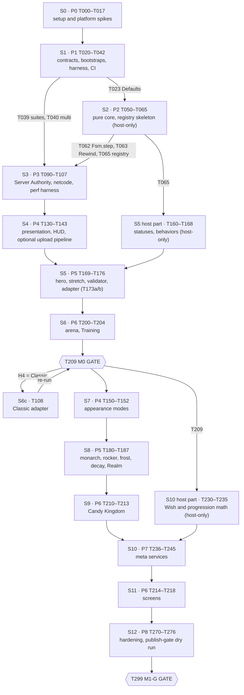

# TASKS — ordered task plan for *Algebraic!* (M0, then M1-G)

Ships as `docs/agent/TASKS.md`. Companion to the build spec `docs/STUDIO_BUILD_SPEC.md` (index + Part 0 contracts; Parts 1–8 are `docs/build-spec/part-N-*.md`, so §3.4 is in `part-3-combat.md`) ("the spec", sections cited as §n.m) and `docs/GDD.md` (cited as GDD §x.y). Sections of this file are cited as TASKS §n. Part 0 (spec §0) contracts apply verbatim. This file is static: the agent never edits a card except to append a `Split into …` note (TASKS §1.2 rule 7).

## 1. How to use this plan

### 1.1 Reader and scope

The reader is the coding agent (Claude Code driving Roblox Studio through the built-in MCP server `Roblox_Studio`, code synced by Script Sync). The plan builds milestone **M0** (feel prototype) and then milestone **M1-G** (graybox vertical slice), as defined in §0.0. It contains 159 cards in the §0.6 format (155 regular cards, the two gate cards T209 `M0 GATE` and T299 `M1-G GATE`, and two conditional cards, T108 Classic adapter and T143 Open Cloud animation upload pipeline; T173 and T239 are pre-split into T173a/T173b and T239a/T239b) and the tables that tie them together.

### 1.2 Rules

1. **One task at a time.** The next task is the **first card in the Execution order (TASKS §3) whose status is `todo`, whose `Depends on` cards are all `done` (or `skipped` with a reason), and whose blocking human checkpoints are satisfied.** This replaces the "lowest-numbered todo" rule of §1.3 step 9: task IDs are grouped by phase (§0.6), but dependencies make the phases interleave (TASKS §3.1). **One exception:** the conditional card T108 becomes eligible as soon as T209 records H4 = Classic in `PROGRESS.md`, while T209 itself is `blocked (awaiting T108)`; after T108 is `done`, T209 goes back to `todo` and is re-run in full (TASKS §16.1 C15).
2. **Inner loop.** Run every card through §1.4 (plan → tests first → implement on disk → host gate → sync gate → builders → playtest → evidence → bookkeeping → commit → human checkpoint). "Done" means green per §1.1.3 (G1–G8).
3. **Read first.** Before coding, read the card, every spec section and GDD section it cites, `ARCHITECTURE.md` and the *Blockers* section of `docs/agent/PROGRESS.md`.
4. **Never skip an acceptance check.** Every `Verify` item is run exactly as written. The host gate, the sync gate (when `src/` changed), `Verify` (when a builder or builder data changed) and the `log_scan` rules of §1.4.6 apply to every card even when the card does not repeat them.
5. **Bookkeeping in the same commit.** Update the card's row in `PROGRESS.md` (status, commit, date, evidence per §1.4.7) and every touched `ARCHITECTURE.md` row (`planned` → `wip` → `done`). Commit subject: `T0xx: <card title>` (titles are ≤ 66 characters so the subject stays ≤ 72).
6. **Human checkpoints.** A card whose checkpoint is marked **blocking** cannot be `done` until the human confirms in `PROGRESS.md` → *Human steps* and the agent's probe passes. Set the card to `awaiting-human`, post a `human-step` blocker (§1.8.2 format, with the click path), and continue with the next eligible card. Non-blocking checkpoints are posted and tracked, but the card may be `done`.
7. **Splitting.** If a card needs more than about 400 changed lines, split it before coding into `T0xxa`, `T0xxb`, … with the same `Depends on`, append `Split into T0xxa, T0xxb (reason)` under the card, and add the rows to `PROGRESS.md`. This is the only allowed edit to this file.
8. **Spikes.** A spike's result is written to `docs/agent/SPIKES.md` (format TASKS §16.1 C3) and indexed in `PROGRESS.md` → *Spike results*. A spike never "fails the task": it records PASS / FAIL / value and the **decision** (which path or fallback is adopted). A rule change that a spike forces goes in an `OPS:` commit that cites the spike ID.
9. **Conditional cards** (T108, T143) are set to `skipped (reason)` when their condition is false.
10. **Fix budget and escalation** follow §1.1.2 item 6 and §1.8: 3 attempts per failing check, the R1 self-explanation prompt, 1 more attempt, then stash and escalate.
11. **Design numbers.** Never change a GDD number. A missing number gets a value consistent with the GDD, marked `(tuning default)` in code and in `PROGRESS.md`.
12. **IP.** Code, comments, file names, test names, asset keys, commit messages and prompts use IP-neutral IDs only (§8.1.4 R-IP-02). Where a part's text used a canonical name in a test ID or archetype string, this plan renames it (TASKS §16.1 C12).

### 1.3 Notation used in `Verify` lines

| Shorthand | Meaning | Pass condition |
|---|---|---|
| `host` | `lune run tools/check.luau` (§1.4.2) | `[ALG][CHECK] SUMMARY pass=<n> fail=0`, exit 0 |
| `lune(<filter>)` | `lune run tests/run.luau --filter <filter>` (§7.2.2; `<filter>` is a substring of the test ids, so the card's filter must match every test it lists; cards that need a whole spec file write `lune run tests/run.luau --file <dir>/<name>` instead), then `host` | every listed test id prints `[ALG][TEST] <id> PASS`; `SUMMARY … fail=0` (a filter that matches nothing exits 2, a failure) |
| `sync` | Sync gate (§1.4.3): `lune run tools/sync_manifest.luau` vs `sync_tree_hash.luau` (Edit) | equal `agg` |
| `builder(<Name>)` | The five builder tests of §1.6.8 (`build_fresh`, `build_idempotent`, `build_reset_equal`, `verify_detects`, `no_sync_side_effects`) via `run_builder.luau` | all five pass; second run `created=updated=removed=0` |
| `snippet(<file>, <DM>, <ARGS>)` | `execute_luau` with `tools/studio/<file>` in data model `<DM>` and the ARGS JSON | returned JSON `ok == true` plus the stated fields |
| `play{…}` | The single-client playtest procedure §1.4.5 P1–P13, with the actions in braces at P8; `log_scan.luau` ARGS `{maxErrors, allowErrors?, allowFail?}` (§1.4.6, §1.10 C14). A card that provokes `[ALG][<tag>] ERROR …` lines on purpose names them in `allowErrors` (Lua patterns, e.g. T035 `{"ERROR rollback"}`); spike runs pass `allowFail = {"^spike%."}`; acceptance runs never pass `allowFail` | Server and Client `log_scan` `ok == true`: `errors == []`, `algErrors == []`, and no `[ALG][TEST] … FAIL` line outside `allowFail` (a FAIL line fails the scan even without a SUMMARY) |
| `studio(<sel>) ≥ n` | The solo scenario protocol §7.3.6 with selector `<sel>` (available from T038). Selector grammar (§7.3.4): each comma-separated term is an exact scenario name, a prefix `<domain>.*`, or a tag `@tag`; a leading `-` removes. **A bare word is invalid** (use `<domain>.*`). `n` is the number of scenarios the selector resolves to when the card runs; a card that defers a scenario excludes it with `-<name>` | `state == "done"`, `fail == 0`, `pass ≥ n`, both `log_scan` ok; a selection that matches nothing ends with `state = "error"`, `err = "empty_selection"` (a failure) |
| `mcp(<name>)` | The MCP input-driven protocol §7.3.7 for one `mcp` scenario | as `studio`; a `(fallback)` suffix (the scenario's client-driver step instead of real MCP input) is allowed whenever `SPIKES.md` records S9 = FAIL (T011); the evidence line and any gate record note it |
| `multi(<n>, <profile>, <sel>)` | The multi-client protocol §7.3.8 (available from T040) | `state == "done"`, `fail == 0`; `net`-tagged selections pass twice in a row (§7.1.3) |
| `proc(<name>)` | An **agent procedure**: host commands, Edit-mode builder calls and git, run by the agent as the card lists (e.g. `proc(ip.gate_dry_run)`, §8.4.7). Never a `studio(…)` selector | the evidence lines the card lists |
| `Log:` | An exact `[ALG]` line expected in `log_scan`/`get_console_output` | present (placeholders in `<…>`) |

Before T038 exists, in-Studio checks use the snippets named in the card and the `log_scan` result. Calls from `execute_luau` into live game modules (`require(...)` of a service or controller and calling its methods, e.g. `DataService.update`, `UiController.state()`) are allowed only when `SPIKES.md` records T7-S4 = PASS (the snippet shares the game's module cache, T005); otherwise the card uses the scenario named next to it, run through T038's request/result protocol (§7.3.6).

### 1.4 Statuses and evidence

Task statuses are those of §1.2.8 (`todo`, `in-progress`, `blocked`, `awaiting-human`, `done`, `skipped`). Evidence lines follow §1.4.7 and §7.1.4 (`check:`, `tests:`, `studio:`, `multi(…)`, `perf:`, `H-xx …`). Gate verdicts use §7.7.1 (`[ALG][GATE] M0 PASS automated=<a>/<A> human=<h>/<H>`).

---

## 2. Phase overview and milestone gates

| Phase | Name (§0.6) | IDs used | Goal | Exit criteria |
|---|---|---|---|---|
| P0 | Session setup and platform spikes | T000–T017 | Repository, tools, MCP, Script Sync, builder framework, boot smoke test; every go/no-go platform question answered | Preflight line prints `PREFLIGHT ok …`; host, sync and `Verify` green; `SPIKES.md` has a decision for every P0 spike; H-01…H-06 done |
| P1 | Foundations | T020–T042 | Typed shared contracts (Types, Config, Net, Data, Skin, Assets), bootstraps with 15 services and 10 controllers, Lune infrastructure, solo and multi-client test harness, CI | Boot lines for 15/10 modules; Part 2 Lune specs and scenario suites pass; `multi(2, Baseline30, data.rejoin_persists)` passes; CI green |
| P2 | Pure combat core + Lune tests | T050–T065 | `Core/*`, `Sim/Attr`, `Combat/Rewind`/`Query` logic, golden traces, frame-data export, kit kernel and Styles registry skeleton | Every Part 3 Lune spec passes; `export_framedata --check` exit 0; registry loads 18 stub defs in Lune |
| P3 | Server Authority integration | T090–T108 | Inputs, adapter, simulation loop, hit resolution, rewind, KO/respawn, bots, carriers, netcode tests, perf harness | Every M0 `combat.*`, `sim.*`, `input.*`, `bot.*` scenario passes; multi netcode tests pass at `Baseline30`; perf scenarios run (smoke) |
| P4 | Presentation | T130–T143 (M0; T143 conditional), T150–T152 (M1-G) | Placeholder anims, combat animation driver, render/VFX/SFX/camera, ragdoll, Style Tell, HUD and touch, the optional Open Cloud animation upload pipeline; then appearance modes | M0: `render.*`, `vfx.*`, `sfx.*`, `cam.*`, `ragdoll.*`, `hud.*` pass. M1-G: `appearance.*`, `look.*` pass (the `multi`-level `look.*` scenarios through `multi(2, Baseline30, …)`) |
| P5 | Style framework and kits | T160–T176 (M0), T180–T187 (M1-G) | Behaviors, hooks, statuses, kit validator, `hero` and `stretch`; then `monarch`, `rocker`, `frost`, `decay` and the Realm | M0: `kit.hero.smoke`, `kit.stretch.smoke` and Part 4 Lune specs pass; H-10 feel for both. M1-G: all six kits pass; Realm scenarios pass |
| P6 | World and UI screens | T200–T204, T209 (M0); T210–T218 (M1-G) | Map framework, lighting, arena, Training Grounds, M0 gate; then Candy Kingdom and every screen | M0 GATE PASS (T209). M1-G: map and screen scenarios pass |
| P7 | Meta systems | T230–T245 | Style ownership, Wish, PolicyGate, shop, progression, mock monetization, telemetry, moderation | Every `wish.*`, `style.*`, `policy.*`, `shop.*`, `progress.*`, `store.*`, `tel.*`, `mod.*` test passes; Monte Carlo within §0.11 |
| P8 | Hardening | T270–T276, T299 | Soak and perf pass, security pass, manifest audit, publish gate (dry run), dev publish, docs | M1-G GATE PASS (T299) |

**Milestone gates.**
- **M0 GATE (T209)** runs after P5's `hero`/`stretch` cards and P6's arena and Training cards (§0.6), with every §7.7.2 item. It also records the NetModel decision (§3.16.4). If the decision is Classic, T209 is set to `blocked (awaiting T108)`, T108 runs (TASKS §1.2 rule 1 exception) and T209 is then re-run in full.
- **M1-G GATE (T299)** runs at the end of P8 with every §7.7.3 item, the publish-hook dry run as the agent procedure `ip.gate_dry_run` (§7.7.6, §8.4.7; never a Studio scenario) and the owner's design sign-offs.

---

## 3. Execution order and branches

### 3.1 Why the order is not numeric

Three dependencies force phases to interleave: (1) the Sim adapter (P3) needs `StyleDef`s, so the kit kernel and Styles registry **skeleton** is a pure P2 card (T065), while validation and kits stay in P5; (2) the M0 gate needs load-test and netcode infrastructure, which this plan places in P3 (T106, T107) rather than P8; (3) the M1-G screens (P6) need the P7 services, so the M1-G wave runs P7 before the P6 screen cards. The table below is the authoritative order.

### 3.2 Stages

| Stage | Milestone | Cards, in order | Branch (§1.9) | PR |
|---|---|---|---|---|
| S0 | M0 | T000 → T017 | `phase/P0-setup` | at T017 |
| S1 | M0 | T020 → T033, **T038**, T034 → T037, T039 → T042 (the solo harness T038 comes before the service cards so T034–T037 can verify through scenarios) | `phase/P1-foundations` | at T042 |
| S2 | M0 | T050 → T065 | `phase/P2-core` | at T065 |
| S3 | M0 | T090 → T107 | `phase/P3-authority` | at T107 |
| S4 | M0 | T130 → T142, then T143 (conditional: only when T014 chose the H-07 Open Cloud route) | `phase/P4-presentation` | at T143 (at T142 when T143 is `skipped`) |
| S5 | M0 | T160 → T176 (T173 is pre-split into T173a → T173b) | `phase/P5-styles` | at T176 |
| S6 | M0 | T200 → T204, then **T209 M0 GATE** | `phase/P6-world-ui` | at T209 (gate PR, verdict line in the body) |
| S6c | M0 (conditional) | T108, then T209 re-run | `phase/P3-classic` | only if T209 selects Classic |
| S7 | M1-G | T150 → T152 | `phase/P4-presentation-m1g` | at T152 |
| S8 | M1-G | T180 → T187 | `phase/P5-styles-m1g` | at T187 |
| S9 | M1-G | T210 → T213 | `phase/P6-world-ui-map` | at T213 |
| S10 | M1-G | T230 → T245 (T239 is pre-split into T239a → T239b) | `phase/P7-meta` | at T245 |
| S11 | M1-G | T214 → T218 | `phase/P6-world-ui-screens` | at T218 |
| S12 | M1-G | T270 → T276, then **T299 M1-G GATE** | `phase/P8-hardening` | at T299 (gate PR) |

### 3.3 Git rules for stages (extends §1.9)

1. Create the stage branch from the latest `main` when the stage's first card starts (`git switch -c <branch>`). If the previous stage's PR is not merged yet, branch from the previous stage branch head instead (a stacked branch) and say so in the PR body. Never rebase.
2. One commit per green card (`T0xx: <title>`); `OPS:` commits for spike-driven rule changes, snapshot refreshes and `PROGRESS.md`-only updates.
3. A stage PR lists its cards, their evidence lines and any `awaiting-human` items. The human merges; the human creates the `m0-gate` and `m1g-gate` tags after T209 and T299.
4. Only switch branches with no playtest running and a clean tree; run the full sync gate after every switch (§1.2.5).
5. Every push, PR and CI read (`git push`, `gh pr create`, `gh run list`) needs the private GitHub remote and `gh auth login` of H-01 step 9 (§1.9 rule 5). If `git remote -v` lists no `origin` or `gh auth status` fails, post a `human-step` blocker naming H-01 step 9, keep committing locally and continue with the next eligible card.

---

## 4. P0 — Session setup and platform spikes (T000–T019)

P0 answers every platform question before code depends on it. Spikes that need the in-Studio harness use the P0 probe mechanism (TASKS §16.1 C4): probe modules `src/DevTools/Tests/Spikes/Probe_<id>.luau` exporting `start(args)`/`read()` and the snippet `tools/studio/spike_run.luau`. P0 probes print `[ALG][Spike] <id> PASS|FAIL <detail>` (raw `print`, allowed under `src/DevTools/**`), never `[ALG][TEST]`, so a recorded spike failure does not fail `log_scan` (§1.4.6, decision D-11). T038 later wraps the probes as `Spike_SAxx` scenarios (§3.16.3) that print `[ALG][TEST] spike.SA-xx …` and run with `allowFail = {"^spike%."}`. The probe files are exempt from the one-`BindToSimulation` rule and from the `CreateVirtualInput` part of `devtools-isolation` (§3.16.1 item 1, §7.5.5).

### T000 — Bootstrap the repository skeleton and verify shipped files
- Phase / milestone: P0 / M0
- Depends on: none
- Spec refs: §1.2.4, §1.2.6, §1.2.7, §1.2.8 (shipped root agent files), §1.9, §1.10 C8, C11, C12; §8.4.5 (deny entries, included in the example); §0.1, §3; TASKS §16.1 C25
- Files & instances: **verify (shipped with the spec; never regenerated):** `AGENTS.md`, `CLAUDE.md`, `ARCHITECTURE.md`, `.claude/skills/algebraic-studio/SKILL.md`, `docs/agent/skills/algebraic-conventions.md`, `docs/agent/skills/algebraic-style-kit.md`, `docs/agent/mcp.example.json`, `docs/agent/claude-settings.example.json` (§1.2.4 verbatim; shipped — write it verbatim from §1.2.4 **only if it is missing**), `docs/agent/TASKS.md` (this file). **Create:** `README.md` (one paragraph); `docs/agent/PROGRESS.md`; `docs/agent/SPIKES.md`; `docs/agent/dev-place.json` (template of §1.2.8: zeros, `"ownerGitEmail": ""`); `docs/agent/ASSET_PROVENANCE.md`; `docs/THIRD_PARTY.md`; `docs/reference/.gitkeep`; `rokit.toml`, `.luaurc`, `selene.toml`, `stylua.toml`, `.styluaignore`, `default.project.json`, `.gitignore`, `.gitattributes`; `src/Shared/.gitkeep`, `src/ServerScriptService/.gitkeep`, `src/DevTools/.gitkeep`, `src/StarterPlayerScripts/.gitkeep`, `tests/.gitkeep`, `tools/studio/.gitkeep`. Never create or edit `.claude/settings.json` or `.claude/settings.local.json` (the human installs the first from the example at H-02 step 4).
- Steps:
  1. `git switch -c phase/P0-setup`.
  2. Check that every shipped file above exists. Do not regenerate or rewrite any of them. If `docs/agent/claude-settings.example.json` is missing, write it byte-for-byte from §1.2.4; if any other shipped file is missing, post a `human-step` blocker (the spec bundle is incomplete) and stop.
  3. Write every config file verbatim from §1.2.6–§1.2.7. The §1.2.7 `.gitignore` already lists `place/`, `build/`, `sourcemap.json`, `.mcp.json`, `.claude/settings.json` and `.claude/settings.local.json`; check that all six are present after writing.
  4. Confirm that the shipped `docs/agent/skills/algebraic-style-kit.md` states that a kit file "returns a builder function producing a StyleModule" (§4.9 item 2), not a StyleDef; if not, post a `spec-gap` blocker (do not edit the shipped file).
  5. `PROGRESS.md` from the §1.2.8 template: one *Task status* row per card of this plan (status `todo`; T108 and T143 are conditional), one *Human steps* row per H-01…H-12, an empty *Blockers* section and a *Spike results* index table (`| Spike | Result | Decision | Date | SPIKES.md anchor |`).
  6. `SPIKES.md` with the header and entry template of TASKS §16.1 C3.
  7. `ASSET_PROVENANCE.md` with the §1.7.2 row header plus the two §8.5.1 columns `likeness` and `R-###`.
  8. `ARCHITECTURE.md` (the agent keeps this shipped file current, C11): keep every shipped row and add `planned` rows only where missing for the folders this plan adds: `src/DevTools/Tests/Spikes/`, `src/DevTools/Tests/Client/`, `src/DevTools/Tests/Lib/`, `tests/ip/`, `tools/lib/`, `tools/plugin/`. The shipped file already has `planned` rows for `src/DevTools/Tests/Suites/`, `tests/core/`, `tests/wish/`, `tests/shim/`, `tools/lib/SafeWrite.luau` (T013), `tests/core/graph.spec.luau` (T064) and the four conditional T143 files; the cards that create them flip those rows (`planned` → `wip` → `done`) instead of adding new ones.
  9. Commit `T000: Bootstrap the repository skeleton and verify shipped files`.
- Acceptance criteria:
  - Every shipped file exists unchanged (or, for the permissions example only, was written from §1.2.4); every created file exists and is committed.
  - `docs/agent/claude-settings.example.json` is byte-identical to §1.2.4 (including the six P8 `deny` entries) and `git ls-files .claude/settings.json` is empty.
  - `PROGRESS.md` has 159 task rows (one per card, including the conditional T108 and T143, the pre-split T173a/T173b and T239a/T239b, and the gates T209 and T299) and 12 human-step rows.
  - No `.luau` file exists under `src/` yet.
- Verify: `git ls-files` lists every file above and no `.claude/settings*.json`; `git check-attr eol -- src/Shared/x.luau` prints `eol: lf`; byte-compare `docs/agent/claude-settings.example.json` with §1.2.4; `git check-ignore .claude/settings.json` prints the path. (Lune is not installed yet; T002's host gate re-checks the configs.)
- Human checkpoint: none (host-only; may run before H-01). If `CLAUDE.md` was absent when this session started, ask the human to restart Claude Code after T000 so its `@AGENTS.md` rules load (§1.2.8).

### T001 — Human setup: places, MCP connection and Rokit tools
- Phase / milestone: P0 / M0
- Depends on: T000
- Spec refs: §1.2.1 steps 2–4, §1.2.2 H-01 (steps 1–9 incl. 3b), H-02 (steps 1–6), §1.2.3, §1.2.4, §1.2.6, §1.9 rule 5; §1.12 S7; §8.2.6 (dedicated dev group), §8.4.5 (`ownerGitEmail`)
- Files & instances: `docs/agent/PROGRESS.md` (*Human steps* H-01, H-02); `docs/agent/SPIKES.md` (S7); `docs/agent/dev-place.json` (`ownerGitEmail` only; the IDs follow in T004).
- Steps:
  1. Post a `human-step` blocker listing:
     - H-01 steps 1–9: step 1 a **dedicated dev group** that owns no public experience (not the production group; owner account ID-verified); dev universe `Algebraic DEV`, group-owned, private; step 3b *Server Size / Max Players* = **20**; local backup `place/Algebraic.dev.rbxl`; scratch place `place/scratch.rbxl`; step 7 the dev group ID **and the git author email** the owner will use for human-signed files; step 9 a **private GitHub repository**, `git remote add origin <url>`, push `main`, install the GitHub CLI and run `gh auth login` (scopes `repo`, `workflow`);
     - H-02 steps 1–6: Studio MCP server on, Claude Code Quick connect, step 4 review `docs/agent/claude-settings.example.json` and install it as `.claude/settings.json` (the agent never creates that file), step 6 the restart below;
     - the Rokit install command of §1.2.6.
  1b. After H-01, H-02 and the Rokit install, the human **quits Claude Code and starts a new session in the repo root** (H-02 step 6: a running session sees neither MCP servers added later nor Rokit's `PATH` change). The agent resumes T001 from `PROGRESS.md` (`awaiting-human` → `in-progress`) and runs preflight §1.3 steps 1–2 before step 2.
  2. Run `claude mcp list` and confirm `Roblox_Studio` is connected; record the registered name as S7 (fallback: the §1.2.3 Option B CLI command, run by the human).
  3. Enumerate the session's `mcp__Roblox_Studio__*` tools (load deferred schemas first) and call `list_roblox_studios`: exactly one entry (the dev place).
  4. Run `rokit trust rojo-rbx/rojo lune-org/lune JohnnyMorganz/StyLua Kampfkarren/selene JohnnyMorganz/luau-lsp` and `rokit install` (Claude Code asks the human to approve: `rokit` is in the `ask` list).
  5. Write the owner's git email into `docs/agent/dev-place.json` → `ownerGitEmail`; the human confirms it equals `git config user.email` (H-01 step 7).
- Acceptance criteria:
  - H-01 and H-02 are `done` in `PROGRESS.md`; S7 recorded.
  - `list_roblox_studios` returns one Studio whose window shows `Algebraic DEV`, in the **new** session.
  - The five tools print the pinned versions.
  - `git remote -v` lists `origin`; `gh auth status` reports a logged-in account; `dev-place.json.ownerGitEmail` is non-empty; `.claude/settings.json` exists locally and `git ls-files .claude/settings.json` is empty.
- Verify: `claude mcp list` → `Roblox_Studio … connected`; MCP `list_roblox_studios`; `rojo --version` → 7.7.1, `lune --version` → 0.10.5, `stylua --version` → 2.6.0, `selene --version` → 0.32.0, `luau-lsp --version` → 1.70.1; `git remote -v`; `gh auth status`; read back `dev-place.json.ownerGitEmail`. The Max Players probe (`[ALG][Player] max_players=20`, outside Studio) is read by the human after the first dev publish (H-11, T209).
- Human checkpoint: **blocking** — H-01 (incl. step 3b Max Players = 20, step 7 owner git email, step 9 GitHub remote and `gh auth`) and H-02 (incl. step 4 install `.claude/settings.json` from the example, step 6 restart Claude Code), plus the Rokit install; approve the `rokit` prompts.

### T002 — Implement the host gate and the project lint rules
- Phase / milestone: P0 / M0
- Depends on: T001
- Spec refs: §1.4.2, §1.2.6 (type definitions), §1.2.7, §1.10 C6, C15; §4.9 item 1 (pure scope); §1.12 S12; TASKS §16.1 C18
- Files & instances (create): `tools/check.luau`, `tools/lint_rules.luau`, `tools/types/globalTypes.None.d.luau`, `tools/types/globalTypes.PluginSecurity.d.luau`; modify `docs/THIRD_PARTY.md` (luau-lsp type definitions, MIT, tag).
- Steps:
  1. Write `tools/check.luau` from the §1.4.2 skeleton (steps stylua, selene, sourcemap, analyze-game, analyze-plugin, lint-rules, lint-strings, check-manifest, tests). Behaviour (§1.10 C15): a missing **tool script** prints `[ALG][CHECK] <step> SKIP missing <script>`; a missing **binary** is caught by the `pcall` around `process.exec` and prints `[ALG][CHECK] <step> FAIL code=127 missing <program>` (counted); an analyze step whose targets hold no `.luau` file after its `--ignore` globs prints `[ALG][CHECK] <step> SKIP no files` (not counted). The `analyze-plugin` targets are `src/DevTools/Builders`, `tools/studio` and `tools/plugin/AlgebraicTestHarness` (not `tools/plugin/build.luau`).
  2. Write `tools/lint_rules.luau` with rules `strict`, `banned-api`, `sim-time`, `pure`, `require-form`, `script-kind`, `raw-print`, `secrets`, `architecture`, `snippet-size`, `probe` exactly as the §1.4.2 table:
     - every content rule except `architecture` and `script-kind` skips `**/Vendor/**`;
     - `banned-api` tokenization: `_G`/`shared` only as identifiers outside comments and strings and not after `local`, `.` or `:`; `wait(`/`spawn(`/`delay(`/`tick(` only as global calls (boundary `[^%w_%.:]` before the name), so `task.spawn(`, `Adapter.spawn(` and `respawn(` are not flagged;
     - token checks in `banned-api`, `sim-time` and `pure` read code only, outside comments and string literals (except `pure`'s `@game/` check, which reads `require` strings);
     - `pure` scope = `src/Shared/Core/**`, `src/Shared/Wish/**`, `src/Shared/Styles/**`, `src/Shared/Behaviors/**` (§4.9 item 1, C18);
     - `sim-time` scans `src/Shared/Core/**` and `src/Shared/Behaviors/**` whole, and in `src/Shared/Sim/**` and `src/Shared/Combat/**` only the code between `-- @sim-begin` and `-- @sim-end` marker lines (§3.1.5, decision D-12; `Adapter.flush` legitimately calls `workspace:GetServerTimeNow()` outside the markers);
     - `secrets` scope = whole repo except `docs/`, `**/Vendor/**`, `tools/lint_rules.luau` and `tests/**/fixtures/**`; the base64 check reads string literals only;
     - `architecture` covers `.luau` files under `src/` only and skips temporary files (base name or any folder segment below `src/` starting with `_`, e.g. T006's `src/Shared/_Req/B/C.luau`); `probe` also rejects staged `src/**/_*.luau` files and files under `src/**/_*/` folders at commit time.
     Output `[ALG][LINT] <path>:<line> <rule> <detail>` and `[ALG][LINT] lint_rules SUMMARY errors=<n> warnings=<m>`; exit 0/1/2.
  3. Fetch the two `globalTypes.*.d.luau` files at the luau-lsp 1.70.1 tag (record the exact tag spelling and URL as S12).
  4. Run `host`. If luau-lsp rejects `--definitions:@roblox=` or the `--ignore` glob, switch to the documented fallback (`--definitions=<path>`) and record it under S12.
  5. Self-test the lints with a temporary `src/Shared/_LintProbe.luau`: (a) without `--!strict` → exactly one `strict` finding; (b) with `--!strict` and the line `Adapter.spawn(e, req, f)` → no `banned-api` finding, while a line `spawn(fn)` → exactly one. Delete the file before commit.
- Acceptance criteria:
  - `host` prints `[ALG][CHECK] SUMMARY pass=4 fail=0` (stylua, selene, sourcemap, lint-rules) with `SKIP` lines for `analyze-game` and `analyze-plugin` (`no files`) and for `lint-strings`, `check-manifest` and `tests` (`missing <script>`); exit code 0.
  - The self-test findings are exactly as in step 5, and the probe file is deleted before commit.
  - S12 recorded in `SPIKES.md`.
- Verify: `host`; `lune run tools/lint_rules.luau` → `SUMMARY errors=0`.
- Human checkpoint: none (approve the network fetch of the two type-definition files if prompted).

### T003 — Create the Studio snippet library and sync manifest
- Phase / milestone: P0 / M0
- Depends on: T002
- Spec refs: §1.4.3, §1.4.4, §1.4.5, §1.4.6, §1.5.5, §1.7.2, §1.10 C5, C7, C14, C15; §1.2.2 H-04 (probe fields)
- Files & instances (create): `tools/studio/ping.luau`, `create_sync_roots.luau`, `sync_status.luau`, `sync_tree_hash.luau`, `run_builder.luau`, `clear_output.luau`, `boot_status.luau`, `client_status.luau`, `log_scan.luau`, `quarantine_scan.luau`; `tools/sync_manifest.luau`.
- Steps:
  1. Copy each snippet verbatim from §1.2.5, §1.4.3–§1.4.6, §1.5.5 and §1.7.2 (`--!strict`, header comment with data model and ARGS). `ping.luau` returns `clientAnimatorThrottling` (H-04 step 1c probe); `client_status.luau` reads the client-local `AlgClientReady` attribute first and the `client ready` log line only as fallback, and returns `readyVia` (`"attr" | "log" | "none"`); `log_scan.luau` takes ARGS `{maxErrors, allowErrors?, allowFail?}` and returns `recorded` and `algErrors` (§1.10 C14); `quarantine_scan.luau` returns `{ok = false, err = "Quarantine empty: asset not moved in"}` on an empty `ServerStorage.Quarantine` and flags `script in workspace: <path>` for any `LuaSourceContainer` in the scratch place's `workspace` (decision D-50).
  2. Write `tools/sync_manifest.luau` from §1.4.3 (its `fnv` must be byte-identical to the snippet's).
  3. Run `host` (rule `snippet-size` caps each snippet at 1,536 bytes). `analyze-plugin` starts running here (the snippets are its first targets).
- Acceptance criteria:
  - All ten snippets pass `snippet-size` and the PluginSecurity analysis pass; `host` prints `[ALG][CHECK] SUMMARY pass=5 fail=0` (`analyze-game` still `SKIP no files`).
  - `lune run tools/sync_manifest.luau` prints `"count": 0` and `"agg": "811c9dc5"` (FNV-1a of the empty string).
- Verify: `host`; `lune run tools/sync_manifest.luau`.
- Human checkpoint: none.

### T004 — Connect Script Sync and run the first full preflight
- Phase / milestone: P0 / M0
- Depends on: T001, T003
- Spec refs: §1.2.5, §1.3 (all steps), §1.5.1, §1.5.2, §1.2.2 H-03; §1.12 S4, S5, S8, S15
- Files & instances: `docs/agent/dev-place.json` (real IDs), `docs/agent/mcp-tools.snapshot.json`; Studio Folders `ReplicatedStorage.Shared`, `ServerStorage.DevTools` (agent-created sync roots).
- Steps:
  1. Pin `studio_id` from `list_roblox_studios`. `snippet(ping.luau, Edit, —)`; write `groupId` (the dedicated dev group, H-01 step 1), `universeId`, `placeId` into `dev-place.json`; post a **blocking** `human-step` request to confirm the IDs against Creator Hub; set T004 `awaiting-human` and do not run step 2 until the human confirms in `PROGRESS.md` (§1.3 step 3).
  2. `snippet(create_sync_roots.luau, Edit, —)` → `shared` and `devTools` = `created`.
  3. Post H-03 (Script Sync on the four roots, selecting the parent `src/` folder; Keep Disk on conflict). After done: `snippet(sync_status.luau, Edit, —)` → every root `SyncedAsRoot`. Record S4 (parent-folder mapping) and S5 (GA vs Beta toggle).
  4. Write `mcp-tools.snapshot.json` (§1.5.1 format: name, verbatim description, input schema, `aliases`) from the session's tool definitions; record how the schemas were captured (S15). Commit as `OPS: refresh MCP tool snapshot`.
  5. Run the sync gate (both sides `count 0`), then the round-trip probe of §1.3 step 7 (`src/DevTools/_SyncProbe.luau`: count + 1, then back).
  6. Record S8: after the human's H-01 "Save to File As", does the window stay bound to the published place (ping `placeId` unchanged)?
  7. Print the preflight line.
- Acceptance criteria:
  - `ping` matches `dev-place.json`; `creatorType == "Group"`; `isRunning == false`.
  - All four roots `SyncedAsRoot`; sync `agg` equal before and after the probe; no `_SyncProbe*` file remains.
  - Snapshot committed; S4, S5, S8, S15 recorded.
- Verify: `snippet(ping.luau, Edit, —)`; `snippet(sync_status.luau, Edit, —)`; `sync`; chat line `PREFLIGHT ok studio=<id> place=<placeId> sync=0/811c9dc5 verify=n/a task=T004`.
- Human checkpoint: **blocking** — H-03; confirmation of the IDs in `dev-place.json`.

### T005 — Spike: MCP execution limits and tool behaviour
- Phase / milestone: P0 / M0
- Depends on: T004
- Spec refs: §1.12 S1, S2, S3, S10, S14, S15; §7.11 T7-S4, T7-S7, T7-S12; §8.10 S-P8-3; §1.5.4
- Files & instances: `docs/agent/SPIKES.md`; temporary `src/Shared/_SpikeMarker.luau` (deleted at the end); possibly `OPS:` changes to `tools/lint_rules.luau` (`snippet-size`).
- Steps:
  1. **S1 payload and timeout.** Send inline Edit payloads of 1, 2 and 4 KB (padded comments) returning `{ok=true}`; record the largest accepted. Time a call that runs `task.wait(10)`: record whether calls may yield and the timeout. Record whether `print` output is returned.
  2. **S1 security.** Confirm `InstanceFileSyncService:GetStatus` and `Script.Source` reads succeed from a snippet (already used by T004); record the security level observed.
  3. **S1 require cache.** Require `ReplicatedStorage.Shared._SpikeMarker` twice without cloning, editing the file on disk in between (wait for sync); record whether the second require is stale.
  4. **S2.** Record the `get_studio_state` output shape, the `start_stop_play` parameters and the `datamodel_type` strings into the snapshot notes.
  5. **S3.** In a playtest, print `[ALG][Spike] S3 server` (Server snippet) and `[ALG][Spike] S3 client` (Client snippet); read `get_console_output`; record whether both sides appear and whether `clear_output.luau` clears it.
  6. **S10.** In Edit, call `ChangeHistoryService:TryBeginRecording("AlgSpike", "Algebraic: spike")` then `FinishRecording(id, Enum.FinishRecordingOperation.Commit)` inside `pcall`; record the result.
  7. **T7-S4.** In play, a Server snippet sets a marker field on `require(ReplicatedStorage.Shared._SpikeMarker)`; a second Server snippet reads it: record whether `execute_luau` shares the game's module cache. Repeat with two Client snippets and record the Client result in the same entry. TASKS §1.3: direct calls into live game modules from `execute_luau` are used only on the data model where T7-S4 passed.
  8. **T7-S7.** A Client snippet connects `RunService.Heartbeat` incrementing a `LocalPlayer` attribute; a second call reads it: record whether connections persist after the call returns.
  9. **T7-S12.** Print 600 tagged lines, then count `LogService:GetLogHistory()` entries.
  10. **S-P8-3.** Return JSON strings of 16, 64 and 256 KB from Edit; record the largest delivered.
  11. **S14/S15.** Record "not exercised" for quotas (log counts on first `generate_*` use) and the snapshot capture method.
  12. Delete `_SpikeMarker.luau`; adjust `snippet-size` through an `OPS:` commit only if the real payload cap is below 2,048 bytes.
- Acceptance criteria: `SPIKES.md` has entries S1, S2, S3, S10, S14, S15, T7-S4, T7-S7, T7-S12, S-P8-3, each with the measured value and the adopted rule (e.g. "spikes use two-call start/read" or "spikes use one yielding call").
- Verify: `SPIKES.md` entries present; `sync` (marker removed); `host`.
- Human checkpoint: none.

### T006 — Spike: require convention and host toolchain parity
- Phase / milestone: P0 / M0
- Depends on: T004
- Spec refs: §1.2.7, §1.6.3, §1.12 S11, S12; §2.10 item 2, §2.14 item 2; §4.11 S-P4-6; §7.2.4 (Lune 0.10.5 `CFrame.lookAt` bug); §7.10 item 5
- Files & instances (temporary, deleted at the end): `src/Shared/_Req/init.luau`, `src/Shared/_Req/A.luau`, `src/Shared/_Req/B/C.luau`, `src/DevTools/_ReqCross.luau`, `src/DevTools/Builders/_ReqUtil.luau` (`--!strict` `return { x = 1 }`; `Util.luau` does not exist until T007), `src/DevTools/Builders/_ReqTypeOnly.luau`, `tools/_req_probe.luau`.
- Steps:
  1. Write sample modules using `./`, `../` and `@self/` inside `Shared`, and `@game/ReplicatedStorage/Shared/_Req` from `DevTools/_ReqCross.luau`.
  2. Studio: an Edit snippet requires `_Req` and `_ReqCross` and returns their computed values.
  3. luau-lsp: run `host` and confirm no resolution errors for `./`, `@self/`, `@game/` (with `rojo sourcemap`), and for `type U = typeof(require("./_ReqUtil"))` in `_ReqTypeOnly.luau`.
  4. Lune: `lune run tools/_req_probe.luau` requires `@shared/_Req` and the relative paths; checks that `@lune/roblox` provides `Vector3.new`, `CFrame.Angles`, `CFrame.lookAt`, `Color3.fromRGB` (S-P4-6) and reproduces the `lookAt(zero, (0,1,-1))` bug.
  5. Decide the cross-root form: `@game/<Service>/…` (Part 1 C1, the default) if Studio and luau-lsp both resolve it, else instance-path requires (`require(game:GetService("ReplicatedStorage").Shared.X)`, the Part 2 §2.10 item 2 fallback). Encode the decision in `lint_rules` rule `require-form`; a switch away from `@game/` changes every root file at once in one `OPS:` commit (decision D-05; T017 mirrors it in the always-loaded agent files).
  6. Delete every temporary file (including `_ReqUtil.luau` and `_ReqTypeOnly.luau`).
- Acceptance criteria: `SPIKES.md` entries S11, S12 (flags), S-P4-6 and "lookAt bug present on 0.10.5: yes/no"; exactly one cross-root require form is recorded and enforced by `require-form`.
- Verify: `host`; `sync` (temporary files removed); `SPIKES.md`.
- Human checkpoint: none.

### T007 — Build the builder framework: Util, BuildAll, Verify
- Phase / milestone: P0 / M0
- Depends on: T004, T005, T006
- Spec refs: §1.6.1–§1.6.8, §1.10 C4; §2.2 rules 1–2, §2.12 item 22 (containers); §7.3.10 and §7.9 item 6 (leftovers); §6.6.0 rule 6 (`Workspace.ALG_Local`); §0.3; TASKS §16.1 C4, C6
- Files & instances (create): `src/DevTools/Builders/Util.luau` (incl. `Util.ensureRoot` for Folder roots and `Util.ensureContainer(parent, name, c, quiet?)`), `BuildAll.luau`, `Verify.luau`; Studio Folders `Workspace.Map`, `Workspace.Sim`, `Workspace.Bots` (BuildAll containers, attribute `AlgBuilder = "BuildAll"`).
- Steps:
  1. `Util.luau` exactly as §1.6.4 (leaf module, requires nothing). `Util.ensureContainer(parent, name, c, quiet?)` finds or creates a Folder stamped `AlgBuilder = "BuildAll"`, never prunes it and ignores `reset`; a 3-argument call that creates a container also adds the warning `container <Path> missing; run BuildAll` (child builders whose container is missing), while BuildAll passes `quiet = true`. Model roots use Part 6's `Util.ensureRootOf` (added in T200).
  2. `BuildAll.luau` (§1.6.6): step 0 is the **containers step** (always, before `ORDER`, unaffected by `only`/`skip`/`reset`): `Util.ensureContainer(workspace, "Map", c, true)`, then `"Sim"`, then `"Bots"`; containers are never pruned or destroyed and their children belong to other builders. Then the §1.6.6 `ORDER` (`BuildLighting, BuildInputs, BuildTemplates, BuildPlaceholderAnims, BuildVfxTemplates, BuildArena, BuildTraining, BuildMap_CandyKingdom`) with `only`/`skip`; missing builders add `"<name> not implemented"` warnings; wrap in a ChangeHistory recording only if T005 S10 passed; finish with `Verify.verify()`.
  3. `Verify.luau`: §1.6.7 items 1–8 — item 5 leftovers `ReplicatedStorage.Remotes`, `ReplicatedStorage.Runtime`, `ServerStorage.__AlgScratch`, `ServerStorage.AgentTestRequest`, `ServerStorage.AgentTestResult`, `ServerStorage.AgentTestMultiArgs`, `Workspace.TestPad`, `ReplicatedStorage.TestRun`, `Workspace.ALG_Local`, `ReplicatedStorage.__AlgSpike` (all `[leftover]`); item 6 `workspace.StreamingEnabled == true` as `[human:H-04]` (new places default to true, so the H-04 regression check is the first-playtest `prediction` probe of §1.3 step 8, not this item); item 8 the three containers exist as Folders with `AlgBuilder == "BuildAll"` (problem `[builder:BuildAll] Workspace.<X> missing` or `… not owned`).
  4. Run `builder(BuildAll)` with the §1.6.8 counts rule: `build_reset_equal` passes when `verify.ok`, `created` equals `build_fresh`'s minus the containers that run created (here fresh `created = 3`, reset `created = 0`: containers ignore `reset` and are never recreated), `updated` equals `build_fresh`'s, and `removed` equals the number of owned roots the reset destroyed (0 for the containers step).
- Acceptance criteria:
  - On a fresh place the first `build {reset:true}` logs `[ALG][BUILD] BuildAll created=3 updated=0 removed=0 warnings=8` (the containers step creates 3 Folders with no warning of its own; the 8 warnings are `<name> not implemented`); the second run reports `created=0 updated=0 removed=0`.
  - `verify` reports only `<name> not implemented` warnings.
  - Deleting `Workspace.Sim` makes `verify` report `[builder:BuildAll] Workspace.Sim missing`; a rebuild restores it.
  - `ServerStorage.__AlgScratch` never persists; sync `agg` unchanged by builder runs.
- Verify: `builder(BuildAll)`; `snippet(run_builder.luau, Edit, {"builder":"Verify","fn":"verify"})`.
- Human checkpoint: none.

### T008 — Smoke-test the playtest loop with boot stubs
- Phase / milestone: P0 / M0
- Depends on: T007
- Spec refs: §1.4.5, §1.4.6, §1.10 C2, C3; §2.3.4 (client guard), §2.3.6 (Log); §2.13 item 1, §2.14 item 3; TASKS §16.1 C5 (BOOT tag)
- Files & instances (create): `src/Shared/Log.luau` (full §2.3.6 implementation with the TASKS §16.1 C5 tag list: operational `BOOT`, `TEST`, `BUILD`, `CHECK`, `LINT`, `GATE`, `TEL` and the PascalCase domain tags incl. `Spike`; no `Boot`); temporary stubs `src/ServerScriptService/Main.server.luau`, `src/StarterPlayerScripts/Main.client.luau` (replaced in T033).
- Steps:
  1. Server stub: create `ReplicatedStorage.Runtime` (Folder), set attribute `ServerReady = true`, `Log.info("BOOT", "server ready services=0 ms=<n>")`, `Log.test("smoke.boot", true)`, `Log.summary(1, 0)`.
  2. Client stub: the §2.3.4 guard as the first statement, `ReplicatedStorage:WaitForChild("Shared")`, then `Players.LocalPlayer:SetAttribute("AlgClientReady", true)` (client-local) and `Log.info("BOOT", "client ready controllers=0 ms=<n>")`.
  3. Run the full playtest procedure P1–P13 of §1.4.5. `analyze-game` starts running here (`Log.luau` and the stubs are its first targets): `host` → `SUMMARY pass=6 fail=0`.
  4. Count `[ALG][BOOT] client ready` lines on the client: exactly 1 proves the double-run guard (§2.14 item 3).
- Acceptance criteria:
  - `boot_status` `ok == true`; `client_status` `clientReady == true` with `readyVia == "attr"`.
  - Server `log_scan`: `summary = {pass=1, fail=0}`, `boot` contains `[ALG][BOOT] server ready services=0 ms=<n>`; `errors == []`, `algErrors == []`.
  - Client `log_scan`: exactly one `[ALG][BOOT] client ready …` line.
  - After stop, `Verify` reports no `ReplicatedStorage.Runtime` leftover.
- Verify: `play{ test lines }` with `snippet(boot_status.luau, Server, —)`, `snippet(client_status.luau, Client, —)`, `snippet(log_scan.luau, Server|Client, {"maxErrors":10})`; Log: `[ALG][BOOT] server ready services=0 ms=<n>`, `[ALG][TEST] smoke.boot PASS`, `[ALG][TEST] SUMMARY pass=1 fail=0`.
- Human checkpoint: none.

### T009 — Human: Server Authority and Avatar Settings, then probes
- Phase / milestone: P0 / M0
- Depends on: T008
- Spec refs: §1.2.2 H-04 (steps 1, 1b, 1c, 1d, 2–4; probes and regression check), H-05 (steps 1–5); §1.3 step 8; §1.12 S6; §2.2 human-set table, §2.12 item 24; §3.7.4 (CCL not adopted), §3.13.4 step 5b (streaming); GDD §12.5, §18.2, §18.4, §18.7
- Files & instances: `PROGRESS.md` (H-04, H-05 rows with the recorded values), `SPIKES.md` (S6).
- Steps:
  1. Post H-04: step 1 `Workspace.AuthorityMode = Server` (confirm `StreamingEnabled`); step 1b `Workspace.StreamingIntegrityMode = MinimumRadiusPause`; step 1c `Workspace.EnableSLIMAvatars = Enabled`, `MeshStreamingAndImprovedLods = Enabled`, `ClientAnimatorThrottling = Enabled`; step 1d `Workspace.Terrain.Decoration` unchecked (NotScriptable; no builder writes or reads it); step 2 `StarterPlayer.AvatarJointUpgrade = Enabled`; step 3 Save to Roblox with Notes; step 4 record the values in `PROGRESS.md`. Post H-05: step 1 avatar type **R15** (not "R15 & R6"); step 2 Consistent Gameplay preset; step 3 Single Collider, Hit & Touch Detection = Colliders; **skip** the CCL step 4 because §3.7.4 does not adopt the CCL; step 5 save.
  2. Probes: `snippet(ping.luau, Edit, —)` → `streamingEnabled == true` and `clientAnimatorThrottling == "Enabled"`; in a playtest `snippet(client_status.luau, Client, —)` → `prediction == "Predicted"`, `animationConstraints > 0`; try `inspect_instance` on `game.Workspace` and record whether it reports `AuthorityMode` (S6). The other 1b–1d settings and the R15 avatar type are human-attested (not script-readable).
  3. `Verify` must not report `[human:H-04]`. From now on the first playtest of every session records `client_status.prediction`; anything other than `"Predicted"` is a `human-step` blocker naming H-04 (§1.3 step 8; `[human:H-04]` alone cannot detect a reverted `AuthorityMode` because new places default to `StreamingEnabled = true`).
- Acceptance criteria: H-04, H-05 `done` with the recorded values; probes pass; S6 recorded.
- Verify: snippets above; `snippet(run_builder.luau, Edit, {"builder":"Verify","fn":"verify"})` → `res.ok == true`.
- Human checkpoint: **blocking** — H-04 (steps 1–4 incl. 1b–1d) and H-05 (steps 1–5, CCL step skipped).

### T010 — Spike SA-01, SA-02, SA-04: clock, attributes, roster
- Phase / milestone: P0 / M0
- Depends on: T009
- Spec refs: §3.16.3, §3.16.4 SA-01, SA-02, SA-04; §3.1.3, §3.1.4, §3.1.5; TASKS §16.1 C4
- Files & instances (create): `tools/studio/spike_run.luau` (Server or Client; ARGS `{"id":"SA01","op":"stage|start|read","args":{}}`; on the server `stage` clones `ServerStorage.DevTools.Tests.Spikes.Probe_<id>` into the runtime folder `ReplicatedStorage.__AlgSpike` so the client can require it); `src/DevTools/Tests/Spikes/Probe_SA01.luau`, `Probe_SA02.luau`, `Probe_SA04.luau`.
- Steps:
  1. **SA-01.** The probe binds `RunService:BindToSimulation(fn, Enum.StepFrequency.Hz60)` on the server and on the client and records `Frames.fromTime(time())`-equivalent `math.floor(time() * 60 + 0.5)` and `dt` for 600 calls; `read` returns Δf histogram, `max |dt − 1/60|`, and the client-vs-server frame for one tagged step (§3.16.4 method).
  2. **SA-02.** Inside the server binding, write 52 SPEC-shaped attributes plus 12 junk ones on the local character's HRP (64), then a 65th, one 51-character name and one 51-character string; the client reads which replicated.
  3. **SA-04.** Inside the binding, `pcall` `Players:GetPlayers()` and `player.Character`; record the result only.
  4. Use the execution mode decided in T005 (two-call start/read if connections persist, else one yielding call; if neither works, mark the spikes `deferred to T038`).
  5. Each probe prints `[ALG][Spike] SA-0x PASS|FAIL <detail>` with raw `print` (allowed under `src/DevTools/**`); never `[ALG][TEST]`, so a recorded FAIL does not fail `log_scan` (§1.4.6).
- Acceptance criteria: `SPIKES.md` entries SA-01, SA-02, SA-04 with PASS/FAIL and decision (SA-01 fail → escalate as `spec-gap` and mark "Classic candidate"; SA-02 fail → trim `Attr.SPECS` plan; SA-04 → roster cache stays mandatory either way).
- Verify: `play{ snippet(spike_run.luau, Server, {"id":"SA01","op":"stage"}); … start; … read (Server and Client) }`; Log: `[ALG][Spike] SA-01 PASS|FAIL <detail>`, `[ALG][Spike] SA-02 …`, `[ALG][Spike] SA-04 …` (the recorded result, PASS or FAIL, is the evidence).
- Human checkpoint: none.

### T011 — Spike SA-03 and S9: input reachability under authority
- Phase / milestone: P0 / M0
- Depends on: T010
- Spec refs: §3.16.4 SA-03, SA-14; §1.12 S9; §7.11 T7-S8; §3.10.1; §1.5.7
- Files & instances (create): `src/DevTools/Tests/Spikes/Probe_SA03.luau`, `Probe_SA14.luau`.
- Steps:
  1. The server half creates, at runtime under the local `Player`, an `InputContext` `SpikeCtx` with Bool action `T` (bindings `KBM` = `F`, `Pad` = `ButtonX`, `Script` of type `Enum.InputBindingType.Scriptable`), Bool action `Click` (`KBM` = `MouseLeftButton`) and Direction3D action `Aim` (`Script`), and records `InputAction:GetState()` per sim frame.
  2. **S9:** `user_keyboard_input` press `F` and `user_mouse_input` click at the viewport centre; the server sees `true` within 10 frames?
  3. Client half: `InputBinding:Fire(true)` on `T.Script`; `Aim.Script:Fire(Vector3.new(1, 0, 0))`; the server reads `T` true and `Aim` within 0.001 after ≤ 10 frames?
  4. **T7-S8:** `UserInputService:CreateVirtualInput()` non-nil on the client? Its `F` key drives `T`?
  5. **SA-14:** Awaken-style chord: Bool action with `Pad` = `ButtonR3`, `PrimaryModifier = ButtonL3`; press both (VirtualInput if it can press gamepad buttons; otherwise the human presses LS+RS once with a gamepad or the Studio Controller Emulator).
- Acceptance criteria: `SPIKES.md` entries S9, SA-03, T7-S8, SA-14 with decisions: (a) `mcp` scenarios use real MCP input, or always use the `fallback` client step (§7.3.7 item 6); (b) Script bindings work (else Classic candidate); (c) Awaken pad binding is the chord or `ButtonL3` alone.
- Verify: `play{ MCP key/mouse input; spike_run reads }`; Log: `[ALG][Spike] SA-03 PASS|FAIL …`, `[ALG][Spike] SA-14 …`, `[ALG][Spike] S9 …`, `[ALG][Spike] T7-S8 …`.
- Human checkpoint: non-blocking — one gamepad chord press if VirtualInput cannot press gamepad buttons.

### T012 — Spike SA-06, SA-11, SA-15: controller and bot attributes
- Phase / milestone: P0 / M0
- Depends on: T010
- Spec refs: §3.16.4 SA-06, SA-11, SA-15; §3.7.4; §3.10.3 (`RunStickThreshold`); §2.5.4, §2.14 item 6
- Files & instances (create): `src/DevTools/Tests/Spikes/Probe_SA06.luau`, `Probe_SA11.luau`, `Probe_SA15.luau`.
- Steps:
  1. **SA-06:** inspect the spawned character for a `ControllerManager`; record the controller in use.
  2. **SA-11:** inside the server and client bindings, toggle `Humanoid.WalkSpeed`, `SetStateEnabled(Enum.HumanoidStateType.Jumping, …)`, `Jump`, `AutoRotate` on a fixed schedule; count client `RunService.Rollback` events; confirm the HRP has `RootAttachment`; record `Humanoid.MoveDirection.Magnitude` for a partial stick push (VirtualInput thumbstick if available, else human).
  3. **SA-15:** create 10 rigs at runtime (`Players:CreateHumanoidModelFromDescriptionAsync` in the Server data model), set `IsBot`, `BotId`, `EquippedStyle`, `Flair`, `Level`, `CombatCfg` before parenting under `Workspace.Bots` near the client; count client rollbacks over 30 s.
- Acceptance criteria: `SPIKES.md` entries SA-06 (default controller, no `ControllerManager` → `HumanoidLoco` path), SA-11 (predicted writes, `RootAttachment` present or `ALG_RootAtt` needed, analog magnitude yes/no → `RunAuto` rule), SA-15 (no attributable rollbacks, or bot meta moves to server memory).
- Verify: `play{ spike_run reads }`; Log: `[ALG][Spike] SA-06 …`, `[ALG][Spike] SA-11 …`, `[ALG][Spike] SA-15 …`.
- Human checkpoint: non-blocking — one partial stick push if VirtualInput cannot emulate a thumbstick.

### T013 — Spike: local plugin install and plugin-only services
- Phase / milestone: P0 / M0
- Depends on: T004
- Spec refs: §7.3.8 (plugin, `net_profile.luau`), §7.6.5 (`device_sim.luau`), §7.1.5; §7.11 T7-S1, T7-S2, T7-S3, T7-S9; §1.4.2 (`analyze-plugin` target); §8.4.5 (`tools/lib/SafeWrite.luau`)
- Files & instances (create): `tools/lib/SafeWrite.luau` (verbatim from §8.4.5: the only file writer for Lune host tools; refuses the human-signed files; flip its shipped `ARCHITECTURE.md` row to `done`); `tools/plugin/build.luau` (`lune run tools/plugin/build.luau [--install]` → `build/AlgebraicTestHarness.rbxm`, installs into `roblox.studioPluginPath()`; every file write goes through `SafeWrite.writeFile`, never `fs.writeFile`/`fs.copy`/`fs.move`); `tools/plugin/AlgebraicTestHarness/Main.luau` (P0 version: prints `[ALG][Harness] loaded edit=<bool>`; the launcher of §7.3.8 is added in T040), `tools/plugin/AlgebraicTestHarness/Top.luau`; `src/DevTools/Tests/Lib/NetProfiles.luau` (§7.1.5 data); `tools/studio/net_profile.luau`, `tools/studio/device_sim.luau`.
- Steps:
  1. Build and install the plugin; the human restarts Studio once; `get_console_output` (Edit) shows `[ALG][Harness] loaded edit=true` (T7-S2; fallback: the human copies the `.rbxm` into the Plugins folder).
  2. `snippet(net_profile.luau, Edit, {"profile":"M0Gate"})`, then `{"profile":"read"}` and `{"profile":"Off"}` (T7-S3).
  3. `snippet(device_sim.luau, Edit, {"op":"list"})`, `{"op":"set","preset":"phone1334"}`, `{"op":"stop"}` (T7-S9).
  4. T7-S1 (partial): read `StudioTestService.EditModeActive` from a snippet; the actual `ExecuteMultiplayerTestAsync` call is attempted in T040.
- Acceptance criteria: plugin loads; `net_profile` read-back equals `NetProfiles.M0Gate` (60/30/0.5 both directions) and then all zeros; `device_sim` returns ids and sets/stops without error; `SPIKES.md` entries T7-S1 (partial), T7-S2, T7-S3, T7-S9.
- Verify: snippets above; `get_console_output` line `[ALG][Harness] loaded edit=true`; `host` (`analyze-plugin` covers `tools/plugin/AlgebraicTestHarness`; the Lune script `tools/plugin/build.luau` is not analyzed with plugin definitions).
- Human checkpoint: **blocking** — restart Studio once after the plugin install.

### T014 — Spike: placeholder animation registration vs publishing
- Phase / milestone: P0 / M0
- Depends on: T009
- Spec refs: §0.5 (placeholder animations); §2.9.1 (Studio placeholder animations), §2.14 item 5; §3.16.4 SA-05; §3.11.8; §1.2.2 H-07, H-08; §6.6.8, §6.6.9 (upload pipeline)
- Files & instances (create): `src/DevTools/Tests/Spikes/Probe_Anim.luau`, `Probe_SA05.luau`.
- Steps:
  1. In play, the server creates a 2-keyframe `KeyframeSequence` (one Pose on `RightUpperArm`) and calls `AnimationClipProvider:RegisterAnimationClip`; the client does the same with an identical sequence; compare the two temporary ids (§2.14 item 5).
  2. Play the server's temporary id on the local character from a server `RunService:BindToAnimation(…, Enum.StepFrequency.Hz60)` binding; record whether the client sees the track playing.
  3. **SA-05:** play 10 tracks on one Animator inside `BindToAnimation`; count `IsPlaying` (needs either working temporary ids or one published test animation from the human).
  4. Decide: (a) are Studio temporary ids enough for single-client SA playtests? (b) are temporary ids shared across peers, i.e. may multi-peer and SA playtests run before H-08 (if not, every later H-08 checkpoint is **blocking** for the card's multi/SA scenarios, T174, T182–T185)? (c) manual H-08 vs the Open Cloud upload pipeline (§6.6.9: H-07 key + conditional card T143) — ask the owner and record the choice; T143 becomes `todo` for the H-07 route and `skipped (H-08 chosen)` otherwise (then delete the four shipped T143 rows from `ARCHITECTURE.md` §4 in this card's commit); (d) `Render.MaxCombatTracks` stays 2 unless SA-05 shows fewer than 2.
- Acceptance criteria: `SPIKES.md` entries ANIM-REG (ids identical yes/no; SA playback yes/no), SA-05 (N or `deferred to T135`), and the H-07/H-08 path decision (T143 status set).
- Verify: `play{ spike_run }`; Log: `[ALG][Spike] ANIM-REG …`, `[ALG][Spike] SA-05 …`.
- Human checkpoint: non-blocking — owner chooses the H-08 path (manual H-08, or the H-07 key plus the T143 pipeline); optionally publishes one test animation.

### T015 — Spike: Studio platform services and avatar loading
- Phase / milestone: P0 / M0
- Depends on: T009
- Spec refs: §1.2.2 H-06, §1.12 S13; §2.6.4, §2.14 items 1, 4; §5.14 POL-1, APP-1; §5.7.3
- Files & instances (create): `src/DevTools/Tests/Spikes/Probe_Platform.luau`.
- Steps:
  1. Post H-06 (Experience Settings → Security → Enable Studio Access to API Services, dev universe only) and an optional request to create ConfigService key `ALG_Probe` (JSON `{"a":1}`) in the dev universe.
  2. **S13:** Server probe `pcall(DataStoreService:GetDataStore("ALG_PROBE"):GetAsync("probe"))`.
  3. **ConfigService:** `pcall(ConfigService.GetConfigAsync, ConfigService)`; `snapshot:GetValue("ALG_Probe")` type (table or string); whether `_` is accepted; `ConfigService:SetTestingValue` in play fires `UpdateAvailable`.
  4. **POL-1:** `PolicyService:GetPolicyInfoForPlayerAsync(player)` result for the Studio player.
  5. **APP-1:** set `Player.CanLoadCharacterAppearance` true, `LoadCharacterAsync`, record avatar applied and `Humanoid.RigType`; then false → default blocky R15.
- Acceptance criteria: `SPIKES.md` entries S13, CFG-1 (GetConfigAsync behaviour, JSON value type, key charset, SetTestingValue), POL-1, APP-1 with decisions consumed by T034 (decode branch), T036/T150 (avatar route A or B), T237 (`StudioFailOpen`).
- Verify: `play{ spike_run }`; `SPIKES.md`.
- Human checkpoint: **blocking** — H-06. Non-blocking — create `ALG_Probe` (if skipped, T034 implements both decode branches).

### T016 — Spike: R15 rig templates built in Edit
- Phase / milestone: P0 / M0
- Depends on: T007
- Spec refs: §6.8.6, §6.15 S-P6-1; §4.11 S-P4-5; §6.7.2 (joint attachment names)
- Files & instances: temporary instances under `ServerStorage.__AlgScratch` (removed in the same call).
- Steps:
  1. An Edit snippet calls `Players:CreateHumanoidModelFromDescriptionAsync(HumanoidDescription.new(), Enum.HumanoidRigType.R15)` inside `pcall`, lists the 15 body parts and every `*RigAttachment`, checks `RightHand.RightGripAttachment`, then destroys the model and `__AlgScratch`.
  2. If the call fails in Edit: post a request for the human to insert one R15 rig via Avatar ▸ Rig Builder into `ServerStorage.Templates.__RigSeed`, and repeat the listing on it.
- Acceptance criteria: `SPIKES.md` entries S-P6-1 (route A builder-generated or B human seed; attachment list) and S-P4-5 (grip attachment present or `RigidConstraint` fallback); no `__AlgScratch` left.
- Verify: snippet result JSON; `Verify` → no leftovers.
- Human checkpoint: non-blocking — rig seed only if route B.

### T017 — Record P0 decisions and open the P0 pull request
- Phase / milestone: P0 / M0
- Depends on: T000–T016
- Spec refs: §1.12; §1.9; §3.16.4 (fallback decision rule); TASKS §16.1 C3
- Files & instances: `docs/agent/SPIKES.md`, `docs/agent/PROGRESS.md`; only if a spike changed an operating rule: `AGENTS.md`, `CLAUDE.md`, `.claude/skills/algebraic-studio/SKILL.md`, `docs/agent/skills/algebraic-conventions.md`.
- Steps:
  1. Check that every P0 spike has a SPIKES.md entry with PASS/FAIL, value and decision; list the deferred ones (to T038, T090, T095, T104, T105, T135) with their new owner card.
  2. Apply rule changes forced by spikes (snippet cap, execution mode, require form, input fallback) in `OPS:` commits citing the spike ID; mirror them in every always-loaded agent file that states the rule: `AGENTS.md`, `CLAUDE.md`, `.claude/skills/algebraic-studio/SKILL.md` and `docs/agent/skills/algebraic-conventions.md` (decision D-05), and ask the owner to re-paste the Assistant skill.
  3. Record the GDD §18.11 wording note (built-in MCP server, not the deprecated open-source one) for the owner (Part 1 open question).
  4. Push `phase/P0-setup` (approval) and open the PR with the P0 table and evidence (needs H-01 step 9, TASKS §3.3 rule 5).
- Acceptance criteria: no P0 spike lacks a decision; the PR is open; the preflight line prints `PREFLIGHT ok … verify=ok`.
- Verify: `host`; `sync`; `Verify` ok; PR URL in `PROGRESS.md`.
- Human checkpoint: non-blocking — review and merge the P0 PR.

## 5. P1 — Foundations (T020–T049)

P1 builds every typed shared contract of Part 2 and the test infrastructure of Part 7. Pure modules come with their Lune specs in the same card (tests first, §1.4.1). Service and controller bodies are filled by their owner cards later; P1 gives each one its exact API type (§2.3.5, §2.3.7) and a boot-safe skeleton. Cards T043–T049 are unused.

### T020 — Vendor ProfileStore, Trove, Signal and Shake
- Phase / milestone: P1 / M0
- Depends on: T017
- Spec refs: §2.10 item 10, §2.13 item 2, §2.3.2 (Vendor rows), §1.7.4 (vendored code), §1.11 item 2; §0.2 ("No frameworks"), §3
- Files & instances (create): `src/Shared/Vendor/Trove.luau` (Sleitnick RbxUtil trove 1.8.0), `src/Shared/Vendor/Signal.luau` (signal 2.0.3), `src/Shared/Vendor/Shake.luau` (shake 1.1.0), `src/ServerScriptService/Vendor/ProfileStore.luau` (MadStudio, upstream `45c9847`, wally 1.0.3); modify `docs/THIRD_PARTY.md`, `ARCHITECTURE.md`.
- Steps:
  1. `git switch -c phase/P1-foundations` (TASKS §3.3).
  2. Post a `human-step` blocker asking the owner to approve vendoring the four pinned upstream versions (§1.7.4) and the network fetches.
  3. After approval, fetch each file at its pinned version; prepend exactly `-- Vendored from <repo>@<commit> (<license>). Do not edit. See docs/THIRD_PARTY.md` as line 1; change nothing else.
  4. Add one `THIRD_PARTY.md` row per file: repository, commit or tag, licence (MIT), SHA-256 of the upstream body.
  5. Confirm StyLua, Selene and luau-lsp exclude `**/Vendor/**` (configured in T000/T002), and confirm that every `lint_rules` rule except `architecture`/`script-kind` skips `**/Vendor/**` (`strict`, `banned-api`, `sim-time`, `pure`, `require-form`, `raw-print`, `secrets`; §1.4.2, decision D-10): upstream ProfileStore calls `warn(`/`print(` and holds a long base64-alphabet run in a comment.
  6. In a playtest, a Server snippet requires the four modules and returns `{profileStore = typeof(ProfileStore.New) == "function", trove = …, signal = …, shake = …}`.
- Acceptance criteria:
  - Each vendored body hashes to the SHA-256 recorded in `THIRD_PARTY.md`; line 1 is the attribution header.
  - `host` green with the vendored files present (no `lint_rules` or analysis finding under `Vendor/`).
  - The play snippet returns all four flags `true`; no errors in `log_scan`.
- Verify: `host`; `sync`; `play{ execute_luau Server: require + typeof checks }`; `snippet(log_scan.luau, Server, {"maxErrors":10})`.
- Human checkpoint: **blocking** — approve the four upstream versions before they are committed.

### T021 — Build the Lune runner, test API and loader shim
- Phase / milestone: P1 / M0
- Depends on: T006, T008, T017
- Spec refs: §7.2.1–§7.2.5, §7.5.5, §7.4.2; §1.4.2 (`tests` step, `banned-api` tokenization); §2.3.6 (Log), §2.10 (standards); §3.16.1 item 1 (spike exemption); TASKS §16.1 C18
- Files & instances (create): `tests/run.luau`, `tests/shim/T.luau`, `tests/shim/Loader.luau`; `tests/core/shim.spec.luau`, `tests/core/log.spec.luau`, `tests/core/standards.spec.luau`, `tests/core/tools.spec.luau`; fixtures `tests/core/fixtures/runner/**` (passing, failing, duplicate-id, load-error specs) and `tests/core/fixtures/loader/**` (plain file, `init.luau` folder, `@self/` child, impure module indexing `game`); modify `tools/lint_rules.luau` (rules `devtools-isolation`, `test-loader`, §7.5.5), `tools/check.luau` (the `tests` step stops printing `SKIP`).
- Steps:
  1. Write `T.luau` (§7.2.3: `describe`, `it`, `pending`, `expect` matchers) and `run.luau` (§7.2.2: discovery of `tests/**/*.spec.luau`, flags `--filter`, `--list`, `--fast`, `--tag`; one `[ALG][TEST] <id> PASS` or `[ALG][TEST] <id> FAIL <detail>` line per test, `[ALG][Test] pending id=<id> task=<T0xx>` for pending ones, then `[ALG][TEST] SUMMARY pass=<n> fail=<m>`; exit codes per §7.2.2: 0 pass; 1 failures, load errors or duplicate ids (a duplicate id is reported as `[ALG][TEST] load.<path> FAIL … duplicate test id …`); 2 usage error or a filter/tag/file selection that matches nothing).
  2. Write `Loader.luau` (§7.2.4): `@lune/roblox` datatypes as globals, require resolution for `./`, `../`, `@self/`, `@shared/` and the cross-root form decided in T006, one instance per path, the impure guard (no `game`, `workspace`, `script`, `Instance` in the module environment; the error names the module path), `Loader.new(env)` for fakes, and the `CFrame.lookAt` patch when T006 recorded the 0.10.5 bug.
  3. Specs: `shim.datatypes_typeof`, `shim.loader_relative_and_self`, `shim.loader_same_instance`, `shim.loader_rejects_impure`, `shim.cframe_lookat_reference`, `runner.cli_contract`; `log.format_sorted_pairs`, `log.test_lines_exact` (against `src/Shared/Log.luau` from T008); `standards.strict_headers`, `standards.no_deprecated` (§2.10 scan list, plus `Player:LoadCharacter(` per §2.13 item 5; `wait`/`spawn`/`delay`/`tick` matched only as global calls with the `[^%w_%.:]` boundary and `_G`/`shared` only as identifiers outside comments and strings, the same definition as `lint_rules` `banned-api`; fixtures: `Adapter.spawn(` and `respawn(` are not flagged, `spawn(fn)` and `wait(1)` are); `standards.devtools_isolation` (`CreateVirtualInput` also allowed in `src/DevTools/Tests/Spikes/**` and `src/DevTools/Tests/Spike_*.luau`, decision D-12), `standards.test_loader_only`.
  4. Add the two lint rules (`devtools-isolation` with the same spike exemption) and enable the `tests` step in `check.luau` (`--fast` in the host gate, full run in CI).
- Acceptance criteria:
  - `lune run tests/run.luau` prints PASS for the 12 ids above and `SUMMARY … fail=0`; exit 0.
  - Running against the duplicate-id fixture exits 1 with a `[ALG][TEST] load.<path> FAIL … duplicate test id …` line, and `--filter nomatch` exits 2 (both asserted inside `runner.cli_contract`).
  - `host` prints `[ALG][CHECK] SUMMARY pass=7 fail=0` with `SKIP` only for `lint-strings` and `check-manifest`.
- Verify: `lune(shim)`; `lune(runner)`; `lune(log)`; `lune(standards)`; `lune run tests/run.luau --list` lists the 12 ids; `host`.
- Human checkpoint: none.

### T022 — Implement Schema utilities: validators, canonical JSON, hash
- Phase / milestone: P1 / M0
- Depends on: T021
- Spec refs: §2.6.3 (utilities), §2.12 item 9; §1.4.3 (`fnv` must match the sync manifest's FNV-1a)
- Files & instances (create): `src/Shared/Config/Schema.luau` (utility part), `tests/core/schema.spec.luau`.
- Steps:
  1. Write the failing specs `schema.canonical_stable`, `schema.hash32_vectors` (`""` → `811c9dc5`, `"a"` → `e40c292c`), `schema.merge_rejects_unknown`, `schema.merge_type_mismatch`.
  2. Implement `Schema.t` combinators (`struct`, `opt`, `oneOf`, `enum`, `int`, `num`, `str(max, pattern?)`, `bool`, `map`, `array`, `none`, `styleId`/`flairId` hooks filled by T024), `Schema.canonical` (sorted keys, arrays dense, no NaN/inf), `Schema.hash32` (FNV-1a 32, lowercase hex), `Schema.merge(base, overlay)` (rejects unknown keys and type mismatches, returns the problem list), `Schema.deepFreeze`, `Schema.isJsonSafe`.
- Acceptance criteria: the four specs pass; the module loads through `Loader` with no impure access.
- Verify: `lune(schema)`.
- Human checkpoint: none.

### T023 — Write Defaults.luau and the config section rules
- Phase / milestone: P1 / M0
- Depends on: T022
- Spec refs: §2.6.2, §2.6.3 (config parts), §2.12 items 6–7; §0.9; §4.1.6 (`Kits`); §5.10 `Appearance` (TASKS §16.1 C22); §8.2.6, §8.8 item 3 (`Ip`); §8.4.3 rule L21 and §8.6.2 (`Features.PaidRandomItems`), §8.6.3 (`Features.CodenameLooks`); §7.6.7 (`Features.LoadTest*`)
- Files & instances (create): `src/Shared/Config/Defaults.luau`; modify `src/Shared/Config/Schema.luau` (config rules), `tests/core/schema.spec.luau`.
- Steps:
  1. Write `Defaults.luau` with every §0.9 top-level key plus `Net`, `Data`, `Features`, `Kits`, `Ip`:
     - Part 2's values for `Shop`, `Economy`, `Progression`, `Net`, `Data`, `Features`, `Telemetry` (§2.6.2 draft, incl. `Shop.CosmeticSlotsEnabled = true`, `Progression.FreeRotation.Enabled = true`, `Progression.Quests.Enabled = true`; Part 5 §5.10 is final and T230 overwrites these sections except `Appearance`);
     - `Appearance` **in full per Part 5 §5.10 (C22)**: `OosonaSpecies` as `{id, skin}` records, `OosonaFaces = 6`, `OosonaHats = 6`, `OosonaOutfits = 4`, `OutfitColors`, `NoOutfitDarken`, `OosonaColors`, `SimplifiedLimbShade`, `FaceExpressions`;
     - `Kits` from §4.1.6 (empty overrides; §2.6.2 shows the `Kits = {}` placeholder until then);
     - `Ip = { DevUniverseIds = { <universeId from dev-place.json> }, DevGroupId = <groupId from dev-place.json>, LicenseRef = "", PublicAckExpiresUnix = 0 }` (code-only; rule L16 checks `DevGroupId`);
     - `Features` additionally `PaidRandomItems = true`, `CodenameLooks = true`, `LoadTestBots = 0`, `LoadTestMapId = ""`, `LoadTestGameIds = {} :: { number }`, `DisabledStyles = {} :: { string }`, `DisabledMoves = {} :: { string }`.
     `Combat`, `Wish` and `Perf` keep the §2.6.2 placeholder shapes (filled by T050, T230, T130; `Wish` lists `Announce = { CrossServerEnabled = false, CrossServerTopic = "ALG_Announce_v1" }`).
  2. Add the per-section rules of §2.6.3 to `Schema` (types, ranges, the overridable-section list, the not-overridable list incl. `Ip`, JSON safety: vectors as arrays, colours as hex), including `Features.DisabledMoves[*]` (move-ID pattern), `Features.LoadTestBots` int 0–20, `Features.LoadTestGameIds[*]` int, and Part 5's `Appearance` rules (§5.10: `#OosonaSpecies ≥ 1`, `#OosonaColors ≥ 1` hex, `SimplifiedLimbShade` 0–1, `FaceExpressions` int ≥ 1).
  3. Specs: `schema.defaults_valid`, `schema.defaults_json_safe`, `schema.config_size` (canonical JSON < 190,000 chars, else a warning that chunking is active). Run `lune(schema)`.
- Acceptance criteria: the three specs pass; every GDD number copied into `Defaults` carries a `-- GDD §x.y` comment; numbers the GDD lacks are marked `(tuning default)`; `Defaults.Appearance` equals the C22 table.
- Verify: `lune(schema)`; `host`.
- Human checkpoint: none.

### T024 — Write Types.luau with every cross-part type and ID list
- Phase / milestone: P1 / M0
- Depends on: T023
- Spec refs: §2.4 (all, incl. the Combat-section pointer), §2.12 items 4, 12, 14; §3.15.2 (`TrainingDummyReq` behaviours), §3.13.7 (`StreakEvent`, `CombatFeed`, `KoEvent.assistBots`), §5.12 item 4 (`WishStats.paidEscrow`, `PurchaseState.weekIndex`/`weekRobux`, `WishResult.firstReveal`, the `OddsView` additions, `StoreView.spentThisWeekRobux`), §5.8.4 (`FtueStepReq`), §2.8.6 and §6.13 item 10 (settings keys `quietBarks`, `damageNumbers`, `holdToToggleRun`, `binds.<Action>.<Device>`; decision D-18); TASKS §16.1 C7; §0.10
- Files & instances (create): `src/Shared/Types.luau`, `tests/core/types.spec.luau`.
- Steps:
  1. Write `Types.luau` from §2.4 with the cross-part additions listed in the spec refs: `Types.Config = typeof(Defaults)`; `Settings` gains `quietBarks`, `damageNumbers`, `holdToToggleRun` (booleans) and documents `binds` keys as `"<Action>.<Device>"` (`<Device>` ∈ `KBM`, `Pad`); `ReportReq.targetUserId` allows negative (Studio test) ids; `KoEvent.assistBots: { string }`; `STYLE_IDS` (18, §0.10 order), `FLAIR_IDS`, `VARIANT_IDS` (`v1`..`v9`), `SETTING_KEYS` (incl. `quietBarks`, `damageNumbers`, `holdToToggleRun`; no `title` key), the `DevCmd` union (§2.11.5 plus later additions, appended by owner cards), `IMPLEMENTED_M1G = {}` (it grows per kit card, TASKS §16.1 C7). All ID lists `table.freeze`d.
  2. Add the **Combat section** marker comments (`-- Combat section (content owned by Part 3 §3.4.1)` … `-- end Combat section`); T052 fills it (decision D-16). Within that section `RosterEntry.kitSet` is typed structurally (`{ get: …, move: … }`) or as `any`, because `Types.luau` cannot require `Styles`.
  3. Wire `Schema.t.styleId`/`t.flairId` to the frozen lists.
  4. Specs: `types.ids_frozen`, `types.style_ids_match_spine` (literal §0.10 list), `types.implemented_matches_styles` written as `pending` with reason `task=T065`.
- Acceptance criteria: the two active specs pass; the pending spec prints `[ALG][Test] pending id=types.implemented_matches_styles task=T065`; luau-lsp reports no type errors; `Types.luau` stays ≤ 1,200 lines (§2.10 item 5 exception).
- Verify: `lune(types)`; `host`.
- Human checkpoint: none.

### T025 — Add the PlayerData template, settings validators and Oosona codec
- Phase / milestone: P1 / M0
- Depends on: T024
- Spec refs: §2.8.3, §2.8.4, §2.8.6, §2.12 items 9, 11–12, 14; §5.12 item 4 (persisted fields); §6.13 item 10 (settings keys, decision D-18); GDD §17.2 (currencies), §9 (progression fields)
- Files & instances: modify `src/Shared/Config/Schema.luau` (PlayerData template, `normalize`, `migrate`, `CURRENT_SCHEMA = 1`, `validatePlayerData`, settings validators, `encodeOosona`/`decodeOosona`); create `tests/core/playerdata.spec.luau`.
- Steps:
  1. Specs first: `playerdata.template_valid`, `playerdata.normalize_starters` (also asserts normalize step 8: `wishStats.paidUnspent` clamped to `0..currencies.Wishes`, `paidEscrow ≥ 0`), `playerdata.migrate_noop_v1`, `playerdata.schema_ahead_preserved`, `playerdata.max_size_under_64kb`, `oosona.codec_roundtrip`, `settings.validators` (covers `quietBarks`, `damageNumbers`, `holdToToggleRun` and `binds.<Action>.<Device>`: `KBM` and `Pad` accepted, any other device rejected; KeyCode item name ≤ 32 or `""`).
  2. Implement the template exactly as §2.8.3 (starter styles, currencies incl. global `Shards`, ledger field, `wishStats.paidEscrow = 0`, `purchases.weekIndex = 0`, `purchases.weekRobux = 0`), `normalize` (adds missing keys, grants starters, step 8 clamps), `migrate` (no-op for v1; `schema > CURRENT` logs `WARN schema ahead` and preserves unknown keys), per-key setting validators (§2.8.6), and the Oosona codec (`o1.<species>.<RRGGBB>.<face>.<hat>.<outfit>`, ≤ 30 chars, `nil` on malformed input; hat range 0..`Appearance.OosonaHats` = 6).
- Acceptance criteria: the seven specs pass; the worst-case profile of `playerdata.max_size_under_64kb` is < 64,000 bytes of canonical JSON (the measured size is printed in the test detail).
- Verify: `lune(playerdata)`; `lune(oosona)`; `lune(settings)`; `host`.
- Human checkpoint: none.

### T026 — Implement Config/Runtime with versioned frozen config
- Phase / milestone: P1 / M0
- Depends on: T020, T025
- Spec refs: §2.6.5, §2.6.6, §2.12 item 8
- Files & instances (create): `src/Shared/Config/Runtime.luau`; extend `tests/core/schema.spec.luau` only if a pure helper (decode, chunk join) is factored out.
- Steps:
  1. Implement `Runtime.get()`, `Runtime.at(version)`, `Runtime.version()`, `Runtime.hash()`, `Runtime.changed` (Signal), the chunk join for `Parts`, and the cache of decoded versions; on the client it reads `ReplicatedStorage.Runtime.Config` and `History.v<n>`; when no Runtime folder exists (Lune, Edit) it returns the frozen `Defaults` as version 0.
  2. Keep the module safe to require in Edit and Lune (no `WaitForChild` at require time).
- Acceptance criteria: in Lune, `Runtime.get()` equals `Defaults` and is frozen; in Edit, a snippet requiring `Runtime` returns version 0 without yielding.
- Verify: `lune(schema)`; `snippet` (Edit, inline) `require(ReplicatedStorage.Shared.Config.Runtime).version() == 0`; `host`.
- Human checkpoint: none.

### T027 — Write the Net schema catalog for every remote
- Phase / milestone: P1 / M0
- Depends on: T024
- Spec refs: §2.7.1 (unreliable remotes), §2.7.3 (`RemoteSpec.classicOnly`), §2.7.4 (rows 1–23 and the semantic checks), §2.11.5 (`DevCmd`), §2.12 item 10; §3.13.7 (`Combat.Feed`), §3.14 and §3.18 item 17 (Classic-only remotes); §5.8.4 (`Ftue.Step`); §6.2.2 and §6.13 item 6 (`World.Travel` adds `"arena_duel_m0"`); TASKS §16.1 C11
- Files & instances (create): `src/Shared/Net/Schemas.luau`, `tests/core/net_schemas.spec.luau`.
- Steps:
  1. Specs first: `net.specs_complete` (excludes `classicOnly` specs under ServerAuthority), `net.dev_studio_only`, `net.validators_reject_fuzz` (the §2.7.4 fuzz list: `nil`, number, string, array for struct, extra key, NaN, `math.huge`, 10 kB string, 33-key table; one known-good payload accepted; `Report.Submit` accepts `targetUserId = -2` and rejects `1.5`).
  2. Write `list` and `byName` in catalog order: rows 1–23 of §2.7.4 with their rates and shape validators:
     - `Report.Submit.targetUserId = int(-(2^53), 2^53)` with the semantic check `Players:GetPlayerByUserId(id) ~= nil` and `id ~= 0`;
     - `Settings.Set` binds keys match `^binds%.(%w+)%.(%a+)$` with the device ∈ {`KBM`, `Pad`};
     - `World.Travel` `mapId` enum `{"candy_kingdom", "training", "arena_duel_m0"}` (`arena_duel_m0` valid only when `Workspace.Arena.DuelArena` exists);
     - `Telemetry.Perf` accepted only when the sender's `PerfSampled` attribute is true;
     - `Combat.Feed` (S2C event, Part 3); `Ftue.Step` (C2S event, rate 5 / 1, `struct{step = int(1, 9), skipped = bool}`, owner ProgressionService, §5.8.4);
     - the Classic-only specs with `classicOnly = true`: `Combat.Input` (C2S **UnreliableRemoteEvent**, sent at 30 Hz, `rate = {burst = 40, perSec = 30}`, payload ≤ 120 B) and `Combat.HitClaim` (C2S event, rate 30/10), built only when `NetModel == "Classic"` (T108).
- Acceptance criteria: the three specs pass; every name matches `^%u%a+%.%u%a+$` or is `Notify`.
- Verify: `lune(net)`; `host`.
- Human checkpoint: none.

### T028 — Implement the Net wrapper with buckets and validation
- Phase / milestone: P1 / M0
- Depends on: T026, T027
- Spec refs: §2.7.1, §2.7.2, §2.11.2, §2.12 items 10, 13; TASKS §16.1 C11
- Files & instances (create): `src/Shared/Net/init.luau`.
- Steps:
  1. Implement `NetServerApi`, `NetClientApi` and the test seam `_buildRemotes(isStudio, classic?)` exactly as §2.7.2: instances created unparented in `init`, parented by `open`; `Net.server.init` skips `classicOnly` specs unless `Defaults.NetModel == "Classic"` (it reads `Config/Defaults`, not `Runtime`); `Net.server.on` handles both RemoteEvent and UnreliableRemoteEvent; the five-step C2S pipeline (global bucket, per-remote bucket with `Net.LimitOverrides`, `validate`, ready check, `pcall` handler); throttled WARN lines; client-side bucket; `invoke` with timeout that never throws.
  2. Expose the internal `_dispatch(player, name, payload)` seam used by Studio tests (no remote round-trip).
  3. Default handler (TASKS §16.1 C11): a C2S remote with no registered handler answers `{ok = false, err = "disabled", detail = "no_handler"}` (invoke) or is dropped with one `[ALG][Net] WARN no_handler remote=<name>` (event).
- Acceptance criteria: in Edit, `Net._buildRemotes(true)` returns a detached Folder with one child per non-`classicOnly` spec (incl. `Dev.Command`); `_buildRemotes(false)` has no `Dev.*` child; `_buildRemotes(true, true)` adds `Combat.Input` as an `UnreliableRemoteEvent` and `Combat.HitClaim`. Scenario coverage follows in T039 (`net.rate_limit_drops`, `net.invalid_payload_rejected`, `net.remotes_match_catalog`).
- Verify: `snippet` (Edit, inline): counts of `_buildRemotes(true)`, `(false)` and `(true, true)` children equal the catalog counts; `host`.
- Human checkpoint: none.

### T029 — Implement the Skin API with pack resolution and looks
- Phase / milestone: P1 / M0
- Depends on: T026
- Spec refs: §2.9.2, §2.12 item 17; §8.2.2–§8.2.7, §8.2.8 (Lune), §8.8 item 1; §0.4 (Skin)
- Files & instances (create): `src/Shared/Skin/init.luau`, empty pack shells `src/Shared/Skin/Packs/Original.luau`, `Codename.luau`, `Canon.luau` (filled in T030); `tests/core/skin.spec.luau`.
- Steps:
  1. Specs first: `skin.fallback_order`, `skin.canon_locked`, `skin.interpolate_ids`, `skin.missing_logged_once`, `skin.on_changed` (a callback fires once when `setPack` switches Codename → Original, not when the pack is unchanged; the returned disconnect stops further calls), `skin.resolve_pack_matrix` (the **seven** §8.2.6 rows, incl. the expired-ACK row), `skin.look_active_only` (incl. the `pack` argument: `Skin.look("hero", "Original")` returns the Original palette while Codename is active).
  2. Implement `Skin.text(key, args?)` (active pack → Original → `[key]`; one WARN per missing key), `*Id` argument resolution, `Skin.setPack(pack, licenseConfirmed)` (clients call it with the published config), the pure `Skin.resolvePack(requested, gate): (PackId, PackDowngrade?)` with `PackGate` (incl. `ackValid`), `PackDowngrade` (`canon_locked | codename_public_unacked | codename_ack_expired`) and the seven-row truth table of §8.2.6, `Skin.look(styleId, pack: PackId?)` (§8.2.7: reads one pack only — the active pack unless `pack` is given — with no fallback, so it returns `nil` for packs without `looks`), `Skin.activePack(): PackId` and `Skin.onChanged(fn: (PackId) -> ()): () -> ()` (a pure callback list fired by `setPack` on a change; returns a disconnect; decision D-32).
- Acceptance criteria: the seven specs pass; `Skin` never requires a service.
- Verify: `lune(skin)`; `host`.
- Human checkpoint: none.

### T030 — Write the pack tables and the string lint
- Phase / milestone: P1 / M0
- Depends on: T029
- Spec refs: §8.3.1–§8.3.8 (all tables), §8.2.3 (shape, inheritance, strip-stub semantics), §8.4.2 (rules data), §8.4.3 (L01–L08, L12, L13, L16), §8.5.6 (Original palettes), §8.8 items 4–6; §7.5.1, §7.4.7; GDD §7.2 (style list), GDD §13 (UI copy)
- Files & instances: fill `src/Shared/Skin/Packs/Original.luau`, `Codename.luau`, `Canon.luau` (filled from the §8.3 Canon columns; locked at runtime by `Skin.resolvePack`, decision D-21); create `tools/lint_strings.rules.json` (v2), `tools/lint_strings.luau`, `tests/ip/ip.spec.luau`, `tests/ip/fixtures/**`; modify `tests/core/tools.spec.luau` (`skin.pack_key_coverage`, `lint.strings_clean`, `lint.strings_detects_fixture`), `tools/check.luau` (`lint-strings` step active).
- Steps:
  1. Copy every key of §8.3.2–§8.3.7 into `Original` and `Codename` (styles ×18, move names of the six M1-G kits, maps and zones, rarities, flairs, generated families incl. `ui.quest.<id>` and `ui.report.reason_<reason>`, core UI strings incl. `ui.shop.goose_line_1…6` (plain prose), `ui.error.<ErrCode>` and every decision D-42 key listed in §8.3.7); Original `looks` palettes per §8.5.6 (e.g. hero primary `#C8553D`). Copy every Canon cell of §8.3.2–§8.3.7 into `Canon`, with the LOCKED header line from §8.3.8 (R-IP-02 allows canonical names only in this file).
  2. Write the rules file (schema v2, §8.4.2; matching removes apostrophes and accepts `s`/`es` endings for lists A and C) and `lint_strings.luau` with rules L01–L08, L12, L13, L16 (dev mode; L02(b) requires identity namespaces complete in every pack that is not a strip stub, §8.4.3; L04 also checks Codename values; L16 also checks `Ip.DevGroupId == dev-place.json.groupId`), flags `--text`, `--scope`, `--pack`, output `[ALG][LINT] <path>:<line> <rule> <detail>` and an exit code; rules L09–L11, L14, L15, L17–L22 and the flags `--tree`, `--meta`, `--strip`, `--unstrip`, `--dry-run` are added in T273.
  3. Specs: `ip.rules_schema`, `ip.normalize_matches`, `ip.original_clean`, `ip.codename_clean`, `ip.leak_detect`, `ip.algebraic_allowlist`, `ip.gambling_terms`, `ip.product_keys_original_only`, `ip.pack_shapes`, `skin.pack_key_coverage`, `lint.strings_clean`, `lint.strings_detects_fixture`.
- Acceptance criteria: the 12 specs pass; `lune run tools/lint_strings.luau` exits 0 on the repo; `host` runs `lint-strings` (no `SKIP`).
- Verify: `lune(ip)`; `lune(skin.pack_key_coverage)`; `lune(lint.strings)`; `host`.
- Human checkpoint: none (pack text is reviewed by the owner at the M1-G gate, H3).

### T031 — Write the Assets manifest and the manifest lint
- Phase / milestone: P1 / M0
- Depends on: T026, T030 (so `lint-strings` runs and `host` reaches `pass=9`)
- Spec refs: §2.9.1, §2.12 item 16; §7.5.2 (M01–M08), §8.5.1 (provenance, M09–M12), §8.5.8; §0.4–§5 (asset keys, placeholders)
- Files & instances (create): `src/Shared/Assets.luau` (keys, `tpl:` scheme, `FALLBACK`, `registerTemp`, `registerStudioClips`, `products[0]` for unpublished Studio, provenance type), `tools/check_manifest.luau`, `tests/core/assets.spec.luau`, `tests/core/fixtures/manifest/**`; modify `tests/core/tools.spec.luau`, `tests/ip/ip.spec.luau` (`ip.prov_rules`), `tools/check.luau` (`check-manifest` step active).
- Steps:
  1. Specs: `assets.keys_wellformed`, `assets.resolution_order`, `assets.products_dev_present`, `lint.manifest_clean`, `lint.manifest_release_detects_placeholder`, `lint.manifest_raw_id_detected`, `ip.prov_rules`.
  2. Implement `Assets` (§2.9.1) with the initial keys (generic UI, `FALLBACK`, product and pass keys with `products[0]`), then `check_manifest.luau` rules M01–M12 and the `--release` flag.
- Acceptance criteria: the seven specs pass; `host` prints `SUMMARY pass=9 fail=0` (no `SKIP` left).
- Verify: `lune(assets)`; `lune(lint.manifest)`; `lune(ip.prov_rules)`; `host`.
- Human checkpoint: none.

### T032 — Create the 15 service and 10 controller skeletons
- Phase / milestone: P1 / M0
- Depends on: T028, T029, T031
- Spec refs: §2.3.2, §2.3.3, §2.3.5, §2.3.7, §2.5.2, §2.5.3, §2.11.3; §5.8 (Telemetry core), §5.9 (Moderation core), §5.3 (PolicyGate fail-safe); §3.13.4 (CombatService spawn stub); TASKS §16.1 C9, C14
- Files & instances (create): `src/ServerScriptService/Services/` `ConfigReplicator`, `Telemetry`, `ModerationService`, `DataService`, `PolicyGate`, `MonetizationService`, `StyleService`, `AppearanceService`, `CombatService`, `BotService`, `ProgressionService`, `WishService`, `ShopService`, `PlayerService`, `TestHarness` (`.luau`); `src/StarterPlayerScripts/Controllers/` `UiController`, `SettingsController`, `InputController`, `CameraController`, `AnimController`, `VfxController`, `SfxController`, `AppearanceController`, `RenderController`, `HudController` (`.luau`).
- Steps:
  1. Each module is annotated with its exact API type from §2.3.5/§2.3.7 (`local X: XApi = {} :: any`), owns its Signals, requires only earlier modules, and has non-yielding `init`/`start` that return within 1 s.
  2. Minimal bodies so boot works end to end: `ConfigReplicator` publishes v1 from `Defaults` (full version T034); `Telemetry` ring buffer plus `[ALG][TEL]` echo in Studio; `ModerationService` signal counters, summary and throttle, registered as the Net violation sink; `PolicyGate` fail-safe (restricted on failure); stubs write the §2.5.2 attribute defaults they own (18 Player attributes, incl. `PerfSampled = false` from Telemetry); `CombatService` stub `spawnAsync` sets `CombatCfg` and calls `Player:LoadCharacterAsync()` at the map spawn or the fallback spawn (TASKS §16.1 C9: `CFrame.new(0, 5, 0)` plus `[ALG][Combat] WARN no_spawn map=<id>`); `TestHarness` returns immediately outside Studio.
  3. Every unimplemented method raises nothing: it logs once `[ALG][<Tag>] WARN not_implemented fn=<name>` and returns a neutral value; `Dev.Command` entries not yet owned answer `{ok = false, err = "not_implemented"}` (TASKS §16.1 C14).
- Acceptance criteria: luau-lsp type-checks every module against its API type; `standards.strict_headers` passes; the `architecture` lint finds no row missing in `ARCHITECTURE.md`.
- Verify: `host`; `sync`.
- Human checkpoint: none.

### T033 — Write the real server and client bootstraps
- Phase / milestone: P1 / M0
- Depends on: T032
- Spec refs: §2.3.3, §2.3.4, §2.12 items 1–2; §1.10 C2, C3; §7.3.9 (`Main.client` TestRun hook); §2.9.1 (`registerStudioClips`); §2.9.2, §8.6.3 (live pack switching, decision D-32); TASKS §16.1 C5, C13
- Files & instances: replace `src/ServerScriptService/Main.server.luau` and `src/StarterPlayerScripts/Main.client.luau`.
- Steps:
  1. Server: `ORDER` (15), error `[ALG][BOOT] ERROR service <name> missing from ORDER` if a module in `Services/` is missing from `ORDER` (orphan check), `init` all, `start` all, `Net.server.open()`, then `local rt = ReplicatedStorage:FindFirstChild("Runtime"); assert(rt ~= nil, "[ALG][BOOT] Runtime missing"); rt:SetAttribute("ServerReady", true)`, then `Log.info("BOOT", "server ready services=15 ms=<n>")`. Every bootstrap assert/error uses tag `BOOT`.
  2. Client: the double-run guard first, `ReplicatedStorage:WaitForChild("Shared")`, `Net.client.init`, `ORDER` (10), the first `Skin.setPack(...)` from the published config plus `Runtime.changed:Connect(function() local c = Runtime.get(); Skin.setPack(c.SkinPack, c.LicenseConfirmed) end)` (live pack switching), `Assets.registerStudioClips()` when in Studio, then `Players.LocalPlayer:SetAttribute("AlgClientReady", true)` (client-local) and `Log.info("BOOT", "client ready controllers=10 ms=<n>")`, then the Studio TestRun hook of §7.3.9 (requires the client driver only when `ReplicatedStorage.TestRun` exists).
  3. Cross-root requires use the form decided in T006 (default `@game/`, Part 1 C1).
  4. Remove the T008 `smoke.boot` lines (TASKS §16.1 C13).
- Acceptance criteria:
  - `play{}` with `boot_status` ok (`ReplicatedStorage.Runtime:GetAttribute("ServerReady") == true`); Server Log: `[ALG][BOOT] server ready services=15 ms=<n>`; Client Log: exactly one `[ALG][BOOT] client ready controllers=10 ms=<n>`; on the client `LocalPlayer:GetAttribute("AlgClientReady") == true` (`client_status` `readyVia == "attr"`).
  - `ReplicatedStorage.Remotes` has one child per non-`classicOnly` catalog entry during play; none after stop.
- Verify: `play{ boot_status; client_status; log_scan Server|Client }`; `snippet(run_builder.luau, Edit, {"builder":"Verify","fn":"verify"})` after stop → ok.
- Human checkpoint: none.

### T034 — Complete ConfigReplicator: overlay, history, overrides
- Phase / milestone: P1 / M0
- Depends on: T033, T038, T015
- Spec refs: §2.6.1, §2.6.4 (incl. the `ALG_Kits` row and the not-overridable list), §2.6.5, §2.6.6, §2.12 items 7–8; §4.9 item 3 (`Kits`/`ALG_Kits`); §8.2.6 (pack guard, `ackValid`, `GUARD_RECHECK_SEC`, `setSkinPack`, `_devContextOverride`), §8.8 item 2; SPIKES CFG-1
- Files & instances: modify `src/ServerScriptService/Services/ConfigReplicator.luau`, `src/Shared/Config/Runtime.luau` (client apply path), `src/DevTools/Tests/Lib/DevCommands.luau` (`setConfig`, `setSkinPack`); create `src/DevTools/Tests/Suites/Config.luau` (the first suite: flip the shipped `ARCHITECTURE.md` folder row `src/DevTools/Tests/Suites/` to `done`).
- Steps:
  1. Overlay: read `ConfigService:GetConfigAsync()` in `pcall` (Studio failure → Defaults); decode `ALG_<Section>` values (incl. `ALG_Kits`, pinned with `CombatCfg`) per the CFG-1 decision (table or JSON string; implement both branches if CFG-1 was skipped); `Schema.merge` per overridable section; reject invalid sections with one `[ALG][Config] ERROR rejected section=<S> problems=<…>` each; listen to `UpdateAvailable` and refresh.
  2. Publish: canonical JSON, `Hash`, `Version`, `Parts` chunking above 190,000 chars; `History.v<n>` with `pin(version)`/`unpin(version)` and removal ~10 s after the last unpin.
  3. `devOverride(section, json)` (Studio only, via `Dev.Command setConfig`) refuses the not-overridable sections (`Version`, `NetModel`, `LicenseConfirmed`, `PublicCodenameAcknowledged`, `MockPurchases`, `Data`, `Ip`) and supports `ConfigService:SetTestingValue`; every publish logs `[ALG][Config] published v=<n> hash=<hash> src=<defaults|configservice|dev> bytes=<n>`; the client logs `[ALG][Config] applied v=<n> hash=<hash>`.
  4. Pack guard (§8.2.6): `applyPackGuard(cfg)` on every candidate snapshot (v1 and every overlay) through `Skin.resolvePack`, with `ackValid = DateTime.now().UnixTimestamp <= cfg.Ip.PublicAckExpiresUnix`, logging `[ALG][Skin] ERROR pack_downgraded effective=<p> reason=<r> requested=<p>` on a downgrade; outside a dev context a downgrade also sets `Features.CodenameLooks = false`; a `GUARD_RECHECK_SEC = 3600` loop re-applies the guard and republishes when the effective pack changes while a non-dev server requests Codename; `DevCmd setSkinPack(pack)` runs the same path; the `_devContextOverride` seam exists for TestHarness only.
  5. Scenarios in `Suites/Config.luau`: `config.publish_v1`, `config.dev_override_bumps_version` (version and client `applied v=2` only; the `Shop.Get` assertion is added by T240, C21), `config.client_hash_match`, `config.not_overridable` (`setConfig` for `Ip`, `Data` and `NetModel` each returns `ok = false` and leaves `Runtime.version()` unchanged; `setConfig Kits {"MomentCooldownFrames":300}` is accepted and bumps the version).
- Acceptance criteria: the four scenarios pass; in play `Runtime.version() == 1` on both peers; `devOverride("Shop", …)` bumps to 2 and the client logs `[ALG][Config] applied v=2 hash=<hash>`; `Hash` equals `Schema.hash32` of the published JSON.
- Verify: `studio(config.*) ≥ 4`; Log: `[ALG][Config] published v=1 hash=<hash> src=defaults bytes=<n>`. (Direct `execute_luau` reads of `Runtime.version()`/`Runtime.hash()` on Server and Client are also acceptable when T7-S4 = PASS, TASKS §1.3.)
- Human checkpoint: none.

### T035 — Implement DataService on ProfileStore with transactions
- Phase / milestone: P1 / M0
- Depends on: T033, T038
- Spec refs: §2.8.1–§2.8.7, §2.12 items 11–13; §5.12 item 5 (`Tx` additions); §2.14 item 7 (ProfileStore `Cancel` typing); GDD §17.2 (cap and overflow)
- Files & instances: modify `src/ServerScriptService/Services/DataService.luau`; create `src/DevTools/Tests/Suites/Data.luau`.
- Steps:
  1. Store `PlayerData_v1`, key `Player_<UserId>`, Mock in Studio unless `Data.StudioLiveData` is true and H-06 is done; `StartSessionAsync` with `Cancel` (cast `:: any` if luau-lsp rejects the field; record the result as §2.14 item 7 in `SPIKES.md`).
  2. Session lifecycle §2.8.2 (normalize, migrate, `DataLoaded`, release on leave with `beforeRelease` hooks, `[ALG][Data] released user=<id>`); `update(player, section, mutator)` atomic with rollback on error and on a yield (a yielded mutator is stopped with `pcall(task.cancel, co)`, never `coroutine.close`); `tx.credit(…, opts: CreditOpts?)` with `CreditOpts = {purchased?, sku?}`, `tx.debit(currency, amount, reason, opts: DebitOpts?)` with `DebitOpts = {sku?}`, the sku carried into `TelCurrencyFlow.sku` on commit; `tx.canAcceptWishes`; overflow conversion; Studio out-of-band integrity check; 4 Hz delta coalescing with `seq`; `Data.Ready` → `Data.Snapshot`; `DataService.now()` with the Studio offset; Studio seam `DataService._readStored(userId)` (nil outside Studio).
  3. Scenarios in `Suites/Data.luau`: `data.load_mock`, `data.update_rollback_on_error`, `data.yield_in_mutator_rejected` (also asserts that no `cannot resume dead coroutine` line appears), `data.overflow_converts`, `data.out_of_band_mutation_detected`, `data.release_on_leave` (in play, before stop: the release path logs `[ALG][Data] released user=<id>` and the Server `log_scan` reads it), `data.delta_seq_monotonic`. `data.rejoin_persists` follows in T040.
- Acceptance criteria: the seven scenarios pass; Server Log `[ALG][Data] loaded user=<id> mode=Mock schema=1 ms=<t> bytes=<n>`; the forced mutator error leaves Treasure unchanged and logs `ERROR rollback`.
- Verify: `studio(data.*) ≥ 7` with `log_scan` `allowErrors = {"ERROR rollback", "ERROR out_of_band_mutation"}`; Log: `[ALG][Data] released user=<id>` (read in play by `data.release_on_leave`). (A direct `execute_luau` call of `DataService.update` with an erroring mutator is also acceptable when T7-S4 = PASS.)
- Human checkpoint: none.

### T036 — Implement PlayerService join, leave and travel
- Phase / milestone: P1 / M0
- Depends on: T035, T038
- Spec refs: §2.1.3 flows D and E, §2.3.5 (PlayerService API, `max_players` log, dev-universe membership check, `_leaveTest` seam), §2.5.2, §2.7.4 row 15, §2.12 item 3; §6.2.2 and §6.13 item 6 (initial `MapId`, travel rules, `DevEnableMouseLock`), §6.6.5 (shift-lock); §3.13.4 step 5b (destination streaming, used by `travelAsync`); §8.2.6 and §8.8 item 16 (dev-group check, `_devAccessCheck`); §2.2 (`CharacterAutoLoads = false`); GDD §4.5
- Files & instances: modify `src/ServerScriptService/Services/PlayerService.luau`; create `src/DevTools/Tests/Suites/Player.luau`.
- Steps:
  1. `init`: `Players.CharacterAutoLoads = false`; `Net.server.setReadyCheck(isReady)`; outside Studio log once `[ALG][Player] max_players=<n>` (`n = Players.MaxPlayers`, set at H-01 step 3b) and additionally `[ALG][Player] WARN max_players=<n>` when `n ~= 20`.
  2. Join: per-player `Trove`, `player.DevEnableMouseLock = false`; **dev-universe membership check** before `DataService` load (outside Studio, when `game.GameId` is in `Ip.DevUniverseIds`): `pcall(player.IsInGroupAsync, player, cfg.Ip.DevGroupId)`; a non-member or a failed call is kicked with `Skin.text("ui.error.restricted")` and logged `[ALG][Skin] ERROR dev_universe_non_member userId=<id>` (fail closed); Studio seam `PlayerService._devAccessCheck(player, opts {forceDevUniverse?, member?, dryRun?}) -> boolean` (dry run logs `[ALG][Skin] ERROR dev_universe_non_member dry_run=true userId=<id>` instead of kicking; scenario `ip.dev_universe_members_only` in T039). Then `DataService` load, `DataLoaded = true`, initial `MapId` (`candy_kingdom` if `Workspace.Map.CandyKingdom` exists, else `arena_duel_m0`), attach input contexts (no-op until T091), `CombatService.spawnAsync`; `start()` processes players already present.
  3. Leave: trove cleanup, `CombatService.onPlayerRemoving`, data release.
  4. `World.Travel` handler: map enum incl. `arena_duel_m0` (only when `Workspace.Arena.DuelArena` exists), `Features.Training`, `CombatService.canTravel` (training → training skips the combat tag), `travelAsync` respawns at the target map through `CombatService.spawnAsync`, which streams the destination first (§3.13.4 step 5b, added in T093).
  5. Studio seam `PlayerService._leaveTest(player)` (Studio only, §7.3.10): runs the leave path of step 3 for a player who stays in the game, then the join path again. Scenarios in `Suites/Player.luau`: `player.join_ready`, `player.leave_releases` (solo, through `_leaveTest`: `[ALG][Data] released user=<id>` within 2 s, then `DataLoaded == true` again within 30 s).
- Acceptance criteria: the two scenarios pass; in play the local player has `DataLoaded = true` and `MapId = "arena_duel_m0"` (no map built yet) and a character at the fallback spawn with the `no_spawn` WARN; a `World.Travel {mapId = "training"}` request returns `{ok = false, err = "disabled"}` or the Training failure reason without errors.
- Verify: `studio(player.*) ≥ 2`; `play{ execute_luau Client: read the local Player attributes; ReplicatedStorage.Remotes["World.Travel"]:InvokeServer({mapId = "training"}) }` (the remote instance directly, so no module cache is needed); Log: `[ALG][Player] ready user=<id> ms=<n>`.
- Human checkpoint: none.

### T037 — Implement the client store and settings controller
- Phase / milestone: P1 / M0
- Depends on: T036, T038
- Spec refs: §2.3.7 (incl. rule 6: SettingsController is the single owner of key rebinds), §2.8.6, §2.7.4 rows 2, 20–21; §6.9.9 (settings list), §6.13 items 7 and 10 (settings keys, decision D-18); §3.10.1 (binding names)
- Files & instances: modify `src/StarterPlayerScripts/Controllers/UiController.luau`, `SettingsController.luau`.
- Steps:
  1. `UiController`: PrivateView store from `Data.Snapshot`, ordered `Data.Delta` application by `seq`, gap detection → `[ALG][UI] data gap seq=<n> resync` and a new `Data.Ready`; `state()`, `changed` signal; ScreenGui roots `ALG_Screens`, `ALG_Toasts` (`ResetOnSpawn = false`).
  2. `SettingsController`: typed accessors for every `SETTING_KEYS` entry (incl. `quietBarks`, `damageNumbers`, `holdToToggleRun`), local validation with the shared validators, `Settings.Set` with the local bucket, and the `binds.<Action>.<Device>` applier: it writes `Player.Combat.<Action>.<Device>.KeyCode` (`""` restores the Part 3 default) and is a no-op until T091 attaches `Player.Combat`. InputController never rewrites binding KeyCodes (it only latches `holdToToggleBlock`/`holdToToggleRun`).
- Acceptance criteria: in play, `UiController.state().settings` equals the template settings; a `Settings.Set` for `reducedMotion` round-trips into the store within 1 s.
- Verify: when T7-S4 passed for the Client data model (T005): `play{ execute_luau Client: Net.client.fire("Settings.Set", {key = "reducedMotion", value = true}); read UiController.state().settings }`. Otherwise fire the remote instance directly (`play{ execute_luau Client: ReplicatedStorage.Remotes["Settings.Set"]:FireServer({key = "reducedMotion", value = true}) }`, `log_scan` clean) and record `client store check deferred to T218` (`ui.settings_roundtrip` covers the store round trip through the UI).
- Human checkpoint: none.

### T038 — Build the solo in-Studio TestHarness
- Phase / milestone: P1 / M0 (runs right after T033 in the Execution order, before T034–T037)
- Depends on: T033
- Spec refs: §7.3.1–§7.3.6, §7.3.10, §7.4.2 (`harness.*`), §7.9 items 2–6, 22; §2.11.5; §3.16.3 (spike scenarios); §1.4.6 (`allowFail`); TASKS §16.1 C4, C14, C19
- Files & instances (create): `src/DevTools/Tests/Lib/Types.luau`, `Registry.luau`, `Runner.luau`, `Ctx.luau`, `Fixtures.luau`, `Tap.luau` (stub until T099), `DevCommands.luau`; `src/DevTools/Tests/Suites/Harness.luau`; `src/DevTools/Tests/Spike_SA01.luau` … one per P0 probe (wrapping `Spikes/Probe_<id>`); `tools/studio/test_run.luau`, `tools/studio/test_result.luau`; modify `src/ServerScriptService/Services/TestHarness.luau`, `src/DevTools/Builders/Verify.luau` (leftovers already listed in T007).
- Steps:
  1. Implement the framework of §7.3.2–§7.3.5 (scenario format, needs, timeouts, soft/hard fails, teardown, report JSON, `AgentTestRequest`/`AgentTestResult` StringValues, paging by 40) and the Studio-only guard. The selector grammar of §7.3.4: exact name, `<domain>.*` prefix or `@tag`, `-` removes; a bare word is not a prefix; a selection that matches nothing ends with `state = "error"`, `err = "empty_selection"`.
  2. `DevCommands` with the full §2.11.5 dispatch table; each command answers `{ok = false, err = "not_implemented"}` (C14) until its owner card wires it (e.g. `setConfig`/`setSkinPack` T034, `grant`/`resetProfile`/`setTimeOffset`/`snapshotHash` T035, `travel` T036).
  3. Suite `Harness`: `harness.selftest`, `harness.studio_only_guard`; the agent-run `harness.request_roundtrip` is recorded from the snippet JSON.
  4. Wrap each P0 probe as `Spike_SAxx` with scenario id `spike.SA-xx`; spike scenarios print `[ALG][TEST] spike.SA-xx PASS|FAIL <detail>` and every spike run passes `allowFail = {"^spike%."}` to `log_scan`.
- Acceptance criteria: the two harness scenarios pass; `test_result` returns states `queued → running → done`; `studio(spike.SA-01)` (with `allowFail`) reproduces the T010 result; a bare-word selector (e.g. `harness`) returns `err = "empty_selection"`.
- Verify: `studio(harness.selftest,harness.studio_only_guard) ≥ 2`; `snippet(test_run.luau, Server, {"op":"run","sel":"harness.selftest"})` then `snippet(test_result.luau, Server, {"page":1})`; Log: `[ALG][TEST] harness.selftest PASS`.
- Human checkpoint: none.

### T039 — Complete and run the Part 2 scenario suites
- Phase / milestone: P1 / M0
- Depends on: T034, T035, T036, T037, T038
- Spec refs: §2.12 item 21; §2.2 (tree), §2.6.5, §2.7.4 (Verify), §2.8.7, §2.11.5; §8.2.8 (`ip.runtime_guard_public_sim`, `ip.canon_locked_runtime`, `ip.dev_universe_members_only`)
- Files & instances (create): `src/DevTools/Tests/Suites/Boot.luau`, `Net.luau`, `Security.luau`, `Tree.luau`, `Ip.luau` (`Config.luau`, `Data.luau` and `Player.luau` exist from T034–T036).
- Steps:
  1. Write the remaining scenarios: `boot.server_ready` (also asserts `ReplicatedStorage.Runtime:GetAttribute("ServerReady") == true`), `boot.client_ready` (also asserts the client-local `AlgClientReady == true`), `boot.order_enforced`, `boot.client_single_run`; `tree.runtime_objects` (excludes `classicOnly` remotes under ServerAuthority); `net.rate_limit_drops`, `net.invalid_payload_rejected`, `net.remotes_match_catalog`; `attrs.player_public_set`; `security.no_private_attrs`, `security.dev_hooks_studio_only`; `ip.runtime_guard_public_sim` (also asserts `Runtime.get().Features.CodenameLooks == false`), `ip.canon_locked_runtime`, `ip.dev_universe_members_only` (the `PlayerService._devAccessCheck` seam, §8.2.8).
  2. Run every Part 2 scenario: the 14 above plus `config.*` (4, T034), `data.*` (7, T035) and `player.*` (2, T036).
  3. Fix any service defect they expose in the owning file (same commit).
- Acceptance criteria: all 27 scenarios pass; `config.combat_pinned` is left to T093, `data.rejoin_persists` to T040, `security.pri_server_rejects` and `security.mock_ignored_live` to T238 (none of them exists yet, so the selectors below resolve to exactly these 27).
- Verify: `studio(boot.*,player.*,tree.*,config.*,net.*,data.*,attrs.*,security.*,ip.*) ≥ 27` with `log_scan` `allowErrors = {"ERROR rollback", "ERROR out_of_band_mutation", "ERROR pack_downgraded", "ERROR dev_universe_non_member"}` (lines these scenarios provoke on purpose).
- Human checkpoint: none.

### T040 — Build the multi-client harness and client driver
- Phase / milestone: P1 / M0
- Depends on: T013, T039
- Spec refs: §7.3.8, §7.3.9, §7.1.3, §7.1.5; §7.11 T7-S1, T7-S5, T7-S11, T7-S14, T7-S16 (= ADD-1); §2.8.7 (`data.rejoin_persists`), §2.14 item 11 (`AddPlayers` UserIds); §7.4.2 (`netcond.*`), §7.4.8 (`multi.*` framework)
- Files & instances (create): `src/DevTools/Tests/Lib/Multi.luau`, `src/DevTools/Tests/Client/Driver.luau`, `src/DevTools/Tests/Client/Steps.luau`, `src/DevTools/Tests/Suites/NetCond.luau`, `src/DevTools/Tests/Suites/MultiClient.luau`, `tools/studio/multi_run.luau`; modify `tools/plugin/AlgebraicTestHarness/Main.luau` (launcher Option B: `StudioTestService:ExecuteMultiplayerTestAsync`, `GetTestArgs`, `EndTest`, `AddPlayers`), `src/DevTools/Tests/Lib/DevCommands.luau` (`testReport`).
- Steps:
  1. Implement the launcher (Option B) and attempt Option A (agent snippet calls `ExecuteMultiplayerTestAsync` directly); record T7-S1 in `SPIKES.md` and use the working option.
  2. Implement roles, client reports via `Dev.Command testReport`, the client driver (`ready`, steps) and `EndTest`; record T7-S5 (client windows and console visibility), T7-S11 (do plugins load inside the server and client DMs of a multiplayer test), T7-S14 (`GetTestArgs` population, `AgentTestMultiArgs` fallback) and ADD-1 (= Part 7 §7.11 T7-S16: does a client added with `AddPlayers` after another client's `LeaveTest` reuse the departed test UserId? §2.14 item 11).
  3. Scenarios: `data.rejoin_persists` (multi, §2.8.7: client B is granted 500 Treasure, B calls `LeaveTest`; after `[ALG][Data] released user=<idB>` the server asserts `DataService._readStored(idB).currencies.Treasure` includes the grant; a true rejoin of the same user is asserted only if ADD-1 records UserId reuse), `netcond.profile_applied` (agent-run, snippet JSON), `netcond.rtt_m0gate` (net).
  4. Rebuild and reinstall the plugin (`lune run tools/plugin/build.luau --install`).
- Acceptance criteria: `multi(2, Baseline30, data.rejoin_persists)` passes; `netcond.rtt_m0gate` passes twice in a row under `M0Gate`; T7-S1, T7-S5, T7-S11, T7-S14 and T7-S16 (ADD-1) recorded.
- Verify: `multi(2, Baseline30, data.rejoin_persists)`; `studio(netcond.rtt_m0gate)` with `snippet(net_profile.luau, Edit, {"profile":"M0Gate"})` first and `Off` after; Log: `[ALG][Harness] multi end id=<id> ok=true`; evidence `multi(2,Baseline30): data.rejoin_persists SUMMARY pass=1 fail=0`.
- Human checkpoint: **blocking** — restart Studio once after the plugin reinstall.

### T041 — Set up CI on GitHub Actions
- Phase / milestone: P1 / M0
- Depends on: T031
- Spec refs: §7.8.1–§7.8.3; §7.11 T7-S13; §1.9
- Files & instances (create): `.github/workflows/ci.yml`.
- Steps:
  1. Write the workflow verbatim from §7.8.1 (Ubuntu 24.04, Rokit with the pinned tools, the full host gate without `--fast`, `export_framedata --check` (a no-op until T062 adds the tool, so guard the step with a file-exists check until then), `rojo build`, the manual release inputs, log upload).
  2. Push the branch (approval; needs the GitHub remote and `gh auth` of H-01 step 9, TASKS §3.3 rule 5) and observe the first run; record T7-S13 (Rokit trust and install on a fresh runner, selene std generation, cache behaviour, run time).
  3. §7.8.3 negative check: on a scratch branch, push a commit with a deliberately failing Lune test, confirm `ci` fails, delete the branch (ask before each push).
- Acceptance criteria: the `ci / host` job is green on the stage branch in ≤ 20 minutes; the scratch-branch run fails as expected; T7-S13 recorded.
- Verify: `gh run list --branch phase/P1-foundations --limit 1` shows `completed success`; job log contains `[ALG][CHECK] SUMMARY pass=9 fail=0`.
- Human checkpoint: non-blocking — set `ci / host` as a required status check on `main`.

### T042 — Dry-run the asset safety pipeline in the scratch place
- Phase / milestone: P1 / M0
- Depends on: T004, T031
- Spec refs: §1.7.2 (V1–V7), §1.7.3, §1.10 C9; §8.5.4 (prompt rule), §8.5.5; `tools/studio/quarantine_scan.luau`
- Files & instances: `docs/agent/ASSET_PROVENANCE.md` (one dry-run row marked `dry-run`); scratch place only (`ServerStorage.Quarantine`; no dev-place change).
- Steps:
  0. With the human's scratch place open as a second MCP-connected Studio window, pin its `studio_id` (with confirmation) and check `snippet(ping.luau, Edit, —)` → `placeId == 0`; create `ServerStorage.Quarantine` (Folder) there with a one-line Edit snippet.
  1. V1–V2, then V3: `insert_asset` one non-script Creator Store mesh into the scratch place and, immediately (before any other call), move the inserted root into `ServerStorage.Quarantine` with a one-line Edit snippet using the path the tool returned; then V4–V6 (`quarantine_scan.luau`: it fails with `Quarantine empty: asset not moved in` on an empty folder and flags any `LuaSourceContainer` in `workspace`).
  2. Run the §8.5.4 prompt lint on one example `generate_material` prompt (no generation call).
  3. Post the V7 human review request with the scan JSON.
  4. Delete the quarantined asset; re-pin the dev place `studio_id`.
- Acceptance criteria: the scan JSON is `ok == true` with zero scripts, an occupied `Quarantine` and the expected fields; the provenance row exists; the dev place is untouched (`sync` agg and `Verify` unchanged).
- Verify: `snippet(quarantine_scan.luau, Edit, {})` on the scratch place; `snippet(ping.luau, Edit, —)` shows the dev place re-pinned; `sync`.
- Human checkpoint: **blocking** — open `place/scratch.rbxl` in a second Studio window with the MCP server enabled for this card; V7 sign-off of the dry run (one line in `ASSET_PROVENANCE.md`).

## 6. P2 — Pure combat core and Lune tests (T050–T089)

P2 is host-only: every card is Lune specs plus pure modules under `src/Shared/Core`, `Sim/Attr`, `Combat/Rewind`, `Combat/Query`, `Behaviors/Buff` and `Styles/init`, so `sync` is the only Studio check (the files must still sync cleanly). The spec test names of §3.4.4 are binding; write each spec file before its module (§1.4.1 step 2). Cards T066–T089 are unused.

### T050 — Fill Defaults.Combat with the GDD numbers
- Phase / milestone: P2 / M0
- Depends on: T023
- Spec refs: §3.17, §3.18 item 23, §2.6.2, §2.6.3; GDD §6.2–§6.11, §6.13, §11.1
- Files & instances: modify `src/Shared/Config/Defaults.luau` (`Combat` section), `src/Shared/Config/Schema.luau` (Combat rules); create `tests/core/config.spec.luau`.
- Steps:
  1. `git switch -c phase/P2-core`.
  2. Write `config.combat_gdd_values` first: a literal table of the GDD numbers listed in §3.17.
  3. Replace every `Combat` placeholder with §3.17 verbatim (chassis incl. `Chassis.Sim.MaxCarrierLifeFrames = 780`, M1, Block, Dash, Stun, Ragdoll, Breakaway, Meter, Awakening, Realm, Damage, Respawn, PileOn, Streak incl. `EnvKoCreditWindowSec = 5`, GDD §11.1), each number with its `GDD §` or `(td)` comment.
  4. Add the §3.17 validation rules to `Schema`, incl. the cross-field checks `MaxCarrierLifeFrames ≥ toFrames(Damage.Summon.LifeSec[2]) + 60`, `EnvKoCreditWindowSec ≤ KoCreditWindowSec` and the air-string inequality (counted in non-frozen frames), and re-run `schema.defaults_valid`.
- Acceptance criteria: `config.combat_gdd_values`, `schema.defaults_valid`, `schema.defaults_json_safe` pass; no GDD number differs from the GDD text.
- Verify: `lune(config.combat_gdd_values)`; `lune(schema)`.
- Human checkpoint: none.

### T051 — Implement Frames and the seeded Rng
- Phase / milestone: P2 / M0
- Depends on: T050
- Spec refs: §3.4.2 (`Frames`, `Rng`), §3.4.3 item 4; §0.4 (frame conventions)
- Files & instances (create): `src/Shared/Core/Frames.luau`, `src/Shared/Core/Rng.luau`, `tests/core/frames.spec.luau`, `tests/core/rng.spec.luau`.
- Steps: write the six specs, then the two modules exactly as the §3.4.2 signatures (xorshift32 over `bit32`; `new` never returns 0; `hash01` constants as §3.4.3).
- Acceptance criteria: `frames.to_seconds`, `frames.phase_boundaries`, `frames.window_1indexed`, `rng.deterministic`, `rng.range_uniform_chi2`, `rng.hash_stable` pass.
- Verify: `lune(frames)`; `lune(rng)`.
- Human checkpoint: none.

### T052 — Define the combat types, constants and Fsm state entry
- Phase / milestone: P2 / M0
- Depends on: T051
- Spec refs: §3.2.1, §3.4.1, §3.4.2 (`Fsm`, require order), §3.18 item 9; §2.4 (Combat-section pointer), §2.12 item 4; §4.9 items 5–9, 12, 14, 17 (Part 4 type extensions); TASKS §16.1 C23
- Files & instances: modify `src/Shared/Types.luau` (fill the **Combat section** created in T024); create `src/Shared/Core/Fsm.luau` (re-exports, `initial`, `isStun`, `isNeutral`, `isInvulnerable`, `enter`; `step` returns an unchanged state until T062), `tests/core/fsm.spec.luau` (skeleton).
- Steps:
  1. Copy the §3.4.1 types into the Combat section of `Types.luau` (decision D-16): `CharState`, `InputFrame`, `StepCtx` (incl. `status`), `StepOut`, `HitDef` (incl. Part 4 `kit: KitHitExt?`), `HitboxReq` (incl. `coneDeg`), `HitRequest` (incl. `heldOnly`, `carrier`), `SpawnRequest` (incl. `serverOnly`), `MotionCmd`, `LocoCmd`, `FacingCmd`, `SimEvent` (incl. kinds `"face"`, `"summon_down"`), `ChassisMods`, `StyleRuntime` (incl. `variants`, `disabled`), `Status`, `StatusMods` (incl. `m1Chain`), `Movers`, `RewindRing {poses, head, count}`, `ServerData`, `RosterEntry` (incl. `animator`, `fullCfg`, `kitSet` typed structurally `{get, move}`, `anims` records `{anim, id, clipF, looped}`, `combatIds`), and the constant tables `Types.CombatS`, `Types.CombatSET` (membership maps keyed by state id), `Types.CombatIN`, `Types.CombatCF`, `Types.CombatFLG` (re-exported as `Fsm.S`, `Fsm.SET`, …); plus the `Hitstun` Sub codes 2–6 and the `Grabbed` Sub codes 1–6 (§4.2.0.2, §4.2.4).
  2. `Fsm.luau` re-exports them (`Fsm.S = Types.CombatS`, …) and implements `initial`, `enter`, `isStun`, `isNeutral`, `isInvulnerable` per §3.2. Require order (§3.4.2): leaf modules (`Moves`, `Stun`, `Defense`, `Movement`, `Breakaway`, `Meter`, `M1`, `Realm`) require only `Types`, `Frames`, `Rng`; `Fsm` is the only state-machine module that requires them; `Damage` sits above `Fsm`; `Combat/*` never requires `Sim/Adapter`. T054–T063 follow this order.
- Acceptance criteria: luau-lsp type-checks `Types.luau` and `Fsm.luau`; `fsm.pure_no_mutation` passes for `initial`/`enter` (the remaining `fsm.*` tests are `pending task=T062`); `Types.luau` ≤ 1,200 lines.
- Verify: `lune(fsm)`; `host`.
- Human checkpoint: none.

### T053 — Write the HRP attribute schema Sim/Attr
- Phase / milestone: P2 / M0
- Depends on: T052
- Spec refs: §3.3.1–§3.3.5, §3.1.4 (Q-rule); §0.4 (attribute budget ≤ 56); SPIKES SA-02
- Files & instances (create): `src/Shared/Sim/Attr.luau`, `tests/core/attr.spec.luau`.
- Steps: write `attr.budget` and `attr.defaults_match_fsm`, then `Attr.SPECS` (49 player / 52 bot attributes, short names, types, class B/S, defaults, Q-rule), `Attr.N` name constants and the encode/decode helpers of §3.3.2; apply any SA-02 trim decision.
- Acceptance criteria: both specs pass; `#SPECS` ≤ 56; every default equals `Fsm.initial`'s value.
- Verify: `lune(attr)`.
- Human checkpoint: none.

### T054 — Implement the M1 chain, Enders and air strings
- Phase / milestone: P2 / M0
- Depends on: T052
- Spec refs: §3.5.1–§3.5.7, §3.3 (`M1Idx`), §3.4.2 (`M1`); §4.9 item 14 (`StatusMods.m1Chain`); GDD §6.3, §6.6
- Files & instances (create): `src/Shared/Core/M1.luau`, `tests/core/m1.spec.luau`.
- Steps: write `m1.frame_table_gdd`, `m1.chain_window_36f`, `m1.chain_reset_37f`, `m1.ender_endlag_60f`, `m1.variant_select`, `m1.air_string_fits_hang` (the §3.17 inequality in non-frozen frames), `m1.dashm1_continues_at_2`, `m1.downslam_once_per_combo`; implement the §3.4.2 exports (leaf module: requires only `Types`, `Frames`, `Rng`). `onPress` returns `(St, Sub, chainIndex)` and honours `StatusMods.m1Chain`, read through `StepCtx.status` (decision D-31): `chainLen = mods.m1Chain or 4`; the chain continues while `s.M1Idx >= 1 and s.M1Idx < chainLen` within the window; non-Ender hits use `Sub = math.min(idx, 3)`; the Ender triggers at `idx == chainLen`; `M1Idx` range 0–6.
- Acceptance criteria: the eight specs pass with the GDD frame table (6/3/12/3.5, 6/3/12/3.5, 7/3/13/3.5, 10/4/22/5.0).
- Verify: `lune(m1)`.
- Human checkpoint: none.

### T055 — Implement block, guard, Perfect Block and Guard Break
- Phase / milestone: P2 / M0
- Depends on: T052
- Spec refs: §3.6.1–§3.6.5, §3.4.2 (`Defense`); GDD §6.4
- Files & instances (create): `src/Shared/Core/Defense.luau`, `tests/core/defense.spec.luau`.
- Steps: specs `defense.front_180`, `defense.behind_unblocked`, `defense.pb_window_9f`, `defense.antimash_20f`, `defense.guard_regen_lazy`, `defense.guardbreak_84f`, `defense.blockstun_from_adv`; then the module (lazy guard regeneration, `isPerfect` with `blockDelayF`).
- Acceptance criteria: the seven specs pass.
- Verify: `lune(defense)`.
- Human checkpoint: none.

### T056 — Implement movement, dashes and predicted volumes
- Phase / milestone: P2 / M0
- Depends on: T052
- Spec refs: §3.7.1–§3.7.3, §3.4.2 (`Movement`), §3.8.5 (knockback motions); §6.1.7 (`Movement.volumeEffect`); GDD §6.2, §6.5
- Files & instances (create): `src/Shared/Core/Movement.luau`, `tests/core/movement.spec.luau`, `tests/core/movement_volumes.spec.luau`.
- Steps:
  1. Specs: `movement.classify_dirs`, `movement.dash_distances`, `movement.side_iframes_1_7`, `movement.back_iframes_1_5`, `movement.cooldowns`, `movement.airdash_once`; `movement.volume_spring_neutral_only`, `movement.volume_slow_grounded`, `movement.volume_boundary_depth`, `movement.volume_order_deterministic`.
  2. Implement the §3.4.2 exports and `Movement.volumeEffect(pos, vel, grounded, neutral, moveDir, vols)` exactly as §6.1.7.
- Acceptance criteria: the ten specs pass; dash distances 30/20/16/14 studs over 18/15/14/12 frames.
- Verify: `lune(movement)`.
- Human checkpoint: none.

### T057 — Implement hitstun, Stun Decay, Shake-Off and scaling
- Phase / milestone: P2 / M0
- Depends on: T052
- Spec refs: §3.8.1–§3.8.4, §3.8.6, §3.4.2 (`Stun`); GDD §6.6, §7.3.2 (stretch passive); TASKS §16.1 C12
- Files & instances (create): `src/Shared/Core/Stun.luau`, `tests/core/stun.spec.luau`.
- Steps: specs `stun.decay_after_150f`, `stun.shakeoff_210f`, `stun.otg_once`, `stun.combo_scale_tiers`, `stun.scale_floor`, and `stun.stretch_ragdoll_minus10` (IP-neutral name, TASKS §16.1 C12); then the module.
- Acceptance criteria: the six specs pass; no canonical character name appears in the file or the test id (`lint_strings` clean).
- Verify: `lune(stun)`; `lune run tools/lint_strings.luau`.
- Human checkpoint: none.

### T058 — Implement Breakaway and the Algebraic Meter
- Phase / milestone: P2 / M0
- Depends on: T052
- Spec refs: §3.9.1, §3.9.2, §3.4.2 (`Breakaway`, `Meter`); GDD §6.8, §6.9
- Files & instances (create): `src/Shared/Core/Breakaway.luau`, `src/Shared/Core/Meter.luau`, `tests/core/breakaway.spec.luau`, `tests/core/meter.spec.luau`.
- Steps: specs `breakaway.lockout_12f`, `breakaway.refill_25s`, `breakaway.damage_refund`, `breakaway.pileon_2x`, `breakaway.guardbreak_30f`, `meter.gains_table`, `meter.realm_half`, `meter.awaken_effects`, `meter.awaken_60s_plus5_cap90`; then both modules.
- Acceptance criteria: the nine specs pass.
- Verify: `lune(breakaway)`; `lune(meter)`.
- Human checkpoint: none.

### T059 — Implement Moves: definitions, statuses and frame rows
- Phase / milestone: P2 / M0
- Depends on: T052
- Spec refs: §3.4.2 (`Moves`, status codec, per-move kill switch), §3.18 item 11, §7.5.3 (`Moves.frameRows`); §4.3.2 (status kinds), §4.9 items 12, 14; GDD §6.7, §18.6
- Files & instances (create): `src/Shared/Core/Moves.luau`, `tests/core/moves.spec.luau`.
- Steps:
  1. Specs: `moves.status_codec_roundtrip`, `moves.status_capacity_evicts`, `moves.status_codec_long_uptime` (`untilF` ≈ 6e7 and above 62^5: kept entries round-trip, ≤ 50 chars, the smallest-`untilF` entry is evicted, no error), `moves.validate_bands`, `moves.validate_tell_8f`, `moves.disabled_move_blocked` (a `StyleRuntime` with `disabled["1"] = true`: `canUse` false for Sub 1, true for Sub 2).
  2. Implement `slotKey`, `slotName`, `defFor` (returns `variants[id][s.Kit + 1]` when present), `canUse` (false when `ctx.style.disabled[Moves.slotName(sub)] == true`, the per-move kill switch, decision D-14), `cooldownFrames`, `hitDef`, `hitbox`, `validate`, `chassisMods`, the status codec (`statusDecode`, `statusEncode` ≤ 50 chars, evicting the smallest `untilF` instead of asserting, `statusAdd`, `statusExpire`, `statusMods`; `Status`/`StatusMods` live in the Combat section of `Types.luau`) and the pure `frameRows(style?, cfg): { FrameRow }`.
  3. Seed `Moves.STATUS` with the four kinds named in §3.4.2 (`dc`, `wh`, `rt`, `sl`) using the §4.3.2 values; T160 completes the registry.
- Acceptance criteria: the six specs pass; `frameRows(nil, cfg)` returns the chassis rows listed in §7.5.3.
- Verify: `lune(moves)`.
- Human checkpoint: none.

### T060 — Implement damage resolution and scaling
- Phase / milestone: P2 / M0
- Depends on: T055, T057, T058, T059, T061
- Spec refs: §3.12.6, §3.4.2 (`Damage`, require order: `Damage` sits above `Fsm` and requires `Fsm`, `Defense`, `Stun`, `Breakaway`, `Realm`, `Moves`), §3.5.7; §4.9 item 14 (flat adds clamped to the band); GDD §6.4, §6.6
- Files & instances (create): `src/Shared/Core/Damage.luau`, `tests/core/damage.spec.luau`.
- Steps: specs `damage.m1_blocked_zero`, `damage.move_chip_20`, `damage.pileon_25`, `damage.guardbroken_plus10`, `damage.iframes_whiff`, `damage.grab_vs_block`, `damage.grab_vs_airborne`, `damage.pb_parryable_only`, `damage.design_target_no_meter`; then `resolve`, `scaled`, `quantize`, with the `nextHitAdd`/`incomingFrom` flat adds applied on `firstOfUse` and clamped to the move's band cap.
- Acceptance criteria: the nine specs pass; the §3.5.7 clean string totals 28–36.
- Verify: `lune(damage)`.
- Human checkpoint: none.

### T061 — Implement the Realm framework
- Phase / milestone: P2 / M0 (content M1-G)
- Depends on: T052
- Spec refs: §3.9.3, §3.4.2 (`Realm`); GDD §6.10
- Files & instances (create): `src/Shared/Core/Realm.luau` (`rules = {}`; Part 4 fills `"decay.a4"` in T185), `tests/core/realm.spec.luau`.
- Steps: specs `realm.interrupt_window_45f`, `realm.contains`, `realm.max2`, `realm.stubborn_heart_once`; then `castPhase`, `interrupts`, `contains`, `canStubbornHeart`, `slotFree`.
- Acceptance criteria: the four specs pass.
- Verify: `lune(realm)`.
- Human checkpoint: none.

### T062 — Integrate Fsm.step with buffering, golden traces and export
- Phase / milestone: P2 / M0
- Depends on: T053, T054, T055, T056, T057, T058, T059, T060, T061
- Spec refs: §3.2.2–§3.2.7, §3.4.3 item 5, §3.16.1 items 11–12; §7.5.3; §7.4.7 (`framedata.*`); GDD §6.3, §6.13
- Files & instances: complete `src/Shared/Core/Fsm.luau` (`step`); create `tests/core/golden/m1_string.json`, `uppercut_string.json`, `hop_cancel.json`, `tools/export_framedata.luau`, `docs/reference/framedata.json`, `docs/reference/framedata.md`; modify `tests/core/fsm.spec.luau`, `tests/core/tools.spec.luau`, `.github/workflows/ci.yml` (remove the file-exists guard that T041 put on the frame-data step).
- Steps:
  1. Implement `Fsm.step` in the §3.2.4 order: buffer (6 frames, latest wins, cleared on stun), priorities (Awaken over Dash), the §3.2.3 transition table, cancels, entry effects on transition, locomotion and facing per state.
  2. Activate the pending specs: `fsm.buffer_6f`, `fsm.buffer_latest_wins`, `fsm.buffer_cleared_on_stun`, `fsm.priority_awaken_over_dash`, `fsm.no_input_in_stun`, `fsm.q_rule` (2,000-frame random-input fuzz).
  3. Write `export_framedata.luau` (§7.5.3: `--check`, `--golden`, `--pack`, byte-deterministic output with the `generatedFrom` header; files written through `tools/lib/SafeWrite.luau`, §8.4.5); generate the three golden traces with `--golden`, inspect them against the GDD frame table, commit them; add `fsm.golden_m1_string`, `fsm.golden_uppercut_string` (every air-M1 contact extends `HangF` by its hitstop on the attacker and the victim, §3.5.3/§3.12.6, so all three air M1s and the Downslam press fall inside the extended hang), `fsm.golden_hop_cancel`, `framedata.export_up_to_date`, `framedata.m1_on_block_gdd`.
- Acceptance criteria: every `fsm.*` spec passes; `framedata.m1_on_block_gdd` computes −2, −2, −3, −10; `lune run tools/export_framedata.luau --check` exits 0.
- Verify: `lune(fsm)`; `lune(framedata)`; `lune run tools/export_framedata.luau --check`; `host`.
- Human checkpoint: none.

### T063 — Implement lag-compensation Rewind and spatial Query
- Phase / milestone: P2 / M0
- Depends on: T052
- Spec refs: §3.12.1–§3.12.5; GDD §18.2 (≤ 200 ms rewind); SPIKES SA-07 (deferred to T104)
- Files & instances (create): `src/Shared/Combat/Rewind.luau`, `src/Shared/Combat/Query.luau`, `tests/core/rewind.spec.luau` (incl. `query.*`).
- Steps: specs `rewind.ring_wraps`, `rewind.frames_for_rtt`, `query.sweep_excludes` (fake `workspace` through `Loader.new`); then the ring buffer typed as `Types.RewindRing` (Rewind requires only `Types`; it annotates `Types.RosterEntry`/`Types.ServerData`, never `Sim/Adapter`, decision D-16; rewind capped at the §3.17 limit, 200 ms) and the query functions of §3.12.3, including the Lua OBB fallback path behind a flag (selected by SA-07 in T104). `Query.*` and `Rewind.withPoses` sit between `-- @sim-begin` and `-- @sim-end` marker lines (§3.1.5, decision D-12).
- Acceptance criteria: the three specs pass; neither module touches `game` at require time.
- Verify: `lune(rewind)`; `lune(query)`.
- Human checkpoint: none.

### T064 — Add the determinism lints for the simulation code
- Phase / milestone: P2 / M0
- Depends on: T062, T063
- Spec refs: §3.1.5, §3.4.2 (require order), §3.16.1 items 1–5 and 8 (L items), §3.18 items 9, 20; §7.4.2 (`standards.sim_banned_tokens`, `core.require_graph_acyclic`); §7.5.5
- Files & instances: modify `tools/lint_rules.luau` (rule `sim-determinism`), `tests/core/standards.spec.luau`; create `tests/core/graph.spec.luau` (flip its shipped `ARCHITECTURE.md` row to `done`), fixtures `tests/core/fixtures/sim_lint/**`.
- Steps:
  1. Implement the five L checks of §3.16.1 (decision D-12):
     - every `BindToSimulation(`/`BindToAnimation(` passes `Enum.StepFrequency.Hz60`, and `BindToSimulation(` appears exactly once across `src/Shared`, `src/ServerScriptService` and `src/StarterPlayerScripts` (in `Simulation.luau`); `src/DevTools/Tests/Spikes/**` and `src/DevTools/Tests/Spike_*.luau` are exempt (until T094 creates `Simulation.luau` the real tree has zero bindings, so the check reads "at most one" before T094 and "exactly one" from T094 on);
     - banned tokens (§3.1.5) are scanned in whole files under `Core/**` and `Behaviors/**`, and in `Sim/**` and `Combat/**` only between `-- @sim-begin` and `-- @sim-end` marker lines (an unmatched or nested marker is a finding); allow-list: `Simulation.luau`'s single `IsServer()` at load and `Adapter.spawn`'s `:Clone(`; inside markers the tokens `Animation.AnimationId`, `AnimationTrack.Animation` and `AnimationTrack.Length` are also banned;
     - `SetAttribute` only via `Adapter.writeDiff`/`patch` with `Attr.N`;
     - dictionary iteration needs `-- det:sorted`;
     - no `== f` comparisons in Core;
     plus item 8 (`GetAttributeChangedSignal` in `RenderController.luau`). Add `standards.sim_banned_tokens` with one fixture violation per check.
  2. Lune `core.require_graph_acyclic` in `tests/core/graph.spec.luau`: parse every `require("…")` under `src/Shared/Core`, `Sim`, `Combat`, `Behaviors`, `Styles` and `Types.luau`; fail on any cycle and on any edge against the §3.4.2 order.
  3. Confirm `devtools-isolation` (T021) exempts the spike probes from the `CreateVirtualInput` rule.
- Acceptance criteria: `standards.sim_banned_tokens` and `core.require_graph_acyclic` pass; each fixture produces exactly one finding; the real tree has zero (the existing `Query.*`/`Rewind.withPoses` code sits inside markers).
- Verify: `lune(standards)`; `lune(core.require_graph_acyclic)`; `host`.
- Human checkpoint: none.

### T065 — Build the kit kernel and the Styles registry skeleton
- Phase / milestone: P2 / M0
- Depends on: T059, T061
- Spec refs: §4.1.1–§4.1.3, §4.1.7, §4.2.0, §4.5.8 (stubs), §4.9 items 1–2, 4, 20; §4.10 item 3; §4.11 Q10; TASKS §16.1 C7, C8, C12; §0.8, §10
- Files & instances (create): `src/Shared/Behaviors/Buff.luau` (kit kernel: `KitBuilder` `K`, `StyleModule`, `PassiveHooks`, `MomentDef`, `AnimMoveSpec`, `HookCtx`, `HookOut`, `KitBehavior`, `CarrierView`, `CarrierOut`, `FighterLite`, `K.stubMove`; the Buff behavior body comes in T166), `src/Shared/Styles/init.luau` (registry: `get`, `tryGet`, `all`, `implemented`, `isPlayable`, `move`, `hooks`, `moment`, `anim`, `behavior`, `variants`, `forConfig` (no overrides yet), `maxDamage`, `passiveStep`/`serverHook` returning `nil`, `SFX_SPEED = {}`; `validate` returns `true, {}` until T171), `tests/core/styles.spec.luau`.
- Steps:
  1. Specs: `styles.registry_18`, `styles.ids_match_types`, `styles.rarities_match_gdd`, `styles.frozen`, `styles.move_ids_unique`, `styles.behavior_strike_nil`; activate `types.implemented_matches_styles`.
  2. Write the registry following the §4.1.3 load sequence with all 18 styles as stub rows (`STUBS`, §4.5.8). Until each kit card lands, the six M1-G styles also use temporary stub rows (palettes §4.7.1, archetypes §4.5; `decay` uses archetype `DecayUndead`, TASKS §16.1 C12). `Types.IMPLEMENTED_M1G` stays `{}`.
  3. `behavior(b)` returns `nil` for `"Strike"` and for modules not written yet.
- Acceptance criteria: the six `styles.*` specs and `types.implemented_matches_styles` pass; `Styles.implemented()` is empty; `lint_rules` `pure` covers `Styles/**` and `Behaviors/**`.
- Verify: `lune(styles)`; `lune(types)`; `host`; `sync`; then push and open the P2 PR (approval; needs H-01 step 9, TASKS §3.3 rule 5).
- Human checkpoint: non-blocking — review and merge the P2 PR.

## 7. P3 — Server Authority integration (T090–T129)

P3 wires the pure core into the engine: inputs, the single Hz60 simulation binding, hit resolution with rewind, KO and respawn, bots, carriers, then the multi-client netcode tests and the perf harness that the M0 gate needs (TASKS §3.1). Every scenario in this phase declares `needs = {"sa"}`. Studio snippets `combat_attrs.luau` and `combat_force.luau` (§3.18 item 22) are the main debugging tools. Rules for every P3 card: `Loco`, `Carriers` and the Classic adapter are local sections of `src/Shared/Sim/Adapter.luau` (no `Sim/Loco.luau`, `Sim/Carriers.luau` or `Sim/ClassicAdapter.luau`; `Adapter.luau` ≤ 1,600 lines; TASKS §16.1 C23); sim-only code in `Sim/**` and `Combat/**` (`Adapter.step` and its phase helpers, `Adapter.animate`, `InputMap.read/readBot`, `Query.*`, `Rewind.withPoses`, `Hurtbox.place`, carrier stepping and every local function they call) sits between `-- @sim-begin` and `-- @sim-end` marker lines, while outside-sim code (`Adapter.track/startClient/flush`, `Simulation.start`'s log line, `InputMap.attach`, `Hurtbox.prepare/ensureGroups`) stays outside them (§3.1.5); the sim reads config only from the roster's pinned tables (`cfg`, `fullCfg`, `kitSet`, `style.disabled`), never `Runtime.get()` (§3.16.1 item 10); spike scenarios run with `allowFail = {"^spike%."}`. Cards T109–T129 are unused.

### T090 — Build the Combat input template and collision groups
- Phase / milestone: P3 / M0
- Depends on: T065, T039
- Spec refs: §3.10.1, §3.12.1; §6.1.5 (`MapBoundary`, `RagdollFx`); §3.16.4 SA-10, SA-14 decision (T011); GDD §15.2
- Files & instances (create): `src/Shared/Sim/InputMap.luau` (`ACTIONS`, `BOOL_ORDER`), `src/Shared/Combat/Hurtbox.luau` (`ensureGroups` only), `src/DevTools/Builders/BuildInputs.luau`, `src/DevTools/Tests/Spike_SA10.luau`; Studio: `ReplicatedStorage.Inputs.Combat` (InputContext `Priority = 2000`, `Sink = false`) with 15 InputActions and their `KBM`/`Pad`/`Touch`/`Script` bindings; 8 collision groups.
- Steps:
  1. `git switch -c phase/P3-authority`.
  2. Write `InputMap.ACTIONS` from the §3.10.1 table, with the Awaken pad binding chosen by SA-14 (T011).
  3. `ensureGroups()`: register `Characters`, `Hurtbox`, `HitQuery`, `WorldQuery`, `CosmeticNoQuery`, `MapBoundary`, `RagdollFx` if missing (`WorldRoot:IsCollisionGroupRegistered`, `RegisterCollisionGroup`) and set the full matrix (`CollisionGroupSetCollidable`) of §3.12.1 + §6.1.5.
  4. `BuildInputs.build()` creates the template from `ACTIONS` and calls `ensureGroups()`; `verify()` checks the tree, the Scriptable binding types and the matrix with `WorldRoot:CollisionGroupsAreCollidable`.
  5. Spike SA-10 part (a): in a playtest, a client snippet lists the registered collision groups; part (b) (floor detection on hurtboxes) needs a second character and runs in T095.
- Acceptance criteria: `builder(BuildInputs)` passes; `verify()` reports 15 actions and 8 groups (of 32); SA-10 (a) recorded.
- Verify: `builder(BuildInputs)`; `play{ execute_luau Client: workspace:GetRegisteredCollisionGroups() names }`; Log: `[ALG][BUILD] BuildInputs created=<n> updated=0 removed=0 warnings=0`.
- Human checkpoint: none.

### T091 — Attach per-player input contexts and read inputs in the sim
- Phase / milestone: P3 / M0
- Depends on: T090, T036
- Spec refs: §3.10.2, §3.10.4, §3.10.6, §3.15.1 (intent attributes); §2.1.3 flow D step 2
- Files & instances: modify `src/Shared/Sim/InputMap.luau` (`attach`, `actionsOf`, `read`, `readBot`), `src/ServerScriptService/Services/PlayerService.luau` (join step 2); create `src/DevTools/Tests/Suites/Input.luau`.
- Steps:
  1. `attach(player)` clones the template directly under the Player (idempotent), logs `[ALG][Input] attached user=<id> actions=15` (outside the sim markers).
  2. `read` exactly as §3.10.4 (only `InputAction:GetState`, with `InputAction?` locals), `readBot` from `BIn`/`BAim`/`BMv` attributes; both inside `-- @sim-begin`/`-- @sim-end`.
  3. Scenario `input.attach_contexts`.
- Acceptance criteria: `studio(input.attach_contexts) ≥ 1`; `Player.Combat` survives a respawn.
- Verify: `studio(input.attach_contexts) ≥ 1`; Log: `[ALG][Input] attached user=<id> actions=15`.
- Human checkpoint: none.

### T092 — Build the DummyRig and BotRig templates
- Phase / milestone: P3 / M0
- Depends on: T016, T090
- Spec refs: §6.8.6 (rig part), §3.11.2, §3.15.1; §2.2 (`ServerStorage.Templates`, `ReplicatedStorage.Looks`); SPIKES S-P6-1, S-P4-5
- Files & instances (create): `src/DevTools/Builders/BuildTemplates.luau` (rig section; Looks content added in T133/T151); Studio: `ServerStorage.Templates.DummyRig`, `ServerStorage.Templates.BotRig` (R15 Models), empty `ReplicatedStorage.Looks`.
- Steps:
  1. Build both rigs by the S-P6-1 route (A: `Players:CreateHumanoidModelFromDescriptionAsync` with an empty `HumanoidDescription`, R15; B: copy the human's `__RigSeed`), tagged `AlgBuilder = "BuildTemplates"`.
  2. Rig settings: `Humanoid.DisplayDistanceType = None`, body colours per §6.8.6, no scripts; assert `RootAttachment` and (per S-P4-5) `RightGripAttachment`.
  3. `verify()` checks the 15 body parts and attachments.
- Acceptance criteria: `builder(BuildTemplates)` passes; `Verify` ok.
- Verify: `builder(BuildTemplates)`; `snippet(run_builder.luau, Edit, {"builder":"BuildTemplates","fn":"verify"})`.
- Human checkpoint: none.

### T093 — Spawn characters with a pinned config and an equipped style
- Phase / milestone: P3 / M0
- Depends on: T091, T092
- Spec refs: §3.13.4 (incl. step 5b), §3.11.2, §2.6.6, §2.3.5 (`StyleService.resolveForSpawn/canEquip/grantInTx/equippedChanged/lifeStyleResolved`), §5.1.2–§5.1.3 (M0 subset), §5.12 item 6; §6.13 items 7, 11 (`DisplayDistanceType`); §3.18 items 14, 16 (`PreferLodEnabled`, destination streaming); TASKS §16.1 C9
- Files & instances: modify `src/ServerScriptService/Services/StyleService.luau` (M0 subset: `resolveForSpawn`, `canEquip` via `Styles.isPlayable`, `requestEquip`, `Style.Equip` handler, `equippedChanged`, `lifeStyleResolved`, `grantInTx`), `CombatService.luau` (`spawnAsync`, `pickSpawn`, `CharacterAdded`/`CharacterRemoving` handlers), `src/Shared/Combat/Hurtbox.luau` (`prepare`); `src/DevTools/Tests/Suites/Config.luau` (`config.combat_pinned`).
- Steps:
  1. `spawnAsync` exactly as the §3.13.4 steps 1–8 incl. step 5b `pcall(player.RequestStreamAroundAsync, player, spawnCf.Position, 5)` (outside the sim; on failure `[ALG][Combat] WARN stream_around_failed` and continue), using `Player:LoadCharacterAsync()`; fallback spawn per TASKS §16.1 C9.
  2. `Hurtbox.prepare(model)` per the §3.11.2 table (Hurtbox, `ALG_Proto`, `ALG_Vel`, `ALG_Face`, `ALG_Hold`, `ALG_Grab`, collision groups, Humanoid settings, `DisplayDistanceType = None`, `animator.PreferLodEnabled = false` for player and bot characters); `[ALG][Combat] ERROR mover_unwired` on a nil attachment.
  3. StyleService M0 subset: `canEquip` row 2 is `Styles.isPlayable(styleId, Runtime.get())` → `not_implemented` | `disabled`; `lifeStyleResolved` fires every spawn before `LoadCharacterAsync` (non-yielding handlers); `equippedChanged` fires only when the style differs from the previous life; the equipped style resolves to a playable style, else the first `Styles.implemented()` entry; while no kit is implemented (before T169), `resolveForSpawn` returns the `hero` stub as a chassis-only runtime (M1, block, dash, Breakaway, Awakening; no move slots) and logs once `[ALG][Style] WARN no_playable_style fallback=hero` (TASKS §16.1 C20).
  4. Scenario `config.combat_pinned`.
- Acceptance criteria: in play the character has the six `ALG_*`/`Hurtbox` children; `CombatCfg = 1`; `studio(config.combat_pinned) ≥ 1`.
- Verify: `studio(config.combat_pinned) ≥ 1`; Log: `[ALG][Combat] respawn user=<id> map=<mapId> cfg=1`.
- Human checkpoint: none.

### T094 — Run the simulation loop: adapter, roster and server step
- Phase / milestone: P3 / M0
- Depends on: T093, T062
- Spec refs: §3.11.1, §3.11.3 phases 0–1, §3.11.4, §3.1.3–§3.1.8, §3.4.2 (per-move kill switch), §3.18 items 20, 22; §1.5.5 (snippets); TASKS §16.1 C23
- Files & instances (create): `src/Shared/Sim/Simulation.luau`, `src/Shared/Sim/Adapter.luau` (incl. its `Loco` section), `tools/studio/combat_attrs.luau`, `tools/studio/combat_force.luau`, `src/DevTools/Tests/Suites/Sim.luau`; modify `CombatService.luau` (`init`: `ensureGroups`; `start`: `Simulation.start(2000)`, `startAnimation()`; `_queuePatch`).
- Steps:
  1. `Simulation.luau` verbatim from §3.11.3; `Adapter` roster (`track`, `untrack`, `list`, `entryOf*`): `track` (outside the sim) pins `fullCfg = Runtime.at(CombatCfg)` (frozen), `cfg = fullCfg.Combat` (the only config Core receives), `kitSet = Styles.forConfig(fullCfg)` (T172 adds the `Kits.Overrides` layer) and builds `style.disabled` from the pinned `fullCfg.Features.DisabledMoves` (`disabled[def.slot] = true` for every listed MoveDef id); phase 0 (pose and rewind record), 0b (init state, `PivotTo(spawnCf)`), 1 (read → `Fsm.step` → `writeDiff` → movers/facing/`Loco` section); phases 1b–4 stay empty until T098–T101. Sim-only code inside `-- @sim-begin`/`-- @sim-end`.
  2. Write the two snippets (≤ 1,536 bytes each).
  3. Scenario `sim.attr_budget` (49 player / 52 bot attributes with correct types once bots exist; players only for now). SA-10 (b) needs a second character and runs in T095.
- Acceptance criteria: Server Log `[ALG][Sim] bound hz=60 priority=2000 side=server`; `combat_attrs` for the local player returns every SPEC attribute with `St` name `Idle`; walking and jumping work with the default controls; `sim.attr_budget` passes; the one-`BindToSimulation` lint now counts exactly one.
- Verify: `play{ snippet(combat_attrs.luau, Server, {"target":"<player>"}) }`; `studio(sim.attr_budget) ≥ 1`; `host`.
- Human checkpoint: none.

### T095 — Implement BotService: dummies, brawl bots and intents
- Phase / milestone: P3 / M0
- Depends on: T094
- Spec refs: §3.15.1, §3.15.2, §3.18 item 25 (bot kill switches), §2.5.4, §7.3.10 (`_setBrain`), §7.6.7 (`LoadTestBots`, Studio guard), §7.9 item 13; §6.4.2 (`DummyPoints` `Mode` attribute); §3.16.4 SA-10 (b); SPIKES SA-15; TASKS §16.1 C24
- Files & instances: modify `src/ServerScriptService/Services/BotService.luau`, `src/DevTools/Tests/Lib/DevCommands.luau` (`spawnBots`, `clearBots`); create `src/DevTools/Tests/Suites/Bot.luau`; modify `src/DevTools/Tests/Spike_SA10.luau` (part b).
- Steps:
  1. `spawnAsync(spec): Model?` per §3.15.1 (attributes before parenting, `Hurtbox.prepare`, parent to `Workspace.Bots`, `Adapter.track`); when `Features.Bots == false` it refuses `brawl` bots and load-test bots (returns `nil`) while dummies still spawn; the intent provider (phase 0c) with dummy modes `idle`, `block`, `perfect_block`, `m1_spam`, `dash_spam` and the `brawl` brain; `Training.Dummy` handler (nearest `DummyPoints` slot ≤ 40 studs) that also writes the slot Part's `Mode` attribute; dummy respawn and HP reset.
  2. Studio seam `_setBrain(model, brain?)`; `LoadTestBots` brawl bots spawn only when `not RunService:IsStudio() and table.find(cfg.Features.LoadTestGameIds, game.GameId) ~= nil and cfg.Features.Bots ~= false`, logging `[ALG][Bot] loadtest bots=<n> map=<id>` (decision D-20).
  3. Scenarios `bot.intent_path` (`BIn = Dash`, `BMv = right` → side dash identical to a player's) and `bot.loadtest_off_in_studio` (`setConfig Features {"LoadTestBots":4,"LoadTestGameIds":[<game.GameId>]}`, respawn → no brawl bot in `Workspace.Bots`; with `Features.Bots == false`, `spawnAsync({kind = "brawl"})` returns nil while `kind = "dummy"` still spawns).
  4. Spike SA-10 (b) (moved from T094, which has only one character): after `spawnBots {count = 1}`, teleport the local character onto the bot's head and assert that its root Y returns to the floor or the bot body height, not the hurtbox top; record SA-10 in `SPIKES.md`.
- Acceptance criteria: both scenarios pass; `spawnBots {count=10}` then `clearBots` leaves `Workspace.Bots` empty; `sim.attr_budget` now also checks the bot set (52); SA-10 recorded.
- Verify: `studio(bot.intent_path,bot.loadtest_off_in_studio,sim.attr_budget) ≥ 3`; `studio(spike.SA-10) ≥ 1` (with `allowFail`); Log: `[ALG][Bot] dummy mode=<m> slot=<n>` (unit-checked via `ctx.remote`).
- Human checkpoint: none.

### T096 — Apply movers, locomotion, facing, volumes and the wall probe
- Phase / milestone: P3 / M0
- Depends on: T095
- Spec refs: §3.7.3, §3.7.4, §3.11.4, §3.5.5 (wall probe), §6.1.7 (volume application); SPIKES SA-06, SA-11
- Files & instances: modify `src/Shared/Sim/Adapter.luau` (`applyMotion`, `applyFacing`, the `Loco` section); create `src/DevTools/Tests/Suites/CombatMovement.luau` (scenarios added in T103).
- Steps:
  1. `applyMotion` as §3.11.4 (`LinearVelocity` planes and vectors), `applyFacing` (`auto`/`set`/`hold` with the yaw write on leaving `auto`), `Loco.apply` on the Humanoid path (SA-06 decision) and `humanoid:Move` for bots.
  2. Volume cache per map at `track`; apply `Movement.volumeEffect` after `Fsm.step`, before `Loco.apply`.
  3. Wall probe (`WorldQuery` group, excludes `workspace.Sim`) for eligible Enders.
- Acceptance criteria: a forced Side dash through `combat_force` moves 20 ± 2 studs in 15 frames on the server trace; facing holds during a forced stun; no `mover_unwired` errors.
- Verify: `play{ snippet(combat_force.luau, Server, {"target":"<player>","patch":{…}}); snippet(combat_attrs.luau, Server, …) }`; `log_scan` clean (`algErrors == []`, so no `mover_unwired` line).
- Human checkpoint: none.

### T097 — Start the client simulation and synthesized inputs
- Phase / milestone: P3 / M0
- Depends on: T096
- Spec refs: §3.10.3, §3.11.1 (client roster), §3.11.3 (client column), §3.11.7; §3.10.4 Verify; §7.4.10; SPIKES SA-03, S9 (T011)
- Files & instances: modify `src/StarterPlayerScripts/Controllers/InputController.luau` (API of §3.10.3, `Aim`/`AimLock`/`RunAuto`/`Launcher` synthesis, `startClient`, client `Simulation.start`); create `src/DevTools/Tests/Suites/Mcp.luau` (first entries).
- Steps:
  0. `InputController.init()` first frees the CoreGui-reserved inputs (§3.10.1/§3.10.3, decision D-34): `StarterGui:SetCoreGuiEnabled(Enum.CoreGuiType.Backpack, false)` and `(Enum.CoreGuiType.PlayerList, false)` inside `pcall`, retried up to 5× at 0.2 s in `task.spawn` (never yields), and `GuiService.AutoSelectGuiEnabled = false`, before any combat context is enabled. InputController never writes binding KeyCodes (SettingsController owns rebinds, T037).
  1. Implement `InputControllerApi` and the synthesized inputs (fire only on change, keep-alive 0.5 s); `Adapter.startClient()` waiting for the prepared children and `CombatCfg`; local entry simulated, remote entries tracked only.
  2. Scenarios `sim.hz60_clock`, `input.scriptable_aim_replicates`, and the mcp scenario `input.default_jump_works`.
- Acceptance criteria: Client Log `[ALG][Sim] bound hz=60 priority=2000 side=client`; the three scenarios pass; `client_status.luau` reports `prediction == "Predicted"`.
- Verify: `studio(sim.hz60_clock,input.scriptable_aim_replicates) ≥ 2`; `mcp(input.default_jump_works)`.
- Human checkpoint: none.

### T098 — Resolve hits: rewound queries and consequences
- Phase / milestone: P3 / M0
- Depends on: T097, T063
- Spec refs: §3.12.2–§3.12.7, §3.11.3 phases 2–3; §3.5.6 (hitstop); §7.3.9 (client driver step `pressM1`); GDD §6.3, §6.4, §18.2
- Files & instances: modify `src/Shared/Sim/Adapter.luau` (phases 2–3, client predicted first contact), `src/Shared/Combat/Hurtbox.luau` (`place`, inside the sim markers), `src/Shared/Combat/Query.luau` (live use), `src/DevTools/Tests/Client/Steps.luau` (step `pressM1`); create `src/DevTools/Tests/Suites/CombatDefense.luau` (`combat.block_front_back`).
- Steps:
  1. Server phase 2 (§3.12.5: grouping by `k`, broadphase 30 studs, `Rewind.withPoses`, hit registry); phase 3 (`Damage.resolve` per contact in rid order; S and BQ patches; meter; `Damage.predictAttacker` on the client).
  2. Hurtbox pose in phase 0 with `hurtboxScale`.
  3. Client-driver step `pressM1` (§7.3.9) and scenario `combat.block_front_back` (front M1 0 damage, `Grd` 88; rear M1 3.5; spawns its dummy with `Dev.Command spawnBots {count = 1}`).
- Acceptance criteria: a player M1 against an `idle` dummy reduces dummy `HP` by 3.5 (server `combat_attrs`); a rear M1 on a blocking dummy deals 3.5, a front one 0; `combat.block_front_back` passes.
- Verify: `studio(combat.block_front_back) ≥ 1`; `log_scan` clean. (When T7-S4 = PASS, the direct check `play{ execute_luau Server: BotService.spawnAsync({kind = "dummy", styleId = "hero", mapId = <map>}); execute_luau Client: InputController.fire("M1", true) then false; snippet(combat_attrs.luau, Server, {"target":"b1"}) }` is also acceptable.)
- Human checkpoint: none.

### T099 — Flush events, tap, feed and the first combat scenarios
- Phase / milestone: P3 / M0
- Depends on: T098
- Spec refs: §3.11.6, §3.13.7, §7.3.3 (`Tap`, `Trace`), §7.3.10, §2.11.3 (signals); §7.4.3; §3.10.4 Verify (cadence signal)
- Files & instances: modify `CombatService.luau` (`metaQueue`, `flush`, signals `damage`, `ko`, `streak`, `lifeEnded`, `spawned`, `styleMoment`, `_tap`, `Life.Summary`, `Combat.Feed`, the Player attribute `Meter` written in the flush, `isInCombat`, Studio seams `_setMeter`, `_getMeter(target: Player | Model) -> number` (server-memory meter of a player, bot or dummy; returns 0 outside Studio), `_setRtt`), `src/DevTools/Tests/Lib/Tap.luau` (real), `src/DevTools/Tests/Lib/Ctx.luau` (`trace`); create `src/DevTools/Tests/Suites/CombatM1.luau`; modify `CombatDefense.luau`.
- Steps:
  1. Deferred flush in the §3.11.6 order; `_tap` records every SimEvent and contact.
  2. Moderation signals `sim_input` (cadence) and `sim_reject` (Studio counters).
  3. Scenarios `combat.m1_chain_frames`, `combat.trade_same_frame`, `bot.dummy_modes`, `combat.feed_fired`, `harness.client_driver`; mcp `input.mcp_m1_reaches_server` (asserts via the tap; `(fallback)` per TASKS §1.3 when S9 = FAIL).
- Acceptance criteria: all listed scenarios pass; `combat.m1_chain_frames` shows hits at e = 6, 6, 7, 10 and 15.5 total damage.
- Verify: `studio(combat.m1_chain_frames,combat.trade_same_frame,bot.dummy_modes,combat.feed_fired,harness.client_driver) ≥ 5`; `mcp(input.mcp_m1_reaches_server)`.
- Human checkpoint: none.

### T100 — Implement KO, credit, streaks, respawn and protection
- Phase / milestone: P3 / M0
- Depends on: T099
- Spec refs: §3.13.1–§3.13.6, §3.17 (`Streak.EnvKoCreditWindowSec`), §3.8.7 (regen), §3.18 items 2, 16, 19; §2.4 (`KoEvent.assistBots`); GDD §6.2, §6.11, §11.1, §15.5
- Files & instances: modify `CombatService.luau` (KO detection phase 4, credit and assists incl. `KoEvent.assistBots`, streak tiers and bounty, the Player attribute `Streak`, respawn scheduling, `killAsync`, `canTravel`), `src/DevTools/Tests/Lib/DevCommands.luau` (`kill`, `setMeter`, `combatPatch` → `CombatService._queuePatch` on the caller's character); create `src/DevTools/Tests/Suites/CombatKo.luau`.
- Steps:
  1. KO at `HP = 0`; credit to the last hitter within `Streak.KoCreditWindowSec`; for `killAsync(…, "environment")` the killer is `lastHit.rid` only if `f − lastHit.f ≤ toFrames(Streak.EnvKoCreditWindowSec)` (5 s, §3.17; scenario `combat.env_ko_credit` follows in T202 with the void kill); assists ≥ 15 damage in 10 s (+7 meter; bot assisters listed in `KoEvent.assistBots` as `"b<n>"`); streak tiers 3/5/10 and bounty 25; one `Combat.Feed` per KO; respawn after 4 s with `ProtF = f + 480`; regen 2 HP/s after 8 s out of combat.
  2. Scenarios `combat.ko_respawn`, `combat.spawn_protection`, `combat.assist_credit` (bot A `"b1"` deals 16, bot B kills → `assistBots = {"b1"}`, `assists` empty, `CombatService._getMeter(A)` +7), `combat.streak_bounty` (setup `Dev.Command setConfig Combat {"Streak":{"CountBots":true}}`, respawn P; P KOs 3 brawl bots → tier-3 event; a bot KOs P → `ended`, bounty 25; teardown restores `CountBots = false`), `combat.regen`.
- Acceptance criteria: the five scenarios pass; Server Log `[ALG][Combat] ko …` and `[ALG][Combat] respawn user=<id> map=<mapId> cfg=<v>`.
- Verify: `studio(combat.ko_respawn,combat.spawn_protection,combat.assist_credit,combat.streak_bounty,combat.regen) ≥ 5`.
- Human checkpoint: none.

### T101 — Wire Breakaway, Awakening and Perfect Block on the server
- Phase / milestone: P3 / M0
- Depends on: T100
- Spec refs: §3.9.1, §3.9.2, §3.6.3, §3.10.5, §3.11.3 phase 4 (`AwkRdy`); GDD §6.4, §6.8, §6.9
- Files & instances: modify `src/Shared/Sim/Adapter.luau` (phase 4 `AwkRdy`, Breakaway burst handling), `CombatService.luau` (Awakening extension on KO); create `src/DevTools/Tests/Suites/CombatMeter.luau`.
- Steps: implement the server sides (burst staggers attackers within 8 studs, pip refill and refund, Awakening activation 72f invulnerable, +10 HP, +1 pip, `AwkEndF`, +5 s per KO capped at 90 s); scenarios `combat.breakaway`, `combat.breakaway_refill`, `combat.awakening` (precondition `Dev.Command combatPatch {"HP":60,"BkP":0}` so the 100 HP / 2-pip clamps cannot hide the effects; `setMeter 100` → `AwkRdy`; G → `Awakening` 72f, invulnerable, HP 70 and `BkP` 1 against values sampled 1f before activation, `AwkEndF − AwkF0 = 3672`), `combat.awaken_ko_extend`, `combat.perfect_block` (dummy `perfect_block` vs player M1: attacker `Stagger` 36f; defender meter +6 read with `CombatService._getMeter(dummy)`).
- Acceptance criteria: the five scenarios pass; `AwkEndF − AwkF0 = 3672` after activation.
- Verify: `studio(combat.breakaway,combat.breakaway_refill,combat.awakening,combat.awaken_ko_extend,combat.perfect_block) ≥ 5`.
- Human checkpoint: none.

### T102 — Verify M1 strings, Enders, wall splat and guard rules in play
- Phase / milestone: P3 / M0
- Depends on: T101
- Spec refs: §3.5.1–§3.5.5, §3.6.3–§3.6.5; §7.3.3 (TestPad); GDD §6.3, §6.4
- Files & instances: modify `src/DevTools/Tests/Suites/CombatM1.luau`, `CombatDefense.luau`; fixes in Core/Sim as needed.
- Steps: scenarios `combat.chain_window_reset`, `combat.uppercut_air_string`, `combat.wall_splat` (TestPad wall), `combat.side_ender_angle`, `combat.antimash`, `combat.guard_break` (nine isolated M1-1 presses, each ≥ 37f after the previous M1's recovery ends, into a holding-block dummy → `Grd` = 4 before the 9th; `GuardBroken` on the 9th; `StDur = 84`; Breakaway refused at e = 20, accepted at e = 31); fix any defect in the owning module and re-run `lune(fsm)` (golden traces must not change unless a tuning change is intended and regenerated with `--golden`).
- Acceptance criteria: the six scenarios pass; `export_framedata --check` still exits 0.
- Verify: `studio(combat.chain_window_reset,combat.uppercut_air_string,combat.wall_splat,combat.side_ender_angle,combat.antimash,combat.guard_break) ≥ 6`; `lune run tools/export_framedata.luau --check`.
- Human checkpoint: none.

### T103 — Verify dashes, stun decay, OTG and pile-on in play
- Phase / milestone: P3 / M0
- Depends on: T101
- Spec refs: §3.7.2, §3.8.1–§3.8.6; GDD §6.5, §6.6
- Files & instances: modify `src/DevTools/Tests/Suites/CombatMovement.luau`, create `CombatStun.luau`; ragdoll wake-up and Tech Roll in `Adapter` if missing.
- Steps: scenarios `combat.dash_distances`, `combat.side_dash_iframes`, `combat.hop_cancel`, `combat.stun_decay`, `combat.otg_once`, `combat.pileon`.
- Acceptance criteria: the six scenarios pass.
- Verify: `studio(combat.dash_distances,combat.side_dash_iframes,combat.hop_cancel,combat.stun_decay,combat.otg_once,combat.pileon) ≥ 6`.
- Human checkpoint: none.

### T104 — Spike SA-07 and SA-08; verify rewind under latency
- Phase / milestone: P3 / M0
- Depends on: T102, T103, T040
- Spec refs: §3.16.4 SA-07, SA-08; §3.12.4; §3.20 (interpolation delay); §7.1.5 (`M0Gate`); §7.4.8; GDD §18.2
- Files & instances (create): `src/DevTools/Tests/Spike_SA07.luau`, `Spike_SA08.luau`, `src/DevTools/Tests/Suites/CombatRewind.luau`.
- Steps:
  1. SA-07 (a) query sees hurtboxes moved in the same step, (b) `GetPredictionStatus(root)` stays `Predicted` with the anchored hurtbox, (b2) measure `InterpDelaySec` at 150 ms; apply fallbacks (Lua OBB path, hurtboxes under `workspace.Sim`) if needed.
  2. SA-08: 50 dashes of each kind and 20 Enders on a dummy under `M0Gate`; distance error ≤ 10 %; apply fallback A or B if needed (record the decision).
  3. Scenarios `combat.rewind_hit_150ms` (net) and `combat.rewind_cap`.
- Acceptance criteria: SA-07 and SA-08 recorded with decisions; `combat.rewind_hit_150ms` passes twice in a row under `M0Gate` (≥ 9/10 with rewind, ≤ 4/10 without); `combat.rewind_cap` passes.
- Verify: `snippet(net_profile.luau, Edit, {"profile":"M0Gate"})`; `studio(spike.SA-07,spike.SA-08,combat.rewind_hit_150ms) ≥ 3` twice (spike run: `allowFail = {"^spike%."}`, so only `combat.rewind_hit_150ms` must PASS); `studio(combat.rewind_cap) ≥ 1`; `net_profile Off` afterwards.
- Human checkpoint: non-blocking — eyeball 10 dashes with the SA visualizer for rubber-banding (part of SA-08 evidence).

### T105 — Stitch carriers and spike SA-09 and SA-12
- Phase / milestone: P3 / M0
- Depends on: T104
- Spec refs: §3.11.5, §3.11.3 phase 1b, §3.1.6 (Sim-Access whitelist: `GetChildren`, not `Name`), §3.12.6 (carrier hits), §3.16.4 SA-09, SA-12; §3.17 (`Chassis.Sim.MaxCarrierLifeFrames`); §4.11 S-P4-1; §7.4.8 (`sim.*` multi); TASKS §16.1 C23
- Files & instances: modify `src/Shared/Sim/Adapter.luau` (`spawn`, the `Carriers` section with the carrier-step dispatch, despawn in flush), `InputController.luau` (`SetPredictionMode(p, On)` for own carriers; `Off` for bots if SA-12 requires), `src/DevTools/Tests/Suites/Sim.luau`; create `src/DevTools/Tests/Spike_SA09.luau`, `Spike_SA12.luau`.
- Steps:
  1. Carrier creation from `ALG_Proto:Clone()` with the attribute set `Own, Kind, MoveId, F0, Dead, Hits, Cid` (`Cid` = the name `C_<rid>_<f>_<n>`; `Instance.Name` is not Sim-Access) and the parent-last rule. In the sim, carriers are enumerated with `workspace.Sim:GetChildren()`, filtered by a `Kind` attribute and `Dead == false`, and sorted by `Cid`; `req.carrier` and the hit-registry keys use `Cid`, never `Name`. `CarrierView` gets the owner's pinned `cfg`/`kits`/`moves` (an untracked owner's carrier is set `Dead`), and the caps come from the spawning owner's pinned `Kits` (§3.11.5). Server destroys `Dead` carriers after 2 frames; lifetime cap `Chassis.Sim.MaxCarrierLifeFrames` (780). HitRequests produced by a carrier carry `req.carrier` (set in phase 1b) and apply no attacker-side state (`Cnt`, `HsF`, `StF`, Uppercut follow); only server-memory meta and, when `f − CombatF ≥ 60`, the owner's `CombatF`. Until T162, a test-only carrier behaviour (straight line, 30 frames) exercises the path from a Studio seam.
  2. SA-09 (two characters spawn carriers on the same frame) and SA-12 (prediction status of remote roots).
  3. Multi scenarios `sim.carrier_stitch`, `sim.client_writes_local_only`.
- Acceptance criteria: SA-09 and SA-12 recorded (fallback "server-only carriers + ghost" if SA-09 fails, which also selects T180's path); both multi scenarios pass.
- Verify: `multi(2, Baseline30, sim.carrier_stitch,sim.client_writes_local_only)`; `studio(spike.SA-09,spike.SA-12) ≥ 2` (spike run, `allowFail = {"^spike%."}`).
- Human checkpoint: none.

### T106 — Write the multi-client netcode scenarios
- Phase / milestone: P3 / M0
- Depends on: T105
- Spec refs: §7.4.8 (`multi.join_leave_rejoin`, `multi.ko_feed_both`, `multi.pb_rhythm`, `multi.pb_reactive`, `multi.prediction`, `multi.dash_no_rubberband`), §7.3.8, §7.6.4; GDD §6.11, §18.2
- Files & instances: modify `src/DevTools/Tests/Suites/MultiClient.luau`, `src/DevTools/Tests/Client/Steps.luau` (block timing, dash, report steps).
- Steps: write the six scenarios; run the non-net ones at `Baseline30`; run the `net` ones twice at `Baseline30` and twice at `M0Gate`; record `pbRatePct` for both profiles.
- Acceptance criteria: all six pass; `multi.prediction` ≥ 97 % for each client; `multi.pb_rhythm` ≥ 90 % under `M0Gate` and within 5 points of `Baseline30`.
- Verify: `multi(2, Baseline30, multi.*)`; `multi(2, M0Gate, multi.pb_rhythm,multi.pb_reactive,multi.prediction,multi.dash_no_rubberband)` twice; Log: `[ALG][Harness] multi end id=<id> ok=true` for each run.
- Human checkpoint: none.

### T107 — Build the performance harness and M0 load scenarios
- Phase / milestone: P3 / M0
- Depends on: T106
- Spec refs: §7.6.1–§7.6.6, §7.4.9 (`perf.budgets_match_gdd`, `perf.m0_gate_load`, `perf.m0_clients8`, `perf.boot_time_to_fight`, `perf.static_vfx_caps`); GDD §13.5, §18.2, §18.7, §20.2; SPIKES T7-S10 (deferred to T270)
- Files & instances (create): `src/DevTools/Tests/Lib/PerfSampler.luau`, `src/DevTools/Tests/Lib/Budgets.luau`, `src/DevTools/Tests/Client/PerfProbe.luau`, `src/DevTools/Tests/Suites/Perf.luau`, `tools/studio/mispred_probe.luau`, `tests/core/perf_budgets.spec.luau`.
- Steps:
  1. `Budgets` (§7.6.1 table) and `perf.budgets_match_gdd`; `PerfSampler` with `Stats.HeartbeatTime`; `PerfProbe`; `mispred_probe.luau` verbatim.
  2. Scenarios `perf.m0_gate_load` (4 clients + 20 brawl bots, `M0Gate`, 300 s), `perf.m0_clients8` (8 clients + 12 bots, 180 s), `perf.boot_time_to_fight`, `perf.static_vfx_caps` (smoke now: no VFX templates exist until T132, so it asserts zero violations over zero templates).
  3. Run each perf scenario once as a smoke test; the gate runs are part of T209.
  4. Push and open the P3 PR (TASKS §3.3 rule 5).
- Acceptance criteria: `perf.budgets_match_gdd` passes; each perf scenario completes with a metrics block; Log `[ALG][Perf] server scn=perf.m0_gate_load hzP5=<n> pct55=<n> …`.
- Verify: `lune(perf.budgets_match_gdd)`; `multi(4, M0Gate, perf.m0_gate_load)` (smoke); `multi(8, M0Gate, perf.m0_clients8)` (smoke); `studio(perf.boot_time_to_fight,perf.static_vfx_caps) ≥ 2`.
- Human checkpoint: non-blocking — review and merge the P3 PR.

### T108 — Conditional: build the Classic fallback adapter
- Phase / milestone: P3 / M0 (only if T209 records `NetModel = Classic`)
- Depends on: T209 H4 recorded as Classic in `PROGRESS.md` (T209 itself stays `blocked (awaiting T108)`; TASKS §1.2 rule 1 exception)
- Spec refs: §3.14, §3.16.4 SA-16, §2.6.4 (`NetModel` code constant), §2.7.1, §2.7.4 (Classic-only remotes), §3.18 item 17; TASKS §16.1 C15, C23
- Files & instances (create): `src/DevTools/Tests/Spike_SA16.luau`, `tests/core/classic.spec.luau`; modify `src/Shared/Sim/Adapter.luau` (the `Classic` section; no `Sim/ClassicAdapter.luau`), `Defaults.luau` (`NetModel = "Classic"`, human-confirmed), `Net/Schemas.luau` (the `classicOnly` specs are now built: `Combat.Input` as a C2S `UnreliableRemoteEvent`, `Combat.HitClaim`), `CombatService.luau`, `InputController.luau`.
- Steps:
  1. `git switch -c phase/P3-classic`; the human sets `AuthorityMode = Automatic` (H-04 revisited).
  2. SA-16 in the scratch place; then the Heartbeat accumulator loop, the client shadow FSM, `Combat.Input` (only if SA-16 fails; sent at 30 Hz, `rate = {burst = 40, perSec = 30}`, payload ≤ 120 B) and `Combat.HitClaim` with the six validation steps of §3.14.
  3. Lune `classic.origin_tolerance`, `classic.los_blocked`, `classic.active_window_slack`; re-run every M0 `combat.*` scenario and `multi.*` under Classic.
  4. Set T209 back to `todo` and re-run it in full.
- Acceptance criteria: the three Lune specs pass; every M0 combat and multi scenario passes under Classic; the T209 re-run records `PASS`.
- Verify: `lune(classic)`; `studio(combat.*,-@m1g,-@net) ≥ 29` (the 29 M0 non-net `combat.*` scenarios of T098–T104, T173b and T202); `multi(2, M0Gate, multi.*,-@m1g)` twice; the T209 verdict line.
- Human checkpoint: **blocking** — the human sets `AuthorityMode = Automatic` and confirms the Classic decision. Mark `skipped (NetModel=ServerAuthority)` when T209 keeps Server Authority.

## 8. P4 — Presentation (T130–T159)

P4 renders what the simulation decides. VFX, SFX, camera and UI effects are render-side (RenderController on `RunService.RenderStepped`), keyed on state transitions and skipped while `RunService:IsResimulating()`; the exception is combat animation, played only by `Sim/Adapter.animate` inside `RunService:BindToAnimation(fn, Enum.StepFrequency.Hz60)` on both peers, never moved to RenderStepped, never gated on `IsResimulating()` and never cached as AnimationTracks (§3.11.8, decision D-03). Render code never uses `GetAttributeChangedSignal` for one-shots. Presentation timing comes from MoveDef frame data (§6.14 item 5); clip markers exist for the timing-lock check only. M0 cards are T130–T143 (T143 conditional); M1-G cards T150–T152 run in stage S7. Cards T144–T149 and T153–T159 are unused.

### T130 — Fill Defaults.Perf
- Phase / milestone: P4 / M0
- Depends on: T107
- Spec refs: §6.11 (`Defaults.Perf`), §6.13 item 17, §6.5.2 (lighting presets), §6.10 (audio map), §2.6.3; TASKS §16.1 C22; GDD §13.5, §15.3, §16.3, §18.7
- Files & instances: modify `src/Shared/Config/Defaults.luau` (`Perf`), `src/Shared/Config/Schema.luau`; create `tests/core/perf.spec.luau`.
- Steps:
  1. `git switch -c phase/P4-presentation`.
  2. Specs `perf.defaults_gdd`, `perf.json_safe`, `perf.tiers_ordered`, `perf.lighting_presets_complete`, `perf.audio_map_complete`.
  3. Copy §6.11 verbatim (tiers, VFX budgets, camera, UI timings incl. `Perf.Ui.DamageNumbersDefault = false`, lighting presets, audio map, `Audio.TtsInStudioOnly = true`, `World.Hazard = { MaxDamage = 15, MinTelegraphSec = 1.5 }` with no `KoCreditSec`); add the Schema rules. `Appearance` is not touched: T023 already wrote it in full per C22 (Part 5 §5.10 owns it; §6.11 points there). Run `lune(schema)`.
- Acceptance criteria: the five specs pass; `schema.defaults_valid` still passes; `Defaults.Appearance` still equals the C22 table.
- Verify: `lune(perf)`; `lune(schema)`.
- Human checkpoint: none.

### T131 — Write the UI Theme and the typed Create factory
- Phase / milestone: P4 / M0
- Depends on: T130
- Spec refs: §6.9.2, §6.9.3, §6.9.4, §6.9.11; §6.15 S-P6-6, S-P6-12; GDD §16.3
- Files & instances (create): `src/StarterPlayerScripts/UI/Theme.luau` (load-pure), `src/StarterPlayerScripts/UI/Create.luau`, `tests/core/theme.spec.luau`.
- Steps:
  1. Specs `theme.contrast`, `theme.reveal_durations`, `theme.cooldown_frac`, `theme.touch_no_overlap`.
  2. Theme tokens, rarity colours and glyphs, `Theme.stylePalette(styleId, variantId?)` (§8.2.7: palette from the registry, Original pack look override through `Skin.look`; the variant rules and the `Features.CodenameLooks` forcing are added in T152), text scale helpers; `Create` typed factory.
  3. Spikes S-P6-6 (glyphs per font) and S-P6-12 (`Font.fromName("ComicNeueAngular")`) with one `screen_capture` each; apply the fallbacks if needed.
- Acceptance criteria: the four specs pass; S-P6-6 and S-P6-12 recorded.
- Verify: `lune(theme)`; `play{ capture }` for the two spikes.
- Human checkpoint: none.

### T132 — Build the VFX templates and their LOD variants
- Phase / milestone: P4 / M0
- Depends on: T131
- Spec refs: §6.6.7, §6.13 item 15; §4.7.2 (recipes used by kits), §4.9 item 18; GDD §13.5
- Files & instances (create): `src/DevTools/Builders/BuildVfxTemplates.luau`; Studio: `ReplicatedStorage.VFX` with every generic recipe (`VFX_BlockSpark`, `VFX_PerfectStar`, `VFX_Breakaway_Burst`, `VFX_Splat`, `VFX_Tell_Ring`, the Part 4 recipes `VFX_Telegraph_Arc`, `VFX_Projectile_Orb`, `VFX_Zone_Disc`, `VFX_Wave_Wall`, `VFX_Encase_Block`, `VFX_Stealth_Shimmer`, `VFX_Status_Pips`, and the §6.6.7 base set) plus `_Lod1` variants; modify `src/Shared/Assets.luau` (generic `vfx.*` keys as `tpl:` entries).
- Steps: build each recipe with built-in textures only, emitter counts within the per-rarity cap, `AssetKey` attributes; `verify()` checks names, `_Lod1` presence and emitter caps.
- Acceptance criteria: `builder(BuildVfxTemplates)` passes; `perf.static_vfx_caps` now checks real templates and passes; `check_manifest` clean.
- Verify: `builder(BuildVfxTemplates)`; `studio(perf.static_vfx_caps) ≥ 1`; `host`.
- Human checkpoint: none.

### T133 — Build the look rig and UI face templates
- Phase / milestone: P4 / M0
- Depends on: T132
- Spec refs: §6.8.3, §6.8.5, §6.8.6, §6.13 item 14; §2.13 item 3
- Files & instances: modify `src/DevTools/Builders/BuildTemplates.luau` (Looks section); Studio: `ReplicatedStorage.Looks.LookRig_R15`, `ReplicatedStorage.Looks.Face_UI`.
- Steps: build the proxy look rig (massless, `CosmeticNoQuery`, `CanQuery/CanCollide/CanTouch = false`) and the UI-drawn face template (`SurfaceGui` face with the expression set of §6.8.5); extend `verify()`.
- Acceptance criteria: `builder(BuildTemplates)` passes with the Looks section; no `BasePart` under `Looks` is collidable or queryable.
- Verify: `builder(BuildTemplates)`.
- Human checkpoint: none.

### T134 — Build placeholder animations: pose library and common clips
- Phase / milestone: P4 / M0
- Depends on: T133, T014
- Spec refs: §6.6.8, §4.6.1–§4.6.4, §2.9.1 (`registerStudioClips`); §4.11 S-P4-7; §0.5 (placeholder animations); §1.2.2 H-07, H-08
- Files & instances (create): `src/DevTools/Builders/BuildPlaceholderAnims.luau`; Studio: `ReplicatedStorage.Anim` with the 19 `anim.common.*` KeyframeSequences; modify `src/Shared/Assets.luau` (`anim.common.*` keys).
- Steps:
  1. Pose library of §4.6.2 plus the seven §6.6.8 poses; the kit generator of §4.6.1 (22 sequences per implemented style, zero until T169); the 19 common clips with attributes `AssetKey`, `MoveId = "common"`, `Frames`, `Gen = "placeholder-v1"`, markers.
  2. Spike S-P4-7: preview `neutral`, `guard_wide`, `fly` on the DummyRig with `Animator:StepAnimations` and `screen_capture`; fix sign conventions if needed.
  3. Following the T014 decision, either rely on Studio temporary clip ids (`registerStudioClips`) for single-client tests, or post H-08 for the 19 common clips (manual H-08, or the T143 pipeline at the end of this stage) and record the published ids in `Assets`.
- Acceptance criteria: `builder(BuildPlaceholderAnims)` passes; `verify()` counts 19 sequences, unique `AssetKey`s, `Frames` equal to the last keyframe; S-P4-7 recorded.
- Verify: `builder(BuildPlaceholderAnims)`; MCP `search_game_tree` under `ReplicatedStorage.Anim` → 19 KeyframeSequences.
- Human checkpoint: non-blocking — H-08 for the 19 common clips (or the T143 pipeline) if T014 decided that temporary ids are not enough.

### T135 — Drive combat animation from the state machine
- Phase / milestone: P4 / M0
- Depends on: T134
- Spec refs: §3.11.8, §3.18 item 14, §6.6.2, §3.16.4 SA-05 (deferred from T014); §6.12 (`anim.cosmetic_budget`, `anim.no_track_cache`)
- Files & instances: modify `src/Shared/Sim/Adapter.luau` (`animate` driver inside `BindToAnimation`, the animation cache built by `track`), `src/StarterPlayerScripts/Controllers/AnimController.luau`, `tests/core/standards.spec.luau` (spec `anim.no_track_cache`); create `src/DevTools/Tests/Suites/Anim.luau`, `src/DevTools/Tests/Spike_SA05.luau` (if T014 deferred it).
- Steps:
  1. The §3.11.8 animation contract: logical key from `St/Sub` (M1 hits 4–5 reuse `m1_3` with `Sub = 3`), `Action2`/`Action4` priorities, ≤ `Render.MaxCombatTracks`, no track caches. Outside the sim, `Adapter.track` caches per key `{anim, id = Assets.get(key), clipF = the Anim KeyframeSequence's Frames attribute, looped = its Loop}`, the `combatIds` set and the `animator`. Inside the binding (`-- @sim-begin`/`-- @sim-end`): stop other combat tracks via `combatIds`, no resync during hitstop, loop or clamp to `clipF`, and never read `Animation.AnimationId`, `AnimationTrack.Animation` or `AnimationTrack.Length`.
  2. AnimController registers Studio clips and plays cosmetic (non-combat) tracks within budget; SA-05 if pending (spike run, `allowFail`).
  3. Scenario `anim.cosmetic_budget`; Lune spec `anim.no_track_cache` in `standards.spec.luau` (no table assignment of `LoadAnimation(` results in `src/`).
- Acceptance criteria: a forced Side dash plays `anim.common.dash_2` on the server-driven Animator (visible in a capture); the scenario and the spec pass; SA-05 recorded.
- Verify: `studio(anim.cosmetic_budget) ≥ 1`; `lune(anim.no_track_cache)`; `play{ combat_force dash; screen_capture }`.
- Human checkpoint: none.

### T136 — Implement the RenderController dispatcher
- Phase / milestone: P4 / M0
- Depends on: T135
- Spec refs: §6.6.0, §6.6.1 (render contract, timing per view, haptics), §6.6.6, §6.13 item 26, §3.11.7, §3.11.8, §3.12.7, §3.18 items 14–15; §3.16.1 item 8; GDD §6.13, §18.2, §18.4
- Files & instances: modify `src/StarterPlayerScripts/Controllers/RenderController.luau`; create `src/DevTools/Tests/Suites/Render.luau`; modify `tests/core/standards.spec.luau` (`render.no_attr_signal`).
- Steps:
  1. Per-entry state diffing on `RenderStepped` with the decision D-29 rules: entry = `St` or `Sub` changed (an `M1Idx` change while `St = M1` is also an entry); a `StF` increase with unchanged `St`/`Sub` is a hitstop shift in ATTACK states (ignored) and a hit refresh in `Hitstun`/`BlockStun`/`Stagger` (reaction replayed); one-shots keyed by `(actionId, threshold)` with `actionId` incremented only on entry and `firedMax` per action; telegraphs only while `Cnt == 0` and before the action's first active frame; remote views use the observation time `eR`, not `fNow − StF`.
  2. SimEvent dispatch to VFX/SFX/camera/appearance; predicted effects marked unverified and undone within 15 frames: a contact effect is undone only if `Cnt` returns to 0 with the action identity unchanged, or `RunService.Rollback` fires with a frame ≤ the contact frame (`RenderController.onRollback(f)`); a predicted effect is also undone when, within 15 f, the identity changes to a STUN/KO state before the effect state's natural end. Hitstop presentation without re-entry; focus target.
  3. Haptics: a short `HapticEffect` (`Workspace.ALG_Local.ALG_Haptic`) on own contact and on being hit, gamepad/touch only, off with Reduced Motion. Every 0.5 s, outside the sim, set `Animator.PreferLodEnabled` for remote characters (false within 60 studs of the camera subject, true beyond).
  4. Scenarios `render.undo_spark` (net), `render.hitstop_not_reentry`, `render.focus_target`, `render.haptic_gate`; Lune lint `render.no_attr_signal` (no `GetAttributeChangedSignal(` text in `RenderController.luau`), which is how `render.no_attrchanged_oneshots` is checked (a Studio scenario cannot read script source). `render.no_double_move_vfx` and `render.remote_telegraph_full` need `hero` moves and run in T175.
- Acceptance criteria: the four scenarios pass (`render.undo_spark` twice under `M0Gate`); the lint passes.
- Verify: `studio(render.hitstop_not_reentry,render.focus_target,render.haptic_gate) ≥ 3`; `studio(render.undo_spark)` twice under `M0Gate`; `lune(render.no_attr_signal)`.
- Human checkpoint: none.

### T137 — Implement the VfxController with tiers and telegraphs
- Phase / milestone: P4 / M0
- Depends on: T136
- Spec refs: §6.6.3 (incl. the perf sample sender and attached-VFX rule), §6.6.6 (impact frames), §6.13 items 24–25, §7.3.10 (`VfxController.stats`); §5.8.3, §5.10 (`Telemetry.PerfWindowSec`, `PerfSendEverySec`), §2.7.4 row 18 (`Telemetry.Perf`); §6.15 S-P6-4, S-P6-13; §7.6.3 (`PerfProbe` frame-time mode, decision D-51); GDD §12.4, §13.5, §16.3, §20.2
- Files & instances: modify `src/StarterPlayerScripts/Controllers/VfxController.luau`, `src/DevTools/Tests/Client/PerfProbe.luau` (frame-time mode; the probe itself is created in T107), `src/Shared/Config/Defaults.luau` (`Telemetry.PerfWindowSec = 120`, `Telemetry.PerfSendEverySec = 300`, tuning defaults, only if absent; T230 re-copies them verbatim from §5.10); create `src/DevTools/Tests/Suites/Vfx.luau`; client-local root `Workspace.ALG_Local.Vfx` at runtime.
- Steps:
  1. Template pooling, tier budgets and `degradeLevel` (`[ALG][Vfx] degrade level=<n>`), telegraphs that are never reduced, the pooled Highlight cap of 12, LOD by distance, impact frames, `stats()`; attached VFX parts are un-anchored and massless before welding to a character.
  2. **Perf sample sender** (decision D-17): while `LocalPlayer:GetAttribute("PerfSampled") == true`, record RenderStepped dt over a `Telemetry.PerfWindowSec` window; compute fps P50/P5 (nearest rank), `Stats:GetTotalMemoryUsageMb()`, the current tier and degrade level; fire `Telemetry.Perf` (`TelPerfSample`) once per `Telemetry.PerfSendEverySec`, the first after the first full window. The attribute stays false until T243 samples players; the scenario `tel.perf_sample_sent` runs in T243.
  3. Spikes S-P6-4 and S-P6-13. First add `PerfProbe`'s frame-time mode (§7.6.3: per-frame `Stats.RenderCPUFrameTime` over a 10 s baseline window and a 10 s test window, reported as `rcpuBaseP95Ms` and `rcpuTestMaxMs` via `testReport`). S-P6-13 is measured with it for 10 s idle (baseline) and 10 s while toggling 12 Highlights/s (pass: no frame more than 2 ms above the baseline's P95; MicroProfiler is optional, for a human).
  4. Scenarios `vfx.budget_tiers`, `vfx.telegraph_never_reduced`, `vfx.highlight_cap`, `vfx.lod_distance`, `vfx.attach_unanchored`, `vfx.impact_frame`, `vfx.templates_all_play`.
- Acceptance criteria: the seven scenarios pass; S-P6-4 and S-P6-13 recorded; a missing template logs `[ALG][Vfx] WARN missing_template key=<k>` once.
- Verify: `studio(vfx.*) ≥ 7`.
- Human checkpoint: none.

### T138 — Implement the SfxController and the placeholder audio map
- Phase / milestone: P4 / M0
- Depends on: T136
- Spec refs: §6.6.4, §6.10, §6.13 item 10 (`quietBarks`); GDD §14.4, §14.5
- Files & instances: modify `src/StarterPlayerScripts/Controllers/SfxController.luau`, `src/Shared/Assets.luau` (generic `sfx.*` keys from §6.10); SoundGroups `Music`, `Sfx`, `Vo`, `Ui` (client-local); create `src/DevTools/Tests/Suites/Sfx.luau` (extends `Vfx` naming rules).
- Steps: voice cap, bark throttle (4 s, 40 studs, `quietBarks`), bus volumes from settings, TTS placeholder only in Studio (`AudioTextToSpeech` → `Wire` → `AudioDeviceOutput`), subtitles hook; scenarios `sfx.voice_cap`, `sfx.bark_throttle`, `sfx.bus_volumes`.
- Acceptance criteria: the three scenarios pass; `perf.audio_map_complete` still passes; `check_manifest` clean.
- Verify: `studio(sfx.voice_cap,sfx.bark_throttle,sfx.bus_volumes) ≥ 3`; `host`.
- Human checkpoint: none.

### T139 — Implement the CameraController and custom shift-lock
- Phase / milestone: P4 / M0
- Depends on: T136
- Spec refs: §6.6.5, §6.13 items 6–7 (`DevEnableMouseLock`, `setShiftLock`); §3.10.3 (`AimLock`); §6.15 S-P6-8; §3.20 (shift-lock); GDD §15.2, §16.3
- Files & instances: modify `src/StarterPlayerScripts/Controllers/CameraController.luau`, `InputController.luau` (`setShiftLock`, `shiftLock`, `ShiftLock` UI action, touch `ShiftLockBtn`); create `src/DevTools/Tests/Suites/Cam.luau`.
- Steps: custom shift-lock (default on, `MouseBehavior = LockCenter` each frame at the camera priority + 1), shake with reduced-motion scaling, flash-rate limiter; spike S-P6-8; scenarios `cam.shift_lock_default`, `cam.reduced_motion`, `cam.flash_rate`.
- Acceptance criteria: the three scenarios pass; S-P6-8 recorded; `AimLock` reads true with shift-lock on.
- Verify: `studio(cam.shift_lock_default,cam.reduced_motion,cam.flash_rate) ≥ 3`.
- Human checkpoint: none.

### T140 — Implement the cosmetic ragdoll presenter
- Phase / milestone: P4 / M0
- Depends on: T136
- Spec refs: §6.7.1, §6.7.2, §3.8.6; §6.15 S-P6-9; GDD §13.3
- Files & instances: modify `src/StarterPlayerScripts/Controllers/RenderController.luau` (ragdoll section); client-local `Workspace.ALG_Local.Ragdolls`; modify `src/DevTools/Tests/Suites/Render.luau`.
- Steps: clone construction with BallSocket limits on `*RigAttachment` pairs, `RagdollFx` group, source rig hidden locally, cap and pooling, get-up clip; `Finish(instant)` on any non-Idle, non-KO exit and on a Ragdoll re-entry (a refresh by an air hit destroys the old clone at once; at most one clone per view); spike S-P6-9; scenarios `ragdoll.clone_lifecycle`, `ragdoll.cap`, `ragdoll.juggle_rebegin`, `ragdoll.no_misprediction`. `ragdoll.wallsplat_handoff` needs the Training `SplatWall` and runs in T203.
- Acceptance criteria: the four scenarios pass; S-P6-9 recorded (human look at one capture).
- Verify: `studio(ragdoll.clone_lifecycle,ragdoll.cap,ragdoll.juggle_rebegin,ragdoll.no_misprediction) ≥ 4`.
- Human checkpoint: non-blocking — confirm the "noodle" look in a capture (S-P6-9; final judgement at H-10).

### T141 — Show the Style Tell, nameplates and UI faces
- Phase / milestone: P4 / M0
- Depends on: T136
- Spec refs: §6.8.1–§6.8.6 (M0 subset: Character proxy mode only; `look.face_expressions` per §6.8.6), §4.7.6, §6.14 item 3; §6.15 S-P6-2; §0.4 (Style Tell always on)
- Files & instances: modify `src/StarterPlayerScripts/Controllers/AppearanceController.luau`; create `src/DevTools/Tests/Suites/Look.luau`, `src/DevTools/Tests/Spike_SP6_2.luau` (scenario `spike.S-P6-2`, Part 7 §7.3.1, §7.4.3).
- Steps: Character-mode proxy look per style palette (`Theme.stylePalette`), nameplate chip with the style colour (`Skin.text("style.<id>.name")`), re-rendered on `Skin.onChanged`; stealth exception (chip hidden, shimmer keeps the colour); proxies and the Style Tell ring un-anchored and massless; FaceController expressions from `face` SimEvents; spike S-P6-2 (proxies welded to the local predicted character); scenarios `look.style_tell_always`, `look.face_expressions` (each of the 24 `set` calls asserted programmatically against the `Face_UI` frame table; then **one** `screen_capture` of a 3×3 grid of sample expressions for human review, within the 3-captures-per-task cap).
- Acceptance criteria: both scenarios pass; S-P6-2 recorded with the chosen attachment strategy; the 3×3 capture is attached to a non-blocking review request.
- Verify: `studio(look.style_tell_always,look.face_expressions) ≥ 2`; `multi(2, Baseline30, spike.S-P6-2)` (5 min run, misprediction log; spike run, `allowFail = {"^spike%."}`).
- Human checkpoint: none (the capture review request is non-blocking; work continues).

### T142 — Build the HUD, touch cluster and UI input context
- Phase / milestone: P4 / M0
- Depends on: T137, T138, T139, T140, T141
- Spec refs: §6.9.1, §6.9.3, §6.9.5, §6.9.11, §6.13 item 7, §3.10.1 (CoreGui-reserved inputs), §3.10.3 (touch buttons), §3.10.5; §7.4.10 (`mcp.block_hold_f`, `mcp.dash_q_side`, `mcp.awaken_g`, `mcp.touch_layout_phone`, `mcp.tab_no_playerlist`); §6.15 S-P6-3, S-P6-7; GDD §15.2, §15.3, §16.3
- Files & instances: modify `src/StarterPlayerScripts/Controllers/HudController.luau`, `InputController.luau` (touch root, `LauncherBtn`, client-local `UI` InputContext with `StyleWheel`, `ShiftLock`, `Emote`; hold-to-toggle block); create `src/StarterPlayerScripts/UI/Screens/Hud.luau`, `src/DevTools/Tests/Suites/Ui.luau`; modify `src/DevTools/Tests/Suites/Mcp.luau`.
- Steps:
  1. HUD: HP with drain, guard, cooldown wipes, meter ring, Breakaway swap of the Dash glyph, combo counter, edge indicators, the Simple preset, travel button; kill feed from `Combat.Feed`; text re-rendered on `Skin.onChanged`.
  2. Touch cluster (1334 × 750 first, ≥ 44 px buttons, no overlap) bound through `InputController.bindTouch`; `Jump.Touch.UIButton` to the default `JumpButton` (S-P6-3); `UI` context under `LocalPlayer` (S-P6-7; `StyleWheel` on `Tab`/`ButtonSelect` works because T097's `InputController.init()` disabled the CoreGui PlayerList and UI auto-selection; `MenuFocus` is added in T215).
  3. Scenarios `hud.hp_drain`, `hud.meter_ring`, `hud.breakaway_swap`, `hud.touch_binding`, `hud.combo_counter`, `hud.simple_preset`, `hud.edge_indicators` (`hud.cooldown_wipe` uses `hero.1` and runs in T175 once the kit exists); mcp `mcp.block_hold_f`, `mcp.dash_q_side`, `mcp.awaken_g`, `mcp.touch_layout_phone`, `mcp.tab_no_playerlist` (CoreGui PlayerList and Backpack disabled, `AutoSelectGuiEnabled == false`; the Style Wheel half is asserted again in T215).
  4. Push; open the P4 PR here if T143 is `skipped`, else after T143.
- Acceptance criteria: the seven `hud.*` scenarios and five mcp scenarios pass; S-P6-3 and S-P6-7 recorded; `lint_strings` reports no literal player-visible text.
- Verify: `studio(hud.*) ≥ 7`; `mcp(mcp.block_hold_f)`, `mcp(mcp.dash_q_side)`, `mcp(mcp.awaken_g)`, `mcp(mcp.touch_layout_phone)`, `mcp(mcp.tab_no_playerlist)` (each `(fallback)` per TASKS §1.3 when S9 = FAIL); `host`.
- Human checkpoint: non-blocking — review and merge the P4 PR.

### T143 — Conditional: build the Open Cloud animation upload pipeline
- Phase / milestone: P4 / M0 (only if T014 recorded the H-07 Open Cloud route; otherwise `skipped (H-08 chosen)`)
- Depends on: T014 (decision = H-07 route), T134
- Spec refs: §6.6.9, §6.13 item 23, §6.15 S-P6-14; §1.2.2 H-07, H-08; §1.7.1 items 2, 5; §8.2.6 (dev-group uploads), §8.4.5 (`SafeWrite`); §0.5
- Files & instances (create): `tools/studio/export_anim.luau` (Edit; ARGS `{key, offset?, len?}`; ≤ 1,536 bytes; read-only), `tools/upload_anims.luau` (Lune; reads `ALG_OPEN_CLOUD_API_KEY` from the environment and never prints, logs or writes it; reads `groupId` from `docs/agent/dev-place.json`; writes through `tools/lib/SafeWrite.luau`), `tools/base64.luau` (pure helper, loaded with `@tools/`), `tests/core/upload_anims.spec.luau`; host outputs under `build/anims/` (`<key>.b64`, `<key>.rbxm`, `ids.txt`; git-ignored); modify `src/Shared/Assets.luau` (published ids), `ARCHITECTURE.md` (flip the four shipped `planned` rows of these files to `done`; if this card ends `skipped` (T014 or step 2), delete those four rows in the commit that records the skip, so T299 finds no stale rows).
- Steps:
  1. Lune specs first: `anims.base64_roundtrip` (3-byte, 4-byte and 1 KB seeded-random buffers round-trip losslessly), `anims.upload_refuses_without_approve` (a dry pass with a fake key prints the pending count and makes no request).
  2. `export_anim.luau`: `SerializationService:SerializeInstancesAsync({seq})` on `ReplicatedStorage.Anim.<Name>` → base64 of the bytes `[offset, offset + len)` with a pure-Luau encoder over `buffer.readu8`; returns `{ok, key, size, offset, b64}`. Spike **S-P6-14**: export the shortest and the longest existing clip (`anim.hero.m1_1` does not exist before T174; T174 repeats the check on it) and compare the decoded length with `size`; set the chunk length if one chunk does not fit; if neither works, record the fallback (human H-08), set this card `skipped` and stop.
  3. The agent writes the `b64` chunks to `build/anims/<key>.b64`; `upload_anims.luau [--only <key>] [--approve <n>]` decodes to `<key>.rbxm` (length must equal `size`), POSTs multipart to `https://apis.roblox.com/assets/v1/assets` (`assetType = "Animation"`, `creationContext.creator.groupId` = the dev group), polls `operations/<id>` every 2 s up to 60 s, appends `key=id` to `build/anims/ids.txt`; one upload at a time, ≥ 1 s apart; it refuses to upload unless `--approve <n>` equals the pending count of its dry pass; idempotent (keys already in `ids.txt` are skipped).
  4. Upload the 19 `anim.common.*` clips (every run human-approved), then patch `Assets.luau` (`id = "rbxassetid://<id>"`, `status = "placeholder"`, `source = "agent"`, `kind = "anim"`), then the host and sync gates. T174 and T187 reuse the pipeline for the kit clips (44 and 88).
- Acceptance criteria: both Lune specs pass; S-P6-14 recorded; `[ALG][CHECK] upload_anims SUMMARY ok=19 fail=0`; `Assets.isPlaceholder` unchanged for the uploaded keys; a two-client playtest plays an uploaded common clip on the observer (`AnimationTrack.IsPlaying` true on the remote rig); `lint_rules` `secrets` clean (the env var name is the only key-related literal).
- Verify: `lune(anims)`; `snippet(export_anim.luau, Edit, {"key":"<key>"})`; `lune run tools/upload_anims.luau` (dry pass), then `lune run tools/upload_anims.luau --approve <n>` (human-approved); Log: `[ALG][CHECK] upload_anims SUMMARY ok=<n> fail=0`; observer check in a two-client session started with the §7.3.8 launcher: a Client `execute_luau` on the observer reports `IsPlaying == true` for the uploaded clip on the other client's rig; `host`; `sync`.
- Human checkpoint: **blocking** — H-07 (dev-group Open Cloud key in the human's environment) and approval of every `upload_anims` run (`ask` in the example permissions file); then review and merge the P4 PR.

### T150 — Implement AppearanceService and the Character Look toggle
- Phase / milestone: P4 / M1-G
- Depends on: T209
- Spec refs: §5.7.1–§5.7.7, §5.12 item 7, §2.7.4 row 3, §2.5.2 (`CharacterLook`, `OwnLook`, `ShowStyleGear`, `OosonaCode`); SPIKES APP-1 (T015); TASKS §16.1 C22; §0.4; GDD §12.3
- Files & instances: modify `src/ServerScriptService/Services/AppearanceService.luau` (re-exports the pure helper), `CombatService.luau` (spawn flow hook); create `src/Shared/Wish/Pity.luau` with only `Pity.effectiveLook(settings, styleId)` (§5.11: the pure helper lives there; T232 adds the rest of the module), `tests/wish/progression.spec.luau` (first test), `src/DevTools/Tests/Suites/Appearance.luau`.
- Steps:
  1. `git switch -c phase/P4-presentation-m1g`.
  2. Spawn flow §5.7.3 by the APP-1 route (A: `CanLoadCharacterAppearance` per life; B: description-based), `Appearance.Set` handler, replication attributes; hurtbox invariant across looks.
  3. Lune `appearance.effective_look`; scenarios `appearance.per_style_override`, `appearance.ownlook_on_respawn`, `appearance.attrs_replicated`, `appearance.r15_only`, `appearance.hurtbox_invariant`. (`appearance.trial_override_allowed` needs an unowned implemented style and the Training trial rule, so it runs in T236.)
- Acceptance criteria: the Lune spec and five scenarios pass.
- Verify: `lune(appearance)`; `studio(appearance.*) ≥ 5`.
- Human checkpoint: none.

### T151 — Build Style Gear, summon and Oosona look templates
- Phase / milestone: P4 / M1-G
- Depends on: T150
- Spec refs: §6.8.6, §4.7.4, §4.7.5, §8.5.6 (Original look set, one look set per build), §8.5.8, §8.8 item 10; §6.13 items 14–15; TASKS §16.1 C22
- Files & instances: modify `src/DevTools/Builders/BuildTemplates.luau` (Gear, Summon, Oosona sections; look-set recipes kept as primitive data `{shape, size, offset, role}` per key for both look sets), `src/Shared/Assets.luau` (`model.*` keys with provenance); create scenario `look.gear_silhouette` in `src/DevTools/Tests/Suites/Look.luau` (options `{lookSet, silhouette}`).
- Steps:
  1. `BuildTemplates.build({lookSet})` supports `Codename` (Part 4 §4.7.4–§4.7.5; default when `Defaults.SkinPack ~= "Original"`) and `Original` (§8.5.6 rows, e.g. the hero sprout cap); a normal build contains exactly **one** look set, and every `Gear_*`/`Summon_*` carries the attribute `LookSet`. Build the recipes of every implemented kit (`hero`, `stretch` at this point; T182–T185 add their own per §4.8 step 8 and §8.5.6), and the Oosona species (`.id` keys), hats 1–6 and outfits per C22.
  2. `verify()` checks the §8.5.8 rule (every `Gear_*` and `Summon_*` has `LookSet ∈ {Codename, Original}`, all with the same value).
  3. Silhouette review: `run_builder {"builder":"BuildTemplates","fn":"build","opts":{"lookSet":"Original"}}`, then `mcp(look.gear_silhouette)` (`lookSet = "Original"`, `silhouette = true`) with one `capture` hint per implemented style (≤ 3 captures per run), then rebuild the Codename set and re-run `Verify`.
- Acceptance criteria: `builder(BuildTemplates)` passes for each look set; `check_manifest` M09–M12 clean; the silhouette captures are attached to a non-blocking review request; the tree ends with the Codename set and `Verify` ok.
- Verify: `builder(BuildTemplates)`; `mcp(look.gear_silhouette)`; `snippet(run_builder.luau, Edit, {"builder":"Verify","fn":"verify"})`; `host`.
- Human checkpoint: non-blocking — recognizability review of the Original silhouettes (§8.5.3; final sign-off at T299).

### T152 — Render every Character Look mode per viewer
- Phase / milestone: P4 / M1-G
- Depends on: T151
- Spec refs: §6.8.1–§6.8.4 (incl. variants and `CodenameLooks`), §6.9.4 (`Theme.stylePalette(styleId, variantId?)`), §6.13 items 27–28, §5.7.1 (three-colour Oosona), §5.7.5 (truth table), §8.2.7, §8.2.8 (`ip.pack_switch_live`), §8.6.3; §7.4.7 (`multi.appearance_per_viewer`, `look.modes_matrix`); TASKS §16.1 C22
- Files & instances: modify `src/StarterPlayerScripts/Controllers/AppearanceController.luau` (all modes, `OthersAppearance` viewer override, gear on/off, Oosona three-colour rendering, `Variant` as a refresh trigger, the `CodenameLooks` behaviour), `src/StarterPlayerScripts/UI/Theme.luau` (`Theme.stylePalette(styleId, variantId?)`: `v1` swaps secondary/accent, `v2`+ darkens 25 %; `Features.CodenameLooks == false` forces the Original pack palette, §8.2.7), `tests/core/theme.spec.luau`; modify `src/DevTools/Tests/Suites/Look.luau`, `Ip.luau`, `MultiClient.luau`.
- Steps:
  1. Implement the modes per §6.8.1–§6.8.3; Oosona renders head/arms in `OosonaSpecies[species].skin`, torso in `OosonaSpec.color`, legs in `OutfitColors[outfit]` or `color × NoOutfitDarken` (§5.7.1, C22).
  2. `Features.CodenameLooks` (decision D-43): when false, hide every `Gear_*`/`Summon_*` clone whose template has `LookSet == "Codename"` (`LocalTransparencyModifier = 1`), render summons as a neutral Ball in the Original palette and Character mode as `Simplified`; immediate on config change.
  3. Lune `theme.style_palette_variants`; scenarios `ip.pack_switch_live` (`setConfig Features {"CodenameLooks": false, "PaidRandomItems": false}`, then `setSkinPack Original` → within 1 s the local chip text is the Original `style.hero.name`, its colour `#C8553D`, and every Codename-look `Gear_*`/`Summon_*` clone is hidden; restore both values), `look.oosona_three_colour`, `look.variant_render`; multi `look.modes_matrix` and `multi.appearance_per_viewer` (level `multi`, never in solo `studio(…)`, decision D-48); push and open the S7 PR.
- Acceptance criteria: the Lune spec, the three solo scenarios and the two multi tests pass; `[ALG][Look] mode rid=<n> mode=<m>` lines appear in Studio.
- Verify: `lune(theme.style_palette_variants)`; `studio(ip.pack_switch_live,look.oosona_three_colour,look.variant_render) ≥ 3`; `multi(2, Baseline30, look.modes_matrix)`; `multi(2, Baseline30, multi.appearance_per_viewer)`.
- Human checkpoint: non-blocking — review and merge the S7 PR.

## 9. P5 — Style framework and kits (T160–T199)

P5 turns the registry skeleton of T065 into playable kits. Behavior modules are pure and Lune-tested through `tests/shim/FakeCtx.luau` (§4.2.11); kit files follow the §4.8 checklist verbatim. Registry growth follows TASKS §16.1 C7: a kit card flips `implemented = true`, removes its temporary stub row and appends its id to `Types.IMPLEMENTED_M1G` in the same commit.

**Behavior spec fixtures.** Several behavior specs assert numbers of kit moves that later cards write (hero.1/.2/.q/.a4 in T169; stretch.1/.4/.a4 in T170; monarch.2/.3 in T182; rocker.q/.a2/.4 in T183; decay.q in T185). Until a kit lands the registry holds only stub rows (C7), so `tests/core/behaviors.spec.luau` builds those MoveDefs as **fixtures copied verbatim from the §4.5.x kit tables** and never calls `Styles.move` for them. When a kit card lands, it replaces its fixtures with `FakeCtx`'s `moves` lookup (`Styles.forConfig(Defaults).move(id)`) and re-runs `lune(behaviors)`, so the specs then exercise the real kit data.

Behaviors read config only through the context (decision D-14): `bc.cfg` is the pinned **Combat section** (never `cfg.Combat.X`), `bc.kits` the pinned `Kits` section and `bc.moves` the pinned kit set's `move` lookup; carriers get the owner's `view.cfg`/`view.kits`/`view.moves`; hooks get `hc.cfg`/`hc.kits`/`hc.moves`; only `KitBehavior.validate(def, cfg: Types.Config)` (the boot validator) receives the full config. M0 cards are T160–T176 (`hero`, `stretch`; T173 is pre-split into T173a/T173b); M1-G cards T180–T187 run in stage S8. Cards T177–T179 and T188–T199 are unused.

### T160 — Complete the status registry and kit status rules
- Phase / milestone: P5 / M0
- Depends on: T065
- Spec refs: §4.3.2, §4.3.3, §4.3.7, §4.9 item 14; §3.4.2 (status codec)
- Files & instances: modify `src/Shared/Core/Moves.luau` (`Moves.STATUS` full content, `consumeOn`, `incomingFrom`, `StatusMods.m1Chain`); create `tests/core/kit_status.spec.luau`.
- Steps:
  1. `git switch -c phase/P5-styles`.
  2. Specs `kit_status.registry_kinds`, `kit_status.nh_consumed_on_hit`, `kit_status.wh_consumed_on_block`, `kit_status.iv_removed_on_attack`, `kit_status.slow_additive_cap60`, `kit_status.bonus_clamped_to_band`, `kit_status.decay_bonus_only_from_decay`, `kit_status.chassis_from_data`, `kit_status.hover_budget` (the last two may stay `pending task=T168` until the hooks exist).
  3. Fill every §4.3.2 kind; four entries encode within 50 characters.
- Acceptance criteria: the active `kit_status.*` specs pass; `moves.*` still pass.
- Verify: `lune(kit_status)`; `lune(moves)`.
- Human checkpoint: none.

### T161 — Add the behavior test harness and the Rush behavior
- Phase / milestone: P5 / M0
- Depends on: T160
- Spec refs: §4.2.0, §4.2.2, §4.2.11; §4.9 items 4–5
- Files & instances (create): `tests/shim/FakeCtx.luau`, `tests/core/behaviors.spec.luau`, `src/Shared/Behaviors/Rush.luau`; modify `src/Shared/Styles/init.luau` (`behavior("Rush")`).
- Steps: write `FakeCtx` (§4.2.11: `FakeCtx.bc(def, e, s?, inp?, world?)` with `cfg = Defaults.Combat`, `kits = Defaults.Kits`, `moves = Styles.forConfig(Defaults).move`, `inp`, `ray`; `FakeCtx.view(def, age, p?, world?)` returning a `CarrierView` with the same `cfg`/`kits`/`moves`/`ray`; `FakeCtx.run`), then specs `behaviors.all_pure`, `behaviors.strike_registry_nil`, `behaviors.rush_travel_distance`, `behaviors.rush_leap_apex` (hero.1 and rocker.a2 fixtures: Σ vy·dt = 0 ± 0.05, apex = height ± 0.1 with `vy(k) = 4·height·60/N·(1 − (2k+1)/N)`), `behaviors.rush_multi_hit_sum` (hero.2 fixture), `behaviors.rush_echo_spawns_once`; implement Rush (`step`, `onEnd`, `validate`, `maxDamage`, `tellFrames`, echo carrier request).
- Acceptance criteria: the six specs pass; `pure` lint clean.
- Verify: `lune(behaviors)`.
- Human checkpoint: none.

### T162 — Implement the Projectile behavior beam path and aim helpers
- Phase / milestone: P5 / M0
- Depends on: T161
- Spec refs: §4.2.3 (beam; carrier kinds stubbed until T180), §4.2.8 (`Buff.aimPoint`), §4.11 S-P4-1 (`Projectile.trajectory`)
- Files & instances (create): `src/Shared/Behaviors/Projectile.luau`; modify `src/Shared/Behaviors/Buff.luau` (`aimPoint`), `tests/core/behaviors.spec.luau`.
- Steps: spec `behaviors.projectile_beam_sweep` (stretch.1 fixture); implement the beam owner step, `validate`, `maxDamage`, `tellFrames`, `blockable`, the pure `trajectory(def, origin, age)`; carrier kinds return a `not_implemented` validation problem only for implemented styles that use them (none in M0).
- Acceptance criteria: `behaviors.projectile_beam_sweep` passes; `all_pure` still passes.
- Verify: `lune(behaviors)`.
- Human checkpoint: none.

### T163 — Implement the Grab behavior
- Phase / milestone: P5 / M0
- Depends on: T161
- Spec refs: §4.2.4, §4.9 items 8, 10–11
- Files & instances (create): `src/Shared/Behaviors/Grab.luau`; modify `tests/core/behaviors.spec.luau`.
- Steps: specs `behaviors.grab_hold_extends_stdur`, `behaviors.grab_ticks_sum` (stretch.4 fixture), `behaviors.grab_whiff_recovery`; implement catch, hold (`Grabbed` Sub codes), ticks, release, `kit.grab` offsets.
- Acceptance criteria: the three specs pass.
- Verify: `lune(behaviors)`.
- Human checkpoint: none.

### T164 — Implement the Counter behavior
- Phase / milestone: P5 / M0
- Depends on: T161
- Spec refs: §4.2.5, §4.9 item 4 (`intercept`, `reflectCarrier`)
- Files & instances (create): `src/Shared/Behaviors/Counter.luau`; modify `tests/core/behaviors.spec.luau`.
- Steps: specs `behaviors.counter_staggers_melee`, `behaviors.counter_reflects_projectile`, `behaviors.counter_loses_to_grab`, `behaviors.counter_back_passes`; implement `intercept` verdicts (`absorb`, `reflect`, `stagger`, pass-through from behind).
- Acceptance criteria: the four specs pass.
- Verify: `lune(behaviors)`.
- Human checkpoint: none.

### T165 — Implement the Mobility behavior
- Phase / milestone: P5 / M0
- Depends on: T161
- Spec refs: §4.2.9
- Files & instances (create): `src/Shared/Behaviors/Mobility.luau`; modify `tests/core/behaviors.spec.luau`.
- Steps: specs `behaviors.mobility_flight_distance` (rocker.q fixture), `behaviors.mobility_flight_pitch_clamp` (rocker.q fixture: aim straight up → `MvB = 0.524`, straight down → `−0.524`, level → 0), `behaviors.mobility_grapple_hit`, `behaviors.mobility_grapple_whiff`; implement flight and grapple modes using `bc.ray`.
- Acceptance criteria: the four specs pass.
- Verify: `lune(behaviors)`.
- Human checkpoint: none.

### T166 — Implement Buff, toggle modes and kit variants
- Phase / milestone: P5 / M0
- Depends on: T161
- Spec refs: §4.2.8, §4.3.4 (Kit attribute), §4.9 items 12, 16; §4.1.2 (`Styles.variants`)
- Files & instances: modify `src/Shared/Behaviors/Buff.luau` (behavior body, `toggleMode`), `src/Shared/Styles/init.luau` (`variants`), `tests/core/behaviors.spec.luau`, `tests/core/styles.spec.luau`.
- Steps: specs `behaviors.buff_front_debuff` (decay.q fixture), `behaviors.buff_toggle_cycles` (hero.q fixture), `styles.variants_hero1` (hero.1 fixture); implement buffs and debuffs through `StatusReq`, toggle modes cycling `Kit`, and `Styles.variants(def)` feeding `StyleRuntime.variants`.
- Acceptance criteria: the three specs pass.
- Verify: `lune(behaviors)`; `lune(styles)`.
- Human checkpoint: none.

### T167 — Implement the Zone behavior and its carriers
- Phase / milestone: P5 / M0
- Depends on: T161
- Spec refs: §4.2.6, §4.9 items 4–5, 11 (zone pull, B-class); §3.11.5, §3.18 item 10
- Files & instances (create): `src/Shared/Behaviors/Zone.luau`; modify `tests/core/behaviors.spec.luau`.
- Steps: specs `behaviors.zone_burst_once`, `behaviors.zone_tick_cap` (monarch.3 fixture), `behaviors.zone_selfFollow_tracks_owner`, `behaviors.zone_owner_heal`, `behaviors.zone_blockable_defaults` (monarch.3, rocker.4, hero.a4 fixtures: `Zone.blockable` false/true/true; a tick request without `blockable` has `unblockable = true`, a burst request `false`), `behaviors.zone_pull_b_class` (stretch.a4 fixture: `Zone.pullVelocity` at 10 studs → planar magnitude 4 ± 0.02 toward the centre, components rounded to 0.01; 26 studs and 0.3 studs → zero; `stepCarrier` outputs never contain a pull); implement burst and tick zones, `stepCarrier` (also for the Rush echo, `Kind = "zone"`, `sub = 1`), `blockable`, and the pure export `Zone.pullVelocity(def, carrierPos, rootPos): Vector3` for `params.pullStudsPerSec` (the adapter applies it as a B-class pull in T173b; no S-class mover write).
- Acceptance criteria: the six specs pass; `rush_echo_spawns_once` still passes.
- Verify: `lune(behaviors)`.
- Human checkpoint: none.

### T168 — Implement passive hooks, hover and Style Moments
- Phase / milestone: P5 / M0
- Depends on: T166, T167
- Spec refs: §4.3.1, §4.3.3–§4.3.6, §4.9 item 13; GDD §7 (Style Moments)
- Files & instances: modify `src/Shared/Styles/init.luau` (`passiveStep`, `serverHook`, moment tracker, `hooks`, `moment`), `tests/core/kit_status.spec.luau`.
- Steps: generic hover `passiveStep` (`hoverSec`/`hoverMode`), chassis modifiers from `passive.params`/`awakening.modifiers`, `serverHook` dispatch and output merging, moment tracker (server memory, S-class outputs only); activate `kit_status.chassis_from_data` and `kit_status.hover_budget`.
- Acceptance criteria: every `kit_status.*` spec passes.
- Verify: `lune(kit_status)`.
- Human checkpoint: none.

### T169 — Write the hero kit
- Phase / milestone: P5 / M0
- Depends on: T162, T163, T164, T165, T168
- Spec refs: §4.5.1, §4.5.2, §4.5.9, §4.8 steps 1–6; GDD §7.3.1; TASKS §16.1 C7
- Files & instances (create): `src/Shared/Styles/hero.luau`, `tests/core/kits.spec.luau`; modify `src/Shared/Styles/init.luau` (remove the `hero` stub row), `src/Shared/Types.luau` (`IMPLEMENTED_M1G = {"hero"}`).
- Steps: copy the GDD §7.3.1 table into the card notes; write the kit per §4.5.2 (every number with `GDD §` or `(td)` and a `canon:` pointer); spec `kits.hero.gdd_numbers` (the §4.5.9 row), `kits.hero_heart_low_hp`, `kits.signature_slot`; replace the hero.1/.2/.q/.a4 fixtures in `behaviors.spec.luau` with the registry lookup and re-run `lune(behaviors)` (P5 intro).
- Acceptance criteria: the three specs pass; `styles.registry_18` and `types.implemented_matches_styles` pass with `implemented() = {hero}`.
- Verify: `lune(kits)`; `lune(styles)`; `lune(types)`; `lune(behaviors)`.
- Human checkpoint: none.

### T170 — Write the stretch kit
- Phase / milestone: P5 / M0
- Depends on: T169
- Spec refs: §4.5.3, §4.5.9, §4.8 steps 1–6; GDD §7.3.2
- Files & instances (create): `src/Shared/Styles/stretch.luau`; modify `src/Shared/Styles/init.luau`, `src/Shared/Types.luau` (`IMPLEMENTED_M1G = {"hero", "stretch"}`), `tests/core/kits.spec.luau`.
- Steps: as T169 for `stretch`; spec `kits.stretch.gdd_numbers`; `stun.stretch_ragdoll_minus10` now reads the kit's `ragdollFramesAdd`; replace the stretch.1/.4/.a4 fixtures in `behaviors.spec.luau` with the registry lookup.
- Acceptance criteria: `kits.stretch.gdd_numbers` passes; every `kits.*`, `stun.*` and `behaviors.*` spec passes.
- Verify: `lune(kits)`; `lune(stun)`; `lune(behaviors)`.
- Human checkpoint: none.

### T171 — Implement the kit validator and its 31 negative tests
- Phase / milestone: P5 / M0
- Depends on: T170
- Spec refs: §4.1.4, §4.1.5, §7.5.4; TASKS §16.1 C7
- Files & instances: modify `src/Shared/Styles/init.luau` (`validate`), `src/ServerScriptService/Services/StyleService.luau` (`init` validation, runtime-disabled set), `tests/core/styles.spec.luau`; create `src/DevTools/Tests/Suites/Style.luau` (`style.registry_boot`).
- Steps:
  1. Rules S01–S06 and K01–K25 with thresholds from config; S03 compares against `Types.IMPLEMENTED_M1G` (it reaches the full six at T185). `Styles.validate(cfg: Types.Config)` gets the full config: K18 calls `Moves.validate(def, slot, cfg.Combat)` and each `KitBehavior.validate(def, cfg)` receives the full `Types.Config` (decision D-14).
  2. Specs `styles.validate_all_clean`, `styles.implemented_set`, and `styles.rule_<ID>_detects` for all 31 rules (each mutates one field of a valid kit).
  3. Boot behaviour: Studio errors on any problem; success logs `[ALG][Style] registry ok styles=18 implemented=<n> moves=<m> problems=0`; client logs `registry loaded styles=18`.
- Acceptance criteria: 33 specs pass; `studio(style.registry_boot) ≥ 1`.
- Verify: `lune(styles)`; `studio(style.registry_boot) ≥ 1`; Log: `[ALG][Style] registry ok styles=18 implemented=2 moves=<m> problems=0`.
- Human checkpoint: none.

### T172 — Add the Kits overrides layer and per-life kit sets
- Phase / milestone: P5 / M0
- Depends on: T171
- Spec refs: §4.1.6, §4.9 items 3, 5, 13; §3.11.1 (`RosterEntry.fullCfg`/`kitSet`), §3.4.2 (`BehaviorCtx`), §2.6.4 (`ALG_Kits`), §2.6.6; §4.1.5 (config change)
- Files & instances: modify `src/Shared/Styles/init.luau` (`forConfig(cfg: Types.Config)` with `Kits.Overrides`, cached per cfg table), `src/ServerScriptService/Services/ConfigReplicator.luau` (reject an invalid `Kits` section), `src/Shared/Sim/Adapter.luau` (`track` already pins `fullCfg` and `kitSet = Styles.forConfig(fullCfg)` from T094; `Styles.variants` is called with the pinned kit set's StyleDef) and `RenderController.luau` (MoveDef lookups through the entry's pinned `kitSet`), `tests/core/styles.spec.luau`; create scenario `config.kits_override_next_life` in `src/DevTools/Tests/Suites/Config.luau`.
- Steps: specs `styles.overrides_apply`, `styles.overrides_invalid_rejected`; scenario `config.kits_override_next_life` (`Dev.Command setConfig Kits`: the current life keeps the old value; after respawn the new damage applies).
- Acceptance criteria: both specs and the scenario pass; an invalid override logs `[ALG][Config] ERROR rejected section=Kits problems=<…>`.
- Verify: `lune(styles)`; `studio(config.kits_override_next_life) ≥ 1`.
- Human checkpoint: none.

### T173a — Dispatch kit behaviors, intercepts and carriers in the adapter
- Phase / milestone: P5 / M0
- Depends on: T172
- Spec refs: §4.9 items 4–5, 9 (adapter side), §4.2.0.1–§4.2.0.5, §3.4.2 (`BehaviorCtx`), §3.11.4, §3.11.5, §3.12.6 (carrier hits), §3.18 items 10, 20; TASKS §16.1 C23
- Files & instances: modify `src/Shared/Sim/Adapter.luau` (behavior dispatch, the `Carriers` section), `src/Shared/Core/Damage.luau` (the `intercept` call site).
- Steps: behavior dispatch (`step`, `onContact`, `onEnd`) with `BehaviorCtx {f, e, phase, def, s, ctx, cfg = entry.cfg (Combat section), kits = entry.fullCfg.Kits, moves = entry.kitSet.move, inp, ray, isServer}`; `intercept` before `Damage.resolve` when the victim is in `Move` and its behavior defines it; `hurtCarrier` when a carrier hurtbox is hit and `reflectCarrier` on a `reflect` verdict; carrier stepping `Behaviors.Projectile/Zone/Summon.stepCarrier(view, f)` with `CarrierView.cfg`/`kits`/`moves` taken from the **owner's** pinned entry; carrier caps (`MaxCarriersPerFighter`/`MaxCarriersServer`) from the owner's pinned `Kits`; carrier HitRequests carry `req.carrier` and apply no attacker-side state; `serverOnly` spawns created on the server branch only. All of it inside the sim markers.
- Acceptance criteria: in play, `hero` move 1 used on an `idle` dummy reduces HP by its GDD damage; no `[ALG][Combat] ERROR behavior_patch` lines; every existing M0 `combat.*` scenario still passes.
- Verify: `play{ execute_luau Client: InputController.fire("Move1", true/false); combat_attrs b1 }` (direct calls when T7-S4 = PASS; otherwise the same check runs as `kit.hero.smoke` in T175); `studio(combat.*,-@m1g,-@net) ≥ 27` (the 27 M0 non-net `combat.*` scenarios of T098–T104).
- Human checkpoint: none.

### T173b — Apply kit hit effects, grabs, pulls and hooks in the adapter
- Phase / milestone: P5 / M0
- Depends on: T173a
- Spec refs: §4.9 items 6–8, 10–17 (adapter side), §4.2.0.2 (`KitHitExt`), §4.2.6 (`Zone.pullVelocity`), §3.4.2 (per-move kill switch), §3.8.5 (Push profile), §3.11.4, §3.11.5 (carrier enumeration, zone pull), §3.12.6, §3.12.7 (`kit.pull`), §3.18 items 10–11; §4.3.1 (`HookCtx`, `HookOut`); GDD §18.6
- Files & instances: modify `src/Shared/Sim/Adapter.luau`, `src/Shared/Core/Damage.luau` (kit hit extensions on outcome `hit`), `CombatService.luau` (`styleMoment`, +10 meter); create scenario `combat.disabled_move_kill_switch` in `src/DevTools/Tests/Suites/CombatMeter.luau`.
- Steps:
  1. `HitDef.kit` effects on outcome `hit` in the server consequence phase (`grab` on catch): `stun`, `debuffs`, `pull`, `meterDrain`, `healSelf`, `grab`, `release`, `reflectable`, `firstOfUse` (set by the adapter). `kit.pull`: the server writes the victim's `KbV` once, `flat(attRoot − vicRoot).Unit · (max(dist − stopStuds, 0)·60/frames)` (Q-rule, zero-vector guard, replaces knockback); the victim FSM applies it with the Push profile for `N = StDur` (`Hitstun` Sub 5 `possess`) or `min(StDur, Stun.MoveKbFramesMax)`.
  2. Grabs: on catch set the attacker's `ALG_Grab.CFrame = CFrame.new(kit.grab.offset)` and the victim's `ALG_Hold.Attachment1`; detach `ALG_Hold` when the holder leaves `Move` or a `kit.release` hit resolves; reset `ALG_Grab` to (0, 0, −2.5).
  3. Zone pull (B-class, decision D-30): in each character's own step on both peers, scan the live zone carriers with the §3.11.5 enumeration (`workspace.Sim:GetChildren()`, sorted by `Cid`; `Kind == "zone"`, `Dead == false`, `Own` ≠ this character's rid; party allies are not exempt) whose MoveDef (`kitSet.move`) has `params.pullStudsPerSec` and add `Zone.pullVelocity(def, carrierPos, rootPos)` to the character's motion; no S-class mover write.
  4. Hooks: `Styles.passiveStep(h, inp)` after `Fsm.step` (both peers; its motion applies only when the FSM motion is `none` and `St == Air`); `Styles.serverHook(kind, h, info)` for `use, hitDealt, hitTaken, blocked, perfectBlocked, ko, lowHp, wallsplat` (server) and `awaken/awakenEnd` (both), with `HookCtx {cfg (Combat section), kits, moves = kitSet.move}`; accepted patch fields `MvA`, `MvB`, `Kit` (B) and `Buffs`, `StDur`, `CdQ` (B·S); SimEvents `face`, `summon_down`, `style_moment`; `Move` entry zeroes `MvA`/`MvB`.
  5. Scenario `combat.disabled_move_kill_switch` (`setConfig Features {"DisabledMoves":["hero.1"]}`, respawn → Move1 leaves the player in `Idle`, Move2 still works; teardown restores `DisabledMoves = {}`).
- Acceptance criteria: the kill-switch scenario passes; no `[ALG][Combat] ERROR behavior_patch` lines; every M0 `combat.*` scenario still passes.
- Verify: `studio(combat.*,-@m1g,-@net) ≥ 28` (T173a's 27 plus `combat.disabled_move_kill_switch`).
- Human checkpoint: none.

### T174 — Map hero and stretch presentation and placeholder clips
- Phase / milestone: P5 / M0
- Depends on: T173b, T134, T132, T138
- Spec refs: §4.7.1–§4.7.3, §4.7.6, §4.6.1, §4.8 steps 7–9, 12; §6.6.8 (63 sequences), §6.6.9 (T143 pipeline); §0.5; §1.2.2 H-08
- Files & instances: modify `src/Shared/Assets.luau` (`anim.hero.*`, `anim.stretch.*`, `vfx.*`, `sfx.*` keys), `src/Shared/Styles/init.luau` (`SFX_SPEED` rows), `src/Shared/Skin/Packs/Codename.luau`/`Original.luau`/`Canon.luau` (any missing move keys), `docs/reference/framedata.json` (regenerated); run `BuildPlaceholderAnims`.
- Steps: palette, VFX recipe map rows, SFX rows, `SFX_SPEED`; run `builder(BuildPlaceholderAnims)` (63 sequences: 2 × 22 + 19); `lune run tools/export_framedata.luau`; publish the 44 kit clips, plus the 19 `anim.common.*` clips if T134 did not (total 63), through H-08 or the T143 pipeline per the T014 path (with T143, also re-run the S-P6-14 export check on `anim.hero.m1_1`).
- Acceptance criteria: `verify()` counts 63 sequences; `kits.anim_specs_complete` passes; `check_manifest` and `lint_strings` clean; `export_framedata --check` exits 0.
- Verify: `builder(BuildPlaceholderAnims)`; `lune(kits.anim_specs_complete)`; `host`.
- Human checkpoint: H-08 (or the approved T143 runs) for the 63 sequences, required before T209. **Blocking** for T175/T176's multi-peer and SA scenarios when T014 recorded that temporary clip ids are not shared across peers; non-blocking otherwise.

### T175 — Smoke-test hero and stretch kits in play
- Phase / milestone: P5 / M0
- Depends on: T174
- Spec refs: §4.8 step 10, §7.4.4 (`kit.<id>.smoke`), §7.4.10 (`mcp.move_keys`); §6.6.1 (`render.no_double_move_vfx`, `render.remote_telegraph_full`), §6.9.5 (`hud.cooldown_wipe`)
- Files & instances: create `src/DevTools/Tests/Suites/Kit.luau`; modify `src/DevTools/Tests/Suites/Mcp.luau`, `Render.luau`, `Ui.luau`.
- Steps: scenarios `kit.hero.smoke`, `kit.stretch.smoke` (each slot on a dummy; before each slot clear the dummy's `Debuffs` and the attacker's `Buffs`/`Kit` with `CombatService._queuePatch` (or use a fresh dummy slot), so flat adds from earlier slots cannot carry over; HP delta = `maxDamage` ± 0.1, or `maxDamage` + the active flat adds clamped to the band cap when a slot is deliberately chained; cooldown = `f + toFrames(cooldown)`; no `[ALG][Style] ERROR`); the hero-dependent presentation scenarios deferred from S4: `render.no_double_move_vfx` (hero.3), `render.remote_telegraph_full` (a bot uses hero.2; under `M0Gate`), `hud.cooldown_wipe` (hero.1); mcp `mcp.move_keys` (hero).
- Acceptance criteria: the six tests pass.
- Verify: `studio(kit.hero.smoke,kit.stretch.smoke,render.no_double_move_vfx,hud.cooldown_wipe) ≥ 4`; `studio(render.remote_telegraph_full) ≥ 1` under `M0Gate` (`net_profile` before and `Off` after); `mcp(mcp.move_keys)` (`(fallback)` per TASKS §1.3 when S9 = FAIL).
- Human checkpoint: none.

### T176 — Verify awakening swaps, grabs and Style Moments; feel pass
- Phase / milestone: P5 / M0
- Depends on: T175
- Spec refs: §4.4.1, §4.4.2, §4.3.5, §4.9 item 21; §4.11 S-P4-2; §7.7.4 (H-10); GDD §6.2, §6.9
- Files & instances: modify `src/DevTools/Tests/Suites/Kit.luau`; create `src/DevTools/Tests/Spike_SP4_2.luau` (grab hold smoothness probe).
- Steps: scenarios `kit.awaken.swap`, `kit.awaken.hurtbox`, `kit.grab_vs_jump` (hero.a2), `kit.grab_breakaway`, `kit.moment_meter`; spike S-P4-2 (misprediction count per grab hold at 150 ms); push and open the P5 PR (TASKS §3.3 rule 5).
- Acceptance criteria: the five scenarios pass; S-P4-2 recorded; `styles.validate_all_clean` passes.
- Verify: `studio(kit.awaken.swap,kit.awaken.hurtbox,kit.grab_vs_jump,kit.grab_breakaway,kit.moment_meter) ≥ 5`; `multi(2, M0Gate, spike.S-P4-2)` (spike run, `allowFail = {"^spike%."}`).
- Human checkpoint: non-blocking — H-10 kit feel pass for `hero` and `stretch` (notes feed T209 H1); review and merge the P5 PR.

### T180 — Implement projectile carriers: bullet, lob, wave, homing
- Phase / milestone: P5 / M1-G
- Depends on: T209, T105
- Spec refs: §4.2.3 (carrier kinds), §3.11.5, §4.9 items 4–5, 9; SPIKES SA-09 (T105); TASKS §16.1 C23
- Files & instances: modify `src/Shared/Behaviors/Projectile.luau` (`stepCarrier`, `reflectCarrier`, `hurtCarrier` where relevant), the `Carriers` section of `src/Shared/Sim/Adapter.luau`, `tests/core/behaviors.spec.luau`; RenderController ghost path if SA-09 selected it.
- Steps:
  1. `git switch -c phase/P5-styles-m1g`.
  2. Specs `behaviors.projectile_bullet_range`, `behaviors.projectile_lob_lands_on_spot`, `behaviors.projectile_reflect_once`, `behaviors.homing_turn_rate`; implement the four carrier kinds and the reflect rules (`rf`, `o0`, `reflectedHome`).
- Acceptance criteria: the four specs pass; a scripted bullet carrier from a test kit fixture stitches on the client (re-run `sim.carrier_stitch`).
- Verify: `lune(behaviors)`; `multi(2, Baseline30, sim.carrier_stitch)`.
- Human checkpoint: none.

### T181 — Implement the Summon behavior
- Phase / milestone: P5 / M1-G
- Depends on: T180
- Spec refs: §4.2.7, §4.9 items 4, 9 (targetable summons); TASKS §16.1 C23
- Files & instances (create): `src/Shared/Behaviors/Summon.luau`; modify `tests/core/behaviors.spec.luau`, the `Carriers` section of `src/Shared/Sim/Adapter.luau`.
- Steps: specs `behaviors.summon_limits`, `behaviors.summon_hits_cap` (monarch.2 fixture, P5 intro), `behaviors.summon_m1_double`, `behaviors.summon_once_despawns`; implement summons (`stepCarrier`) with `serverOnly` creation, `CanQuery = true`, `CollisionGroup = "Hurtbox"` and `Size = params.hurtbox` (default 3×5×3) for `hp > 0`, `summon_down` events.
- Acceptance criteria: the four specs pass.
- Verify: `lune(behaviors)`.
- Human checkpoint: none.

### T182 — Write the monarch kit
- Phase / milestone: P5 / M1-G
- Depends on: T181
- Spec refs: §4.5.4, §4.3.6 (Scientific Method), §4.7, §4.8 (all steps); §8.5.6 (Original recipe rows for this style); GDD §7.3.9
- Files & instances (create): `src/Shared/Styles/monarch.luau`; modify `Styles/init.luau`, `Types.luau` (`IMPLEMENTED_M1G` + `monarch`), `tests/core/kits.spec.luau`, `tests/core/behaviors.spec.luau` (monarch.2/.3 fixtures → registry lookup), `Assets.luau`, packs, `BuildTemplates.luau` (Codename and Original gear and summon recipes as primitive data, incl. `model.monarch.guardian_bust`).
- Steps: follow §4.8 steps 1–11; specs `kits.monarch.gdd_numbers`, `kits.monarch_scientific_method`; scenario `kit.monarch.smoke` (statuses cleared before each slot, as in T175); rebuild templates and placeholder anims; post H-08 for this kit's 22 clips (or run the T143 pipeline) per the T014 path.
- Acceptance criteria: specs and smoke pass; `registry ok … implemented=3`.
- Verify: `lune(kits)`; `lune(behaviors)`; `studio(kit.monarch.smoke) ≥ 1`; `builder(BuildTemplates)`; `builder(BuildPlaceholderAnims)`.
- Human checkpoint: non-blocking — H-10 kit feel notes; H-08 (or approved T143 runs) for the 22 clips, **blocking** for this card's multi/SA scenarios when T014 recorded that temporary clip ids are not shared across peers.

### T183 — Write the rocker kit
- Phase / milestone: P5 / M1-G
- Depends on: T182
- Spec refs: §4.5.5, §4.7.6 (stealth), §4.8; §6.14 item 3; §8.5.6 (Original recipe rows and the colour-drain delta); GDD §7.3.12
- Files & instances (create): `src/Shared/Styles/rocker.luau`; modify `Styles/init.luau`, `Types.luau` (+ `rocker`), `tests/core/kits.spec.luau`, `tests/core/behaviors.spec.luau` (rocker.q/.a2/.4 fixtures → registry lookup), `Assets.luau`, packs, `BuildTemplates.luau` (Codename and Original recipes), `AppearanceController.luau` (stealth ranges), `VfxController.luau` (colour drain).
- Steps: §4.8 steps 1–11; specs `kits.rocker.gdd_numbers`, `kits.rocker_color_drain`; in the Original look set the colour-drain VFX tints with the palette accent glow instead of red-to-grey (§8.5.6); scenarios `kit.rocker.smoke` (statuses cleared before each slot: rocker.2's next-hit buff must not carry into rocker.3), `kit.rocker.batshift_iframes`, and `look.stealth_ranges` (level `multi`, decision D-48); post H-08 for this kit's 22 clips (or run the T143 pipeline).
- Acceptance criteria: specs and three scenarios pass; `implemented=4`.
- Verify: `lune(kits)`; `lune(behaviors)`; `studio(kit.rocker.smoke,kit.rocker.batshift_iframes) ≥ 2`; `multi(2, Baseline30, look.stealth_ranges)`.
- Human checkpoint: non-blocking — H-10 kit feel notes; H-08 (or approved T143 runs) for the 22 clips, **blocking** for the multi/SA scenarios when T014 recorded that temporary clip ids are not shared across peers.

### T184 — Write the frost kit
- Phase / milestone: P5 / M1-G
- Depends on: T183
- Spec refs: §4.5.6, §4.3.4 (hover), §4.8; §4.11 S-P4-3; §8.5.6 (Original recipe rows); GDD §7.3.13
- Files & instances (create): `src/Shared/Styles/frost.luau`, `src/DevTools/Tests/Spike_SP4_3.luau`; modify `Styles/init.luau`, `Types.luau` (+ `frost`), `tests/core/kits.spec.luau`, `Assets.luau`, packs, `BuildTemplates.luau` (Codename and Original recipes; `model.frost.summon_golem` is unchanged in the Original set).
- Steps: §4.8 steps 1–11; spec `kits.frost.gdd_numbers`; scenarios `kit.frost.smoke` (statuses cleared before each slot), `kit.frost.hover`; spike S-P4-3 "Status write and pull cost": rollbacks per second on a victim standing in a zone, on a victim inside `stretch.a4` (B-class zone pull) and on hero.3 / decay.4 `kit.pull` victims (decay.4 measured after T185; record it there); fallbacks: status refresh every 12 f with `frames = 24`; for the zone pull, drop `pullStudsPerSec` from stretch.a4 (td value) and record it in `PROGRESS.md`. Post H-08 for this kit's 22 clips (or run the T143 pipeline).
- Acceptance criteria: specs and scenarios pass; S-P4-3 recorded; `implemented=5`.
- Verify: `lune(kits)`; `studio(kit.frost.smoke,kit.frost.hover) ≥ 2`; `multi(2, M0Gate, spike.S-P4-3)` (spike run, `allowFail = {"^spike%."}`).
- Human checkpoint: non-blocking — H-10 kit feel notes; H-08 (or approved T143 runs) for the 22 clips, **blocking** for the multi/SA scenarios when T014 recorded that temporary clip ids are not shared across peers.

### T185 — Write the decay kit and its Realm rules
- Phase / milestone: P5 / M1-G
- Depends on: T184
- Spec refs: §4.5.7, §4.4.3, §4.2.10 (RealmCast), §4.8; §4.11 Q1, Q10; §8.5.6 (Original recipe rows); GDD §7.3.15, §6.10; TASKS §16.1 C12
- Files & instances (create): `src/Shared/Styles/decay.luau`, `src/Shared/Behaviors/RealmCast.luau`; modify `src/Shared/Core/Realm.luau` (`rules["decay.a4"]`), `Styles/init.luau`, `Types.luau` (+ `decay`; six entries), `tests/core/kits.spec.luau`, `tests/core/behaviors.spec.luau` (decay.q fixture → registry lookup), `Assets.luau`, packs, `BuildTemplates.luau` (Codename and Original recipes).
- Steps: §4.8 steps 1–11 with archetype `DecayUndead`; specs `kits.decay.gdd_numbers`, `kits.decay_m1_ender_only`, `kits.decay_stacks_per_use`, `kits.realm_well_rules`; scenarios `kit.decay.smoke` and `kit.decay.well_heal`. `kit.decay.smoke` clears statuses before each slot (decay.1's stack must not add to decay.2) and **excludes `decay.a4`** until T186 (the scenario skips that slot while the adapter has no Realm cast); `kit.decay.well_heal`: `Dev.Command combatPatch {"HP":80}`, land one M1 on an `idle` dummy, cast decay.3 with the dummy inside the pool (the ticks keep `CombatF` fresh, so out-of-combat regen cannot add), sample HP 1 f before the cast and at k = 179 → exactly +3 HP. Post H-08 for this kit's 22 clips (or run the T143 pipeline). Add the decay.4 `kit.pull` leg of S-P4-3 (T184).
- Acceptance criteria: specs and scenarios pass; `registry ok styles=18 implemented=6 moves=<m> problems=0`; `styles.implemented_set` asserts exactly the six §0.10 ids.
- Verify: `lune(kits)`; `lune(styles)`; `lune(behaviors)`; `studio(kit.decay.smoke,kit.decay.well_heal,style.registry_boot) ≥ 3`.
- Human checkpoint: non-blocking — H-10 kit feel notes; H-08 (or approved T143 runs) for the 22 clips, **blocking** for the multi/SA scenarios when T014 recorded that temporary clip ids are not shared across peers.

### T186 — Integrate the Realm into the server simulation
- Phase / milestone: P5 / M1-G
- Depends on: T185
- Spec refs: §3.9.3, §3.11.3 phase 4 (Realm phases), §4.4.3; §7.4.3 (Realm scenarios), §7.4.8 (`multi.realm_two_clients`); GDD §6.10
- Files & instances: modify `src/Shared/Sim/Adapter.luau` (cast, open, members, cap 2 with queue, Stubborn Heart), `CombatService.luau` (Realm markers in the flush), `RenderController.luau`/`VfxController.luau` (`vfx.realm.*`); create `src/DevTools/Tests/Suites/CombatRealm.luau`.
- Steps: scenarios `combat.realm_cast_interrupt`, `combat.realm_open_members` (bots at 10/35/45 studs → **3** members: `RlmId` on the caster and the 2 bots inside 40 studs), `combat.realm_cap_queue`, `combat.stubborn_heart`, `kit.decay.realm` (3 members incl. the caster; `dc` stacks on non-caster members only: 1 after 2 s, 3 after 6 s); re-enable `decay.a4` in `kit.decay.smoke`; multi `multi.realm_two_clients`.
- Acceptance criteria: the seven tests pass.
- Verify: `studio(combat.realm_cast_interrupt,combat.realm_open_members,combat.realm_cap_queue,combat.stubborn_heart,kit.decay.realm,kit.decay.smoke) ≥ 6`; `multi(2, Baseline30, multi.realm_two_clients)`.
- Human checkpoint: none.

### T187 — Verify all six kits together and publish their clips
- Phase / milestone: P5 / M1-G
- Depends on: T186
- Spec refs: §4.5.9, §4.6.4, §4.8 steps 10–12, §4.9 item 21; §8.5.3, §8.5.6 (`ip.original_palette_distance`, `ip.gear_not_codename_clone`, silhouettes), §8.5.8; §6.6.8 (151 sequences), §6.6.9; §4.11 Q1–Q9; GDD §7.3
- Files & instances: modify `tests/core/kits.spec.luau`, `tests/ip/ip.spec.luau`, `src/DevTools/Tests/Suites/Kit.luau`, `Anim.luau`.
- Steps:
  1. Specs `kits.extenders_resolve`, `kits.moments_sequence`, `ip.original_palette_distance` (set-wise, incl. the T2 reference colours), `ip.gear_not_codename_clone` (Original vs Codename recipes from BuildTemplates' primitive data; skips `model.frost.summon_golem`); assert `#Types.IMPLEMENTED_M1G == 6`.
  2. Scenarios `kit.stretch.shield_reflect`, `kit.grab_vs_jump` (adds `decay.2`), `anim.placeholders_built`, `anim.timing_lock` (vacuous until final animations exist).
  3. `builder(BuildPlaceholderAnims)` → 151 sequences; verify that H-08 is done for all 151 sequences, or that the T143 pipeline uploaded them (`build/anims/ids.txt` covers every key).
  4. Silhouettes: build the Original look set (`BuildTemplates {lookSet = "Original"}`), run `mcp(look.gear_silhouette)` for `monarch`, `rocker`, `frost` and `decay` in two runs (≤ 3 captures each), rebuild the Codename set and re-run `Verify`; record each capture as a `pending` recognizability item in `PROGRESS.md` (T274 copies them into `RECOGNIZABILITY.md` with Result `pending`).
  5. Record the design answers needed for §4.11 Q1–Q9 as `design-question` blockers for the owner (resolved at T299 H3); push and open the S8 PR.
- Acceptance criteria: all listed tests pass; 151 sequences published; `export_framedata --check` exits 0; the tree ends with the Codename look set and `Verify` ok.
- Verify: `lune(kits)`; `lune(ip.original_palette_distance)`; `lune(ip.gear_not_codename_clone)`; `studio(kit.stretch.shield_reflect,kit.grab_vs_jump,anim.placeholders_built,anim.timing_lock) ≥ 4`; `mcp(look.gear_silhouette)` (two runs); `builder(BuildPlaceholderAnims)`.
- Human checkpoint: non-blocking — H-08 (or the approved T143 runs) for the M1-G kit clips; recognizability review of the four new Original silhouettes; H-10 kit feel pass (HF-15) for the four new kits; review and merge the S8 PR.

## 10. P6 — World and UI screens (T200–T229)

P6 builds the maps (builders in Edit, §6.1) and the screens (lazy-loaded modules, §6.9.1). M0 needs the duel arena, Training Grounds and the M0 gate (T209). In the M1-G wave, the Candy Kingdom cards (T210–T213, stage S9) run before P7, and the screen cards (T214–T218, stage S11) run after P7 because they call its services (TASKS §3.1). Cards T205–T208 and T219–T229 are unused.

### T200 — Add the MapKit helpers and the map statistics snippet
- Phase / milestone: P6 / M0
- Depends on: T176
- Spec refs: §6.1.1, §6.1.2, §6.1.4, §6.1.9, §6.13 items 1, 5, 12, 19, 21; §1.6.4 (Util stays a leaf; `Util.ensureContainer` from T007)
- Files & instances: modify `src/DevTools/Builders/Util.luau` (`Util.KIND`, `mapPart`, `ramp`, `slabRects`, `ensureRootOf(parent, name, className, owner, c, reset)` for Model roots, common map `verify` checks 1–7 incl. the reserved `Hazard*` attribute schema and limits); create `tools/studio/map_stats.luau`.
- Steps:
  1. `git switch -c phase/P6-world-ui`.
  2. Add the MapKit functions exactly as §6.1.2 (upsert-based, idempotent); the shared verify checks of §6.1.9 items 1–7 as a helper; the `map_stats.luau` snippet (≤ 1,536 bytes).
- Acceptance criteria: `Util.luau` still requires nothing; every existing builder still passes `builder(<Name>)`; `snippet-size` passes.
- Verify: `builder(BuildAll)`; `host`.
- Human checkpoint: none.

### T201 — Build the lighting presets
- Phase / milestone: P6 / M0
- Depends on: T200
- Spec refs: §6.5.1, §6.5.2, §6.13 items 9, 14 (DevCmd `setLightingPhase`, Lighting children); GDD §11.4, §12.4
- Files & instances (create): `src/DevTools/Builders/BuildLighting.luau`; modify `CameraController.luau` (apply the preset for the local `MapId`, tween 1 s), `src/DevTools/Tests/Lib/DevCommands.luau` (`setLightingPhase(phase)`, a no-op answering `{ok = false, err = "disabled"}` while `Perf.Lighting.CycleEnabled = false`, as in M1-G); Studio: `Lighting` properties, `ALG_Atmosphere`, `ALG_Sky`, `ALG_CC`, `ALG_CC_Fx`, `ALG_Bloom`, `Terrain.ALG_Clouds`.
- Steps: build with the preset named by `Perf.Lighting.EditPreset` (`"arena_duel_m0.Day"` in `Defaults`); `verify()` per §6.5 (`LightingStyle = Soft`, `EnvironmentSpecularScale = 0`, owned children present); add the DevCmd.
- Acceptance criteria: `builder(BuildLighting)` passes; `perf.lighting_presets_complete` passes.
- Verify: `builder(BuildLighting)`; `lune(perf.lighting_presets_complete)`.
- Human checkpoint: none.

### T202 — Build the M0 duel arena and the void-kill runtime
- Phase / milestone: P6 / M0
- Depends on: T201
- Spec refs: §6.2.1, §6.2.2, §6.1.5, §6.1.8 (void and kill volumes), §6.13 items 4, 6; §3.13.2, §3.17 (`Streak.EnvKoCreditWindowSec`), §3.18 item 16; GDD §11.1
- Files & instances (create): `src/DevTools/Builders/BuildArena.luau`, `src/DevTools/Tests/Suites/World.luau`; modify `CombatService.luau` (`CombatService.world`: `scan`, void kills through `killAsync(…, "environment")`, `stats`; breakables stubbed until T212), `PlayerService.luau` (`World.Travel` accepts `arena_duel_m0` only when `Workspace.Arena.DuelArena` exists), `src/DevTools/Tests/Suites/CombatKo.luau` (`combat.env_ko_credit`); Studio: `Workspace.Arena.DuelArena` (74 BaseParts, 8 spawns, `KillY = −40`).
- Steps: build the arena from the §6.2.1 layout table (origin (−2600, 0, 0)); `verify()` with the 74-part count and the collision-group checks of §6.1.5; world runtime on `Heartbeat` at 10 Hz with `[ALG][World] void_kill rid=<n> map=<mapId>`; scenarios `map.arena_spawn_8`, `map.arena_no_escape`, `world.void_kill`, `combat.env_ko_credit` (an `m1_spam` dummy hits the player once; 3 s later the player drops below `KillY` → the dummy is credited as `killerBot`; with 6 s → no killer; decision D-25); one `screen_capture` from (0, 40, 90) for human review.
- Acceptance criteria: `builder(BuildArena)` passes; the four scenarios pass; the fallback-spawn WARN (`no_spawn`) no longer appears.
- Verify: `builder(BuildArena)`; `studio(map.arena_spawn_8,map.arena_no_escape,world.void_kill,combat.env_ko_credit) ≥ 4`; `snippet(map_stats.luau, Edit, {"mapId":"arena_duel_m0"})`.
- Human checkpoint: non-blocking — review the arena capture (layer-2 readability).

### T203 — Build the Training Grounds with springs and volumes
- Phase / milestone: P6 / M0
- Depends on: T202
- Spec refs: §6.4.1, §6.1.1 (map roots under the `Workspace.Map` container), §6.1.7, §6.7 (`ragdoll.wallsplat_handoff`), §6.13 items 3, 6, 21; §3.13.4 step 5b (`world.travel_streams_destination`); §6.15 S-P6-5; GDD §15.5
- Files & instances (create): `src/DevTools/Builders/BuildTraining.luau`; modify `PlayerService.luau`/`CombatService.luau` (`canTravel` skips the combat tag for `training → training`), `src/DevTools/Tests/Suites/World.luau`, `src/DevTools/Tests/Suites/Render.luau`; Studio: `Workspace.Map.Training` (Model; 100 tiles, `DummyPoints` with `DummySlot` 1–5, 2 spawns, 1 totem, `Spring_Test`, `SplatWall`).
- Steps: build per §6.4.1 (origin (2600, 0, 0)); the Model root is created with `Util.ensureRootOf(Util.ensureContainer(workspace, "Map", c), "Training", "Model", NAME, c, opts.reset)` (decision D-01; the container belongs to BuildAll); `Zones` Model `Persistent`; dummy points spawn `idle` dummies at server start; scenarios `world.spring_launch` (with spike S-P6-5 under `M0Gate`), `world.travel_streams_destination` (travel from the battle map to `training` — `arena_duel_m0` at M0, `candy_kingdom` once T211 sets the initial MapId: no `stream_around_failed` log, the client root never goes below the destination's `KillY + 5`, `GetPredictionStatus(root)` back to `Predicted` within 2 s), `ragdoll.wallsplat_handoff` (an Ender toward `SplatWall` from 18 studs: no clone exists for the dummy on the first `WallSplat` render frame or the next).
- Acceptance criteria: `builder(BuildTraining)` passes (`verify()` counts as §6.4.2); the three scenarios pass; S-P6-5 recorded.
- Verify: `builder(BuildTraining)`; `studio(world.spring_launch,world.travel_streams_destination,ragdoll.wallsplat_handoff) ≥ 3`, then `studio(world.spring_launch)` again under `M0Gate`.
- Human checkpoint: none.

### T204 — Build the Training panels and frame-data readout
- Phase / milestone: P6 / M0
- Depends on: T203
- Spec refs: §6.4.2, §6.9.11 (damage numbers), §6.13 item 10, §7.5.3 (`Moves.frameRows`), §2.7.4 rows 4, 15–16; TASKS §16.1 C10; GDD §15.3, §18.9
- Files & instances: modify `src/StarterPlayerScripts/UI/Screens/Hud.luau` (`TrainingPanel`, `FrameDataPanel`, damage numbers, placards), `HudController.luau`, `RenderController.luau` (damage numbers shown only while the `damageNumbers` setting is true; `Perf.Ui.DamageNumbersDefault = false` before settings load); modify `src/DevTools/Tests/Suites/Ui.luau` (Training scenarios); Skin keys `ui.training.*` (incl. `ui.training.damage_numbers`) already in the packs (T030).
- Steps:
  1. Panels per §6.4.2; mode buttons fire `Training.Dummy`; [Reset] travels to Training; [Back to battle] travels to the battle map; the Damage numbers toggle writes the `damageNumbers` setting (the same key as Settings ▸ Accessibility).
  2. M0 [Try styles] (TASKS §16.1 C10): until the Style Wheel exists (T215), the button cycles `Styles.implemented()` with `Style.Equip` then `World.Travel {mapId = "training"}`.
  3. Scenarios `training.dummy_mode_ui`, `training.framedata_m1` (panel rows 6/3/12, 6/3/12, 7/3/13, 10/4/22; observed contact read as `HsF − StF`, at e = 6, 6, 7, 10), `training.reset_travel`, `training.damage_numbers_toggle`; push the branch (no PR: the S6 PR is the gate PR opened in T209).
- Acceptance criteria: the four scenarios pass; [Try styles] switches `hero` ↔ `stretch` within 6 s.
- Verify: `studio(training.dummy_mode_ui,training.framedata_m1,training.reset_travel,training.damage_numbers_toggle) ≥ 4`; `play{ click [Try styles] via mcp mouse; client_status }`.
- Human checkpoint: none.

### T209 — M0 GATE
- Phase / milestone: P6 / M0 (gate)
- Depends on: T204, T176, T142, T107, T041 (and every M0 card T000–T204 except the conditional T108 and T143 is `done`; T143 is `done` or `skipped`); human steps H-01…H-05, H-08 for 63 sequences (or the T143 pipeline uploaded them), H-11 (dev publish for H-12)
- Spec refs: §7.7.1, §7.7.2 (A1–A13, H1–H5), §7.7.4 (HF-01…HF-14), §7.7.5 (HD-01…HD-09), §7.6.6, §7.6.7 (load-test bots; Studio guard), §3.16.4 (fallback decision rule), §8.4.7 (dev publish); §0.0 (M0 definition); GDD §18.2, §18.7, §20.2, §21.2; TASKS §16.1 C15, C24
- Files & instances: `docs/agent/PROGRESS.md` (gate record per §7.7.1); `docs/agent/SPIKES.md` (SA-13); ConfigService `ALG_Features` in the dev universe (human-set, H-12 preparation).
- Steps:
  1. Preconditions: every M0 card above is `done`; H-01…H-05 and H-08 (63 sequences, or the T143 uploads) done; `AlgebraicTestHarness` installed; every spike mapped in TASKS §14 to a card ≤ T209 is recorded; branch head pushed. Run A1 and A3, print `[ALG][GATE] publish-dev PASS commit=<sha7>` (§8.4.7 dev publish), then post H-11 (publish the private dev place).
  2. **A1** `host` → `[ALG][CHECK] SUMMARY pass=9 fail=0`, tests `fail=0`.
  3. **A2** `ci` on the branch head → success.
  4. **A3** `snippet(run_builder.luau, Edit, {"builder":"Verify","fn":"verify"})` → `res.ok == true`.
  5. **A4** `test_run` once per batch with selector `<batch>,-@m1g,-@slow,-@net,-@spike` (§7.7.2); batches: (1) `boot.*,config.*,net.*,data.*,player.*,security.*,tree.*,attrs.*`; (2) `sim.*,input.*,bot.*,render.*,harness.*`; (3) `combat.*`; (4) `style.*,kit.*,anim.*`; (5) `world.*,map.*,training.*,vfx.*,sfx.*,cam.*,ragdoll.*,look.*,hud.*,ip.*` → every batch `state = "done"`, `fail=0` (an `empty_selection` error fails the item); `log_scan` with the `allowErrors` of T039.
  6. **A5** every `@m0` `mcp` scenario (`input.mcp_m1_reaches_server`, `input.default_jump_works`, `mcp.block_hold_f`, `mcp.dash_q_side`, `mcp.awaken_g`, `mcp.move_keys`, `mcp.touch_layout_phone`, `mcp.tab_no_playerlist`) → PASS (`(fallback)` allowed per TASKS §1.3 when S9 = FAIL; the gate record notes it).
  7. **A6 (part 1)** `spike.SA-01`, `spike.SA-03`, `spike.SA-08` → PASS or the in-SA fallback recorded (spike runs, `allowFail`). SA-13 is judged after A10 (step 11).
  8. **A7** `netcond.profile_applied`, then `@net,-@m1g` (`netcond.rtt_m0gate`, `combat.rewind_hit_150ms`, `render.undo_spark` and every other `net`-tagged M0 scenario) under `M0Gate`, twice → PASS both.
  9. **A8** `multi_run {"n":2,"sel":"multi.*,-@m1g","net":"Baseline30"}` → `fail=0`; record `pbRatePct` = B.
  10. **A9** the same with `"net":"M0Gate"`, twice → `fail=0` both; M ≥ 90 and |B − M| ≤ 5.
  11. **A10** `perf.m0_gate_load` (n = 4, `M0Gate`, 300 s; 20 brawl bots spawned by the scenario) → ≥ 95 % of seconds at ≥ 55 Hz, every client `predSuccessPct` ≥ 97 %, 0 errors. **A6 (part 2):** this run is SA-13 (`pctSecAtOrAbove55 ≥ 95` and prediction ≥ 97 %, §3.16.4); record SA-13 and complete A6.
  12. **A11** `perf.m0_clients8` (n = 8, `M0Gate`, 180 s) → same criteria.
  13. **A12** `perf.static_vfx_caps`, `perf.boot_time_to_fight` → PASS.
  14. **A13** `lune run tools/export_framedata.luau --check` → exit 0.
  15. **H1** post H-10: HF-01…HF-14 on KB+M and gamepad (2 clients, `Baseline30`; HF-13/HF-14 also at `M0Gate`); the owner also signs off the touch HUD HP/pips deviation (§6.14 item 9).
  16. **H2** the human plays client A during an A10 re-run with the SA visualizer (Ctrl+Shift+F6) → `human.sa_visualizer_reading` ≥ 97 %; resolve proxy-vs-visualizer differences > 2 points per §7.6.4 (T7-S6).
  17. **H3** only after A1–A13 have run, post the H-12 preparation (`ALG_Features` with `LoadTestBots = 12`, `LoadTestMapId = "arena_duel_m0"`, `LoadTestGameIds = {<dev universe id>}`; load-test bots never spawn in Studio, decision D-20) and H-12: HD-01…HD-09 on the low-end Android reference in the published dev place with `LoadTestBots = 12` **plus ≥ 7 additional live clients** in the same server, or the owner's recorded acceptance of bots as stand-ins → fps P50 ≥ 30, memory ≤ 1,100 MB; record S-P6-10 and T7-S15. After H3 is recorded the human sets `LoadTestBots = 0`.
  18. **H4** NetModel decision by the §3.16.4 rule (Server Authority stays if SA-01/03/08/13 pass, possibly with in-SA fallbacks); the human confirms in `PROGRESS.md`. If Classic: set T209 to `blocked (awaiting T108)`; T108 becomes eligible (TASKS §1.2 rule 1 exception) and runs in stage S6c; after T108 is `done`, set T209 back to `todo` and re-run it in full.
  19. **H5** owner records the non-technical GDD §21.2 items (IP path, pillars).
  20. Append the gate record (§7.7.1) and open the gate PR with the verdict line in the body.
- Acceptance criteria: every automated item A1–A13 PASS and every human item H1–H5 PASS or "accepted by owner" with a note; the gate record exists in `PROGRESS.md`; T108 status is set (`skipped (NetModel=ServerAuthority)` or eligible per step 18); `LoadTestBots` is back to 0.
- Verify: the commands above; Log: `[ALG][GATE] publish-dev PASS commit=<sha7>`, `[ALG][GATE] M0 PASS automated=13/13 human=5/5`.
- Human checkpoint: **blocking** — H-10 (H1), SA visualizer reading (H2), H-11 and H-12 incl. the 7 extra clients or the bots-as-stand-ins acceptance and the `LoadTestBots = 0` reset (H3), NetModel decision (H4), owner sign-off (H5); the human merges the gate PR and creates the tag `m0-gate`.

### T210 — Build Candy Kingdom part 1: terrain, plaza and dungeon
- Phase / milestone: P6 / M1-G
- Depends on: T209
- Spec refs: §6.3.1–§6.3.3, §6.1.1 (map roots under the `Workspace.Map` container), §6.1.3, §6.1.6, §6.1.9, §6.13 items 21–22; §1.2.2 H-04 step 1d; GDD §11.1–§11.3, §12.5
- Files & instances (create): `src/DevTools/Builders/BuildMap_CandyKingdom.luau` (zones, terrain, `castle_plaza`, `dungeon`; `opts.lookSet`, default from `Defaults.SkinPack`, as in BuildTemplates); Studio: `Workspace.Map.CandyKingdom` (Model; origin (0, 0, 0)).
- Steps:
  1. `git switch -c phase/P6-world-ui-map`.
  2. Create the Model root with `Util.ensureRootOf(Util.ensureContainer(workspace, "Map", c), "CandyKingdom", "Model", NAME, c, opts.reset)` (decision D-01). Build the zone palettes, terrain (six materials, plaza hole), Castle Plaza and the Dungeon per §6.3.2–§6.3.3; `verify()` terrain checks (`Terrain:GetMaterialColor`, `ReadVoxels` samples). `Terrain.Decoration` is NotScriptable and human-set at H-04 step 1d: the builder never writes or reads it, and `verify()` prints the non-failing line `[ALG][BUILD] reminder Terrain.Decoration is human-set at H-04 (NotScriptable)`.
- Acceptance criteria: `builder(BuildMap_CandyKingdom)` passes for the built zones (counts for unbuilt zones reported as `not built yet` warnings, not errors).
- Verify: `builder(BuildMap_CandyKingdom)`; `snippet(map_stats.luau, Edit, {"mapId":"candy_kingdom"})`.
- Human checkpoint: none.

### T211 — Build Candy Kingdom part 2: streets, gardens, river, hubs
- Phase / milestone: P6 / M1-G
- Depends on: T210
- Spec refs: §6.3.4–§6.3.7 (incl. the Original gate-tower variant of `Guardian_N/S`), §6.1.7, §6.1.9 items 8–9 (wall splat, sightline audit); §6.3.6 and §6.13 item 8 (Totems, `TotemRadius`); §6.5.1 (`EditPreset` switch); §5.1.3, §5.12 item 6 (Totems are direct children of `<MapModel>/Totems`); §8.5.3 (T5 gate-tower capture), §8.5.6, §8.5.8 (Original look-set delta); GDD §11.1
- Files & instances: modify `BuildMap_CandyKingdom.luau` (`candy_streets` geometry without breakables, barracks, royal gardens, chocolate river slow volume, 4 spawn hubs with 16 spawns, 4 Style Totems, 11 springs, 4 boundary bands, kill volume, world-event stub zone, `Guardian_N/S`), `src/Shared/Config/Defaults.luau` (`Perf.Lighting.EditPreset = "candy_kingdom.Day"`; `Progression.TotemRangeStuds = 12` if absent, the Part 5 §5.10 value that T230 re-copies verbatim).
- Steps: build per the tables, then run `builder(BuildLighting)` for the new Edit preset; Totems as direct children of `<MapModel>/Totems` with attribute `TotemRadius` = `Progression.TotemRangeStuds`, used only for the ProximityPrompt `MaxActivationDistance` (the equip range check is server-side, §5.1.3); `Guardian_N/S`: with `lookSet == "Original"` build generic gate towers (Block 12 × 22 × 12 with a crenellated top, 4 merlons, default Cover colour `#3A7BD5`; no head, no eye), else the Codename stub; run the sightline audit (≤ 150 studs) and the per-zone wall-splat/layer-2 checks; scenario `world.river_slow`; initial `MapId` for joiners becomes `candy_kingdom` (T036 rule).
- Acceptance criteria: `verify()` reports 16 spawns, 4 totems, 11 springs, 1 slow volume, 4 boundary bands, 6 zones, a clean sightline audit, ≤ 2,500 BaseParts; with the Original look set `Guardian_N/S` hold the gate-tower parts and no Ball part (§8.5.8); the gate-tower capture is recorded as a `pending` `map:candy_kingdom` recognizability item in `PROGRESS.md` (T274 copies it into `RECOGNIZABILITY.md`); `world.river_slow` passes.
- Verify: `builder(BuildMap_CandyKingdom)`; `snippet(run_builder.luau, Edit, {"builder":"BuildMap_CandyKingdom","fn":"build","opts":{"reset":true,"lookSet":"Original"}})` then `verify` (gate towers) and one `screen_capture` (Edit) framing both gate towers (the T5 gate-tower capture of §8.5.3; T213 takes the other three T5 captures), then rebuild the default look set; `builder(BuildLighting)`; `studio(world.river_slow) ≥ 1`; `snippet(map_stats.luau, Edit, {"mapId":"candy_kingdom"})` (`worstSightline` ≤ 150).
- Human checkpoint: non-blocking — the gate-tower capture waits as a `pending` T5 recognizability item (reviewed through T274).

### T212 — Add breakable houses, hatches and the rebuild cycle
- Phase / milestone: P6 / M1-G
- Depends on: T211
- Spec refs: §6.1.8 (breakables), §6.3.4, §6.13 items 9, 14 (`breakAll`, `rebuildAll`; `ServerStorage.Templates.Fragments`); §6.15 S-P6-11; GDD §11.1, §18.8
- Files & instances: modify `BuildMap_CandyKingdom.luau` (40 houses + 2 hatches as chunked Models; optional fragment cache under `ServerStorage.Templates.Fragments`), `CombatService.luau` (`world.breakNow`, `rebuildNow`, contact rules, postponement), `VfxController.luau` (crack, debris, storybook redraw), `src/DevTools/Tests/Lib/DevCommands.luau` (`breakAll`, `rebuildAll`).
- Steps: implement the §6.1.8 table; placement rules in `verify()` (no breakable within 60 studs of a hub); scenarios `world.house_break_rebuild`, `world.hatch_fall_and_spring`, `world.rebuild_postponed_when_occupied`; spike S-P6-11 (misprediction near server `CanCollide` toggles; fallback: delay collision removal 6 frames).
- Acceptance criteria: `verify()` counts 42 breakables; the three scenarios pass; S-P6-11 recorded.
- Verify: `builder(BuildMap_CandyKingdom)`; `studio(world.house_break_rebuild,world.hatch_fall_and_spring,world.rebuild_postponed_when_occupied) ≥ 3`.
- Human checkpoint: none.

### T213 — Verify Candy Kingdom zones, boundary and lighting
- Phase / milestone: P6 / M1-G
- Depends on: T212
- Spec refs: §6.3 Verify, §6.5.1 (runtime presets); §6.15 Q1–Q3; GDD §11.1
- Files & instances: modify `src/DevTools/Tests/Suites/World.luau`, `Cam.luau`; HUD zone label in `Hud.luau`.
- Steps: scenarios `map.ck_zone_label`, `map.ck_boundary_soft`, `cam.lighting_follows_map`; three captures (plaza from the south ramp, streets at head height, gardens from a canopy) attached to an H-10 review request; push and open the S9 PR.
- Acceptance criteria: the three scenarios pass; captures posted.
- Verify: `studio(map.ck_zone_label,map.ck_boundary_soft,cam.lighting_follows_map) ≥ 3`.
- Human checkpoint: non-blocking — H-10 map review (captures; §6.15 Q1–Q3 tuning notes); review and merge the S9 PR.

### T214 — Build the screen router, notifications, results and tips
- Phase / milestone: P6 / M1-G
- Depends on: T245
- Spec refs: §6.9.1, §6.9.5 (Wallet & level, Quests, kill-switched slot glyph), §6.9.10 (Results, FTUE steps 2–7, no offer after a loss), §6.9.12 (Results-card report entry point; the Report panel and `ui.report_submit` come with the Settings screen in T218), §6.13 items 13, 29, 31–32 (`UiController.open(screen, args?)`, `Skin.onChanged` re-render); §2.7.4 row 22 (`Notify`), §5.5.9 (quests), §5.8.4 (FTUE steps), §5.6.4 (`Economy.NoOfferAfterLossSec`); GDD §8.8, §15.3, §15.5, §16.3, §17.2
- Files & instances: modify `UiController.luau` (router `open(screen, args?)`/`close`/`top`, lazy screen requires, `Notify` routing, toasts, banners, subtitles, FTUE-lite and `Ftue.Step`, `lastLocalKoAt`), `src/StarterPlayerScripts/UI/Create.luau`, `src/StarterPlayerScripts/UI/Screens/Hud.luau` (Wallet & level row, Quests panel, kill-switch lock glyph); create `src/StarterPlayerScripts/UI/Screens/Results.luau`.
- Steps:
  1. `git switch -c phase/P6-world-ui-screens`.
  2. Router per the §6.9.1 screen contract (open screens, the HUD and nameplates re-render on `Skin.onChanged`); Results card on `Life.Summary` (a [`ui.report.button`] on the killer chip for player killers only, opening `UiController.open("Settings", {tab = "safety", reportUserId})`; the Safety panel itself arrives in T218); Notify kinds; `[ALG][UI] screen open=<id>` in Studio.
  3. FTUE-lite tips and the `Ftue.Step{step, skipped = false}` mapping of §6.9.10 (decision D-40): first `ui.tip.punch` shown → 2; first M1 contact → 3; first Block → 4; first Dash → 5; first Breakaway → 6; first Awakening → 7 (steps 1 and 8–9 are server-side or not emitted in M1-G). No offer after a loss: UiController records `lastLocalKoAt`; `ui.tip.wish` and every unsolicited Wish/Store prompt are suppressed while `os.clock() − lastLocalKoAt < Runtime.get().Economy.NoOfferAfterLossSec`.
  4. HUD meta elements: Wallet & level (`ui.hud.level`, XP bar, `ui.hud.treasure`/`shards`/`sparks`), Quests (`ui.hud.quests`, three rows `ui.quest.<id>` with progress bars; the reward toast is the server's `Notify` `ui.notify.quest_done`, the HUD adds no second toast; hidden in Simple HUD), and the lock glyph on slots whose move id is in `Runtime.get().Features.DisabledMoves` (cosmetic).
  5. Scenarios `ui.results_card`, `ui.notify_kinds`, `ui.no_offer_after_loss`, `ui.ftue_steps`, `hud.wallet_level`, `hud.quests_progress`, `hud.move_lock_glyph`.
- Acceptance criteria: the seven scenarios pass; the Results card never contains a Store entry point.
- Verify: `studio(ui.results_card,ui.notify_kinds,ui.no_offer_after_loss,ui.ftue_steps,hud.wallet_level,hud.quests_progress,hud.move_lock_glyph) ≥ 7`.
- Human checkpoint: none.

### T215 — Build the Style Wheel, totem prompt and Training trial
- Phase / milestone: P6 / M1-G
- Depends on: T214
- Spec refs: §6.9.5 (gamepad menu focus), §6.9.6 (incl. the Variant picker and Mastery and Shards), §6.4.2 (trial selector), §6.3.6 (totems), §6.13 items 7–8 (`MenuFocus`, totem equip inference), §5.1.2–§5.1.5; §7.4.10 (`mcp.wheel_totem`, `mcp.tab_no_playerlist`, `mcp.gamepad_menu_nav`); TASKS §16.1 C10; GDD §9.2, §15.2, §15.4
- Files & instances (create): `src/StarterPlayerScripts/UI/Screens/StyleWheel.luau`; modify `Hud.luau` ([Try styles] opens the wheel in `trial` mode; the T204 cycle is removed; menu strip buttons `Selectable` with chained `NextSelectionLeft/Right`), `InputController.luau` (`StyleWheel` UI action; Bool action `MenuFocus` on Pad `DPadDown`: focus the menu strip's Style button with combat disabled; `ButtonB` or `DPadDown` again clears focus), totem `ProximityPrompt` wiring.
- Steps: wheel modes `death` (3 s auto-confirm), `menu`, `totem`, `trial`; In-development badge; Character Look per-style toggle; Variant picker (Base + owned `styles[id].variants` → `Style.SetVariant {styleId, variantId}`, chips drawn in `Theme.stylePalette(id, vid)`); Mastery and Shards (`ui.wheel.shards`, stepper → `Mastery.SpendShards {styleId, shards}`, `ui.wheel.mastery_combat_only` at level ≥ 20); scenarios `ui.wheel_death_autoconfirm`, `ui.wheel_equip_next`, `ui.wheel_in_dev_badge`, `ui.wheel_cl_toggle`, `ui.wheel_variant_equip`, `ui.wheel_spend_shards`, `ui.mastery_level_matches_server`, `training.trial_equip`, `map.ck_totem_prompt`; mcp `mcp.wheel_totem`, `mcp.gamepad_menu_nav`, and a re-run of `mcp.tab_no_playerlist` (now also asserting that `Tab` opens the Style Wheel).
- Acceptance criteria: the nine scenarios and the three mcp scenarios pass.
- Verify: `studio(ui.wheel_death_autoconfirm,ui.wheel_equip_next,ui.wheel_in_dev_badge,ui.wheel_cl_toggle,ui.wheel_variant_equip,ui.wheel_spend_shards,ui.mastery_level_matches_server,training.trial_equip,map.ck_totem_prompt) ≥ 9`; `mcp(mcp.wheel_totem)`, `mcp(mcp.gamepad_menu_nav)`, `mcp(mcp.tab_no_playerlist)` (each `(fallback)` per TASKS §1.3 when S9 = FAIL; `mcp.gamepad_menu_nav` also uses the fallback when the MCP snapshot cannot send gamepad buttons).
- Human checkpoint: none.

### T216 — Build the Wish screen with odds and reveals
- Phase / milestone: P6 / M1-G
- Depends on: T214
- Spec refs: §6.9.7 (incl. the PRI-restricted wallet and the Quick Wish pass), §5.2.6 (odds view), §5.2.9 (first reveal), §5.2.10, §5.2.14, §5.6.5 (`quick_wish`), §6.13 items 8, 32 (`seenReveals`); §6.14 item 10 (Quick Wish first-view rule); §8.4.3 L07 (gambling terms); §7.4.10 (`mcp.ui_wish_click`); GDD §8.3, §8.6, §8.8, §17.1, §17.3
- Files & instances (create): `src/StarterPlayerScripts/UI/Screens/Wish.luau`.
- Steps: Wish ×1/×10, odds panel from `Wish.GetOdds` (rows sum to 100 %, else `[ALG][UI] ERROR odds_sum`; the fake-out note `ui.wish.fakeout_note` shown as-is with no arguments; the Cosmic row reads `ui.wish.secret` unless owned), pity counters, reveal durations per rarity, first reveal per rarity unskippable, 10× grid best first, Cosmic craft; PRI-restricted wallet (spendable = `Wishes − paidUnspent`, `ui.wish.locked_paid {n}`, ×1/×10 disabled below cost, `paid_wishes_locked` shown on that line); Quick Wish pass (already-seen rarities reveal instantly, a rarity's first view still plays in full; [Auto ×10] `ui.wish.auto10` sends `Wish.Make {10}` ≥ 2.0 s apart and stops on tap, close, legendary+, a new style or any error); no [Shop] shortcut on `insufficient` within `NoOfferAfterLossSec` of a KO; scenarios `ui.wish_odds_live` (also asserts the fake-out note and the Cosmic `???` row), `ui.wish_reveal_first_unskippable`, `ui.wish_10x_grid`, `ui.wish_no_gambling_terms`, `ui.quick_wish_instant`, `ui.wish_restricted_wallet`; mcp `mcp.ui_wish_click`.
- Acceptance criteria: the six scenarios and the mcp scenario pass.
- Verify: `studio(ui.wish_odds_live,ui.wish_reveal_first_unskippable,ui.wish_10x_grid,ui.wish_no_gambling_terms,ui.quick_wish_instant,ui.wish_restricted_wallet) ≥ 6`; `mcp(mcp.ui_wish_click)` (`(fallback)` per TASKS §1.3 when S9 = FAIL).
- Human checkpoint: none.

### T217 — Build the Shop and Store screens
- Phase / milestone: P6 / M1-G
- Depends on: T214
- Spec refs: §6.9.8 (incl. cosmetic slots 4–7, the In-development confirm and the weekly spend line), §6.13 item 32, §5.4.3, §5.6.4 (`StoreView.spentThisWeekRobux`), §5.3 (policy hiding); TASKS §16.1 C17; GDD §8.5, §8.7, §8.8
- Files & instances (create): `src/StarterPlayerScripts/UI/Screens/Shop.luau`.
- Steps: header `ui.shop.balance {n}` (Treasure, both tabs); Choose Goose style slots 1–3 (In-development badge `ui.wheel.in_dev` and the `ui.shop.confirm_in_dev` modal before `Shop.Buy` for unimplemented styles) and cosmetic slots 4–7 (`kind == "cosmetic"`, `itemId = "<styleId>/<variantId>"`: card in `Theme.stylePalette(styleId, variantId)`, `variant.<styleId>.<vid>.name`, price, Owned/Bought, [Buy]; empty slots hidden; `ui.shop.coming_soon` only while `CosmeticSlotsEnabled == false`); merchant line `ui.shop.goose_line_<n>`; buy flow with `stale` refetch; Store tab with policy-hidden items, the 4th-purchase confirm modal (driven by `wishBuysLast24h` only) and the weekly spend line `ui.store.spent_week {robux}` from `StoreView.spentThisWeekRobux`; scenarios `ui.shop_buy_flow`, `ui.shop_in_dev_badge`, `ui.shop_buy_variant`, `ui.store_restricted_hidden`, `ui.store_confirm_4th`, `ui.store_week_spend`.
- Acceptance criteria: the six scenarios pass.
- Verify: `studio(ui.shop_buy_flow,ui.shop_in_dev_badge,ui.shop_buy_variant,ui.store_restricted_hidden,ui.store_confirm_4th,ui.store_week_spend) ≥ 6`.
- Human checkpoint: none.

### T218 — Build the Settings screen and remapping
- Phase / milestone: P6 / M1-G
- Depends on: T214
- Spec refs: §6.9.9 (incl. the Safety tab), §6.9.11 (hold-to-toggle block and run, damage numbers), §6.9.12 (Report), §2.8.6, §2.3.7 rule 6, §3.10.1 (remap rules), §6.13 items 7, 10, 30; §5.7.1 (three-colour Oosona); §5.9.1 (`Report.Submit`); §6.15 Q6; GDD §15.2, §16.2, §16.3
- Files & instances (create): `src/StarterPlayerScripts/UI/Screens/Settings.luau` (incl. the Safety tab and the Report sub-panel); modify `SettingsController.luau` (rebinds through the T037 applier), `InputController.luau` (hold-to-toggle block; hold-to-toggle run latching `RunAuto`).
- Steps: every settings key with validators incl. `quietBarks`, `damageNumbers`, `holdToToggleRun`; rebind rows per device (`binds.<Action>.<Device>`, KBM column keyboard/mouse only, Pad column gamepad only) with conflict refusal (`ui.toast.key_in_use`) and [Reset] → `""`; Oosona preview (P5 three-colour rendering, colour swatches from `Appearance.OosonaColors`); text scale; CVD rarity palette; Safety tab (`ui.settings.tab_safety`) listing the other players with [`ui.report.button`]; Report sub-panel (§6.9.12: target, reason `ui.report.reason_<reason>`, [`ui.report.send`] → `Report.Submit {targetUserId, reason}`; no button for self, bots or while `Features.Reports == false`; opened by the Results-card button of T214); scenarios `ui.settings_roundtrip`, `ui.settings_new_toggles`, `ui.rebind_m1` (store holds `binds["M1.KBM"] == "V"` and `Combat.M1.KBM.KeyCode == V`; a later `binds.M1.Pad` set leaves `M1.KBM.KeyCode == V`), `ui.oosona_preview` (penguin, swatch 1, outfit 0 → head/arms `#2E3440`, torso `#F2C14E`, legs `#F2C14E` × 0.65), `input.block_toggle`, `input.run_toggle`, `ui.cvd_rarity`; multi `ui.report_submit` (level `multi`); push and open the S11 PR.
- Acceptance criteria: the seven scenarios and the multi test pass; captures of the three CVD modes posted for review.
- Verify: `studio(ui.settings_roundtrip,ui.settings_new_toggles,ui.rebind_m1,ui.oosona_preview,input.block_toggle,input.run_toggle,ui.cvd_rarity) ≥ 7`; `multi(2, Baseline30, ui.report_submit)`.
- Human checkpoint: non-blocking — CVD palette review (§6.15 Q6); review and merge the S11 PR.

## 11. P7 — Meta systems (T230–T269)

P7 implements Part 5: the pure Wish and progression math first (host-only, parallel-safe), then the services that use it. Odds are integer ppm; the per-roll stream draws exactly five values in a fixed order (§5.12 item 1). Mock purchases are honoured only in Studio (§2.11.4). Cards T246–T269 are unused.

### T230 — Fill the Part 5 config sections and the GDD odds checks
- Phase / milestone: P7 / M1-G
- Depends on: T209
- Spec refs: §5.10, §5.12 items 2–3, §2.6.3; §7.4.5 (`wish.gdd_tier_odds`, `wish.gdd_flair_odds`); TASKS §16.1 C16, C22; GDD §8.1, §8.3, §8.4, §8.7, §9, §17
- Files & instances: modify `src/Shared/Config/Defaults.luau` (`Wish`, `Shop`, `Economy`, `Progression`, `Telemetry` per §5.10; `Appearance` already complete per C22), `Schema.luau`; create `tests/wish/gdd.spec.luau` (first two tests).
- Steps:
  1. `git switch -c phase/P7-meta`.
  2. Specs `wish.gdd_tier_odds` (500000, 280000, 140000, 60000, 16000, 3900, 100) and `wish.gdd_flair_odds` (shiny 20000, golden 4000, crystal 1000, rainbow 200, nightosphere 40, glitched 10; standard 974,750).
  3. Copy §5.10 verbatim **except `Appearance`** (already complete per C22 since T023; do not overwrite it): incl. `Shop.CosmeticSlotsEnabled = true`, `Progression.FreeRotation.Enabled = true` (`Count = 3`, GDD §8.1; DES-6), `Progression.Quests.Enabled = true` (DES-7), `Progression.TotemRangeStuds = 12`, `Wish.Announce.CrossServerEnabled = false`, `Telemetry.PerfWindowSec = 120`, `Telemetry.PerfSendEverySec = 300` (the last three and `TotemRangeStuds` may already exist from T137/T211 with the same values); tuning defaults marked `(td)` and listed for DES-1. Run `lune(schema)`.
- Acceptance criteria: both specs and every `schema.*` spec pass; `Defaults.Appearance` still equals C22.
- Verify: `lune(wish.gdd)`; `lune(schema)`.
- Human checkpoint: none.

### T231 — Implement the per-roll random stream
- Phase / milestone: P7 / M1-G
- Depends on: T230
- Spec refs: §5.2.2, §5.2.3, §5.2.15 (vectors)
- Files & instances (create): `src/Shared/Wish/Odds.luau` (stream part: `mul32`, `fmix32`, stream seeding, five draws d1–d5), `tests/wish/stream.spec.luau`.
- Steps: specs `wish.mul32_vectors`, `wish.fmix32_vectors`, `wish.stream_vectors`; implement with `bit32` only.
- Acceptance criteria: the three specs pass bit-exactly.
- Verify: `lune run tests/run.luau --file wish/stream` (the whole spec file; the substring filter `wish.stream` would match only `wish.stream_vectors`).
- Human checkpoint: none.

### T232 — Implement pity, the ledger codec and progression curves
- Phase / milestone: P7 / M1-G
- Depends on: T231
- Spec refs: §5.2.2 (`Pity`), §5.2.4 (pity rules), §5.2.12, §2.8.4 (ledger codec), §5.5.6–§5.5.8, §5.1.4; GDD §8.4, §9
- Files & instances: modify `src/Shared/Wish/Pity.luau` (pity state, floors, soft pity, `encodeLedger`/`decodeLedger`, account and mastery curves, shard clamp, repeat-victim multipliers, week index); create `tests/wish/pity.spec.luau`, `tests/wish/ledger.spec.luau`; extend `tests/wish/progression.spec.luau`.
- Steps: specs `pity.floor_precedence`, `pity.soft_bonus_values`, `pity.advance_resets`, `pity.bounds_invariant_random_walk`, `pity.transition_check_detects`; `ledger.codec_roundtrip`, `ledger.vector_v1`, `ledger.max_len_80`, `ledger.decode_rejects_garbage`, `ledger.ring_semantics`; `progression.account_curve`, `progression.level_from_xp_vectors`, `progression.mastery_curve`, `progression.shard_clamp`, `progression.repeat_victim_multipliers`. The week-index helper is implemented here, but its spec `time.week_index_monday` lives in `tests/wish/rotation.spec.luau` and is created by T235 (§5.11); this card must not add it.
- Acceptance criteria: the 15 specs pass; `appearance.effective_look` still passes.
- Verify: `lune(pity)`; `lune(ledger)`; `lune(progression)`.
- Human checkpoint: none.

### T233 — Implement tier tables, rolls and the odds view
- Phase / milestone: P7 / M1-G
- Depends on: T232
- Spec refs: §5.2.1, §5.2.4–§5.2.8, §5.2.15; §7.4.5 (`wish.per_style_*`); GDD §8.3–§8.8
- Files & instances: modify `src/Shared/Wish/Odds.luau` (tier tables, largest-remainder quantization, roll, style/Flair/Variant/fake-out selection, odds view, config hash, pool); create `tests/wish/odds.spec.luau`; extend `tests/wish/gdd.spec.luau`.
- Steps: specs `wish.tier_tables`, `wish.tier_tables_sum_1e6`, `wish.flair_tables`, `wish.roll_vectors` (R1–R16), `wish.batch10_vector`, `wish.ftue_styles_match_rarity`, `wish.cosmic_fixed`, `wish.lucky_flair_only`, `wish.view_matches_roll_tables`, `wish.view_sums_100`, `wish.view_priority_rows`, `wish.hash_stable`, `wish.hash_changes`, `wish.pool_matches_styles`, `wish.per_style_division`, `wish.per_style_redivide`.
- Acceptance criteria: the 16 specs pass.
- Verify: `lune(wish)` (fast set).
- Human checkpoint: none.

### T234 — Run the Monte Carlo and frequency acceptance tests
- Phase / milestone: P7 / M1-G
- Depends on: T233
- Spec refs: §5.2.16, §0.11; §7.4.5 (`wish.cosmic_path_bound_4400`); GDD §8.3, §8.4, §8.7
- Files & instances (create): `tests/wish/montecarlo.spec.luau`; extend `tests/wish/odds.spec.luau` (frequency tests), `tests/wish/gdd.spec.luau`.
- Steps: slow-tagged specs `wish.mc_spine_tolerance` (2,000 runs, ±10 % of §0.11), `wish.mc_hard_pity_bounds`, `wish.mc_reference_exact`, `wish.tier_frequencies_fresh`, `wish.flair_frequencies_fresh` (200,000 rolls, ±4σ), `wish.cosmic_path_bound_4400`.
- Acceptance criteria: `lune run tests/run.luau --tag slow` passes; the measured means are written into the test details.
- Verify: `lune run tests/run.luau --tag slow`.
- Human checkpoint: none.

### T235 — Implement the shop, free-style and quest rotations
- Phase / milestone: P7 / M1-G
- Depends on: T232
- Spec refs: §5.4.2, §5.1.4, §5.5.9, §5.12 item 12; GDD §8.1, §8.5
- Files & instances: modify `src/Shared/Wish/Odds.luau` (rotation helpers); create `tests/wish/rotation.spec.luau`.
- Steps: specs `shop.rotation_vectors`, `shop.rotation_id_roundtrip`, `shop.rotation_owned_weighting`, `style.free_rotation_vectors`, `quests.pick_deterministic`, `time.week_index_monday` (all in `tests/wish/rotation.spec.luau`, §5.11); rotation id format `<b36 period>:<style chars>:<cosmetic codes>`; cosmetic `itemId` format `"<styleId>/<variantId>"`.
- Acceptance criteria: the six specs pass.
- Verify: `lune run tests/run.luau --file wish/rotation`.
- Human checkpoint: none.

### T236 — Complete StyleService: ownership, rotation, totems, trial
- Phase / milestone: P7 / M1-G
- Depends on: T235, T213, T187
- Spec refs: §5.1.1–§5.1.8, §5.12 item 6, §5.7.7 (`appearance.trial_override_allowed`); §6.13 item 8 (totem inference); TASKS §16.1 C16; GDD §8.1, §15.4
- Files & instances: modify `src/ServerScriptService/Services/StyleService.luau` (`isOwned`, `freeRotation`, `setSwapGate`, `swapNow`, totem equip `applyAt = "now"`, Flair/Variant equip), `PlayerService.luau` (`setSwapGate(CombatService.canTravel)` in `init()`, `swapNow` → `CombatService.spawnAsync`); extend `src/DevTools/Tests/Suites/Style.luau`, `Appearance.luau`; DevCmd `giveStyle`.
- Steps: `canEquip` rules 1–4 incl. row 2 `Styles.isPlayable(styleId, Runtime.get())` → `not_implemented` | `disabled`; free-rotation candidates use `isPlayable`; trial on Training; totem inference per §5.1.3 (HRP to a Totem Model pivot ≤ `Progression.TotemRangeStuds`, plus the swap gate). Scenarios `style.equip_owned_respawn`, `style.equip_unowned_rejected` (uses `decay`, written in T185), `style.equip_unimplemented_rejected`, `style.training_trial`, `style.free_rotation_equip` (uses `rocker`, T183), `style.totem_swap`, `style.disabled_kill_switch`, and `appearance.trial_override_allowed` (moved from T150: on Training, `styleOverride` for an unowned implemented style such as `monarch` is accepted).
- Acceptance criteria: the eight scenarios pass; logs `[ALG][Style] equip|resolved …`.
- Verify: `studio(style.*,appearance.trial_override_allowed) ≥ 9` (incl. `style.registry_boot`).
- Human checkpoint: none.

### T237 — Implement PolicyGate
- Phase / milestone: P7 / M1-G
- Depends on: T236
- Spec refs: §5.3, §5.14 POL-1 (T015 result); §2.11.4; GDD §8.8
- Files & instances: modify `src/ServerScriptService/Services/PolicyGate.luau` (`PolicyService:GetPolicyInfoForPlayerAsync` in `pcall`, `paidRandomRestricted` rule, `StudioFailOpen`, `_forceFail`), DevCmd `setPolicy`; create `src/DevTools/Tests/Suites/Policy.luau`.
- Steps: scenarios `policy.failsafe_restricted`, `policy.dev_override`, `policy.live_in_studio` (records the POL-1 behaviour).
- Acceptance criteria: the three scenarios pass; `[ALG][Policy] flags …` logged per join.
- Verify: `studio(policy.*) ≥ 3`.
- Human checkpoint: none.

### T238 — Implement mock-first monetization and receipts
- Phase / milestone: P7 / M1-G
- Depends on: T237
- Spec refs: §5.6.1–§5.6.7, §5.12 item 8, §2.11.4, §2.7.4 rows 13–14, §8.2.6 (`Features.PaidRandomItems`); GDD §17.3, §18.5, §8.8
- Files & instances: modify `src/ServerScriptService/Services/MonetizationService.luau` (`grantProduct`, `isMock`, `setMockPass`, `BindReceiptHandler` catch-all with `ProcessReceipt` fallback, `Store.Get`, `Store.Prompt`, weekly spend, 4th-purchase confirm), `src/Shared/Assets.luau` (`products[game.GameId]` keys), DevCmds `setPass`, `simulatePurchase`; create `src/DevTools/Tests/Suites/Store.luau`, `Security.luau` additions.
- Steps: scenarios `store.mock_grant_wishes`, `store.receipt_idempotent`, `store.cap_blocked`, `store.pri_hidden_restricted`, `store.fourth_purchase_confirm`, `store.week_spend`, `store.mock_ignored_live`, `security.pri_server_rejects`, `security.mock_ignored_live`; `Features.PaidRandomItems = false` hides Wish packs and the Lucky Jar.
- Acceptance criteria: the nine scenarios pass; logs `[ALG][Store] mock grant …`.
- Verify: `studio(store.*,-@spike,security.pri_server_rejects,security.mock_ignored_live) ≥ 9`.
- Human checkpoint: none.

### T239a — Implement WishService rolls, odds view, escrow and ledger
- Phase / milestone: P7 / M1-G
- Depends on: T234, T238
- Spec refs: §5.2.9–§5.2.12, §5.2.14, §5.2.17, §5.12 items 4, 10; §6.13 item 8 (`seenReveals`); GDD §8.3–§8.8, §15.5, §18.5
- Files & instances: modify `src/ServerScriptService/Services/WishService.luau` (`Wish.Make`, `Wish.GetOdds`, busy flag, escrow, ledger, `flags.seenReveals[rarity] = true` for every rarity of a batch inside the roll transaction, `_setSeedMaster`), DevCmds `setPity`, `setWishSeedMaster`; create `src/DevTools/Tests/Suites/Wish.luau`.
- Steps: scenarios `wish.ftue_first_rare`, `wish.tutorial_grant_once`, `wish.pity_epic_hard`, `wish.pity_mythic_hard`, `wish.batch10_server` (the Studio run of the Lune vector `wish.batch10_vector`; ids are unique across levels), `wish.insufficient`, `wish.busy`, `wish.odds_view_matches_server`, `wish.lucky_odds_live`, `wish.escrow_release`, `wish.config_change_rehash`, `wish.anomaly_signal`, `wish.restricted_paid_locked`, `wish.restricted_no_luck`.
- Acceptance criteria: the 14 scenarios pass; `[ALG][Wish] batch …` lines.
- Verify: `studio(wish.*) ≥ 14`.
- Human checkpoint: none.

### T239b — Add Cosmic craft, announcements and the Wish multi tests
- Phase / milestone: P7 / M1-G
- Depends on: T239a
- Spec refs: §5.2.13 (announcements), §5.2.17, §5.12 item 13; §7.4.8 (`multi.wish_under_loss`, `multi.wish_announce`); GDD §8.4, §8.6, §18.5
- Files & instances: modify `src/ServerScriptService/Services/WishService.luau` (`Wish.CraftCosmic`; announcements), `src/DevTools/Tests/Suites/Wish.luau`, `MultiClient.luau`.
- Steps: `Wish.CraftCosmic` (10 Sparks → the Cosmic style; a second craft denied); announcements as server-wide `Notify` in Studio; the cross-server path on `ALG_Announce_v1` runs only when `Wish.Announce.CrossServerEnabled == true` (false in M1-G) and never in Studio, and its subscribe runs inside `task.spawn` with `pcall` so `start()` never yields (decision D-49); scenario `wish.cosmic_craft`; multi `multi.wish_under_loss` (net, `M0Gate`, twice), `multi.wish_announce`.
- Acceptance criteria: the scenario and both multi tests pass; all 15 `wish.*` scenarios pass together.
- Verify: `studio(wish.*) ≥ 15`; `multi(2, M0Gate, multi.wish_under_loss)` twice; `multi(2, Baseline30, multi.wish_announce)`.
- Human checkpoint: none.

### T240 — Implement ShopService
- Phase / milestone: P7 / M1-G
- Depends on: T236
- Spec refs: §5.4.1, §5.4.3, §2.7.4 rows 11–12; §2.6.5 (`config.dev_override_bumps_version` Shop assertion); GDD §8.5
- Files & instances: modify `src/ServerScriptService/Services/ShopService.luau`; create `src/DevTools/Tests/Suites/Shop.luau`; modify `src/DevTools/Tests/Suites/Config.luau`.
- Steps: scenarios `shop.rotation_stable`, `shop.buy_style`, `shop.buy_variant`, `shop.buy_insufficient`, `shop.buy_stale`, `shop.unimplemented_purchasable`; add the `Shop.Get` reflects-override assertion to `config.dev_override_bumps_version`.
- Acceptance criteria: the six scenarios and the extended config scenario pass.
- Verify: `studio(shop.*,config.dev_override_bumps_version) ≥ 7`.
- Human checkpoint: none.

### T241 — Implement progression: activity, XP, Treasure and logins
- Phase / milestone: P7 / M1-G
- Depends on: T239b, T240
- Spec refs: §5.5.1–§5.5.6, §5.5.8, §5.5.10, §5.5.11, §5.5.12, §5.12 items 10, 13b–13c; §5.9.3 (Rookie anti-farm); GDD §9, §15.5, §17.2, §17.5
- Files & instances: modify `src/ServerScriptService/Services/ProgressionService.luau` (accumulators, AFK zeroing, anti-farm, flush, level-ups, title auto-equip, daily login, overflow, Life.Summary fields, `_simActivity`, `_simKo`, `_flushNow`), `src/Shared/Wish/Pity.luau` (`Pity.rookieKoPays`), `tests/wish/progression.spec.luau`, DevCmds `simActivity`, `simKo`, `flushProgress`, `setLevel`; create `src/DevTools/Tests/Suites/Progress.luau`.
- Steps:
  1. Rookie rule **per earner** (§5.5.4, decision D-26): a server-memory log `rookieKos[earner]` of paid Rookie KOs (all victims together); a Rookie KO pays Treasure iff the pure `Pity.rookieKoPays(log, now, Economy.RookieKill)` is true; Lune `progression.rookie_rule_per_earner` (KOs of R1, R2, R3 at t = 0, 60, 120 → paid, paid, unpaid; a 4th at t = 601 → paid).
  2. Title auto-equip (flush step 4): the first title granted while `account.title == ""` becomes the equipped title (no `title` settings key, no picker in M1-G).
  3. Scenarios `progress.afk_zero_xp`, `progress.active_wish`, `progress.level_up_rewards`, `progress.repeat_kill_decay`, `progress.rookie_rule` (`simKo` on three **different** Rookie victims within 10 min → the first two pay, the third 0 Treasure), `progress.training_no_earn`, `progress.daily_login`, `progress.overflow_to_treasure`, `progress.life_summary_filled`, `store.pass_mock_vip`. Every `progress.*` scenario with exact Wish/Treasure/XP values (all except `progress.training_no_earn`, `progress.life_summary_filled` and T242's `progress.daily_quest_claim`) starts with `Dev.Command setConfig Progression {"Quests":{"Enabled":false}}` and restores the overlay in cleanup, so quest rewards (on from T242) cannot change the numbers.
- Acceptance criteria: the Lune spec and the ten scenarios pass with the §5.5.12 expected numbers.
- Verify: `lune(progression.rookie_rule_per_earner)`; `studio(progress.*,store.pass_mock_vip) ≥ 10`.
- Human checkpoint: none.

### T242 — Implement mastery, shard spending, quests and FTUE steps
- Phase / milestone: P7 / M1-G
- Depends on: T241
- Spec refs: §5.5.7, §5.5.9 (daily quests, on in M1-G), §5.5.10 (world event stub), §5.8.4, §5.14 DES-7, §2.7.4 row 7, §2.14 items 8–9; GDD §9.2, §15.5, §17.5
- Files & instances: modify `ProgressionService.luau` (`masteryLevel`, `Mastery.SpendShards`, daily quests (`Progression.Quests.Enabled = true`), world-event stub, `Ftue.Step` handler), DevCmd `setMastery`; extend `Suites/Progress.luau`.
- Steps: daily quests: rollover, progress fed by real activity and by `_simActivity`, auto-claim in the flush; after the flush commit that claims a quest, send `Notify {kind = "reward", key = "ui.notify.quest_done", scope = "self"}` and log `[ALG][Progress] quest_done user=<id> quest=<id>` (the HUD panel of T214 shows no second toast); every `DailyPool` id has a `ui.quest.<id>` Skin key (add any missing key to the packs in the same commit); scenarios `progress.spend_shards`, `progress.daily_quest_claim`; a Studio check that `Ftue.Step {3}` then `{2}` keeps `flags.ftueStep = 3` (asserted in T243's `tel.ftue_monotonic`).
- Acceptance criteria: `progress.spend_shards` passes (400 Shards → level 20, 20 left); `progress.daily_quest_claim` passes with one `quest_done` line per claim; every T241 `progress.*` scenario still passes.
- Verify: `studio(progress.*,store.pass_mock_vip) ≥ 12`.
- Human checkpoint: none.

### T243 — Complete the Telemetry wrapper and analytics echo
- Phase / milestone: P7 / M1-G
- Depends on: T242
- Spec refs: §5.8.1–§5.8.5, §5.12 items 10–11, 13a, 15; §2.5.2 (`PerfSampled`), §2.7.4 row 18; §6.6.3 (sender, T137); §7.4.6 (`tel.perf_sample_sent`), §7.6.8; GDD §18.10, §20.2, §20.4
- Files & instances: modify `src/ServerScriptService/Services/Telemetry.luau` (environments, budgets and priority classes, field mapping, `AnalyticsService` calls live only, Studio `[ALG][TEL]` echo, `PerfSampled` at `PlayerAdded`, `_liveCalls`, `_lastSent`, `_setPerfSampled`); create `src/DevTools/Tests/Suites/Tel.luau`.
- Steps: at join set the Player attribute `PerfSampled = Random.new():NextNumber() < Telemetry.PerfSampleRate`; Studio seam `Telemetry._setPerfSampled(player, on)`; accept `Telemetry.Perf` only from sampled senders; scenarios `tel.ftue_monotonic`, `tel.echo_wish`, `tel.echo_economy`, `tel.fields_stringified`, `tel.budget_drop`, `tel.no_analytics_in_studio`, `tel.perf_sample_sent` (`setConfig Telemetry {"PerfWindowSec":5,"PerfSendEverySec":10}`, seam on → within 15 s the ring has a `perf_sample` record from the T137 sender; an unsampled sender is dropped).
- Acceptance criteria: the seven scenarios pass; no analytics call is made in Studio.
- Verify: `studio(tel.*) ≥ 7`.
- Human checkpoint: none.

### T244 — Implement reports, the ban wrapper and Rookie flags
- Phase / milestone: P7 / M1-G
- Depends on: T243
- Spec refs: §5.9.1–§5.9.3, §2.11.3, §2.7.4 row 17; §5.14 OPS-1; GDD §15.5, §18.10
- Files & instances: modify `src/ServerScriptService/Services/ModerationService.luau` (`Report.Submit`, ban wrapper in dry-run mode, `_banCalls`, Rookie flag writes); create `src/DevTools/Tests/Suites/Mod.luau`.
- Steps: scenarios `mod.report_logged`, `mod.report_self_rejected`, `mod.ban_dry_run` (no `Players:BanAsync` call is made; the dry-run line is logged).
- Acceptance criteria: the three scenarios pass; `[ALG][Mod] report …` and `[ALG][Mod] ban dry_run …` lines.
- Verify: `studio(mod.*) ≥ 3`.
- Human checkpoint: none.

### T245 — Spike MON-1 with live test purchases (optional)
- Phase / milestone: P7 / M1-G
- Depends on: T244
- Spec refs: §5.14 MON-1, §5.6.3, §5.6.7; §1.2.2 H-09 (dev-universe developer products and game passes); §1.7.5 (money)
- Files & instances: `docs/agent/SPIKES.md` (MON-1); scenario `store.receipt_live_spike` in `Suites/Store.luau`, tagged `m1g` and `spike` (every gate A4 selector removes it with `-@spike`, decision D-47).
- Steps: if the human completed H-09 (developer products and passes in the dev universe; passes stay Off Sale except during this spike), run a Studio test purchase and check that `BindReceiptHandler` fires and the grant is idempotent; otherwise record `MON-1 deferred (H-09 not done)` and keep the `ProcessReceipt` fallback. Push and open the S10 PR.
- Acceptance criteria: MON-1 recorded with result or deferral; no real Robux is spent (Studio test purchases only).
- Verify: `studio(store.receipt_live_spike) ≥ 1` when H-09 is done (spike run, `allowFail = {"^store%.receipt_live_spike$"}`; the result is recorded as MON-1); `SPIKES.md`.
- Human checkpoint: non-blocking — H-09 (optional) and the Studio test purchase prompt; review and merge the S10 PR.

## 12. P8 — Hardening (T270–T299)

P8 proves the slice holds up: soak and leak runs, a security pass, the manifest audit, the IP publish gate as a dry run, a private dev publish for the device test, and a docs refresh, then the M1-G gate. The agent never publishes; the human does (H-11). A public publish is blocked in M1-G by design (§8.4.7 step 8: placeholders fail R2). Cards T277–T298 are unused.

### T270 — Run the M1-G soak, leak and worst-case VFX tests
- Phase / milestone: P8 / M1-G
- Depends on: T218, T187
- Spec refs: §7.4.9 (`perf.m1g_soak`, `perf.leak_after_clear`, `perf.vfx_budget_worst`), §7.6.2–§7.6.6; §7.11 T7-S10; GDD §13.5, §16.3, §18.7
- Files & instances: modify `src/DevTools/Tests/Suites/Perf.luau`, `src/DevTools/Tests/Lib/PerfSampler.luau` (unparented-instance count via `SceneAnalysisService:GetUnparentedInstancesAsync`, per T7-S10).
- Steps:
  1. `git switch -c phase/P8-hardening`.
  2. Spike T7-S10 (is `GetUnparentedInstancesAsync` available in Play data models?); record and choose the fallback (instance-count delta only) if not.
  3. Run `perf.leak_after_clear`, `perf.vfx_budget_worst`, then `perf.m1g_soak` (8 clients + 12 bots on `candy_kingdom`, 2 decay Realms, 5 forced awakenings, `Baseline30`, 600 s); fix leaks or budget breaches in the owning module and re-run.
- Acceptance criteria: the three tests meet the §7.4.9 criteria; T7-S10 recorded; evidence lines `perf: …` in `PROGRESS.md`.
- Verify: `multi(8, Baseline30, perf.m1g_soak)`; `studio(perf.leak_after_clear,perf.vfx_budget_worst) ≥ 2`; Log: `[ALG][Perf] server scn=perf.m1g_soak hzP5=<n> pct55=<n> …`.
- Human checkpoint: none.

### T271 — Harden security and run the release-tagged tests
- Phase / milestone: P8 / M1-G
- Depends on: T270
- Spec refs: §2.11.1–§2.11.5, §7.1.4 (release tags), §7.7.6 R3, §7.9 item 23, §7.4.2 (`net.validators_reject_fuzz`), §3.10.4 (cadence signal); GDD §18.4
- Files & instances: modify `tests/core/net_schemas.spec.luau` (fuzz every M1-G C2S remote incl. `Ftue.Step`, `Report.Submit` with negative ids, `Combat.*` additions), service handlers as needed; tag the release tests (decision D-46): Lune `release` on `lint.manifest_release_detects_placeholder`, `lint.manifest_raw_id_detected`, `net.validators_reject_fuzz`, `skin.canon_locked`, `ip.leak_detect`, `ip.product_keys_original_only`; Studio `@release` on `security.dev_hooks_studio_only`, `harness.studio_only_guard`, `security.mock_ignored_live`, `store.mock_ignored_live`, `tel.no_analytics_in_studio`.
- Steps: review every handler against the §2.11.2 validation layers; run the fuzz spec; run `lune run tests/run.luau --tag release` and the Studio `@release` selection; review `ModerationService` signal coverage (`remote_rate`, `remote_invalid`, `sim_input`, `sim_reject`, `wish` anomaly).
- Acceptance criteria: `net.validators_reject_fuzz` covers every C2S spec; `--tag release` runs ≥ 6 Lune tests with `fail=0`; the Studio `@release` selection runs ≥ 5 scenarios with `fail=0`; no `Dev.*` remote outside Studio.
- Verify: `lune(net.validators_reject_fuzz)`; `lune run tests/run.luau --tag release`; `studio(@release) ≥ 5`.
- Human checkpoint: none.

### T272 — Audit the asset manifest and placeholder audio
- Phase / milestone: P8 / M1-G
- Depends on: T271
- Spec refs: §7.5.2 (M01–M12), §6.10, §8.5.1, §8.5.8; §7.7.6 R2; §0.5
- Files & instances: modify `src/Shared/Assets.luau` (missing keys, provenance), `docs/agent/ASSET_PROVENANCE.md`; scenario `sfx.map_complete` in `Suites/Sfx.luau`.
- Steps: run `check_manifest.luau` (dev) → clean; run `check_manifest.luau --release --game <dev universe>` and record the expected failure list (placeholders, unpublished clips) as the M1-G release backlog in `PROGRESS.md`; scenario `sfx.map_complete`.
- Acceptance criteria: dev mode exit 0; the release run fails only on rules M08 (placeholders) and M07 (dev-universe products, if H-09 is not done), each listed; `sfx.map_complete` passes.
- Verify: `lune run tools/check_manifest.luau`; `lune run tools/check_manifest.luau --release --game <dev universe id>` (expected exit 1, list recorded); `studio(sfx.map_complete) ≥ 1`.
- Human checkpoint: none.

### T273 — Add the host half of the IP publish gate
- Phase / milestone: P8 / M1-G
- Depends on: T030 (host-only; parallel-safe group PG-6 — in the main Execution order it still runs after T272)
- Spec refs: §8.4.1–§8.4.5 (incl. SafeWrite and the L09/L10 provenance check), §8.4.9 (P8 rows), §8.6.1–§8.6.2 (TRIGGER_WATCH rows), §8.8 items 4, 6–7, 11, 13, 15, 17; §8.10 S-P8-2; §1.2.4 (example permissions file, deny entries); TASKS §16.1 C25, C26
- Files & instances: modify `tools/lint_strings.luau` (rules L09, L10, L11, L14, L15, L17–L22; flags `--tree`, `--meta`, `--strip`, `--unstrip`, `--dry-run`; writes only through `tools/lib/SafeWrite.luau`), `tools/lint_strings.rules.json`; create `docs/agent/templates/PUBLISH_ACK.template.md`, `LICENSE_CONFIRMATION.template.md`, `TITLE_CLEARANCE.template.md`, `PUBLISH_METADATA.template.md`, `RECOGNIZABILITY.template.md`, `TRIGGER_WATCH.template.md`, `tests/ip/fixtures/**`; extend `tests/ip/ip.spec.luau`.
- Steps:
  1. Rules: L02(b) skips strip-stub packs (second line `-- STRIPPED for public build`, empty `strings`) and L14 checks that exactly the required packs are stubs (decision D-22); L09 adds the `PublicAckExpiresUnix` equality, the M5/S4 conditions and `target_group_id ≠ dev-place.json.groupId`; L09/L10 add the owner-provenance check (`git status`, `git log -1`, `git log -L` against `dev-place.json.ownerGitEmail`; no `Co-Authored-By: Claude` trailer; decision D-43); L11 fails on empty or `<…>` placeholder fields; L16 also checks `Ip.DevGroupId`; L22 checks exempt identifiers in the tree dump; `--dry-run` turns L11, L17 and L22 into `W-DRYRUN` warnings (agent procedure `ip.gate_dry_run` only; decision D-23).
  2. Templates per §8.4.5, §8.5.3 and §8.6.1: PUBLISH_ACK with `target_group_id`, boxes M5 and S4 and owner options OPT-1…OPT-3; TRIGGER_WATCH with TW-09 weekly and TW-10, TW-11, TW-12 plus their playbook rows.
  3. Specs `ip.ack_parse`, `ip.license_parse`, `ip.metadata_parse`, `ip.strip_unstrip` (temporary git repository fixture), `ip.l02_skips_stubs`, `ip.dry_run_warnings`, `ip.signed_file_provenance`, `ip.no_tool_writes_signed_files` (static scan: no Lune script under `tools/**` except `tools/lib/SafeWrite.luau` calls `fs.writeFile`/`fs.copy`/`fs.move`, excluding `tools/studio/**` and `tools/plugin/AlgebraicTestHarness/**`; plus the `SafeWrite.writeFile` refusals); spike S-P8-2 (line endings through `process.exec`).
  4. Confirm with the human that the installed `.claude/settings.json` contains the six deny entries of the example permissions file (non-blocking; the agent never edits that file).
- Acceptance criteria: the eight specs pass; `lint_strings` dev mode still exits 0; S-P8-2 recorded.
- Verify: `lune(ip)`; `lune run tools/lint_strings.luau`; `host`.
- Human checkpoint: non-blocking — confirm that the installed `.claude/settings.json` contains the six deny entries (re-copy the example if not).

### T274 — Add the Studio half of the publish gate and dry-run it
- Phase / milestone: P8 / M1-G
- Depends on: T273
- Spec refs: §8.4.6, §8.4.7 (dev publish, public procedure, dry run), §8.4.9 (agent procedure `ip.gate_dry_run`), §8.2.4 (`ip.no_missing_keys_tour`), §8.5.3, §8.6.1; §7.7.6; §8.10 S-P8-1, S-P8-3; TASKS §16.1 C26
- Files & instances: modify `src/DevTools/Builders/Verify.luau` (`publishGate`), `tools/studio/run_builder.luau` (`fn == "publishGate"` branch); create `docs/agent/RECOGNIZABILITY.md` (from the template, with the `pending` silhouette rows recorded in T151/T187 and the T211 gate-tower capture), `docs/agent/TRIGGER_WATCH.md` (from the template); scenario `ip.no_missing_keys_tour` in `Suites/Ip.luau`; throwaway branch `release/<YYYY-MM-DD>-original-dryrun` (never pushed) with `Defaults.SkinPack = "Original"` and a draft `docs/agent/PUBLISH_METADATA.md`.
- Steps:
  1. Implement `publishGate` (deduplicated string dump ≤ 4,000 entries, paginated per service if S-P8-3 requires; output `build/ip_tree.json`).
  2. Run the **agent procedure** `ip.gate_dry_run` (§8.4.7; never a Studio scenario), target Original:
     - (0) Setup: record the sync `agg` on the stage branch; create `release/<YYYY-MM-DD>-original-dryrun` from the stage head; on it set `Defaults.SkinPack = "Original"` and draft `docs/agent/PUBLISH_METADATA.md` with `target_pack: Original` and the placeholder `target_universe_id: 1`; commit both on that branch only.
     - (1) Run §8.4.7 steps 2–9 with `--dry-run` on both `lint_strings --public` runs (pre-strip lint, `BuildAll {reset:true}` with the Original look set, `--strip Original`, sync gate, `publishGate` → `build/ip_tree.json`, tree lint, R2–R4); while the packs are stripped run `studio(ip.no_missing_keys_tour) ≥ 1`; step 9 prints the verdict and posts no H-11 blocker.
     - (2) Restore: `--unstrip`, switch back to the stage branch, sync gate, `BuildAll {reset:true}` (dev look set), `verify`, delete the local dry-run branch.
  3. Run the procedure twice in a row (S-P8-1).
- Acceptance criteria: both runs produce the expected evidence; `ip.no_missing_keys_tour` passes; the tree returns to the dev state (post-run sync `agg` equals the pre-run `agg` both times); S-P8-1 and S-P8-3 recorded.
- Verify: `proc(ip.gate_dry_run)` twice; `studio(ip.no_missing_keys_tour) ≥ 1` (inside each run); Log: `[ALG][GATE] publish-ip PASS target=Original commit=<sha7> errors=0 warnings=<m>` (`W-DRYRUN` included in `m`) and `[ALG][GATE] publish FAIL target=Original commit=<sha7> items=<n>/<n>` with R2 failing (graybox placeholders); `sync` agg equal before and after.
- Human checkpoint: non-blocking — recognizability review rows for the Original look set in `RECOGNIZABILITY.md` (§8.5.3).

### T275 — Publish the private dev place
- Phase / milestone: P8 / M1-G
- Depends on: T274
- Spec refs: §8.4.7 (dev publish), §1.2.2 H-01 (Max Players probe), H-11, §7.6.7; §5.14 MSG-1
- Files & instances: `docs/agent/PROGRESS.md`.
- Steps:
  1. Host gate and `Verify` green → print `[ALG][GATE] publish-dev PASS commit=<sha7>`; post H-11 (dev universe only; it stays private).
  2. MSG-1: Studio cannot exercise MessagingService across servers, `Dev.Command` does not exist live, and `Wish.Announce.CrossServerEnabled = false` in M1-G; record MSG-1 as "code-reviewed; live check deferred" unless the owner enables it through `ALG_Wish` and opens two live servers of the private dev place to observe a cross-server announcement from a real Mythic pull (optional).
  3. The H-12 `ALG_Features` preparation is posted by T299 after its automated items (§7.7.3 H2), not here.
- Acceptance criteria: H-11 done; the published dev place boots (`[ALG][BOOT] server ready services=15` and `[ALG][Player] max_players=20` seen by the human in the Developer Console); MSG-1 recorded.
- Verify: Log: `[ALG][GATE] publish-dev PASS commit=<sha7>`; `PROGRESS.md` H-11 row.
- Human checkpoint: **blocking** — H-11 (dev publish) and the Developer Console readings.

### T276 — Refresh the architecture map and project docs
- Phase / milestone: P8 / M1-G
- Depends on: T275
- Spec refs: §1.2.8, §1.10 C11–C12, §7.7.3 A11; §7.5.3; §0.3
- Files & instances: modify `ARCHITECTURE.md` (every row `done`, no stale rows), `README.md`, `AGENTS.md` (rules learned from spikes), `docs/reference/framedata.json`/`.md` (regenerated), `docs/agent/PROGRESS.md` (spike index complete).
- Steps: run the `architecture` lint; regenerate frame data; summarise the open owner decisions for T299 H3.
- Acceptance criteria: `lint_rules` `architecture` clean; `export_framedata --check` exits 0; every spike in TASKS §14 has a `SPIKES.md` decision or an explicit deferral.
- Verify: `host`; `lune run tools/export_framedata.luau --check`.
- Human checkpoint: none.

### T299 — M1-G GATE
- Phase / milestone: P8 / M1-G (gate)
- Depends on: T276 (and every M1-G card `done`); human steps H-08 for 151 sequences (or the T143 uploads), H-11
- Spec refs: §7.7.1, §7.7.3 (A1–A11, H1–H3), §7.7.4 (HF-01…HF-19), §7.7.5 (HD-01…HD-10), §7.7.6 (R1–R4, dry-run evaluation), §7.6.7, §8.4.7, §8.4.9 (`ip.gate_dry_run`); §3.20, §4.11, §5.14 (DES-1…DES-7, TEL-1), §6.14 items 9–10, §6.15; §0.0 (M1-G definition); TASKS §16.1 C24, C26
- Files & instances: `docs/agent/PROGRESS.md` (gate record), `docs/agent/SPIKES.md`; ConfigService `ALG_Features` in the dev universe (human-set, H-12 preparation).
- Steps:
  1. Preconditions: every M1-G card `done`; H-08 for all 151 sequences (or the T143 uploads); plugin installed; branch head pushed.
  2. **A1** `host` → `fail=0`. **A2** `ci` → success. **A3** `Verify` → `res.ok == true`.
  3. **A4** `test_run` once per batch with selector `<batch>,-@slow,-@net,-@spike` (both milestones, §7.7.3): the five M0 batches of T209 step 5 (they contain `look.*`, `combat.realm_*`, `combat.stubborn_heart`), plus (6) `wish.*,policy.*,shop.*,progress.*,store.*` and (7) `appearance.*,tel.*,mod.*,ui.*` → every batch `state = "done"`, `fail=0` (an `empty_selection` error fails the item); `log_scan` with the `allowErrors` of T039 (`data.*` and `ip.*` provoke `ERROR rollback`, `ERROR out_of_band_mutation`, `ERROR pack_downgraded` and `ERROR dev_universe_non_member` on purpose).
  4. **A5** `lune run tests/run.luau --tag slow` → `fail=0`.
  5. **A6** every `mcp` scenario incl. `mcp.ui_wish_click`, `mcp.wheel_totem`, `mcp.touch_layout_phone`, `mcp.tab_no_playerlist`, `mcp.gamepad_menu_nav` → PASS (`(fallback)` per TASKS §1.3 when S9 = FAIL; the gate record notes it).
  6. **A7** `multi.*,look.modes_matrix,look.stealth_ranges` (n = 2) under `Baseline30` and `M0Gate` → `fail=0` (net-tagged twice); also `multi(2, Baseline30, ui.report_submit)` (level `multi`, P6 §6.9.12).
  7. **A8** `perf.m1g_soak`, `perf.leak_after_clear`, `perf.vfx_budget_worst` → §7.4.9 criteria.
  8. **A9** M0 regression: §7.7.2 A7–A11 → PASS.
  9. **A10** `check_manifest.luau` (dev), `lint_strings.luau` (dev), `export_framedata --check` → exit 0.
  10. **A11** `ARCHITECTURE.md` matches the tree (`architecture` lint) → PASS.
  11. Publish-hook dry run: run the agent procedure `proc(ip.gate_dry_run)` (T274 steps; target Original). R1 runs as `lint_strings --public --pack Original --dry-run`; R2 is expected to FAIL (placeholders); R3 runs as written; R4 is taken from this card's own A1–A11 results. Expected: `publish-ip PASS … warnings=<m>` (W-DRYRUN for L11/L17/L22), `publish FAIL` with R2 failing; record `[ALG][GATE] publish-hook FAIL items=3/4` as expected only if R1, R3 and R4 pass.
  12. **H1** post H-10: HF-01…HF-19 (all six kits, Realm, Wish flow, Style Wheel, Shop/Store/Settings).
  13. **H2** only after A1–A11: post the H-12 preparation (`ALG_Features` with `LoadTestBots = 19`, `LoadTestMapId = "candy_kingdom"`, `LoadTestGameIds = {<dev universe id>}`; load-test bots never spawn in Studio) and H-12: HD-01…HD-10 (HD-10 menus on touch) on `candy_kingdom` with `LoadTestBots = 19` (20 fighters) → fps P50 ≥ 30, memory ≤ 1,100 MB, HD-10 PASS. After H2 is recorded the human sets `LoadTestBots = 0`.
  14. **H3** owner design sign-offs: Part 3 §3.20 design items, Part 4 §4.11 Q1–Q10, Part 5 DES-1…DES-7 (DES-6 free-rotation ratio, DES-7 M1-G earn rate) and TEL-1, Part 2 §2.14 items 8–9, Part 6 §6.14 items 9–10 (touch HUD deviation, Quick Wish first-view rule) and §6.15 Q1–Q7 and future hooks; IP review of pack text and the Original look set.
  15. Append the gate record and open the gate PR with the verdict line.
- Acceptance criteria: A1–A11 PASS; H1–H3 PASS or accepted with notes; the publish-hook dry run recorded with the expected R2 failure only; `LoadTestBots` is back to 0.
- Verify: the commands above; Log: `[ALG][GATE] M1-G PASS automated=11/11 human=3/3`.
- Human checkpoint: **blocking** — H-10 (H1), H-12 incl. the `LoadTestBots = 0` reset (H2), design and IP sign-offs (H3); the human merges the gate PR and creates the tag `m1g-gate`.

## 13. Dependency summary and parallel-safe groups

### 13.1 Stage graph

Card-level dependencies are in each card's `Depends on`; this graph shows the stages of TASKS §3.2 and the edges that cross them.



**M0 critical path:** T000 → T001 → T002 → T003 → T004 → T007 → T008 → T009 → T015 → T033 → T038 → T034 → T039 → T090 → T091 → T093 → T094 → … → T107 → T130 → … → T142 → T169 → … → T173a → T173b → T174 → T175 → T176 → T200 → … → T204 → T209. Human steps on it: H-01…H-05 (P0, incl. the Claude Code restart of T001 step 1b), H-06 (T015), the plugin restarts (T013, T040), H-08 or the T143 uploads (before T209), H-10, H-11, H-12 (T209).

### 13.2 Parallel-safe groups

The main agent works strictly in the Execution order of §3. Studio-touching cards are **never** parallel: there is one Studio, one Script Sync binding and one playtest at a time (§1.5). The groups below contain only host-only work (Lune, docs, CI). The owner may run them with a second agent, under these rules:

1. The second agent works in a separate git worktree on a branch `host/<stage>` (e.g. `host/S2`), runs only `host`, never calls MCP tools and never edits files that the main agent's current card lists.
2. It follows the same card format, inner loop (minus Studio steps) and commit subject `T0xx: <title>`; it updates only its own cards' rows in `PROGRESS.md`.
3. It skips the card's `git switch -c phase/…` step. When the main agent reaches the stage, it merges `host/<stage>` into the stage branch (merge commit, never rebase) and re-runs `host` and `sync`.

| Group | Cards | Can start after | Runs alongside | Notes |
|---|---|---|---|---|
| PG-1 Pure combat core | T050–T064 | T023 | S1 Studio cards T032–T042 | Within it, T053–T059, T061, T063 are mutually independent after T052 |
| PG-2 Registry skeleton | T065 | T059, T061 | S1, S3 start | Needed by T090; finish before S3 |
| PG-3 Behaviors and statuses | T160–T168 | T065 | S3, S4 | T162–T167 are mutually independent after T161 |
| PG-4 Presentation data | T130, T131 (Lune parts only; T131's capture spikes stay with the main agent) | T107 | — | Small; usually not worth a second agent |
| PG-5 Wish and progression math | T230–T235 | T209 | S7, S8, S9 | T233 and T235 are independent after T232; T234 (slow) can run any time after T233 |
| PG-6 Host-side publish gate | T273 | T030 (T273's only dependency) | S11 | Only its Lune rules, templates and fixtures; the dry run (T274) stays with the main agent |
| PG-7 CI | T041 | T031 | S1 | Needs push approval |

---

## 14. Known open questions

Every open question or spike raised by the parts, mapped to the card that resolves it (or records the fallback). Results go to `docs/agent/SPIKES.md` (TASKS §16.1 C3).

| ID | Question (short) | Source | Resolved by | Fallback if negative |
|---|---|---|---|---|
| S1 | `execute_luau` payload, timeout, yields, print, security, require cache | §1.12 | T005 | Smaller snippets; two-call start/read |
| S2 | `get_studio_state` / `start_stop_play` shapes | §1.12 | T005 | Adjust §1.4.5 parsing |
| S3 | `get_console_output` merges Server and Client? | §1.12 | T005 | `log_scan.luau` only |
| S4 | Script Sync parent-folder mapping, CRLF | §1.12 | T004 | Select exact folders |
| S5 | Script Sync GA vs Beta toggle | §1.12 | T004 | Beta path |
| S6 | `inspect_instance` shows `AuthorityMode` | §1.12 | T009 | Human attestation |
| S7 | Quick-connect server name `Roblox_Studio` | §1.12 | T001 | CLI add |
| S8 | Save to File As keeps the window bound | §1.12 | T004 | Reopen from Creator Hub |
| S9 | MCP key/mouse input drives IAS under SA | §1.12 | T011 | Scriptable `InputBinding:Fire` |
| S10 | ChangeHistory recording from `execute_luau` | §1.12 | T005 | Skip recording |
| S11 | `@game/`, `./`, `@self/` parity in Studio, luau-lsp, Lune | §1.12, §2.14 item 2 | T006 | Instance-path requires |
| S12 | luau-lsp flags and type-definition tag | §1.12 | T002, T006 | `--definitions=<path>` |
| S13 | DataStore access in Studio (H-06) | §1.12 | T015 | Mock only |
| S14 | Assistant quota use by `generate_*` | §1.12 | T005 (logged on first use) | Minimise use |
| S15 | Capturing tool schemas verbatim | §1.12 | T004, T005 | Lune MCP stdio client |
| CFG-1 | ConfigService in Studio: JSON type, `_` in keys, `SetTestingValue` | §2.14 item 1 | T015 → T034 | Both decode branches; Defaults only |
| BOOT-1 | Client double-run guard yields one `client ready` | §2.14 item 3 | T008 | Move entry script (spine fix) |
| POL-1 | `GetPolicyInfoForPlayerAsync` in Studio | §2.14 item 4, §5.14 | T015 → T237 | `StudioFailOpen` + `setPolicy` |
| ANIM-REG | `RegisterAnimationClip` ids identical across peers | §2.14 item 5 | T014 | Publish via H-08 or the T143 pipeline (H-07 key); H-08 checkpoints become blocking for multi/SA scenarios |
| PS-1 | ProfileStore `Cancel` typing | §2.14 item 7 | T035 | `:: any` cast |
| DES-S | Shards global vs per style; mastery curve | §2.14 items 8–9 | T299 H3 | Keep global; keep curve |
| MSG-1 | MessagingService in M1-G / Studio | §2.14 item 10, §5.14 | T239b (Studio skip, `CrossServerEnabled = false`), T275 | Server-wide only |
| ADD-1 | `StudioTestService:AddPlayers` reuses a departed test UserId? | §2.14 item 11, §7.11 T7-S16 | T040 | `data.rejoin_persists` keeps the `DataService._readStored` check (no true rejoin) |
| SA-01, SA-02, SA-04 | Hz60 clock, attribute limits, roster reads in the sim | §3.16.4 | T010 (T038 re-wraps) | Escalate / trim SPECS / roster cache |
| SA-03, SA-14 | IAS reachability; gamepad chord | §3.16.4 | T011 | Scriptable bindings; `ButtonL3` alone |
| SA-05 | Track limit; `BindToAnimation` mirroring | §3.16.4 | T014 or T135 | Lower `MaxCombatTracks` |
| SA-06, SA-11, SA-15 | Controller, Humanoid writes, bot attributes | §3.16.4 | T012 | `ControllerLoco`; server-memory bot meta |
| SA-07, SA-08 | Same-step queries; movers at 150 ms | §3.16.4 | T104 | Lua OBB; mover fallbacks A/B; Classic |
| SA-09, SA-12 | Carrier stitching; remote prediction status | §3.16.4, §4.11 S-P4-1 | T105 | Server-only carriers + ghost; `SetPredictionMode(Off)` |
| SA-10 | Collision groups on clients; floor ignores hurtboxes | §3.16.4 | T090 (a), T095 (b) | Runtime registration; shrink offset |
| SA-13 | End-to-end prediction under load (≥ 97 % prediction; `pctSecAtOrAbove55 ≥ 95`) | §3.16.4 | T209 (A10 run, judged as A6 part 2) | Reduce S-class writes; Classic |
| SA-16 | IAS readable in Automatic mode | §3.16.4 | T108 (only if Classic) | `Combat.Input` remote |
| P3-D1…D10 | Combat design interpretations (§3.20 items 1–10) | §3.20 | T139 (item 9), T104 (item 10, `InterpDelaySec`), T209 H1, T299 H3 | Keep defaults |
| S-P4-2 | Grab hold smoothness | §4.11 | T176 | — (record) |
| S-P4-3 | Status write and pull cost (zone statuses, `stretch.a4` zone pull, hero.3/decay.4 `kit.pull`) | §4.11 | T184 (decay.4 leg in T185) | Refresh every 12 f; drop stretch.a4 `pullStudsPerSec` (td) |
| S-P4-5 | `RightGripAttachment` on R15 | §4.11 | T016 | `RigidConstraint` |
| S-P4-6 | Lune datatype coverage | §4.11 | T006 | Loader shims |
| S-P4-7 | Pose sign conventions | §4.11 | T134 | Fix pose table |
| P4-Q1…Q9 | Kit design questions | §4.11 | T187 (blockers posted), T299 H3 | As implemented |
| P4-Q10 | Archetype denylist collision | §4.11 | T065 (adopts `DecayUndead`) | — |
| APP-1 | Avatar loading under SA in Studio | §5.14 | T015 → T150 | Route B |
| MON-1 | `BindReceiptHandler` in Studio test purchases | §5.14 | T245 (optional, H-09) | `ProcessReceipt` fallback |
| DES-1…DES-7, TEL-1, OPS-1 | Part 5 owner decisions (DES-6 free-rotation ratio, DES-7 M1-G earn rate) | §5.14 | T299 H3 (OPS-1 stays dry-run, T244) | Keep defaults |
| S-P6-1 | R15 rig in Edit; attachment names | §6.15 | T016 → T092 | Human rig seed |
| S-P6-2 | Proxy parts on the predicted character | §6.15 | T141 | `BulkMoveTo` follow |
| S-P6-3 | Bind our `Jump` to the default JumpButton | §6.15 | T142 | Own `JumpBtn` |
| S-P6-4 | Telegraph outline above particles | §6.15 | T137 | Raise fill part |
| S-P6-5 | Spring launch predicted | §6.15 | T203 | Mover-based launch |
| S-P6-6, S-P6-12 | Glyphs and font availability | §6.15 | T131 | Frame-drawn shapes; Arimo |
| S-P6-7 | Client `UI` InputContext under SA | §6.15 | T142 | `InputBegan` |
| S-P6-8 | Custom shift-lock sticks | §6.15 | T139 | Also set at `Last` |
| S-P6-9 | Client ragdoll clones simulate | §6.15 | T140 | Pose-only ragdoll |
| S-P6-10 | GUI units on a small device | §6.15 | T209 H3, T299 H2 | Adjust `RefSize` clamp |
| S-P6-11 | Breakable `CanCollide` toggles near predicted characters | §6.15 | T212 | Delay 6 frames |
| S-P6-13 | Pooled Highlight hitch (`PerfProbe` `Stats.RenderCPUFrameTime`) | §6.15 | T137 | Transparency-only |
| S-P6-14 | Animation export fits through `execute_luau` | §6.15 | T143 (re-check on `anim.hero.m1_1` in T174) | Human H-08; T143 `skipped` |
| P6-D9, P6-D10 | Touch HP/pips deviation; Quick Wish first-view rule (owner sign-off) | §6.14 items 9–10 | T209 H1 (touch HUD), T299 H3 | Fallback layout; first views in full |
| P6-Q1…Q7 | World/UI design questions | §6.15 | T213 (Q1–Q3 captures), T215 (Q5 check), T218 (Q6 review), T299 H3 | Defaults; Q7 deferred past M1-G |
| T7-S1 | Agent-launched multiplayer test | §7.11 | T013 (partial), T040 | Plugin launcher (Option B) |
| T7-S2, T7-S3, T7-S9 | Plugin install, NetworkSettings, Device Simulator | §7.11 | T013 | Manual install; human presets |
| T7-S4, T7-S7, T7-S12 | Module cache sharing (Server and Client), persistent connections, log eviction | §7.11 | T005 | Request/result protocol; client driver; TASKS §1.3 direct-call rule |
| T7-S5, T7-S11, T7-S14 | Multi-test client visibility, plugins in test DMs, `GetTestArgs` | §7.11 | T040 | Result JSON only; probe snippet in solo; `AgentTestMultiArgs` |
| T7-S6 | Visualizer vs rollback proxy | §7.11 | T209 H2 | Visualizer wins |
| T7-S8 | `CreateVirtualInput` in Play clients | §7.11 | T011 | Script bindings |
| T7-S10 | `GetUnparentedInstancesAsync` in Play DMs | §7.11 | T270 | Skip that criterion |
| T7-S13 | Rokit on GitHub runners | §7.11 | T041 | Pinned binaries |
| T7-S15 | Reading fps/memory on the device | §7.11 | T209 H3 | MicroProfiler capture |
| P7-Q1…Q3 | PB threshold; 8 real clients at M0; memory unit | §7.11 | T209 (recorded with the gate), T299 H3 | Current readings |
| S-P8-1 | Script Sync after strip/unstrip | §8.10 | T274 (agent procedure `ip.gate_dry_run` run twice) | Toggle root sync |
| S-P8-2 | Byte-exact `git show` on Windows | §8.10 | T273 | Normalize line endings |
| S-P8-3 | Max `execute_luau` response size | §8.10 | T005 (measure), T274 (apply) | Paginate per service |
| S-P8-4 | Publish-As re-pointing | §8.10 | not tested by design (§8.4.7) | Separate-window procedure |
| S-P8-5 | Product info from Edit-mode snippets | §8.10 | T274 (optional) | Names stay in `PUBLISH_METADATA.md` |
| Q-P8-1…Q-P8-6 | Title clearance, ack validity, MON-B, Codename names, world name, image matching | §8.10 | Owner; recorded at T299 H3 | As written |

---

## 15. Coverage: spec section → tasks

Every numbered section of Parts 1–8 maps to at least one card. For the "New contracts" sections the right column maps each item (by number) to its owner card(s); "Issues with spine" sections map to TASKS §16.2 and "Open questions / spikes" sections to TASKS §14.

| Spec section | Tasks |
|---|---|
| §1.1 Roles, principles, "green" | T000 (shipped AGENTS.md verified), every card (TASKS §1.2 rule 2) |
| §1.2 One-time setup (H-01…H-12, permissions example, sync roots, Rokit, configs, bookkeeping) | T000, T001, T002, T004, T009, T013, T015, T017; H-07/H-08 at T014, T134, T143, T174, T182–T185, T187; H-09 at T245; H-11/H-12 at T209, T275, T299 |
| §1.3 Session preflight | T004 (first run; then every session); H-04 regression check from T009 on |
| §1.4 Inner loop, host gate, sync gate, builders, playtest, parsing, evidence | T002, T003, T004, T007, T008, T021, T030, T031 |
| §1.5 MCP usage rules and snippets | T003, T004, T005, T010, T013, T038, T094, T107, T143, T200 |
| §1.6 Builder pattern | T007, T016, T090, T092, T132–T134, T151, T200–T203, T210–T212 |
| §1.7 Safety (vetting, AI generation, vendoring, money, IP, destructive ops) | T013 (`SafeWrite`), T020, T042, T143, T245; TASKS §1.2 rule 12 |
| §1.8 Escalation and recovery | §1.2 rule 10 (all cards) |
| §1.9 Git workflow | §3.3 (incl. rule 5); T017, T041 and every stage-closing card |
| §1.10 New contracts (C1–C15) | C1 T006; C2 T008, T033; C3 T008; C4 T007; C5 T003; C6 T002; C7 T003; C8 T000, T001, T004; C9 T001, T042; C10 future AI-prop cards (§1.7.3; none in M1-G); C11 T000, T276; C12 §3.2–§3.3; C13 T002 (`script-kind`); C14 T003 (`log_scan`), §1.3 `play{…}`; C15 T002 |
| §1.11 Issues with spine; §1.12 Open questions / spikes | TASKS §16.2; TASKS §14 (S1–S15) |
| §2.1 Runtime architecture, key flows | T033, T036, T093 |
| §2.2 DataModel tree | T007, T033, T039 (`tree.runtime_objects`), T090, T092 |
| §2.3 Module catalog, init order, APIs, Log, client store | T008, T021, T032, T033, T036, T037 |
| §2.4 Types | T024, T052 (Combat section) |
| §2.5 Attribute homes | T032, T036, T093, T095, T243 (`PerfSampled`) |
| §2.6 Config system | T022, T023, T026, T034, T050, T093, T130, T172, T230 |
| §2.7 Net layer and remote catalog | T027, T028, T039, T271 |
| §2.8 Data layer | T025, T035, T039, T040 |
| §2.9 Assets and Skin contracts | T029, T031 |
| §2.10 Coding standards | T002, T020, T021, T064 |
| §2.11 Security model, dev hooks | T028, T032, T038, T039, T238, T244, T271 |
| §2.12 New contracts (items 1–25) | 1–2 T033; 3 T032, T036, T037; 4 T024, T052; 5 T032, T036, T243; 6 T023; 7 T034; 8 T026, T034; 9 T022, T025; 10 T027, T028; 11 T035; 12 T025, T232; 13 T028, T035, T036; 14 T024, T025; 15 T025, T242; 16 T031; 17 T029; 18 T238; 19 T008; 20 T021–T031; 21 T034–T040; 22 T007, T092; 23 T065; 24 T001, T009; 25 T024, T094 |
| §2.13 Issues with spine; §2.14 Open questions / spikes | TASKS §16.2; TASKS §14 (CFG-1, BOOT-1, POL-1, ANIM-REG, PS-1, DES-S, MSG-1, ADD-1) |
| §3.1 Simulation principles | T063, T064, T094 |
| §3.2 State machine | T052, T062 |
| §3.3 Attribute schema | T053, T094 |
| §3.4 Pure Core API, require order, determinism, Lune catalog | T051–T064 |
| §3.5 M1 chain, Enders, wall splat, hitstop | T054, T062, T099, T102, T136 |
| §3.6 Block, Perfect Block, Guard Break | T055, T098, T099, T101, T102 |
| §3.7 Movement and dashes | T056, T096, T103 |
| §3.8 Hitstun, decay, ragdoll, regen | T057, T100, T103, T140, T173b (Push profile for `kit.pull`) |
| §3.9 Breakaway, Meter, Awakening, Realm framework | T058, T061, T101, T186 |
| §3.10 Input layer (incl. CoreGui-reserved inputs) | T090, T091, T097, T139, T142, T215 |
| §3.11 Simulation adapter, carriers, flush, rollback, animation contract | T094–T099, T105, T135, T136, T172, T173a, T173b |
| §3.12 Hit resolution, rewind | T063, T090, T098, T104, T105, T173b |
| §3.13 KO, credit, respawn, streaks, remotes | T093, T099, T100, T202, T203 |
| §3.14 Classic fallback | T027, T028, T108 (conditional) |
| §3.15 Bots and dummies | T095, T204 |
| §3.16 Determinism checklist and SA spikes | T010–T012, T014, T064, T090, T094, T095, T104, T105, T209 |
| §3.17 `Defaults.Combat` | T050 |
| §3.18 New contracts (items 1–25) | 1 T053; 2 T099, T100; 3 T052; 4 T090, T091; 5 T097, T142; 6 T093; 7 T094, T095; 8 T090; 9 T052, T063, T064; 10 T105, T167, T173a, T173b; 11 T059, T094, T160, T173b; 12 T059, T168; 13 T061, T186; 14 T093, T135, T136; 15 T136; 16 T093, T094, T099, T100, T202; 17 T027, T028, T099, T108; 18 T024, T095; 19 T095, T100; 20 T064, T094; 21 T099; 22 T094; 23 T050; 24 T050–T064, T090–T107, T173b, T202, T203; 25 T095 |
| §3.19 Issues with spine; §3.20 Open questions / spikes | TASKS §16.2 (items 4, 6), C23; TASKS §14 (SA-01…SA-16, P3-D1…D10) |
| §4.1 Styles registry, validation, boot, `Kits` | T065, T171, T172 |
| §4.2 Behavior modules | T161–T167, T173a, T173b, T180, T181, T185 |
| §4.3 Passive and Quirk hooks, statuses, moments | T160, T168, T173b |
| §4.4 Awakening and Realm content | T176, T185, T186 |
| §4.5 Kit data (six kits, stubs, cross-check) | T065, T169, T170, T182–T185, T187 |
| §4.6 Placeholder animation spec | T134, T174, T187 |
| §4.7 Presentation mapping | T131, T132, T141, T151, T174, T182–T185 |
| §4.8 New-style checklist | T169, T170, T182–T185 |
| §4.9 New contracts (items 1–22) | 1 T002 (C18), T065; 2 T000 (shipped skill checked), T065; 3 T023, T034, T172; 4 T161–T167, T173a, T180, T181; 5 T161, T173a; 6 T052, T173b; 7 T052, T173b; 8 T052, T163; 9 T052, T173a, T181; 10 T173b; 11 T167, T173b; 12 T166; 13 T168, T173b; 14 T054, T160; 15 T168, T173b; 16 T166, T169, T183, T184; 17 T052, T173b; 18 T132, T174, T182–T185; 19 T134, T174, T187; 20 T168, T171; 21 T161–T176, T182–T187; 22 T185 |
| §4.10 Issues with spine; §4.11 Open questions / spikes | TASKS §16.2; TASKS §14 (S-P4-1…S-P4-7, P4-Q1…Q10) |
| §5.0 Conventions for this part | T230–T245 (every P7 card) |
| §5.1 StyleService | T093 (M0 subset), T236 |
| §5.2 Wish system | T231–T234, T239a, T239b |
| §5.3 PolicyGate | T032 (fail-safe), T237 |
| §5.4 Shop | T235, T240 |
| §5.5 Economy and progression (incl. quests, Rookie rule, title auto-equip) | T232, T241, T242 |
| §5.6 Monetization | T238, T245 |
| §5.7 Appearance and Character Look | T150, T152 (rendering), T236 (trial override) |
| §5.8 Telemetry | T032 (core), T137 (client perf sender), T243 |
| §5.9 Moderation | T032 (core), T241 (Rookie anti-farm), T244 |
| §5.10 Part 5 config | T023 (`Appearance`, C22), T230 |
| §5.11 Test catalog | T150, T231–T245 |
| §5.12 New contracts (items 1–16, 13a–13c) | 1 T150, T231–T235; 2 T230 (`Appearance` T023, C22); 3 T023, T230; 4 T024, T025; 5 T035; 6 T093, T236; 7 T150; 8 T238; 9 T027, T242; 10 T237, T239a, T241, T243, T244; 11 T032, T243; 12 T235; 13 T239b; 13a T032, T137, T243; 13b T241; 13c T241; 14 T030, T242; 15 T243; 16 T231–T245 |
| §5.13 Issues with spine; §5.14 Open questions / spikes | TASKS §16.2; TASKS §14 (APP-1, MON-1, POL-1, MSG-1, DES-1…DES-7, TEL-1, OPS-1) |
| §6.1 Map framework, volumes, world runtime, budgets | T056, T090, T096, T200, T202, T203, T210, T212 |
| §6.2 Duel arena | T202 |
| §6.3 Candy Kingdom (incl. the Original gate towers) | T210–T213 |
| §6.4 Training Grounds | T203, T204, T215 |
| §6.5 Lighting presets | T201, T211, T213 |
| §6.6 Presentation architecture (render, anim, VFX, SFX, camera, hitstop, builders, upload pipeline) | T132, T134–T139, T143, T175 |
| §6.7 Cosmetic ragdoll | T140, T203 |
| §6.8 Appearance rendering, Style Tell, faces, templates | T092, T133, T141, T151, T152 |
| §6.9 UI system and screens (incl. Report) | T131, T142, T204, T214–T218 |
| §6.10 Placeholder audio map | T138, T272 |
| §6.11 `Defaults.Perf` | T130 (`Appearance`: T023, C22) |
| §6.12 Consolidated test catalog | T130–T143, T150–T152, T175, T200–T218 |
| §6.13 New contracts (items 1–32) | 1 T200, T202, T203, T210; 2 T090; 3 T056, T096; 4 T050, T100, T202; 5 T200; 6 T036, T202, T203; 7 T095, T097, T139, T142, T215, T218; 8 T211, T236, T239a; 9 T201, T212; 10 T024, T025, T037, T138, T204, T218; 11 T093; 12 T130, T200; 13 T214, T218; 14 T007, T133, T136, T137, T140, T151, T201, T212; 15 T132, T134, T151; 16 T030; 17 T130; 18 T008; 19 T200; 20 T056, T130, T131, T143; 21 T203, T210; 22 T009, T210; 23 T143; 24 T137, T243; 25 T137, T141; 26 T136; 27 T131, T152; 28 T152; 29 T214; 30 T214, T218; 31 T173b, T214; 32 T214–T217 |
| §6.14 Issues with spine; §6.15 Open questions / spikes | TASKS §16.2 (and §14 P6-D9/D10); TASKS §14 (S-P6-1…S-P6-14, P6-Q1…Q7; future hooks at T299 H3) |
| §7.1 Test strategy, network profiles | T013, T040 |
| §7.2 Lune setup | T021 |
| §7.3 In-Studio harness, multi-client, client driver | T038, T040, T098, T099 |
| §7.4 Test catalog | every card's `Verify` |
| §7.5 Lints and tools | T021, T030, T031, T062, T064, T135, T136, T171, T273 |
| §7.6 Performance measurement | T107, T137, T270 |
| §7.7 Gates, feel and device checklists, publish hook | T209, T274, T299 |
| §7.8 CI | T041 |
| §7.9 New contracts (items 1–24) | 1 T021; 2 T021, T038, T245, T271; 3 T038, T040; 4–5 T038; 6 T007; 7 T013, T038, T040, T107; 8 T013, T040; 9 T038, T040; 10 T095, T099, T243; 11 T059, T062, T204; 12 T137; 13 T095; 14 T013, T040; 15 T013; 16 T030, T031, T273; 17 T021; 18 T008, T040, T107; 19 T209, T299; 20 T041; 21 every card's `Verify`; 22 T038 (and TASKS §1.3), T209, T299; 23 T271; 24 T274, T299 |
| §7.10 Issues with spine; §7.11 Open questions / spikes | TASKS §16.2; TASKS §14 (T7-S1…T7-S15, P7-Q1…Q3) |
| §8.1 IP summary and standing rules | TASKS §1.2 rule 12; T000 |
| §8.2 Skin system rules, runtime guard, looks | T029, T030, T034, T036 (dev-group check), T039, T131, T152, T274 |
| §8.3 Pack content tables | T030 (plus each kit card's keys, §4.8 step 9; T242 quest keys) |
| §8.4 Publish gate | T013 (`SafeWrite`), T030 (L01–L08, L12, L13, L16), T273, T274, T299 |
| §8.5 Provenance and recognizability (incl. the Original look set) | T031, T042, T151, T182–T185, T187, T211, T274 |
| §8.6 Trigger watch and emergency switch | T034 (guard re-check), T152 (`CodenameLooks`, `ip.pack_switch_live`), T273 (TRIGGER_WATCH template), T274 (`TRIGGER_WATCH.md`) |
| §8.7 Title clearance | T273 (template); owner (T299 H3) |
| §8.8 New contracts (items 1–17) | 1 T029; 2 T034; 3 T023, T152; 4 T030, T273; 5–6 T030; 7 T030, T273; 8 T031; 9 T274; 10 T151, T152, T182–T185, T211; 11 T013, T273, T274; 12 all cards (§1.8 blocker type `ip`); 13 T273, T299; 14 T029, T030, T039, T152, T187, T273, T274; 15 T274; 16 T001 (H-01), T023, T036; 17 T273 |
| §8.9 Issues with spine; §8.10 Open questions / spikes | TASKS §16.2; TASKS §14 (S-P8-1…S-P8-5, Q-P8-1…Q-P8-6) |
| GDD §6 combat chassis | T050–T064, T090–T107 |
| GDD §7 styles | T065, T160–T176, T180–T187 |
| GDD §8 Wish, shop, policy | T230–T240, T216, T217 |
| GDD §9 progression | T232, T241, T242 |
| GDD §11 maps | T200–T204, T210–T213 |
| GDD §12–§14 art, animation, VFX, audio | T130–T143, T150–T152, T174 |
| GDD §15–§16 controls, HUD, FTUE, accessibility, reporting | T142, T204, T214–T218 |
| GDD §17 economy and monetization | T238, T241, T242 |
| GDD §18 tech (netcode, data, perf, pipeline, analytics) | T035, T041, T062, T104–T107, T137, T143, T209, T238, T239a, T239b, T243, T270 |
| GDD §20–§21 KPIs, milestones | T107, T137, T243, T209, T299 |

---

## 16. Contracts and issues

### 16.1 New contracts introduced

- **C1 Execution order and selection rule.** The next task is the first card in TASKS §3.2's Execution order whose status is `todo`, whose `Depends on` cards are `done` (or `skipped`), and whose blocking human checkpoints are satisfied (decision D-07). Phase IDs group work; they do not order it. Replaces §1.3 step 9's lowest-numbered rule. The only exception is T108 (TASKS §1.2 rule 1, C15).
- **C2 Stage branches.** One branch per stage (§3.2), including the suffixed M1-G branches (`phase/P4-presentation-m1g`, `phase/P5-styles-m1g`, `phase/P6-world-ui-map`, `phase/P6-world-ui-screens`) and the conditional `phase/P3-classic`; stacked branches when the previous PR is unmerged; optional host-only branches `host/<stage>` for parallel-safe groups (TASKS §13.2), merged by the main agent, never rebased.
- **C3 `docs/agent/SPIKES.md` format.** Created in T000 with this entry template, one entry per spike ID:
  ```markdown
  ## <ID> — <one-line question>
  - Card: T0xx
  - Method: <what ran: probe, snippet, scenario, human action>
  - Result: PASS | FAIL | VALUE <measured value and unit>
  - Decision: <rule, path or fallback adopted; OPS commit sha if a rule changed>
  - Evidence: <snippet JSON excerpt, log line or capture name>
  - Date: <YYYY-MM-DD>
  ```
  `PROGRESS.md` → *Spike results* keeps one index row per entry: `| <ID> | <PASS/FAIL/value> | <decision, ≤ 60 chars> | <date> | SPIKES.md#<anchor> |`. Deferred spikes carry `Result: DEFERRED to T0xx`.
- **C4 Spike probes.** P0 probes live in `src/DevTools/Tests/Spikes/Probe_<id>.luau`, export `start(args)` and `read()` and print `[ALG][Spike] <id> PASS|FAIL <detail>` (never `[ALG][TEST]`, §1.4.6); the snippet `tools/studio/spike_run.luau` (Server or Client; ops `stage`, `start`, `read`) clones them into the runtime folder `ReplicatedStorage.__AlgSpike`, which `Verify` reports as a leftover in Edit. From T038 on, spikes are scenario modules `src/DevTools/Tests/Spike_<ID>.luau` (the first dash is dropped and any later dash becomes `_`: `SA-07` → `Spike_SA07`, `S-P6-2` → `Spike_SP6_2`) with scenario id `spike.<ID>` (e.g. `spike.S-P6-2`), printing `[ALG][TEST] spike.<ID> …` and run with `allowFail = {"^spike%."}`. Probe and spike files are exempt from the one-`BindToSimulation` rule and from the `CreateVirtualInput` part of `devtools-isolation` (§3.16.1 item 1).
- **C5 Log tags.** Operational tags are UPPERCASE: `BOOT`, `TEST`, `BUILD`, `CHECK`, `LINT`, `GATE`, `TEL` (`TEL` = telemetry echo lines only). Domain tags are PascalCase: `Config`, `Data`, `Net`, `Player`, `Policy`, `Store`, `Style`, `Appearance`, `Combat`, `Sim`, `Bot`, `Progress`, `Wish`, `Shop`, `Tel`, `Mod`, `Skin`, `Assets`, `UI`, `Input`, `Render`, `Vfx`, `Test`, `World`, `Anim`, `Sfx`, `Cam`, `Look`, `Perf`, `Harness`, `Spike` (`Test` = runner info lines, `Tel` = telemetry operational warnings, `Spike` = P0 probe lines; there is no `Boot`). Boot lines: `[ALG][BOOT] server ready services=<n> ms=<t>` (after `ReplicatedStorage.Runtime` attribute `ServerReady = true`) and `[ALG][BOOT] client ready controllers=<n> ms=<t>` (after the client-local `LocalPlayer` attribute `AlgClientReady = true`). Matches Part 1 C2–C3 and Part 2 §2.3.6 (decision D-02).
- **C6 BuildAll order.** A containers step (`Workspace.Map`, `Workspace.Sim`, `Workspace.Bots` via `Util.ensureContainer(…, quiet = true)`, attribute `AlgBuilder = "BuildAll"`, never pruned or reset; Verify item 8), then Part 1 §1.6.6's `ORDER`. Model roots under `Workspace.Map` use `Util.ensureRootOf`. Resolves the Part 1 / Part 2 difference (Part 7 §7.10 item 9, decision D-01).
- **C7 Registry growth.** `Types.IMPLEMENTED_M1G` starts `{}` and each kit card appends its id when it flips `implemented = true` and removes its temporary stub row; rule S03 and `styles.implemented_set` compare the registry with that list; T187 asserts it has exactly the six §0.10 ids. The registry log line reads `registry ok styles=18 implemented=<n> …` while it grows.
- **C8 Registry skeleton in P2.** `Behaviors/Buff.luau` (kit kernel types and `K`) and `Styles/init.luau` with 18 stub defs exist from T065 so the P3 adapter can build `StyleRuntime`s; validation and kits stay in P5.
- **C9 Fallback spawn.** If no Part with `SpawnFor == MapId` exists, `CombatService.pickSpawn` returns `CFrame.new(0, 5, 0)` and logs `[ALG][Combat] WARN no_spawn map=<id>` once per map.
- **C10 M0 Try styles.** Until the Style Wheel (T215), the Training panel's [Try styles] cycles `Styles.implemented()` with `Style.Equip` followed by `World.Travel {mapId = "training"}`.
- **C11 Net default handler.** A C2S remote without a registered handler answers `{ok = false, err = "disabled", detail = "no_handler"}` (invoke) or is dropped with one `[ALG][Net] WARN no_handler remote=<name>` (event).
- **C12 IP-neutral renames.** The stun test that Part 3's draft named after the canonical character is `stun.stretch_ragdoll_minus10`; the `decay` archetype is `DecayUndead`, not the GDD column's word (Part 4 §4.11 Q10, Part 8 rules); comments use style IDs.
- **C13 Smoke test.** `smoke.boot` (T008) exists only until T033 replaces the boot stubs.
- **C14 Unowned dev commands.** A `Dev.Command` whose owner card has not landed answers `{ok = false, err = "not_implemented"}`; unimplemented service methods log one `WARN not_implemented fn=<name>` and return a neutral value.
- **C15 Gate cards.** T209 and T299 are cards with the full §7.7 item lists; a Classic decision at T209 sets T209 to `blocked (awaiting T108)`, makes T108 eligible (TASKS §1.2 rule 1 exception) and requires a full T209 re-run after T108.
- **C16 FreeRotation.** `Progression.FreeRotation.Enabled = true` (Part 5 §5.12 item 3 wins over Part 6's note). `Count` stays 3 (GDD §8.1); owner decision DES-6 records the M1-G ratio (3 of 4 rollable implemented styles free each week), signed off at T299 H3.
- **C17 Shop line keys.** `ui.shop.goose_line_<n>` (Part 6 form, adopted by Part 8).
- **C18 Pure scope.** The `pure` lint covers `Core/**`, `Wish/**`, `Styles/**` and `Behaviors/**` from T002 on.
- **C19 Evidence shorthands.** The `Verify` notation of TASKS §1.3 (`host`, `lune(…)`, `sync`, `builder(…)`, `snippet(…)`, `play{…}`, `studio(…) ≥ n`, `mcp(…)`, `multi(…)`, `Log:`).
- **C20 Pre-kit spawn style.** Until a kit is implemented (before T169), `StyleService.resolveForSpawn` returns the `hero` stub as a chassis-only runtime and logs once `[ALG][Style] WARN no_playable_style fallback=hero`.
- **C21 Split ownership of two Part 2 scenarios.** `config.dev_override_bumps_version` gains its `Shop.Get` assertion in T240; `Pity.effectiveLook` (and `appearance.effective_look`) is created in T150, before the rest of `Pity.luau` (T232).
- **C22 Appearance section merge** (decision D-13). Part 5 §5.10 owns the single `Defaults.Appearance` table, which already contains Part 6's keys; T023 writes it in full, and T130/T230 never overwrite it:
  ```lua
  Appearance = {
  	OosonaSpecies = { { id = "human", skin = "#F2C9A0" }, … }, -- Part 5's ten {id, skin} records, verbatim
  	OosonaFaces = 6, OosonaHats = 6, OosonaOutfits = 4,       -- (tuning default) graybox catalog sizes
  	OutfitColors = { "#3B6EA8", "#2E8B57", "#8B3A3A", "#444444" }, -- legs per outfit 1..4 (tuning default)
  	NoOutfitDarken = 0.65,                                    -- (tuning default)
  	OosonaColors = { "#F2C14E", "#F48FB1", "#7FD8BE", "#B39DDB", "#FFF3D6", "#4FC3F7",
  		"#FF8A65", "#A1887F", "#90A4AE", "#E0E0E0", "#6D4C41", "#212121" }, -- (tuning default) swatches
  	SimplifiedLimbShade = 0.75,                               -- (tuning default)
  	FaceExpressions = 24,                                     -- GDD §12.3
  }
  ```
  Oosona rendering follows Part 5 §5.7.1 (head/arms `OosonaSpecies[species].skin`, torso `OosonaSpec.color`, legs `OutfitColors[outfit]` or `color × NoOutfitDarken`); species are read through `.id`; hats range 0..6.
- **C23 Sim module layout** (decision D-15). §0.3's `Sim/` file list is exact: `Loco`, `Carriers` and the Classic adapter are local sections of `src/Shared/Sim/Adapter.luau` (≤ 1,600 lines, Part 2 §2.10 item 5; Part 3 §3.19 item 4); there is no `Sim/Loco.luau`, `Sim/Carriers.luau` or `Sim/ClassicAdapter.luau`. TASKS §16.2 item 6 records the recommendation to allow `Sim/Adapter/` sub-modules.
- **C24 Load-test bots** (decision D-20). BotService spawns `Features.LoadTestBots` brawl bots only when `not RunService:IsStudio() and table.find(Features.LoadTestGameIds, game.GameId) ~= nil and Features.Bots ~= false` (scenario `bot.loadtest_off_in_studio`, T095). The gate cards post the H-12 `ALG_Features` preparation only after their automated items (T209 before H3, T299 before H2), and the human sets `LoadTestBots = 0` after each H-12.
- **C25 Permissions example file** (decision D-06). Part 1 §1.2.4's JSON ships as `docs/agent/claude-settings.example.json` (spec bundle source `root/claude-settings.example.json`), incl. the six Part 8 deny entries and the `ask` entry `Bash(lune run tools/upload_anims.luau:*)` (Part 6 §6.6.9, T143). The repo never contains an active `.claude/settings.json` (both `.claude/settings*.json` are git-ignored); the human installs it from the example at H-02 step 4. The agent never creates or edits `.claude/settings*.json`; it changes the example only in a card that says so, in an `OPS:` commit followed by a non-blocking `human-step` to review and re-copy. T000 verifies the shipped root agent files and does not regenerate them.
- **C26 Publish dry run** (decision D-23). `ip.gate_dry_run` is an agent procedure (`proc(…)`, TASKS §1.3), never a `studio(…)` selector: a throwaway branch `release/<YYYY-MM-DD>-original-dryrun` with `Defaults.SkinPack = "Original"` and a placeholder `PUBLISH_METADATA.md`, §8.4.7 steps 2–9 with `lint_strings --dry-run` (L11, L17, L22 → `W-DRYRUN`), `studio(ip.no_missing_keys_tour)` while the packs are stripped, then `--unstrip`, the sync gate and `BuildAll {reset:true}`. Expected: `publish-ip PASS … warnings=<m>`, `publish FAIL` with R2 failing, the post-run sync `agg` equal to the pre-run `agg`; inside T299, R4 comes from the card's own A1–A11 and `publish-hook FAIL items=3/4` is recorded only if R1, R3 and R4 pass. Run twice in T274 (S-P8-1) and once in T299.

### 16.2 Issues with spine

1. **§0.6 phase order vs real dependencies.** Numbered phases cannot run in order: the Sim adapter (P3) needs `StyleDef`s (P5), the M0 gate (after P6) needs load and netcode infrastructure that Part 0 places in P8, and the M1-G screens (P6) call P7 services. This plan keeps the Part 0 ID ranges and adds an explicit Execution order (§3, C1). Recommended spine wording: "phase ID ranges group tasks; TASKS.md §3 orders them".
2. **One branch per phase** (§1.9) does not fit phases revisited in M1-G; C2 adds suffixed stage branches.
3. **M0 gate needs H-11 and H-12.** §0.7 lists the human steps without milestones; Part 7 §7.7.2 H3 needs a private dev publish (H-11) and the device test (H-12) already at M0. This plan schedules both at T209 and again at T275/T299.
4. **Cross-part conflicts resolved by this plan and the cross-file decisions** (each needs a one-line spine or part erratum): log tags and boot readiness (C5); cross-root require form (default `@game/`, decided by spike T006, enforced by `require-form`); BuildAll containers and order (C6); Lune 0.10.5 pin with the loader `lookAt` patch (upgrade later, TASKS §16.3); `FreeRotation.Enabled` (C16); `goose_line_<n>` (C17); render timing from frame data rather than clip markers (decision D-03); `input.mcp_m1_reaches_server` asserted through the tap (Part 7 §7.10 item 8); `Data.StudioLiveData` key name; IP renames (C12); the merged `Appearance` table (C22); the Sim module layout (C23).
5. **Placeholder animations need repeated human publishing** (H-08 for 19, then 63, then 151 sequences) because temporary clip ids exist only in Studio and may differ per peer (T014). Part 6 §6.6.9 now specifies the H-07 Open Cloud pipeline (conditional card T143); the spine should name it as the default path.
6. **File sizes under the fixed layout.** Part 6 §6.14 item 4: `RenderController`, `AppearanceController`, `VfxController` and `Hud.luau` will exceed Part 2's 700-line cap under the fixed file list. Cards T136, T140, T141, T142, T152, T214 will likely need the TASKS §1.2 rule 7 split; the spine should allow `Controllers/<Name>/init.luau` sub-modules. Likewise `Sim/Adapter.luau` (≤ 1,600 lines with its `Loco`, `Carriers` and Classic sections, C23) and `Types.luau` (≤ 1,200 lines with the Combat section): the spine should allow `Sim/Adapter/` sub-modules.
7. **Config keys outside §0.9.** `Kits` (Part 4), `Ip` (Part 8), `Net`, `Data`, `Features` (Part 2) and the presentation and world tuning parked under `Perf` (Part 6 §6.14 item 1) need a spine amendment.
8. **No world service.** The map runtime lives in `CombatService.world` (Part 6 §6.14 item 2); a `WorldService` would need ORDER = 16.
9. **Two M0 load definitions** (§0.0 "8 clients" vs GDD §18.2 "20 bots + 4 humans"): both are gated (A10, A11 in T209); the device test uses bots as the other fighters (Part 7 Q2).

### 16.3 Open questions / spikes

1. **PR cadence.** This plan opens one PR per stage (13 stage PRs plus two gate PRs). If the owner merges slowly, stacked branches (TASKS §3.3) grow long; the owner may prefer merging per phase pair. Decision needed before T017.
2. **H-08 workload.** 63 sequences at M0 and 151 at M1-G published by hand is hours of human work. T014 asks the owner to choose the H-07 Open Cloud pipeline instead (built by the conditional card T143, every upload run human-approved); this plan recommends it.
3. **Lune upgrade.** Lune 0.11.0 was released on 2026-10-11 and fixes `CFrame.lookAt`. Per the two-week rule it may be pinned from 2026-10-25; add an `OPS:` upgrade card after that date (the loader patch stays harmless on either version).
4. **Second agent.** Whether the owner wants the parallel-safe groups of TASKS §13.2 run by a second agent at all; the default is a single agent.
5. **Optional live checks.** MON-1 (T245, needs H-09) and MSG-1 (T275, needs two live servers) are optional in M1-G; the owner decides whether to spend the human time.
6. **Spine amendments** listed in TASKS §16.2 items 1, 5–8 need owner confirmation before the M1-G gate so that T276's docs refresh can cite the amended spine.
7. All part-level spikes and design questions are mapped to their resolving cards in TASKS §14.

