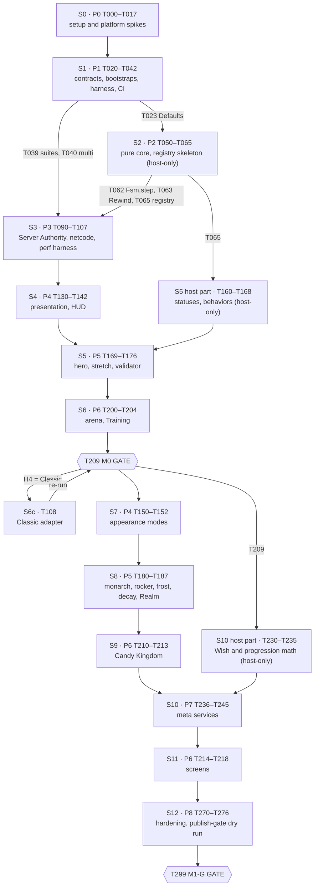

# TASKS — ordered task plan for *Algebraic!* (M0, then M1-G)

> ⚠️ **DRAFT — pre-review snapshot.** An editorial/technical review of this spec found ~200 issues and the fixed
> v1.0 is still being prepared. **Agents: do not execute any task card beyond the P0 human-setup steps (H-01…H-12)
> until this banner is gone.** Humans can start the one-time setup in Part 1 §1.2 now.

Ships as `docs/agent/TASKS.md`. Companion to the build spec `docs/STUDIO_BUILD_SPEC.md` (index + Part 0 contracts; Parts 1–8 are `docs/build-spec/part-N-*.md`, so §3.4 is in `part-3-combat.md`) ("the spec", sections cited as §n.m) and `docs/GDD.md` (cited as GDD §x.y). Sections of this file are cited as TASKS §n. Part 0 (spec §0) contracts apply verbatim. This file is static: the agent never edits a card except to append a `Split into …` note (TASKS §1.2 rule 7).

## 1. How to use this plan

### 1.1 Reader and scope

The reader is the coding agent (Claude Code driving Roblox Studio through the built-in MCP server `Roblox_Studio`, code synced by Script Sync). The plan builds milestone **M0** (feel prototype) and then milestone **M1-G** (graybox vertical slice), as defined in §0.0. It contains 156 cards in the §0.6 format (153 regular cards, the two gate cards T209 `M0 GATE` and T299 `M1-G GATE`, and one conditional card, T108 Classic adapter) and the tables that tie them together.

### 1.2 Rules

1. **One task at a time.** The next task is the **first card in the Execution order (TASKS §3) whose status is `todo`, whose `Depends on` cards are all `done` (or `skipped` with a reason), and whose blocking human checkpoints are satisfied.** This replaces the "lowest-numbered todo" rule of §1.3 step 9: task IDs are grouped by phase (§0.6), but dependencies make the phases interleave (TASKS §3.1).
2. **Inner loop.** Run every card through §1.4 (plan → tests first → implement on disk → host gate → sync gate → builders → playtest → evidence → bookkeeping → commit → human checkpoint). "Done" means green per §1.1.3 (G1–G8).
3. **Read first.** Before coding, read the card, every spec section and GDD section it cites, `ARCHITECTURE.md` and the *Blockers* section of `docs/agent/PROGRESS.md`.
4. **Never skip an acceptance check.** Every `Verify` item is run exactly as written. The host gate, the sync gate (when `src/` changed), `Verify` (when a builder or builder data changed) and the `log_scan` rules of §1.4.6 apply to every card even when the card does not repeat them.
5. **Bookkeeping in the same commit.** Update the card's row in `PROGRESS.md` (status, commit, date, evidence per §1.4.7) and every touched `ARCHITECTURE.md` row (`planned` → `wip` → `done`). Commit subject: `T0xx: <card title>` (titles are ≤ 66 characters so the subject stays ≤ 72).
6. **Human checkpoints.** A card whose checkpoint is marked **blocking** cannot be `done` until the human confirms in `PROGRESS.md` → *Human steps* and the agent's probe passes. Set the card to `awaiting-human`, post a `human-step` blocker (§1.8.2 format, with the click path), and continue with the next eligible card. Non-blocking checkpoints are posted and tracked, but the card may be `done`.
7. **Splitting.** If a card needs more than about 400 changed lines, split it before coding into `T0xxa`, `T0xxb`, … with the same `Depends on`, append `Split into T0xxa, T0xxb (reason)` under the card, and add the rows to `PROGRESS.md`. This is the only allowed edit to this file.
8. **Spikes.** A spike's result is written to `docs/agent/SPIKES.md` (format TASKS §16.1 C3) and indexed in `PROGRESS.md` → *Spike results*. A spike never "fails the task": it records PASS / FAIL / value and the **decision** (which path or fallback is adopted). A rule change that a spike forces goes in an `OPS:` commit that cites the spike ID.
9. **Conditional cards** (only T108) are set to `skipped (reason)` when their condition is false.
10. **Fix budget and escalation** follow §1.1.2 item 6 and §1.8: 3 attempts per failing check, the R1 self-explanation prompt, 1 more attempt, then stash and escalate.
11. **Design numbers.** Never change a GDD number. A missing number gets a value consistent with the GDD, marked `(tuning default)` in code and in `PROGRESS.md`.
12. **IP.** Code, comments, file names, test names, asset keys, commit messages and prompts use IP-neutral IDs only (§8.1.4 R-IP-02). Where a part's text used a canonical name in a test ID or archetype string, this plan renames it (TASKS §16.1 C12).

### 1.3 Notation used in `Verify` lines

| Shorthand | Meaning | Pass condition |
|---|---|---|
| `host` | `lune run tools/check.luau` (§1.4.2) | `[ALG][CHECK] SUMMARY pass=<n> fail=0`, exit 0 |
| `lune(<filter>)` | `lune run tests/run.luau --filter <filter>` (§7.2.2), then `host` | every listed test id prints `[ALG][TEST] <id> PASS`; `SUMMARY … fail=0` |
| `sync` | Sync gate (§1.4.3): `lune run tools/sync_manifest.luau` vs `sync_tree_hash.luau` (Edit) | equal `agg` |
| `builder(<Name>)` | The five builder tests of §1.6.8 (`build_fresh`, `build_idempotent`, `build_reset_equal`, `verify_detects`, `no_sync_side_effects`) via `run_builder.luau` | all five pass; second run `created=updated=removed=0` |
| `snippet(<file>, <DM>, <ARGS>)` | `execute_luau` with `tools/studio/<file>` in data model `<DM>` and the ARGS JSON | returned JSON `ok == true` plus the stated fields |
| `play{…}` | The single-client playtest procedure §1.4.5 P1–P13, with the actions in braces at P8 | Server and Client `log_scan` `ok == true`, `errors == []` |
| `studio(<sel>) ≥ n` | The solo scenario protocol §7.3.6 with selector `<sel>` (available from T038) | `state == "done"`, `fail == 0`, `pass ≥ n`, both `log_scan` ok |
| `mcp(<name>)` | The MCP input-driven protocol §7.3.7 for one `mcp` scenario | as `studio`; a `(fallback)` suffix is allowed only where the card says so |
| `multi(<n>, <profile>, <sel>)` | The multi-client protocol §7.3.8 (available from T040) | `state == "done"`, `fail == 0`; `net`-tagged selections pass twice in a row (§7.1.3) |
| `Log:` | An exact `[ALG]` line expected in `log_scan`/`get_console_output` | present (placeholders in `<…>`) |

Before T038 exists, in-Studio checks use the snippets named in the card and the `log_scan` result.

### 1.4 Statuses and evidence

Task statuses are those of §1.2.8 (`todo`, `in-progress`, `blocked`, `awaiting-human`, `done`, `skipped`). Evidence lines follow §1.4.7 and §7.1.4 (`check:`, `tests:`, `studio:`, `multi(…)`, `perf:`, `H-xx …`). Gate verdicts use §7.7.1 (`[ALG][GATE] M0 PASS automated=<a>/<A> human=<h>/<H>`).

---

## 2. Phase overview and milestone gates

| Phase | Name (§0.6) | IDs used | Goal | Exit criteria |
|---|---|---|---|---|
| P0 | Session setup and platform spikes | T000–T017 | Repository, tools, MCP, Script Sync, builder framework, boot smoke test; every go/no-go platform question answered | Preflight line prints `PREFLIGHT ok …`; host, sync and `Verify` green; `SPIKES.md` has a decision for every P0 spike; H-01…H-06 done |
| P1 | Foundations | T020–T042 | Typed shared contracts (Types, Config, Net, Data, Skin, Assets), bootstraps with 15 services and 10 controllers, Lune infrastructure, solo and multi-client test harness, CI | Boot lines for 15/10 modules; Part 2 Lune specs and scenario suites pass; `multi(2, Baseline30, data.rejoin_persists)` passes; CI green |
| P2 | Pure combat core + Lune tests | T050–T065 | `Core/*`, `Sim/Attr`, `Combat/Rewind`/`Query` logic, golden traces, frame-data export, kit kernel and Styles registry skeleton | Every Part 3 Lune spec passes; `export_framedata --check` exit 0; registry loads 18 stub defs in Lune |
| P3 | Server Authority integration | T090–T108 | Inputs, adapter, simulation loop, hit resolution, rewind, KO/respawn, bots, carriers, netcode tests, perf harness | Every M0 `combat.*`, `sim.*`, `input.*`, `bot.*` scenario passes; multi netcode tests pass at `Baseline30`; perf scenarios run (smoke) |
| P4 | Presentation | T130–T142 (M0), T150–T152 (M1-G) | Placeholder anims, combat animation driver, render/VFX/SFX/camera, ragdoll, Style Tell, HUD and touch; then appearance modes | M0: `render.*`, `vfx.*`, `sfx.*`, `cam.*`, `ragdoll.*`, `hud.*` pass. M1-G: `appearance.*`, `look.*` pass |
| P5 | Style framework and kits | T160–T176 (M0), T180–T187 (M1-G) | Behaviors, hooks, statuses, kit validator, `hero` and `stretch`; then `monarch`, `rocker`, `frost`, `decay` and the Realm | M0: `kit.hero.smoke`, `kit.stretch.smoke` and Part 4 Lune specs pass; H-10 feel for both. M1-G: all six kits pass; Realm scenarios pass |
| P6 | World and UI screens | T200–T204, T209 (M0); T210–T218 (M1-G) | Map framework, lighting, arena, Training Grounds, M0 gate; then Candy Kingdom and every screen | M0 GATE PASS (T209). M1-G: map and screen scenarios pass |
| P7 | Meta systems | T230–T245 | Style ownership, Wish, PolicyGate, shop, progression, mock monetization, telemetry, moderation | Every `wish.*`, `style.*`, `policy.*`, `shop.*`, `progress.*`, `store.*`, `tel.*`, `mod.*` test passes; Monte Carlo within §0.11 |
| P8 | Hardening | T270–T276, T299 | Soak and perf pass, security pass, manifest audit, publish gate (dry run), dev publish, docs | M1-G GATE PASS (T299) |

**Milestone gates.**
- **M0 GATE (T209)** runs after P5's `hero`/`stretch` cards and P6's arena and Training cards (§0.6), with every §7.7.2 item. It also records the NetModel decision (§3.16.4). If the decision is Classic, T108 runs and T209 is re-run.
- **M1-G GATE (T299)** runs at the end of P8 with every §7.7.3 item, the publish-hook dry run (§7.7.6, §8.4.9 `ip.gate_dry_run`) and the owner's design sign-offs.

---

## 3. Execution order and branches

### 3.1 Why the order is not numeric

Three dependencies force phases to interleave: (1) the Sim adapter (P3) needs `StyleDef`s, so the kit kernel and Styles registry **skeleton** is a pure P2 card (T065), while validation and kits stay in P5; (2) the M0 gate needs load-test and netcode infrastructure, which this plan places in P3 (T106, T107) rather than P8; (3) the M1-G screens (P6) need the P7 services, so the M1-G wave runs P7 before the P6 screen cards. The table below is the authoritative order.

### 3.2 Stages

| Stage | Milestone | Cards, in order | Branch (§1.9) | PR |
|---|---|---|---|---|
| S0 | M0 | T000 → T017 | `phase/P0-setup` | at T017 |
| S1 | M0 | T020 → T042 | `phase/P1-foundations` | at T042 |
| S2 | M0 | T050 → T065 | `phase/P2-core` | at T065 |
| S3 | M0 | T090 → T107 | `phase/P3-authority` | at T107 |
| S4 | M0 | T130 → T142 | `phase/P4-presentation` | at T142 |
| S5 | M0 | T160 → T176 | `phase/P5-styles` | at T176 |
| S6 | M0 | T200 → T204, then **T209 M0 GATE** | `phase/P6-world-ui` | at T209 (gate PR, verdict line in the body) |
| S6c | M0 (conditional) | T108, then T209 re-run | `phase/P3-classic` | only if T209 selects Classic |
| S7 | M1-G | T150 → T152 | `phase/P4-presentation-m1g` | at T152 |
| S8 | M1-G | T180 → T187 | `phase/P5-styles-m1g` | at T187 |
| S9 | M1-G | T210 → T213 | `phase/P6-world-ui-map` | at T213 |
| S10 | M1-G | T230 → T245 | `phase/P7-meta` | at T245 |
| S11 | M1-G | T214 → T218 | `phase/P6-world-ui-screens` | at T218 |
| S12 | M1-G | T270 → T276, then **T299 M1-G GATE** | `phase/P8-hardening` | at T299 (gate PR) |

### 3.3 Git rules for stages (extends §1.9)

1. Create the stage branch from the latest `main` when the stage's first card starts (`git switch -c <branch>`). If the previous stage's PR is not merged yet, branch from the previous stage branch head instead (a stacked branch) and say so in the PR body. Never rebase.
2. One commit per green card (`T0xx: <title>`); `OPS:` commits for spike-driven rule changes, snapshot refreshes and `PROGRESS.md`-only updates.
3. A stage PR lists its cards, their evidence lines and any `awaiting-human` items. The human merges; the human creates the `m0-gate` and `m1g-gate` tags after T209 and T299.
4. Only switch branches with no playtest running and a clean tree; run the full sync gate after every switch (§1.2.5).

---

## 4. P0 — Session setup and platform spikes (T000–T019)

P0 answers every platform question before code depends on it. Spikes that need the in-Studio harness use the P0 probe mechanism (TASKS §16.1 C4): probe modules `src/DevTools/Tests/Spikes/Probe_<id>.luau` exporting `start(args)`/`read()` and the snippet `tools/studio/spike_run.luau`. T038 later wraps the probes as `Spike_SAxx` suites (§3.16.3).

### T000 — Bootstrap the repository skeleton and root agent files
- Phase / milestone: P0 / M0
- Depends on: none
- Spec refs: §1.2.4, §1.2.6, §1.2.7, §1.2.8, §1.9, §1.10 C8, C11, C12; §8.4.5 (deny proposals, later); §0.1, §3
- Files & instances (create): `AGENTS.md`, `CLAUDE.md`, `ARCHITECTURE.md` (from the Part 1 drafts); `README.md` (one paragraph); `.claude/settings.json` (§1.2.4 verbatim); `.claude/skills/algebraic-studio/SKILL.md`; `docs/agent/skills/algebraic-conventions.md`, `docs/agent/skills/algebraic-style-kit.md`; `docs/agent/mcp.example.json`; `docs/agent/TASKS.md` (this file); `docs/agent/PROGRESS.md`; `docs/agent/SPIKES.md`; `docs/agent/dev-place.json` (zeros); `docs/agent/ASSET_PROVENANCE.md`; `docs/THIRD_PARTY.md`; `docs/reference/.gitkeep`; `rokit.toml`, `.luaurc`, `selene.toml`, `stylua.toml`, `.styluaignore`, `default.project.json`, `.gitignore`, `.gitattributes`; `src/Shared/.gitkeep`, `src/ServerScriptService/.gitkeep`, `src/DevTools/.gitkeep`, `src/StarterPlayerScripts/.gitkeep`, `tests/.gitkeep`, `tools/studio/.gitkeep`.
- Steps:
  1. `git switch -c phase/P0-setup`.
  2. Write every config file verbatim from §1.2.4–§1.2.7 (`.gitignore` additionally lists `build/`).
  3. In `docs/agent/skills/algebraic-style-kit.md` state that a kit file "returns a builder function producing a StyleModule" (§4.9 item 2), not a StyleDef.
  4. `PROGRESS.md` from the §1.2.8 template: one *Task status* row per card of this plan (status `todo`), one *Human steps* row per H-01…H-12, an empty *Blockers* section and a *Spike results* index table (`| Spike | Result | Decision | Date | SPIKES.md anchor |`).
  5. `SPIKES.md` with the header and entry template of TASKS §16.1 C3.
  6. `ASSET_PROVENANCE.md` with the §1.7.2 row header plus the two §8.5.1 columns `likeness` and `R-###`.
  7. `ARCHITECTURE.md`: keep the Part 1 draft rows (status `planned`) and add `planned` rows for the files this plan adds: `src/DevTools/Tests/` (folder), `src/DevTools/Tests/Spikes/` (folder), `tests/shim/`, `tests/core/`, `tests/wish/`, `tests/ip/` (folders), `tools/plugin/` (folder).
  8. Commit `T000: Bootstrap the repository skeleton and root agent files`.
- Acceptance criteria:
  - Every listed file exists and is committed; `.claude/settings.json` is byte-identical to §1.2.4.
  - `PROGRESS.md` has 156 task rows (one per card, including T108, T209 and T299) and 12 human-step rows.
  - No `.luau` file exists under `src/` yet.
- Verify: `git ls-files` lists every file above; `git check-attr eol -- src/Shared/x.luau` prints `eol: lf`; read back `.claude/settings.json` and compare with §1.2.4. (Lune is not installed yet; T002's host gate re-checks the configs.)
- Human checkpoint: none (host-only; may run before H-01).

### T001 — Human setup: places, MCP connection and Rokit tools
- Phase / milestone: P0 / M0
- Depends on: T000
- Spec refs: §1.2.1 steps 2–4, §1.2.2 H-01, H-02, §1.2.3, §1.2.6; §1.12 S7
- Files & instances: `docs/agent/PROGRESS.md` (*Human steps* H-01, H-02); `docs/agent/SPIKES.md` (S7).
- Steps:
  1. Post a `human-step` blocker listing H-01 steps 1–6 (dev universe `Algebraic DEV`, group-owned, private; local backup `place/Algebraic.dev.rbxl`; scratch place `place/scratch.rbxl`), H-02 steps 1–5 (Studio MCP server on, Claude Code Quick connect) and the Rokit install command of §1.2.6.
  2. After the human reports done: run `claude mcp list` and confirm `Roblox_Studio` is connected; record the registered name as S7 (fallback: the §1.2.3 Option B CLI command, run by the human).
  3. Enumerate the session's `mcp__Roblox_Studio__*` tools (load deferred schemas first) and call `list_roblox_studios`: exactly one entry (the dev place).
  4. Run `rokit trust rojo-rbx/rojo lune-org/lune JohnnyMorganz/StyLua Kampfkarren/selene JohnnyMorganz/luau-lsp` and `rokit install` (Claude Code asks the human to approve: `rokit` is in the `ask` list).
- Acceptance criteria:
  - H-01 and H-02 are `done` in `PROGRESS.md`; S7 recorded.
  - `list_roblox_studios` returns one Studio whose window shows `Algebraic DEV`.
  - The five tools print the pinned versions.
- Verify: `claude mcp list` → `Roblox_Studio … connected`; MCP `list_roblox_studios`; `rojo --version` → 7.7.1, `lune --version` → 0.10.5, `stylua --version` → 2.6.0, `selene --version` → 0.32.0, `luau-lsp --version` → 1.70.1.
- Human checkpoint: **blocking** — H-01 and H-02 (incl. Rokit install); approve the `rokit` prompts.

### T002 — Implement the host gate and the project lint rules
- Phase / milestone: P0 / M0
- Depends on: T001
- Spec refs: §1.4.2, §1.2.6 (type definitions), §1.2.7, §1.10 C6; §4.9 item 1 (pure scope); §1.12 S12
- Files & instances (create): `tools/check.luau`, `tools/lint_rules.luau`, `tools/types/globalTypes.None.d.luau`, `tools/types/globalTypes.PluginSecurity.d.luau`; modify `docs/THIRD_PARTY.md` (luau-lsp type definitions, MIT, tag).
- Steps:
  1. Write `tools/check.luau` from the §1.4.2 skeleton (steps stylua, selene, sourcemap, analyze-game, analyze-plugin, lint-rules, lint-strings, check-manifest, tests; missing tools print `SKIP`).
  2. Write `tools/lint_rules.luau` with rules `strict`, `banned-api`, `sim-time`, `pure`, `require-form`, `script-kind`, `raw-print`, `secrets`, `architecture`, `snippet-size`, `probe` exactly as the §1.4.2 table. Scope `pure` to `src/Shared/Core/**`, `src/Shared/Wish/**`, `src/Shared/Styles/**` and `src/Shared/Behaviors/**` (§4.9 item 1). Output `[ALG][LINT] <path>:<line> <rule> <detail>` and `[ALG][LINT] lint_rules SUMMARY errors=<n> warnings=<m>`; exit 0/1/2.
  3. Fetch the two `globalTypes.*.d.luau` files at the luau-lsp 1.70.1 tag (record the exact tag spelling and URL as S12).
  4. Run `host`. If luau-lsp rejects `--definitions:@roblox=` or the `--ignore` glob, switch to the documented fallback (`--definitions=<path>`) and record it under S12.
  5. Self-test the lints: add a temporary `src/Shared/_LintProbe.luau` without `--!strict`, confirm one `strict` finding, delete it.
- Acceptance criteria:
  - `host` prints `[ALG][CHECK] SUMMARY pass=6 fail=0` with `SKIP` lines for `lint-strings`, `check-manifest` and `tests`; exit code 0.
  - The temporary probe file produces exactly one `[ALG][LINT] src/Shared/_LintProbe.luau:1 strict …` line and is deleted before commit.
  - S12 recorded in `SPIKES.md`.
- Verify: `host`; `lune run tools/lint_rules.luau` → `SUMMARY errors=0`.
- Human checkpoint: none (approve the network fetch of the two type-definition files if prompted).

### T003 — Create the Studio snippet library and sync manifest
- Phase / milestone: P0 / M0
- Depends on: T002
- Spec refs: §1.4.3, §1.4.4, §1.4.5, §1.4.6, §1.5.5, §1.7.2, §1.10 C5, C7
- Files & instances (create): `tools/studio/ping.luau`, `create_sync_roots.luau`, `sync_status.luau`, `sync_tree_hash.luau`, `run_builder.luau`, `clear_output.luau`, `boot_status.luau`, `client_status.luau`, `log_scan.luau`, `quarantine_scan.luau`; `tools/sync_manifest.luau`.
- Steps:
  1. Copy each snippet verbatim from §1.2.5, §1.4.3–§1.4.6, §1.5.5 and §1.7.2 (`--!strict`, header comment with data model and ARGS).
  2. Write `tools/sync_manifest.luau` from §1.4.3 (its `fnv` must be byte-identical to the snippet's).
  3. Run `host` (rule `snippet-size` caps each snippet at 1,536 bytes).
- Acceptance criteria:
  - All ten snippets pass `snippet-size` and the PluginSecurity analysis pass.
  - `lune run tools/sync_manifest.luau` prints `"count": 0` and `"agg": "811c9dc5"` (FNV-1a of the empty string).
- Verify: `host`; `lune run tools/sync_manifest.luau`.
- Human checkpoint: none.

### T004 — Connect Script Sync and run the first full preflight
- Phase / milestone: P0 / M0
- Depends on: T001, T003
- Spec refs: §1.2.5, §1.3 (all steps), §1.5.1, §1.5.2, §1.2.2 H-03; §1.12 S4, S5, S8, S15
- Files & instances: `docs/agent/dev-place.json` (real IDs), `docs/agent/mcp-tools.snapshot.json`; Studio Folders `ReplicatedStorage.Shared`, `ServerStorage.DevTools` (agent-created sync roots).
- Steps:
  1. Pin `studio_id` from `list_roblox_studios`. `snippet(ping.luau, Edit, —)`; write `groupId`, `universeId`, `placeId` into `dev-place.json`; post a non-blocking request for the human to confirm the IDs against Creator Hub, and make no further mutating call until confirmed.
  2. `snippet(create_sync_roots.luau, Edit, —)` → `shared` and `devTools` = `created`.
  3. Post H-03 (Script Sync on the four roots, selecting the parent `src/` folder; Keep Disk on conflict). After done: `snippet(sync_status.luau, Edit, —)` → every root `SyncedAsRoot`. Record S4 (parent-folder mapping) and S5 (GA vs Beta toggle).
  4. Write `mcp-tools.snapshot.json` (§1.5.1 format: name, verbatim description, input schema, `aliases`) from the session's tool definitions; record how the schemas were captured (S15). Commit as `OPS: refresh MCP tool snapshot`.
  5. Run the sync gate (both sides `count 0`), then the round-trip probe of §1.3 step 7 (`src/DevTools/_SyncProbe.luau`: count + 1, then back).
  6. Record S8: after the human's H-01 "Save to File As", does the window stay bound to the published place (ping `placeId` unchanged)?
  7. Print the preflight line.
- Acceptance criteria:
  - `ping` matches `dev-place.json`; `creatorType == "Group"`; `isRunning == false`.
  - All four roots `SyncedAsRoot`; sync `agg` equal before and after the probe; no `_SyncProbe*` file remains.
  - Snapshot committed; S4, S5, S8, S15 recorded.
- Verify: `snippet(ping.luau, Edit, —)`; `snippet(sync_status.luau, Edit, —)`; `sync`; chat line `PREFLIGHT ok studio=<id> place=<placeId> sync=0/811c9dc5 verify=n/a task=T004`.
- Human checkpoint: **blocking** — H-03; confirmation of the IDs in `dev-place.json`.

### T005 — Spike: MCP execution limits and tool behaviour
- Phase / milestone: P0 / M0
- Depends on: T004
- Spec refs: §1.12 S1, S2, S3, S10, S14, S15; §7.11 T7-S4, T7-S7, T7-S12; §8.10 S-P8-3; §1.5.4
- Files & instances: `docs/agent/SPIKES.md`; temporary `src/Shared/_SpikeMarker.luau` (deleted at the end); possibly `OPS:` changes to `tools/lint_rules.luau` (`snippet-size`).
- Steps:
  1. **S1 payload and timeout.** Send inline Edit payloads of 1, 2 and 4 KB (padded comments) returning `{ok=true}`; record the largest accepted. Time a call that runs `task.wait(10)`: record whether calls may yield and the timeout. Record whether `print` output is returned.
  2. **S1 security.** Confirm `InstanceFileSyncService:GetStatus` and `Script.Source` reads succeed from a snippet (already used by T004); record the security level observed.
  3. **S1 require cache.** Require `ReplicatedStorage.Shared._SpikeMarker` twice without cloning, editing the file on disk in between (wait for sync); record whether the second require is stale.
  4. **S2.** Record the `get_studio_state` output shape, the `start_stop_play` parameters and the `datamodel_type` strings into the snapshot notes.
  5. **S3.** In a playtest, print `[ALG][Test] spike S3 server` (Server snippet) and `… client` (Client snippet); read `get_console_output`; record whether both sides appear and whether `clear_output.luau` clears it.
  6. **S10.** In Edit, call `ChangeHistoryService:TryBeginRecording("AlgSpike", "Algebraic: spike")` then `FinishRecording(id, Enum.FinishRecordingOperation.Commit)` inside `pcall`; record the result.
  7. **T7-S4.** In play, a Server snippet sets a marker field on `require(ReplicatedStorage.Shared._SpikeMarker)`; a second Server snippet reads it: record whether `execute_luau` shares the game's module cache.
  8. **T7-S7.** A Client snippet connects `RunService.Heartbeat` incrementing a `LocalPlayer` attribute; a second call reads it: record whether connections persist after the call returns.
  9. **T7-S12.** Print 600 tagged lines, then count `LogService:GetLogHistory()` entries.
  10. **S-P8-3.** Return JSON strings of 16, 64 and 256 KB from Edit; record the largest delivered.
  11. **S14/S15.** Record "not exercised" for quotas (log counts on first `generate_*` use) and the snapshot capture method.
  12. Delete `_SpikeMarker.luau`; adjust `snippet-size` through an `OPS:` commit only if the real payload cap is below 2,048 bytes.
- Acceptance criteria: `SPIKES.md` has entries S1, S2, S3, S10, S14, S15, T7-S4, T7-S7, T7-S12, S-P8-3, each with the measured value and the adopted rule (e.g. "spikes use two-call start/read" or "spikes use one yielding call").
- Verify: `SPIKES.md` entries present; `sync` (marker removed); `host`.
- Human checkpoint: none.

### T006 — Spike: require convention and host toolchain parity
- Phase / milestone: P0 / M0
- Depends on: T004
- Spec refs: §1.2.7, §1.6.3, §1.12 S11, S12; §2.10 item 2, §2.14 item 2; §4.11 S-P4-6; §7.2.4 (Lune 0.10.5 `CFrame.lookAt` bug); §7.10 item 5
- Files & instances (temporary, deleted at the end): `src/Shared/_Req/init.luau`, `src/Shared/_Req/A.luau`, `src/Shared/_Req/B/C.luau`, `src/DevTools/_ReqCross.luau`, `src/DevTools/Builders/_ReqTypeOnly.luau`, `tools/_req_probe.luau`.
- Steps:
  1. Write sample modules using `./`, `../` and `@self/` inside `Shared`, and `@game/ReplicatedStorage/Shared/_Req` from `DevTools/_ReqCross.luau`.
  2. Studio: an Edit snippet requires `_Req` and `_ReqCross` and returns their computed values.
  3. luau-lsp: run `host` and confirm no resolution errors for `./`, `@self/`, `@game/` (with `rojo sourcemap`), and for `type U = typeof(require("./Util"))` in `_ReqTypeOnly.luau`.
  4. Lune: `lune run tools/_req_probe.luau` requires `@shared/_Req` and the relative paths; checks that `@lune/roblox` provides `Vector3.new`, `CFrame.Angles`, `CFrame.lookAt`, `Color3.fromRGB` (S-P4-6) and reproduces the `lookAt(zero, (0,1,-1))` bug.
  5. Decide the cross-root form: `@game/<Service>/…` (Part 1 C1) if Studio and luau-lsp both resolve it, else instance-path requires (`require(game:GetService("ReplicatedStorage").Shared.X)`, Part 2 §2.10 item 2). Encode the decision in `lint_rules` rule `require-form` (`OPS:` commit if it changes).
  6. Delete every temporary file.
- Acceptance criteria: `SPIKES.md` entries S11, S12 (flags), S-P4-6 and "lookAt bug present on 0.10.5: yes/no"; exactly one cross-root require form is recorded and enforced by `require-form`.
- Verify: `host`; `sync` (temporary files removed); `SPIKES.md`.
- Human checkpoint: none.

### T007 — Build the builder framework: Util, BuildAll, Verify
- Phase / milestone: P0 / M0
- Depends on: T004, T005, T006
- Spec refs: §1.6.1–§1.6.8, §1.10 C4; §2.2 rules 1–2 (containers step); §7.3.10 and §7.9 item 6 (leftovers); §6.6.0 rule 6 (`Workspace.ALG_Local`); §0.3
- Files & instances (create): `src/DevTools/Builders/Util.luau`, `BuildAll.luau`, `Verify.luau`; Studio Folders `Workspace.Map`, `Workspace.Sim`, `Workspace.Bots` (owned by `BuildAll`, attribute `AlgBuilder = "BuildAll"`).
- Steps:
  1. `Util.luau` exactly as §1.6.4 (leaf module, requires nothing).
  2. `BuildAll.luau`: first a **containers step** that ensures `Workspace.Map`, `Workspace.Sim`, `Workspace.Bots` (never prunes their children, which other builders own); then the §1.6.6 `ORDER` (`BuildLighting, BuildInputs, BuildTemplates, BuildPlaceholderAnims, BuildVfxTemplates, BuildArena, BuildTraining, BuildMap_CandyKingdom`) with `only`/`skip`; missing builders add `"<name> not implemented"` warnings; wrap in a ChangeHistory recording only if T005 S10 passed; finish with `Verify.verify()`.
  3. `Verify.luau`: §1.6.7 items 1–7; leftovers `ReplicatedStorage.Remotes`, `ReplicatedStorage.Runtime`, `ServerStorage.__AlgScratch`, `ServerStorage.AgentTestRequest`, `ServerStorage.AgentTestResult`, `ServerStorage.AgentTestMultiArgs`, `Workspace.TestPad`, `ReplicatedStorage.TestRun`, `Workspace.ALG_Local`, `ReplicatedStorage.__AlgSpike` (all `[leftover]`); `workspace.StreamingEnabled == true` as `[human:H-04]`.
  4. Run `builder(BuildAll)` treating the three containers as the owned roots.
- Acceptance criteria:
  - First `build {reset:true}` logs `[ALG][BUILD] BuildAll created=3 updated=0 removed=0 warnings=8`; the second run reports `created=0 updated=0 removed=0`.
  - `verify` reports only `[human:H-04] …` (allowed before T009) and `<name> not implemented` warnings.
  - Deleting `Workspace.Sim` makes `verify` name it; a rebuild restores it.
  - `ServerStorage.__AlgScratch` never persists; sync `agg` unchanged by builder runs.
- Verify: `builder(BuildAll)`; `snippet(run_builder.luau, Edit, {"builder":"Verify","fn":"verify"})`.
- Human checkpoint: none.

### T008 — Smoke-test the playtest loop with boot stubs
- Phase / milestone: P0 / M0
- Depends on: T007
- Spec refs: §1.4.5, §1.4.6, §1.10 C2, C3; §2.3.4 (client guard), §2.3.6 (Log); §2.13 item 1, §2.14 item 3; TASKS §16.1 C5 (BOOT tag)
- Files & instances (create): `src/Shared/Log.luau` (full §2.3.6 implementation; tag list plus `BOOT`, `TEST`, `BUILD`, `CHECK`, `LINT`); temporary stubs `src/ServerScriptService/Main.server.luau`, `src/StarterPlayerScripts/Main.client.luau` (replaced in T033).
- Steps:
  1. Server stub: create `ReplicatedStorage.Runtime` (Folder), set attribute `ServerReady = true`, `Log.info("BOOT", "server ready services=0 ms=<n>")`, `Log.test("smoke.boot", true)`, `Log.summary(1, 0)`.
  2. Client stub: the §2.3.4 guard as the first statement, `ReplicatedStorage:WaitForChild("Shared")`, then `Log.info("BOOT", "client ready controllers=0 ms=<n>")`.
  3. Run the full playtest procedure P1–P13 of §1.4.5.
  4. Count `[ALG][BOOT] client ready` lines on the client: exactly 1 proves the double-run guard (§2.14 item 3).
- Acceptance criteria:
  - `boot_status` `ok == true`; `client_status` `clientReady == true`.
  - Server `log_scan`: `summary = {pass=1, fail=0}`, `boot` contains `[ALG][BOOT] server ready services=0 ms=<n>`; no errors.
  - Client `log_scan`: exactly one `[ALG][BOOT] client ready …` line.
  - After stop, `Verify` reports no `ReplicatedStorage.Runtime` leftover.
- Verify: `play{ test lines }` with `snippet(boot_status.luau, Server, —)`, `snippet(client_status.luau, Client, —)`, `snippet(log_scan.luau, Server|Client, {"maxErrors":10})`; Log: `[ALG][BOOT] server ready services=0 ms=<n>`, `[ALG][TEST] smoke.boot PASS`, `[ALG][TEST] SUMMARY pass=1 fail=0`.
- Human checkpoint: none.

### T009 — Human: Server Authority and Avatar Settings, then probes
- Phase / milestone: P0 / M0
- Depends on: T008
- Spec refs: §1.2.2 H-04, H-05; §1.12 S6; §2.2 human-set table; §3.7.4 (CCL not adopted); GDD §18.2, §18.4
- Files & instances: `PROGRESS.md` (H-04, H-05), `SPIKES.md` (S6).
- Steps:
  1. Post H-04 (`Workspace.AuthorityMode = Server`, confirm `StreamingEnabled`, `StarterPlayer.AvatarJointUpgrade = Enabled`, Save to Roblox with Notes) and H-05 (Consistent Gameplay preset, Single Collider, Hit & Touch Detection = Colliders; **skip** the CCL step 3 because §3.7.4 does not adopt the CCL).
  2. Probes: `snippet(ping.luau, Edit, —)` → `streamingEnabled == true`; in a playtest `snippet(client_status.luau, Client, —)` → `prediction == "Predicted"`, `animationConstraints > 0`; try `inspect_instance` on `game.Workspace` and record whether it reports `AuthorityMode` (S6).
  3. `Verify` must no longer report `[human:H-04]`.
- Acceptance criteria: H-04, H-05 `done`; probes pass; S6 recorded.
- Verify: snippets above; `snippet(run_builder.luau, Edit, {"builder":"Verify","fn":"verify"})` → `res.ok == true`.
- Human checkpoint: **blocking** — H-04 and H-05.

### T010 — Spike SA-01, SA-02, SA-04: clock, attributes, roster
- Phase / milestone: P0 / M0
- Depends on: T009
- Spec refs: §3.16.3, §3.16.4 SA-01, SA-02, SA-04; §3.1.3, §3.1.4, §3.1.5; TASKS §16.1 C4
- Files & instances (create): `tools/studio/spike_run.luau` (Server or Client; ARGS `{"id":"SA01","op":"stage|start|read","args":{}}`; on the server `stage` clones `ServerStorage.DevTools.Tests.Spikes.Probe_<id>` into the runtime folder `ReplicatedStorage.__AlgSpike` so the client can require it); `src/DevTools/Tests/Spikes/Probe_SA01.luau`, `Probe_SA02.luau`, `Probe_SA04.luau`.
- Steps:
  1. **SA-01.** The probe binds `RunService:BindToSimulation(fn, Enum.StepFrequency.Hz60)` on the server and on the client and records `Frames.fromTime(time())`-equivalent `math.floor(time() * 60 + 0.5)` and `dt` for 600 calls; `read` returns Δf histogram, `max |dt − 1/60|`, and the client-vs-server frame for one tagged step (§3.16.4 method).
  2. **SA-02.** Inside the server binding, write 52 SPEC-shaped attributes plus 12 junk ones on the local character's HRP (64), then a 65th, one 51-character name and one 51-character string; the client reads which replicated.
  3. **SA-04.** Inside the binding, `pcall` `Players:GetPlayers()` and `player.Character`; record the result only.
  4. Use the execution mode decided in T005 (two-call start/read if connections persist, else one yielding call; if neither works, mark the spikes `deferred to T038`).
  5. Each probe prints `[ALG][TEST] spike.SA-0x PASS|FAIL <detail>` with raw `print` (allowed under `src/DevTools/**`).
- Acceptance criteria: `SPIKES.md` entries SA-01, SA-02, SA-04 with PASS/FAIL and decision (SA-01 fail → escalate as `spec-gap` and mark "Classic candidate"; SA-02 fail → trim `Attr.SPECS` plan; SA-04 → roster cache stays mandatory either way).
- Verify: `play{ snippet(spike_run.luau, Server, {"id":"SA01","op":"stage"}); … start; … read (Server and Client) }`; Log: `[ALG][TEST] spike.SA-01 PASS …`, `[ALG][TEST] spike.SA-02 …`, `[ALG][TEST] spike.SA-04 …`.
- Human checkpoint: none.

### T011 — Spike SA-03 and S9: input reachability under authority
- Phase / milestone: P0 / M0
- Depends on: T010
- Spec refs: §3.16.4 SA-03, SA-14; §1.12 S9; §7.11 T7-S8; §3.10.1; §1.5.7
- Files & instances (create): `src/DevTools/Tests/Spikes/Probe_SA03.luau`, `Probe_SA14.luau`.
- Steps:
  1. The server half creates, at runtime under the local `Player`, an `InputContext` `SpikeCtx` with Bool action `T` (bindings `KBM` = `F`, `Pad` = `ButtonX`, `Script` of type `Enum.InputBindingType.Scriptable`), Bool action `Click` (`KBM` = `MouseLeftButton`) and Direction3D action `Aim` (`Script`), and records `InputAction:GetState()` per sim frame.
  2. **S9:** `user_keyboard_input` press `F` and `user_mouse_input` click at the viewport centre; the server sees `true` within 10 frames?
  3. Client half: `InputBinding:Fire(true)` on `T.Script`; `Aim.Script:Fire(Vector3.new(1, 0, 0))`; the server reads `T` true and `Aim` within 0.001 after ≤ 10 frames?
  4. **T7-S8:** `UserInputService:CreateVirtualInput()` non-nil on the client? Its `F` key drives `T`?
  5. **SA-14:** Awaken-style chord: Bool action with `Pad` = `ButtonR3`, `PrimaryModifier = ButtonL3`; press both (VirtualInput if it can press gamepad buttons; otherwise the human presses LS+RS once with a gamepad or the Studio Controller Emulator).
- Acceptance criteria: `SPIKES.md` entries S9, SA-03, T7-S8, SA-14 with decisions: (a) `mcp` scenarios use real MCP input, or always use the `fallback` client step (§7.3.7 item 6); (b) Script bindings work (else Classic candidate); (c) Awaken pad binding is the chord or `ButtonL3` alone.
- Verify: `play{ MCP key/mouse input; spike_run reads }`; Log: `[ALG][TEST] spike.SA-03 PASS|FAIL …`, `[ALG][TEST] spike.SA-14 …`.
- Human checkpoint: non-blocking — one gamepad chord press if VirtualInput cannot press gamepad buttons.

### T012 — Spike SA-06, SA-11, SA-15: controller and bot attributes
- Phase / milestone: P0 / M0
- Depends on: T010
- Spec refs: §3.16.4 SA-06, SA-11, SA-15; §3.7.4; §3.10.3 (`RunStickThreshold`); §2.5.4, §2.14 item 6
- Files & instances (create): `src/DevTools/Tests/Spikes/Probe_SA06.luau`, `Probe_SA11.luau`, `Probe_SA15.luau`.
- Steps:
  1. **SA-06:** inspect the spawned character for a `ControllerManager`; record the controller in use.
  2. **SA-11:** inside the server and client bindings, toggle `Humanoid.WalkSpeed`, `SetStateEnabled(Enum.HumanoidStateType.Jumping, …)`, `Jump`, `AutoRotate` on a fixed schedule; count client `RunService.Rollback` events; confirm the HRP has `RootAttachment`; record `Humanoid.MoveDirection.Magnitude` for a partial stick push (VirtualInput thumbstick if available, else human).
  3. **SA-15:** create 10 rigs at runtime (`Players:CreateHumanoidModelFromDescriptionAsync` in the Server data model), set `IsBot`, `BotId`, `EquippedStyle`, `Flair`, `Level`, `CombatCfg` before parenting under `Workspace.Bots` near the client; count client rollbacks over 30 s.
- Acceptance criteria: `SPIKES.md` entries SA-06 (default controller, no `ControllerManager` → `HumanoidLoco` path), SA-11 (predicted writes, `RootAttachment` present or `ALG_RootAtt` needed, analog magnitude yes/no → `RunAuto` rule), SA-15 (no attributable rollbacks, or bot meta moves to server memory).
- Verify: `play{ spike_run reads }`; Log: `[ALG][TEST] spike.SA-06 …`, `spike.SA-11 …`, `spike.SA-15 …`.
- Human checkpoint: non-blocking — one partial stick push if VirtualInput cannot emulate a thumbstick.

### T013 — Spike: local plugin install and plugin-only services
- Phase / milestone: P0 / M0
- Depends on: T004
- Spec refs: §7.3.8 (plugin, `net_profile.luau`), §7.6.5 (`device_sim.luau`), §7.1.5; §7.11 T7-S1, T7-S2, T7-S3, T7-S9
- Files & instances (create): `tools/plugin/build.luau` (`lune run tools/plugin/build.luau [--install]` → `build/AlgebraicTestHarness.rbxm`, installs into `roblox.studioPluginPath()`); `tools/plugin/AlgebraicTestHarness/Main.luau` (P0 version: prints `[ALG][Harness] loaded edit=<bool>`; the launcher of §7.3.8 is added in T040), `tools/plugin/AlgebraicTestHarness/Top.luau`; `src/DevTools/Tests/Lib/NetProfiles.luau` (§7.1.5 data); `tools/studio/net_profile.luau`, `tools/studio/device_sim.luau`.
- Steps:
  1. Build and install the plugin; the human restarts Studio once; `get_console_output` (Edit) shows `[ALG][Harness] loaded edit=true` (T7-S2; fallback: the human copies the `.rbxm` into the Plugins folder).
  2. `snippet(net_profile.luau, Edit, {"profile":"M0Gate"})`, then `{"profile":"read"}` and `{"profile":"Off"}` (T7-S3).
  3. `snippet(device_sim.luau, Edit, {"op":"list"})`, `{"op":"set","preset":"phone1334"}`, `{"op":"stop"}` (T7-S9).
  4. T7-S1 (partial): read `StudioTestService.EditModeActive` from a snippet; the actual `ExecuteMultiplayerTestAsync` call is attempted in T040.
- Acceptance criteria: plugin loads; `net_profile` read-back equals `NetProfiles.M0Gate` (60/30/0.5 both directions) and then all zeros; `device_sim` returns ids and sets/stops without error; `SPIKES.md` entries T7-S1 (partial), T7-S2, T7-S3, T7-S9.
- Verify: snippets above; `get_console_output` line `[ALG][Harness] loaded edit=true`; `host` (`analyze-plugin` covers `tools/plugin`).
- Human checkpoint: **blocking** — restart Studio once after the plugin install.

### T014 — Spike: placeholder animation registration vs publishing
- Phase / milestone: P0 / M0
- Depends on: T009
- Spec refs: §0.5 (placeholder animations); §2.9.1 (Studio placeholder animations), §2.14 item 5; §3.16.4 SA-05; §3.11.8; §1.2.2 H-07, H-08; §6.6.8
- Files & instances (create): `src/DevTools/Tests/Spikes/Probe_Anim.luau`, `Probe_SA05.luau`.
- Steps:
  1. In play, the server creates a 2-keyframe `KeyframeSequence` (one Pose on `RightUpperArm`) and calls `AnimationClipProvider:RegisterAnimationClip`; the client does the same with an identical sequence; compare the two temporary ids (§2.14 item 5).
  2. Play the server's temporary id on the local character from a server `RunService:BindToAnimation(…, Enum.StepFrequency.Hz60)` binding; record whether the client sees the track playing.
  3. **SA-05:** play 10 tracks on one Animator inside `BindToAnimation`; count `IsPlaying` (needs either working temporary ids or one published test animation from the human).
  4. Decide: (a) are Studio temporary ids enough for single-client SA playtests? (b) must H-08 happen before T135? (c) manual H-08 vs Open Cloud pipeline (H-07) — ask the owner and record the choice; (d) `Render.MaxCombatTracks` stays 2 unless SA-05 shows fewer than 2.
- Acceptance criteria: `SPIKES.md` entries ANIM-REG (ids identical yes/no; SA playback yes/no), SA-05 (N or `deferred to T135`), and the H-07/H-08 path decision.
- Verify: `play{ spike_run }`; Log: `[ALG][TEST] spike.SA-05 …`.
- Human checkpoint: non-blocking — owner chooses the H-08 path (manual or H-07 pipeline); optionally publishes one test animation.

### T015 — Spike: Studio platform services and avatar loading
- Phase / milestone: P0 / M0
- Depends on: T009
- Spec refs: §1.2.2 H-06, §1.12 S13; §2.6.4, §2.14 items 1, 4; §5.14 POL-1, APP-1; §5.7.3
- Files & instances (create): `src/DevTools/Tests/Spikes/Probe_Platform.luau`.
- Steps:
  1. Post H-06 (Experience Settings → Security → Enable Studio Access to API Services, dev universe only) and an optional request to create ConfigService key `ALG_Probe` (JSON `{"a":1}`) in the dev universe.
  2. **S13:** Server probe `pcall(DataStoreService:GetDataStore("ALG_PROBE"):GetAsync("probe"))`.
  3. **ConfigService:** `pcall(ConfigService.GetConfigAsync, ConfigService)`; `snapshot:GetValue("ALG_Probe")` type (table or string); whether `_` is accepted; `ConfigService:SetTestingValue` in play fires `UpdateAvailable`.
  4. **POL-1:** `PolicyService:GetPolicyInfoForPlayerAsync(player)` result for the Studio player.
  5. **APP-1:** set `Player.CanLoadCharacterAppearance` true, `LoadCharacterAsync`, record avatar applied and `Humanoid.RigType`; then false → default blocky R15.
- Acceptance criteria: `SPIKES.md` entries S13, CFG-1 (GetConfigAsync behaviour, JSON value type, key charset, SetTestingValue), POL-1, APP-1 with decisions consumed by T034 (decode branch), T036/T150 (avatar route A or B), T237 (`StudioFailOpen`).
- Verify: `play{ spike_run }`; `SPIKES.md`.
- Human checkpoint: **blocking** — H-06. Non-blocking — create `ALG_Probe` (if skipped, T034 implements both decode branches).

### T016 — Spike: R15 rig templates built in Edit
- Phase / milestone: P0 / M0
- Depends on: T007
- Spec refs: §6.8.6, §6.15 S-P6-1; §4.11 S-P4-5; §6.7.2 (joint attachment names)
- Files & instances: temporary instances under `ServerStorage.__AlgScratch` (removed in the same call).
- Steps:
  1. An Edit snippet calls `Players:CreateHumanoidModelFromDescriptionAsync(HumanoidDescription.new(), Enum.HumanoidRigType.R15)` inside `pcall`, lists the 15 body parts and every `*RigAttachment`, checks `RightHand.RightGripAttachment`, then destroys the model and `__AlgScratch`.
  2. If the call fails in Edit: post a request for the human to insert one R15 rig via Avatar ▸ Rig Builder into `ServerStorage.Templates.__RigSeed`, and repeat the listing on it.
- Acceptance criteria: `SPIKES.md` entries S-P6-1 (route A builder-generated or B human seed; attachment list) and S-P4-5 (grip attachment present or `RigidConstraint` fallback); no `__AlgScratch` left.
- Verify: snippet result JSON; `Verify` → no leftovers.
- Human checkpoint: non-blocking — rig seed only if route B.

### T017 — Record P0 decisions and open the P0 pull request
- Phase / milestone: P0 / M0
- Depends on: T000–T016
- Spec refs: §1.12; §1.9; §3.16.4 (fallback decision rule); TASKS §16.1 C3
- Files & instances: `docs/agent/SPIKES.md`, `docs/agent/PROGRESS.md`, `AGENTS.md` (only if a spike changed an operating rule).
- Steps:
  1. Check that every P0 spike has a SPIKES.md entry with PASS/FAIL, value and decision; list the deferred ones (to T038, T090, T104, T105, T135) with their new owner card.
  2. Apply rule changes forced by spikes (snippet cap, execution mode, require form, input fallback) in `OPS:` commits citing the spike ID; mirror them in `AGENTS.md`.
  3. Record the GDD §18.11 wording note (built-in MCP server, not the deprecated open-source one) for the owner (Part 1 open question).
  4. Push `phase/P0-setup` (approval) and open the PR with the P0 table and evidence.
- Acceptance criteria: no P0 spike lacks a decision; the PR is open; the preflight line prints `PREFLIGHT ok … verify=ok`.
- Verify: `host`; `sync`; `Verify` ok; PR URL in `PROGRESS.md`.
- Human checkpoint: non-blocking — review and merge the P0 PR.

## 5. P1 — Foundations (T020–T049)

P1 builds every typed shared contract of Part 2 and the test infrastructure of Part 7. Pure modules come with their Lune specs in the same card (tests first, §1.4.1). Service and controller bodies are filled by their owner cards later; P1 gives each one its exact API type (§2.3.5, §2.3.7) and a boot-safe skeleton. Cards T043–T049 are unused.

### T020 — Vendor ProfileStore, Trove, Signal and Shake
- Phase / milestone: P1 / M0
- Depends on: T017
- Spec refs: §2.10 item 10, §2.13 item 2, §2.3.2 (Vendor rows), §1.7.4 (vendored code), §1.11 item 2; §0.2 ("No frameworks"), §3
- Files & instances (create): `src/Shared/Vendor/Trove.luau` (Sleitnick RbxUtil trove 1.8.0), `src/Shared/Vendor/Signal.luau` (signal 2.0.3), `src/Shared/Vendor/Shake.luau` (shake 1.1.0), `src/ServerScriptService/Vendor/ProfileStore.luau` (MadStudio, upstream `45c9847`, wally 1.0.3); modify `docs/THIRD_PARTY.md`, `ARCHITECTURE.md`.
- Steps:
  1. `git switch -c phase/P1-foundations` (TASKS §3.3).
  2. Post a `human-step` blocker asking the owner to approve vendoring the four pinned upstream versions (§1.7.4) and the network fetches.
  3. After approval, fetch each file at its pinned version; prepend exactly `-- Vendored from <repo>@<commit> (<license>). Do not edit. See docs/THIRD_PARTY.md` as line 1; change nothing else.
  4. Add one `THIRD_PARTY.md` row per file: repository, commit or tag, licence (MIT), SHA-256 of the upstream body.
  5. Confirm StyLua, Selene, luau-lsp and the `strict` lint exclude `**/Vendor/**` (configured in T000/T002).
  6. In a playtest, a Server snippet requires the four modules and returns `{profileStore = typeof(ProfileStore.New) == "function", trove = …, signal = …, shake = …}`.
- Acceptance criteria:
  - Each vendored body hashes to the SHA-256 recorded in `THIRD_PARTY.md`; line 1 is the attribution header.
  - `host` green with the vendored files present (no `strict` or analysis finding under `Vendor/`).
  - The play snippet returns all four flags `true`; no errors in `log_scan`.
- Verify: `host`; `sync`; `play{ execute_luau Server: require + typeof checks }`; `snippet(log_scan.luau, Server, {"maxErrors":10})`.
- Human checkpoint: **blocking** — approve the four upstream versions before they are committed.

### T021 — Build the Lune runner, test API and loader shim
- Phase / milestone: P1 / M0
- Depends on: T006, T008, T017
- Spec refs: §7.2.1–§7.2.5, §7.5.5, §7.4.2; §1.4.2 (`tests` step); §2.3.6 (Log), §2.10 (standards); TASKS §16.1 C18
- Files & instances (create): `tests/run.luau`, `tests/shim/T.luau`, `tests/shim/Loader.luau`; `tests/core/shim.spec.luau`, `tests/core/log.spec.luau`, `tests/core/standards.spec.luau`, `tests/core/tools.spec.luau`; fixtures `tests/core/fixtures/runner/**` (passing, failing, duplicate-id, load-error specs) and `tests/core/fixtures/loader/**` (plain file, `init.luau` folder, `@self/` child, impure module indexing `game`); modify `tools/lint_rules.luau` (rules `devtools-isolation`, `test-loader`, §7.5.5), `tools/check.luau` (the `tests` step stops printing `SKIP`).
- Steps:
  1. Write `T.luau` (§7.2.3: `describe`, `it`, `pending`, `expect` matchers) and `run.luau` (§7.2.2: discovery of `tests/**/*.spec.luau`, flags `--filter`, `--list`, `--fast`, `--tag`; one `[ALG][TEST] <id> PASS` or `[ALG][TEST] <id> FAIL <detail>` line per test, `[ALG][Test] pending id=<id> task=<T0xx>` for pending ones, then `[ALG][TEST] SUMMARY pass=<n> fail=<m>`; exit 0 pass, 1 failures, 2 load failure or duplicate id).
  2. Write `Loader.luau` (§7.2.4): `@lune/roblox` datatypes as globals, require resolution for `./`, `../`, `@self/`, `@shared/` and the cross-root form decided in T006, one instance per path, the impure guard (no `game`, `workspace`, `script`, `Instance` in the module environment; the error names the module path), `Loader.new(env)` for fakes, and the `CFrame.lookAt` patch when T006 recorded the 0.10.5 bug.
  3. Specs: `shim.datatypes_typeof`, `shim.loader_relative_and_self`, `shim.loader_same_instance`, `shim.loader_rejects_impure`, `shim.cframe_lookat_reference`, `runner.cli_contract`; `log.format_sorted_pairs`, `log.test_lines_exact` (against `src/Shared/Log.luau` from T008); `standards.strict_headers`, `standards.no_deprecated` (§2.10 scan list, plus `Player:LoadCharacter(` per §2.13 item 5); `standards.devtools_isolation`, `standards.test_loader_only`.
  4. Add the two lint rules and enable the `tests` step in `check.luau` (`--fast` in the host gate, full run in CI).
- Acceptance criteria:
  - `lune run tests/run.luau` prints PASS for the 12 ids above and `SUMMARY … fail=0`; exit 0.
  - Running against the duplicate-id fixture exits 2 (asserted inside `runner.cli_contract`).
  - `host` prints `[ALG][CHECK] SUMMARY pass=7 fail=0` with `SKIP` only for `lint-strings` and `check-manifest`.
- Verify: `lune(shim)`; `lune(runner)`; `lune(log)`; `lune(standards)`; `lune run tests/run.luau --list` lists the 12 ids; `host`.
- Human checkpoint: none.

### T022 — Implement Schema utilities: validators, canonical JSON, hash
- Phase / milestone: P1 / M0
- Depends on: T021
- Spec refs: §2.6.3 (utilities), §2.12 item 9; §1.4.3 (`fnv` must match the sync manifest's FNV-1a)
- Files & instances (create): `src/Shared/Config/Schema.luau` (utility part), `tests/core/schema.spec.luau`.
- Steps:
  1. Write the failing specs `schema.canonical_stable`, `schema.hash32_vectors` (`""` → `811c9dc5`, `"a"` → `e40c292c`), `schema.merge_rejects_unknown`, `schema.merge_type_mismatch`.
  2. Implement `Schema.t` combinators (`struct`, `opt`, `oneOf`, `enum`, `int`, `num`, `str(max, pattern?)`, `bool`, `map`, `array`, `none`, `styleId`/`flairId` hooks filled by T024), `Schema.canonical` (sorted keys, arrays dense, no NaN/inf), `Schema.hash32` (FNV-1a 32, lowercase hex), `Schema.merge(base, overlay)` (rejects unknown keys and type mismatches, returns the problem list), `Schema.deepFreeze`, `Schema.isJsonSafe`.
- Acceptance criteria: the four specs pass; the module loads through `Loader` with no impure access.
- Verify: `lune(schema)`.
- Human checkpoint: none.

### T023 — Write Defaults.luau and the config section rules
- Phase / milestone: P1 / M0
- Depends on: T022
- Spec refs: §2.6.2, §2.6.3 (config parts), §2.12 items 6–7; §0.9; §4.1.6 (`Kits`); §6.11 (`Appearance`); §8.2.6 (`Ip`); §8.4.3 rule L21 and §8.6.2 (`Features.PaidRandomItems`); §7.6.7 (`Features.LoadTest*`)
- Files & instances (create): `src/Shared/Config/Defaults.luau`; modify `src/Shared/Config/Schema.luau` (config rules), `tests/core/schema.spec.luau`.
- Steps:
  1. Write `Defaults.luau` with every §0.9 top-level key plus `Net`, `Data`, `Features`; fill Part 2's values for `Shop`, `Economy`, `Progression`, `Net`, `Data`, `Features`, `Telemetry`; `Appearance` from §6.11 (incl. the Oosona lists of §2.12 item 6); `Kits` from §4.1.6 (empty overrides); `Ip = { DevUniverseIds = { <universeId from dev-place.json> }, LicenseRef = "" }`; `Features` additionally `PaidRandomItems = true`, `LoadTestBots = 0`, `LoadTestMapId = ""`, `LoadTestGameIds = {}`. `Combat`, `Wish` and `Perf` keep the §2.6.2 placeholder shapes (filled by T050, T230, T130).
  2. Add the per-section rules of §2.6.3 to `Schema` (types, ranges, the overridable-section list, JSON safety: vectors as arrays, colours as hex).
  3. Specs: `schema.defaults_valid`, `schema.defaults_json_safe`, `schema.config_size` (canonical JSON < 190,000 chars, else a warning that chunking is active).
- Acceptance criteria: the three specs pass; every GDD number copied into `Defaults` carries a `-- GDD §x.y` comment; numbers the GDD lacks are marked `(tuning default)`.
- Verify: `lune(schema)`; `host`.
- Human checkpoint: none.

### T024 — Write Types.luau with every cross-part type and ID list
- Phase / milestone: P1 / M0
- Depends on: T023
- Spec refs: §2.4 (all), §2.12 items 4, 12, 14; §3.15.2 (`TrainingDummyReq` behaviours), §3.13.7 (`StreakEvent`, `CombatFeed`), §5.2.6, §5.2.9, §5.2.10 (`OddsView`, `firstReveal`, `paidEscrow`), §5.6.4 and §5.12 (`StoreView.spentThisWeekRobux`, `PurchaseState.weekIndex`/`weekRobux`), §5.8.4 (`FtueStepReq`), §6.13 item 10 (`quietBarks`); TASKS §16.1 C7; §0.10
- Files & instances (create): `src/Shared/Types.luau`, `tests/core/types.spec.luau`.
- Steps:
  1. Write `Types.luau` from §2.4 with the cross-part additions listed in the spec refs; `Types.Config = typeof(Defaults)`; `STYLE_IDS` (18, §0.10 order), `FLAIR_IDS`, `VARIANT_IDS` (`v1`..`v9`), `SETTING_KEYS` (incl. `quietBarks`), the `DevCmd` union (§2.11.5 plus later additions, appended by owner cards), `IMPLEMENTED_M1G = {}` (it grows per kit card, TASKS §16.1 C7). All ID lists `table.freeze`d.
  2. Wire `Schema.t.styleId`/`t.flairId` to the frozen lists.
  3. Specs: `types.ids_frozen`, `types.style_ids_match_spine` (literal §0.10 list), `types.implemented_matches_styles` written as `pending` with reason `task=T065`.
- Acceptance criteria: the two active specs pass; the pending spec prints `[ALG][Test] pending id=types.implemented_matches_styles task=T065`; luau-lsp reports no type errors.
- Verify: `lune(types)`; `host`.
- Human checkpoint: none.

### T025 — Add the PlayerData template, settings validators and Oosona codec
- Phase / milestone: P1 / M0
- Depends on: T024
- Spec refs: §2.8.3, §2.8.4, §2.8.6, §2.12 items 9, 12; GDD §17.2 (currencies), §9 (progression fields)
- Files & instances: modify `src/Shared/Config/Schema.luau` (PlayerData template, `normalize`, `migrate`, `CURRENT_SCHEMA = 1`, `validatePlayerData`, settings validators, `encodeOosona`/`decodeOosona`); create `tests/core/playerdata.spec.luau`.
- Steps:
  1. Specs first: `playerdata.template_valid`, `playerdata.normalize_starters`, `playerdata.migrate_noop_v1`, `playerdata.schema_ahead_preserved`, `playerdata.max_size_under_64kb`, `oosona.codec_roundtrip`, `settings.validators`.
  2. Implement the template exactly as §2.8.3 (starter styles, currencies incl. global `Shards`, ledger field), `normalize` (adds missing keys, grants starters), `migrate` (no-op for v1; `schema > CURRENT` logs `WARN schema ahead` and preserves unknown keys), per-key setting validators (§2.8.6), and the Oosona codec (`o1.<species>.<RRGGBB>.<face>.<hat>.<outfit>`, ≤ 30 chars, `nil` on malformed input).
- Acceptance criteria: the seven specs pass; the worst-case profile of `playerdata.max_size_under_64kb` is < 64,000 bytes of canonical JSON (the measured size is printed in the test detail).
- Verify: `lune(playerdata)`; `lune(oosona)`; `lune(settings)`; `host`.
- Human checkpoint: none.

### T026 — Implement Config/Runtime with versioned frozen config
- Phase / milestone: P1 / M0
- Depends on: T020, T025
- Spec refs: §2.6.5, §2.6.6, §2.12 item 8
- Files & instances (create): `src/Shared/Config/Runtime.luau`; extend `tests/core/schema.spec.luau` only if a pure helper (decode, chunk join) is factored out.
- Steps:
  1. Implement `Runtime.get()`, `Runtime.at(version)`, `Runtime.version()`, `Runtime.hash()`, `Runtime.changed` (Signal), the chunk join for `Parts`, and the cache of decoded versions; on the client it reads `ReplicatedStorage.Runtime.Config` and `History.v<n>`; when no Runtime folder exists (Lune, Edit) it returns the frozen `Defaults` as version 0.
  2. Keep the module safe to require in Edit and Lune (no `WaitForChild` at require time).
- Acceptance criteria: in Lune, `Runtime.get()` equals `Defaults` and is frozen; in Edit, a snippet requiring `Runtime` returns version 0 without yielding.
- Verify: `lune(schema)`; `snippet` (Edit, inline) `require(ReplicatedStorage.Shared.Config.Runtime).version() == 0`; `host`.
- Human checkpoint: none.

### T027 — Write the Net schema catalog for every remote
- Phase / milestone: P1 / M0
- Depends on: T024
- Spec refs: §2.7.3, §2.7.4 (rows 1–23), §2.11.5 (`DevCmd`); §3.13.7 (`Combat.Feed`), §3.14 (Classic-only remotes, conditional), §5.8.4 (`Ftue.Step`), §6.2.2 and §6.13 item 6 (`World.Travel` adds `"arena_duel_m0"`); TASKS §16.1 C11
- Files & instances (create): `src/Shared/Net/Schemas.luau`, `tests/core/net_schemas.spec.luau`.
- Steps:
  1. Specs first: `net.specs_complete`, `net.dev_studio_only`, `net.validators_reject_fuzz` (the §2.7.4 fuzz list: `nil`, number, string, array for struct, extra key, NaN, `math.huge`, 10 kB string, 33-key table; one known-good payload accepted).
  2. Write `list` and `byName` in catalog order: rows 1–23 of §2.7.4 with their rates and shape validators; `World.Travel` `mapId` enum `{"candy_kingdom", "training", "arena_duel_m0"}`; `Combat.Feed` (S2C event, Part 3); `Ftue.Step` (C2S event, rate 5 / 1, `struct{step = int(1, 9), skipped = bool}`, owner ProgressionService, §5.8.4); the Classic-only specs of §3.14 marked `classicOnly = true` (built only when `NetModel == "Classic"`, T108).
- Acceptance criteria: the three specs pass; every name matches `^%u%a+%.%u%a+$` or is `Notify`.
- Verify: `lune(net)`; `host`.
- Human checkpoint: none.

### T028 — Implement the Net wrapper with buckets and validation
- Phase / milestone: P1 / M0
- Depends on: T026, T027
- Spec refs: §2.7.1, §2.7.2, §2.11.2, §2.12 item 13; TASKS §16.1 C11
- Files & instances (create): `src/Shared/Net/init.luau`.
- Steps:
  1. Implement `NetServerApi`, `NetClientApi` and `_buildRemotes(isStudio)` exactly as §2.7.2: instances created unparented in `init`, parented by `open`; the five-step C2S pipeline (global bucket, per-remote bucket with `Net.LimitOverrides`, `validate`, ready check, `pcall` handler); throttled WARN lines; client-side bucket; `invoke` with timeout that never throws.
  2. Expose the internal `_dispatch(player, name, payload)` seam used by Studio tests (no remote round-trip).
  3. Default handler (TASKS §16.1 C11): a C2S remote with no registered handler answers `{ok = false, err = "disabled", detail = "no_handler"}` (invoke) or is dropped with one `[ALG][Net] WARN no_handler remote=<name>` (event).
- Acceptance criteria: in Edit, `Net._buildRemotes(true)` returns a detached Folder with one child per non-Classic spec (incl. `Dev.Command`); `_buildRemotes(false)` has no `Dev.*` child. Scenario coverage follows in T039 (`net.rate_limit_drops`, `net.invalid_payload_rejected`, `net.remotes_match_catalog`).
- Verify: `snippet` (Edit, inline): counts of `_buildRemotes(true)` and `(false)` children equal the catalog counts; `host`.
- Human checkpoint: none.

### T029 — Implement the Skin API with pack resolution and looks
- Phase / milestone: P1 / M0
- Depends on: T026
- Spec refs: §2.9.2, §2.12 item 17; §8.2.2–§8.2.7, §8.2.8 (Lune); §0.4 (Skin)
- Files & instances (create): `src/Shared/Skin/init.luau`, empty pack shells `src/Shared/Skin/Packs/Original.luau`, `Codename.luau`, `Canon.luau` (filled in T030); `tests/core/skin.spec.luau`.
- Steps:
  1. Specs first: `skin.fallback_order`, `skin.canon_locked`, `skin.interpolate_ids`, `skin.missing_logged_once`, `skin.resolve_pack_matrix` (the six §8.2.6 rows), `skin.look_active_only`.
  2. Implement `Skin.text(key, args?)` (active pack → Original → `[key]`; one WARN per missing key), `*Id` argument resolution, `Skin.setPack(pack, licenseConfirmed)` (clients call it with the published config), the pure `Skin.resolvePack(requested, gate): (PackId, PackDowngrade?)` with the `PackGate` type and the six-row truth table of §8.2.6, `Skin.look(styleId)` (§8.2.7: `nil` unless Original is active), `Skin.active()`, `Skin.changed`.
- Acceptance criteria: the six specs pass; `Skin` never requires a service.
- Verify: `lune(skin)`; `host`.
- Human checkpoint: none.

### T030 — Write the pack tables and the string lint
- Phase / milestone: P1 / M0
- Depends on: T029
- Spec refs: §8.3.1–§8.3.8 (all tables), §8.2.3 (shape and inheritance), §8.4.2 (rules data), §8.4.3 (L01–L08, L12, L13, L16), §7.5.1, §7.4.7; GDD §7.2 (style list), GDD §13 (UI copy)
- Files & instances: fill `src/Shared/Skin/Packs/Original.luau`, `Codename.luau`, `Canon.luau` (shape only, locked); create `tools/lint_strings.rules.json` (v2), `tools/lint_strings.luau`, `tests/ip/ip.spec.luau`, `tests/ip/fixtures/**`; modify `tests/core/tools.spec.luau` (`skin.pack_key_coverage`, `lint.strings_clean`, `lint.strings_detects_fixture`), `tools/check.luau` (`lint-strings` step active).
- Steps:
  1. Copy every key of §8.3.2–§8.3.7 into `Original` and `Codename` (styles ×18, move names of the six M1-G kits, maps and zones, rarities, flairs, generated families, core UI strings incl. `ui.shop.goose_line_<n>` and `ui.error.<ErrCode>`); Original looks palettes per §8.5.6. Canon holds the shape only.
  2. Write the rules file and `lint_strings.luau` with rules L01–L08, L12, L13, L16 (dev mode), flags `--text`, `--scope`, `--pack`, output `[ALG][LINT] <path>:<line> <rule> <detail>` and an exit code; rules L09–L11, L14, L15, L17–L21 are added in T273.
  3. Specs: `ip.rules_schema`, `ip.normalize_matches`, `ip.original_clean`, `ip.codename_clean`, `ip.leak_detect`, `ip.algebraic_allowlist`, `ip.gambling_terms`, `ip.product_keys_original_only`, `ip.pack_shapes`, `skin.pack_key_coverage`, `lint.strings_clean`, `lint.strings_detects_fixture`.
- Acceptance criteria: the 12 specs pass; `lune run tools/lint_strings.luau` exits 0 on the repo; `host` runs `lint-strings` (no `SKIP`).
- Verify: `lune(ip)`; `lune(skin.pack_key_coverage)`; `lune(lint.strings)`; `host`.
- Human checkpoint: none (pack text is reviewed by the owner at the M1-G gate, H3).

### T031 — Write the Assets manifest and the manifest lint
- Phase / milestone: P1 / M0
- Depends on: T026
- Spec refs: §2.9.1, §2.12 item 16; §7.5.2 (M01–M08), §8.5.1 (provenance, M09–M12), §8.5.8; §0.4–§5 (asset keys, placeholders)
- Files & instances (create): `src/Shared/Assets.luau` (keys, `tpl:` scheme, `FALLBACK`, `registerTemp`, `registerStudioClips`, `products[0]` for unpublished Studio, provenance type), `tools/check_manifest.luau`, `tests/core/assets.spec.luau`, `tests/core/fixtures/manifest/**`; modify `tests/core/tools.spec.luau`, `tests/ip/ip.spec.luau` (`ip.prov_rules`), `tools/check.luau` (`check-manifest` step active).
- Steps:
  1. Specs: `assets.keys_wellformed`, `assets.resolution_order`, `assets.products_dev_present`, `lint.manifest_clean`, `lint.manifest_release_detects_placeholder`, `lint.manifest_raw_id_detected`, `ip.prov_rules`.
  2. Implement `Assets` (§2.9.1) with the initial keys (generic UI, `FALLBACK`, product and pass keys with `products[0]`), then `check_manifest.luau` rules M01–M12 and the `--release` flag.
- Acceptance criteria: the seven specs pass; `host` prints `SUMMARY pass=9 fail=0` (no `SKIP` left).
- Verify: `lune(assets)`; `lune(lint.manifest)`; `lune(ip.prov_rules)`; `host`.
- Human checkpoint: none.

### T032 — Create the 15 service and 10 controller skeletons
- Phase / milestone: P1 / M0
- Depends on: T028, T029, T031
- Spec refs: §2.3.2, §2.3.3, §2.3.5, §2.3.7, §2.5.2, §2.5.3, §2.11.3; §5.8 (Telemetry core), §5.9 (Moderation core), §5.3 (PolicyGate fail-safe); §3.13.4 (CombatService spawn stub); TASKS §16.1 C9, C14
- Files & instances (create): `src/ServerScriptService/Services/` `ConfigReplicator`, `Telemetry`, `ModerationService`, `DataService`, `PolicyGate`, `MonetizationService`, `StyleService`, `AppearanceService`, `CombatService`, `BotService`, `ProgressionService`, `WishService`, `ShopService`, `PlayerService`, `TestHarness` (`.luau`); `src/StarterPlayerScripts/Controllers/` `UiController`, `SettingsController`, `InputController`, `CameraController`, `AnimController`, `VfxController`, `SfxController`, `AppearanceController`, `RenderController`, `HudController` (`.luau`).
- Steps:
  1. Each module is annotated with its exact API type from §2.3.5/§2.3.7 (`local X: XApi = {} :: any`), owns its Signals, requires only earlier modules, and has non-yielding `init`/`start` that return within 1 s.
  2. Minimal bodies so boot works end to end: `ConfigReplicator` publishes v1 from `Defaults` (full version T034); `Telemetry` ring buffer plus `[ALG][TEL]` echo in Studio; `ModerationService` signal counters, summary and throttle, registered as the Net violation sink; `PolicyGate` fail-safe (restricted on failure); stubs write the §2.5.2 attribute defaults they own; `CombatService` stub `spawnAsync` sets `CombatCfg` and calls `Player:LoadCharacterAsync()` at the map spawn or the fallback spawn (TASKS §16.1 C9: `CFrame.new(0, 5, 0)` plus `[ALG][Combat] WARN no_spawn map=<id>`); `TestHarness` returns immediately outside Studio.
  3. Every unimplemented method raises nothing: it logs once `[ALG][<Tag>] WARN not_implemented fn=<name>` and returns a neutral value; `Dev.Command` entries not yet owned answer `{ok = false, err = "not_implemented"}` (TASKS §16.1 C14).
- Acceptance criteria: luau-lsp type-checks every module against its API type; `standards.strict_headers` passes; the `architecture` lint finds no row missing in `ARCHITECTURE.md`.
- Verify: `host`; `sync`.
- Human checkpoint: none.

### T033 — Write the real server and client bootstraps
- Phase / milestone: P1 / M0
- Depends on: T032
- Spec refs: §2.3.3, §2.3.4, §2.12 items 1–2; §7.3.9 (`Main.client` TestRun hook); §2.9.1 (`registerStudioClips`); TASKS §16.1 C5, C13
- Files & instances: replace `src/ServerScriptService/Main.server.luau` and `src/StarterPlayerScripts/Main.client.luau`.
- Steps:
  1. Server: `ORDER` (15), error if a module in `Services/` is missing from `ORDER` (orphan check), `init` all, `start` all, `Net.server.open()`, attribute `ServerReady`, `Log.info("BOOT", "server ready services=15 ms=<n>")`.
  2. Client: the double-run guard first, `Net.client.init`, `ORDER` (10), `Assets.registerStudioClips()` when in Studio, `Log.info("BOOT", "client ready controllers=10 ms=<n>")`, then the Studio TestRun hook of §7.3.9 (requires the client driver only when `ReplicatedStorage.TestRun` exists).
  3. Remove the T008 `smoke.boot` lines (TASKS §16.1 C13).
- Acceptance criteria:
  - `play{}` with `boot_status` ok; Server Log: `[ALG][BOOT] server ready services=15 ms=<n>`; Client Log: exactly one `[ALG][BOOT] client ready controllers=10 ms=<n>`.
  - `ReplicatedStorage.Remotes` has one child per non-Classic catalog entry during play; none after stop.
- Verify: `play{ boot_status; client_status; log_scan Server|Client }`; `snippet(run_builder.luau, Edit, {"builder":"Verify","fn":"verify"})` after stop → ok.
- Human checkpoint: none.

### T034 — Complete ConfigReplicator: overlay, history, overrides
- Phase / milestone: P1 / M0
- Depends on: T033, T015
- Spec refs: §2.6.1, §2.6.4, §2.6.5, §2.6.6, §2.12 items 7–8; §8.2.6 (pack guard, `setSkinPack`, `_devContextOverride`), §8.8 item 2; SPIKES CFG-1
- Files & instances: modify `src/ServerScriptService/Services/ConfigReplicator.luau`, `src/Shared/Config/Runtime.luau` (client apply path), `src/DevTools/Tests/Lib/DevCommands.luau` once T038 exists (`setConfig`, `setSkinPack`).
- Steps:
  1. Overlay: read `ConfigService:GetConfigAsync()` in `pcall` (Studio failure → Defaults); decode `ALG_<Section>` values per the CFG-1 decision (table or JSON string; implement both branches if CFG-1 was skipped); `Schema.merge` per overridable section; reject invalid sections with one WARN each; listen to `UpdateAvailable` and refresh.
  2. Publish: canonical JSON, `Hash`, `Version`, `Parts` chunking above 190,000 chars; `History.v<n>` with `pin(version)`/`unpin(version)` and removal ~10 s after the last unpin.
  3. `devOverride(section, json)` (Studio only, via `Dev.Command setConfig`) and `ConfigService:SetTestingValue` support; every publish logs `[ALG][Config] published v=<n> hash=<hash> src=<defaults|configservice|dev> bytes=<n>`; the client logs `[ALG][Config] applied v=<n> hash=<hash>`.
  4. Pack guard (§8.2.6): `applyPackGuard(cfg)` on every candidate snapshot (v1 and every overlay) through `Skin.resolvePack`, logging `[ALG][Skin] ERROR pack_downgraded effective=<p> reason=<r> requested=<p>` on a downgrade; `DevCmd setSkinPack(pack)` runs the same path; the `_devContextOverride` seam exists for TestHarness only.
- Acceptance criteria: in play, `Runtime.version() == 1` on both peers; `devOverride("Shop", …)` bumps to 2 and the client logs `[ALG][Config] applied v=2 hash=<hash>`; `Hash` equals `Schema.hash32` of the published JSON.
- Verify: `play{ execute_luau Server and Client: Runtime.version(), Runtime.hash() }`; Log: `[ALG][Config] published v=1 hash=<hash> src=defaults bytes=<n>`. Scenarios follow in T039.
- Human checkpoint: none.

### T035 — Implement DataService on ProfileStore with transactions
- Phase / milestone: P1 / M0
- Depends on: T033
- Spec refs: §2.8.1–§2.8.7, §2.12 items 11–12; §2.14 item 7 (ProfileStore `Cancel` typing); GDD §17.2 (cap and overflow)
- Files & instances: modify `src/ServerScriptService/Services/DataService.luau`.
- Steps:
  1. Store `PlayerData_v1`, key `Player_<UserId>`, Mock in Studio unless `Data.StudioLiveData` is true and H-06 is done; `StartSessionAsync` with `Cancel` (cast `:: any` if luau-lsp rejects the field; record the result as §2.14 item 7 in `SPIKES.md`).
  2. Session lifecycle §2.8.2 (normalize, migrate, `DataLoaded`, release on leave with `beforeRelease` hooks, `[ALG][Data] released user=<id>`); `update(player, section, mutator)` atomic with rollback on error and rejection of yields; `tx.credit/debit/canAcceptWishes`; overflow conversion; Studio out-of-band integrity check; 4 Hz delta coalescing with `seq`; `Data.Ready` → `Data.Snapshot`; `DataService.now()` with the Studio offset.
- Acceptance criteria: in play, Server Log `[ALG][Data] loaded user=<id> mode=Mock schema=1 ms=<t> bytes=<n>`; after stop, `[ALG][Data] released user=<id>`; a forced mutator error leaves Treasure unchanged and logs `ERROR rollback`.
- Verify: `play{ log_scan }`; inline Server `execute_luau` calling `DataService.update` with an erroring mutator. Scenarios follow in T039.
- Human checkpoint: none.

### T036 — Implement PlayerService join, leave and travel
- Phase / milestone: P1 / M0
- Depends on: T035
- Spec refs: §2.1.3 flows D and E, §2.3.5 (PlayerService API), §2.5.2, §2.7.4 row 15; §6.2.2 and §6.13 item 6 (initial `MapId`, travel rules, `DevEnableMouseLock`), §6.6.5 (shift-lock); §2.2 (`CharacterAutoLoads = false`)
- Files & instances: modify `src/ServerScriptService/Services/PlayerService.luau`.
- Steps:
  1. `init`: `Players.CharacterAutoLoads = false`; `Net.server.setReadyCheck(isReady)`.
  2. Join: per-player `Trove`, `player.DevEnableMouseLock = false`, `DataService` load, `DataLoaded = true`, initial `MapId` (`candy_kingdom` if `Workspace.Map.CandyKingdom` exists, else `arena_duel_m0`), attach input contexts (no-op until T091), `CombatService.spawnAsync`; `start()` processes players already present.
  3. Leave: trove cleanup, `CombatService.onPlayerRemoving`, data release.
  4. `World.Travel` handler: map enum incl. `arena_duel_m0`, `Features.Training`, `CombatService.canTravel` (training → training skips the combat tag), `travelAsync` respawns at the target map.
- Acceptance criteria: in play the local player has `DataLoaded = true` and `MapId = "arena_duel_m0"` (no map built yet) and a character at the fallback spawn with the `no_spawn` WARN; `Net.client.invoke("World.Travel", {mapId = "training"})` returns `{ok = false, err = "disabled"}` or the Training failure reason without errors.
- Verify: `play{ execute_luau Client: attributes; invoke World.Travel }`; Log: `[ALG][Player] ready user=<id> ms=<n>`.
- Human checkpoint: none.

### T037 — Implement the client store and settings controller
- Phase / milestone: P1 / M0
- Depends on: T036
- Spec refs: §2.3.7, §2.8.6, §2.7.4 rows 2, 20–21; §6.9.9 (settings list), §6.13 item 10 (`quietBarks`)
- Files & instances: modify `src/StarterPlayerScripts/Controllers/UiController.luau`, `SettingsController.luau`.
- Steps:
  1. `UiController`: PrivateView store from `Data.Snapshot`, ordered `Data.Delta` application by `seq`, gap detection → `[ALG][UI] data gap seq=<n> resync` and a new `Data.Ready`; `state()`, `changed` signal; ScreenGui roots `ALG_Screens`, `ALG_Toasts` (`ResetOnSpawn = false`).
  2. `SettingsController`: typed accessors for every `SETTING_KEYS` entry, local validation with the shared validators, `Settings.Set` with the local bucket.
- Acceptance criteria: in play, `UiController.state().settings` equals the template settings; a `Settings.Set` for `reducedMotion` round-trips into the store within 1 s.
- Verify: `play{ execute_luau Client: Net.client.fire("Settings.Set", {key = "reducedMotion", value = true}); read UiController.state().settings }`.
- Human checkpoint: none.

### T038 — Build the solo in-Studio TestHarness
- Phase / milestone: P1 / M0
- Depends on: T033
- Spec refs: §7.3.1–§7.3.6, §7.3.10, §7.4.2 (`harness.*`), §2.11.5; §3.16.3 (spike suites); TASKS §16.1 C4, C19
- Files & instances (create): `src/DevTools/Tests/Lib/Types.luau`, `Registry.luau`, `Runner.luau`, `Ctx.luau`, `Fixtures.luau`, `Tap.luau` (stub until T099), `DevCommands.luau`; `src/DevTools/Tests/Suites/Harness.luau`; `src/DevTools/Tests/Spike_SA01.luau` … one per P0 probe (wrapping `Spikes/Probe_<id>`); `tools/studio/test_run.luau`, `tools/studio/test_result.luau`; modify `src/ServerScriptService/Services/TestHarness.luau`, `src/DevTools/Builders/Verify.luau` (leftovers already listed in T007).
- Steps:
  1. Implement the framework of §7.3.2–§7.3.5 (scenario format, needs, timeouts, soft/hard fails, teardown, report JSON, `AgentTestRequest`/`AgentTestResult` StringValues, paging by 40) and the Studio-only guard.
  2. `DevCommands` with the §2.11.5 commands available so far (`grant`, `resetProfile`, `setConfig`, `setTimeOffset`, `travel`, `kill`, `snapshotHash`, `setSkinPack`); the rest answer `not_implemented` until their owner card.
  3. Suite `Harness`: `harness.selftest`, `harness.studio_only_guard`; the agent-run `harness.request_roundtrip` is recorded from the snippet JSON.
  4. Wrap each P0 probe as `Spike_SAxx` with scenario id `spike.SA-xx`.
- Acceptance criteria: `studio(harness)` passes 2 scenarios; `test_result` returns states `queued → running → done`; `studio(spike.SA-01)` reproduces the T010 result.
- Verify: `studio(harness) ≥ 2`; `snippet(test_run.luau, Server, {"sel":"harness.selftest"})` then `snippet(test_result.luau, Server, {"page":1})`; Log: `[ALG][TEST] harness.selftest PASS`.
- Human checkpoint: none.

### T039 — Write the Part 2 scenario suites
- Phase / milestone: P1 / M0
- Depends on: T034, T035, T036, T037, T038
- Spec refs: §2.12 item 21; §2.2 (tree), §2.6.5, §2.7.4 (Verify), §2.8.7, §2.11.5; §8.2.8 (`ip.runtime_guard_public_sim`, `ip.canon_locked_runtime`)
- Files & instances (create): `src/DevTools/Tests/Suites/Boot.luau`, `Config.luau`, `Net.luau`, `Data.luau`, `Player.luau`, `Security.luau`, `Tree.luau`; `src/DevTools/Tests/Suites/Ip.luau`.
- Steps:
  1. Write the scenarios: `boot.server_ready`, `boot.client_ready`, `boot.order_enforced`, `boot.client_single_run`; `player.join_ready`, `player.leave_releases`; `tree.runtime_objects`; `config.publish_v1`, `config.dev_override_bumps_version` (version and client `applied v=2` only; the `Shop.Get` assertion is added by T240), `config.client_hash_match`; `net.rate_limit_drops`, `net.invalid_payload_rejected`, `net.remotes_match_catalog`; `data.load_mock`, `data.update_rollback_on_error`, `data.yield_in_mutator_rejected`, `data.overflow_converts`, `data.out_of_band_mutation_detected`, `data.release_on_leave`, `data.delta_seq_monotonic`; `attrs.player_public_set`; `security.no_private_attrs`, `security.dev_hooks_studio_only`; `ip.runtime_guard_public_sim`, `ip.canon_locked_runtime`.
  2. Fix any service defect they expose in the owning file (same commit).
- Acceptance criteria: every listed scenario passes; `config.combat_pinned` is left to T093, `data.rejoin_persists` to T040, `security.pri_server_rejects` and `security.mock_ignored_live` to T238.
- Verify: `studio(boot,player,tree,config,net,data,attrs,security,ip) ≥ 27`.
- Human checkpoint: none.

### T040 — Build the multi-client harness and client driver
- Phase / milestone: P1 / M0
- Depends on: T013, T039
- Spec refs: §7.3.8, §7.3.9, §7.1.3, §7.1.5; §7.11 T7-S1, T7-S5, T7-S11, T7-S14; §7.4.2 (`netcond.*`), §7.4.8 (`multi.*` framework)
- Files & instances (create): `src/DevTools/Tests/Lib/Multi.luau`, `src/DevTools/Tests/Client/Driver.luau`, `src/DevTools/Tests/Client/Steps.luau`, `src/DevTools/Tests/Suites/NetCond.luau`, `src/DevTools/Tests/Suites/MultiClient.luau`, `tools/studio/multi_run.luau`; modify `tools/plugin/AlgebraicTestHarness/Main.luau` (launcher Option B: `StudioTestService:ExecuteMultiplayerTestAsync`, `GetTestArgs`, `EndTest`, `AddPlayers`), `src/DevTools/Tests/Lib/DevCommands.luau` (`testReport`).
- Steps:
  1. Implement the launcher (Option B) and attempt Option A (agent snippet calls `ExecuteMultiplayerTestAsync` directly); record T7-S1 in `SPIKES.md` and use the working option.
  2. Implement roles, client reports via `Dev.Command testReport`, the client driver (`ready`, steps) and `EndTest`; record T7-S5 (client report latency), T7-S11 (`AddPlayers` behaviour), T7-S14 (`LeaveTest` semantics).
  3. Scenarios: `data.rejoin_persists` (multi), `netcond.profile_applied` (agent-run, snippet JSON), `netcond.rtt_m0gate` (net).
  4. Rebuild and reinstall the plugin (`lune run tools/plugin/build.luau --install`).
- Acceptance criteria: `multi(2, Baseline30, data.rejoin_persists)` passes; `netcond.rtt_m0gate` passes twice in a row under `M0Gate`; T7-S1, T7-S5, T7-S11, T7-S14 recorded.
- Verify: `multi(2, Baseline30, data.rejoin_persists)`; `studio(netcond.rtt_m0gate)` with `snippet(net_profile.luau, Edit, {"profile":"M0Gate"})` first and `Off` after; Log: `[ALG][Harness] multi end id=<id> ok=true`; evidence `multi(2,Baseline30): data.rejoin_persists SUMMARY pass=1 fail=0`.
- Human checkpoint: **blocking** — restart Studio once after the plugin reinstall.

### T041 — Set up CI on GitHub Actions
- Phase / milestone: P1 / M0
- Depends on: T031
- Spec refs: §7.8.1–§7.8.3; §7.11 T7-S13; §1.9
- Files & instances (create): `.github/workflows/ci.yml`.
- Steps:
  1. Write the workflow verbatim from §7.8.1 (Ubuntu 24.04, Rokit with the pinned tools, the full host gate without `--fast`, `export_framedata --check` (a no-op until T062 adds the tool, so guard the step with a file-exists check until then), `rojo build`, the manual release inputs, log upload).
  2. Push the branch (approval) and observe the first run; record T7-S13 (Rokit trust and install on a fresh runner, selene std generation, cache behaviour, run time).
  3. §7.8.3 negative check: on a scratch branch, push a commit with a deliberately failing Lune test, confirm `ci` fails, delete the branch (ask before each push).
- Acceptance criteria: the `ci / host` job is green on the stage branch in ≤ 20 minutes; the scratch-branch run fails as expected; T7-S13 recorded.
- Verify: `gh run list --branch phase/P1-foundations --limit 1` shows `completed success`; job log contains `[ALG][CHECK] SUMMARY pass=9 fail=0`.
- Human checkpoint: non-blocking — set `ci / host` as a required status check on `main`.

### T042 — Dry-run the asset safety pipeline in the scratch place
- Phase / milestone: P1 / M0
- Depends on: T004, T031
- Spec refs: §1.7.2 (V1–V7), §1.7.3, §8.5.4 (prompt rule), §8.5.5; `tools/studio/quarantine_scan.luau`
- Files & instances: `docs/agent/ASSET_PROVENANCE.md` (one dry-run row marked `dry-run`); scratch place only (no dev-place change).
- Steps:
  1. With the human's scratch place open as a second Studio (or after switching the pinned `studio_id` with confirmation), insert one non-script Creator Store mesh into `ServerStorage.__Quarantine` and run V1–V6 (`quarantine_scan.luau`).
  2. Run the §8.5.4 prompt lint on one example `generate_material` prompt (no generation call).
  3. Post the V7 human review request with the scan JSON.
  4. Delete the quarantined asset; re-pin the dev place `studio_id`.
- Acceptance criteria: the scan JSON lists zero scripts and the expected fields; the provenance row exists; the dev place is untouched (`sync` agg and `Verify` unchanged).
- Verify: `snippet(quarantine_scan.luau, Edit, {})` on the scratch place; `snippet(ping.luau, Edit, —)` shows the dev place re-pinned; `sync`.
- Human checkpoint: **blocking** — V7 sign-off of the dry run (one line in `ASSET_PROVENANCE.md`).

## 6. P2 — Pure combat core and Lune tests (T050–T089)

P2 is host-only: every card is Lune specs plus pure modules under `src/Shared/Core`, `Sim/Attr`, `Combat/Rewind`, `Combat/Query`, `Behaviors/Buff` and `Styles/init`, so `sync` is the only Studio check (the files must still sync cleanly). The spec test names of §3.4.4 are binding; write each spec file before its module (§1.4.1 step 2). Cards T066–T089 are unused.

### T050 — Fill Defaults.Combat with the GDD numbers
- Phase / milestone: P2 / M0
- Depends on: T023
- Spec refs: §3.17, §2.6.2, §2.6.3; GDD §6.2–§6.11, §6.13
- Files & instances: modify `src/Shared/Config/Defaults.luau` (`Combat` section), `src/Shared/Config/Schema.luau` (Combat rules); create `tests/core/config.spec.luau`.
- Steps:
  1. `git switch -c phase/P2-core`.
  2. Write `config.combat_gdd_values` first: a literal table of the GDD numbers listed in §3.17.
  3. Replace every `Combat` placeholder with §3.17 verbatim (chassis, M1, Block, Dash, Stun, Ragdoll, Breakaway, Meter, Awakening, Realm, Damage, Respawn, PileOn, Streak), each number with its `GDD §` or `(td)` comment; add `Combat.Streak.EnvKoCreditWindowSec = 5` (Part 6 request, §6.13).
  4. Add the §3.17 validation rules to `Schema` and re-run `schema.defaults_valid`.
- Acceptance criteria: `config.combat_gdd_values`, `schema.defaults_valid`, `schema.defaults_json_safe` pass; no GDD number differs from the GDD text.
- Verify: `lune(config.combat_gdd_values)`; `lune(schema)`.
- Human checkpoint: none.

### T051 — Implement Frames and the seeded Rng
- Phase / milestone: P2 / M0
- Depends on: T050
- Spec refs: §3.4.2 (`Frames`, `Rng`), §3.4.3 item 4; §0.4 (frame conventions)
- Files & instances (create): `src/Shared/Core/Frames.luau`, `src/Shared/Core/Rng.luau`, `tests/core/frames.spec.luau`, `tests/core/rng.spec.luau`.
- Steps: write the six specs, then the two modules exactly as the §3.4.2 signatures (xorshift32 over `bit32`; `new` never returns 0; `hash01` constants as §3.4.3).
- Acceptance criteria: `frames.to_seconds`, `frames.phase_boundaries`, `frames.window_1indexed`, `rng.deterministic`, `rng.range_uniform_chi2`, `rng.hash_stable` pass.
- Verify: `lune(frames)`; `lune(rng)`.
- Human checkpoint: none.

### T052 — Define the Fsm types, constants and state entry
- Phase / milestone: P2 / M0
- Depends on: T051
- Spec refs: §3.2.1, §3.4.1, §3.4.2 (`Fsm`); §4.9 items 5–9, 12, 17 (Part 4 type extensions)
- Files & instances (create): `src/Shared/Core/Fsm.luau` (types, `S`, `SET`, `IN`, `CF`, `FLG`, `initial`, `isStun`, `isNeutral`, `isInvulnerable`, `enter`; `step` returns an unchanged state until T062), `tests/core/fsm.spec.luau` (skeleton).
- Steps:
  1. Copy the §3.4.1 types (`CharState`, `InputFrame`, `StepCtx`, `StepOut`, `HitDef`, `HitboxReq`, `HitRequest`, `SpawnRequest`, `MotionCmd`, `LocoCmd`, `FacingCmd`, `SimEvent`, `StyleRuntime`, `ChassisMods`).
  2. Add the Part 4 extensions: `HitDef.kit: KitHitExt?`, `HitboxReq.coneDeg`, `HitRequest.heldOnly`, `SpawnRequest.serverOnly`, `StyleRuntime.variants`, the `Hitstun` Sub codes 2–6, the `Grabbed` Sub codes 1–6, SimEvent kinds `"face"` and `"summon_down"`.
  3. Implement `initial`, `enter`, `isStun`, `isNeutral`, `isInvulnerable` per §3.2.
- Acceptance criteria: luau-lsp type-checks `Fsm.luau`; `fsm.pure_no_mutation` passes for `initial`/`enter` (the remaining `fsm.*` tests are `pending task=T062`).
- Verify: `lune(fsm)`; `host`.
- Human checkpoint: none.

### T053 — Write the HRP attribute schema Sim/Attr
- Phase / milestone: P2 / M0
- Depends on: T052
- Spec refs: §3.3.1–§3.3.5, §3.1.4 (Q-rule); §0.4 (attribute budget ≤ 56); SPIKES SA-02
- Files & instances (create): `src/Shared/Sim/Attr.luau`, `tests/core/attr.spec.luau`.
- Steps: write `attr.budget` and `attr.defaults_match_fsm`, then `Attr.SPECS` (49 player / 52 bot attributes, short names, types, class B/S, defaults, Q-rule), `Attr.N` name constants and the encode/decode helpers of §3.3.2; apply any SA-02 trim decision.
- Acceptance criteria: both specs pass; `#SPECS` ≤ 56; every default equals `Fsm.initial`'s value.
- Verify: `lune(attr)`.
- Human checkpoint: none.

### T054 — Implement the M1 chain, Enders and air strings
- Phase / milestone: P2 / M0
- Depends on: T052
- Spec refs: §3.5.1–§3.5.7, §3.4.2 (`M1`); §4.9 item 14 (`StatusMods.m1Chain`); GDD §6.3, §6.6
- Files & instances (create): `src/Shared/Core/M1.luau`, `tests/core/m1.spec.luau`.
- Steps: write `m1.frame_table_gdd`, `m1.chain_window_36f`, `m1.chain_reset_37f`, `m1.ender_endlag_60f`, `m1.variant_select`, `m1.air_string_fits_hang`, `m1.dashm1_continues_at_2`, `m1.downslam_once_per_combo`; implement the §3.4.2 exports; `onPress` honours `m1Chain`.
- Acceptance criteria: the eight specs pass with the GDD frame table (6/3/12/3.5, 6/3/12/3.5, 7/3/13/3.5, 10/4/22/5.0).
- Verify: `lune(m1)`.
- Human checkpoint: none.

### T055 — Implement block, guard, Perfect Block and Guard Break
- Phase / milestone: P2 / M0
- Depends on: T052
- Spec refs: §3.6.1–§3.6.5, §3.4.2 (`Defense`); GDD §6.4
- Files & instances (create): `src/Shared/Core/Defense.luau`, `tests/core/defense.spec.luau`.
- Steps: specs `defense.front_180`, `defense.behind_unblocked`, `defense.pb_window_9f`, `defense.antimash_20f`, `defense.guard_regen_lazy`, `defense.guardbreak_84f`, `defense.blockstun_from_adv`; then the module (lazy guard regeneration, `isPerfect` with `blockDelayF`).
- Acceptance criteria: the seven specs pass.
- Verify: `lune(defense)`.
- Human checkpoint: none.

### T056 — Implement movement, dashes and predicted volumes
- Phase / milestone: P2 / M0
- Depends on: T052
- Spec refs: §3.7.1–§3.7.3, §3.4.2 (`Movement`), §3.8.5 (knockback motions); §6.1.7 (`Movement.volumeEffect`); GDD §6.2, §6.5
- Files & instances (create): `src/Shared/Core/Movement.luau`, `tests/core/movement.spec.luau`, `tests/core/movement_volumes.spec.luau`.
- Steps:
  1. Specs: `movement.classify_dirs`, `movement.dash_distances`, `movement.side_iframes_1_7`, `movement.back_iframes_1_5`, `movement.cooldowns`, `movement.airdash_once`; `movement.volume_spring_neutral_only`, `movement.volume_slow_grounded`, `movement.volume_boundary_depth`, `movement.volume_order_deterministic`.
  2. Implement the §3.4.2 exports and `Movement.volumeEffect(pos, vel, grounded, neutral, moveDir, vols)` exactly as §6.1.7.
- Acceptance criteria: the ten specs pass; dash distances 30/20/16/14 studs over 18/15/14/12 frames.
- Verify: `lune(movement)`.
- Human checkpoint: none.

### T057 — Implement hitstun, Stun Decay, Shake-Off and scaling
- Phase / milestone: P2 / M0
- Depends on: T052
- Spec refs: §3.8.1–§3.8.4, §3.8.6, §3.4.2 (`Stun`); GDD §6.6, §7.3.2 (stretch passive); TASKS §16.1 C12
- Files & instances (create): `src/Shared/Core/Stun.luau`, `tests/core/stun.spec.luau`.
- Steps: specs `stun.decay_after_150f`, `stun.shakeoff_210f`, `stun.otg_once`, `stun.combo_scale_tiers`, `stun.scale_floor`, and `stun.stretch_ragdoll_minus10` (renamed from Part 3's `stun.jake_ragdoll_minus10`, TASKS §16.1 C12); then the module.
- Acceptance criteria: the six specs pass; no canonical character name appears in the file or the test id (`lint_strings` clean).
- Verify: `lune(stun)`; `lune run tools/lint_strings.luau`.
- Human checkpoint: none.

### T058 — Implement Breakaway and the Algebraic Meter
- Phase / milestone: P2 / M0
- Depends on: T052
- Spec refs: §3.9.1, §3.9.2, §3.4.2 (`Breakaway`, `Meter`); GDD §6.8, §6.9
- Files & instances (create): `src/Shared/Core/Breakaway.luau`, `src/Shared/Core/Meter.luau`, `tests/core/breakaway.spec.luau`, `tests/core/meter.spec.luau`.
- Steps: specs `breakaway.lockout_12f`, `breakaway.refill_25s`, `breakaway.damage_refund`, `breakaway.pileon_2x`, `breakaway.guardbreak_30f`, `meter.gains_table`, `meter.realm_half`, `meter.awaken_effects`, `meter.awaken_60s_plus5_cap90`; then both modules.
- Acceptance criteria: the nine specs pass.
- Verify: `lune(breakaway)`; `lune(meter)`.
- Human checkpoint: none.

### T059 — Implement Moves: definitions, statuses and frame rows
- Phase / milestone: P2 / M0
- Depends on: T052
- Spec refs: §3.4.2 (`Moves`, status codec), §7.5.3 (`Moves.frameRows`); §4.3.2 (status kinds), §4.9 items 12, 14; GDD §6.7
- Files & instances (create): `src/Shared/Core/Moves.luau`, `tests/core/moves.spec.luau`.
- Steps:
  1. Specs: `moves.status_codec_roundtrip`, `moves.status_capacity_evicts`, `moves.validate_bands`, `moves.validate_tell_8f`.
  2. Implement `slotKey`, `defFor` (returns `variants[id][s.Kit + 1]` when present), `canUse`, `cooldownFrames`, `hitDef`, `hitbox`, `validate`, `chassisMods`, the status codec (`statusDecode`, `statusEncode` ≤ 50 chars at 4 entries, `statusAdd`, `statusExpire`, `statusMods`) and the pure `frameRows(style?, cfg): { FrameRow }`.
  3. Seed `Moves.STATUS` with the four kinds named in §3.4.2 (`dc`, `wh`, `rt`, `sl`) using the §4.3.2 values; T160 completes the registry.
- Acceptance criteria: the four specs pass; `frameRows(nil, cfg)` returns the chassis rows listed in §7.5.3.
- Verify: `lune(moves)`.
- Human checkpoint: none.

### T060 — Implement damage resolution and scaling
- Phase / milestone: P2 / M0
- Depends on: T055, T057, T059
- Spec refs: §3.12.6, §3.4.2 (`Damage`), §3.5.7; §4.9 item 14 (flat adds clamped to the band); GDD §6.4, §6.6
- Files & instances (create): `src/Shared/Core/Damage.luau`, `tests/core/damage.spec.luau`.
- Steps: specs `damage.m1_blocked_zero`, `damage.move_chip_20`, `damage.pileon_25`, `damage.guardbroken_plus10`, `damage.iframes_whiff`, `damage.grab_vs_block`, `damage.grab_vs_airborne`, `damage.pb_parryable_only`, `damage.design_target_no_meter`; then `resolve`, `scaled`, `quantize`, with the `nextHitAdd`/`incomingFrom` flat adds applied on `firstOfUse` and clamped to the move's band cap.
- Acceptance criteria: the nine specs pass; the §3.5.7 clean string totals 28–36.
- Verify: `lune(damage)`.
- Human checkpoint: none.

### T061 — Implement the Realm framework
- Phase / milestone: P2 / M0 (content M1-G)
- Depends on: T052
- Spec refs: §3.9.3, §3.4.2 (`Realm`); GDD §6.10
- Files & instances (create): `src/Shared/Core/Realm.luau` (`rules = {}`; Part 4 fills `"decay.a4"` in T185), `tests/core/realm.spec.luau`.
- Steps: specs `realm.interrupt_window_45f`, `realm.contains`, `realm.max2`, `realm.stubborn_heart_once`; then `castPhase`, `interrupts`, `contains`, `canStubbornHeart`, `slotFree`.
- Acceptance criteria: the four specs pass.
- Verify: `lune(realm)`.
- Human checkpoint: none.

### T062 — Integrate Fsm.step with buffering, golden traces and export
- Phase / milestone: P2 / M0
- Depends on: T053, T054, T055, T056, T057, T058, T059, T060, T061
- Spec refs: §3.2.2–§3.2.7, §3.4.3 item 5, §3.16.1 items 11–12; §7.5.3; §7.4.7 (`framedata.*`); GDD §6.3, §6.13
- Files & instances: complete `src/Shared/Core/Fsm.luau` (`step`); create `tests/core/golden/m1_string.json`, `uppercut_string.json`, `hop_cancel.json`, `tools/export_framedata.luau`, `docs/reference/framedata.json`, `docs/reference/framedata.md`; modify `tests/core/fsm.spec.luau`, `tests/core/tools.spec.luau`, `.github/workflows/ci.yml` (remove the file-exists guard that T041 put on the frame-data step).
- Steps:
  1. Implement `Fsm.step` in the §3.2.4 order: buffer (6 frames, latest wins, cleared on stun), priorities (Awaken over Dash), the §3.2.3 transition table, cancels, entry effects on transition, locomotion and facing per state.
  2. Activate the pending specs: `fsm.buffer_6f`, `fsm.buffer_latest_wins`, `fsm.buffer_cleared_on_stun`, `fsm.priority_awaken_over_dash`, `fsm.no_input_in_stun`, `fsm.q_rule` (2,000-frame random-input fuzz).
  3. Write `export_framedata.luau` (§7.5.3: `--check`, `--golden`, `--pack`, byte-deterministic output with the `generatedFrom` header); generate the three golden traces with `--golden`, inspect them against the GDD frame table, commit them; add `fsm.golden_m1_string`, `fsm.golden_uppercut_string`, `fsm.golden_hop_cancel`, `framedata.export_up_to_date`, `framedata.m1_on_block_gdd`.
- Acceptance criteria: every `fsm.*` spec passes; `framedata.m1_on_block_gdd` computes −2, −2, −3, −10; `lune run tools/export_framedata.luau --check` exits 0.
- Verify: `lune(fsm)`; `lune(framedata)`; `lune run tools/export_framedata.luau --check`; `host`.
- Human checkpoint: none.

### T063 — Implement lag-compensation Rewind and spatial Query
- Phase / milestone: P2 / M0
- Depends on: T052
- Spec refs: §3.12.1–§3.12.5; GDD §18.2 (≤ 200 ms rewind); SPIKES SA-07 (deferred to T104)
- Files & instances (create): `src/Shared/Combat/Rewind.luau`, `src/Shared/Combat/Query.luau`, `tests/core/rewind.spec.luau` (incl. `query.*`).
- Steps: specs `rewind.ring_wraps`, `rewind.frames_for_rtt`, `query.sweep_excludes` (fake `workspace` through `Loader.new`); then the ring buffer (rewind capped at the §3.17 limit, 200 ms) and the query functions of §3.12.3, including the Lua OBB fallback path behind a flag (selected by SA-07 in T104).
- Acceptance criteria: the three specs pass; neither module touches `game` at require time.
- Verify: `lune(rewind)`; `lune(query)`.
- Human checkpoint: none.

### T064 — Add the determinism lints for the simulation code
- Phase / milestone: P2 / M0
- Depends on: T062, T063
- Spec refs: §3.1.5, §3.16.1 items 1–5 and 8 (L items); §7.4.3 (`standards.sim_banned_tokens`); §7.5.5
- Files & instances: modify `tools/lint_rules.luau` (rule `sim-determinism`), `tests/core/standards.spec.luau`; create fixtures `tests/core/fixtures/sim_lint/**`.
- Steps: implement the five L checks of §3.16.1 (Hz60 on every binding and one `BindToSimulation(` in `src/`; banned tokens in Core/Sim/Combat/Behaviors with the two allow-listed exceptions; `SetAttribute` only via `Adapter.writeDiff`/`patch` with `Attr.N`; dictionary iteration needs `-- det:sorted`; no `== f` comparisons in Core) and item 8 (`GetAttributeChangedSignal` in `RenderController.luau`); add `standards.sim_banned_tokens` with one fixture violation per check.
- Acceptance criteria: `standards.sim_banned_tokens` passes; each fixture produces exactly one finding; the real tree has zero.
- Verify: `lune(standards)`; `host`.
- Human checkpoint: none.

### T065 — Build the kit kernel and the Styles registry skeleton
- Phase / milestone: P2 / M0
- Depends on: T059, T061
- Spec refs: §4.1.1–§4.1.3, §4.1.7, §4.2.0, §4.5.8 (stubs), §4.9 items 1–2, 4, 20; §4.10 item 3; §4.11 Q10; TASKS §16.1 C7, C8, C12; §0.8, §10
- Files & instances (create): `src/Shared/Behaviors/Buff.luau` (kit kernel: `KitBuilder` `K`, `StyleModule`, `PassiveHooks`, `MomentDef`, `AnimMoveSpec`, `HookCtx`, `HookOut`, `KitBehavior`, `CarrierView`, `CarrierOut`, `FighterLite`, `K.stubMove`; the Buff behavior body comes in T166), `src/Shared/Styles/init.luau` (registry: `get`, `tryGet`, `all`, `implemented`, `isPlayable`, `move`, `hooks`, `moment`, `anim`, `behavior`, `variants`, `forConfig` (no overrides yet), `maxDamage`, `passiveStep`/`serverHook` returning `nil`, `SFX_SPEED = {}`; `validate` returns `true, {}` until T171), `tests/core/styles.spec.luau`.
- Steps:
  1. Specs: `styles.registry_18`, `styles.ids_match_types`, `styles.rarities_match_gdd`, `styles.frozen`, `styles.move_ids_unique`, `styles.behavior_strike_nil`; activate `types.implemented_matches_styles`.
  2. Write the registry following the §4.1.3 load sequence with all 18 styles as stub rows (`STUBS`, §4.5.8). Until each kit card lands, the six M1-G styles also use temporary stub rows (palettes §4.7.1, archetypes §4.5; `decay` uses archetype `DecayUndead`, TASKS §16.1 C12). `Types.IMPLEMENTED_M1G` stays `{}`.
  3. `behavior(b)` returns `nil` for `"Strike"` and for modules not written yet.
- Acceptance criteria: the six `styles.*` specs and `types.implemented_matches_styles` pass; `Styles.implemented()` is empty; `lint_rules` `pure` covers `Styles/**` and `Behaviors/**`.
- Verify: `lune(styles)`; `lune(types)`; `host`; `sync`; then push and open the P2 PR (approval).
- Human checkpoint: non-blocking — review and merge the P2 PR.

## 7. P3 — Server Authority integration (T090–T129)

P3 wires the pure core into the engine: inputs, the single Hz60 simulation binding, hit resolution with rewind, KO and respawn, bots, carriers, then the multi-client netcode tests and the perf harness that the M0 gate needs (TASKS §3.1). Every scenario in this phase declares `needs = {"sa"}`. Studio snippets `combat_attrs.luau` and `combat_force.luau` (§3.18 item 22) are the main debugging tools. Cards T109–T129 are unused.

### T090 — Build the Combat input template and collision groups
- Phase / milestone: P3 / M0
- Depends on: T065, T039
- Spec refs: §3.10.1, §3.12.1; §6.1.5 (`MapBoundary`, `RagdollFx`); §3.16.4 SA-10, SA-14 decision (T011); GDD §15.2
- Files & instances (create): `src/Shared/Sim/InputMap.luau` (`ACTIONS`, `BOOL_ORDER`), `src/Shared/Combat/Hurtbox.luau` (`ensureGroups` only), `src/DevTools/Builders/BuildInputs.luau`, `src/DevTools/Tests/Spike_SA10.luau`; Studio: `ReplicatedStorage.Inputs.Combat` (InputContext `Priority = 2000`, `Sink = false`) with 15 InputActions and their `KBM`/`Pad`/`Touch`/`Script` bindings; 8 collision groups.
- Steps:
  1. `git switch -c phase/P3-authority`.
  2. Write `InputMap.ACTIONS` from the §3.10.1 table, with the Awaken pad binding chosen by SA-14 (T011).
  3. `ensureGroups()`: register `Characters`, `Hurtbox`, `HitQuery`, `WorldQuery`, `CosmeticNoQuery`, `MapBoundary`, `RagdollFx` if missing (`WorldRoot:IsCollisionGroupRegistered`, `RegisterCollisionGroup`) and set the full matrix (`CollisionGroupSetCollidable`) of §3.12.1 + §6.1.5.
  4. `BuildInputs.build()` creates the template from `ACTIONS` and calls `ensureGroups()`; `verify()` checks the tree, the Scriptable binding types and the matrix with `WorldRoot:CollisionGroupsAreCollidable`.
  5. Spike SA-10 part (a): in a playtest, a client snippet lists the registered collision groups; part (b) (floor detection on hurtboxes) runs in T094.
- Acceptance criteria: `builder(BuildInputs)` passes; `verify()` reports 15 actions and 8 groups (of 32); SA-10 (a) recorded.
- Verify: `builder(BuildInputs)`; `play{ execute_luau Client: workspace:GetRegisteredCollisionGroups() names }`; Log: `[ALG][BUILD] BuildInputs created=<n> updated=0 removed=0 warnings=0`.
- Human checkpoint: none.

### T091 — Attach per-player input contexts and read inputs in the sim
- Phase / milestone: P3 / M0
- Depends on: T090, T036
- Spec refs: §3.10.2, §3.10.4, §3.10.6, §3.15.1 (intent attributes); §2.1.3 flow D step 2
- Files & instances: modify `src/Shared/Sim/InputMap.luau` (`attach`, `actionsOf`, `read`, `readBot`), `src/ServerScriptService/Services/PlayerService.luau` (join step 2); create `src/DevTools/Tests/Suites/Input.luau`.
- Steps:
  1. `attach(player)` clones the template directly under the Player (idempotent), logs `[ALG][Input] attached user=<id> actions=15`.
  2. `read` exactly as §3.10.4 (only `InputAction:GetState`), `readBot` from `BIn`/`BAim`/`BMv` attributes.
  3. Scenario `input.attach_contexts`.
- Acceptance criteria: `studio(input.attach_contexts) ≥ 1`; `Player.Combat` survives a respawn.
- Verify: `studio(input.attach_contexts) ≥ 1`; Log: `[ALG][Input] attached user=<id> actions=15`.
- Human checkpoint: none.

### T092 — Build the DummyRig and BotRig templates
- Phase / milestone: P3 / M0
- Depends on: T016, T090
- Spec refs: §6.8.6 (rig part), §3.11.2, §3.15.1; §2.2 (`ServerStorage.Templates`, `ReplicatedStorage.Looks`); SPIKES S-P6-1, S-P4-5
- Files & instances (create): `src/DevTools/Builders/BuildTemplates.luau` (rig section; Looks content added in T133/T151); Studio: `ServerStorage.Templates.DummyRig`, `ServerStorage.Templates.BotRig` (R15 Models), empty `ReplicatedStorage.Looks`.
- Steps:
  1. Build both rigs by the S-P6-1 route (A: `Players:CreateHumanoidModelFromDescriptionAsync` with an empty `HumanoidDescription`, R15; B: copy the human's `__RigSeed`), tagged `AlgBuilder = "BuildTemplates"`.
  2. Rig settings: `Humanoid.DisplayDistanceType = None`, body colours per §6.8.6, no scripts; assert `RootAttachment` and (per S-P4-5) `RightGripAttachment`.
  3. `verify()` checks the 15 body parts and attachments.
- Acceptance criteria: `builder(BuildTemplates)` passes; `Verify` ok.
- Verify: `builder(BuildTemplates)`; `snippet(run_builder.luau, Edit, {"builder":"BuildTemplates","fn":"verify"})`.
- Human checkpoint: none.

### T093 — Spawn characters with a pinned config and an equipped style
- Phase / milestone: P3 / M0
- Depends on: T091, T092
- Spec refs: §3.13.4, §3.11.2, §2.6.6, §2.3.5 (`StyleService.resolveForSpawn/canEquip/grantInTx/equippedChanged/lifeStyleResolved`), §5.1.2–§5.1.3 (M0 subset); §6.13 item 7 (`DisplayDistanceType`); TASKS §16.1 C9
- Files & instances: modify `src/ServerScriptService/Services/StyleService.luau` (M0 subset: `resolveForSpawn`, `canEquip` via `Styles.isPlayable`, `requestEquip`, `Style.Equip` handler, `equippedChanged`, `lifeStyleResolved`, `grantInTx`), `CombatService.luau` (`spawnAsync`, `pickSpawn`, `CharacterAdded`/`CharacterRemoving` handlers), `src/Shared/Combat/Hurtbox.luau` (`prepare`); `src/DevTools/Tests/Suites/Config.luau` (`config.combat_pinned`).
- Steps:
  1. `spawnAsync` exactly as the §3.13.4 steps 1–8, using `Player:LoadCharacterAsync()`; fallback spawn per TASKS §16.1 C9.
  2. `Hurtbox.prepare(model)` per the §3.11.2 table (Hurtbox, `ALG_Proto`, `ALG_Vel`, `ALG_Face`, `ALG_Hold`, `ALG_Grab`, collision groups, Humanoid settings, `DisplayDistanceType = None`); `[ALG][Combat] ERROR mover_unwired` on a nil attachment.
  3. StyleService M0 subset: the equipped style resolves to a playable style, else the first `Styles.implemented()` entry; while no kit is implemented (before T169), `resolveForSpawn` returns the `hero` stub as a chassis-only runtime (M1, block, dash, Breakaway, Awakening; no move slots) and logs once `[ALG][Style] WARN no_playable_style fallback=hero` (TASKS §16.1 C20).
  4. Scenario `config.combat_pinned`.
- Acceptance criteria: in play the character has the six `ALG_*`/`Hurtbox` children; `CombatCfg = 1`; `studio(config.combat_pinned) ≥ 1`.
- Verify: `studio(config.combat_pinned) ≥ 1`; Log: `[ALG][Combat] respawn user=<id> map=<mapId> cfg=1`.
- Human checkpoint: none.

### T094 — Run the simulation loop: adapter, roster and server step
- Phase / milestone: P3 / M0
- Depends on: T093, T062
- Spec refs: §3.11.1, §3.11.3 phases 0–1, §3.11.4, §3.1.3–§3.1.8, §3.18 item 22; §3.16.4 SA-10 (b); §1.5.5 (snippets)
- Files & instances (create): `src/Shared/Sim/Simulation.luau`, `src/Shared/Sim/Adapter.luau`, `src/Shared/Sim/Loco.luau`, `tools/studio/combat_attrs.luau`, `tools/studio/combat_force.luau`, `src/DevTools/Tests/Suites/Sim.luau`; modify `CombatService.luau` (`init`: `ensureGroups`; `start`: `Simulation.start(2000)`, `startAnimation()`; `_queuePatch`).
- Steps:
  1. `Simulation.luau` verbatim from §3.11.3; `Adapter` roster (`track`, `untrack`, `list`, `entryOf*`), phase 0 (pose and rewind record), 0b (init state, `PivotTo(spawnCf)`), 1 (read → `Fsm.step` → `writeDiff` → movers/facing/loco); phases 1b–4 stay empty until T098–T101.
  2. Write the two snippets (≤ 1,536 bytes each).
  3. Scenario `sim.attr_budget` (49 player / 52 bot attributes with correct types once bots exist; players only for now); SA-10 (b): one character stands on another's head and must not rest on the hurtbox.
- Acceptance criteria: Server Log `[ALG][Sim] bound hz=60 priority=2000 side=server`; `combat_attrs` for the local player returns every SPEC attribute with `St` name `Idle`; walking and jumping work with the default controls; `sim.attr_budget` passes.
- Verify: `play{ snippet(combat_attrs.luau, Server, {"target":"<player>"}) }`; `studio(sim.attr_budget) ≥ 1`; `spike.SA-10` result in `SPIKES.md`.
- Human checkpoint: none.

### T095 — Implement BotService: dummies, brawl bots and intents
- Phase / milestone: P3 / M0
- Depends on: T094
- Spec refs: §3.15.1, §3.15.2, §2.5.4, §7.3.10 (`_setBrain`), §7.6.7 (`LoadTestBots`); §6.4.2 (`DummyPoints` `Mode` attribute); SPIKES SA-15
- Files & instances: modify `src/ServerScriptService/Services/BotService.luau`, `src/DevTools/Tests/Lib/DevCommands.luau` (`spawnBots`, `clearBots`); create `src/DevTools/Tests/Suites/Bot.luau`.
- Steps:
  1. `spawnAsync(spec)` per §3.15.1 (attributes before parenting, `Hurtbox.prepare`, parent to `Workspace.Bots`, `Adapter.track`); the intent provider (phase 0c) with dummy modes `idle`, `block`, `perfect_block`, `m1_spam`, `dash_spam` and the `brawl` brain; `Training.Dummy` handler (nearest `DummyPoints` slot ≤ 40 studs) that also writes the slot Part's `Mode` attribute; dummy respawn and HP reset.
  2. Studio seam `_setBrain(model, brain?)`; `LoadTestBots` spawning gated by `LoadTestGameIds` with `[ALG][Bot] loadtest bots=<n> map=<id>`.
  3. Scenario `bot.intent_path` (`BIn = Dash`, `BMv = right` → side dash identical to a player's).
- Acceptance criteria: `studio(bot.intent_path) ≥ 1`; `spawnBots {count=10}` then `clearBots` leaves `Workspace.Bots` empty; `sim.attr_budget` now also checks the bot set (52).
- Verify: `studio(bot.intent_path,sim.attr_budget) ≥ 2`; Log: `[ALG][Bot] dummy mode=<m> slot=<n>` (unit-checked via `ctx.remote`).
- Human checkpoint: none.

### T096 — Apply movers, locomotion, facing, volumes and the wall probe
- Phase / milestone: P3 / M0
- Depends on: T095
- Spec refs: §3.7.3, §3.7.4, §3.11.4, §3.5.5 (wall probe), §6.1.7 (volume application); SPIKES SA-06, SA-11
- Files & instances: modify `src/Shared/Sim/Adapter.luau` (`applyMotion`, `applyFacing`), `src/Shared/Sim/Loco.luau`; create `src/DevTools/Tests/Suites/CombatMovement.luau` (scenarios added in T103).
- Steps:
  1. `applyMotion` as §3.11.4 (`LinearVelocity` planes and vectors), `applyFacing` (`auto`/`set`/`hold` with the yaw write on leaving `auto`), `Loco.apply` on the Humanoid path (SA-06 decision) and `humanoid:Move` for bots.
  2. Volume cache per map at `track`; apply `Movement.volumeEffect` after `Fsm.step`, before `Loco.apply`.
  3. Wall probe (`WorldQuery` group, excludes `workspace.Sim`) for eligible Enders.
- Acceptance criteria: a forced Side dash through `combat_force` moves 20 ± 2 studs in 15 frames on the server trace; facing holds during a forced stun; no `mover_unwired` errors.
- Verify: `play{ snippet(combat_force.luau, Server, {"target":"<player>","patch":{…}}); snippet(combat_attrs.luau, Server, …) }`; `log_scan` clean.
- Human checkpoint: none.

### T097 — Start the client simulation and synthesized inputs
- Phase / milestone: P3 / M0
- Depends on: T096
- Spec refs: §3.10.3, §3.11.1 (client roster), §3.11.3 (client column), §3.11.7; §3.10.4 Verify; §7.4.10; SPIKES SA-03, S9 (T011)
- Files & instances: modify `src/StarterPlayerScripts/Controllers/InputController.luau` (API of §3.10.3, `Aim`/`AimLock`/`RunAuto`/`Launcher` synthesis, `startClient`, client `Simulation.start`); create `src/DevTools/Tests/Suites/Mcp.luau` (first entries).
- Steps:
  1. Implement `InputControllerApi` and the synthesized inputs (fire only on change, keep-alive 0.5 s); `Adapter.startClient()` waiting for the prepared children and `CombatCfg`; local entry simulated, remote entries tracked only.
  2. Scenarios `sim.hz60_clock`, `input.scriptable_aim_replicates`, and the mcp scenario `input.default_jump_works`.
- Acceptance criteria: Client Log `[ALG][Sim] bound hz=60 priority=2000 side=client`; the three scenarios pass; `client_status.luau` reports `prediction == "Predicted"`.
- Verify: `studio(sim.hz60_clock,input.scriptable_aim_replicates) ≥ 2`; `mcp(input.default_jump_works)`.
- Human checkpoint: none.

### T098 — Resolve hits: rewound queries and consequences
- Phase / milestone: P3 / M0
- Depends on: T097, T063
- Spec refs: §3.12.2–§3.12.7, §3.11.3 phases 2–3; §3.5.6 (hitstop); GDD §6.3, §6.4, §18.2
- Files & instances: modify `src/Shared/Sim/Adapter.luau` (phases 2–3, client predicted first contact), `src/Shared/Combat/Hurtbox.luau` (`place`), `src/Shared/Combat/Query.luau` (live use).
- Steps:
  1. Server phase 2 (§3.12.5: grouping by `k`, broadphase 30 studs, `Rewind.withPoses`, hit registry); phase 3 (`Damage.resolve` per contact in rid order; S and BQ patches; meter; `Damage.predictAttacker` on the client).
  2. Hurtbox pose in phase 0 with `hurtboxScale`.
- Acceptance criteria: a player M1 against an `idle` dummy reduces dummy `HP` by 3.5 (server `combat_attrs`); a rear M1 on a blocking dummy deals 3.5, a front one 0.
- Verify: `play{ execute_luau Server: BotService.spawnAsync({kind = "dummy", styleId = "hero", mapId = <map>}); execute_luau Client: InputController.fire("M1", true) then false; snippet(combat_attrs.luau, Server, {"target":"b1"}) }`; `log_scan` clean.
- Human checkpoint: none.

### T099 — Flush events, tap, feed and the first combat scenarios
- Phase / milestone: P3 / M0
- Depends on: T098
- Spec refs: §3.11.6, §3.13.7, §7.3.3 (`Tap`, `Trace`), §7.3.10, §2.11.3 (signals); §7.4.3; §3.10.4 Verify (cadence signal)
- Files & instances: modify `CombatService.luau` (`metaQueue`, `flush`, signals `damage`, `ko`, `streak`, `lifeEnded`, `spawned`, `styleMoment`, `_tap`, `Life.Summary`, `Combat.Feed`, `isInCombat`, `_setMeter`, `_setRtt`), `src/DevTools/Tests/Lib/Tap.luau` (real), `src/DevTools/Tests/Lib/Ctx.luau` (`trace`), `src/DevTools/Tests/Client/Steps.luau` (`pressM1`); create `src/DevTools/Tests/Suites/CombatM1.luau`, `CombatDefense.luau`.
- Steps:
  1. Deferred flush in the §3.11.6 order; `_tap` records every SimEvent and contact.
  2. Moderation signals `sim_input` (cadence) and `sim_reject` (Studio counters).
  3. Scenarios `combat.m1_chain_frames`, `combat.block_front_back`, `combat.trade_same_frame`, `bot.dummy_modes`, `combat.feed_fired`, `harness.client_driver`; mcp `input.mcp_m1_reaches_server` (asserts via the tap; `(fallback)` allowed only if S9 failed in T011).
- Acceptance criteria: all listed scenarios pass; `combat.m1_chain_frames` shows hits at e = 6, 6, 7, 10 and 15.5 total damage.
- Verify: `studio(combat.m1_chain_frames,combat.block_front_back,combat.trade_same_frame,bot.dummy_modes,combat.feed_fired,harness.client_driver) ≥ 6`; `mcp(input.mcp_m1_reaches_server)`.
- Human checkpoint: none.

### T100 — Implement KO, credit, streaks, respawn and protection
- Phase / milestone: P3 / M0
- Depends on: T099
- Spec refs: §3.13.1–§3.13.6, §3.8.7 (regen); §6.13 (env KO credit 5 s); GDD §6.2, §6.11, §15.5
- Files & instances: modify `CombatService.luau` (KO detection phase 4, credit and assists, streak tiers and bounty, respawn scheduling, `killAsync`, `canTravel`), `src/DevTools/Tests/Lib/DevCommands.luau` (`kill`, `setMeter`, `combatPatch`); create `src/DevTools/Tests/Suites/CombatKo.luau`.
- Steps:
  1. KO at `HP = 0`; credit to the last hitter within the window; environment KOs credit the last hitter within `Combat.Streak.EnvKoCreditWindowSec` (5 s); assists ≥ 15 damage in 10 s (+7 meter); streak tiers 3/5/10 and bounty 25; one `Combat.Feed` per KO; respawn after 4 s with `ProtF = f + 480`; regen 2 HP/s after 8 s out of combat.
  2. Scenarios `combat.ko_respawn`, `combat.spawn_protection`, `combat.assist_credit`, `combat.streak_bounty`, `combat.regen`.
- Acceptance criteria: the five scenarios pass; Server Log `[ALG][Combat] ko …` and `[ALG][Combat] respawn user=<id> map=<mapId> cfg=<v>`.
- Verify: `studio(combat.ko_respawn,combat.spawn_protection,combat.assist_credit,combat.streak_bounty,combat.regen) ≥ 5`.
- Human checkpoint: none.

### T101 — Wire Breakaway, Awakening and Perfect Block on the server
- Phase / milestone: P3 / M0
- Depends on: T100
- Spec refs: §3.9.1, §3.9.2, §3.6.3, §3.10.5, §3.11.3 phase 4 (`AwkRdy`); GDD §6.4, §6.8, §6.9
- Files & instances: modify `src/Shared/Sim/Adapter.luau` (phase 4 `AwkRdy`, Breakaway burst handling), `CombatService.luau` (Awakening extension on KO); create `src/DevTools/Tests/Suites/CombatMeter.luau`.
- Steps: implement the server sides (burst staggers attackers within 8 studs, pip refill and refund, Awakening activation 72f invulnerable, +10 HP, +1 pip, `AwkEndF`, +5 s per KO capped at 90 s); scenarios `combat.breakaway`, `combat.breakaway_refill`, `combat.awakening`, `combat.awaken_ko_extend`, `combat.perfect_block`.
- Acceptance criteria: the five scenarios pass; `AwkEndF − AwkF0 = 3672` after activation.
- Verify: `studio(combat.breakaway,combat.breakaway_refill,combat.awakening,combat.awaken_ko_extend,combat.perfect_block) ≥ 5`.
- Human checkpoint: none.

### T102 — Verify M1 strings, Enders, wall splat and guard rules in play
- Phase / milestone: P3 / M0
- Depends on: T101
- Spec refs: §3.5.1–§3.5.5, §3.6.3–§3.6.5; §7.3.3 (TestPad); GDD §6.3, §6.4
- Files & instances: modify `src/DevTools/Tests/Suites/CombatM1.luau`, `CombatDefense.luau`; fixes in Core/Sim as needed.
- Steps: scenarios `combat.chain_window_reset`, `combat.uppercut_air_string`, `combat.wall_splat` (TestPad wall), `combat.side_ender_angle`, `combat.antimash`, `combat.guard_break`; fix any defect in the owning module and re-run `lune(fsm)` (golden traces must not change unless a tuning change is intended and regenerated with `--golden`).
- Acceptance criteria: the six scenarios pass; `export_framedata --check` still exits 0.
- Verify: `studio(combat.chain_window_reset,combat.uppercut_air_string,combat.wall_splat,combat.side_ender_angle,combat.antimash,combat.guard_break) ≥ 6`; `lune run tools/export_framedata.luau --check`.
- Human checkpoint: none.

### T103 — Verify dashes, stun decay, OTG and pile-on in play
- Phase / milestone: P3 / M0
- Depends on: T101
- Spec refs: §3.7.2, §3.8.1–§3.8.6; GDD §6.5, §6.6
- Files & instances: modify `src/DevTools/Tests/Suites/CombatMovement.luau`, create `CombatStun.luau`; ragdoll wake-up and Tech Roll in `Adapter` if missing.
- Steps: scenarios `combat.dash_distances`, `combat.side_dash_iframes`, `combat.hop_cancel`, `combat.stun_decay`, `combat.otg_once`, `combat.pileon`.
- Acceptance criteria: the six scenarios pass.
- Verify: `studio(combat.dash_distances,combat.side_dash_iframes,combat.hop_cancel,combat.stun_decay,combat.otg_once,combat.pileon) ≥ 6`.
- Human checkpoint: none.

### T104 — Spike SA-07 and SA-08; verify rewind under latency
- Phase / milestone: P3 / M0
- Depends on: T102, T103, T040
- Spec refs: §3.16.4 SA-07, SA-08; §3.12.4; §3.20 (interpolation delay); §7.1.5 (`M0Gate`); §7.4.8; GDD §18.2
- Files & instances (create): `src/DevTools/Tests/Spike_SA07.luau`, `Spike_SA08.luau`, `src/DevTools/Tests/Suites/CombatRewind.luau`.
- Steps:
  1. SA-07 (a) query sees hurtboxes moved in the same step, (b) `GetPredictionStatus(root)` stays `Predicted` with the anchored hurtbox, (b2) measure `InterpDelaySec` at 150 ms; apply fallbacks (Lua OBB path, hurtboxes under `workspace.Sim`) if needed.
  2. SA-08: 50 dashes of each kind and 20 Enders on a dummy under `M0Gate`; distance error ≤ 10 %; apply fallback A or B if needed (record the decision).
  3. Scenarios `combat.rewind_hit_150ms` (net) and `combat.rewind_cap`.
- Acceptance criteria: SA-07 and SA-08 recorded with decisions; `combat.rewind_hit_150ms` passes twice in a row under `M0Gate` (≥ 9/10 with rewind, ≤ 4/10 without); `combat.rewind_cap` passes.
- Verify: `snippet(net_profile.luau, Edit, {"profile":"M0Gate"})`; `studio(spike.SA-07,spike.SA-08,combat.rewind_hit_150ms) ≥ 3` twice; `studio(combat.rewind_cap) ≥ 1`; `net_profile Off` afterwards.
- Human checkpoint: non-blocking — eyeball 10 dashes with the SA visualizer for rubber-banding (part of SA-08 evidence).

### T105 — Stitch carriers and spike SA-09 and SA-12
- Phase / milestone: P3 / M0
- Depends on: T104
- Spec refs: §3.11.5, §3.11.3 phase 1b, §3.16.4 SA-09, SA-12; §4.11 S-P4-1; §7.4.8 (`sim.*` multi)
- Files & instances: modify `src/Shared/Sim/Adapter.luau` (`spawn`, `Carriers.step` dispatch, despawn in flush), `InputController.luau` (`SetPredictionMode(p, On)` for own carriers; `Off` for bots if SA-12 requires); create `src/Shared/Sim/Carriers.luau`, `src/DevTools/Tests/Spike_SA09.luau`, `Spike_SA12.luau`; modify `src/DevTools/Tests/Suites/Sim.luau`.
- Steps:
  1. Carrier creation from `ALG_Proto:Clone()` with the attribute set and parent-last rule; server destroys `Dead` carriers after 2 frames; lifetime cap 600 frames. Until T162, a test-only carrier behaviour (straight line, 30 frames) exercises the path from a Studio seam.
  2. SA-09 (two characters spawn carriers on the same frame) and SA-12 (prediction status of remote roots).
  3. Multi scenarios `sim.carrier_stitch`, `sim.client_writes_local_only`.
- Acceptance criteria: SA-09 and SA-12 recorded (fallback "server-only carriers + ghost" if SA-09 fails, which also selects T180's path); both multi scenarios pass.
- Verify: `multi(2, Baseline30, sim.carrier_stitch,sim.client_writes_local_only)`; `studio(spike.SA-09,spike.SA-12) ≥ 2`.
- Human checkpoint: none.

### T106 — Write the multi-client netcode scenarios
- Phase / milestone: P3 / M0
- Depends on: T105
- Spec refs: §7.4.8 (`multi.join_leave_rejoin`, `multi.ko_feed_both`, `multi.pb_rhythm`, `multi.pb_reactive`, `multi.prediction`, `multi.dash_no_rubberband`), §7.3.8, §7.6.4; GDD §6.11, §18.2
- Files & instances: modify `src/DevTools/Tests/Suites/MultiClient.luau`, `src/DevTools/Tests/Client/Steps.luau` (block timing, dash, report steps).
- Steps: write the six scenarios; run the non-net ones at `Baseline30`; run the `net` ones twice at `Baseline30` and twice at `M0Gate`; record `pbRatePct` for both profiles.
- Acceptance criteria: all six pass; `multi.prediction` ≥ 97 % for each client; `multi.pb_rhythm` ≥ 90 % under `M0Gate` and within 5 points of `Baseline30`.
- Verify: `multi(2, Baseline30, multi.*)`; `multi(2, M0Gate, multi.pb_rhythm,multi.pb_reactive,multi.prediction,multi.dash_no_rubberband)` twice; Log: `[ALG][Harness] multi end id=<id> ok=true` for each run.
- Human checkpoint: none.

### T107 — Build the performance harness and M0 load scenarios
- Phase / milestone: P3 / M0
- Depends on: T106
- Spec refs: §7.6.1–§7.6.6, §7.4.9 (`perf.budgets_match_gdd`, `perf.m0_gate_load`, `perf.m0_clients8`, `perf.boot_time_to_fight`, `perf.static_vfx_caps`); GDD §13.5, §18.2, §18.7, §20.2; SPIKES T7-S10 (deferred to T270)
- Files & instances (create): `src/DevTools/Tests/Lib/PerfSampler.luau`, `src/DevTools/Tests/Lib/Budgets.luau`, `src/DevTools/Tests/Client/PerfProbe.luau`, `src/DevTools/Tests/Suites/Perf.luau`, `tools/studio/mispred_probe.luau`, `tests/core/perf_budgets.spec.luau`.
- Steps:
  1. `Budgets` (§7.6.1 table) and `perf.budgets_match_gdd`; `PerfSampler` with `Stats.HeartbeatTime`; `PerfProbe`; `mispred_probe.luau` verbatim.
  2. Scenarios `perf.m0_gate_load` (4 clients + 20 brawl bots, `M0Gate`, 300 s), `perf.m0_clients8` (8 clients + 12 bots, 180 s), `perf.boot_time_to_fight`, `perf.static_vfx_caps` (smoke now: no VFX templates exist until T132, so it asserts zero violations over zero templates).
  3. Run each perf scenario once as a smoke test; the gate runs are part of T209.
  4. Push and open the P3 PR.
- Acceptance criteria: `perf.budgets_match_gdd` passes; each perf scenario completes with a metrics block; Log `[ALG][Perf] server scn=perf.m0_gate_load hzP5=<n> pct55=<n> …`.
- Verify: `lune(perf.budgets_match_gdd)`; `multi(4, M0Gate, perf.m0_gate_load)` (smoke); `multi(8, M0Gate, perf.m0_clients8)` (smoke); `studio(perf.boot_time_to_fight,perf.static_vfx_caps) ≥ 2`.
- Human checkpoint: non-blocking — review and merge the P3 PR.

### T108 — Conditional: build the Classic fallback adapter
- Phase / milestone: P3 / M0 (only if T209 records `NetModel = Classic`)
- Depends on: T209 (decision H4)
- Spec refs: §3.14, §3.16.4 SA-16, §2.6.4 (`NetModel` code constant), §2.7.4 (Classic-only remotes); TASKS §16.1 C15
- Files & instances (create): `src/Shared/Sim/ClassicAdapter.luau`, `src/DevTools/Tests/Spike_SA16.luau`, `tests/core/classic.spec.luau`; modify `Defaults.luau` (`NetModel = "Classic"`, human-confirmed), `Net/Schemas.luau` (enable `classicOnly` specs), `CombatService.luau`, `InputController.luau`.
- Steps:
  1. `git switch -c phase/P3-classic`; the human sets `AuthorityMode = Automatic` (H-04 revisited).
  2. SA-16 in the scratch place; then the Heartbeat accumulator loop, the client shadow FSM, `Combat.Input` (only if SA-16 fails) and `Combat.HitClaim` with the six validation steps of §3.14.
  3. Lune `classic.origin_tolerance`, `classic.los_blocked`, `classic.active_window_slack`; re-run every M0 `combat.*` scenario and `multi.*` under Classic.
  4. Re-run T209 in full.
- Acceptance criteria: the three Lune specs pass; every M0 combat and multi scenario passes under Classic; T209 re-run records `PASS`.
- Verify: `lune(classic)`; `studio(combat.*) ≥ <M0 count>`; `multi(2, M0Gate, multi.*)` twice; the T209 verdict line.
- Human checkpoint: **blocking** — the human sets `AuthorityMode = Automatic` and confirms the Classic decision. Mark `skipped (NetModel=ServerAuthority)` when T209 keeps Server Authority.

## 8. P4 — Presentation (T130–T159)

P4 renders what the simulation decides. Render code runs outside the simulation (`RenderStepped` and `BindToAnimation` only, §6.6.0) and reacts to attribute values and SimEvents, never to `GetAttributeChangedSignal` for one-shots. Presentation timing is data-driven from frame data (§6.14 item 5); clip markers exist for the timing-lock check only. M0 cards are T130–T142; M1-G cards T150–T152 run in stage S7. Cards T143–T149 and T153–T159 are unused.

### T130 — Fill Defaults.Perf and Defaults.Appearance
- Phase / milestone: P4 / M0
- Depends on: T107
- Spec refs: §6.11, §6.5.2 (lighting presets), §6.10 (audio map), §2.6.3; GDD §13.5, §16.3, §18.7
- Files & instances: modify `src/Shared/Config/Defaults.luau` (`Perf`, `Appearance`), `src/Shared/Config/Schema.luau`; create `tests/core/perf.spec.luau`.
- Steps:
  1. `git switch -c phase/P4-presentation`.
  2. Specs `perf.defaults_gdd`, `perf.json_safe`, `perf.tiers_ordered`, `perf.lighting_presets_complete`, `perf.audio_map_complete`.
  3. Copy §6.11 verbatim (tiers, VFX budgets, camera, UI timings, lighting presets, audio map, `Audio.TtsInStudioOnly = true`); add the Schema rules.
- Acceptance criteria: the five specs pass; `schema.defaults_valid` still passes.
- Verify: `lune(perf)`; `lune(schema)`.
- Human checkpoint: none.

### T131 — Write the UI Theme and the typed Create factory
- Phase / milestone: P4 / M0
- Depends on: T130
- Spec refs: §6.9.2, §6.9.3, §6.9.4, §6.9.11; §6.15 S-P6-6, S-P6-12; GDD §16.3
- Files & instances (create): `src/StarterPlayerScripts/UI/Theme.luau` (load-pure), `src/StarterPlayerScripts/UI/Create.luau`, `tests/core/theme.spec.luau`.
- Steps:
  1. Specs `theme.contrast`, `theme.reveal_durations`, `theme.cooldown_frac`, `theme.touch_no_overlap`.
  2. Theme tokens, rarity colours and glyphs, `Theme.stylePalette(styleId)` (palette from the registry, Original pack look override through `Skin.look`), text scale helpers; `Create` typed factory.
  3. Spikes S-P6-6 (glyphs per font) and S-P6-12 (`Font.fromName("ComicNeueAngular")`) with one `screen_capture` each; apply the fallbacks if needed.
- Acceptance criteria: the four specs pass; S-P6-6 and S-P6-12 recorded.
- Verify: `lune(theme)`; `play{ capture }` for the two spikes.
- Human checkpoint: none.

### T132 — Build the VFX templates and their LOD variants
- Phase / milestone: P4 / M0
- Depends on: T131
- Spec refs: §6.6.7, §6.13 item 15; §4.7.2 (recipes used by kits), §4.9 item 18; GDD §13.5
- Files & instances (create): `src/DevTools/Builders/BuildVfxTemplates.luau`; Studio: `ReplicatedStorage.VFX` with every generic recipe (`VFX_BlockSpark`, `VFX_PerfectStar`, `VFX_Breakaway_Burst`, `VFX_Splat`, `VFX_Tell_Ring`, the Part 4 recipes `VFX_Telegraph_Arc`, `VFX_Projectile_Orb`, `VFX_Zone_Disc`, `VFX_Wave_Wall`, `VFX_Encase_Block`, `VFX_Stealth_Shimmer`, `VFX_Status_Pips`, and the §6.6.7 base set) plus `_Lod1` variants; modify `src/Shared/Assets.luau` (generic `vfx.*` keys as `tpl:` entries).
- Steps: build each recipe with built-in textures only, emitter counts within the per-rarity cap, `AssetKey` attributes; `verify()` checks names, `_Lod1` presence and emitter caps.
- Acceptance criteria: `builder(BuildVfxTemplates)` passes; `perf.static_vfx_caps` now checks real templates and passes; `check_manifest` clean.
- Verify: `builder(BuildVfxTemplates)`; `studio(perf.static_vfx_caps) ≥ 1`; `host`.
- Human checkpoint: none.

### T133 — Build the look rig and UI face templates
- Phase / milestone: P4 / M0
- Depends on: T132
- Spec refs: §6.8.3, §6.8.5, §6.8.6, §6.13 item 14; §2.13 item 3
- Files & instances: modify `src/DevTools/Builders/BuildTemplates.luau` (Looks section); Studio: `ReplicatedStorage.Looks.LookRig_R15`, `ReplicatedStorage.Looks.Face_UI`.
- Steps: build the proxy look rig (massless, `CosmeticNoQuery`, `CanQuery/CanCollide/CanTouch = false`) and the UI-drawn face template (`SurfaceGui` face with the expression set of §6.8.5); extend `verify()`.
- Acceptance criteria: `builder(BuildTemplates)` passes with the Looks section; no `BasePart` under `Looks` is collidable or queryable.
- Verify: `builder(BuildTemplates)`.
- Human checkpoint: none.

### T134 — Build placeholder animations: pose library and common clips
- Phase / milestone: P4 / M0
- Depends on: T133, T014
- Spec refs: §6.6.8, §4.6.1–§4.6.4, §2.9.1 (`registerStudioClips`); §4.11 S-P4-7; §0.5 (placeholder animations); §1.2.2 H-07, H-08
- Files & instances (create): `src/DevTools/Builders/BuildPlaceholderAnims.luau`; Studio: `ReplicatedStorage.Anim` with the 19 `anim.common.*` KeyframeSequences; modify `src/Shared/Assets.luau` (`anim.common.*` keys).
- Steps:
  1. Pose library of §4.6.2 plus the seven §6.6.8 poses; the kit generator of §4.6.1 (22 sequences per implemented style, zero until T169); the 19 common clips with attributes `AssetKey`, `MoveId = "common"`, `Frames`, `Gen = "placeholder-v1"`, markers.
  2. Spike S-P4-7: preview `neutral`, `guard_wide`, `fly` on the DummyRig with `Animator:StepAnimations` and `screen_capture`; fix sign conventions if needed.
  3. Following the T014 decision, either rely on Studio temporary clip ids (`registerStudioClips`) for single-client tests, or post H-08 for the 19 common clips (manual, or the H-07 pipeline) and record the published ids in `Assets`.
- Acceptance criteria: `builder(BuildPlaceholderAnims)` passes; `verify()` counts 19 sequences, unique `AssetKey`s, `Frames` equal to the last keyframe; S-P4-7 recorded.
- Verify: `builder(BuildPlaceholderAnims)`; MCP `search_game_tree` under `ReplicatedStorage.Anim` → 19 KeyframeSequences.
- Human checkpoint: non-blocking — H-08 for the 19 common clips if T014 decided that temporary ids are not enough.

### T135 — Drive combat animation from the state machine
- Phase / milestone: P4 / M0
- Depends on: T134
- Spec refs: §3.11.8, §6.6.2, §3.16.4 SA-05 (deferred from T014); §6.12 (`anim.cosmetic_budget`, `anim.no_track_cache`)
- Files & instances: modify `src/Shared/Sim/Adapter.luau` (`animate` driver inside `BindToAnimation`), `src/StarterPlayerScripts/Controllers/AnimController.luau`; create `src/DevTools/Tests/Suites/Anim.luau`, `src/DevTools/Tests/Spike_SA05.luau` (if T014 deferred it); modify `tools/lint_rules.luau` (`anim.no_track_cache` Lune lint).
- Steps: implement the §3.11.8 animation contract (logical key from `St/Sub`, `Action2`/`Action4` priorities, ≤ `Render.MaxCombatTracks`, no track caches); AnimController registers Studio clips and plays cosmetic (non-combat) tracks within budget; SA-05 if pending; scenario `anim.cosmetic_budget`; Lune lint `anim.no_track_cache`.
- Acceptance criteria: a forced Side dash plays `anim.common.dash_2` on the server-driven Animator (visible in a capture); the scenario and the lint pass; SA-05 recorded.
- Verify: `studio(anim.cosmetic_budget) ≥ 1`; `lune(anim.no_track_cache)`; `play{ combat_force dash; screen_capture }`.
- Human checkpoint: none.

### T136 — Implement the RenderController dispatcher
- Phase / milestone: P4 / M0
- Depends on: T135
- Spec refs: §6.6.0, §6.6.1, §6.6.6, §3.11.7, §3.11.8, §3.12.7; §3.16.1 item 8; GDD §6.13, §18.2
- Files & instances: modify `src/StarterPlayerScripts/Controllers/RenderController.luau`; create `src/DevTools/Tests/Suites/Render.luau`; modify `tests/core/standards.spec.luau` (`render.no_attr_signal`).
- Steps: per-entry state diffing on `RenderStepped`, SimEvent dispatch to VFX/SFX/camera/appearance, predicted effects marked unverified on `RunService.Rollback` and undone within 15 frames, hitstop presentation without re-entry, focus target; scenarios `render.undo_spark` (net), `render.no_attrchanged_oneshots`, `render.hitstop_not_reentry`, `render.focus_target`; Lune lint `render.no_attr_signal`.
- Acceptance criteria: the four scenarios pass (`render.undo_spark` twice under `M0Gate`); the lint passes.
- Verify: `studio(render.no_attrchanged_oneshots,render.hitstop_not_reentry,render.focus_target) ≥ 3`; `studio(render.undo_spark)` twice under `M0Gate`; `lune(render.no_attr_signal)`.
- Human checkpoint: none.

### T137 — Implement the VfxController with tiers and telegraphs
- Phase / milestone: P4 / M0
- Depends on: T136
- Spec refs: §6.6.3, §6.6.6 (impact frames), §7.3.10 (`VfxController.stats`); §6.15 S-P6-4, S-P6-13; GDD §12.4, §13.5, §16.3
- Files & instances: modify `src/StarterPlayerScripts/Controllers/VfxController.luau`; create `src/DevTools/Tests/Suites/Vfx.luau`; client-local root `Workspace.ALG_Local.Vfx` at runtime.
- Steps: template pooling, tier budgets and `degradeLevel` (`[ALG][Vfx] degrade level=<n>`), telegraphs that are never reduced, the pooled Highlight cap of 12, LOD by distance, impact frames, `stats()`; spikes S-P6-4 and S-P6-13; scenarios `vfx.budget_tiers`, `vfx.telegraph_never_reduced`, `vfx.highlight_cap`, `vfx.lod_distance`, `vfx.impact_frame`, `vfx.templates_all_play`.
- Acceptance criteria: the six scenarios pass; S-P6-4 and S-P6-13 recorded; a missing template logs `[ALG][Vfx] WARN missing_template key=<k>` once.
- Verify: `studio(vfx.budget_tiers,vfx.telegraph_never_reduced,vfx.highlight_cap,vfx.lod_distance,vfx.impact_frame,vfx.templates_all_play) ≥ 6`.
- Human checkpoint: none.

### T138 — Implement the SfxController and the placeholder audio map
- Phase / milestone: P4 / M0
- Depends on: T136
- Spec refs: §6.6.4, §6.10, §6.13 item 10 (`quietBarks`); GDD §14.4, §14.5
- Files & instances: modify `src/StarterPlayerScripts/Controllers/SfxController.luau`, `src/Shared/Assets.luau` (generic `sfx.*` keys from §6.10); SoundGroups `Music`, `Sfx`, `Vo`, `Ui` (client-local); create `src/DevTools/Tests/Suites/Sfx.luau` (extends `Vfx` naming rules).
- Steps: voice cap, bark throttle (4 s, 40 studs, `quietBarks`), bus volumes from settings, TTS placeholder only in Studio (`AudioTextToSpeech` → `Wire` → `AudioDeviceOutput`), subtitles hook; scenarios `sfx.voice_cap`, `sfx.bark_throttle`, `sfx.bus_volumes`.
- Acceptance criteria: the three scenarios pass; `perf.audio_map_complete` still passes; `check_manifest` clean.
- Verify: `studio(sfx.voice_cap,sfx.bark_throttle,sfx.bus_volumes) ≥ 3`; `host`.
- Human checkpoint: none.

### T139 — Implement the CameraController and custom shift-lock
- Phase / milestone: P4 / M0
- Depends on: T136
- Spec refs: §6.6.5, §6.13 items 6–7 (`DevEnableMouseLock`, `setShiftLock`); §3.10.3 (`AimLock`); §6.15 S-P6-8; §3.20 (shift-lock); GDD §15.2, §16.3
- Files & instances: modify `src/StarterPlayerScripts/Controllers/CameraController.luau`, `InputController.luau` (`setShiftLock`, `shiftLock`, `ShiftLock` UI action, touch `ShiftLockBtn`); create `src/DevTools/Tests/Suites/Cam.luau`.
- Steps: custom shift-lock (default on, `MouseBehavior = LockCenter` each frame at the camera priority + 1), shake with reduced-motion scaling, flash-rate limiter; spike S-P6-8; scenarios `cam.shift_lock_default`, `cam.reduced_motion`, `cam.flash_rate`.
- Acceptance criteria: the three scenarios pass; S-P6-8 recorded; `AimLock` reads true with shift-lock on.
- Verify: `studio(cam.shift_lock_default,cam.reduced_motion,cam.flash_rate) ≥ 3`.
- Human checkpoint: none.

### T140 — Implement the cosmetic ragdoll presenter
- Phase / milestone: P4 / M0
- Depends on: T136
- Spec refs: §6.7.1, §6.7.2, §3.8.6; §6.15 S-P6-9; GDD §13.3
- Files & instances: modify `src/StarterPlayerScripts/Controllers/RenderController.luau` (ragdoll section); client-local `Workspace.ALG_Local.Ragdolls`; modify `src/DevTools/Tests/Suites/Render.luau`.
- Steps: clone construction with BallSocket limits on `*RigAttachment` pairs, `RagdollFx` group, source rig hidden locally, cap and pooling, get-up clip; spike S-P6-9; scenarios `ragdoll.clone_lifecycle`, `ragdoll.cap`, `ragdoll.no_misprediction`.
- Acceptance criteria: the three scenarios pass; S-P6-9 recorded (human look at one capture).
- Verify: `studio(ragdoll.clone_lifecycle,ragdoll.cap,ragdoll.no_misprediction) ≥ 3`.
- Human checkpoint: non-blocking — confirm the "noodle" look in a capture (S-P6-9; final judgement at H-10).

### T141 — Show the Style Tell, nameplates and UI faces
- Phase / milestone: P4 / M0
- Depends on: T136
- Spec refs: §6.8.1–§6.8.5 (M0 subset: Character proxy mode only), §4.7.6, §6.14 item 3; §6.15 S-P6-2; §0.4 (Style Tell always on)
- Files & instances: modify `src/StarterPlayerScripts/Controllers/AppearanceController.luau`; create `src/DevTools/Tests/Suites/Look.luau`.
- Steps: Character-mode proxy look per style palette, nameplate chip with the style colour (`Skin.text("style.<id>.name")`), stealth exception (chip hidden, shimmer keeps the colour), FaceController expressions from `face` SimEvents; spike S-P6-2 (proxies welded to the local predicted character); scenarios `look.style_tell_always`, `look.face_expressions`.
- Acceptance criteria: both scenarios pass; S-P6-2 recorded with the chosen attachment strategy.
- Verify: `studio(look.style_tell_always,look.face_expressions) ≥ 2`; `multi(2, Baseline30, spike.S-P6-2)` (5 min run, misprediction log).
- Human checkpoint: none.

### T142 — Build the HUD, touch cluster and UI input context
- Phase / milestone: P4 / M0
- Depends on: T137, T138, T139, T140, T141
- Spec refs: §6.9.1, §6.9.3, §6.9.5, §6.9.11, §6.13 item 7, §3.10.3 (touch buttons), §3.10.5; §7.4.10 (`mcp.block_hold_f`, `mcp.dash_q_side`, `mcp.awaken_g`, `mcp.touch_layout_phone`); §6.15 S-P6-3, S-P6-7; GDD §15.2, §15.3, §16.3
- Files & instances: modify `src/StarterPlayerScripts/Controllers/HudController.luau`, `InputController.luau` (touch root, `LauncherBtn`, client-local `UI` InputContext with `StyleWheel`, `ShiftLock`, `Emote`; hold-to-toggle block); create `src/StarterPlayerScripts/UI/Screens/Hud.luau`, `src/DevTools/Tests/Suites/Ui.luau`; modify `src/DevTools/Tests/Suites/Mcp.luau`.
- Steps:
  1. HUD: HP with drain, guard, cooldown wipes, meter ring, Breakaway swap of the Dash glyph, combo counter, edge indicators, the Simple preset, travel button; kill feed from `Combat.Feed`.
  2. Touch cluster (1334 × 750 first, ≥ 44 px buttons, no overlap) bound through `InputController.bindTouch`; `Jump.Touch.UIButton` to the default `JumpButton` (S-P6-3); `UI` context under `LocalPlayer` (S-P6-7).
  3. Scenarios `hud.hp_drain`, `hud.cooldown_wipe`, `hud.meter_ring`, `hud.breakaway_swap`, `hud.touch_binding`, `hud.combo_counter`, `hud.simple_preset`, `hud.edge_indicators`; mcp `mcp.block_hold_f`, `mcp.dash_q_side`, `mcp.awaken_g`, `mcp.touch_layout_phone`.
  4. Push and open the P4 PR.
- Acceptance criteria: the eight `hud.*` scenarios and four mcp scenarios pass; S-P6-3 and S-P6-7 recorded; `lint_strings` reports no literal player-visible text.
- Verify: `studio(hud) ≥ 8`; `mcp(mcp.block_hold_f)`, `mcp(mcp.dash_q_side)`, `mcp(mcp.awaken_g)`, `mcp(mcp.touch_layout_phone)`; `host`.
- Human checkpoint: non-blocking — review and merge the P4 PR.

### T150 — Implement AppearanceService and the Character Look toggle
- Phase / milestone: P4 / M1-G
- Depends on: T209
- Spec refs: §5.7.1–§5.7.7, §2.7.4 row 3, §2.5.2 (`CharacterLook`, `OwnLook`, `ShowStyleGear`, `OosonaCode`); SPIKES APP-1 (T015); §0.4; GDD §12.3
- Files & instances: modify `src/ServerScriptService/Services/AppearanceService.luau` (re-exports the pure helper), `CombatService.luau` (spawn flow hook); create `src/Shared/Wish/Pity.luau` with only `Pity.effectiveLook(settings, styleId)` (§5.11: the pure helper lives there; T232 adds the rest of the module), `tests/wish/progression.spec.luau` (first test), `src/DevTools/Tests/Suites/Appearance.luau`.
- Steps:
  1. `git switch -c phase/P4-presentation-m1g`.
  2. Spawn flow §5.7.3 by the APP-1 route (A: `CanLoadCharacterAppearance` per life; B: description-based), `Appearance.Set` handler, replication attributes; hurtbox invariant across looks.
  3. Lune `appearance.effective_look`; scenarios `appearance.per_style_override`, `appearance.ownlook_on_respawn`, `appearance.attrs_replicated`, `appearance.r15_only`, `appearance.trial_override_allowed`, `appearance.hurtbox_invariant`.
- Acceptance criteria: the Lune spec and six scenarios pass.
- Verify: `lune(appearance)`; `studio(appearance) ≥ 6`.
- Human checkpoint: none.

### T151 — Build Style Gear, summon and Oosona look templates
- Phase / milestone: P4 / M1-G
- Depends on: T150
- Spec refs: §6.8.6, §4.7.4, §4.7.5, §8.5.6 (Original look set), §8.5.8; §6.13 items 14–15
- Files & instances: modify `src/DevTools/Builders/BuildTemplates.luau` (Gear, Summon, Oosona sections, both look sets with attribute `LookSet ∈ {Codename, Original}`), `src/Shared/Assets.luau` (`model.*` keys with provenance); create scenario `look.gear_silhouette` in `src/DevTools/Tests/Suites/Look.luau`.
- Steps: build the `Gear_*` and `Summon_*` recipes of every implemented kit (`hero`, `stretch` at this point; T182–T185 add their own per §4.8 step 8) in both look sets, and the Oosona species, hats and outfits; `verify()` checks the `LookSet` rule of §8.5.8; scenario `look.gear_silhouette` captures one silhouette per implemented style with `lookSet = "Original"`.
- Acceptance criteria: `builder(BuildTemplates)` passes; `check_manifest` M09–M12 clean; captures attached to a non-blocking review request.
- Verify: `builder(BuildTemplates)`; `studio(look.gear_silhouette) ≥ 1`; `host`.
- Human checkpoint: non-blocking — recognizability review of the Original silhouettes (§8.5.3; final sign-off at T299).

### T152 — Render every Character Look mode per viewer
- Phase / milestone: P4 / M1-G
- Depends on: T151
- Spec refs: §6.8.1–§6.8.4, §5.7.5 (truth table), §8.2.8 (`ip.pack_switch_live`); §7.4.7 (`multi.appearance_per_viewer`)
- Files & instances: modify `src/StarterPlayerScripts/Controllers/AppearanceController.luau` (all modes, `OthersAppearance` viewer override, gear on/off, Oosona); modify `src/DevTools/Tests/Suites/Look.luau`, `Ip.luau`, `MultiClient.luau`.
- Steps: implement the modes; scenarios `look.modes_matrix`, `ip.pack_switch_live`; multi `multi.appearance_per_viewer`; push and open the S7 PR.
- Acceptance criteria: the three tests pass; `[ALG][Look] mode rid=<n> mode=<m>` lines appear in Studio.
- Verify: `studio(look.modes_matrix,ip.pack_switch_live) ≥ 2`; `multi(2, Baseline30, multi.appearance_per_viewer)`.
- Human checkpoint: non-blocking — review and merge the S7 PR.

## 9. P5 — Style framework and kits (T160–T199)

P5 turns the registry skeleton of T065 into playable kits. Behavior modules are pure and Lune-tested through `tests/shim/FakeCtx.luau` (§4.2.11); kit files follow the §4.8 checklist verbatim. Registry growth follows TASKS §16.1 C7: a kit card flips `implemented = true`, removes its temporary stub row and appends its id to `Types.IMPLEMENTED_M1G` in the same commit. M0 cards are T160–T176 (`hero`, `stretch`); M1-G cards T180–T187 run in stage S8. Cards T177–T179 and T188–T199 are unused.

### T160 — Complete the status registry and kit status rules
- Phase / milestone: P5 / M0
- Depends on: T065
- Spec refs: §4.3.2, §4.3.3, §4.3.7, §4.9 item 14; §3.4.2 (status codec)
- Files & instances: modify `src/Shared/Core/Moves.luau` (`Moves.STATUS` full content, `consumeOn`, `incomingFrom`, `StatusMods.m1Chain`); create `tests/core/kit_status.spec.luau`.
- Steps:
  1. `git switch -c phase/P5-styles`.
  2. Specs `kit_status.registry_kinds`, `kit_status.nh_consumed_on_hit`, `kit_status.wh_consumed_on_block`, `kit_status.iv_removed_on_attack`, `kit_status.slow_additive_cap60`, `kit_status.bonus_clamped_to_band`, `kit_status.decay_bonus_only_from_decay`, `kit_status.chassis_from_data`, `kit_status.hover_budget` (the last two may stay `pending task=T168` until the hooks exist).
  3. Fill every §4.3.2 kind; four entries encode within 50 characters.
- Acceptance criteria: the active `kit_status.*` specs pass; `moves.*` still pass.
- Verify: `lune(kit_status)`; `lune(moves)`.
- Human checkpoint: none.

### T161 — Add the behavior test harness and the Rush behavior
- Phase / milestone: P5 / M0
- Depends on: T160
- Spec refs: §4.2.0, §4.2.2, §4.2.11; §4.9 items 4–5
- Files & instances (create): `tests/shim/FakeCtx.luau`, `tests/core/behaviors.spec.luau`, `src/Shared/Behaviors/Rush.luau`; modify `src/Shared/Styles/init.luau` (`behavior("Rush")`).
- Steps: write `FakeCtx` (§4.2.11), then specs `behaviors.all_pure`, `behaviors.strike_registry_nil`, `behaviors.rush_travel_distance`, `behaviors.rush_leap_apex`, `behaviors.rush_multi_hit_sum`, `behaviors.rush_echo_spawns_once`; implement Rush (`step`, `onEnd`, `validate`, `maxDamage`, `tellFrames`, echo carrier request).
- Acceptance criteria: the six specs pass; `pure` lint clean.
- Verify: `lune(behaviors)`.
- Human checkpoint: none.

### T162 — Implement the Projectile behavior beam path and aim helpers
- Phase / milestone: P5 / M0
- Depends on: T161
- Spec refs: §4.2.3 (beam; carrier kinds stubbed until T180), §4.2.8 (`Buff.aimPoint`), §4.11 S-P4-1 (`Projectile.trajectory`)
- Files & instances (create): `src/Shared/Behaviors/Projectile.luau`; modify `src/Shared/Behaviors/Buff.luau` (`aimPoint`), `tests/core/behaviors.spec.luau`.
- Steps: spec `behaviors.projectile_beam_sweep`; implement the beam owner step, `validate`, `maxDamage`, `tellFrames`, `blockable`, the pure `trajectory(def, origin, age)`; carrier kinds return a `not_implemented` validation problem only for implemented styles that use them (none in M0).
- Acceptance criteria: `behaviors.projectile_beam_sweep` passes; `all_pure` still passes.
- Verify: `lune(behaviors)`.
- Human checkpoint: none.

### T163 — Implement the Grab behavior
- Phase / milestone: P5 / M0
- Depends on: T161
- Spec refs: §4.2.4, §4.9 items 8, 10–11
- Files & instances (create): `src/Shared/Behaviors/Grab.luau`; modify `tests/core/behaviors.spec.luau`.
- Steps: specs `behaviors.grab_hold_extends_stdur`, `behaviors.grab_ticks_sum`, `behaviors.grab_whiff_recovery`; implement catch, hold (`Grabbed` Sub codes), ticks, release, `kit.grab` offsets.
- Acceptance criteria: the three specs pass.
- Verify: `lune(behaviors)`.
- Human checkpoint: none.

### T164 — Implement the Counter behavior
- Phase / milestone: P5 / M0
- Depends on: T161
- Spec refs: §4.2.5, §4.9 item 4 (`intercept`, `reflectCarrier`)
- Files & instances (create): `src/Shared/Behaviors/Counter.luau`; modify `tests/core/behaviors.spec.luau`.
- Steps: specs `behaviors.counter_staggers_melee`, `behaviors.counter_reflects_projectile`, `behaviors.counter_loses_to_grab`, `behaviors.counter_back_passes`; implement `intercept` verdicts (`absorb`, `reflect`, `stagger`, pass-through from behind).
- Acceptance criteria: the four specs pass.
- Verify: `lune(behaviors)`.
- Human checkpoint: none.

### T165 — Implement the Mobility behavior
- Phase / milestone: P5 / M0
- Depends on: T161
- Spec refs: §4.2.9
- Files & instances (create): `src/Shared/Behaviors/Mobility.luau`; modify `tests/core/behaviors.spec.luau`.
- Steps: specs `behaviors.mobility_flight_distance`, `behaviors.mobility_grapple_hit`, `behaviors.mobility_grapple_whiff`; implement flight and grapple modes using `bc.ray`.
- Acceptance criteria: the three specs pass.
- Verify: `lune(behaviors)`.
- Human checkpoint: none.

### T166 — Implement Buff, toggle modes and kit variants
- Phase / milestone: P5 / M0
- Depends on: T161
- Spec refs: §4.2.8, §4.3.4 (Kit attribute), §4.9 items 12, 16; §4.1.2 (`Styles.variants`)
- Files & instances: modify `src/Shared/Behaviors/Buff.luau` (behavior body, `toggleMode`), `src/Shared/Styles/init.luau` (`variants`), `tests/core/behaviors.spec.luau`, `tests/core/styles.spec.luau`.
- Steps: specs `behaviors.buff_front_debuff`, `behaviors.buff_toggle_cycles`, `styles.variants_hero1`; implement buffs and debuffs through `StatusReq`, toggle modes cycling `Kit`, and `Styles.variants(def)` feeding `StyleRuntime.variants`.
- Acceptance criteria: the three specs pass.
- Verify: `lune(behaviors)`; `lune(styles)`.
- Human checkpoint: none.

### T167 — Implement the Zone behavior and its carriers
- Phase / milestone: P5 / M0
- Depends on: T161
- Spec refs: §4.2.6, §4.9 items 4–5, 11 (zone pull); §3.11.5
- Files & instances (create): `src/Shared/Behaviors/Zone.luau`; modify `tests/core/behaviors.spec.luau`.
- Steps: specs `behaviors.zone_burst_once`, `behaviors.zone_tick_cap`, `behaviors.zone_owner_heal`; implement burst and tick zones, `stepCarrier` (also for the Rush echo, `Kind = "zone"`, `sub = 1`), `params.pullStudsPerSec`.
- Acceptance criteria: the three specs pass; `rush_echo_spawns_once` still passes.
- Verify: `lune(behaviors)`.
- Human checkpoint: none.

### T168 — Implement passive hooks, hover and Style Moments
- Phase / milestone: P5 / M0
- Depends on: T166, T167
- Spec refs: §4.3.1, §4.3.3–§4.3.6, §4.9 item 13; GDD §7 (Style Moments)
- Files & instances: modify `src/Shared/Styles/init.luau` (`passiveStep`, `serverHook`, moment tracker, `hooks`, `moment`), `tests/core/kit_status.spec.luau`.
- Steps: generic hover `passiveStep` (`hoverSec`/`hoverMode`), chassis modifiers from `passive.params`/`awakening.modifiers`, `serverHook` dispatch and output merging, moment tracker (server memory, S-class outputs only); activate `kit_status.chassis_from_data` and `kit_status.hover_budget`.
- Acceptance criteria: every `kit_status.*` spec passes.
- Verify: `lune(kit_status)`.
- Human checkpoint: none.

### T169 — Write the hero kit
- Phase / milestone: P5 / M0
- Depends on: T162, T163, T164, T165, T168
- Spec refs: §4.5.1, §4.5.2, §4.5.9, §4.8 steps 1–6; GDD §7.3.1; TASKS §16.1 C7
- Files & instances (create): `src/Shared/Styles/hero.luau`, `tests/core/kits.spec.luau`; modify `src/Shared/Styles/init.luau` (remove the `hero` stub row), `src/Shared/Types.luau` (`IMPLEMENTED_M1G = {"hero"}`).
- Steps: copy the GDD §7.3.1 table into the card notes; write the kit per §4.5.2 (every number with `GDD §` or `(td)` and a `canon:` pointer); spec `kits.hero.gdd_numbers` (the §4.5.9 row), `kits.hero_heart_low_hp`, `kits.signature_slot`.
- Acceptance criteria: the three specs pass; `styles.registry_18` and `types.implemented_matches_styles` pass with `implemented() = {hero}`.
- Verify: `lune(kits)`; `lune(styles)`; `lune(types)`.
- Human checkpoint: none.

### T170 — Write the stretch kit
- Phase / milestone: P5 / M0
- Depends on: T169
- Spec refs: §4.5.3, §4.5.9, §4.8 steps 1–6; GDD §7.3.2
- Files & instances (create): `src/Shared/Styles/stretch.luau`; modify `src/Shared/Styles/init.luau`, `src/Shared/Types.luau` (`IMPLEMENTED_M1G = {"hero", "stretch"}`), `tests/core/kits.spec.luau`.
- Steps: as T169 for `stretch`; spec `kits.stretch.gdd_numbers`; `stun.stretch_ragdoll_minus10` now reads the kit's `ragdollFramesAdd`.
- Acceptance criteria: `kits.stretch.gdd_numbers` passes; every `kits.*` and `stun.*` spec passes.
- Verify: `lune(kits)`; `lune(stun)`.
- Human checkpoint: none.

### T171 — Implement the kit validator and its 31 negative tests
- Phase / milestone: P5 / M0
- Depends on: T170
- Spec refs: §4.1.4, §4.1.5, §7.5.4; TASKS §16.1 C7
- Files & instances: modify `src/Shared/Styles/init.luau` (`validate`), `src/ServerScriptService/Services/StyleService.luau` (`init` validation, runtime-disabled set), `tests/core/styles.spec.luau`; create `src/DevTools/Tests/Suites/Style.luau` (`style.registry_boot`).
- Steps:
  1. Rules S01–S06 and K01–K25 with thresholds from config; S03 compares against `Types.IMPLEMENTED_M1G` (it reaches the full six at T185).
  2. Specs `styles.validate_all_clean`, `styles.implemented_set`, and `styles.rule_<ID>_detects` for all 31 rules (each mutates one field of a valid kit).
  3. Boot behaviour: Studio errors on any problem; success logs `[ALG][Style] registry ok styles=18 implemented=<n> moves=<m> problems=0`; client logs `registry loaded styles=18`.
- Acceptance criteria: 33 specs pass; `studio(style.registry_boot) ≥ 1`.
- Verify: `lune(styles)`; `studio(style.registry_boot) ≥ 1`; Log: `[ALG][Style] registry ok styles=18 implemented=2 moves=<m> problems=0`.
- Human checkpoint: none.

### T172 — Add the Kits overrides layer and per-life kit sets
- Phase / milestone: P5 / M0
- Depends on: T171
- Spec refs: §4.1.6, §4.9 item 3, §2.6.6; §4.1.5 (config change)
- Files & instances: modify `src/Shared/Styles/init.luau` (`forConfig` with `Kits.Overrides`, cached per cfg table), `src/ServerScriptService/Services/ConfigReplicator.luau` (reject an invalid `Kits` section), `src/Shared/Sim/Adapter.luau` and `RenderController.luau` (use `forConfig(pinnedCfg)`), `tests/core/styles.spec.luau`; create scenario `config.kits_override_next_life` in `src/DevTools/Tests/Suites/Config.luau`.
- Steps: specs `styles.overrides_apply`, `styles.overrides_invalid_rejected`; scenario `config.kits_override_next_life` (override applies after respawn only).
- Acceptance criteria: both specs and the scenario pass; an invalid override logs `[ALG][Config] ERROR rejected section=Kits problems=<…>`.
- Verify: `lune(styles)`; `studio(config.kits_override_next_life) ≥ 1`.
- Human checkpoint: none.

### T173 — Integrate kit contracts into the simulation adapter
- Phase / milestone: P5 / M0
- Depends on: T172
- Spec refs: §4.9 items 4–17 (adapter side), §3.11.4, §3.12.6, §3.18 item 10
- Files & instances: modify `src/Shared/Sim/Adapter.luau`, `src/Shared/Sim/Carriers.luau`, `src/Shared/Core/Damage.luau` (kit hit extensions on outcome `hit`), `CombatService.luau` (`styleMoment`, +10 meter).
- Steps: behavior dispatch (`step`, `onContact`, `onEnd`), `intercept` before `Damage.resolve`, `hurtCarrier`/`reflectCarrier`, `HitDef.kit` effects (`stun`, `debuffs`, `pull`, `meterDrain`, `healSelf`, `grab`, `release`, `reflectable`, `firstOfUse`), `ALG_Hold`/`ALG_Grab` wiring, zone pull, `serverOnly` spawns, `passiveStep` and `serverHook` calls, accepted patch fields (`MvA`, `MvB`, `Kit`, `Buffs`, `StDur`, `CdQ`), SimEvents `face`, `summon_down`, `style_moment`.
- Acceptance criteria: in play, `hero` move 1 used on an `idle` dummy reduces HP by its GDD damage; no `[ALG][Combat] ERROR behavior_patch` lines; every `combat.*` M0 scenario still passes.
- Verify: `play{ execute_luau Client: InputController.fire("Move1", true/false); combat_attrs b1 }`; `studio(combat) ≥ <M0 combat count>`.
- Human checkpoint: none.

### T174 — Map hero and stretch presentation and placeholder clips
- Phase / milestone: P5 / M0
- Depends on: T173
- Spec refs: §4.7.1–§4.7.3, §4.7.6, §4.6.1, §4.8 steps 7–9; §6.6.8 (63 sequences); §0.5; §1.2.2 H-08
- Files & instances: modify `src/Shared/Assets.luau` (`anim.hero.*`, `anim.stretch.*`, `vfx.*`, `sfx.*` keys), `src/Shared/Styles/init.luau` (`SFX_SPEED` rows), `src/Shared/Skin/Packs/Codename.luau`/`Original.luau` (any missing move keys), `docs/reference/framedata.json` (regenerated); run `BuildPlaceholderAnims`.
- Steps: palette, VFX recipe map rows, SFX rows, `SFX_SPEED`; run `builder(BuildPlaceholderAnims)` (63 sequences: 2 × 22 + 19); `lune run tools/export_framedata.luau`; post H-08 for the 44 kit clips per the T014 path (manual or H-07 pipeline).
- Acceptance criteria: `verify()` counts 63 sequences; `kits.anim_specs_complete` passes; `check_manifest` and `lint_strings` clean; `export_framedata --check` exits 0.
- Verify: `builder(BuildPlaceholderAnims)`; `lune(kits.anim_specs_complete)`; `host`.
- Human checkpoint: non-blocking — H-08 for 44 kit clips (required before T209).

### T175 — Smoke-test hero and stretch kits in play
- Phase / milestone: P5 / M0
- Depends on: T174
- Spec refs: §4.8 step 10, §7.4.4 (`kit.<id>.smoke`), §7.4.10 (`mcp.move_keys`)
- Files & instances: create `src/DevTools/Tests/Suites/Kit.luau`; modify `src/DevTools/Tests/Suites/Mcp.luau`.
- Steps: scenarios `kit.hero.smoke`, `kit.stretch.smoke` (each slot on a dummy: HP delta = `maxDamage` ± 0.1, cooldown = `f + toFrames(cooldown)`, no `[ALG][Style] ERROR`); mcp `mcp.move_keys` (hero).
- Acceptance criteria: the three tests pass.
- Verify: `studio(kit.hero.smoke,kit.stretch.smoke) ≥ 2`; `mcp(mcp.move_keys)`.
- Human checkpoint: none.

### T176 — Verify awakening swaps, grabs and Style Moments; feel pass
- Phase / milestone: P5 / M0
- Depends on: T175
- Spec refs: §4.4.1, §4.4.2, §4.3.5, §4.9 item 21; §4.11 S-P4-2; §7.7.4 (H-10); GDD §6.2, §6.9
- Files & instances: modify `src/DevTools/Tests/Suites/Kit.luau`; create `src/DevTools/Tests/Spike_SP4_2.luau` (grab hold smoothness probe).
- Steps: scenarios `kit.awaken.swap`, `kit.awaken.hurtbox`, `kit.grab_vs_jump` (hero.a2), `kit.grab_breakaway`, `kit.moment_meter`; spike S-P4-2 (misprediction count per grab hold at 150 ms); push and open the P5 PR.
- Acceptance criteria: the five scenarios pass; S-P4-2 recorded; `styles.validate_all_clean` passes.
- Verify: `studio(kit.awaken.swap,kit.awaken.hurtbox,kit.grab_vs_jump,kit.grab_breakaway,kit.moment_meter) ≥ 5`; `multi(2, M0Gate, spike.S-P4-2)`.
- Human checkpoint: non-blocking — H-10 kit feel pass for `hero` and `stretch` (notes feed T209 H1); review and merge the P5 PR.

### T180 — Implement projectile carriers: bullet, lob, wave, homing
- Phase / milestone: P5 / M1-G
- Depends on: T209, T105
- Spec refs: §4.2.3 (carrier kinds), §3.11.5, §4.9 items 4–5, 9; SPIKES SA-09 (T105)
- Files & instances: modify `src/Shared/Behaviors/Projectile.luau` (`stepCarrier`, `reflectCarrier`, `hurtCarrier` where relevant), `src/Shared/Sim/Carriers.luau`, `tests/core/behaviors.spec.luau`; RenderController ghost path if SA-09 selected it.
- Steps:
  1. `git switch -c phase/P5-styles-m1g`.
  2. Specs `behaviors.projectile_bullet_range`, `behaviors.projectile_lob_lands_on_spot`, `behaviors.projectile_reflect_once`, `behaviors.homing_turn_rate`; implement the four carrier kinds and the reflect rules (`rf`, `o0`, `reflectedHome`).
- Acceptance criteria: the four specs pass; a scripted bullet carrier from a test kit fixture stitches on the client (re-run `sim.carrier_stitch`).
- Verify: `lune(behaviors)`; `multi(2, Baseline30, sim.carrier_stitch)`.
- Human checkpoint: none.

### T181 — Implement the Summon behavior
- Phase / milestone: P5 / M1-G
- Depends on: T180
- Spec refs: §4.2.7, §4.9 items 4, 9 (targetable summons)
- Files & instances (create): `src/Shared/Behaviors/Summon.luau`; modify `tests/core/behaviors.spec.luau`, `src/Shared/Sim/Carriers.luau`.
- Steps: specs `behaviors.summon_limits`, `behaviors.summon_hits_cap`, `behaviors.summon_m1_double`, `behaviors.summon_once_despawns`; implement summons with `serverOnly` creation, `CanQuery`/`Hurtbox` group for `hp > 0`, `summon_down` events.
- Acceptance criteria: the four specs pass.
- Verify: `lune(behaviors)`.
- Human checkpoint: none.

### T182 — Write the monarch kit
- Phase / milestone: P5 / M1-G
- Depends on: T181
- Spec refs: §4.5.4, §4.3.6 (Scientific Method), §4.7, §4.8 (all steps); GDD §7.3.9
- Files & instances (create): `src/Shared/Styles/monarch.luau`; modify `Styles/init.luau`, `Types.luau` (`IMPLEMENTED_M1G` + `monarch`), `tests/core/kits.spec.luau`, `Assets.luau`, packs, `BuildTemplates.luau` (gear and summon recipes incl. `model.monarch.guardian_bust`).
- Steps: follow §4.8 steps 1–11; specs `kits.monarch.gdd_numbers`, `kits.monarch_scientific_method`; scenario `kit.monarch.smoke`; rebuild templates and placeholder anims.
- Acceptance criteria: specs and smoke pass; `registry ok … implemented=3`.
- Verify: `lune(kits)`; `studio(kit.monarch.smoke) ≥ 1`; `builder(BuildTemplates)`; `builder(BuildPlaceholderAnims)`.
- Human checkpoint: non-blocking — H-10 kit feel notes.

### T183 — Write the rocker kit
- Phase / milestone: P5 / M1-G
- Depends on: T182
- Spec refs: §4.5.5, §4.7.6 (stealth), §4.8; §6.14 item 3; GDD §7.3.12
- Files & instances (create): `src/Shared/Styles/rocker.luau`; modify `Styles/init.luau`, `Types.luau` (+ `rocker`), `tests/core/kits.spec.luau`, `Assets.luau`, packs, `BuildTemplates.luau`, `AppearanceController.luau` (stealth ranges).
- Steps: §4.8 steps 1–11; specs `kits.rocker.gdd_numbers`, `kits.rocker_color_drain`; scenarios `kit.rocker.smoke`, `kit.rocker.batshift_iframes`, `look.stealth_ranges`.
- Acceptance criteria: specs and three scenarios pass; `implemented=4`.
- Verify: `lune(kits)`; `studio(kit.rocker.smoke,kit.rocker.batshift_iframes,look.stealth_ranges) ≥ 3`.
- Human checkpoint: non-blocking — H-10 kit feel notes.

### T184 — Write the frost kit
- Phase / milestone: P5 / M1-G
- Depends on: T183
- Spec refs: §4.5.6, §4.3.4 (hover), §4.8; §4.11 S-P4-3; GDD §7.3.13
- Files & instances (create): `src/Shared/Styles/frost.luau`; modify `Styles/init.luau`, `Types.luau` (+ `frost`), `tests/core/kits.spec.luau`, `Assets.luau`, packs, `BuildTemplates.luau`.
- Steps: §4.8 steps 1–11; spec `kits.frost.gdd_numbers`; scenarios `kit.frost.smoke`, `kit.frost.hover`; spike S-P4-3 (status write cost in zones; fallback: refresh every 12 f with `frames = 24`).
- Acceptance criteria: specs and scenarios pass; S-P4-3 recorded; `implemented=5`.
- Verify: `lune(kits)`; `studio(kit.frost.smoke,kit.frost.hover) ≥ 2`; `multi(2, M0Gate, spike.S-P4-3)`.
- Human checkpoint: non-blocking — H-10 kit feel notes.

### T185 — Write the decay kit and its Realm rules
- Phase / milestone: P5 / M1-G
- Depends on: T184
- Spec refs: §4.5.7, §4.4.3, §4.2.10 (RealmCast), §4.8; §4.11 Q1, Q10; GDD §7.3.15, §6.10; TASKS §16.1 C12
- Files & instances (create): `src/Shared/Styles/decay.luau`, `src/Shared/Behaviors/RealmCast.luau`; modify `src/Shared/Core/Realm.luau` (`rules["decay.a4"]`), `Styles/init.luau`, `Types.luau` (+ `decay`; six entries), `tests/core/kits.spec.luau`, `tests/core/behaviors.spec.luau`, `Assets.luau`, packs, `BuildTemplates.luau`.
- Steps: §4.8 steps 1–11 with archetype `DecayUndead`; specs `kits.decay.gdd_numbers`, `kits.decay_m1_ender_only`, `kits.decay_stacks_per_use`, `kits.realm_well_rules`; scenario `kit.decay.smoke`, `kit.decay.well_heal`.
- Acceptance criteria: specs and scenarios pass; `registry ok styles=18 implemented=6 moves=<m> problems=0`; `styles.implemented_set` asserts exactly the six §0.10 ids.
- Verify: `lune(kits)`; `lune(styles)`; `studio(kit.decay.smoke,kit.decay.well_heal,style.registry_boot) ≥ 3`.
- Human checkpoint: non-blocking — H-10 kit feel notes.

### T186 — Integrate the Realm into the server simulation
- Phase / milestone: P5 / M1-G
- Depends on: T185
- Spec refs: §3.9.3, §3.11.3 phase 4 (Realm phases), §4.4.3; §7.4.3 (Realm scenarios), §7.4.8 (`multi.realm_two_clients`); GDD §6.10
- Files & instances: modify `src/Shared/Sim/Adapter.luau` (cast, open, members, cap 2 with queue, Stubborn Heart), `CombatService.luau` (Realm markers in the flush), `RenderController.luau`/`VfxController.luau` (`vfx.realm.*`); create `src/DevTools/Tests/Suites/CombatRealm.luau`.
- Steps: scenarios `combat.realm_cast_interrupt`, `combat.realm_open_members`, `combat.realm_cap_queue`, `combat.stubborn_heart`, `kit.decay.realm`; multi `multi.realm_two_clients`.
- Acceptance criteria: the six tests pass.
- Verify: `studio(combat.realm_cast_interrupt,combat.realm_open_members,combat.realm_cap_queue,combat.stubborn_heart,kit.decay.realm) ≥ 5`; `multi(2, Baseline30, multi.realm_two_clients)`.
- Human checkpoint: none.

### T187 — Verify all six kits together and publish their clips
- Phase / milestone: P5 / M1-G
- Depends on: T186
- Spec refs: §4.5.9, §4.6.4, §4.8 steps 10–12, §4.9 item 21; §8.5.6 (`ip.original_palette_distance`); §6.6.8 (151 sequences); §4.11 Q1–Q9; GDD §7.3
- Files & instances: modify `tests/core/kits.spec.luau`, `tests/ip/ip.spec.luau`, `src/DevTools/Tests/Suites/Kit.luau`, `Anim.luau`.
- Steps:
  1. Specs `kits.extenders_resolve`, `kits.moments_sequence`, `ip.original_palette_distance`; assert `#Types.IMPLEMENTED_M1G == 6`.
  2. Scenarios `kit.stretch.shield_reflect`, `kit.grab_vs_jump` (adds `decay.2`), `anim.placeholders_built`, `anim.timing_lock` (vacuous until final animations exist).
  3. `builder(BuildPlaceholderAnims)` → 151 sequences; post H-08 for the 88 new kit clips.
  4. Record the design answers needed for §4.11 Q1–Q9 as `design-question` blockers for the owner (resolved at T299 H3); push and open the S8 PR.
- Acceptance criteria: all listed tests pass; 151 sequences; `export_framedata --check` exits 0.
- Verify: `lune(kits)`; `lune(ip.original_palette_distance)`; `studio(kit.stretch.shield_reflect,kit.grab_vs_jump,anim.placeholders_built,anim.timing_lock) ≥ 4`; `builder(BuildPlaceholderAnims)`.
- Human checkpoint: non-blocking — H-08 for the M1-G kit clips; H-10 kit feel pass (HF-15) for the four new kits; review and merge the S8 PR.

## 10. P6 — World and UI screens (T200–T229)

P6 builds the maps (builders in Edit, §6.1) and the screens (lazy-loaded modules, §6.9.1). M0 needs the duel arena, Training Grounds and the M0 gate (T209). In the M1-G wave, the Candy Kingdom cards (T210–T213, stage S9) run before P7, and the screen cards (T214–T218, stage S11) run after P7 because they call its services (TASKS §3.1). Cards T205–T208 and T219–T229 are unused.

### T200 — Add the MapKit helpers and the map statistics snippet
- Phase / milestone: P6 / M0
- Depends on: T176
- Spec refs: §6.1.1, §6.1.2, §6.1.4, §6.1.9, §6.13 items 1, 5, 19; §1.6.4 (Util stays a leaf)
- Files & instances: modify `src/DevTools/Builders/Util.luau` (`Util.KIND`, `mapPart`, `ramp`, `slabRects`, `ensureRootOf`, common map `verify` checks 1–7); create `tools/studio/map_stats.luau`.
- Steps:
  1. `git switch -c phase/P6-world-ui`.
  2. Add the MapKit functions exactly as §6.1.2 (upsert-based, idempotent); the shared verify checks of §6.1.9 items 1–7 as a helper; the `map_stats.luau` snippet (≤ 1,536 bytes).
- Acceptance criteria: `Util.luau` still requires nothing; every existing builder still passes `builder(<Name>)`; `snippet-size` passes.
- Verify: `builder(BuildAll)`; `host`.
- Human checkpoint: none.

### T201 — Build the lighting presets
- Phase / milestone: P6 / M0
- Depends on: T200
- Spec refs: §6.5.1, §6.5.2, §6.13 item 14 (Lighting children); GDD §11.4, §12.4
- Files & instances (create): `src/DevTools/Builders/BuildLighting.luau`; modify `CameraController.luau` (apply the preset for the local `MapId`, tween 1 s); Studio: `Lighting` properties, `ALG_Atmosphere`, `ALG_Sky`, `ALG_CC`, `ALG_CC_Fx`, `ALG_Bloom`, `Terrain.ALG_Clouds`.
- Steps: build with `Perf.Lighting.EditPreset = "arena_duel_m0.Day"`; `verify()` per §6.5 (`LightingStyle = Soft`, `EnvironmentSpecularScale = 0`, owned children present).
- Acceptance criteria: `builder(BuildLighting)` passes; `perf.lighting_presets_complete` passes.
- Verify: `builder(BuildLighting)`; `lune(perf.lighting_presets_complete)`.
- Human checkpoint: none.

### T202 — Build the M0 duel arena and the void-kill runtime
- Phase / milestone: P6 / M0
- Depends on: T201
- Spec refs: §6.2.1, §6.2.2, §6.1.5, §6.1.8 (void and kill volumes), §6.13 items 4, 6; GDD §11.1
- Files & instances (create): `src/DevTools/Builders/BuildArena.luau`, `src/DevTools/Tests/Suites/World.luau`; modify `CombatService.luau` (`CombatService.world`: `scan`, void kills, `stats`; breakables stubbed until T212), `PlayerService.luau` (`World.Travel` accepts `arena_duel_m0` only when `Workspace.Arena.DuelArena` exists); Studio: `Workspace.Arena.DuelArena` (74 BaseParts, 8 spawns, `KillY = −40`).
- Steps: build the arena from the §6.2.1 layout table (origin (−2600, 0, 0)); `verify()` with the 74-part count and the collision-group checks of §6.1.5; world runtime on `Heartbeat` at 10 Hz with `[ALG][World] void_kill rid=<n> map=<mapId>`; scenarios `map.arena_spawn_8`, `map.arena_no_escape`, `world.void_kill`; one `screen_capture` from (0, 40, 90) for human review.
- Acceptance criteria: `builder(BuildArena)` passes; the three scenarios pass; the fallback-spawn WARN (`no_spawn`) no longer appears.
- Verify: `builder(BuildArena)`; `studio(map.arena_spawn_8,map.arena_no_escape,world.void_kill) ≥ 3`; `snippet(map_stats.luau, Edit, {"mapId":"arena_duel_m0"})`.
- Human checkpoint: non-blocking — review the arena capture (layer-2 readability).

### T203 — Build the Training Grounds with springs and volumes
- Phase / milestone: P6 / M0
- Depends on: T202
- Spec refs: §6.4.1, §6.1.7, §6.13 items 3, 6; §6.15 S-P6-5; GDD §15.5
- Files & instances (create): `src/DevTools/Builders/BuildTraining.luau`; modify `PlayerService.luau`/`CombatService.luau` (`canTravel` skips the combat tag for `training → training`); Studio: `Workspace.Map.Training` (100 tiles, `DummyPoints` with `DummySlot` 1–5, 2 spawns, 1 totem, `Spring_Test`).
- Steps: build per §6.4.1 (origin (2600, 0, 0)); `Zones` Model `Persistent`; dummy points spawn `idle` dummies at server start; scenario `world.spring_launch` (with spike S-P6-5 under `M0Gate`).
- Acceptance criteria: `builder(BuildTraining)` passes (`verify()` counts as §6.4.2); `world.spring_launch` passes; S-P6-5 recorded.
- Verify: `builder(BuildTraining)`; `studio(world.spring_launch) ≥ 1`, then again under `M0Gate`.
- Human checkpoint: none.

### T204 — Build the Training panels and frame-data readout
- Phase / milestone: P6 / M0
- Depends on: T203
- Spec refs: §6.4.2, §7.5.3 (`Moves.frameRows`), §2.7.4 rows 4, 15–16; TASKS §16.1 C10; GDD §15.3, §18.9
- Files & instances: modify `src/StarterPlayerScripts/UI/Screens/Hud.luau` (`TrainingPanel`, `FrameDataPanel`, damage numbers, placards), `HudController.luau`; modify `src/DevTools/Tests/Suites/Ui.luau` (Training scenarios); Skin keys `ui.training.*` already in the packs (T030).
- Steps:
  1. Panels per §6.4.2; mode buttons fire `Training.Dummy`; [Reset] travels to Training; [Back to battle] travels to the battle map.
  2. M0 [Try styles] (TASKS §16.1 C10): until the Style Wheel exists (T215), the button cycles `Styles.implemented()` with `Style.Equip` then `World.Travel {mapId = "training"}`.
  3. Scenarios `training.dummy_mode_ui`, `training.framedata_m1`, `training.reset_travel`; push and open the P6 PR (the gate PR follows in T209).
- Acceptance criteria: the three scenarios pass; [Try styles] switches `hero` ↔ `stretch` within 6 s.
- Verify: `studio(training.dummy_mode_ui,training.framedata_m1,training.reset_travel) ≥ 3`; `play{ click [Try styles] via mcp mouse; client_status }`.
- Human checkpoint: none.

### T209 — M0 GATE
- Phase / milestone: P6 / M0 (gate)
- Depends on: T204, T176, T107, T041; human steps H-01…H-05, H-08 (63 sequences), H-11 (dev publish for H-12)
- Spec refs: §7.7.1, §7.7.2 (A1–A13, H1–H5), §7.7.4 (HF-01…HF-14), §7.7.5 (HD-01…HD-09), §3.16.4 (fallback decision rule), §7.6.6, §7.6.7; §0.0 (M0 definition); GDD §18.2, §18.7, §20.2, §21.2; TASKS §16.1 C15
- Files & instances: `docs/agent/PROGRESS.md` (gate record per §7.7.1); `docs/agent/SPIKES.md` (SA-13); ConfigService `ALG_Features` in the dev universe (human-set, H-12 preparation).
- Steps:
  1. Preconditions: H-01…H-05 and H-08 done, `AlgebraicTestHarness` installed, every spike result recorded, branch head pushed. Post H-11 (publish the private dev place) and the H-12 preparation (`ALG_Features` with `LoadTestBots = 12`, `LoadTestMapId = "arena_duel_m0"`, `LoadTestGameIds = {<dev universe id>}`).
  2. **A1** `host` → `[ALG][CHECK] SUMMARY pass=9 fail=0`, tests `fail=0`.
  3. **A2** `ci` on the branch head → success.
  4. **A3** `snippet(run_builder.luau, Edit, {"builder":"Verify","fn":"verify"})` → `res.ok == true`.
  5. **A4** `test_run` with `@m0,-@slow,-@net` in four batches (`boot.*,config.*,net.*,data.*,player.*,security.*,tree.*,attrs.*`; `sim.*,input.*,bot.*,render.*,harness.*`; `combat.*`; `style.*,kit.*,anim.*`) plus the M0 `world.*`, `map.*`, `training.*`, `vfx.*`, `sfx.*`, `cam.*`, `ragdoll.*`, `look.*`, `hud.*`, `ip.*` scenarios → every batch `fail=0`.
  6. **A5** every `@m0` `mcp` scenario (`input.mcp_m1_reaches_server`, `input.default_jump_works`, `mcp.block_hold_f`, `mcp.dash_q_side`, `mcp.awaken_g`, `mcp.move_keys`, `mcp.touch_layout_phone`) → PASS (fallbacks noted).
  7. **A6** `spike.SA-01`, `spike.SA-03`, `spike.SA-08`, `spike.SA-13` → PASS or the in-SA fallback recorded (SA-13 is the A10 run below with 20 brawl bots + 4 clients).
  8. **A7** `netcond.profile_applied`, then `@net,-@m1g` (`netcond.rtt_m0gate`, `combat.rewind_hit_150ms`, `render.undo_spark`) under `M0Gate`, twice → PASS both.
  9. **A8** `multi_run {"n":2,"sel":"multi.*,-@m1g","net":"Baseline30"}` → `fail=0`; record `pbRatePct` = B.
  10. **A9** the same with `"net":"M0Gate"`, twice → `fail=0` both; M ≥ 90 and |B − M| ≤ 5.
  11. **A10** `perf.m0_gate_load` (n = 4, `M0Gate`, 300 s) → ≥ 95 % of seconds at ≥ 55 Hz, every client `predSuccessPct` ≥ 97 %, 0 errors.
  12. **A11** `perf.m0_clients8` (n = 8, `M0Gate`, 180 s) → same criteria.
  13. **A12** `perf.static_vfx_caps`, `perf.boot_time_to_fight` → PASS.
  14. **A13** `lune run tools/export_framedata.luau --check` → exit 0.
  15. **H1** post H-10: HF-01…HF-14 on KB+M and gamepad (2 clients, `Baseline30`; HF-13/HF-14 also at `M0Gate`).
  16. **H2** the human plays client A during an A10 re-run with the SA visualizer (Ctrl+Shift+F6) → `human.sa_visualizer_reading` ≥ 97 %; resolve proxy-vs-visualizer differences > 2 points per §7.6.4 (T7-S6).
  17. **H3** post H-12: HD-01…HD-09 on the low-end Android reference in the published dev place with `LoadTestBots = 12` → fps P50 ≥ 30, memory ≤ 1,100 MB; record S-P6-10 and T7-S15.
  18. **H4** NetModel decision by the §3.16.4 rule (Server Authority stays if SA-01/03/08/13 pass, possibly with in-SA fallbacks); the human confirms in `PROGRESS.md`. If Classic: set T108 to `todo`, run stage S6c, then re-run this card in full.
  19. **H5** owner records the non-technical GDD §21.2 items (IP path, pillars).
  20. Append the gate record (§7.7.1) and open the gate PR with the verdict line in the body.
- Acceptance criteria: every automated item A1–A13 PASS and every human item H1–H5 PASS or "accepted by owner" with a note; the gate record exists in `PROGRESS.md`; T108 status is set (`skipped (NetModel=ServerAuthority)` or `todo`).
- Verify: the commands above; Log: `[ALG][GATE] M0 PASS automated=13/13 human=5/5`.
- Human checkpoint: **blocking** — H-10 (H1), SA visualizer reading (H2), H-11 and H-12 (H3), NetModel decision (H4), owner sign-off (H5); the human merges the gate PR and creates the tag `m0-gate`.

### T210 — Build Candy Kingdom part 1: terrain, plaza and dungeon
- Phase / milestone: P6 / M1-G
- Depends on: T209
- Spec refs: §6.3.1–§6.3.3, §6.1.3, §6.1.6, §6.1.9; GDD §11.1–§11.3
- Files & instances (create): `src/DevTools/Builders/BuildMap_CandyKingdom.luau` (zones, terrain, `castle_plaza`, `dungeon`); Studio: `Workspace.Map.CandyKingdom` (origin (0, 0, 0)).
- Steps:
  1. `git switch -c phase/P6-world-ui-map`.
  2. Build the zone palettes, terrain (six materials, `Decoration = false`, plaza hole), Castle Plaza and the Dungeon per §6.3.2–§6.3.3; `verify()` terrain checks (`Terrain:GetMaterialColor`, `ReadVoxels` samples).
- Acceptance criteria: `builder(BuildMap_CandyKingdom)` passes for the built zones (counts for unbuilt zones reported as `not built yet` warnings, not errors).
- Verify: `builder(BuildMap_CandyKingdom)`; `snippet(map_stats.luau, Edit, {"mapId":"candy_kingdom"})`.
- Human checkpoint: none.

### T211 — Build Candy Kingdom part 2: streets, gardens, river, hubs
- Phase / milestone: P6 / M1-G
- Depends on: T210
- Spec refs: §6.3.4–§6.3.7, §6.1.7, §6.1.9 items 8–9 (wall splat, sightline audit); §6.5.1 (`EditPreset` switch); GDD §11.1
- Files & instances: modify `BuildMap_CandyKingdom.luau` (`candy_streets` geometry without breakables, barracks, royal gardens, chocolate river slow volume, 4 spawn hubs with 16 spawns, 4 Style Totems, 11 springs, 4 boundary bands, kill volume, world-event stub zone), `BuildLighting.luau` (`EditPreset = "candy_kingdom.Day"`).
- Steps: build per the tables; run the sightline audit (≤ 150 studs) and the per-zone wall-splat/layer-2 checks; scenario `world.river_slow`; initial `MapId` for joiners becomes `candy_kingdom` (T036 rule).
- Acceptance criteria: `verify()` reports 16 spawns, 4 totems, 11 springs, 1 slow volume, 4 boundary bands, 6 zones, a clean sightline audit, ≤ 2,500 BaseParts; `world.river_slow` passes.
- Verify: `builder(BuildMap_CandyKingdom)`; `builder(BuildLighting)`; `studio(world.river_slow) ≥ 1`; `snippet(map_stats.luau, Edit, {"mapId":"candy_kingdom"})` (`worstSightline` ≤ 150).
- Human checkpoint: none.

### T212 — Add breakable houses, hatches and the rebuild cycle
- Phase / milestone: P6 / M1-G
- Depends on: T211
- Spec refs: §6.1.8 (breakables), §6.3.4, §6.13 item 9 (`breakAll`, `rebuildAll`); §6.15 S-P6-11; GDD §11.1, §18.8
- Files & instances: modify `BuildMap_CandyKingdom.luau` (40 houses + 2 hatches as chunked Models; optional fragment cache under `ServerStorage.Templates.Fragments`), `CombatService.luau` (`world.breakNow`, `rebuildNow`, contact rules, postponement), `VfxController.luau` (crack, debris, storybook redraw), `src/DevTools/Tests/Lib/DevCommands.luau` (`breakAll`, `rebuildAll`).
- Steps: implement the §6.1.8 table; placement rules in `verify()` (no breakable within 60 studs of a hub); scenarios `world.house_break_rebuild`, `world.hatch_fall_and_spring`, `world.rebuild_postponed_when_occupied`; spike S-P6-11 (misprediction near server `CanCollide` toggles; fallback: delay collision removal 6 frames).
- Acceptance criteria: `verify()` counts 42 breakables; the three scenarios pass; S-P6-11 recorded.
- Verify: `builder(BuildMap_CandyKingdom)`; `studio(world.house_break_rebuild,world.hatch_fall_and_spring,world.rebuild_postponed_when_occupied) ≥ 3`.
- Human checkpoint: none.

### T213 — Verify Candy Kingdom zones, boundary and lighting
- Phase / milestone: P6 / M1-G
- Depends on: T212
- Spec refs: §6.3 Verify, §6.5.1 (runtime presets); §6.15 Q1–Q3; GDD §11.1
- Files & instances: modify `src/DevTools/Tests/Suites/World.luau`, `Cam.luau`; HUD zone label in `Hud.luau`.
- Steps: scenarios `map.ck_zone_label`, `map.ck_boundary_soft`, `cam.lighting_follows_map`; three captures (plaza from the south ramp, streets at head height, gardens from a canopy) attached to an H-10 review request; push and open the S9 PR.
- Acceptance criteria: the three scenarios pass; captures posted.
- Verify: `studio(map.ck_zone_label,map.ck_boundary_soft,cam.lighting_follows_map) ≥ 3`.
- Human checkpoint: non-blocking — H-10 map review (captures; §6.15 Q1–Q3 tuning notes); review and merge the S9 PR.

### T214 — Build the screen router, notifications, results and tips
- Phase / milestone: P6 / M1-G
- Depends on: T245
- Spec refs: §6.9.1, §6.9.10, §6.13 item 13 (`UiController.open(screen, args?)`); §2.7.4 row 22 (`Notify`), §5.8.4 (FTUE steps); GDD §15.3, §15.5, §16.3
- Files & instances: modify `UiController.luau` (router `open`/`close`/`top`, lazy screen requires, `Notify` routing, toasts, banners, subtitles), `src/StarterPlayerScripts/UI/Create.luau`; create `src/StarterPlayerScripts/UI/Screens/Results.luau`.
- Steps:
  1. `git switch -c phase/P6-world-ui-screens`.
  2. Router per the §6.9.1 screen contract; Results card on `Life.Summary`; Notify kinds; FTUE-lite tips that also send `Ftue.Step`; `[ALG][UI] screen open=<id>` in Studio.
  3. Scenarios `ui.results_card`, `ui.notify_kinds`.
- Acceptance criteria: both scenarios pass; the Results card never contains a Store entry point.
- Verify: `studio(ui.results_card,ui.notify_kinds) ≥ 2`.
- Human checkpoint: none.

### T215 — Build the Style Wheel, totem prompt and Training trial
- Phase / milestone: P6 / M1-G
- Depends on: T214
- Spec refs: §6.9.6, §6.4.2 (trial selector), §6.3.6 (totems), §6.13 item 8 (totem equip inference), §5.1.2–§5.1.5; §7.4.10 (`mcp.wheel_totem`); TASKS §16.1 C10; GDD §15.4
- Files & instances (create): `src/StarterPlayerScripts/UI/Screens/StyleWheel.luau`; modify `Hud.luau` ([Try styles] opens the wheel in `trial` mode; the T204 cycle is removed), `InputController.luau` (`StyleWheel` UI action), totem `ProximityPrompt` wiring.
- Steps: wheel modes `death` (3 s auto-confirm), `menu`, `totem`, `trial`; In-development badge; Character Look per-style toggle; scenarios `ui.wheel_death_autoconfirm`, `ui.wheel_equip_next`, `ui.wheel_in_dev_badge`, `ui.wheel_cl_toggle`, `ui.mastery_level_matches_server`, `training.trial_equip`, `map.ck_totem_prompt`; mcp `mcp.wheel_totem`.
- Acceptance criteria: the seven scenarios and the mcp scenario pass.
- Verify: `studio(ui.wheel_death_autoconfirm,ui.wheel_equip_next,ui.wheel_in_dev_badge,ui.wheel_cl_toggle,ui.mastery_level_matches_server,training.trial_equip,map.ck_totem_prompt) ≥ 7`; `mcp(mcp.wheel_totem)`.
- Human checkpoint: none.

### T216 — Build the Wish screen with odds and reveals
- Phase / milestone: P6 / M1-G
- Depends on: T214
- Spec refs: §6.9.7, §5.2.6 (odds view), §5.2.9 (first reveal), §6.13 item 8 (`seenReveals`); §8.4.3 L07 (gambling terms); §7.4.10 (`mcp.ui_wish_click`); GDD §8.6, §8.8
- Files & instances (create): `src/StarterPlayerScripts/UI/Screens/Wish.luau`.
- Steps: Wish ×1/×10, odds panel from `Wish.GetOdds` (rows sum to 100 %, else `[ALG][UI] ERROR odds_sum`), pity counters, reveal durations per rarity, first reveal per rarity unskippable, 10× grid best first, Cosmic craft; scenarios `ui.wish_odds_live`, `ui.wish_reveal_first_unskippable`, `ui.wish_10x_grid`, `ui.wish_no_gambling_terms`; mcp `mcp.ui_wish_click`.
- Acceptance criteria: the four scenarios and the mcp scenario pass.
- Verify: `studio(ui.wish_odds_live,ui.wish_reveal_first_unskippable,ui.wish_10x_grid,ui.wish_no_gambling_terms) ≥ 4`; `mcp(mcp.ui_wish_click)`.
- Human checkpoint: none.

### T217 — Build the Shop and Store screens
- Phase / milestone: P6 / M1-G
- Depends on: T214
- Spec refs: §6.9.8, §5.4.3, §5.6.4, §5.3 (policy hiding); TASKS §16.1 C17; GDD §8.5, §8.8
- Files & instances (create): `src/StarterPlayerScripts/UI/Screens/Shop.luau`.
- Steps: Shop rotation cards with `ui.shop.goose_line_<n>`, buy flow with `stale` refetch, Store tab with policy-hidden items, 4th-purchase confirm modal, weekly spend summary; scenarios `ui.shop_buy_flow`, `ui.store_restricted_hidden`, `ui.store_confirm_4th`.
- Acceptance criteria: the three scenarios pass.
- Verify: `studio(ui.shop_buy_flow,ui.store_restricted_hidden,ui.store_confirm_4th) ≥ 3`.
- Human checkpoint: none.

### T218 — Build the Settings screen and remapping
- Phase / milestone: P6 / M1-G
- Depends on: T214
- Spec refs: §6.9.9, §6.9.11, §2.8.6, §3.10.1 (remap rules), §6.13 item 7 (hold-to-toggle block); §6.15 Q6; GDD §15.2, §16.3
- Files & instances (create): `src/StarterPlayerScripts/UI/Screens/Settings.luau`; modify `SettingsController.luau` (rebinds on the client's own context), `InputController.luau` (block toggle).
- Steps: every settings key with validators, rebind with conflict refusal (`ui.toast.key_in_use`), Oosona preview, text scale, CVD rarity palette; scenarios `ui.settings_roundtrip`, `ui.rebind_m1`, `ui.oosona_preview`, `input.block_toggle`, `ui.cvd_rarity`; push and open the S11 PR.
- Acceptance criteria: the five scenarios pass; captures of the three CVD modes posted for review.
- Verify: `studio(ui.settings_roundtrip,ui.rebind_m1,ui.oosona_preview,input.block_toggle,ui.cvd_rarity) ≥ 5`.
- Human checkpoint: non-blocking — CVD palette review (§6.15 Q6); review and merge the S11 PR.

## 11. P7 — Meta systems (T230–T269)

P7 implements Part 5: the pure Wish and progression math first (host-only, parallel-safe), then the services that use it. Odds are integer ppm; the per-roll stream draws exactly five values in a fixed order (§5.12 item 1). Mock purchases are honoured only in Studio (§2.11.4). Cards T246–T269 are unused.

### T230 — Fill the Part 5 config sections and the GDD odds checks
- Phase / milestone: P7 / M1-G
- Depends on: T209
- Spec refs: §5.10, §5.12 items 2–3, §2.6.3; §7.4.5 (`wish.gdd_tier_odds`, `wish.gdd_flair_odds`); GDD §8.3, §8.4, §8.7, §9, §17
- Files & instances: modify `src/Shared/Config/Defaults.luau` (`Wish`, `Shop`, `Economy`, `Progression`, `Appearance`, `Telemetry` per §5.10, incl. `Progression.FreeRotation.Enabled = true` and `Shop.CosmeticSlotsEnabled = true`), `Schema.luau`; create `tests/wish/gdd.spec.luau` (first two tests).
- Steps:
  1. `git switch -c phase/P7-meta`.
  2. Specs `wish.gdd_tier_odds` (500000, 280000, 140000, 60000, 16000, 3900, 100) and `wish.gdd_flair_odds` (shiny 20000, golden 4000, crystal 1000, rainbow 200, nightosphere 40, glitched 10; standard 974,750).
  3. Copy §5.10 verbatim; tuning defaults marked `(td)` and listed for DES-1.
- Acceptance criteria: both specs and every `schema.*` spec pass.
- Verify: `lune(wish.gdd)`; `lune(schema)`.
- Human checkpoint: none.

### T231 — Implement the per-roll random stream
- Phase / milestone: P7 / M1-G
- Depends on: T230
- Spec refs: §5.2.2, §5.2.3, §5.2.15 (vectors)
- Files & instances (create): `src/Shared/Wish/Odds.luau` (stream part: `mul32`, `fmix32`, stream seeding, five draws d1–d5), `tests/wish/stream.spec.luau`.
- Steps: specs `wish.mul32_vectors`, `wish.fmix32_vectors`, `wish.stream_vectors`; implement with `bit32` only.
- Acceptance criteria: the three specs pass bit-exactly.
- Verify: `lune(wish.stream)`.
- Human checkpoint: none.

### T232 — Implement pity, the ledger codec and progression curves
- Phase / milestone: P7 / M1-G
- Depends on: T231
- Spec refs: §5.2.2 (`Pity`), §5.2.4 (pity rules), §5.2.12, §2.8.4 (ledger codec), §5.5.6–§5.5.8, §5.1.4; GDD §8.4, §9
- Files & instances: modify `src/Shared/Wish/Pity.luau` (pity state, floors, soft pity, `encodeLedger`/`decodeLedger`, account and mastery curves, shard clamp, repeat-victim multipliers, week index); create `tests/wish/pity.spec.luau`, `tests/wish/ledger.spec.luau`; extend `tests/wish/progression.spec.luau`.
- Steps: specs `pity.floor_precedence`, `pity.soft_bonus_values`, `pity.advance_resets`, `pity.bounds_invariant_random_walk`, `pity.transition_check_detects`; `ledger.codec_roundtrip`, `ledger.vector_v1`, `ledger.max_len_80`, `ledger.decode_rejects_garbage`, `ledger.ring_semantics`; `progression.account_curve`, `progression.level_from_xp_vectors`, `progression.mastery_curve`, `progression.shard_clamp`, `progression.repeat_victim_multipliers`, `time.week_index_monday`.
- Acceptance criteria: the 16 specs pass; `appearance.effective_look` still passes.
- Verify: `lune(pity)`; `lune(ledger)`; `lune(progression)`; `lune(time)`.
- Human checkpoint: none.

### T233 — Implement tier tables, rolls and the odds view
- Phase / milestone: P7 / M1-G
- Depends on: T232
- Spec refs: §5.2.1, §5.2.4–§5.2.8, §5.2.15; §7.4.5 (`wish.per_style_*`); GDD §8.3–§8.8
- Files & instances: modify `src/Shared/Wish/Odds.luau` (tier tables, largest-remainder quantization, roll, style/Flair/Variant/fake-out selection, odds view, config hash, pool); create `tests/wish/odds.spec.luau`; extend `tests/wish/gdd.spec.luau`.
- Steps: specs `wish.tier_tables`, `wish.tier_tables_sum_1e6`, `wish.flair_tables`, `wish.roll_vectors` (R1–R16), `wish.batch10_vector`, `wish.ftue_styles_match_rarity`, `wish.cosmic_fixed`, `wish.lucky_flair_only`, `wish.view_matches_roll_tables`, `wish.view_sums_100`, `wish.view_priority_rows`, `wish.hash_stable`, `wish.hash_changes`, `wish.pool_matches_styles`, `wish.per_style_division`, `wish.per_style_redivide`.
- Acceptance criteria: the 16 specs pass.
- Verify: `lune(wish)` (fast set).
- Human checkpoint: none.

### T234 — Run the Monte Carlo and frequency acceptance tests
- Phase / milestone: P7 / M1-G
- Depends on: T233
- Spec refs: §5.2.16, §0.11; §7.4.5 (`wish.cosmic_path_bound_4400`); GDD §8.3, §8.4, §8.7
- Files & instances (create): `tests/wish/montecarlo.spec.luau`; extend `tests/wish/odds.spec.luau` (frequency tests), `tests/wish/gdd.spec.luau`.
- Steps: slow-tagged specs `wish.mc_spine_tolerance` (2,000 runs, ±10 % of §0.11), `wish.mc_hard_pity_bounds`, `wish.mc_reference_exact`, `wish.tier_frequencies_fresh`, `wish.flair_frequencies_fresh` (200,000 rolls, ±4σ), `wish.cosmic_path_bound_4400`.
- Acceptance criteria: `lune run tests/run.luau --tag slow` passes; the measured means are written into the test details.
- Verify: `lune run tests/run.luau --tag slow`.
- Human checkpoint: none.

### T235 — Implement the shop, free-style and quest rotations
- Phase / milestone: P7 / M1-G
- Depends on: T232
- Spec refs: §5.4.2, §5.1.4, §5.5.9, §5.12 item 12; GDD §8.1, §8.5
- Files & instances: modify `src/Shared/Wish/Odds.luau` (rotation helpers); create `tests/wish/rotation.spec.luau`.
- Steps: specs `shop.rotation_vectors`, `shop.rotation_id_roundtrip`, `shop.rotation_owned_weighting`, `style.free_rotation_vectors`, `quests.pick_deterministic`; rotation id format `<b36 period>:<style chars>:<cosmetic codes>`.
- Acceptance criteria: the five specs pass.
- Verify: `lune(rotation)`.
- Human checkpoint: none.

### T236 — Complete StyleService: ownership, rotation, totems, trial
- Phase / milestone: P7 / M1-G
- Depends on: T235, T213
- Spec refs: §5.1.1–§5.1.8, §5.12 item 6; §6.13 item 8 (totem inference); GDD §8.1, §15.4
- Files & instances: modify `src/ServerScriptService/Services/StyleService.luau` (`isOwned`, `freeRotation`, `setSwapGate`, `swapNow`, totem equip `applyAt = "now"`, Flair/Variant equip), `PlayerService.luau` (`setSwapGate(CombatService.canTravel)`, `swapNow` → `spawnAsync`); create `src/DevTools/Tests/Suites/Style.luau` additions; DevCmd `giveStyle`.
- Steps: scenarios `style.equip_owned_respawn`, `style.equip_unowned_rejected`, `style.equip_unimplemented_rejected`, `style.training_trial`, `style.free_rotation_equip`, `style.totem_swap`, `style.disabled_kill_switch`.
- Acceptance criteria: the seven scenarios pass; logs `[ALG][Style] equip|resolved …`.
- Verify: `studio(style) ≥ 8` (incl. `style.registry_boot`).
- Human checkpoint: none.

### T237 — Implement PolicyGate
- Phase / milestone: P7 / M1-G
- Depends on: T236
- Spec refs: §5.3, §5.14 POL-1 (T015 result); §2.11.4; GDD §8.8
- Files & instances: modify `src/ServerScriptService/Services/PolicyGate.luau` (`PolicyService:GetPolicyInfoForPlayerAsync` in `pcall`, `paidRandomRestricted` rule, `StudioFailOpen`, `_forceFail`), DevCmd `setPolicy`; create `src/DevTools/Tests/Suites/Policy.luau`.
- Steps: scenarios `policy.failsafe_restricted`, `policy.dev_override`, `policy.live_in_studio` (records the POL-1 behaviour).
- Acceptance criteria: the three scenarios pass; `[ALG][Policy] flags …` logged per join.
- Verify: `studio(policy) ≥ 3`.
- Human checkpoint: none.

### T238 — Implement mock-first monetization and receipts
- Phase / milestone: P7 / M1-G
- Depends on: T237
- Spec refs: §5.6.1–§5.6.7, §5.12 item 8, §2.11.4, §2.7.4 rows 13–14; GDD §17.3, §18.5, §8.8
- Files & instances: modify `src/ServerScriptService/Services/MonetizationService.luau` (`grantProduct`, `isMock`, `setMockPass`, `BindReceiptHandler` catch-all with `ProcessReceipt` fallback, `Store.Get`, `Store.Prompt`, weekly spend, 4th-purchase confirm), `src/Shared/Assets.luau` (`products[game.GameId]` keys), DevCmds `setPass`, `simulatePurchase`; create `src/DevTools/Tests/Suites/Store.luau`, `Security.luau` additions.
- Steps: scenarios `store.mock_grant_wishes`, `store.receipt_idempotent`, `store.cap_blocked`, `store.pri_hidden_restricted`, `store.fourth_purchase_confirm`, `store.week_spend`, `store.mock_ignored_live`, `security.pri_server_rejects`, `security.mock_ignored_live`; `Features.PaidRandomItems = false` hides Wish packs and the Lucky Jar.
- Acceptance criteria: the nine scenarios pass; logs `[ALG][Store] mock grant …`.
- Verify: `studio(store,security.pri_server_rejects,security.mock_ignored_live) ≥ 9`.
- Human checkpoint: none.

### T239 — Implement WishService
- Phase / milestone: P7 / M1-G
- Depends on: T234, T238
- Spec refs: §5.2.9–§5.2.14, §5.2.17, §5.12 items 4, 13; §6.13 item 8 (`seenReveals`); §7.4.8 (`multi.wish_under_loss`, `multi.wish_announce`); GDD §8.3–§8.8, §15.5, §18.5
- Files & instances: modify `src/ServerScriptService/Services/WishService.luau` (`Wish.Make`, `Wish.GetOdds`, `Wish.CraftCosmic`, busy flag, escrow, ledger, announcements in Studio as server-wide `Notify` only, `_setSeedMaster`), DevCmds `setPity`, `setWishSeedMaster`; create `src/DevTools/Tests/Suites/Wish.luau`; extend `MultiClient.luau`.
- Steps: scenarios `wish.ftue_first_rare`, `wish.tutorial_grant_once`, `wish.pity_epic_hard`, `wish.pity_mythic_hard`, `wish.cosmic_craft`, `wish.batch10_vector`, `wish.insufficient`, `wish.busy`, `wish.odds_view_matches_server`, `wish.lucky_odds_live`, `wish.escrow_release`, `wish.config_change_rehash`, `wish.anomaly_signal`, `wish.restricted_paid_locked`, `wish.restricted_no_luck`; multi `multi.wish_under_loss` (net, `M0Gate`, twice), `multi.wish_announce`.
- Acceptance criteria: the 15 scenarios and both multi tests pass; `[ALG][Wish] batch …` lines.
- Verify: `studio(wish) ≥ 15`; `multi(2, M0Gate, multi.wish_under_loss)` twice; `multi(2, Baseline30, multi.wish_announce)`.
- Human checkpoint: none.

### T240 — Implement ShopService
- Phase / milestone: P7 / M1-G
- Depends on: T236
- Spec refs: §5.4.1, §5.4.3, §2.7.4 rows 11–12; §2.6.5 (`config.dev_override_bumps_version` Shop assertion); GDD §8.5
- Files & instances: modify `src/ServerScriptService/Services/ShopService.luau`; create `src/DevTools/Tests/Suites/Shop.luau`; modify `src/DevTools/Tests/Suites/Config.luau`.
- Steps: scenarios `shop.rotation_stable`, `shop.buy_style`, `shop.buy_variant`, `shop.buy_insufficient`, `shop.buy_stale`, `shop.unimplemented_purchasable`; add the `Shop.Get` reflects-override assertion to `config.dev_override_bumps_version`.
- Acceptance criteria: the six scenarios and the extended config scenario pass.
- Verify: `studio(shop,config.dev_override_bumps_version) ≥ 7`.
- Human checkpoint: none.

### T241 — Implement progression: activity, XP, Treasure and logins
- Phase / milestone: P7 / M1-G
- Depends on: T239, T240
- Spec refs: §5.5.1–§5.5.6, §5.5.8, §5.5.10, §5.5.11; GDD §9, §15.5, §17.2, §17.5
- Files & instances: modify `src/ServerScriptService/Services/ProgressionService.luau` (accumulators, AFK zeroing, anti-farm, flush, level-ups, daily login, overflow, Life.Summary fields, `_simActivity`, `_simKo`, `_flushNow`), DevCmds `simActivity`, `simKo`, `flushProgress`, `setLevel`; create `src/DevTools/Tests/Suites/Progress.luau`.
- Steps: scenarios `progress.afk_zero_xp`, `progress.active_wish`, `progress.level_up_rewards`, `progress.repeat_kill_decay`, `progress.rookie_rule`, `progress.training_no_earn`, `progress.daily_login`, `progress.overflow_to_treasure`, `progress.life_summary_filled`, `store.pass_mock_vip`.
- Acceptance criteria: the ten scenarios pass with the §5.5.12 expected numbers.
- Verify: `studio(progress,store.pass_mock_vip) ≥ 10`.
- Human checkpoint: none.

### T242 — Implement mastery, shard spending, quests and FTUE steps
- Phase / milestone: P7 / M1-G
- Depends on: T241
- Spec refs: §5.5.7, §5.5.9, §5.5.10 (world event stub), §5.8.4, §2.7.4 row 7, §2.14 items 8–9; GDD §9.2, §15.5
- Files & instances: modify `ProgressionService.luau` (`masteryLevel`, `Mastery.SpendShards`, quests behind `Progression.Quests.Enabled = false`, world-event stub, `Ftue.Step` handler), DevCmd `setMastery`; extend `Suites/Progress.luau`.
- Steps: scenario `progress.spend_shards`; a Studio check that `Ftue.Step {3}` then `{2}` keeps `flags.ftueStep = 3` (asserted in T243's `tel.ftue_monotonic`).
- Acceptance criteria: `progress.spend_shards` passes (400 Shards → level 20, 20 left).
- Verify: `studio(progress.spend_shards) ≥ 1`.
- Human checkpoint: none.

### T243 — Complete the Telemetry wrapper and analytics echo
- Phase / milestone: P7 / M1-G
- Depends on: T242
- Spec refs: §5.8.1–§5.8.5, §5.12 items 11, 15; §7.6.8; GDD §18.10, §20.4
- Files & instances: modify `src/ServerScriptService/Services/Telemetry.luau` (environments, budgets and priority classes, field mapping, `AnalyticsService` calls live only, Studio `[ALG][TEL]` echo, `_liveCalls`, `_lastSent`); create `src/DevTools/Tests/Suites/Tel.luau`.
- Steps: scenarios `tel.ftue_monotonic`, `tel.echo_wish`, `tel.echo_economy`, `tel.fields_stringified`, `tel.budget_drop`, `tel.no_analytics_in_studio`.
- Acceptance criteria: the six scenarios pass; no analytics call is made in Studio.
- Verify: `studio(tel) ≥ 6`.
- Human checkpoint: none.

### T244 — Implement reports, the ban wrapper and Rookie flags
- Phase / milestone: P7 / M1-G
- Depends on: T243
- Spec refs: §5.9.1–§5.9.3, §2.11.3, §2.7.4 row 17; §5.14 OPS-1; GDD §15.5, §18.10
- Files & instances: modify `src/ServerScriptService/Services/ModerationService.luau` (`Report.Submit`, ban wrapper in dry-run mode, `_banCalls`, Rookie flag writes); create `src/DevTools/Tests/Suites/Mod.luau`.
- Steps: scenarios `mod.report_logged`, `mod.report_self_rejected`, `mod.ban_dry_run` (no `Players:BanAsync` call is made; the dry-run line is logged).
- Acceptance criteria: the three scenarios pass; `[ALG][Mod] report …` and `[ALG][Mod] ban dry_run …` lines.
- Verify: `studio(mod) ≥ 3`.
- Human checkpoint: none.

### T245 — Spike MON-1 with live test purchases (optional)
- Phase / milestone: P7 / M1-G
- Depends on: T244
- Spec refs: §5.14 MON-1, §5.6.3; §1.2.2 H-09; §1.7.5 (money)
- Files & instances: `docs/agent/SPIKES.md` (MON-1); scenario `store.receipt_live_spike` in `Suites/Store.luau`.
- Steps: if the human completed H-09 (dev products in the dev universe), run a Studio test purchase and check that `BindReceiptHandler` fires and the grant is idempotent; otherwise record `MON-1 deferred (H-09 not done)` and keep the `ProcessReceipt` fallback. Push and open the S10 PR.
- Acceptance criteria: MON-1 recorded with result or deferral; no real Robux is spent (Studio test purchases only).
- Verify: `studio(store.receipt_live_spike)` when H-09 is done; `SPIKES.md`.
- Human checkpoint: non-blocking — H-09 (optional) and the Studio test purchase prompt; review and merge the S10 PR.

## 12. P8 — Hardening (T270–T299)

P8 proves the slice holds up: soak and leak runs, a security pass, the manifest audit, the IP publish gate as a dry run, a private dev publish for the device test, and a docs refresh, then the M1-G gate. The agent never publishes; the human does (H-11). A public publish is blocked in M1-G by design (§8.4.7 step 8: placeholders fail R2). Cards T277–T298 are unused.

### T270 — Run the M1-G soak, leak and worst-case VFX tests
- Phase / milestone: P8 / M1-G
- Depends on: T218
- Spec refs: §7.4.9 (`perf.m1g_soak`, `perf.leak_after_clear`, `perf.vfx_budget_worst`), §7.6.2–§7.6.6; §7.11 T7-S10; GDD §13.5, §16.3, §18.7
- Files & instances: modify `src/DevTools/Tests/Suites/Perf.luau`, `src/DevTools/Tests/Lib/PerfSampler.luau` (unparented-instance count via `SceneAnalysisService:GetUnparentedInstancesAsync`, per T7-S10).
- Steps:
  1. `git switch -c phase/P8-hardening`.
  2. Spike T7-S10 (is `GetUnparentedInstancesAsync` available in Play data models?); record and choose the fallback (instance-count delta only) if not.
  3. Run `perf.leak_after_clear`, `perf.vfx_budget_worst`, then `perf.m1g_soak` (8 clients + 12 bots on `candy_kingdom`, 2 decay Realms, 5 forced awakenings, `Baseline30`, 600 s); fix leaks or budget breaches in the owning module and re-run.
- Acceptance criteria: the three tests meet the §7.4.9 criteria; T7-S10 recorded; evidence lines `perf: …` in `PROGRESS.md`.
- Verify: `multi(8, Baseline30, perf.m1g_soak)`; `studio(perf.leak_after_clear,perf.vfx_budget_worst) ≥ 2`; Log: `[ALG][Perf] server scn=perf.m1g_soak hzP5=<n> pct55=<n> …`.
- Human checkpoint: none.

### T271 — Harden security and run the release-tagged tests
- Phase / milestone: P8 / M1-G
- Depends on: T270
- Spec refs: §2.11.1–§2.11.5, §7.7.6 R3, §7.4.2 (`net.validators_reject_fuzz`), §3.10.4 (cadence signal); GDD §18.4
- Files & instances: modify `tests/core/net_schemas.spec.luau` (fuzz every M1-G C2S remote incl. `Ftue.Step`, `Combat.*` additions), service handlers as needed; tag the release tests (`--tag release` in Lune; `@release` on `security.dev_hooks_studio_only`, `harness.studio_only_guard`, `security.mock_ignored_live`, `store.mock_ignored_live`, `tel.no_analytics_in_studio`).
- Steps: review every handler against the §2.11.2 validation layers; run the fuzz spec; run `lune run tests/run.luau --tag release` and the Studio `@release` selection; review `ModerationService` signal coverage (`remote_rate`, `remote_invalid`, `sim_input`, `sim_reject`, `wish` anomaly).
- Acceptance criteria: `net.validators_reject_fuzz` covers every C2S spec; both release selections `fail=0`; no `Dev.*` remote outside Studio.
- Verify: `lune(net.validators_reject_fuzz)`; `lune run tests/run.luau --tag release`; `studio(@release) ≥ 5`.
- Human checkpoint: none.

### T272 — Audit the asset manifest and placeholder audio
- Phase / milestone: P8 / M1-G
- Depends on: T271
- Spec refs: §7.5.2 (M01–M12), §6.10, §8.5.1, §8.5.8; §7.7.6 R2; §0.5
- Files & instances: modify `src/Shared/Assets.luau` (missing keys, provenance), `docs/agent/ASSET_PROVENANCE.md`; scenario `sfx.map_complete` in `Suites/Sfx.luau`.
- Steps: run `check_manifest.luau` (dev) → clean; run `check_manifest.luau --release --game <dev universe>` and record the expected failure list (placeholders, unpublished clips) as the M1-G release backlog in `PROGRESS.md`; scenario `sfx.map_complete`.
- Acceptance criteria: dev mode exit 0; the release run fails only on rule M08 (placeholders) and missing products, each listed; `sfx.map_complete` passes.
- Verify: `lune run tools/check_manifest.luau`; `lune run tools/check_manifest.luau --release` (expected exit 1, list recorded); `studio(sfx.map_complete) ≥ 1`.
- Human checkpoint: none.

### T273 — Add the host half of the IP publish gate
- Phase / milestone: P8 / M1-G
- Depends on: T272
- Spec refs: §8.4.1–§8.4.5, §8.4.9 (P8 rows), §8.8 items 6–7, 11, 15; §8.10 S-P8-2
- Files & instances: modify `tools/lint_strings.luau` (rules L09, L10, L11, L14, L15, L17–L21; flags `--tree`, `--meta`, `--strip`, `--unstrip`), `tools/lint_strings.rules.json`; create `docs/agent/templates/PUBLISH_ACK.md`, `LICENSE_CONFIRMATION.md`, `TITLE_CLEARANCE.md`, `PUBLISH_METADATA.md`, `RECOGNIZABILITY.md`, `TRIGGER_WATCH.md` (templates), `tests/ip/fixtures/**`; extend `tests/ip/ip.spec.luau`.
- Steps: specs `ip.ack_parse`, `ip.license_parse`, `ip.metadata_parse`, `ip.strip_unstrip` (temporary git repository fixture); spike S-P8-2 (line endings through `process.exec`); write the §8.4.5 proposed `.claude/settings.json` deny entries into a `human-step` blocker (the agent never edits that file).
- Acceptance criteria: the four specs pass; `lint_strings` dev mode still exits 0; S-P8-2 recorded.
- Verify: `lune(ip)`; `lune run tools/lint_strings.luau`; `host`.
- Human checkpoint: non-blocking — apply the proposed deny entries to `.claude/settings.json`.

### T274 — Add the Studio half of the publish gate and dry-run it
- Phase / milestone: P8 / M1-G
- Depends on: T273
- Spec refs: §8.4.6, §8.4.7 (steps 2–9, target Original), §8.2.4 (`ip.no_missing_keys_tour`), §8.5.3, §8.6.1; §7.7.6; §8.10 S-P8-1, S-P8-3
- Files & instances: modify `src/DevTools/Builders/Verify.luau` (`publishGate`), `tools/studio/run_builder.luau` (`fn == "publishGate"` branch); create `docs/agent/RECOGNIZABILITY.md`, `docs/agent/TRIGGER_WATCH.md` (from templates); scenarios `ip.gate_dry_run`, `ip.no_missing_keys_tour` in `Suites/Ip.luau`.
- Steps: implement `publishGate` (deduplicated string dump ≤ 4,000 entries, paginated per service if S-P8-3 requires); run the dry run twice (S-P8-1): pre-strip lint, `BuildAll {reset:true}` with the Original look set, `--strip Original`, sync gate, `publishGate` → `build/ip_tree.json`, tree lint, R2–R4; expected `publish-ip PASS` and `publish FAIL` (R2), then `--unstrip`, sync gate, `BuildAll {reset:true}` (dev look set).
- Acceptance criteria: `ip.gate_dry_run` passes twice in a row; `ip.no_missing_keys_tour` passes; the tree returns to the dev state (`sync` agg equal to before the run); S-P8-1 and S-P8-3 recorded.
- Verify: `studio(ip.gate_dry_run) ≥ 1` twice; `studio(ip.no_missing_keys_tour) ≥ 1`; Log: `[ALG][GATE] publish-ip PASS target=Original commit=<sha7> errors=0 warnings=<m>` and `[ALG][GATE] publish FAIL target=Original commit=<sha7> items=<n>/<N>`; `sync`.
- Human checkpoint: non-blocking — recognizability review rows for the Original look set in `RECOGNIZABILITY.md` (§8.5.3).

### T275 — Publish the private dev place and prepare the device test
- Phase / milestone: P8 / M1-G
- Depends on: T274
- Spec refs: §8.4.7 (dev publish), §1.2.2 H-11, H-12, §7.6.7, §7.7.5; §5.14 MSG-1
- Files & instances: `docs/agent/PROGRESS.md`; ConfigService `ALG_Features` in the dev universe (human-set: `LoadTestBots = 19`, `LoadTestMapId = "candy_kingdom"`, `LoadTestGameIds = {<dev universe id>}`).
- Steps:
  1. Host gate and `Verify` green → print `[ALG][GATE] publish-dev PASS commit=<sha7>`; post H-11 (dev universe only; it stays private).
  2. MSG-1: Studio cannot exercise MessagingService across servers and `Dev.Command` does not exist live, so record MSG-1 as "code-reviewed; live check deferred" unless the owner opens two live servers of the private dev place and observes a cross-server announcement from a real Mythic pull (optional).
  3. Post the H-12 preparation (`ALG_Features` values above).
- Acceptance criteria: H-11 done; the published dev place boots (`[ALG][BOOT] server ready services=15` seen by the human in the Developer Console); MSG-1 recorded; H-12 config set.
- Verify: Log: `[ALG][GATE] publish-dev PASS commit=<sha7>`; `PROGRESS.md` H-11 row.
- Human checkpoint: **blocking** — H-11 (dev publish) and the `ALG_Features` load-test config.

### T276 — Refresh the architecture map and project docs
- Phase / milestone: P8 / M1-G
- Depends on: T275
- Spec refs: §1.2.8, §1.10 C11–C12, §7.7.3 A11; §7.5.3; §0.3
- Files & instances: modify `ARCHITECTURE.md` (every row `done`, no stale rows), `README.md`, `AGENTS.md` (rules learned from spikes), `docs/reference/framedata.json`/`.md` (regenerated), `docs/agent/PROGRESS.md` (spike index complete).
- Steps: run the `architecture` lint; regenerate frame data; summarise the open owner decisions for T299 H3.
- Acceptance criteria: `lint_rules` `architecture` clean; `export_framedata --check` exits 0; every spike in TASKS §14 has a `SPIKES.md` decision or an explicit deferral.
- Verify: `host`; `lune run tools/export_framedata.luau --check`.
- Human checkpoint: none.

### T299 — M1-G GATE
- Phase / milestone: P8 / M1-G (gate)
- Depends on: T276; human steps H-08 (151 sequences), H-11, H-12 preparation
- Spec refs: §7.7.1, §7.7.3 (A1–A11, H1–H3), §7.7.4 (HF-01…HF-18), §7.7.5 (HD-01…HD-09), §7.7.6 (R1–R4), §8.4.7, §8.4.9 (`ip.gate_dry_run`); §3.20, §4.11, §5.14 (DES-1…DES-5, TEL-1); §0.0 (M1-G definition)
- Files & instances: `docs/agent/PROGRESS.md` (gate record), `docs/agent/SPIKES.md`.
- Steps:
  1. Preconditions: every M1-G card `done`; H-08 for all 151 sequences; plugin installed; branch head pushed.
  2. **A1** `host` → `fail=0`. **A2** `ci` → success. **A3** `Verify` → `res.ok == true`.
  3. **A4** every `@m0` and `@m1g` Studio scenario minus `@net` and `@slow`, in the M0 batches plus `wish.*`, `policy.*`, `shop.*`, `progress.*`, `store.*`, `appearance.*`, `tel.*`, `mod.*`, `look.*`, `combat.realm_*`, `combat.stubborn_heart`, and the `world.*`, `map.*`, `training.*`, `ui.*`, `ip.*` scenarios → every batch `fail=0`.
  4. **A5** `lune run tests/run.luau --tag slow` → `fail=0`.
  5. **A6** every `mcp` scenario incl. `mcp.ui_wish_click`, `mcp.wheel_totem`, `mcp.touch_layout_phone` → PASS.
  6. **A7** `multi.*` (n = 2) under `Baseline30` and `M0Gate` → `fail=0` (net-tagged twice).
  7. **A8** `perf.m1g_soak`, `perf.leak_after_clear`, `perf.vfx_budget_worst` → §7.4.9 criteria.
  8. **A9** M0 regression: §7.7.2 A7–A11 → PASS.
  9. **A10** `check_manifest.luau` (dev), `lint_strings.luau` (dev), `export_framedata --check` → exit 0.
  10. **A11** `ARCHITECTURE.md` matches the tree (`architecture` lint) → PASS.
  11. Publish-hook dry run: R1–R4 through `ip.gate_dry_run` (target Original) → `publish-ip PASS`, `publish FAIL` (R2 placeholders, expected), `[ALG][GATE] publish-hook FAIL items=3/4` recorded as expected.
  12. **H1** post H-10: HF-01…HF-18 (all six kits, Realm, Wish flow, Style Wheel).
  13. **H2** post H-12: HD-01…HD-09 on `candy_kingdom` with `LoadTestBots = 19` (20 fighters) → fps P50 ≥ 30, memory ≤ 1,100 MB.
  14. **H3** owner design sign-offs: Part 3 §3.20 design items, Part 4 §4.11 Q1–Q10, Part 5 DES-1…DES-5 and TEL-1, Part 2 §2.14 items 8–9, Part 6 §6.15 Q1–Q7; IP review of pack text and the Original look set.
  15. Append the gate record and open the gate PR with the verdict line.
- Acceptance criteria: A1–A11 PASS; H1–H3 PASS or accepted with notes; the publish-hook dry run recorded with the expected R2 failure only.
- Verify: the commands above; Log: `[ALG][GATE] M1-G PASS automated=11/11 human=3/3`.
- Human checkpoint: **blocking** — H-10 (H1), H-12 (H2), design and IP sign-offs (H3); the human merges the gate PR and creates the tag `m1g-gate`.

## 13. Dependency summary and parallel-safe groups

### 13.1 Stage graph

Card-level dependencies are in each card's `Depends on`; this graph shows the stages of TASKS §3.2 and the edges that cross them.



**M0 critical path:** T000 → T001 → T002 → T003 → T004 → T007 → T008 → T009 → T015 → T034 → T039 → T090 → T091 → T093 → T094 → … → T107 → T130 → … → T142 → T169 → … → T176 → T200 → … → T204 → T209. Human steps on it: H-01…H-05 (P0), H-06 (T015), the plugin restarts (T013, T040), H-08 (before T209), H-10, H-11, H-12 (T209).

### 13.2 Parallel-safe groups

The main agent works strictly in the Execution order of §3. Studio-touching cards are **never** parallel: there is one Studio, one Script Sync binding and one playtest at a time (§1.5). The groups below contain only host-only work (Lune, docs, CI). The owner may run them with a second agent, under these rules:

1. The second agent works in a separate git worktree on a branch `host/<stage>` (e.g. `host/S2`), runs only `host`, never calls MCP tools and never edits files that the main agent's current card lists.
2. It follows the same card format, inner loop (minus Studio steps) and commit subject `T0xx: <title>`; it updates only its own cards' rows in `PROGRESS.md`.
3. It skips the card's `git switch -c phase/…` step. When the main agent reaches the stage, it merges `host/<stage>` into the stage branch (merge commit, never rebase) and re-runs `host` and `sync`.

| Group | Cards | Can start after | Runs alongside | Notes |
|---|---|---|---|---|
| PG-1 Pure combat core | T050–T064 | T023 | S1 Studio cards T032–T042 | Within it, T053–T059, T061, T063 are mutually independent after T052 |
| PG-2 Registry skeleton | T065 | T059, T061 | S1, S3 start | Needed by T090; finish before S3 |
| PG-3 Behaviors and statuses | T160–T168 | T065 | S3, S4 | T162–T167 are mutually independent after T161 |
| PG-4 Presentation data | T130, T131 (Lune parts only; T131's capture spikes stay with the main agent) | T107 | — | Small; usually not worth a second agent |
| PG-5 Wish and progression math | T230–T235 | T209 | S7, S8, S9 | T233 and T235 are independent after T232; T234 (slow) can run any time after T233 |
| PG-6 Host-side publish gate | T273 | T030 | S11 | Only its Lune rules and fixtures; the dry run (T274) stays with the main agent |
| PG-7 CI | T041 | T031 | S1 | Needs push approval |

---

## 14. Known open questions

Every open question or spike raised by the parts, mapped to the card that resolves it (or records the fallback). Results go to `docs/agent/SPIKES.md` (TASKS §16.1 C3).

| ID | Question (short) | Source | Resolved by | Fallback if negative |
|---|---|---|---|---|
| S1 | `execute_luau` payload, timeout, yields, print, security, require cache | §1.12 | T005 | Smaller snippets; two-call start/read |
| S2 | `get_studio_state` / `start_stop_play` shapes | §1.12 | T005 | Adjust §1.4.5 parsing |
| S3 | `get_console_output` merges Server and Client? | §1.12 | T005 | `log_scan.luau` only |
| S4 | Script Sync parent-folder mapping, CRLF | §1.12 | T004 | Select exact folders |
| S5 | Script Sync GA vs Beta toggle | §1.12 | T004 | Beta path |
| S6 | `inspect_instance` shows `AuthorityMode` | §1.12 | T009 | Human attestation |
| S7 | Quick-connect server name `Roblox_Studio` | §1.12 | T001 | CLI add |
| S8 | Save to File As keeps the window bound | §1.12 | T004 | Reopen from Creator Hub |
| S9 | MCP key/mouse input drives IAS under SA | §1.12 | T011 | Scriptable `InputBinding:Fire` |
| S10 | ChangeHistory recording from `execute_luau` | §1.12 | T005 | Skip recording |
| S11 | `@game/`, `./`, `@self/` parity in Studio, luau-lsp, Lune | §1.12, §2.14 item 2 | T006 | Instance-path requires |
| S12 | luau-lsp flags and type-definition tag | §1.12 | T002, T006 | `--definitions=<path>` |
| S13 | DataStore access in Studio (H-06) | §1.12 | T015 | Mock only |
| S14 | Assistant quota use by `generate_*` | §1.12 | T005 (logged on first use) | Minimise use |
| S15 | Capturing tool schemas verbatim | §1.12 | T004, T005 | Lune MCP stdio client |
| CFG-1 | ConfigService in Studio: JSON type, `_` in keys, `SetTestingValue` | §2.14 item 1 | T015 → T034 | Both decode branches; Defaults only |
| BOOT-1 | Client double-run guard yields one `client ready` | §2.14 item 3 | T008 | Move entry script (spine fix) |
| POL-1 | `GetPolicyInfoForPlayerAsync` in Studio | §2.14 item 4, §5.14 | T015 → T237 | `StudioFailOpen` + `setPolicy` |
| ANIM-REG | `RegisterAnimationClip` ids identical across peers | §2.14 item 5 | T014 | Publish via H-08 / H-07 |
| PS-1 | ProfileStore `Cancel` typing | §2.14 item 7 | T035 | `:: any` cast |
| DES-S | Shards global vs per style; mastery curve | §2.14 items 8–9 | T299 H3 | Keep global; keep curve |
| MSG-1 | MessagingService in M1-G / Studio | §2.14 item 10, §5.14 | T239 (Studio skip), T275 | Server-wide only |
| SA-01, SA-02, SA-04 | Hz60 clock, attribute limits, roster reads in the sim | §3.16.4 | T010 (T038 re-wraps) | Escalate / trim SPECS / roster cache |
| SA-03, SA-14 | IAS reachability; gamepad chord | §3.16.4 | T011 | Scriptable bindings; `ButtonL3` alone |
| SA-05 | Track limit; `BindToAnimation` mirroring | §3.16.4 | T014 or T135 | Lower `MaxCombatTracks` |
| SA-06, SA-11, SA-15 | Controller, Humanoid writes, bot attributes | §3.16.4 | T012 | `ControllerLoco`; server-memory bot meta |
| SA-07, SA-08 | Same-step queries; movers at 150 ms | §3.16.4 | T104 | Lua OBB; mover fallbacks A/B; Classic |
| SA-09, SA-12 | Carrier stitching; remote prediction status | §3.16.4, §4.11 S-P4-1 | T105 | Server-only carriers + ghost; `SetPredictionMode(Off)` |
| SA-10 | Collision groups on clients; floor ignores hurtboxes | §3.16.4 | T090 (a), T094 (b) | Runtime registration; shrink offset |
| SA-13 | End-to-end prediction under load | §3.16.4 | T209 (A6, A10) | Reduce S-class writes; Classic |
| SA-16 | IAS readable in Automatic mode | §3.16.4 | T108 (only if Classic) | `Combat.Input` remote |
| P3-D1…D10 | Combat design interpretations (§3.20 items 1–10) | §3.20 | T139 (item 9), T104 (item 10, `InterpDelaySec`), T209 H1, T299 H3 | Keep defaults |
| S-P4-2 | Grab hold smoothness | §4.11 | T176 | — (record) |
| S-P4-3 | Status write cost in zones | §4.11 | T184 | Refresh every 12 f |
| S-P4-5 | `RightGripAttachment` on R15 | §4.11 | T016 | `RigidConstraint` |
| S-P4-6 | Lune datatype coverage | §4.11 | T006 | Loader shims |
| S-P4-7 | Pose sign conventions | §4.11 | T134 | Fix pose table |
| P4-Q1…Q9 | Kit design questions | §4.11 | T187 (blockers posted), T299 H3 | As implemented |
| P4-Q10 | Archetype denylist collision | §4.11 | T065 (adopts `DecayUndead`) | — |
| APP-1 | Avatar loading under SA in Studio | §5.14 | T015 → T150 | Route B |
| MON-1 | `BindReceiptHandler` in Studio test purchases | §5.14 | T245 (optional, H-09) | `ProcessReceipt` fallback |
| DES-1…DES-5, TEL-1, OPS-1 | Part 5 owner decisions | §5.14 | T299 H3 (OPS-1 stays dry-run, T244) | Keep defaults |
| S-P6-1 | R15 rig in Edit; attachment names | §6.15 | T016 → T092 | Human rig seed |
| S-P6-2 | Proxy parts on the predicted character | §6.15 | T141 | `BulkMoveTo` follow |
| S-P6-3 | Bind our `Jump` to the default JumpButton | §6.15 | T142 | Own `JumpBtn` |
| S-P6-4 | Telegraph outline above particles | §6.15 | T137 | Raise fill part |
| S-P6-5 | Spring launch predicted | §6.15 | T203 | Mover-based launch |
| S-P6-6, S-P6-12 | Glyphs and font availability | §6.15 | T131 | Frame-drawn shapes; Arimo |
| S-P6-7 | Client `UI` InputContext under SA | §6.15 | T142 | `InputBegan` |
| S-P6-8 | Custom shift-lock sticks | §6.15 | T139 | Also set at `Last` |
| S-P6-9 | Client ragdoll clones simulate | §6.15 | T140 | Pose-only ragdoll |
| S-P6-10 | GUI units on a small device | §6.15 | T209 H3, T299 H2 | Adjust `RefSize` clamp |
| S-P6-11 | Breakable `CanCollide` toggles near predicted characters | §6.15 | T212 | Delay 6 frames |
| S-P6-13 | Pooled Highlight hitch | §6.15 | T137 | Transparency-only |
| P6-Q1…Q7 | World/UI design questions | §6.15 | T213 (Q1–Q3 captures), T215 (Q5 check), T218 (Q6 review), T299 H3 | Defaults; Q7 deferred past M1-G |
| T7-S1 | Agent-launched multiplayer test | §7.11 | T013 (partial), T040 | Plugin launcher (Option B) |
| T7-S2, T7-S3, T7-S9 | Plugin install, NetworkSettings, Device Simulator | §7.11 | T013 | Manual install; human presets |
| T7-S4, T7-S7, T7-S12 | Module cache sharing, persistent connections, log eviction | §7.11 | T005 | Request/result protocol; client driver |
| T7-S5, T7-S11, T7-S14 | Multi-test client visibility, plugin in test DMs, `GetTestArgs` | §7.11 | T040 | Result JSON only; `AgentTestMultiArgs` |
| T7-S6 | Visualizer vs rollback proxy | §7.11 | T209 H2 | Visualizer wins |
| T7-S8 | `CreateVirtualInput` in Play clients | §7.11 | T011 | Script bindings |
| T7-S10 | `GetUnparentedInstancesAsync` in Play DMs | §7.11 | T270 | Skip that criterion |
| T7-S13 | Rokit on GitHub runners | §7.11 | T041 | Pinned binaries |
| T7-S15 | Reading fps/memory on the device | §7.11 | T209 H3 | MicroProfiler capture |
| P7-Q1…Q3 | PB threshold; 8 real clients at M0; memory unit | §7.11 | T209 (recorded with the gate), T299 H3 | Current readings |
| S-P8-1 | Script Sync after strip/unstrip | §8.10 | T274 | Toggle root sync |
| S-P8-2 | Byte-exact `git show` on Windows | §8.10 | T273 | Normalize line endings |
| S-P8-3 | Max `execute_luau` response size | §8.10 | T005 (measure), T274 (apply) | Paginate per service |
| S-P8-4 | Publish-As re-pointing | §8.10 | not tested by design (§8.4.7) | Separate-window procedure |
| S-P8-5 | Product info from Edit-mode snippets | §8.10 | T274 (optional) | Names stay in `PUBLISH_METADATA.md` |
| Q-P8-1…Q-P8-6 | Title clearance, ack validity, MON-B, Codename names, world name, image matching | §8.10 | Owner; recorded at T299 H3 | As written |

---

## 15. Coverage: spec section → tasks

| Spec section | Tasks |
|---|---|
| §1.1 Roles, principles, "green" | T000 (AGENTS.md), every card (TASKS §1.2 rule 2) |
| §1.2 One-time setup (H-01…H-12, settings, sync roots, Rokit, configs, bookkeeping) | T000, T001, T002, T004, T009, T013, T015, T017; H-07/H-08 at T014, T134, T174, T187; H-09 at T245; H-11/H-12 at T209, T275, T299 |
| §1.3 Session preflight | T004 (first run; then every session) |
| §1.4 Inner loop, host gate, sync gate, builders, playtest, parsing, evidence | T002, T003, T004, T007, T008, T021, T030, T031 |
| §1.5 MCP usage rules and snippets | T003, T004, T005, T010, T013, T038, T094, T107, T200 |
| §1.6 Builder pattern | T007, T016, T090, T092, T132–T134, T151, T200–T203, T210–T212 |
| §1.7 Safety (vetting, AI generation, vendoring, money, IP, destructive ops) | T020, T042, T245; TASKS §1.2 rule 12 |
| §1.8 Escalation and recovery | §1.2 rule 10 (all cards) |
| §1.9 Git workflow | §3.3; T017, T041 and every stage-closing card |
| §1.10–§1.12 Contracts, issues, spikes | T000, T008; TASKS §14 |
| §2.1 Runtime architecture, key flows | T033, T036, T093 |
| §2.2 DataModel tree | T007, T033, T039 (`tree.runtime_objects`), T090, T092 |
| §2.3 Module catalog, init order, APIs, Log, client store | T008, T021, T032, T033, T037 |
| §2.4 Types | T024 |
| §2.5 Attribute homes | T032, T036, T093, T095 |
| §2.6 Config system | T022, T023, T026, T034, T050, T093, T130, T172, T230 |
| §2.7 Net layer and remote catalog | T027, T028, T039, T271 |
| §2.8 Data layer | T025, T035, T039, T040 |
| §2.9 Assets and Skin contracts | T029, T031 |
| §2.10 Coding standards | T002, T020, T021, T064 |
| §2.11 Security model, dev hooks | T028, T032, T038, T039, T238, T271 |
| §3.1 Simulation principles | T064, T094 |
| §3.2 State machine | T052, T062 |
| §3.3 Attribute schema | T053, T094 |
| §3.4 Pure Core API, determinism, Lune catalog | T051–T063 |
| §3.5 M1 chain, Enders, wall splat, hitstop | T054, T099, T102, T136 |
| §3.6 Block, Perfect Block, Guard Break | T055, T099, T101, T102 |
| §3.7 Movement and dashes | T056, T096, T103 |
| §3.8 Hitstun, decay, ragdoll, regen | T057, T100, T103, T140 |
| §3.9 Breakaway, Meter, Awakening, Realm framework | T058, T061, T101, T186 |
| §3.10 Input layer | T090, T091, T097, T139, T142 |
| §3.11 Simulation adapter, carriers, flush, rollback, animation contract | T094–T099, T105, T135, T136 |
| §3.12 Hit resolution, rewind | T063, T090, T098, T104 |
| §3.13 KO, credit, respawn, streaks, remotes | T093, T099, T100 |
| §3.14 Classic fallback | T108 (conditional) |
| §3.15 Bots and dummies | T095, T204 |
| §3.16 Determinism checklist and SA spikes | T010–T012, T014, T064, T090, T094, T104, T105, T209 |
| §3.17 `Defaults.Combat` | T050 |
| §4.1 Styles registry, validation, boot, `Kits` | T065, T171, T172 |
| §4.2 Behavior modules | T161–T167, T180, T181, T185 |
| §4.3 Passive and Quirk hooks, statuses, moments | T160, T168 |
| §4.4 Awakening and Realm content | T176, T185, T186 |
| §4.5 Kit data (six kits, stubs, cross-check) | T065, T169, T170, T182–T185, T187 |
| §4.6 Placeholder animation spec | T134, T174, T187 |
| §4.7 Presentation mapping | T131, T132, T151, T174, T182–T185 |
| §4.8 New-style checklist | T169, T170, T182–T185 |
| §5.1 StyleService | T093 (M0 subset), T236 |
| §5.2 Wish system | T231–T234, T239 |
| §5.3 PolicyGate | T032 (fail-safe), T237 |
| §5.4 Shop | T235, T240 |
| §5.5 Economy and progression | T232, T241, T242 |
| §5.6 Monetization | T238, T245 |
| §5.7 Appearance and Character Look | T150 |
| §5.8 Telemetry | T032 (core), T243 |
| §5.9 Moderation | T032 (core), T244 |
| §5.10 Part 5 config | T230 |
| §6.1 Map framework, volumes, world runtime, budgets | T056, T090, T096, T200, T202, T203, T212 |
| §6.2 Duel arena | T202 |
| §6.3 Candy Kingdom | T210–T213 |
| §6.4 Training Grounds | T203, T204, T215 |
| §6.5 Lighting presets | T201, T213 |
| §6.6 Presentation architecture (render, anim, VFX, SFX, camera, hitstop, builders) | T132, T134–T139 |
| §6.7 Cosmetic ragdoll | T140 |
| §6.8 Appearance rendering, Style Tell, faces, templates | T092, T133, T141, T151, T152 |
| §6.9 UI system and screens | T131, T142, T204, T214–T218 |
| §6.10 Placeholder audio map | T138, T272 |
| §6.11 `Defaults.Perf` and `Defaults.Appearance` | T130 |
| §7.1 Test strategy, network profiles | T013, T040 |
| §7.2 Lune setup | T021 |
| §7.3 In-Studio harness, multi-client, client driver | T038, T040, T099 |
| §7.4 Test catalog | every card's `Verify` |
| §7.5 Lints and tools | T021, T030, T031, T062, T064, T171 |
| §7.6 Performance measurement | T107, T270 |
| §7.7 Gates, feel and device checklists, publish hook | T209, T299, T274 |
| §7.8 CI | T041 |
| §8.1 IP summary and standing rules | TASKS §1.2 rule 12; T000 |
| §8.2 Skin system rules, runtime guard, looks | T029, T030, T034, T039, T152, T274 |
| §8.3 Pack content tables | T030 (plus each kit card's keys, §4.8 step 9) |
| §8.4 Publish gate | T030 (L01–L08, L12, L13, L16), T273, T274, T299 |
| §8.5 Provenance and recognizability | T031, T042, T151, T187, T274 |
| §8.6 Trigger watch | T274 (`TRIGGER_WATCH.md`) |
| §8.7 Title clearance | T273 (template); owner (T299 H3) |
| GDD §6 combat chassis | T050–T064, T090–T107 |
| GDD §7 styles | T065, T160–T176, T180–T187 |
| GDD §8 Wish, shop, policy | T230–T240, T216, T217 |
| GDD §9 progression | T232, T241, T242 |
| GDD §11 maps | T200–T204, T210–T213 |
| GDD §12–§14 art, animation, VFX, audio | T130–T142, T150–T152, T174 |
| GDD §15–§16 controls, HUD, FTUE, accessibility | T142, T204, T214–T218 |
| GDD §17 economy and monetization | T238, T241 |
| GDD §18 tech (netcode, data, perf, pipeline, analytics) | T035, T041, T062, T104–T107, T209, T238, T239, T243, T270 |
| GDD §20–§21 KPIs, milestones | T107, T243, T209, T299 |

---

## 16. Contracts and issues

### 16.1 New contracts introduced

- **C1 Execution order and selection rule.** The next task is the first card in TASKS §3.2's Execution order whose dependencies are done and whose blocking human checkpoints are satisfied. Phase IDs group work; they do not order it. Replaces §1.3 step 9's lowest-numbered rule.
- **C2 Stage branches.** One branch per stage (§3.2), including the suffixed M1-G branches (`phase/P4-presentation-m1g`, `phase/P5-styles-m1g`, `phase/P6-world-ui-map`, `phase/P6-world-ui-screens`) and the conditional `phase/P3-classic`; stacked branches when the previous PR is unmerged; optional host-only branches `host/<stage>` for parallel-safe groups (TASKS §13.2), merged by the main agent, never rebased.
- **C3 `docs/agent/SPIKES.md` format.** Created in T000 with this entry template, one entry per spike ID:
  ```markdown
  ## <ID> — <one-line question>
  - Card: T0xx
  - Method: <what ran: probe, snippet, scenario, human action>
  - Result: PASS | FAIL | VALUE <measured value and unit>
  - Decision: <rule, path or fallback adopted; OPS commit sha if a rule changed>
  - Evidence: <snippet JSON excerpt, log line or capture name>
  - Date: <YYYY-MM-DD>
  ```
  `PROGRESS.md` → *Spike results* keeps one index row per entry: `| <ID> | <PASS/FAIL/value> | <decision, ≤ 60 chars> | <date> | SPIKES.md#<anchor> |`. Deferred spikes carry `Result: DEFERRED to T0xx`.
- **C4 Spike probes.** P0 probes live in `src/DevTools/Tests/Spikes/Probe_<id>.luau` and export `start(args)` and `read()`; the snippet `tools/studio/spike_run.luau` (Server or Client; ops `stage`, `start`, `read`) clones them into the runtime folder `ReplicatedStorage.__AlgSpike`, which `Verify` reports as a leftover in Edit. From T038 on, spikes are scenario modules `src/DevTools/Tests/Spike_<ID>.luau` (dashes removed, e.g. `Spike_SA07`, `Spike_SP6_2`) with scenario id `spike.<ID>` (e.g. `spike.S-P6-2`).
- **C5 Boot tag.** Boot lines use tag `BOOT`: `[ALG][BOOT] server ready services=<n> ms=<t>` and `[ALG][BOOT] client ready controllers=<n> ms=<t>` (Part 1 C2 wins over Part 2's `Boot`). Log's tag list adds `BOOT`, `TEST`, `BUILD`, `CHECK`, `LINT`, `TEL`, `World`, `Anim`, `Sfx`, `Cam`, `Look`, `Perf`, `Harness`.
- **C6 BuildAll order.** A containers step (`Workspace.Map`, `Workspace.Sim`, `Workspace.Bots`, attribute `AlgBuilder = "BuildAll"`, never pruning children), then Part 1 §1.6.6's `ORDER`. Resolves the Part 1 / Part 2 difference (Part 7 §7.10 item 9).
- **C7 Registry growth.** `Types.IMPLEMENTED_M1G` starts `{}` and each kit card appends its id when it flips `implemented = true` and removes its temporary stub row; rule S03 and `styles.implemented_set` compare the registry with that list; T187 asserts it has exactly the six §0.10 ids. The registry log line reads `registry ok styles=18 implemented=<n> …` while it grows.
- **C8 Registry skeleton in P2.** `Behaviors/Buff.luau` (kit kernel types and `K`) and `Styles/init.luau` with 18 stub defs exist from T065 so the P3 adapter can build `StyleRuntime`s; validation and kits stay in P5.
- **C9 Fallback spawn.** If no Part with `SpawnFor == MapId` exists, `CombatService.pickSpawn` returns `CFrame.new(0, 5, 0)` and logs `[ALG][Combat] WARN no_spawn map=<id>` once per map.
- **C10 M0 Try styles.** Until the Style Wheel (T215), the Training panel's [Try styles] cycles `Styles.implemented()` with `Style.Equip` followed by `World.Travel {mapId = "training"}`.
- **C11 Net default handler.** A C2S remote without a registered handler answers `{ok = false, err = "disabled", detail = "no_handler"}` (invoke) or is dropped with one `[ALG][Net] WARN no_handler remote=<name>` (event).
- **C12 IP-neutral renames.** Test `stun.jake_ragdoll_minus10` → `stun.stretch_ragdoll_minus10`; archetype `DecayLich` → `DecayUndead` (Part 4 §4.11 Q10, Part 8 rules); comments use style IDs.
- **C13 Smoke test.** `smoke.boot` (T008) exists only until T033 replaces the boot stubs.
- **C14 Unowned dev commands.** A `Dev.Command` whose owner card has not landed answers `{ok = false, err = "not_implemented"}`; unimplemented service methods log one `WARN not_implemented fn=<name>` and return a neutral value.
- **C15 Gate cards.** T209 and T299 are cards with the full §7.7 item lists; a Classic decision at T209 sets T108 to `todo` and requires a full T209 re-run.
- **C16 FreeRotation.** `Progression.FreeRotation.Enabled = true` (Part 5 §5.12 item 3 wins over Part 6's note).
- **C17 Shop line keys.** `ui.shop.goose_line_<n>` (Part 6 form, adopted by Part 8).
- **C18 Pure scope.** The `pure` lint covers `Core/**`, `Wish/**`, `Styles/**` and `Behaviors/**` from T002 on.
- **C19 Evidence shorthands.** The `Verify` notation of TASKS §1.3 (`host`, `lune(…)`, `sync`, `builder(…)`, `snippet(…)`, `play{…}`, `studio(…) ≥ n`, `mcp(…)`, `multi(…)`, `Log:`).
- **C20 Pre-kit spawn style.** Until a kit is implemented (before T169), `StyleService.resolveForSpawn` returns the `hero` stub as a chassis-only runtime and logs once `[ALG][Style] WARN no_playable_style fallback=hero`.
- **C21 Split ownership of two Part 2 scenarios.** `config.dev_override_bumps_version` gains its `Shop.Get` assertion in T240; `Pity.effectiveLook` (and `appearance.effective_look`) is created in T150, before the rest of `Pity.luau` (T232).

### 16.2 Issues with spine

1. **§0.6 phase order vs real dependencies.** Numbered phases cannot run in order: the Sim adapter (P3) needs `StyleDef`s (P5), the M0 gate (after P6) needs load and netcode infrastructure that Part 0 places in P8, and the M1-G screens (P6) call P7 services. This plan keeps the Part 0 ID ranges and adds an explicit Execution order (§3, C1). Recommended spine wording: "phase ID ranges group tasks; TASKS.md §3 orders them".
2. **One branch per phase** (§1.9) does not fit phases revisited in M1-G; C2 adds suffixed stage branches.
3. **M0 gate needs H-11 and H-12.** §0.7 lists the human steps without milestones; Part 7 §7.7.2 H3 needs a private dev publish (H-11) and the device test (H-12) already at M0. This plan schedules both at T209 and again at T275/T299.
4. **Cross-part conflicts resolved by this plan** (each needs a one-line spine or part erratum): boot tag (C5); cross-root require form (decided by spike T006, enforced by `require-form`); BuildAll order (C6); Lune 0.10.5 pin with the loader `lookAt` patch (upgrade later, TASKS §16.3); `FreeRotation.Enabled` (C16); `goose_line_<n>` (C17); render timing from frame data rather than clip markers (Part 6 §6.14 item 5 over Part 4 §4.2.0.7); `input.mcp_m1_reaches_server` asserted through the tap (Part 7 §7.10 item 8); `Data.StudioLiveData` key name; IP renames (C12).
5. **Placeholder animations need repeated human publishing** (H-08 for 19, then 63, then 151 sequences) because temporary clip ids exist only in Studio and may differ per peer (T014). The spine should name the H-07 Open Cloud pipeline as the default path.
6. **Controller file sizes.** Part 6 §6.14 item 4: `RenderController`, `AppearanceController`, `VfxController` and `Hud.luau` will exceed Part 2's 700-line cap under the fixed file list. Cards T136, T140, T141, T142, T152 will likely need the TASKS §1.2 rule 7 split; the spine should allow `Controllers/<Name>/init.luau` sub-modules.
7. **Config keys outside §0.9.** `Kits` (Part 4), `Ip` (Part 8), `Net`, `Data`, `Features` (Part 2) and the presentation and world tuning parked under `Perf` (Part 6 §6.14 item 1) need a spine amendment.
8. **No world service.** The map runtime lives in `CombatService.world` (Part 6 §6.14 item 2); a `WorldService` would need ORDER = 16.
9. **Two M0 load definitions** (§0.0 "8 clients" vs GDD §18.2 "20 bots + 4 humans"): both are gated (A10, A11 in T209); the device test uses bots as the other fighters (Part 7 Q2).

### 16.3 Open questions / spikes

1. **PR cadence.** This plan opens one PR per stage (13 stage PRs plus two gate PRs). If the owner merges slowly, stacked branches (TASKS §3.3) grow long; the owner may prefer merging per phase pair. Decision needed before T017.
2. **H-08 workload.** 63 sequences at M0 and 151 at M1-G published by hand is hours of human work. T014 asks the owner to choose the H-07 Open Cloud pipeline instead; this plan recommends it.
3. **Lune upgrade.** Lune 0.11.0 was released on 2026-10-11 and fixes `CFrame.lookAt`. Per the two-week rule it may be pinned from 2026-10-25; add an `OPS:` upgrade card after that date (the loader patch stays harmless on either version).
4. **Second agent.** Whether the owner wants the parallel-safe groups of TASKS §13.2 run by a second agent at all; the default is a single agent.
5. **Optional live checks.** MON-1 (T245, needs H-09) and MSG-1 (T275, needs two live servers) are optional in M1-G; the owner decides whether to spend the human time.
6. **Spine amendments** listed in TASKS §16.2 items 1, 5–8 need owner confirmation before the M1-G gate so that T276's docs refresh can cite the amended spine.
7. All part-level spikes and design questions are mapped to their resolving cards in TASKS §14.

