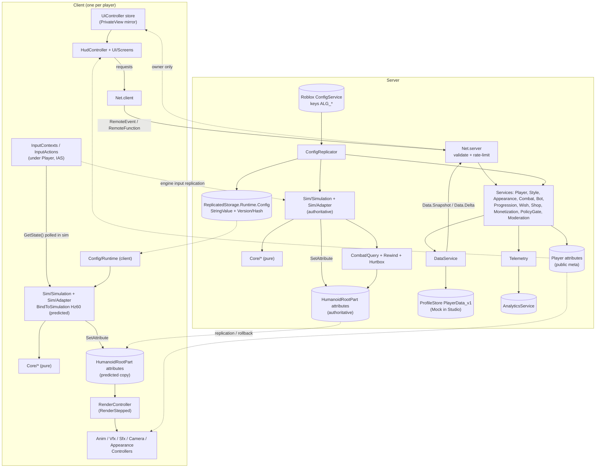

[← Build spec index](../STUDIO_BUILD_SPEC.md) · **Part 2 of 8** · sections §2.x · Part 0 contracts (§0.x) are in the index file

> ⚠️ **DRAFT — pre-review snapshot.** An editorial/technical review of this spec found ~200 issues and the fixed
> v1.0 is still being prepared. **Agents: do not execute any task card beyond the P0 human-setup steps (H-01…H-12)
> until this banner is gone.** Humans can start the one-time setup in Part 1 §1.2 now.

## 2. Architecture and contracts

This part fixes the runtime architecture, the DataModel, the module catalog and boot order, the shared types, where state lives, the config pipeline, the network layer, the persistence layer, the asset/naming APIs, coding standards and the security model. Other parts build *on* these contracts. Part 0 wins over this part; this part wins over Parts 3–8 for every item listed in §2.12.

Conventions used below:
- "MUST" = acceptance-blocking. Every requirement has a **Verify** line: a Lune test (`tests/...`, run with `lune run tests/run.luau`), an in-Studio scenario test (Part 7 harness, printed as `[ALG][TEST] <name> PASS|FAIL`), an MCP call against the server `Roblox_Studio`, or an expected `[ALG]` log line.
- API facts are verified against the offline creator-docs snapshot (2026-10-10) unless marked "(verify in spike)".
- Frame data is in frames @ 60 Hz; times are seconds (`Sec` suffix); distances are studs.

---

### 2.1 Runtime architecture overview

#### 2.1.1 Layers

| Layer | Lives in | Realm | Owner | Hard rule |
|---|---|---|---|---|
| Input | `ReplicatedStorage.Inputs` templates → InputContexts cloned under each `Player` | client hardware → engine → both peers | Part 3 | Simulation input only via the Input Action System (IAS). Never remotes. |
| Pure core | `Shared/Core/*`, `Shared/Wish/*` | both + Lune | Part 3 / Part 5 | No Instance or service access; config is a parameter. |
| Simulation | `Shared/Sim/*` | both | Part 3 | `RunService:BindToSimulation(fn, Enum.StepFrequency.Hz60)`; writes only `HumanoidRootPart` attributes. |
| Authority | `Shared/Combat/*` + `CombatService` | server (client runs queries only for undoable predicted feedback) | Part 3 | Damage, stun, knockback, KO are server consequences. |
| Sim state | `HumanoidRootPart` attributes (`Shared/Sim/Attr.luau`) | replicated, predicted | Part 3 | Written only inside BindToSimulation callbacks. |
| Public meta state | `Player` attributes (§2.5) | server-written, replicated to all | Part 2 (list), writers in §2.5 | Never private data. Never written by clients. |
| Private meta state | `PlayerData` in ProfileStore + server memory → owner via `Data.Snapshot`/`Data.Delta` | server; owner client mirror | Part 2 | Never in attributes. |
| Presentation | `StarterPlayerScripts/Controllers`, `UI/*` | client | Part 6 (Render contract: Part 3) | Reacts to attributes in `RenderStepped`; effects must be undoable. |
| Meta services | `ServerScriptService/Services/*` | server | Part 5 (+ Part 2 for Data/Config/Net/Telemetry/Moderation/Player) | Every economic op = one atomic `DataService.update`. |
| Messaging | `Shared/Net` + `ReplicatedStorage.Remotes` | both | Part 2 | Every C2S message is schema-validated and leaky-bucket rate-limited. |
| Persistence | `DataService` + `Vendor/ProfileStore` | server | Part 2 | Store `"PlayerData_v1"`, key `"Player_<UserId>"`, Mock in Studio by default. |
| Config | `Shared/Config/*` + `ConfigReplicator` | both / server | Part 2 (+ section owners) | Frozen, versioned snapshot; combat config pinned per character life. |
| Telemetry | `Telemetry` service | server | Part 2 (API) / Part 5 (events) | AnalyticsService is server-only and does not send from Studio. |
| Naming / assets | `Shared/Skin`, `Shared/Assets.luau` | both | Part 2 (API) / Part 8 (content) | No player-visible literals; no raw asset IDs in code. |

#### 2.1.2 Diagram



#### 2.1.3 Key flows

**A. One combat frame** (detail: Part 3). Client polls `InputAction:GetState()` inside the sim → Core advances state with the pinned combat config → sim writes HRP attributes → server does the same authoritatively plus rewound hit queries → attribute mismatch triggers engine rollback/resim on the client → `RenderController` reacts to attribute transitions, skipping effects while `RunService:IsResimulating()` is true.

**B. One meta request** (e.g. a Wish). `UI/Screens/Wish` → `Net.client.invoke("Wish.Make", {count = 10})` → `Net.server` checks rate bucket and schema → `WishService` handler → one `DataService.update(player, {"currencies","pity","wishStats","ledger","styles"}, "wish", mutator)` → returns `Response<WishBatchResult>` → `DataService` coalesces dirty sections into a `Data.Delta` (≤ 4 Hz) → `UiController` store → screens re-render.

**C. Config change.** Live-ops edits ConfigService key `ALG_Wish` → `ConfigSnapshot.UpdateAvailable` → `ConfigReplicator` refreshes, merges onto `Defaults`, validates, freezes, publishes version *n+1* to `ReplicatedStorage.Runtime.Config` → server `Runtime` applies immediately; clients apply after the hash check. Meta sections take effect on the next request; the `Combat` section takes effect per character at its next spawn (§2.6.6).

**D. Player join (server).** Owned by `PlayerService` (§2.3.5):
1. `Players.PlayerAdded` → `PlayerService` spawns a per-player thread, creates a per-player `Trove`.
2. `InputMap.attach(player)` (Part 3) clones InputContexts from `ReplicatedStorage.Inputs` under the Player.
3. `DataService.loadAsync(player)`; on `false` the player was kicked; stop.
4. `PolicyGate.fetchAsync(player)` (fail-safe = restricted).
5. `MonetizationService.onPlayerReady`, `StyleService.onPlayerReady`, `AppearanceService.onPlayerReady`, `ProgressionService.onPlayerReady`, `WishService.onPlayerReady`, `ShopService.onPlayerReady`, in this order. Each sets its §2.5 attributes and must not yield longer than 5 s.
6. `player:SetAttribute("DataLoaded", true)`; log `[ALG][Player] ready user=<UserId> ms=<n>`.
7. `CombatService.spawnAsync(player)` (Part 3): pins combat config (`CombatCfg` attribute), calls `Player:LoadCharacterAsync()`.

Client: when `DataLoaded == true`, `UiController` fires `Data.Ready`; the server answers with `Data.Snapshot`.

**E. Player leave.** `Players.PlayerRemoving` → `CombatService.onPlayerRemoving` (life summary) → `DataService.releaseAsync` (fires `beforeRelease`, then `Profile:EndSession()`) → per-player `Trove:Destroy()` → Net buckets cleared.

**Verify (whole section):** scenario `boot.server_ready` expects `[ALG][Boot] server ready services=15 ms=<n>`; scenario `boot.client_ready` expects `[ALG][Boot] client ready controllers=10 ms=<n>`; scenario `player.join_ready` expects `[ALG][Player] ready user=<id>` within 10 s of join in Studio.

---

### 2.2 DataModel tree (M1-G)

Legend:
- `[synced]` = Script Sync root or descendant (scripts and folders only).
- `[builder:X]` = created idempotently by `ServerStorage.DevTools.Builders.X` (Edit mode, via `execute_luau`).
- `[runtime:X]` = created at runtime by module X.
- `[human-set]` = property set by the human in the Properties window (H-xx).
- `[engine]` = engine-created.

Default names marked "(Part N owns)" are placeholders that Part N may rename; it must then list the rename under its "New contracts".

```text
game
├─ Workspace                                   [human-set H-04: AuthorityMode=Server, StreamingEnabled=true]
│  ├─ Map (Folder)                             [builder:BuildAll containers step]
│  │  ├─ CandyKingdom (Model) @MapId="candy_kingdom"   [builder:BuildMap_CandyKingdom] (Part 6 owns contents)
│  │  │  ├─ Geometry (Folder)                  graybox parts / terrain refs
│  │  │  ├─ Spawns (Folder)                    Parts with @SpawnFor="candy_kingdom"
│  │  │  ├─ Totems (Folder)                    Style Totem models (Part 6)
│  │  │  └─ Zones (Folder)                     world-event stub zone, kill planes (Part 6)
│  │  └─ Training (Model) @MapId="training"    [builder:BuildTraining] (Part 6 owns; offset ≥ 2,000 studs from CandyKingdom)
│  │     ├─ Geometry, Spawns, Totems (Folders)
│  │     └─ DummyPoints (Folder)               Parts with @DummySlot=<n> (Part 3/6)
│  ├─ Arena (Folder)                           [builder:BuildArena]
│  │  └─ DuelArena (Model) @MapId="arena_duel_m0"   (M0 arena; kept in M1-G for duel tests)
│  ├─ Sim (Folder)                             [builder:BuildAll containers step] parent for sim-stitched instances (Part 3 owns name)
│  ├─ Bots (Folder)                            [builder:BuildAll containers step] bot/dummy character Models [runtime:BotService]
│  ├─ <player characters>                      [engine] via Player:LoadCharacterAsync (CombatService)
│  └─ Camera                                   [engine]
├─ Players                                     CharacterAutoLoads=false [runtime:PlayerService.init]
│  └─ <Player>                                 [engine]  attributes: §2.5.2 [runtime: writers listed there]
│     ├─ <InputContexts>                       [runtime:InputMap.attach via PlayerService] cloned from ReplicatedStorage.Inputs (Part 3 owns names)
│     ├─ PlayerScripts                         [engine] copies of StarterPlayerScripts (client-only)
│     └─ PlayerGui                             [engine]
│        ├─ ALG_Hud (ScreenGui, ResetOnSpawn=false)      [runtime:HudController] (Part 6 owns)
│        ├─ ALG_Screens (ScreenGui, ResetOnSpawn=false)  [runtime:UiController] (Part 6 owns)
│        ├─ ALG_Toasts (ScreenGui, ResetOnSpawn=false)   [runtime:UiController] Notify toasts (Part 6 owns)
│        └─ ALG_Touch (ScreenGui, ResetOnSpawn=false)    [runtime:InputController] touch buttons bound via InputBinding.UIButton (Part 3/6)
├─ Lighting                                    [builder:BuildLighting] Atmosphere, Sky, post-effects (Part 6)
├─ ReplicatedFirst                             empty in M1-G (future loading screen)
├─ ReplicatedStorage
│  ├─ Shared (Folder)                          [synced] src/Shared
│  ├─ Inputs (Folder)                          [builder:BuildInputs] InputContext templates (Part 3)
│  ├─ VFX (Folder)                             [builder:BuildVfxTemplates] VFX templates (Part 6)
│  ├─ Anim (Folder)                            [builder:BuildPlaceholderAnims] Animation + KeyframeSequence (@AssetKey) (Part 6/4)
│  ├─ Looks (Folder)                           [builder:BuildTemplates] client-visible cosmetic templates: Style Gear props,
│  │                                             Oosona parts, graybox character-look models (Part 6) — NEW, see §2.13
│  ├─ Remotes (Folder)                         [runtime:Net.server] parented by Net.server.open() at end of boot (§2.7)
│  │  └─ <one RemoteEvent / RemoteFunction per §2.7.4 entry, Name = remote name>
│  └─ Runtime (Folder)                         [runtime:ConfigReplicator]
│     ├─ Config (StringValue)                  @Version:number @Hash:string @Parts:number  (§2.6.5)
│     │  └─ Part1..PartN (StringValue)         only when JSON > 190,000 chars
│     └─ History (Folder)                      StringValues "v<n>" = full config JSON of versions pinned by live characters (§2.6.6)
├─ ServerScriptService                         [synced] src/ServerScriptService
│  ├─ Main (Script, RunContext Server)
│  ├─ Services (Folder)                        15 ModuleScripts (§2.3)
│  └─ Vendor (Folder)                          ProfileStore
├─ ServerStorage
│  ├─ DevTools (Folder)                        [synced] Builders/, Tests/
│  ├─ Templates (Folder)                       [builder:BuildTemplates] DummyRig (Model), BotRig (Model), server-only templates (Part 6)
│  ├─ AgentTestRequest (StringValue)           [runtime:AlgebraicTestHarness plugin / agent] (Part 7 owns)
│  └─ AgentTestResult (StringValue)            [runtime:TestHarness] (Part 7 owns)
├─ StarterPlayer                               [human-set H-04: AvatarJointUpgrade=Enabled]
│  ├─ StarterPlayerScripts                     [synced] src/StarterPlayerScripts: Main (Script, RunContext Client), Controllers/, UI/
│  └─ StarterCharacterScripts                  engine defaults; Part 3/6 decide whether to override "Animate"
├─ StarterGui                                  empty (all UI is built at runtime into PlayerGui)
├─ StarterPack                                 empty
├─ SoundService                                SoundGroups Music/Sfx/Vo/Ui [runtime:SfxController, client-local]
└─ TextChatService                             engine defaults (no custom channels in M1-G)
```

Human-set and non-scriptable properties (never set by scripts; `Verify` reads them):

| Property | Value | Step | Why |
|---|---|---|---|
| `Workspace.AuthorityMode` | `Server` | H-04 | RobloxScriptSecurity; auto-enables NextGenerationReplication, IAS for PlayerScripts, Deferred signals, UseFixedSimulation |
| `Workspace.StreamingEnabled` | `true` | H-04 | Required by Server Authority; not scriptable |
| `StarterPlayer.AvatarJointUpgrade` | `Enabled` | H-04 | RobloxScriptSecurity |
| Avatar Settings | Consistent Gameplay + Single Collider | H-05 | Fixed collider |
| Game Settings → Security → Studio API access | on (dev universe only) | H-06 | ProfileStore live mode in Studio (opt-in), ConfigService staged values |

Rules:
1. `BuildAll.build(opts)` MUST first run a **containers step** that creates the empty top-level unsynced containers that no other builder owns (`Workspace.Map`, `Workspace.Sim`, `Workspace.Bots`) and then call the other builders in this order: `BuildInputs, BuildTemplates, BuildVfxTemplates, BuildPlaceholderAnims, BuildLighting, BuildArena, BuildMap_CandyKingdom, BuildTraining`. Each builder creates its own top-level container if it is missing.
2. `ReplicatedStorage.Remotes` and `ReplicatedStorage.Runtime` MUST NOT exist in the saved place. `Verify.verify()` reports them as problems in Edit mode (stale runtime objects).
3. No attributes or tags on any Script/ModuleScript (Script Sync drops them).
4. Characters and bot Models never carry meta attributes written after parenting (§2.5.4).

**Verify:** `Verify.verify()` (builder pattern, §0.3) returns `{ok = true}` and checks every container above. MCP: `search_game_tree` for `ReplicatedStorage.Runtime.Config` during a play session returns a StringValue whose `Version` ≥ 1. Scenario `tree.runtime_objects` asserts that `Remotes` has exactly the remotes in §2.7.4 (minus `Dev.*` outside Studio).

---

### 2.3 Module catalog, boot order and service APIs

#### 2.3.1 Columns

- **Realm**: `shared` (both peers), `server`, `client`, `devtools` (Edit-mode/Studio only), `host` (Lune, not in Roblox).
- **Pure**: `yes` = no Roblox globals or services at load time and in every function; loadable and testable in Lune. `load` = no Roblox globals at *load* time (Lune can `require` it to read data), but some functions use Roblox APIs. `no` = uses Roblox at load.
- **Sim-safe**: may be called inside BindToSimulation callbacks (only Sim-access APIs, no yields, no `os.clock`/`tick`/`GetServerTimeNow`, no Instance `Name`/`Parent`/`Destroy`).

#### 2.3.2 Catalog

**`src/Shared/` → `ReplicatedStorage.Shared`**

| File | Realm | Pure | Sim-safe | Responsibility | Key public API | Depends on | Detailed in |
|---|---|---|---|---|---|---|---|
| `Types.luau` | shared | yes | yes | Canonical types + ID constant lists | §2.4 | `./Config/Defaults` (type only) | §2.4 |
| `Log.luau` | shared | yes | no (prints) | `[ALG]` logging, test lines | §2.3.6 | — | §2.3.6 |
| `Assets.luau` | shared | load | no | Asset manifest + resolver + products | §2.9.1 | `./Log` | §2.9 / Part 8 |
| `Config/Defaults.luau` | shared | yes | yes (data) | Every GDD tunable, JSON-safe | §2.6.2 | — | §2.6 + section owners |
| `Config/Schema.luau` | shared | yes | yes | Validator combinators, canonical JSON, hash, merge/freeze, config rules, PlayerData template/normalize/migrate, settings + Oosona validation/codec | §2.6.3, §2.8.3 | `../Types`, `./Defaults` | §2.6, §2.8 |
| `Config/Runtime.luau` | shared | no | no (call `at()` outside the sim and cache the table; it may decode JSON) | Frozen versioned config on both peers | §2.6.5 | `./Defaults`, `./Schema`, `../Vendor/Signal`, `../Log` | §2.6.5 |
| `Core/Fsm, Frames, M1, Defense, Movement, Stun, Meter, Breakaway, Moves, Damage, Rng, Realm` | shared | yes | yes | Pure combat rules; `Frames.toSeconds(f) = f / 60` | Part 3 | `../Types` | Part 3 (Realm: Part 4) |
| `Sim/Simulation, Attr, InputMap, Adapter` | shared | Attr: yes; others no | yes (Simulation) | Sim loop, attribute list, IAS mapping, NetModel adapter | Part 3 | Core, Runtime | Part 3 |
| `Combat/Query, Rewind, Hurtbox` | shared | no | yes | Spatial queries, hurtbox history, capsule hurtboxes | Part 3 | Core | Part 3 |
| `Styles/init` + `hero, stretch, monarch, rocker, frost, decay` | shared | load | yes (data) | StyleDef registry incl. 12 stub defs with `implemented=false` | `Styles.get(id)`, `Styles.all()` | `../Types` | Part 4 |
| `Behaviors/*` (9 files) | shared | no | yes | Per-behavior move hooks | Part 4 | Core, Combat | Part 4 |
| `Skin/init` + `Packs/Codename, Original, Canon` | shared | yes | no | Player-visible strings | §2.9.2 | `../Log` | §2.9 / Part 8 |
| `Wish/Odds, Pity` | shared | yes | — | Odds table, pity math, ledger codec | Part 5 (+ §2.8.4 codec) | `../Types` | Part 5 |
| `Net/init` | shared | no | no | Remote wrapper (server + client) | §2.7.2 | `@self/Schemas`, `./Log`, `./Types`, `./Config/Runtime` | §2.7 |
| `Net/Schemas` | shared | yes | — | Remote catalog + validators | §2.7.3 | `../Config/Schema`, `../Types` | §2.7 |
| `Vendor/Trove, Signal, Shake` | shared | no | no | Vendored MIT utilities (Sleitnick RbxUtil: trove 1.8.0, signal 2.0.3, shake 1.1.0) | upstream | — | §2.10 item 10 |

Note on `init.luau` requires: inside `Net/init.luau`, `./Log` resolves to `Shared.Log` (Roblox: begins at `script.Parent`) and `@self/Schemas` resolves to the child `Net.Schemas` [Docs `LuaGlobals.yaml` require-by-string].

Per-file responsibilities for grouped rows (signatures are defined by the owning part; the responsibility split below is binding so no two parts implement the same thing):

| File | Responsibility | Owner |
|---|---|---|
| `Core/Fsm.luau` | Deterministic state-machine helpers (state IDs, frame-counted timers, transition guards) | Part 3 |
| `Core/Frames.luau` | Frame ↔ seconds (`toSeconds(f) = f / 60`), frame-window helpers | Part 3 |
| `Core/M1.luau` | M1 chain, Enders, chain window (GDD §6.3) | Part 3 |
| `Core/Defense.luau` | Block, guard, Perfect Block, guard break (GDD §6.4) | Part 3 |
| `Core/Movement.luau` | Walk/run parameters, 3 dashes, dash cooldowns (GDD §6.5) | Part 3 |
| `Core/Stun.luau` | Hitstun, Stun Decay, combo limits, ragdoll state (GDD §6.6) | Part 3 |
| `Core/Meter.luau` | Algebraic Meter gain/decay, Awakening timer (GDD §6.9) | Part 3 |
| `Core/Breakaway.luau` | Breakaway pips, refill, lockout (GDD §6.8) | Part 3 |
| `Core/Moves.luau` | Generic move timeline (startup/active/recovery), cooldowns, cancel rules (GDD §6.7) | Part 3 |
| `Core/Damage.luau` | Damage, guard damage, chip, knockback resolution, pile-on (GDD §6.2/§6.4/§6.11) | Part 3 |
| `Core/Rng.luau` | Deterministic seeded RNG (pure state in, state out); Part 5 may reuse it for server-side Wish rolls (the ledger stores the seed) | Part 3 |
| `Core/Realm.luau` | Realm rules (GDD §6.10) | Part 4 |
| `Sim/Simulation.luau` | The single BindToSimulation loop (Hz60) on both peers | Part 3 |
| `Sim/Attr.luau` | HRP attribute names, types, defaults (≤ 56) | Part 3 |
| `Sim/InputMap.luau` | IAS action names ↔ intents; `attach(player)` clones contexts | Part 3 |
| `Sim/Adapter.luau` | `NetModel` adapter (ServerAuthority/Classic), roster cache, pinned config per character | Part 3 |
| `Combat/Query.luau` | Spatial queries against the Hurtbox collision group | Part 3 |
| `Combat/Rewind.luau` | 1 s / 60 Hz hurtbox history, rewind ≤ 200 ms (GDD §18.2) | Part 3 |
| `Combat/Hurtbox.luau` | Fixed capsule hurtboxes, collision group setup (GDD §6.2) | Part 3 |
| `Styles/init.luau` | Registry of all 18 `StyleDef`s (6 kits + 12 stubs with `implemented=false`) | Part 4 |
| `Styles/<id>.luau` ×6 | One kit each: `hero, stretch, monarch, rocker, frost, decay` | Part 4 |
| `Behaviors/<Behavior>.luau` ×9 | `Projectile, Rush, Grab, Counter, Zone, Summon, Buff, Mobility, RealmCast` hooks | Part 4 |
| `Wish/Odds.luau` | Odds table and effective odds (pity ramp, Lucky Jar) from config | Part 5 |
| `Wish/Pity.luau` | Pity counters and rules (GDD §8.4); ledger codec (§2.8.4) | Part 5 |
| `Skin/Packs/Codename.luau`, `Original.luau`, `Canon.luau` | String packs | Part 8 |
| `UI/Create.luau` | Typed Instance factory for UI | Part 6 |
| `UI/Theme.luau` | Colors, fonts, rarity shapes (GDD §16.3 colorblind) | Part 6 |
| `UI/Screens/Hud, StyleWheel, Wish, Shop, Settings, Results` | One screen module each | Part 6 |

**`src/ServerScriptService/` → `ServerScriptService`**

| File | Realm | Responsibility | Depends on (init-order rule §2.3.3) | Detailed in |
|---|---|---|---|---|
| `Main.server.luau` | server | Bootstrap (§2.3.4) | all services, `Net`, `Log` | §2.3.4 |
| `Services/ConfigReplicator.luau` | server | ConfigService overlay, publish, pin/history, Studio dev override | Defaults, Schema, Runtime, Log | §2.6 |
| `Services/Telemetry.luau` | server | AnalyticsService wrapper, budget, Studio echo ring | Runtime, Log | §2.3.5, Part 5 |
| `Services/ModerationService.luau` | server | Exploit-signal sink, `Report.Submit`, review log | Telemetry | §2.11 |
| `Services/DataService.luau` | server | ProfileStore sessions, PlayerData, tx/wallet, deltas | Vendor/ProfileStore, Schema, Runtime, Telemetry, Net | §2.8 |
| `Services/PolicyGate.luau` | server | `PolicyService` flags per player, fail-safe | DataService | §2.3.5, Part 5 |
| `Services/MonetizationService.luau` | server | Store view, prompts, receipts, passes, mock purchases | DataService, PolicyGate, Telemetry, Assets | Part 5 |
| `Services/StyleService.luau` | server | Ownership, equip/next style, flair/variant, kill switches | DataService, Styles | Part 4/5 |
| `Services/AppearanceService.luau` | server | Appearance settings + public appearance attributes | DataService, StyleService | Part 5/6 |
| `Services/CombatService.luau` | server | Server sim host, hit resolution, damage/KO/respawn, config pinning | StyleService, ConfigReplicator, ModerationService, Telemetry | Part 3 |
| `Services/BotService.luau` | server | Training dummies, load-test bots, `Training.Dummy` | CombatService, StyleService | Part 3 / Part 7 |
| `Services/ProgressionService.luau` | server | XP, levels, mastery, Treasure earning, daily login, Rookie | DataService, CombatService (signals), StyleService, Telemetry | Part 5 |
| `Services/WishService.luau` | server | Wish rolls, ledger, odds view, Cosmic craft, announcements | DataService, PolicyGate, MonetizationService, StyleService, Telemetry | Part 5 |
| `Services/ShopService.luau` | server | Choose Goose rotation and purchases | DataService, StyleService | Part 5 |
| `Services/PlayerService.luau` | server | Join/leave orchestration, CharacterAutoLoads, `World.Travel`, per-player Trove, `MapId`/`DataLoaded` | all services above | §2.3.5 |
| `Services/TestHarness.luau` | server (Studio only) | `Dev.Command`, scenario runner; inert outside Studio | all | Part 7, §2.11.5 |
| `Vendor/ProfileStore.luau` | server | Vendored ProfileStore (MadStudio, MIT, upstream HEAD `45c9847`, wally 1.0.3) | — | §2.8 |

**`src/DevTools/` → `ServerStorage.DevTools`** (realm `devtools`; never required by live code paths)

| File | Responsibility | Detailed in |
|---|---|---|
| `Builders/BuildAll.luau` | Containers step + calls every builder in the §2.2 order; `verify()` aggregates | §2.2 (orchestration), Part 6 |
| `Builders/BuildInputs.luau` | InputContext templates | Part 3 |
| `Builders/BuildArena.luau`, `BuildMap_CandyKingdom.luau`, `BuildTraining.luau`, `BuildLighting.luau` | World | Part 6 |
| `Builders/BuildVfxTemplates.luau`, `BuildPlaceholderAnims.luau`, `BuildTemplates.luau` | Presentation templates (incl. `ReplicatedStorage.Looks`) | Part 6 (anims with Part 4) |
| `Builders/Verify.luau` | Tree + property checks (§2.2 table) | Part 7 |
| `Tests/*` | In-Studio scenario modules | Part 7 |

**`src/StarterPlayerScripts/` → `StarterPlayer.StarterPlayerScripts`** (realm `client`)

| File | Responsibility | Detailed in |
|---|---|---|
| `Main.client.luau` | Client bootstrap with double-run guard (§2.3.4) | §2.3.4 |
| `Controllers/UiController.luau` | PrivateView store (`Data.Ready`/`Snapshot`/`Delta`), screen router, Notify toasts | §2.3.7, Part 6 |
| `Controllers/SettingsController.luau` | Typed settings accessors, local application (audio buses, text scale, graphics tier), `Settings.Set`/`Appearance.Set` senders | §2.3.7, Part 6 |
| `Controllers/InputController.luau` | Touch buttons, context enable/disable by UI state, remaps | Part 3 / Part 6 |
| `Controllers/CameraController.luau` | Camera, Shake (scaled by settings) | Part 6 |
| `Controllers/AnimController.luau` | Track lookup, Studio temp clip registration | Part 6 / Part 3 |
| `Controllers/VfxController.luau`, `SfxController.luau` | Pools, budgets, Flair tints, buses | Part 6 |
| `Controllers/AppearanceController.luau` | Per-viewer look rendering (`OthersAppearance`) | Part 6 |
| `Controllers/RenderController.luau` | Reads sim attributes each frame, dispatches transitions | Part 3 (contract) / Part 6 |
| `Controllers/HudController.luau` | HUD binding | Part 6 |
| `UI/Create.luau`, `UI/Theme.luau`, `UI/Screens/Hud, StyleWheel, Wish, Shop, Settings, Results` | UI factory, theme tokens, screens | Part 6 |

**Host-side (not synced)**

| Path | Realm | Responsibility | Detailed in |
|---|---|---|---|
| `tests/run.luau`, `tests/core/*.spec.luau`, `tests/wish/*.spec.luau`, `tests/shim/` | host | Lune unit tests; Part 2 adds the specs listed in §2.12 | Part 7 |
| `tools/lint_strings.luau` | host | Skin key / literal-string lint | Part 8 |
| `tools/check_manifest.luau` | host | Asset key and raw-ID lint (§2.9.1) | Part 8 / Part 7 |
| `tools/export_framedata.luau` | host | Frame-data export | Part 3/4 |
| `tools/studio/*.luau` | host → `execute_luau` | ≤ 2 KB snippets | Part 1 / Part 7 |
| `tools/plugin/AlgebraicTestHarness/` | Studio plugin | Multi-client tests | Part 7 |

#### 2.3.3 Fixed init order

Rule (MUST): **a module may `require` only modules earlier in its order list** (plus Shared modules). Later modules talk to earlier ones by calling them; earlier modules talk to later ones only through `Signal`s that the earlier module owns. This makes the require graph acyclic by construction. `PlayerService` and `TestHarness` are last because they orchestrate everyone.

Server order (`Main.server.luau` constant `ORDER`):

| # | Service | Rationale |
|---|---|---|
| 1 | `ConfigReplicator` | Publishes config v1 (Defaults) synchronously in `init()`; everyone reads `Runtime`. |
| 2 | `Telemetry` | Sink used by later services during their own init/start. |
| 3 | `ModerationService` | Sink for Net violations and exploit signals. |
| 4 | `DataService` | Profiles; every meta service persists through it. |
| 5 | `PolicyGate` | Policy flags needed by Monetization and Wish. |
| 6 | `MonetizationService` | Pass ownership and receipts; Wish needs pass state (Lucky Jar). Grants go through DataService, not WishService. |
| 7 | `StyleService` | Style registry and ownership; needed by Appearance, Combat, Wish, Shop. |
| 8 | `AppearanceService` | Depends on settings (Data) and the equipped style. |
| 9 | `CombatService` | Server sim host; needs style per player and config pinning. Owns `ko`, `damage`, `lifeEnded`, `spawned` signals. |
| 10 | `BotService` | Spawns dummies/bots through CombatService. |
| 11 | `ProgressionService` | Subscribes to CombatService signals in `start()`. |
| 12 | `WishService` | Needs Data, Policy, Monetization (passes), Style. |
| 13 | `ShopService` | Needs Data and Style. |
| 14 | `PlayerService` | Orchestrates join/leave across all services; its `start()` processes already-present players, so it runs after every other `start()`. |
| 15 | `TestHarness` | Studio only; requires everything; no-op elsewhere. |

Client order (`Main.client.luau` constant `ORDER`):

| # | Controller | Rationale |
|---|---|---|
| 1 | `UiController` | Owns the PrivateView store and ScreenGui roots that others read. |
| 2 | `SettingsController` | Settings accessors (reduced motion, volumes, text scale) read by later controllers. |
| 3 | `InputController` | Needs settings (remaps) and UI state (menus disable combat contexts). |
| 4 | `CameraController` | Needs settings (shake scale). |
| 5 | `AnimController` | Registers Studio placeholder clips before render starts. |
| 6 | `VfxController` | Needs Perf tier from settings. |
| 7 | `SfxController` | Needs audio settings. |
| 8 | `AppearanceController` | Needs settings (`othersAppearance`) and templates. |
| 9 | `RenderController` | Dispatches to 4–8, so it starts after them. |
| 10 | `HudController` | Binds HUD to the store and attributes last. |

Module contract (every service and controller):

```lua
export type Module = {
	init: () -> (),   -- MUST NOT yield; may only touch modules earlier in ORDER; create signals here
	start: () -> (),  -- MUST return within 1 s; spawn long work with task.spawn; may connect to any signal
}
```

#### 2.3.4 Bootstrap skeletons

```lua
--!strict
-- src/ServerScriptService/Main.server.luau — server bootstrap. Spec §2.3.4.
local ReplicatedStorage = game:GetService("ReplicatedStorage")
local Log = require(ReplicatedStorage.Shared.Log)
local Net = require(ReplicatedStorage.Shared.Net)

local ORDER = {
	"ConfigReplicator", "Telemetry", "ModerationService", "DataService", "PolicyGate",
	"MonetizationService", "StyleService", "AppearanceService", "CombatService", "BotService",
	"ProgressionService", "WishService", "ShopService", "PlayerService", "TestHarness",
}
type Module = { init: () -> (), start: () -> () }

local t0 = os.clock()
local folder = script.Parent:FindFirstChild("Services")
assert(folder ~= nil, "[ALG][Boot] Services folder missing")
for _, child in folder:GetChildren() do -- every service must be ordered (§2.3.3)
	if child:IsA("ModuleScript") and table.find(ORDER, child.Name) == nil then
		error(`[ALG][Boot] ERROR service {child.Name} missing from ORDER`)
	end
end

Net.server.init() -- builds remotes UNPARENTED (§2.7.2)
local mods: { [string]: Module } = {}
for _, name in ORDER do
	local ms = folder:FindFirstChild(name)
	assert(ms ~= nil and ms:IsA("ModuleScript"), `[ALG][Boot] missing service {name}`)
	mods[name] = require(ms) :: any
end
for _, phase in { "init", "start" } do
	for _, name in ORDER do
		local ok, err = pcall((mods[name] :: any)[phase])
		if not ok then
			Log.error("Boot", `{phase} failed`, { service = name, err = tostring(err) })
			return -- remotes stay unparented: clients time out loudly instead of half-working
		end
	end
end
Net.server.open() -- parents ReplicatedStorage.Remotes
Log.info("Boot", `server ready services={#ORDER} ms={math.floor((os.clock() - t0) * 1000)}`)
```

```lua
--!strict
-- src/StarterPlayerScripts/Main.client.luau — client bootstrap. Spec §2.3.4.
local Players = game:GetService("Players")
local ReplicatedStorage = game:GetService("ReplicatedStorage")
-- GUARD (MUST be first): a RunContext=Client Script inside StarterPlayerScripts runs twice — the original
-- and the PlayerScripts copy [Docs scripting/locations.md]. Only the copy under the LocalPlayer proceeds.
if not script:IsDescendantOf(Players.LocalPlayer) then
	return
end
ReplicatedStorage:WaitForChild("Shared")
local Log = require(ReplicatedStorage.Shared.Log)
local Runtime = require(ReplicatedStorage.Shared.Config.Runtime)
local Net = require(ReplicatedStorage.Shared.Net)
local Skin = require(ReplicatedStorage.Shared.Skin)

local ORDER = {
	"UiController", "SettingsController", "InputController", "CameraController", "AnimController",
	"VfxController", "SfxController", "AppearanceController", "RenderController", "HudController",
}
local t0 = os.clock()
if not Runtime.waitReady(30) then
	Log.error("Boot", "config not ready after 30s")
	return
end
local cfg = Runtime.get()
Skin.setPack(cfg.SkinPack, cfg.LicenseConfirmed)
Net.client.init(cfg.Net.ClientWaitSec)
-- require, init, start exactly as the server does (same Module contract), then:
Log.info("Boot", `client ready controllers={#ORDER} ms={math.floor((os.clock() - t0) * 1000)}`)
```

The server also calls `Skin.setPack(cfg.SkinPack, cfg.LicenseConfirmed)` inside `ConfigReplicator.init()` after publishing v1, and again on every `Runtime.changed`.

**Verify:** scenario `boot.order_enforced` (TestHarness adds a dummy ModuleScript named `ZzzUnordered` to a *cloned* Services folder, runs the ordering check function, expects the error text `missing from ORDER`). Scenario `boot.client_single_run` counts `[ALG][Boot] client ready` lines per client and expects exactly 1.

#### 2.3.5 Server service APIs (cross-part contracts)

Signatures are exact; owning parts implement the bodies. Each service module's returned table MUST satisfy the type below (annotate the module table with it, e.g. `local DataService: DataServiceApi = {} :: any`). `Types` = `Shared/Types.luau`; `Signal` = `Shared/Vendor/Signal` (`Signal.Signal<T...>`); `Trove` = `Shared/Vendor/Trove` (`Trove.Trove`). Every service also has `init: () -> ()` and `start: () -> ()`.

```lua
--!strict
-- Cross-part service API types (declared in each owning module; collected here as the contract).
type Fields = { [string]: string | number | boolean }

export type ConfigReplicatorApi = {                     -- Part 2 (§2.6)
	ready: () -> boolean,                              -- true after the first ConfigService fetch attempt finished (or 5 s)
	waitReady: (timeoutSec: number) -> boolean,
	pin: (version: number) -> (),                      -- refcount++; keeps History.v<version> published
	unpin: (version: number) -> (),                    -- refcount--; History entry removed 10 s after reaching 0
	devOverride: (section: string, patchJson: string) -> (boolean, string?), -- Studio only
}
export type TelemetryApi = {                            -- Part 2 API; Part 5 decides emission points
	custom: (player: Player, name: Types.TelEventName, value: number?, fields: Fields?) -> (),
	economy: (player: Player, e: Types.TelCurrencyFlow) -> (),
	funnel: (player: Player, funnel: "store" | "wish", sessionId: string, step: number, stepName: string, fields: Fields?) -> (),
	onboarding: (player: Player, step: number, stepName: string, fields: Fields?) -> (),
	progression: (player: Player, e: Types.TelProgression) -> (),
	recent: (n: number) -> { Types.TelRecord },        -- in-memory ring (Telemetry.RingSize), all environments
}
export type ModerationServiceApi = {                    -- Part 2 (§2.11)
	signal: (player: Player, kind: Types.SignalKind, data: Fields?) -> (),
	summary: (player: Player) -> { [string]: number }, -- counts per kind, this session
}
-- DataServiceApi: §2.8.5
export type PolicyGateApi = {                           -- Part 2 API; Part 5 semantics
	fetchAsync: (player: Player) -> Types.PolicyFlags, -- yields <= 10 s; fail-safe: paidRandomRestricted = true
	get: (player: Player) -> Types.PolicyFlags,        -- cached; fail-safe default if not fetched
	devSet: (player: Player, flags: Types.PolicyFlags) -> (), -- Studio only
}
export type MonetizationServiceApi = {                  -- Part 5
	onPlayerReady: (player: Player) -> (),
	ownsPass: (player: Player, pass: Types.PassKey) -> boolean, -- cached, non-yielding
	passChanged: Signal.Signal<Player, Types.PassKey, boolean>,
}
export type StyleServiceApi = {                         -- Part 4/5
	onPlayerReady: (player: Player) -> (),
	canEquip: (player: Player, styleId: string) -> (boolean, Types.ErrCode?),
	requestEquip: (player: Player, styleId: string, via: "wheel" | "totem" | "dev") -> Types.Response<Types.StyleEquipRes>,
	resolveForSpawn: (player: Player) -> Types.StyleId, -- NextStyle -> EquippedStyle; called by CombatService before LoadCharacterAsync
	equippedChanged: Signal.Signal<Player, Types.StyleId>,
	grantInTx: (data: Types.PlayerData, styleId: Types.StyleId, source: Types.OwnSource, now: number) -> boolean, -- pure; true if newly owned
}
export type AppearanceServiceApi = {                    -- Part 5/6
	onPlayerReady: (player: Player) -> (),
	refresh: (player: Player) -> (),                   -- recompute CharacterLook etc. after equip/settings change
}
export type CombatServiceApi = {                        -- Part 3 owns; these members are required by Parts 2/5
	spawnAsync: (player: Player) -> (),                -- pins config, sets CombatCfg, LoadCharacterAsync
	onPlayerRemoving: (player: Player) -> (),
	canTravel: (player: Player) -> boolean,            -- false in hitstun/ragdoll/grab or inside Part 3's combat-tag window
	ko: Signal.Signal<Types.KoEvent>,
	damage: Signal.Signal<Types.DamageEvent>,          -- may be batched per step by Part 3
	lifeEnded: Signal.Signal<Player, Types.LifeSummary>,
	spawned: Signal.Signal<Player, Model>,
}
export type ProgressionServiceApi = {                   -- Part 5
	onPlayerReady: (player: Player) -> (),
	masteryLevel: (xp: number, cfg: Types.Config) -> number,                    -- pure
	accountLevelFromXp: (xpTotal: number, cfg: Types.Config) -> (number, number), -- (level, xpIntoLevel), pure
}
export type WishServiceApi = { onPlayerReady: (player: Player) -> () } -- grants tutorial Wishes once (Economy.TutorialWishes)
export type ShopServiceApi = { onPlayerReady: (player: Player) -> () }
export type PlayerServiceApi = {                        -- Part 2
	trove: (player: Player) -> Trove.Trove,            -- per-player cleanup bag; destroyed on leave
	isReady: (player: Player) -> boolean,              -- DataLoaded
	travelAsync: (player: Player, mapId: Types.MapId) -> Types.Response<{}>, -- respawn at a spawn of mapId
}
export type TestHarnessApi = {                          -- Part 7; Studio only
	run: (scenario: string, args: { [string]: any }?) -> { pass: number, fail: number },
}
```

PlayerService MUST:
- set `Players.CharacterAutoLoads = false` in `init()` (script-writable [Docs `Players.yaml`]);
- never call the deprecated `Player:LoadCharacter` (use `LoadCharacterAsync`, via CombatService);
- handle players already present when `start()` runs;
- write `DataLoaded` and `MapId` (§2.5.2).

**Verify:** scenario `player.join_ready` (attributes `DataLoaded=true`, `MapId="candy_kingdom"`, `EquippedStyle="hero"` on a fresh mock profile); scenario `player.leave_releases` expects `[ALG][Data] released user=<id>` within 2 s of `LeaveTest`.

#### 2.3.6 `Shared/Log.luau`

```lua
--!strict
-- src/Shared/Log.luau — [ALG] logging (pure: print/warn only). Spec §2.3.6.
local Log = {}
local errors = 0
local MAX_VALUE = 200

local function fmt(tag: string, msg: string, data: { [string]: any }?): string
	local line = `[ALG][{tag}] {msg}`
	if data ~= nil then
		local keys = {}
		for k in data do
			table.insert(keys, tostring(k))
		end
		table.sort(keys)
		for _, k in keys do
			local v = string.gsub(tostring(data[k]), "%s+", "_")
			line ..= ` {k}={string.sub(v, 1, MAX_VALUE)}`
		end
	end
	return line
end

function Log.info(tag: string, msg: string, data: { [string]: any }?) print(fmt(tag, msg, data)) end
function Log.warn(tag: string, msg: string, data: { [string]: any }?) warn(fmt(tag, "WARN " .. msg, data)) end
function Log.error(tag: string, msg: string, data: { [string]: any }?)
	errors += 1
	warn(fmt(tag, "ERROR " .. msg, data))
end
function Log.test(name: string, pass: boolean, detail: string?)
	if pass then
		print(`[ALG][TEST] {name} PASS`)
	else
		print(`[ALG][TEST] {name} FAIL {string.gsub(detail or "", "\n", " ")}`)
	end
end
function Log.summary(pass: number, fail: number) print(`[ALG][TEST] SUMMARY pass={pass} fail={fail}`) end
function Log.errorCount(): number return errors end
return Log
```

Format rules: one line per call; `data` is rendered as sorted `key=value` pairs with whitespace replaced by `_`. Tags are PascalCase from this list: `Boot, Config, Data, Net, Player, Policy, Store, Style, Appearance, Combat, Sim, Bot, Progress, Wish, Shop, Tel, Mod, Skin, Assets, UI, Input, Render, Vfx, Test`. Parts may add tags in their "New contracts".

**Verify:** Lune `log.format_sorted_pairs`, `log.test_lines_exact`.

#### 2.3.7 Client store and settings controller APIs

```lua
--!strict
export type UiControllerApi = {                         -- Part 2 API for the store; Part 6 owns screens/router
	state: () -> Types.PrivateView?,                   -- nil until the first Data.Snapshot
	changed: Signal.Signal<{ Types.Section }>,         -- sections replaced by a snapshot or delta
	waitForData: (timeoutSec: number) -> boolean,
	open: (screen: Types.ScreenId) -> (),              -- Part 6
	toast: (n: Types.NotifyPayload) -> (),             -- local toasts use the same path as server Notify
}
export type SettingsControllerApi = {                   -- Part 2 API; Part 6 applies
	get: () -> Types.Settings,                         -- from the store; template defaults before the first snapshot
	set: (key: Types.SettingKey, value: string | number | boolean) -> (), -- optimistic local apply + Settings.Set
	setAppearance: (req: Types.AppearanceSetReq) -> (), -- Appearance.Set
	changed: Signal.Signal<Types.SettingKey>,
}
```

Store rules (MUST):
1. On `Player:GetAttribute("DataLoaded") == true` (or its change signal), fire `Data.Ready` once. Retry once after 5 s if no snapshot arrived.
2. `Data.Snapshot` replaces the whole store and sets `seq`.
3. A `Data.Delta` with `seq ≤ store.seq` is ignored. A delta with `seq > store.seq + 1` (gap) triggers `Data.Ready` again and is ignored.
4. Otherwise replace each listed section wholesale and set `store.seq = delta.seq`.
5. Screens never mutate the store. Optimistic settings changes are applied locally by SettingsController and confirmed by the next delta.

**Verify:** scenario `data.delta_seq_monotonic` (server fires 3 deltas, drops the 2nd artificially in Studio via TestHarness; client logs `[ALG][UI] data gap seq=<n> resync` and ends with the same canonical hash as the server, compared through `execute_luau` on Server and Client).

---

### 2.4 `Shared/Types.luau`

`Types.luau` contains types plus frozen ID lists. It requires only `./Config/Defaults` (for `Config`). **Part 3 owns combat-state types** (`Shared/Sim/Attr.luau` exports `AttrName` and per-state types; Core modules export their own state types); Types does not duplicate them. `KoEvent`/`DamageEvent`/`LifeSummary` below are the cross-part payloads that Part 3 MUST emit.

```lua
--!strict
-- src/Shared/Types.luau — canonical shared types + frozen ID lists. Pure. Spec §2.4.
local Defaults = require("./Config/Defaults")

-- ===== §0.8 (verbatim) =====
export type Rarity = "starter" | "common" | "uncommon" | "rare" | "epic" | "legendary" | "mythic" | "cosmic"
export type Tag = "Projectile" | "Rush" | "Grab" | "Counter" | "Zone" | "Summon" | "Buff" | "Debuff" | "Mobility"
	| "AoE" | "Utility" | "Stealth" | "Ultimate" | "Realm" | "Music" | "Demon" | "Opener" | "Extender"
export type Behavior = "Strike" | "Projectile" | "Rush" | "Grab" | "Counter" | "Zone" | "Summon" | "Buff" | "Mobility" | "RealmCast"
export type HitboxDef = { shape: "Box" | "Sphere" | "Cast", size: Vector3, offset: CFrame, castDistance: number? }
export type KnockbackDef = { dist: number, angleDeg: number, ragdoll: boolean, launch: boolean? }
export type MoveDef = {
	id: string,                       -- e.g. "hero.3"
	slot: "m1" | "1" | "2" | "3" | "4" | "q" | "a1" | "a2" | "a3" | "a4",
	behavior: Behavior,
	tags: { Tag },
	signature: boolean?,              -- exactly one base move per style has signature = true (GDD §6.7)
	startup: number, active: number, recovery: number,   -- frames @ 60 Hz
	damage: number, guardDamage: number, chip: number,   -- chip as fraction (0.2 = 20%)
	hitstun: number,                  -- frames
	knockback: KnockbackDef?,
	hitbox: HitboxDef?,
	cooldown: number,                 -- seconds
	parryable: boolean,
	superArmor: boolean?, projectileArmor: boolean?,
	telegraph: { shape: "Circle" | "Line" | "Cone" | "Arc", leadFrames: number, size: Vector3 }?,
	params: { [string]: any }?,       -- behavior-specific params; typed per behavior in Part 4
	meterGain: number?,               -- multiplier on damage→meter (default 1.0)
	anim: string,                     -- logical asset key (Assets.get)
	vfx: string?, sfx: string?,       -- logical asset keys
}
export type AwakeningDef = {
	id: string, durationSec: number,  -- 60 (GDD §6.9)
	hurtboxScale: number?,            -- ≥ 1 only (GDD §6.2)
	modifiers: { [string]: any }?,    -- awakened passive modifiers (only where the kit says so)
	moves: { MoveDef },               -- a1..a4 (a4 may be behavior "RealmCast" for legendary+)
}
export type StyleDef = {
	id: string, rarity: Rarity, archetype: string, implemented: boolean,
	hp: number,                       -- 100 at launch (GDD §6.2)
	palette: { primary: Color3, secondary: Color3, accent: Color3 },
	passive: { id: string, params: { [string]: any } },
	quirk: MoveDef,
	moves: { MoveDef },               -- slots "1".."4"
	awakening: AwakeningDef,
	m1: { anim: string, vfx: string?, sfx: string? },  -- M1 frame data is shared (GDD §6.3); only presentation differs
	kitProps: { string }?,            -- logical template keys for Style Gear props
}

-- ===== IDs (§0.4) =====
export type StyleId = "hero" | "stretch" | "sentry" | "granny" | "diva" | "tyrant" | "console" | "grappler" | "monarch"
	| "flame" | "butler" | "rocker" | "frost" | "huntress" | "decay" | "demon" | "wish" | "chaos"
export type MapId = "arena_duel_m0" | "candy_kingdom" | "training"
export type FlairId = "standard" | "shiny" | "golden" | "crystal" | "rainbow" | "nightosphere" | "glitched"
export type CurrencyId = "Treasure" | "Wishes" | "Shards" | "CosmicSparks"
export type PassKey = "lucky_jar" | "vip" | "quick_wish"                 -- M1-G subset of GDD §17.3
export type ProductKey = "wishes_10" | "wishes_55" | "wishes_120" | "wishes_300" -- GDD §17.3
export type Config = Defaults.Config

-- ===== Persisted player data: PlayerData schema v1 (§2.8) =====
export type Currencies = { Treasure: number, Wishes: number, Shards: number, CosmicSparks: number }
export type OwnSource = "starter" | "wish" | "shop" | "cosmic_craft" | "grant" | "dev"
export type StyleRecord = {
	obtainedAt: number,               -- unix seconds
	source: OwnSource,
	masteryXp: number,                -- lifetime mastery XP; level is derived (Progression.Mastery)
	masteryClaimed: number,           -- highest mastery level whose reward was granted (0 = none)
	kos: number,                      -- KOs scored with this style
	dupes: number,                    -- duplicate pulls of this style
	bestFlair: FlairId,               -- best Flair ever rolled (GDD §8.7)
	flairs: { [string]: number },     -- FlairId -> times rolled; key present = unlocked
	equippedFlair: FlairId,
	variants: { [string]: boolean },  -- local variant ID ("v1".."v9") -> owned (GDD §9.3)
	equippedVariant: string,          -- "" = base look
}
export type PityState = { sinceEpicPlus: number, sinceLegendaryPlus: number, sinceMythicPlus: number } -- Wishes since last hit (GDD §8.4)
export type WishStats = {
	total: number, free: number, paid: number,
	paidUnspent: number,              -- Robux-bought Wishes not yet spent (spent first; telemetry source)
	tutorialGranted: boolean,         -- the 3 tutorial Wishes were credited (GDD §15.5)
	firstGuaranteeUsed: boolean,      -- first-Wish Rare guarantee consumed (Wish.FirstWishGuarantee)
}
export type Ledger = { head: number, entries: { string } } -- ring of Pity.encodeLedger strings, capacity Data.LedgerSize
export type AccountState = {
	level: number, xp: number, xpTotal: number, prestige: number,
	title: string, titles: { [string]: boolean }, activeSec: number,
}
export type ShopState = { rotationId: string, bought: { boolean } } -- dense, length StyleSlots + CosmeticSlots
export type QuestProgress = { id: string, progress: number, goal: number, claimed: boolean }
export type QuestState = { lastDailyReset: number, lastWeeklyReset: number, rerollsUsed: number, daily: { QuestProgress }, weekly: { QuestProgress } }
export type Flags = {
	ftueStep: number, ftueDone: boolean, rookieSecLeft: number,
	lastLoginDay: number,             -- floor(serverTime / 86400) of last daily-login grant
	loginStreak: number,
	seenReveals: { [string]: boolean }, -- Rarity -> first reveal seen (GDD §8.6)
}
export type PurchaseState = {
	ids: { string },                  -- receipt PurchaseId FIFO ring (Data.PurchaseIdCacheSize)
	wishBuyTimes: { number },         -- unix seconds of Wish product grants (last Data.WishBuyHistorySize)
	robuxSpent: number,
}
export type OwnLook = "Oosona" | "Avatar"
export type OthersAppearance = "AsChosen" | "AlwaysCharacter" | "AlwaysOwn" | "Simplified"
export type OosonaSpec = { v: number, species: number, color: string, face: number, hat: number, outfit: number } -- indices 1-based; hat/outfit 0 = none
export type Settings = {
	v: number,
	characterLook: boolean, characterLookByStyle: { [string]: boolean }, ownLook: OwnLook, showStyleGear: boolean,
	othersAppearance: OthersAppearance, oosona: OosonaSpec,
	graphicsTier: "Auto" | "Low" | "Mid" | "High", reducedMotion: boolean, reducedVfx: boolean, cameraShake: number,
	colorblind: "None" | "Deuteranopia" | "Protanopia" | "Tritanopia", telegraphColor: string, outlineThickness: number,
	textScale: number, dyslexiaFont: boolean, simpleHud: boolean, subtitles: boolean, glitchedCalm: boolean,
	volMaster: number, volMusic: number, volSfx: number, volVo: number, volUi: number,
	holdToToggleBlock: boolean, binds: { [string]: string }, skipSeenReveals: boolean,
}
export type PlayerData = {
	schema: number,
	createdAt: number, lastLoginAt: number, lastLogoutAt: number, sessions: number, playSec: number,
	currencies: Currencies,
	styles: { [string]: StyleRecord },  -- owned styles only, keyed by StyleId
	equipped: { styleId: StyleId },
	pity: PityState,
	wishStats: WishStats,
	ledger: Ledger,
	account: AccountState,
	shop: ShopState,
	quests: QuestState,
	settings: Settings,
	flags: Flags,
	purchases: PurchaseState,
}

-- ===== Wish (shapes; Part 5 may ADD fields, never rename) =====
export type WishSource = "free" | "paid" | "tutorial" | "dev"
export type PityHit = "none" | "epic" | "legendary" | "mythic" | "first" | "cosmic_craft"
export type LedgerEntry = {
	n: number, t: number, src: WishSource, batch: string, seed: number, oddsHash: string,
	styleId: StyleId, rarity: Rarity, flair: FlairId, isNew: boolean, shards: number, sparks: number,
	variantId: string, pityBefore: PityState, pityHit: PityHit,
}
export type WishResult = {
	n: number, styleId: StyleId, rarity: Rarity, flair: FlairId, isNew: boolean,
	shards: number, sparks: number, variantId: string?, pityHit: PityHit,
	bestFlairUpgraded: boolean, fakeOut: boolean,
}
export type WishBatchResult = {
	batchId: string, results: { WishResult }, best: number, -- index into results
	wishesLeft: number, pity: PityState, overflowTreasure: number,
}
export type OddsStyle = { styleId: StyleId, pct: number, owned: boolean, implemented: boolean }
export type OddsTier = { rarity: Rarity, pct: number, styles: { OddsStyle } }
export type OddsView = {
	oddsHash: string, tiers: { OddsTier }, flairs: { { flair: FlairId, pct: number } },
	pity: PityState, legendaryPlusPctNow: number, luckyJar: boolean, restricted: boolean,
}

-- ===== Shop / Store =====
export type ShopSlot = {
	index: number, kind: "style" | "cosmetic", itemId: string, rarity: Rarity?,
	price: number, currency: "Treasure", owned: boolean, bought: boolean,
}
export type ShopView = { rotationId: string, refreshAt: number, slots: { ShopSlot } } -- refreshAt: server unix seconds
export type StoreItem = { key: string, kind: "product" | "pass", priceRobux: number?, owned: boolean, hidden: boolean }
export type StoreView = { items: { StoreItem }, restricted: boolean, mock: boolean, wishBuysLast24h: number }
export type PolicyFlags = {
	paidRandomRestricted: boolean,    -- PolicyService ArePaidRandomItemsRestricted
	paidTradingAllowed: boolean,      -- IsPaidItemTradingAllowed
	adsAllowed: boolean,              -- AreAdsAllowed
	subscriptionEligible: boolean,    -- IsEligibleToPurchaseSubscription
	source: "live" | "failsafe" | "dev",
}

-- ===== Client mirror (owner only) =====
export type Section = "currencies" | "styles" | "equipped" | "pity" | "wishStats" | "account" | "shop"
	| "quests" | "settings" | "flags" | "policy" | "passes"     -- sections of the owner's PrivateView
export type DataSection = "currencies" | "styles" | "equipped" | "pity" | "wishStats" | "ledger" | "account"
	| "shop" | "quests" | "settings" | "flags" | "purchases"    -- persisted top-level PlayerData tables (DataService.update)
export type PrivateView = {
	seq: number,
	currencies: Currencies, styles: { [string]: StyleRecord }, equipped: { styleId: StyleId },
	pity: PityState, wishStats: WishStats, account: AccountState, shop: ShopState, quests: QuestState,
	settings: Settings, flags: Flags,
	policy: PolicyFlags,              -- runtime, not persisted
	passes: { [string]: boolean },    -- runtime, not persisted (PassKey -> owned)
}
export type DataDelta = { seq: number, sections: { [string]: any } } -- partial PrivateView, sections replaced wholesale

-- ===== Net envelopes and payloads (§2.7) =====
export type ErrCode = "invalid" | "rate_limited" | "not_ready" | "denied" | "not_owned" | "not_implemented"
	| "insufficient" | "cap_reached" | "restricted" | "stale" | "busy" | "disabled" | "timeout" | "internal"
export type Response<T> = { ok: true, data: T } | { ok: false, err: ErrCode, detail: string? }
export type StyleEquipReq = { styleId: string }
export type StyleEquipRes = { nextStyle: StyleId, applyAt: "respawn" | "now" }
export type StyleSetFlairReq = { styleId: string, flair: string }
export type StyleSetVariantReq = { styleId: string, variantId: string }
export type MasterySpendReq = { styleId: string, shards: number }
export type MasterySpendRes = { shardsSpent: number, xpGained: number, level: number }
export type WishMakeReq = { count: number }                     -- 1 | 10
export type ShopBuyReq = { slot: number, rotationId: string, price: number }
export type ShopBuyRes = { itemId: string, price: number, treasureLeft: number }
export type StorePromptReq = { key: string, entryPoint: string, confirmed: boolean? }
export type StorePromptRes = { status: "prompted" | "needs_confirm" | "mock_granted" }
export type SettingKey = string                                -- one of Types.SETTING_KEYS, or "binds.<ActionName>" (pattern-validated)
export type SettingsSetReq = { key: string, value: string | number | boolean }
export type AppearanceSetReq = {
	characterLook: boolean?, ownLook: string?, showStyleGear: boolean?, oosona: OosonaSpec?,
	styleOverride: { styleId: string, value: "on" | "off" | "inherit" }?,
}
export type WorldTravelReq = { mapId: string }
export type TrainingDummyReq = { behavior: string }             -- Part 3 defines the enum
export type ReportReq = { targetUserId: number, reason: string }
export type DevCommandReq = { cmd: string, args: { [string]: string | number | boolean } }
export type NotifyPayload = {
	kind: "toast" | "announce" | "error" | "reward",
	key: string,                      -- Skin key, e.g. "ui.notify.level_up"
	args: { [string]: string | number }?, -- IDs end in "Id" (styleId, flairId) and are resolved client-side via Skin
	rarity: Rarity?, scope: "self" | "server" | "global", ttl: number?,
}
export type ScreenId = "Hud" | "StyleWheel" | "Wish" | "Shop" | "Settings" | "Results"

-- ===== Combat → meta payloads (Part 3 emits) =====
export type KoEvent = {
	victim: Player?, victimBot: string?, killer: Player?, killerBot: string?, assists: { Player },
	victimStyle: StyleId, killerStyle: StyleId?, mapId: MapId, streak: number, t: number,
}
export type DamageEvent = { attacker: Player?, victim: Player?, victimBot: string?, amount: number, moveId: string, styleId: StyleId, t: number }
export type LifeSummary = {
	styleId: StyleId, flair: FlairId, mapId: MapId, damageDealt: number, damageTaken: number, kos: number, assists: number,
	lifeSec: number, awakened: boolean, realmCast: boolean, breakawaysUsed: number, perfectBlocks: number,
	killerStyle: StyleId?, treasureEarned: number, xpEarned: number, masteryXpEarned: number,
}

-- ===== Telemetry (GDD §20.4) =====
export type TelEventName = "wish_made" | "match_summary" | "perf_sample" | "world_event" | "ftue_step" | "mod_summary"
export type EconomyReason = "combat_ko" | "combat_assist" | "combat_damage" | "combat_active" | "streak_bounty"
	| "level_up" | "daily_login" | "quest" | "world_event" | "wish" | "wish_overflow" | "duplicate" | "mythic_dupe"
	| "shop_buy" | "purchase" | "shard_convert" | "cosmic_craft" | "tutorial" | "dev" | "compensation"
export type TelCurrencyFlow = { currency: CurrencyId, amount: number, flow: "source" | "sink", reason: EconomyReason, endingBalance: number, sku: string? }
export type TelWishMade = {
	count: number, source: WishSource, rarity: Rarity, styleId: StyleId, flair: FlairId,
	pityEpic: number, pityLegendary: number, pityMythic: number, bannerId: string, oddsHash: string, isNew: boolean,
}
export type TelPerfSample = { deviceTier: "Low" | "Mid" | "High", fpsP50: number, fpsP5: number, memoryMb: number, vfxDegradeLevel: number }
export type TelProgression = { path: "account" | "mastery", level: number, styleId: StyleId? }
export type TelRecord = { t: number, userId: number, api: string, name: string, fields: { [string]: any } }
export type SignalKind = "remote_rate" | "remote_invalid" | "sim_input" | "sim_reject" | "wish_anomaly"
	| "economy_velocity" | "report_received" | "data_invariant"

-- ===== Frozen ID lists (runtime constants) =====
local Types = {}
Types.STYLE_IDS = table.freeze({ "hero", "stretch", "sentry", "granny", "diva", "tyrant", "console", "grappler",
	"monarch", "flame", "butler", "rocker", "frost", "huntress", "decay", "demon", "wish", "chaos" })
Types.STARTER_STYLES = table.freeze({ "hero", "stretch" })
Types.IMPLEMENTED_M1G = table.freeze({ "hero", "stretch", "monarch", "rocker", "frost", "decay" })
Types.RARITY_ORDER = table.freeze({ "starter", "common", "uncommon", "rare", "epic", "legendary", "mythic", "cosmic" })
Types.FLAIR_ORDER = table.freeze({ "standard", "shiny", "golden", "crystal", "rainbow", "nightosphere", "glitched" }) -- ascending rarity
Types.MAP_IDS = table.freeze({ "arena_duel_m0", "candy_kingdom", "training" })
Types.CURRENCY_IDS = table.freeze({ "Treasure", "Wishes", "Shards", "CosmicSparks" })
Types.SECTIONS = table.freeze({ "currencies", "styles", "equipped", "pity", "wishStats", "account", "shop",
	"quests", "settings", "flags", "policy", "passes" })
Types.SETTING_KEYS = table.freeze({ "othersAppearance", "graphicsTier", "reducedMotion", "reducedVfx", "cameraShake",
	"colorblind", "telegraphColor", "outlineThickness", "textScale", "dyslexiaFont", "simpleHud", "subtitles",
	"glitchedCalm", "volMaster", "volMusic", "volSfx", "volVo", "volUi", "holdToToggleBlock", "skipSeenReveals" })
Types.VARIANT_IDS = table.freeze({ "v1", "v2", "v3", "v4", "v5", "v6", "v7", "v8", "v9" }) -- local per-style variant IDs (GDD §9.3: 2–4 per style)
return table.freeze(Types)
```

Rules:
- `IMPLEMENTED_M1G` is a test aid only. The authority on `implemented` is each `StyleDef.implemented` in `Shared/Styles` (Part 4). Lune test `types.implemented_matches_styles` asserts that they agree.
- Rarity per style comes from `Styles.get(id).rarity` (Part 4), never from a second table.
- `Flair` rank = index in `FLAIR_ORDER` ("best Flair" = highest index).

**Verify:** `luau-lsp analyze` passes on `Types.luau`; Lune `types.ids_frozen`, `types.style_ids_match_spine` (18 IDs, same spelling as §0.4).

---

### 2.5 Attribute homes

#### 2.5.1 Where state lives

| State | Home | Writer | Readers | Notes |
|---|---|---|---|---|
| Combat sim state (HP, stun, guard, meter, cooldowns, combo, awakening, breakaway, inputs-prev) | `HumanoidRootPart` attributes | Sim, inside BindToSimulation only | Sim (both peers), RenderController, HUD | Canonical list in `Shared/Sim/Attr.luau` (Part 3). Budget: Part 3 uses ≤ 56 of the 64 replicated attributes; 8 are headroom. |
| Public meta (style, flair, level, look flags, map) | `Player` attributes (§2.5.2) | Server services listed below; outside the sim | Every client (nameplates, Style Tell, appearance), server | Strings ≤ 50 chars, names ≤ 50 chars. Max 24 Player attributes owned by Part 2/5/6; Part 3 may add combat mirrors (prefix-free, listed in Part 3). |
| Bot/dummy public meta | Bot `Model` attributes, set **before** first parenting, never changed (§2.5.4) | BotService | Clients | Restyle = respawn a new Model. |
| Private meta (currencies, pity, ownership, mastery, settings, ledger, purchases) | `PlayerData` (ProfileStore) + DataService memory | DataService (via `update`) | Owner client via `Data.Snapshot`/`Data.Delta`; server services | Never in attributes or any replicated instance. |
| Runtime private (policy flags, pass ownership) | DataService runtime sections `policy`, `passes` | PolicyGate, MonetizationService via `DataService.setRuntime` | Owner client, server services | Not persisted. |
| Config | `ReplicatedStorage.Runtime.Config` (+ `History`) | ConfigReplicator | `Runtime` on both peers | §2.6. |
| Map identity | Map Model attribute `MapId`; spawn Parts `SpawnFor` | Builders | Server, clients | Part 6 owns map-level attributes. |

The sim MUST NOT read `Player` attributes. `Sim/Adapter` caches `EquippedStyle` and `CombatCfg` into its roster entry at `CharacterAdded` (outside the sim), because `Player.Character`/`Player.UserId` have no simulation access [api-sheet §1 #2].

#### 2.5.2 Player attribute list (exact)

| Attribute | Type | Default | Writer | When written | Purpose |
|---|---|---|---|---|---|
| `DataLoaded` | boolean | absent → treat as false | PlayerService | Join step 6 (§2.1.3 D) | Client gate for `Data.Ready` |
| `MapId` | string (`MapId`) | `"candy_kingdom"` | PlayerService | Join; `World.Travel` | Which map the player is in |
| `EquippedStyle` | string (`StyleId`) | `"hero"` | StyleService (`resolveForSpawn`) | Before each `LoadCharacterAsync` | Current life's style (Style Tell, nameplate chip) |
| `NextStyle` | string (`StyleId` or `""`) | `""` | StyleService | `Style.Equip` accepted; cleared at spawn | Style Wheel display |
| `Flair` | string (`FlairId`) | `"standard"` | StyleService | At spawn; `Style.SetFlair` | VFX tint, nameplate finish |
| `Variant` | string | `""` | StyleService | At spawn; `Style.SetVariant` | Character-look variant |
| `MasteryLevel` | number (int 1–30) | 1 | ProgressionService | On `equippedChanged`; on level-up | Nameplate |
| `Level` | number (int 1–100) | 1 | ProgressionService | Ready; level-up | Nameplate |
| `Prestige` | number (int ≥ 0) | 0 | ProgressionService | Ready; prestige | Nameplate stars |
| `Title` | string (title ID ≤ 32 or `""`) | `""` | ProgressionService | Ready; title change | Nameplate title via `Skin.text("title.<id>")` |
| `Rookie` | boolean | true for new accounts | ProgressionService | Ready; when `rookieSecLeft` hits 0 | Rookie nameplate; anti-farm (GDD §15.5) |
| `CharacterLook` | boolean | true | AppearanceService | Ready; `Appearance.Set`; `equippedChanged` | Effective value for the equipped style (per-style override resolved) |
| `OwnLook` | string (`"Oosona"`/`"Avatar"`) | `"Oosona"` | AppearanceService | Ready; `Appearance.Set` | |
| `ShowStyleGear` | boolean | true | AppearanceService | Ready; `Appearance.Set` | |
| `OosonaCode` | string ≤ 30 | encoded default | AppearanceService | Ready; `Appearance.Set` | Compact `OosonaSpec` (§2.8.6) so other clients can render it |
| `Vip` | boolean | false | MonetizationService | Ready; pass change | VIP nameplate frame (GDD §17.3) |
| `CombatCfg` | number (int ≥ 1) | current version | CombatService | Before each `LoadCharacterAsync` | Pinned combat config version for this life (§2.6.6) |

`OthersAppearance` is viewer-local: it is persisted in `settings` but never replicated. Part 3 may add combat mirrors (e.g. `Streak`, `Kos`) as Player attributes; it lists them in Part 3's Attr section and keeps the total ≤ 40.

#### 2.5.3 Writing rules

1. Only the listed writer writes each attribute, only on the server, outside BindToSimulation.
2. Write order at spawn: `EquippedStyle`, `Flair`, `Variant`, `CombatCfg`, then `LoadCharacterAsync`. Clients MUST NOT assume replication order (NextGenerationReplication); the Adapter waits until it has `EquippedStyle` and the `CombatCfg` config version before predicting that character (Part 3).
3. String values are validated against ID lists before writing; a failed check logs `[ALG][<Tag>] ERROR bad attr ...` and writes the default.

#### 2.5.4 Bots

BotService sets `IsBot=true`, `BotId` (string ≤ 16), `EquippedStyle`, `Flair`, `Level`, `CombatCfg` on the bot Model **before** parenting it into `Workspace.Bots`, then never changes them (verify in spike: attributes on an NPC Model set before parenting cause no rollback under Server Authority).

**Verify:** scenario `attrs.player_public_set` (after join every attribute in §2.5.2 exists with the right type); scenario `security.no_private_attrs` (the attribute names on Player, character Models and HRP contain none of: `Treasure`, `Wishes`, `Shards`, `CosmicSparks`, `Pity`, `Ledger`, `Purchase`).

---

### 2.6 Config system

#### 2.6.1 Files and responsibilities

- `Config/Defaults.luau`: every GDD tunable as plain JSON-safe data. No requires. Never mutated (consumers get frozen copies via `Runtime`).
- `Config/Schema.luau`: generic validators, JSON utilities, config validation rules, PlayerData template (§2.8), settings/Oosona validation.
- `Config/Runtime.luau`: the frozen, versioned config on both peers.
- `Services/ConfigReplicator.luau`: the only module that touches `ConfigService` (server-only API [Docs `ConfigService.yaml`]).

**JSON-safety rule (MUST):** config values are only `number` (finite), `string`, `boolean`, dense arrays, and string-keyed dictionaries. Vectors are 3-number arrays `{x, y, z}`; colors are `"#RRGGBB"` strings; no `Vector3`, `CFrame`, `Color3`, `Enum` or Instances. Sparse maps keyed by numbers are written as arrays of records (e.g. `{ {level = 5, reward = "title"} }`). `StyleDef`s (which use `Vector3`/`Color3`) live in `Shared/Styles` code, not in config.

#### 2.6.2 `Defaults.luau` structure and values

Top-level keys are fixed by §0.9. Part 2 adds three sections: `Net`, `Data`, `Features` (§2.12). Sections marked OWNED are filled by their part; keys shown are fixed.

```lua
--!strict
-- src/Shared/Config/Defaults.luau — every GDD tunable (JSON-safe, pure, no requires). Spec §2.6.2.
local Defaults = {
	Version = 1,                                              -- config schema version (bump when keys change)
	NetModel = "ServerAuthority" :: "ServerAuthority" | "Classic",
	SkinPack = "Codename" :: "Codename" | "Original" | "Canon",
	LicenseConfirmed = false,                                 -- Part 8
	PublicCodenameAcknowledged = false,                       -- Part 8
	MockPurchases = true,                                     -- Part 5 (honoured only in Studio, §2.11.4)

	-- OWNED BY PART 3 (keys fixed by §0.9; each {} is replaced by Part 3's table)
	Combat = {
		Chassis = {}, M1 = {}, Block = {}, Dash = {}, Stun = {}, Ragdoll = {}, Breakaway = {},
		Meter = {}, Awakening = {}, Realm = {}, Damage = {}, Respawn = {}, PileOn = {}, Streak = {},
	},
	-- OWNED BY PART 5 (keys fixed by §0.9)
	Wish = {
		TierOdds = {}, Pity = {}, Flair = {}, LuckyJarFlairMultiplier = 0, StorageCap = 0, OverflowTreasure = 0,
		PoolMode = "Full", DuplicateShards = {}, VariantChance = 0, CosmicSparksNeeded = 0, FirstWishGuarantee = {},
	},

	Shop = {
		StyleSlots = 3,                                       -- GDD §8.5
		CosmeticSlots = 4,                                    -- GDD §8.5 (inactive in M1-G, see CosmeticSlotsEnabled)
		CosmeticSlotsEnabled = false,                         -- tuning default: no cosmetic catalog in M1-G
		RefreshSec = 43200,                                   -- 12 h (GDD §8.5)
		Prices = { common = 1500, uncommon = 3000, rare = 6000, epic = 12000, legendary = 30000, mythic = 75000 }, -- GDD §8.5
		ExcludeRarities = { "starter", "cosmic" },            -- GDD §8.5 non-Cosmic; Starters are owned by all
		UnownedWeight = 4, OwnedWeight = 1,                   -- "weighted toward unowned" (tuning default)
		IncludeUnimplemented = true,                          -- §0.10: collectible, not equippable
	},

	Economy = {
		CombatEarn = {
			KoTreasure = 25, AssistTreasure = 10, TreasurePer100Damage = 5, -- tuning default calibrated to ≈350/day (GDD §17.5)
			ActiveWishEverySec = 900,                         -- 1 Wish per 15 min active combat (GDD §17.5)
		},
		RepeatVictim = { WindowSec = 600, Multipliers = { 1, 0.5, 0.25, 0 } }, -- GDD §16.2 "reduced Treasure" (tuning default curve)
		RookieKill = { WindowSec = 600, MaxTreasureKills = 2 },               -- GDD §15.5
		DailyLogin = { Wishes = 2, Treasure = 100 },          -- GDD §17.5 (flat average; streak curve is a future hook)
		WorldEvent = { Treasure = 80, WishEveryParticipations = 6 },          -- ≈500 Treasure + 1 Wish over ≈6 events/day (GDD §17.5), tuning default
		DailyQuest = { Treasure = 150, Wishes = 1, AllDoneBonusWishes = 1 },  -- 3 quests → 450 T + 4 W (GDD §17.5)
		WeeklyQuest = { Treasure = 250, Wishes = 2, AllDoneBonusWishes = 4 }, -- 7 quests → 1,750 T + 18 W/week (GDD §17.5)
		TutorialWishes = 3,                                   -- GDD §15.5
		VipTreasureMultiplier = 1.10,                         -- Royal VIP +10% (GDD §17.3)
		VariantCraftShards = 400,                             -- GDD §17.2 (future hook in M1-G)
		QuestRerollTreasure = 100,                            -- GDD §17.5 sinks
		VelocityAlertTreasurePerHour = 20000,                 -- exploit signal threshold (tuning default, §2.11)
	},

	Progression = {
		Account = {
			MaxLevel = 100, XpBase = 300, XpPerLevel = 45,    -- XP_to_next(n) = 300 + 45·n (GDD §9.1)
			XpPerActiveMinute = 10, XpKo = 25, XpAssist = 10, XpWorldEvent = 40, XpDailyQuest = 150, XpWeeklyQuest = 600, -- GDD §9.1
			ActiveWindowSec = 60,                             -- a minute counts as active if the player dealt or took ≥ 1 damage in it (tuning default; AFK → 0 XP, GDD §9.1)
			RewardPerLevel = { Wishes = 3, Treasure = 250 },  -- GDD §9.1
			CosmeticEveryLevels = 10,                         -- GDD §9.1
			PrestigeStarsMax = 5,                             -- GDD §9.1
		},
		Mastery = {
			MaxLevel = 30,                                    -- GDD §9.2
			XpBase = 400, XpPerLevel = 80,                    -- XP_to_next(m) = 400 + 80·m (tuning default; M30 = 46,400 XP)
			XpPerDamage = 1, XpKo = 50, XpStyleMoment = 100,  -- GDD §9.2
			ShardXp = 60, ShardCapLevel = 20,                 -- 1 shard = 60 XP, only up to Mastery 20 (GDD §9.2)
			Rewards = {                                       -- GDD §9.2 (data only in M1-G)
				{ level = 1, reward = "lore_card" }, { level = 5, reward = "title" },
				{ level = 10, reward = "finale_1_and_palette" }, { level = 15, reward = "m1_trail" },
				{ level = 20, reward = "emote" }, { level = 25, reward = "awaken_tint_and_variant_choice" },
				{ level = 30, reward = "master" },
			},
		},
		Rookie = { DurationSec = 7200 },                      -- 2 h (GDD §15.5); protected-spawn seconds live in Combat.Respawn (Part 3)
		FreeRotation = { Enabled = false, Count = 3, PeriodSec = 604800 }, -- 3 styles/week (GDD §8.1); off in M1-G (tuning default)
		TrainingTrialAllStyles = true,                        -- GDD §4.5 (implemented styles only)
		Quests = { Enabled = false, DailyCount = 3, WeeklyCount = 7, DailyRerolls = 1 }, -- GDD §9.5 (stub in M1-G)
	},

	-- OWNED BY PART 5/6 (keys required by Part 2 validation; values filled by the owner)
	Appearance = { OosonaSpecies = {}, OosonaFaces = 0, OosonaHats = 0, OosonaOutfits = 0 },
	-- OWNED BY PART 5 (minimum keys Telemetry.luau reads; owner sets values and may add keys)
	Telemetry = { Enabled = true, PerfSampleRate = 0.01, BudgetFraction = 0.8, RingSize = 200, EchoInStudio = true }, -- PerfSampleRate: 1% (GDD §20.4)
	-- OWNED BY PART 6 (VFX/perf budgets per device tier, GDD §13.5 / §18.7)
	Perf = {},

	-- PART 2 sections (§2.12)
	Net = {
		InvokeTimeoutSec = 10, ClientWaitSec = 30, ViolationLogEverySec = 10,
		Global = { burst = 120, perSec = 60 },                -- all C2S remotes combined, per player
		LimitOverrides = {},                                  -- { ["Wish.Make"] = { burst = 2, perSec = 0.5 } }
		NotifyMaxPerSec = 5, AnnounceMaxPerSec = 1,
	},
	Data = {                                                  -- NOT live-overridable
		LedgerSize = 500,                                     -- GDD §18.5
		PurchaseIdCacheSize = 100,                            -- ProfileStore receipt pattern
		WishBuyHistorySize = 10, DeltaFlushHz = 4, LoadTimeoutSec = 60,
		ProfileSizeWarnBytes = 64000,                         -- GDD §18.5 target < 64 KB
		StudioLiveData = false,                               -- Studio uses ProfileStore.Mock unless true AND API access is on
		IntegrityCheckSec = 5,                                -- Studio only (§2.8.5)
	},
	Features = {                                              -- kill switches (GDD §18.6)
		Wish = true, Shop = true, Store = true, Appearance = true, Training = true, Bots = true,
		WorldEvent = false, Reports = true,
		DisabledStyles = {},                                  -- StyleIds: not equippable (applied at next spawn)
		DisabledMoves = {},                                   -- move IDs (Part 3/4 honour at spawn boundary)
	},
}
export type Config = typeof(Defaults)
return Defaults
```

Rules:
- Every number above carries a GDD cite or `(tuning default)` in code comments.
- Parts 3/5/6 replace their `{}`/placeholder values. They must not add top-level keys except through their "New contracts".
- `Wish.StorageCap` = 1,000 and `Wish.OverflowTreasure` = 10 (GDD §17.2) are Part 5's values; DataService reads them (§2.8.5).

#### 2.6.3 `Schema.luau` (config parts)

```lua
--!strict
export type Validator = (v: any) -> (boolean, string?)
export type ValidatorLib = {
	none: Validator,                                          -- nil or empty table
	bool: Validator,
	int: (min: number, max: number) -> Validator,             -- finite, integral, in range
	num: (min: number, max: number) -> Validator,             -- finite, in range
	str: (maxLen: number, pattern: string?) -> Validator,     -- valid UTF-8 (utf8.len ~= nil), #s <= maxLen, optional Lua pattern
	enum: (values: { string }) -> Validator,
	oneOf: (values: { any }) -> Validator,
	opt: (v: Validator) -> Validator,                         -- nil allowed
	struct: (fields: { [string]: Validator }) -> Validator,   -- plain table, no metatable, string keys within fields, <= 32 keys
	array: (v: Validator, maxLen: number) -> Validator,       -- dense 1..n
	map: (k: Validator, v: Validator, maxEntries: number) -> Validator,
	hexColor: Validator,                                      -- "^#%x%x%x%x%x%x$"
	styleId: Validator, flairId: Validator, mapId: Validator, currencyId: Validator,
}
export type Rule = { min: number?, max: number?, int: boolean?, enum: { string }? }
export type SchemaApi = {
	t: ValidatorLib,                                          -- shared with Net/Schemas
	-- JSON utilities (pure)
	isJsonSafe: (v: any, path: string?) -> (boolean, string?),
	canonical: (v: any) -> string,      -- sorted keys; "%d" for integers |n| < 2^53, "%.17g" otherwise; errors on NaN/inf/mixed tables
	hash32: (s: string) -> string,      -- FNV-1a 32-bit, 8 lowercase hex chars
	deepCopy: (v: any) -> any,
	deepFreeze: (v: any) -> any,
	merge: (base: any, patch: any, path: string) -> (any, { string }), -- merged copy + problems
	-- config validation
	rules: { [string]: Rule },                                -- dotted path -> rule
	checks: { (cfg: any) -> (boolean, string?) },             -- cross-field checks
	validateConfig: (cfg: any) -> (boolean, { string }),
	-- player data (§2.8) and settings (§2.8.6)
	CURRENT_SCHEMA: number,
	playerDataTemplate: () -> Types.PlayerData,
	normalizePlayerData: (data: Types.PlayerData, cfg: Types.Config, now: number) -> { string }, -- returns notes
	migrate: (data: any) -> (Types.PlayerData, { string }),
	validatePlayerData: (data: any) -> (boolean, { string }),
	validateSetting: (key: string, value: any, cfg: Types.Config) -> (boolean, string?),
	validateOosona: (spec: any, cfg: Types.Config) -> (boolean, string?),
	encodeOosona: (spec: Types.OosonaSpec) -> string,
	decodeOosona: (s: string) -> Types.OosonaSpec?,
}
```

`hash32` (precision-safe: 16777619 = 2^24 + 403):

```lua
function Schema.hash32(s: string): string
	local h = 2166136261
	for i = 1, #s do
		h = bit32.bxor(h, string.byte(s, i))
		h = (h * 403 + bit32.lshift(h, 24)) % 4294967296
	end
	return string.format("%08x", h)
end
```

`merge` semantics (MUST):
1. A patch is a dictionary.
2. A key absent from `base` → problem `"<path>.<key>: unknown key"`.
3. A type differing from `base` → problem.
4. Dictionaries recurse.
5. Arrays are replaced wholesale; their elements must match the type of `base[1]` (an empty base array accepts any JSON-safe elements).

`validateConfig` = `isJsonSafe` + every `rules` entry + every `checks` function + `Version == Defaults.Version`. Part 2 registers these rules (owners add theirs for their sections):

| Path | Rule |
|---|---|
| `Shop.StyleSlots` | int 1–6 |
| `Shop.CosmeticSlots` | int 0–8 |
| `Shop.RefreshSec` | int 600–604800 |
| `Shop.Prices.*` | int 1–1,000,000 |
| `Economy.*Treasure*`, `Economy.*Wishes*` | int 0–100,000 |
| `Economy.VipTreasureMultiplier` | num 1–2 |
| `Progression.Account.MaxLevel` | int 1–1000 |
| `Progression.Mastery.ShardCapLevel` | int 0–`Progression.Mastery.MaxLevel` (check) |
| `Net.*.burst` | int 1–1000 |
| `Net.*.perSec` | num 0.001–1000 |
| `Features.DisabledStyles[*]` | `styleId` |
| `SkinPack` | enum; `"Canon"` requires `LicenseConfirmed == true` (check) |

**Verify:** Lune `schema.canonical_stable` (same table, shuffled insertion order → same string), `schema.hash32_vectors` (`""` → `811c9dc5`, `"a"` → `e40c292c`), `schema.merge_rejects_unknown`, `schema.merge_type_mismatch`, `schema.defaults_valid` (after Parts 3/5/6 fill their sections), `schema.defaults_json_safe`, `schema.config_size` (canonical JSON of Defaults < 190,000 chars, else warn that chunking is active).

#### 2.6.4 ConfigReplicator

ConfigService keys (JSON values overlay one section; created by live-ops in Creator Hub or Studio *File › Open Configs*):

| ConfigService key | Type | Overlays | Takes effect |
|---|---|---|---|
| `ALG_Combat` | JSON | `Combat` | per character at next spawn (pinning, §2.6.6) |
| `ALG_Wish` | JSON | `Wish` | next Wish (ledger records the new `oddsHash`) |
| `ALG_Shop` | JSON | `Shop` | next `Shop.Get`/`Shop.Buy`; slot composition at the next rotation window |
| `ALG_Economy` | JSON | `Economy` | next grant |
| `ALG_Progression` | JSON | `Progression` | next grant/level computation |
| `ALG_Appearance` | JSON | `Appearance` | next `Appearance.Set` validation / next render |
| `ALG_Telemetry` | JSON | `Telemetry` | immediately |
| `ALG_Perf` | JSON | `Perf` | client's next tier evaluation |
| `ALG_Net` | JSON | `Net` | immediately (bucket params read per message) |
| `ALG_Features` | JSON | `Features` | immediately for meta flags; style/move disables at next spawn |
| `ALG_SkinPack` | string | `SkinPack` | immediately; `"Canon"` rejected unless code-level `LicenseConfirmed = true` |

Not overridable (code only): `Version`, `NetModel`, `LicenseConfirmed`, `PublicCodenameAcknowledged`, `MockPurchases`, `Data`.

Behaviour (MUST):
1. `init()`: deep-copy `Defaults`, `validateConfig` (failure = boot failure), publish as **version 1** with `src=defaults`, and set the server `Runtime`. Create `ReplicatedStorage.Runtime` (Folder), `Runtime.Config` (StringValue) and `Runtime.History` (Folder).
2. `start()`: `task.spawn` → `pcall(ConfigService.GetConfigAsync, ConfigService)`.
   - On error (e.g. unpublished place) → log `[ALG][Config] WARN source=defaults reason=<err>`; `ready()` becomes true.
   - If `snapshot.Error == Enum.ConfigSnapshotErrorState.LoadFailed` → same handling.
3. Build a candidate: for each overridable section, `snapshot:GetValue("ALG_" .. section)`.
   - `nil` → skip.
   - `string` → `HttpService:JSONDecode` in `pcall`; `table` → use as is (verify in spike which type a JSON config returns).
   - `Schema.merge` into the section. Any problem rejects **that section's patch** and logs `[ALG][Config] ERROR rejected section=<S> problems=<first 5>`.
4. Validate the whole candidate. Failure → keep the current version; log `ERROR rejected candidate`.
5. If `hash32(canonical(candidate)) ~= currentHash` → publish version *n+1* (§2.6.5). Set `ready()` true after the first attempt or after 5 s, whichever comes first.
6. `snapshot.UpdateAvailable:Connect(...)` → debounce 2 s → `snapshot:Refresh()` → repeat steps 3–5.
7. Studio only: `devOverride(section, patchJson)` merges a patch layer that persists for the server lifetime, then republishes. Prefer `ConfigService:SetTestingValue("ALG_<S>", value)` (fires `UpdateAvailable` [Docs `production/configs.md`]); fall back to `devOverride` when the place is unpublished.
8. Never call `GetConfigForPlayerAsync` in M1-G (experiments are a future hook).

PlayerService waits `ConfigReplicator.waitReady(5)` before the **first** spawn after server boot, so that early players don't pin v1 when an override is about to land.

#### 2.6.5 Publishing format and `Runtime.luau`

Publish (server):
1. `json = Schema.canonical(cfg)`; `hash = Schema.hash32(json)`.
2. If `#json ≤ 190000`: `Config.Value = json`, `Parts = 0`.
   Else split into ≤ 190,000-char chunks into children `Part1..PartN` (StringValue limit 200,000 chars [Docs `StringValue.yaml`]), set `Config.Value = ""`, `Parts = N`.
3. Then `Config:SetAttribute("Hash", hash)`, then `Config:SetAttribute("Version", n)`.
4. Log `[ALG][Config] published v=<n> hash=<hash> src=<defaults|configservice|dev> bytes=<#json>`.

Client apply:
1. On `Version` attribute change, `Value` change or `Parts` change: reassemble the string and compute `hash32`.
2. If it ≠ the `Hash` attribute → wait for the next change (replication order is not guaranteed).
3. Else `JSONDecode` → `Schema.deepFreeze` → apply → `Runtime.changed:Fire(n)`.
4. Log `[ALG][Config] applied v=<n> hash=<hash>` (client).

```lua
--!strict
-- src/Shared/Config/Runtime.luau — frozen versioned config for both peers. Spec §2.6.5.
export type Config = Defaults.Config
export type RuntimeApi = {
	get: () -> Config,                 -- latest applied; errors "[ALG][Config] not ready" before the first apply
	version: () -> number,
	hash: () -> string,
	at: (version: number) -> Config?,  -- retained versions (latest 8 + every History entry); client decodes History.v<n> on demand
	isReady: () -> boolean,
	waitReady: (timeoutSec: number?) -> boolean, -- client: hooks ReplicatedStorage.Runtime.Config on first call
	changed: Signal.Signal<number>,    -- fires after a new version is applied
	_apply: (cfg: Config, version: number, hash: string) -> (), -- server: ConfigReplicator only
}
```

Usage rules (MUST):
- Services call `Runtime.get()` at the start of each request handler and never keep a config table across yields or requests.
- Pure Core and Wish modules receive config sections as parameters and never call `Runtime`.
- Simulation code uses `Runtime.at(pinnedVersion).Combat` (§2.6.6).
- `Runtime.get().Version` must equal `Defaults.Version` on both peers; a mismatch logs `ERROR` (it indicates a stale client build).

#### 2.6.6 Apply-at-boundary rule (combat)

- At each spawn, `CombatService.spawnAsync` does: `v = Runtime.version()`, `ConfigReplicator.pin(v)`, sets the Player (or bot Model) attribute `CombatCfg = v`, then loads the character. On character removal it calls `unpin(v)`.
- `ConfigReplicator` keeps `ReplicatedStorage.Runtime.History.v<n>` (full config JSON) for every version with refcount > 0, and deletes it 10 s after the refcount drops to 0. Clients that joined late can therefore decode any pinned version.
- Sim/Adapter (Part 3) resolves `Runtime.at(CombatCfg).Combat` **outside the sim** (at `CharacterAdded`, or when `CombatCfg` changes before the first predicted step), caches it in the roster entry, and passes that table to Core for the character's whole life. Meta sections always use `Runtime.get()`.

**Verify:**
- Scenario `config.publish_v1` (Version attribute = 1 after boot in an unpublished place; log line present).
- Scenario `config.dev_override_bumps_version` (`Dev.Command setConfig` on `Shop.RefreshSec` → Version 2; `Shop.Get` reflects the change; the client logs `applied v=2`).
- Scenario `config.client_hash_match` (`execute_luau` Server and Client both return the same `Runtime.hash()`).
- Scenario `config.combat_pinned` (change `Combat` mid-life; the living character keeps `CombatCfg=1`; after respawn `CombatCfg=2`; `History.v1` is removed ~10 s later).

---

### 2.7 Net layer

#### 2.7.1 Rules

- One RemoteEvent or RemoteFunction per catalog entry, named exactly as the entry (e.g. `Wish.Make`), under `ReplicatedStorage.Remotes`.
- Kinds: `event` → `RemoteEvent`; `invoke` → `RemoteFunction` (client→server only); `unreliable` → `UnreliableRemoteEvent` (S2C cosmetic only, payload ≤ 900 bytes; the engine drops > 1000 [Docs `UnreliableRemoteEvent.yaml`]).
- **Never** `RemoteFunction:InvokeClient`. **Never** simulation input over remotes.
- Payload rules (engine argument limitations [Docs `scripting/events/remote.md`]):
  - one table argument (or none);
  - plain dictionaries or dense arrays, never mixed, no `nil` holes;
  - no Instances, functions or userdata in C2S payloads;
  - IDs as strings.
- The client applies the same bucket locally before sending (a UI double-click returns `rate_limited` locally instead of creating a server violation).
- The engine itself throttles at ≈ 500 requests/s per client shared across remotes of a type [Docs `RemoteEvent.yaml`]; our buckets are far below that.

#### 2.7.2 `Shared/Net/init.luau` API

```lua
--!strict
type ViolationKind = "remote_rate" | "remote_invalid"
export type NetServerApi = {
	init: () -> (),         -- create every spec's instance UNPARENTED; skip studioOnly specs unless RunService:IsStudio()
	open: () -> (),         -- parent the Remotes folder to ReplicatedStorage (called once, after every start())
	on: (name: string, handler: (player: Player, payload: any) -> ()) -> (),                  -- C2S event
	handle: (name: string, handler: (player: Player, payload: any) -> Types.Response<any>) -> (), -- C2S invoke
	fire: (name: string, player: Player, payload: any) -> (),                                -- S2C
	fireAll: (name: string, payload: any) -> (),
	fireList: (name: string, players: { Player }, payload: any) -> (),
	setViolationSink: (fn: (player: Player, kind: ViolationKind, remote: string, why: string?) -> ()) -> (), -- ModerationService.init
	setReadyCheck: (fn: (player: Player) -> boolean) -> (), -- PlayerService.init; until set, every player is "not ready"
}
export type NetClientApi = {
	init: (timeoutSec: number?) -> (),                 -- WaitForChild("Remotes"), index children
	fire: (name: string, payload: any) -> boolean,     -- false if locally throttled
	invoke: (name: string, payload: any, timeoutSec: number?) -> Types.Response<any>, -- yields; never throws
	on: (name: string, handler: (payload: any) -> ()) -> () -> (), -- returns a disconnect function
}
export type NetApi = {
	server: NetServerApi,
	client: NetClientApi,
	_buildRemotes: (isStudio: boolean) -> Folder,      -- test seam: detached folder built from Schemas
}
```

Server pipeline per C2S message (MUST, in order):
1. Unknown or studioOnly-outside-Studio name → the instance does not exist, so nothing to do.
2. Global bucket (`Net.Global`) then per-remote bucket (spec rate, overridden by `Net.LimitOverrides[name]`).
   Over limit → drop; invoke returns `{ok=false, err="rate_limited"}`; call the violation sink with `remote_rate`. Log at most once per `ViolationLogEverySec` per (player, remote): `[ALG][Net] WARN rate_limited dropped=<n> remote=<name> user=<id>`.
3. `spec.validate(payload)`. Fail → drop; invoke returns `{ok=false, err="invalid", detail=<why>}`; sink `remote_invalid`; log `[ALG][Net] WARN invalid remote=<name> user=<id> why=<why>` (same throttle).
4. The ready check (installed by PlayerService via `setReadyCheck`; Net, being Shared, never requires a server service) for every remote except `Data.Ready` and `Report.Submit`; not ready → `{ok=false, err="not_ready"}`.
5. Handler in `pcall`. A thrown error → `Log.error("Net", "handler error", {remote=..., err=...})`; invoke returns `{ok=false, err="internal"}`.

Leaky bucket (per player, per remote; `os.clock()` is allowed outside the sim):

```lua
type Bucket = { level: number, last: number, dropped: number, lastLog: number }
local function admit(b: Bucket, burst: number, perSec: number, now: number): boolean
	b.level = math.max(0, b.level - (now - b.last) * perSec)
	b.last = now
	if b.level + 1 > burst then
		b.dropped += 1
		return false
	end
	b.level += 1
	return true
end
```

Client invoke with timeout (never yields forever):

```lua
function Net.client.invoke(name: string, payload: any, timeoutSec: number?): Types.Response<any>
	local rf = remotes[name] :: RemoteFunction
	local thread = coroutine.running()
	local done = false
	task.spawn(function()
		local ok, res = pcall(function() return rf:InvokeServer(payload) end)
		if done then return end
		done = true
		task.spawn(thread, if ok then res else { ok = false, err = "internal", detail = tostring(res) })
	end)
	task.delay(timeoutSec or INVOKE_TIMEOUT, function()
		if done then return end
		done = true
		task.spawn(thread, { ok = false, err = "timeout" })
	end)
	return coroutine.yield()
end
```

#### 2.7.3 `Shared/Net/Schemas.luau` (pure)

```lua
--!strict
local Schema = require("../Config/Schema")
local t = Schema.t
export type Dir = "C2S" | "S2C"
export type Kind = "event" | "invoke" | "unreliable"
export type Rate = { burst: number, perSec: number }
export type RemoteSpec = {
	name: string, dir: Dir, kind: Kind, owner: string,
	rate: Rate?,                 -- REQUIRED for C2S
	validate: Schema.Validator?, -- REQUIRED for C2S
	studioOnly: boolean?,
}
-- list: { RemoteSpec } in catalog order (§2.7.4); byName: { [string]: RemoteSpec }
-- example entries:
-- { name = "Wish.Make", dir = "C2S", kind = "invoke", owner = "WishService",
--   rate = { burst = 2, perSec = 0.5 }, validate = t.struct({ count = t.oneOf({ 1, 10 }) }) },
-- { name = "Data.Delta", dir = "S2C", kind = "event", owner = "DataService" },
```

Naming: `<Domain>.<Verb>` in PascalCase (Lua pattern `^%u%a+%.%u%a+$`); the S2C broadcast channel `Notify` is the single one-word exception. Reserved domains for other parts: `Combat.*` (Part 3), `Fx.*` (Part 6, unreliable S2C cosmetic cues only). A new remote is added only by appending a spec here and listing it under the adding part's "New contracts".

#### 2.7.4 Remote catalog (M1-G, complete)

C2S rates are `burst / perSec`. Every C2S remote also passes the shape validator shown and the global bucket (120 / 60 s⁻¹).

| # | Name | Dir · kind | Payload → response | Rate | Shape validation | Semantic validation (handler) | Owner |
|---|---|---|---|---|---|---|---|
| 1 | `Data.Ready` | C2S · event | `nil` → (server fires `Data.Snapshot`) | 3 / 0.2 | `t.none` | Ignored until `DataLoaded`; each call sends a fresh snapshot | DataService |
| 2 | `Settings.Set` | C2S · event | `SettingsSetReq` | 10 / 2 | `struct{key = str(48, "^[%w%.]+$"), value = bool\|num\|str(48)}` | `key` ∈ `SettingKey` or matches `^binds%.%w+$`; value passes the per-key validator (§2.8.6) | DataService |
| 3 | `Appearance.Set` | C2S · event | `AppearanceSetReq` | 5 / 1 | `struct` of optional fields; `oosona` per §2.8.6; `styleOverride.value` ∈ on/off/inherit | `Features.Appearance`; `styleOverride.styleId` owned or trial-eligible | AppearanceService |
| 4 | `Style.Equip` | C2S · invoke | `StyleEquipReq` → `Response<StyleEquipRes>` | 4 / 1 | `struct{styleId = t.styleId}` | Owned, OR free rotation, OR (`MapId == "training"` and `TrainingTrialAllStyles`); `implemented == true`; not in `Features.DisabledStyles` | StyleService |
| 5 | `Style.SetFlair` | C2S · event | `StyleSetFlairReq` | 4 / 1 | `struct{styleId, flair = t.flairId}` | Style owned; `styles[id].flairs[flair] ~= nil` | StyleService |
| 6 | `Style.SetVariant` | C2S · event | `StyleSetVariantReq` | 4 / 1 | `struct{styleId, variantId = enum{"", "v1".."v9"}}` | `""` or owned variant | StyleService |
| 7 | `Mastery.SpendShards` | C2S · invoke | `MasterySpendReq` → `Response<MasterySpendRes>` | 3 / 0.5 | `struct{styleId, shards = int(1, 100000)}` | Owned; current mastery < `ShardCapLevel`; clamp to XP needed to reach the cap; Shards ≥ spent | ProgressionService |
| 8 | `Wish.Make` | C2S · invoke | `WishMakeReq` → `Response<WishBatchResult>` | 2 / 0.5 | `struct{count = oneOf{1,10}}` | `Features.Wish`; Wishes ≥ count; per-player busy flag | WishService |
| 9 | `Wish.GetOdds` | C2S · invoke | `nil` → `Response<OddsView>` | 3 / 1 | `t.none` | — | WishService |
| 10 | `Wish.CraftCosmic` | C2S · invoke | `nil` → `Response<WishBatchResult>` | 2 / 0.2 | `t.none` | `CosmicSparks ≥ Wish.CosmicSparksNeeded` | WishService |
| 11 | `Shop.Get` | C2S · invoke | `nil` → `Response<ShopView>` | 3 / 1 | `t.none` | `Features.Shop` | ShopService |
| 12 | `Shop.Buy` | C2S · invoke | `ShopBuyReq` → `Response<ShopBuyRes>` | 3 / 0.5 | `struct{slot = int(1,14), rotationId = str(32), price = int(0,1e6)}` | Rotation current (else `stale`); slot not bought; `price` equals the current price (else `stale`); not owned; Treasure ≥ price | ShopService |
| 13 | `Store.Get` | C2S · invoke | `nil` → `Response<StoreView>` | 2 / 0.5 | `t.none` | `Features.Store` | MonetizationService |
| 14 | `Store.Prompt` | C2S · invoke | `StorePromptReq` → `Response<StorePromptRes>` | 2 / 0.2 | `struct{key = enum(ProductKey ∪ PassKey), entryPoint = str(24), confirmed = opt(bool)}` | Not `restricted` for PRI items (Wish packs, Lucky Jar); Wish cap would not be exceeded; 4th Wish purchase in 24 h requires `confirmed` (GDD §8.8) | MonetizationService |
| 15 | `World.Travel` | C2S · invoke | `WorldTravelReq` → `Response<{}>` | 2 / 0.2 | `struct{mapId = enum{"candy_kingdom","training"}}` | `Features.Training` for training; not mid-combat (Part 3 predicate `CombatService.canTravel`) | PlayerService |
| 16 | `Training.Dummy` | C2S · event | `TrainingDummyReq` | 4 / 1 | `struct{behavior = enum(Part 3 list)}` | `MapId == "training"` | BotService |
| 17 | `Report.Submit` | C2S · event | `ReportReq` | 2 / 0.02 | `struct{targetUserId = int(1, 2^53), reason = enum{"exploit","teaming","harassment","other"}}` | `Features.Reports`; target is in this server; not self | ModerationService |
| 18 | `Telemetry.Perf` | C2S · event | `TelPerfSample` | 1 / 0.02 | `struct{deviceTier = enum, fpsP50 = num(0,1000), fpsP5 = num(0,1000), memoryMb = num(0,65536), vfxDegradeLevel = int(0,5)}` | Accepted only from clients sampled by `PerfSampleRate` (server decides at join) | Telemetry |
| 19 | `Dev.Command` | C2S · invoke, **studioOnly** | `DevCommandReq` → `Response<any>` | 30 / 15 | `struct{cmd = enum(§2.11.5), args = map(str(24), bool\|num\|str(64), 16)}` | Handler re-checks `RunService:IsStudio()` | TestHarness |
| 20 | `Data.Snapshot` | S2C · event | `PrivateView` | — | — | Owner only; on `Data.Ready` | DataService |
| 21 | `Data.Delta` | S2C · event | `DataDelta` | ≤ `Data.DeltaFlushHz` per player | — | Owner only; coalesced | DataService |
| 22 | `Notify` | S2C · event | `NotifyPayload` | ≤ `Net.NotifyMaxPerSec` per player; `fireAll` ≤ `Net.AnnounceMaxPerSec` | — | Strings are Skin keys only | any service via `Net.server.fire` |
| 23 | `Life.Summary` | S2C · event | `LifeSummary` | per death | — | Owner only | CombatService |

Notes:
- Error-code semantics: `stale` = client view outdated, refetch; `busy` = same-player operation in flight; `disabled` = kill switch; `restricted` = policy gate; `cap_reached` = Wish storage cap; `not_implemented` = collectible style not equippable.
- Cross-server announcements (Mythic/Cosmic, GDD §8.6) use MessagingService topic `ALG_Announce_v1` with a `NotifyPayload` (≤ 1 kB [api-sheet §13]); Part 5 decides whether M1-G implements it (single place) or stubs it.

**Verify:**
- Lune `net.specs_complete` (every C2S spec has `rate` and `validate`; names unique; every name matches `^%u%a+%.%u%a+$` or equals `Notify`).
- Lune `net.dev_studio_only` (every `Dev.*` spec has `studioOnly = true`).
- Lune `net.validators_reject_fuzz`: each C2S validator rejects `nil` (unless `t.none`), a number, a string, an array where a struct is expected, a struct with an extra key, NaN, `math.huge`, a 10 kB string, and a 33-key table; and accepts one known-good payload.
- Scenario `net.rate_limit_drops` (fire `Wish.GetOdds` 20 times in 1 s from a client → ≥ 15 `rate_limited` responses, one `[ALG][Net] WARN rate_limited` line, ModerationService count `remote_rate ≥ 1`).
- Scenario `net.invalid_payload_rejected`.
- Scenario `net.remotes_match_catalog`.

---

### 2.8 Data layer

#### 2.8.1 Store, key and mode

- Store: `ProfileStore.New("PlayerData_v1", Schema.playerDataTemplate())`. Key: `"Player_" .. player.UserId`. Both are **constants in DataService**, not config.
- Mode selection runs once in a thread spawned by `DataService.start()` (`ProfileStore.DataStoreState` ∈ `"NotReady" | "NoInternet" | "NoAccess" | "Access"` [repo `docs/api.md`]):

```lua
local function chooseMode(): Mode
	if not RunService:IsStudio() then
		return "Live"
	end
	local deadline = os.clock() + 10
	while ProfileStore.DataStoreState == "NotReady" and os.clock() < deadline do
		task.wait(0.1) -- allowed: DataService.start() runs this in task.spawn, never in init()
	end
	if ProfileStore.DataStoreState == "Access" and Runtime.get().Data.StudioLiveData then
		return "StudioLive"
	end
	return "Mock"
end
-- Mock → sessions use PlayerStore.Mock (in-memory, server lifetime); Live/StudioLive → PlayerStore
```

- Log once: `[ALG][Data] store=PlayerData_v1 mode=<Live|Mock|StudioLive> dsState=<state>`. Loads requested before the mode is chosen wait for it.
- With API access off, ProfileStore itself falls back to an internal mock store [repo source: `DataStoreState ~= "Access"` branch]; we still select `.Mock` explicitly so the mode is visible and live keys are never touched by default.
- `PlayerStore.Mock:StartSessionAsync` (the store object's `.Mock` view) ignores the `params` argument (Cancel) [repo source `ProfileStore.New`], which is acceptable for Mock.

#### 2.8.2 Session lifecycle

1. **Load** (`loadAsync`, called by PlayerService).
   - `profile = store:StartSessionAsync(key, { Cancel = function() return player.Parent ~= Players or os.clock() - t0 > LoadTimeoutSec end } :: any)`, inside `pcall`. The `:: any` is needed because ProfileStore's exported type omits `Cancel`.
   - `nil` or error → `player:Kick(Skin.text("ui.error.data_load"))`; return false.
   - Then: `profile:AddUserId(player.UserId)` (GDPR); `profile:Reconcile()`; `Schema.migrate(profile.Data)`; `Schema.normalizePlayerData(profile.Data, Runtime.get(), now)`.
   - `profile.OnSessionEnd:Connect(...)`: if the player is still in game → `Kick(Skin.text("ui.error.session_ended"))`; clear the session.
   - `profile:MessageHandler(...)` (§2.8.7).
   - If the player left during the load → `profile:EndSession()`; return false.
   - Update timestamps (`lastLoginAt`, `sessions += 1`); fire `DataService.loaded`.
   - Log `[ALG][Data] loaded user=<id> mode=<m> schema=<n> ms=<t> bytes=<canonical size>`.
2. **Run.** All writes go through `update` (§2.8.5). ProfileStore auto-saves every 300 s (`AUTO_SAVE_PERIOD` default).
3. **Release** (`releaseAsync`, on PlayerRemoving).
   - Fire `beforeRelease(player, data)`. Handlers are synchronous and non-yielding (ProgressionService flushes pending XP/Treasure here).
   - Set `lastLogoutAt`, `playSec += session length`, `profile:EndSession()`.
   - Log `[ALG][Data] released user=<id> bytes=<n>`. Warn if bytes > `Data.ProfileSizeWarnBytes`.
4. **Shutdown.** `game:BindToClose`: release every session (same path), then wait until no session is active or 25 s. ProfileStore registers its own BindToClose for final saves.

#### 2.8.3 PlayerData schema v1 (template)

`Schema.playerDataTemplate(): PlayerData` returns a new table each call:

| Field | Default | Source |
|---|---|---|
| `schema` | `1` | — |
| `createdAt`, `lastLoginAt`, `lastLogoutAt` | `0` (set on first load) | — |
| `sessions`, `playSec` | `0` | — |
| `currencies` | `{Treasure = 0, Wishes = 0, Shards = 0, CosmicSparks = 0}` | GDD §17.2 |
| `styles` | `{hero = StyleRecordDefault("starter"), stretch = StyleRecordDefault("starter")}` | §0.10 (Starters owned by all) |
| `equipped` | `{styleId = "hero"}` | — |
| `pity` | `{sinceEpicPlus = 0, sinceLegendaryPlus = 0, sinceMythicPlus = 0}` | GDD §8.4 |
| `wishStats` | `{total = 0, free = 0, paid = 0, paidUnspent = 0, tutorialGranted = false, firstGuaranteeUsed = false}` | GDD §15.5 |
| `ledger` | `{head = 1, entries = {}}` | GDD §18.5 |
| `account` | `{level = 1, xp = 0, xpTotal = 0, prestige = 0, title = "", titles = {}, activeSec = 0}` | GDD §9.1 |
| `shop` | `{rotationId = "", bought = {false ×7}}` (length `StyleSlots + CosmeticSlots`) | GDD §8.5 |
| `quests` | `{lastDailyReset = 0, lastWeeklyReset = 0, rerollsUsed = 0, daily = {}, weekly = {}}` | GDD §9.5 (stub) |
| `settings` | §2.8.6 defaults | §0.4, GDD §12.3/§16.3 |
| `flags` | `{ftueStep = 0, ftueDone = false, rookieSecLeft = 7200, lastLoginDay = 0, loginStreak = 0, seenReveals = {}}` (7200 = `Progression.Rookie.DurationSec` default) | GDD §15.5 |
| `purchases` | `{ids = {}, wishBuyTimes = {}, robuxSpent = 0}` | GDD §18.5 |

`StyleRecordDefault(source)` = `{obtainedAt = 0, source = source, masteryXp = 0, masteryClaimed = 0, kos = 0, dupes = 0, bestFlair = "standard", flairs = {standard = 0}, equippedFlair = "standard", variants = {}, equippedVariant = ""}`.

ProfileStore storage constraints (repo header):
- no arrays with gaps;
- no mixed tables;
- keys are strings or dense integers only;
- no Instances, userdata or functions.

Every array above is dense; every map is string-keyed.

`Schema.normalizePlayerData(data, cfg, now)` (idempotent):
1. Ensure both starters are owned.
2. Fill missing fields of **every** style record from `StyleRecordDefault` (ProfileStore `Reconcile` only fills keys present in the template [repo `ReconcileTable`]).
3. Drop style keys not in `Types.STYLE_IDS` (log `WARN`).
4. Resize `shop.bought` to `StyleSlots + CosmeticSlots`, filling with false.
5. Clamp currencies to integers ≥ 0.
6. Set `createdAt = now` if 0.
7. Ensure `equipped.styleId` is owned and implemented, else `"hero"`.

#### 2.8.4 Migrations and the ledger codec

- `Schema.CURRENT_SCHEMA = 1`. `Schema.migrate(data): (PlayerData, { string })` applies `MIGRATIONS[n]` (n → n+1) while `data.schema < CURRENT`.
- If `data.schema > CURRENT` (written by a newer server during a rolling update): log `WARN schema ahead`; do **not** migrate; never delete unknown keys (they round-trip untouched).
- Migrations are pure, idempotent and Lune-tested. v1 has none; the framework and test exist from day 1.
- Ledger ring: capacity `Data.LedgerSize` (500).
  - Write at `entries[head]`, then `head = head % size + 1`. Entries stay dense: while `#entries < size`, `head == #entries + 1`.
  - Each entry is a compact string `Pity.encodeLedger(e: LedgerEntry): string` and decodes with `Pity.decodeLedger(s: string): LedgerEntry?`. Both are pure, in `Shared/Wish/Pity.luau` (Part 5 implements them to this contract).
  - Format v1: `"1|n|t|src|batch|seed|oddsHash|style|rfnh|shards|sparks|variant|pE,pL,pM"`, where:
    - `n, t, seed, shards, sparks, pE, pL, pM` are non-negative integers in base 36 (lowercase);
    - `src` ∈ `f` (free), `p` (paid), `t` (tutorial), `d` (dev);
    - `batch` = 6 base-36 chars (same as `WishBatchResult.batchId`); `oddsHash` = 8 lowercase hex chars;
    - `style` = 1 base-36 char, the 0-based index into `Types.STYLE_IDS`;
    - `rfnh` = 4 chars: rarity index into `Types.RARITY_ORDER` (base 36), flair index into `Types.FLAIR_ORDER`, `isNew` (`0`/`1`), `pityHit` code (`n` none, `e` epic, `l` legendary, `m` mythic, `f` first, `c` cosmic_craft);
    - `variant` = local variant ID (`v1`..`v9`) or empty.
  - Every entry is ≤ 80 chars. 500 × 80 = 40 KB worst case; with 18 maxed style records (≈ 6 KB), 100 purchase IDs (≈ 4 KB) and the rest (≈ 2 KB), the profile stays < 64 KB (GDD §18.5).

**Verify:**
- Lune `playerdata.template_valid` (template passes `Schema.validatePlayerData`; `isJsonSafe`; no mixed tables).
- Lune `playerdata.normalize_starters`, `playerdata.migrate_noop_v1`, `playerdata.schema_ahead_preserved`.
- Lune `playerdata.max_size_under_64kb` (template + 18 styles with all Flairs, 4 variants, maximal counters, full 500-entry ledger of 80-char entries, 100 purchase IDs of 36 chars → canonical JSON < 64,000 bytes).
- Lune `ledger.codec_roundtrip` (Part 5 file, contract here).

#### 2.8.5 DataService API

```lua
--!strict
export type Mode = "Live" | "Mock" | "StudioLive"
export type CreditOpts = { purchased: boolean? }      -- purchased Wishes never overflow (blocked upstream)
export type Tx = {
	credit: (currency: Types.CurrencyId, amount: number, reason: Types.EconomyReason, opts: CreditOpts?) -> number, -- amount actually credited
	debit: (currency: Types.CurrencyId, amount: number, reason: Types.EconomyReason) -> boolean, -- false if insufficient (no change)
	canAcceptWishes: (n: number) -> boolean,           -- currencies.Wishes + n <= Wish.StorageCap
	now: number,                                       -- DataService.now() captured at tx start
}
export type DataServiceApi = {
	loadAsync: (player: Player) -> boolean,
	releaseAsync: (player: Player) -> (),
	isLoaded: (player: Player) -> boolean,
	get: (player: Player) -> Types.PlayerData?,        -- READ ONLY. Never mutate the returned table.
	update: (player: Player, sections: { Types.DataSection }, reason: string,
		mutator: (data: Types.PlayerData, tx: Tx) -> ()) -> boolean,
	credit: (player: Player, currency: Types.CurrencyId, amount: number, reason: Types.EconomyReason, opts: CreditOpts?) -> number, -- wraps update
	setRuntime: (player: Player, section: "policy" | "passes", value: any) -> (), -- not persisted; marks dirty
	snapshot: (player: Player) -> Types.PrivateView,
	saveAsync: (player: Player) -> (),                 -- profile:Save(); purchases only
	profile: (player: Player) -> any,                  -- raw Profile; ONLY MonetizationService (receipt LastSavedData wait) and TestHarness
	now: () -> number,                                 -- workspace:GetServerTimeNow() + Studio dev offset (seconds)
	mode: () -> Mode,
	loaded: Signal.Signal<Player, Types.PlayerData>,
	beforeRelease: Signal.Signal<Player, Types.PlayerData>, -- synchronous, non-yielding handlers only
	changed: Signal.Signal<Player, { Types.DataSection }>,  -- after each committed update (server-side listeners)
}
```

`update` semantics (MUST):
1. If no active session → return false.
2. Deep-copy each declared section (backup).
3. Run `mutator(data, tx)` in a fresh coroutine (`coroutine.create` / `coroutine.resume`).
   - If it errored, **or yielded** (`coroutine.status ~= "dead"` → `coroutine.close`), **or** touched `currencies` via `tx` without declaring it, **or** broke an invariant → restore the backups, log `[ALG][Data] ERROR rollback reason=<reason> user=<id> why=<...>`, signal `data_invariant`, return false.
4. Invariants:
   - currencies are integers ≥ 0;
   - an update never raises `Wishes` above `Wish.StorageCap` (a balance already above a lowered cap may only decrease);
   - starters owned;
   - `equipped.styleId` owned;
   - ledger dense with `#entries ≤ LedgerSize`;
   - `purchases.ids` length ≤ cap.
5. Commit:
   - mark declared sections dirty;
   - emit buffered `tx` economy events to `Telemetry.economy` (only after commit, so rolled-back updates emit nothing);
   - fire `changed`;
   - return true.
6. `tx.credit("Wishes", n, reason)` with earned Wishes over the cap credits up to the cap and converts the excess to Treasure at `Wish.OverflowTreasure` each (reason `wish_overflow`) (GDD §17.2). With `opts.purchased = true` and over-cap → credits 0 and returns 0 (callers pre-check `canAcceptWishes`).
7. Treasure earned with `Vip` pass is multiplied by `Economy.VipTreasureMultiplier` **by the caller** (ProgressionService), not by `tx`.

Atomicity: Luau is cooperative, so a non-yielding mutator is atomic. **Every economic operation (Wish, Shop buy, shard spend, craft, receipt grant) MUST be exactly one `update` call** that checks, debits and grants together. Then no locks are needed. Handlers that must yield (receipts waiting for a save) do so *after* the update, keyed by idempotency IDs.

Deltas:
- A Heartbeat loop at `Data.DeltaFlushHz` (4 Hz) sends, for each player with dirty sections who has sent `Data.Ready`: `{seq = ++seq, sections = {<section> = projection}}`.
- `ledger` and `purchases` are never sent.
- `Data.Snapshot` sends the full `PrivateView` with the current `seq`.

Studio integrity check: every `Data.IntegrityCheckSec`, hash the canonical JSON of each profile and compare with the hash stored at the last commit. A mismatch → `[ALG][Data] ERROR out_of_band_mutation user=<id>` (catches code that mutates `get()` results).

How other services persist (MUST):
1. Only through `update`/`credit`/`setRuntime`.
2. In-memory accumulators (XP, Treasure, active seconds) are flushed via `update` at least every 30 s, on KO/death, and in `beforeRelease`.
3. No service requires `Vendor/ProfileStore` except DataService.
4. Receipt handling (Part 5) uses `purchases.ids` (FIFO ring of `Data.PurchaseIdCacheSize`) inside one `update`, then waits until `profile.LastSavedData.purchases.ids` contains the PurchaseId (repo "Caching PurchaseId's" pattern) before returning `PurchaseGranted`.

#### 2.8.6 Settings defaults and per-key validation

| Key | Type | Default | Validation | Set via | Source |
|---|---|---|---|---|---|
| `characterLook` | boolean | `true` | bool | `Appearance.Set` | §0.4, GDD §12.3 |
| `characterLookByStyle` | `{[StyleId]: boolean}` | `{}` | ≤ 18 entries, owned/trial styles | `Appearance.Set.styleOverride` | GDD §12.3 |
| `ownLook` | `"Oosona" \| "Avatar"` | `"Oosona"` | enum | `Appearance.Set` | §0.4 |
| `showStyleGear` | boolean | `true` | bool | `Appearance.Set` | §0.4 |
| `othersAppearance` | enum | `"AsChosen"` | `AsChosen/AlwaysCharacter/AlwaysOwn/Simplified` | `Settings.Set` (viewer-local) | §0.4 |
| `oosona` | `OosonaSpec` | `{v=1, species=1, color="#F2C14E", face=1, hat=0, outfit=0}` (tuning default) | species 1..#`Appearance.OosonaSpecies`; face 1..`OosonaFaces`; hat 0..`OosonaHats`; outfit 0..`OosonaOutfits`; hexColor | `Appearance.Set` | GDD §12.3 |
| `graphicsTier` | enum | `"Auto"` | `Auto/Low/Mid/High` | `Settings.Set` | GDD §15.4 |
| `reducedMotion`, `reducedVfx` | boolean | `false` | bool | `Settings.Set` | GDD §16.3 |
| `cameraShake` | number | `1` | num 0–1 | `Settings.Set` | GDD §15.4 |
| `colorblind` | enum | `"None"` | `None/Deuteranopia/Protanopia/Tritanopia` | `Settings.Set` | GDD §16.3 |
| `telegraphColor` | string | `"#FF8A1F"` (tuning default "warm orange") | hexColor | `Settings.Set` | GDD §16.3 |
| `outlineThickness` | number | `1` | num 0–2 | `Settings.Set` | GDD §15.4 |
| `textScale` | number | `1` | num 0.8–1.5 | `Settings.Set` | GDD §16.3 |
| `dyslexiaFont`, `simpleHud`, `glitchedCalm`, `holdToToggleBlock` | boolean | `false` | bool | `Settings.Set` | GDD §16.3 |
| `subtitles` | boolean | `true` (tuning default) | bool | `Settings.Set` | GDD §16.3 |
| `volMaster`, `volSfx`, `volVo` | number | `1` | num 0–1 | `Settings.Set` | GDD §16.3 |
| `volMusic`, `volUi` | number | `0.8` (tuning default) | num 0–1 | `Settings.Set` | GDD §16.3 |
| `binds.<Action>` | string | absent | `<Action>` ∈ Part 3 action names; value = `Enum.KeyCode` item name ≤ 32 chars or `""` (reset) | `Settings.Set` | GDD §16.3 |
| `skipSeenReveals` | boolean | `true` | bool | `Settings.Set` | GDD §8.6 |

`OosonaCode` codec (in `Schema`, pure): `Schema.encodeOosona(spec): string` → `"o1.<species>.<RRGGBB>.<face>.<hat>.<outfit>"` (≤ 30 chars); `Schema.decodeOosona(s): OosonaSpec?` returns `nil` on any malformed input. **Verify:** Lune `oosona.codec_roundtrip`, `settings.validators`.

#### 2.8.7 ProfileStore messages

`profile:MessageHandler(fn)` is registered on load:
- `{kind = "grant", currency = CurrencyId, amount = int > 0, reason = "compensation"}` → `credit` + `processed()`.
- Unknown kinds → `Log.warn` + `processed()`, so nothing accumulates (MAX_MESSAGE_QUEUE = 1000).
- Sending messages (`store:MessageAsync`) is a live-ops tool, not part of M1-G gameplay.

**Verify (data section):**
- Scenario `data.load_mock` (log line with `mode=Mock`).
- Scenario `data.update_rollback_on_error` (a mutator that credits 100 Treasure then errors → Treasure unchanged, `ERROR rollback` line).
- Scenario `data.yield_in_mutator_rejected`.
- Scenario `data.overflow_converts` (Wishes at cap; earned credit 5 → +50 Treasure).
- Scenario `data.rejoin_persists` (multi-client harness: grant, `LeaveTest`, `AddPlayers`, same server → Mock data retained).
- Scenario `data.out_of_band_mutation_detected`.
- Scenario `data.release_on_leave`.

---

### 2.9 Assets manifest and Skin APIs (contracts; content is Part 8)

#### 2.9.1 `Shared/Assets.luau`

Shape (§0.4):

```lua
--!strict
export type AssetKind = "image" | "audio" | "anim" | "mesh" | "model" | "vfx"
export type AssetEntry = {
	id: string,                -- "rbxassetid://<n>" | "rbxasset://<path>" | "tpl:<Folder>/<Name>" | "" (not yet available)
	status: "placeholder" | "final",
	source: "builtin" | "agent" | "ai" | "creator-store" | "artist",
	kind: AssetKind,
	note: string?,
}
export type AssetsApi = {
	entries: { [string]: AssetEntry },
	products: { [number]: { [string]: number } }, -- [game.GameId] = { [ProductKey | PassKey] = id }; [0] = unpublished Studio (mock only)
	FALLBACK: { [string]: string },               -- image = "rbxasset://textures/whiteCircle.png"; every other kind = ""
	get: (key: string) -> string,
	entry: (key: string) -> AssetEntry?,
	isPlaceholder: (key: string) -> boolean,
	template: (key: string) -> Instance?,         -- "tpl:" ids: Anim|VFX|Looks -> ReplicatedStorage.<F>.<Name>; Templates -> ServerStorage (server only)
	registerTemp: (key: string, contentId: string) -> (),  -- Studio only (errors elsewhere); per peer
	registerStudioClips: (folder: Instance) -> number,     -- Studio only: AnimationClipProvider:RegisterAnimationClip for every
	                                                       -- KeyframeSequence/CurveAnimation with attribute AssetKey; returns count
	product: (key: string) -> number?,            -- Assets.products[game.GameId][key]
}
```

Key format (MUST): the key matches the Lua pattern `^%l+%.[%l%d_]+%.[%l%d_]+$` **and** its first segment ∈ {`anim`, `vfx`, `sfx`, `img`, `mesh`, `model`}, e.g. `anim.hero.m1_1`, `vfx.hit.light`, `sfx.ui.click`, `img.rarity.epic`. Keys are IP-neutral (style IDs, never character names). Note: the `sfx` and `img` key prefixes map to entry `kind` `audio` and `image`.

`Assets.get(key)` resolution order:
1. Entry missing → log once `[ALG][Assets] WARN missing key=<key>`; return `""`.
2. `id` starts with `rbxassetid://` or `rbxasset://` → return `id` (a published ID always beats a temp ID).
3. A temp ID registered on this peer (Studio only) → return it.
4. `id` starts with `tpl:` → return `id` (callers use `Assets.template(key)`).
5. Otherwise return `Assets.FALLBACK[entry.kind]` and log once `[ALG][Assets] WARN unresolved key=<key>`.

Studio placeholder animations:
- `Main.server.luau` and `Main.client.luau` each call `Assets.registerStudioClips(ReplicatedStorage.Anim)` when `RunService:IsStudio()`. A temp ID works only in the DataModel that registered it, and only in Studio [Docs `AnimationClipProvider.yaml`].
- Outside Studio an unpublished placeholder animation resolves to `""`. Gameplay timing never depends on clips (frame data drives timing).

Load-purity: `Assets.luau` touches `game` only inside functions, so `tools/check_manifest.luau` (Lune) can require it and lint keys, statuses and raw `rbxassetid://` literals outside `Assets.luau`.

**Verify:** Lune `assets.keys_wellformed`, `assets.resolution_order` (temp vs published vs tpl vs missing, with `registerTemp` stubbed), `assets.products_dev_present`; `tools/check_manifest.luau` exits 0.

#### 2.9.2 `Shared/Skin`

```lua
--!strict
export type PackId = "Codename" | "Original" | "Canon"
export type Pack = { id: PackId, strings: { [string]: string } }   -- Packs/<Id>.luau returns a Pack
export type SkinApi = {
	setPack: (requested: PackId, licenseConfirmed: boolean) -> PackId, -- "Canon" without license -> "Original" + Log.error once
	activePack: () -> PackId,
	text: (key: string, args: { [string]: string | number }?) -> string,
	style: (styleId: string) -> { name: string, epithet: string },   -- keys style.<id>.name / style.<id>.epithet
	move: (moveId: string) -> string,                                -- move.<moveId>.name
	has: (key: string, pack: PackId?) -> boolean,
	missing: () -> { string },                                       -- keys that fell back this session (for tests)
}
```

Fallback order (MUST): active pack → `Original` → literal `"[" .. key .. "]"`. Each (pack, key) miss logs once: `[ALG][Skin] WARN missing key=<key> pack=<pack>`.

Interpolation: `{name}` tokens are replaced by `tostring(args.name)`; arguments whose names end in `Id` are first resolved by kind (`styleId` → `Skin.style(v).name`, `flairId` → `Skin.text("flair."..v..".name")`, `mapId` → `Skin.text("map."..v..".name")`, `rarityId` → `Skin.text("rarity."..v..".name")`).

Key namespaces: §0.4 plus Part 2's: `ui.error.*` (`data_load`, `session_ended`, `not_ready`, `rate_limited`, `restricted`, `disabled`, `insufficient`, `stale`, `cap_reached`, `timeout`, `internal`), `ui.notify.*`, `title.<id>`.

Skin is pure (no Roblox globals) and Lune-testable; packs are pure tables. Pack content and the publish gate belong to Part 8.

**Verify:** Lune `skin.fallback_order`, `skin.canon_locked`, `skin.interpolate_ids`, `skin.missing_logged_once`; Part 8 `tools/lint_strings.luau` reports zero missing keys in `Codename` and `Original` for every key referenced in `src/`.

---

### 2.10 Coding standards

1. **Mode and globals.**
   - `--!strict` is the first line of every file under `src/` except `Vendor/*` (§2.13).
   - No `_G` and no `shared`.
   - No `wait`, `spawn` or `delay`; use `task.*`. No `tick()`.
   - No deprecated APIs: §0.4 list **plus** `Player:LoadCharacter` (use `LoadCharacterAsync`), `ContentProvider:Preload`, `AnalyticsService:Fire*` [Docs deprecation tags].
2. **Requires.**
   - Within a sync root: require-by-string relative paths (`"./X"`, `"../Folder/X"`; in an `init.luau`, `"@self/Child"` for children) [Docs `LuaGlobals.yaml`]. The same paths work in Lune for pure modules (verify in spike for `@self`).
   - Across roots: `require(game:GetService("ReplicatedStorage").Shared.<Path>)` (typed through the Rojo sourcemap for luau-lsp).
   - No `WaitForChild` in requires except the client bootstrap's single `WaitForChild("Shared")`.
   - **Load-purity:** `Types`, `Log`, `Config/Defaults`, `Config/Schema`, `Core/*`, `Wish/*`, `Skin/*`, `Net/Schemas`, `Styles/*` (data) must not touch Roblox globals at load time.
3. **Naming.**
   - Modules, services, controllers, types and attributes: PascalCase.
   - Functions and locals: camelCase. Constants: UPPER_SNAKE. Private module fields: leading `_`.
   - Remotes: `Domain.Verb`.
   - Config sections and keys: PascalCase. Exceptions: leaf record fields that mirror a Luau record shape (`burst`, `perSec`, `level`, `reward`) are camelCase, and ID-keyed maps keep the ID spelling (`Shop.Prices.common`).
   - Skin keys: lowercase dotted. Asset keys per §2.9.1.
   - Units in names: `Sec`, `Frames`, `Studs`, `Pct`; frame data in integer frames @ 60 Hz.
4. **Types.**
   - Every exported function has annotated parameters and return types.
   - `any` only at trust boundaries (remote payloads, JSON decode, ProfileStore) and is cast immediately after validation.
   - Shared shapes live in `Types.luau`; module-local types stay local.
5. **Size.** Target ≤ 400 lines per file; hard cap 700. Exceptions: `Config/Schema.luau` and `Styles/<id>.luau` ≤ 900. Split by moving pure helpers into the module's existing Core/Wish counterparts, never by creating unlisted files (layout is fixed by §0.3).
6. **Yields.**
   - Every yielding engine call is wrapped in `pcall` with a logged failure path: DataStore/ProfileStore, `MarketplaceService:*Async`, `PolicyService:GetPolicyInfoForPlayerAsync`, `ConfigService:GetConfigAsync`, `MessagingService:*Async`, `Player:LoadCharacterAsync`, `HttpService:JSONDecode` of external strings, `AnimationClipProvider:Register*`.
   - Never yield inside: BindToSimulation/BindToAnimation callbacks, `DataService.update` mutators, `beforeRelease` handlers, `RenderStepped`/`PreRender` handlers, or `init()`.
7. **Simulation.** Determinism and sim restrictions are defined in Part 3 (§3.x). Pointers:
   - `time()` and `dt` only;
   - attributes on predicted instances written only in the sim;
   - no `Destroy`/`Parent`/`Name` in the sim;
   - `Enum.StepFrequency.Hz60` always passed;
   - effects only on transitions and not while `RunService:IsResimulating()`.
8. **Errors and results.**
   - Expected failures return `Response`/`(ok, err)` values; `error()`/`assert` only for programmer errors.
   - Every `pcall` failure is logged with `Log.error` or `Log.warn` plus a tag; no silent catches.
   - Player-facing errors are Skin keys (`ui.error.<ErrCode>`).
9. **Cleanup.**
   - Use the vendored `Trove`: one per player (PlayerService), one per character (CombatService and controllers), one per open screen (UI).
   - Every `Connect` belongs to a Trove or to a module-lifetime connection with a comment saying so.
10. **Vendoring.**
    - Vendored files keep upstream content byte-for-byte below a prepended header: `-- Vendored from <repo>@<commit> (<license>). Do not edit. See docs/THIRD_PARTY.md`.
    - Selene, StyLua and luau-lsp analysis exclude `**/Vendor/**`.
11. **Comments.**
    - File header: `-- <path> — <purpose>. Realm: <..>. Pure: <..>. Spec §x.y`.
    - One-line doc comment per exported function, with units.
    - Every tunable cites `GDD §x.y` or says `(tuning default)` in `Defaults.luau`, never in code (no magic numbers in logic).
    - TODOs carry a task ID: `-- TODO(T0xx): ...`.
    - No commented-out code.
12. **Strings and assets.** No player-visible string literals (only `Skin.text` keys) and no raw asset IDs outside `Assets.luau` (Part 8 lints).
13. **Logging.** Use `Log` only (no bare `print`/`warn` outside `Log.luau` and builder return values). Log state transitions, not per-frame events; never log inside the sim.
14. **Formatting.** StyLua (tabs, column width 120); Selene `std = "roblox"`; luau-lsp analyze with the Rojo sourcemap. CI fails on any warning in `src/` (excluding Vendor).

**Verify:** CI steps from Part 7 (`selene src`, `stylua --check src`, `luau-lsp analyze`); Lune `standards.strict_headers` (every non-Vendor `.luau` under `src/` starts with `--!strict`); Lune `standards.no_deprecated` (scans `src/` minus Vendor for `:LoadCharacter(`, `GetProductInfo(`, `KeyframeSequenceProvider`, `PhysicsService`, `_G`, `shared.`, `tick(`, and for `wait(`/`spawn(`/`delay(` not preceded by `task.` or `:`; InputAction `:Fire(` is caught by Part 3's review list).

---

### 2.11 Security model

#### 2.11.1 Authority boundaries

| The client MAY | The client MUST NOT be trusted for |
|---|---|
| Drive IAS inputs (validated by the engine and the sim) | Hits, damage, stun, knockback, KOs, cooldowns, meter (Part 3) |
| Send C2S requests from the catalog (§2.7.4) | Currency amounts, prices, odds, rolls, rotation contents, pity, ownership, mastery XP |
| Choose cosmetic settings within validated ranges | Policy state, pass ownership, purchase completion (`PromptProductPurchaseFinished` is UI-only; grants come from receipts) |
| Report perf samples (sampled, range-checked) | Anything about other players except a report target ID |

#### 2.11.2 Validation layers (all MUST)

| Layer | Where | What |
|---|---|---|
| L0 existence | `Net.server.init` | Only catalog remotes exist; `Dev.*` only in Studio |
| L1 rate | `Net.server` | Global and per-remote leaky buckets |
| L2 shape | `Net/Schemas` | Strict validators; unknown keys rejected |
| L3 semantics | Owning service handler | Ownership, funds, policy, kill switches, staleness, map/zone, busy |
| L4 invariants | `DataService.update` | Atomic commit or rollback |
| L5 audit | Ledger, Telemetry, ModerationService | Anomalies as signals; human review |

#### 2.11.3 Exploit signals (ModerationService)

| Signal kind | Raised by | Trigger |
|---|---|---|
| `remote_rate` | Net | Bucket drop |
| `remote_invalid` | Net | Validator failure |
| `sim_input` / `sim_reject` | CombatService (Part 3) | Impossible input cadence / prediction rejection rate above Part 3 threshold |
| `wish_anomaly` | WishService (Part 5) | Ledger inconsistency (e.g. pity counter decreasing without a hit) |
| `economy_velocity` | DataService | Treasure sourced > `Economy.VelocityAlertTreasurePerHour` in a rolling hour |
| `data_invariant` | DataService | Rollback due to an invariant |
| `report_received` | ModerationService | `Report.Submit` |

Policy:
- Signals are counted per player per session and logged as `[ALG][Mod] signal kind=<k> user=<id> count=<n>` (throttled to once per 30 s per kind).
- At session end ModerationService sends one `Telemetry.custom(player, "mod_summary", total, {CustomField01 = <top kind>, ...})` aggregate (Part 5 maps the custom fields).
- **No automatic kicks or bans in M1-G** (GDD §18.10: signals are combined and every automated action goes to human review).
- `Players:BanAsync` is out of scope.

#### 2.11.4 Monetization safety

- PRI items (Wish packs, Lucky Jar) are hidden **and** server-rejected when `PolicyFlags.paidRandomRestricted` is true (GDD §8.8).
- `PolicyGate.fetchAsync` failure → fail-safe restricted.
- Mock grant path: executes only when `Config.MockPurchases == true` **and** `RunService:IsStudio()`. Otherwise MockPurchases is ignored and `[ALG][Store] ERROR mock_purchases_ignored_outside_studio` is logged once.
- Receipt grants are idempotent on `PurchaseId` (§2.8.5).
- Purchased Wishes over the cap are blocked before prompting (GDD §17.2).

#### 2.11.5 Studio-only dev hooks

- `Dev.Command` exists only when `RunService:IsStudio()` is true at `Net.server.init`. Its handler re-checks `IsStudio()` and `Features` on every call.
- `TestHarness.init/start` return immediately outside Studio.
- `ServerStorage.DevTools` is never required by live code paths (TestHarness requires `DevTools.Tests.*` lazily, Studio only).

`DevCmd` enum (args in parentheses):
- `grant(currency, amount)`
- `setPity(epic, legendary, mythic)`
- `giveStyle(styleId)`
- `resetProfile()`
- `setLevel(level)`
- `setMastery(styleId, xp)`
- `setPolicy(paidRandomRestricted)`
- `setPass(pass, owned)`
- `setConfig(section, json)` → `ConfigReplicator.devOverride`
- `simulatePurchase(key)`
- `setTimeOffset(seconds)` → `DataService.now()`
- `travel(mapId)`
- `kill()`
- `snapshotHash()` → returns the canonical hash of the player's data

Every command logs `[ALG][Test] dev cmd=<cmd> user=<id>`.

**Verify:**
- Scenario `security.dev_hooks_studio_only` calls the test seam `Net._buildRemotes(false)` and asserts that the returned detached folder has no `Dev.*` child (and that `Net._buildRemotes(true)` has `Dev.Command`).
- Scenario `security.pri_server_rejects` (`setPolicy(true)`; `Store.Prompt{key="wishes_10"}` → `err="restricted"`).
- Scenario `security.mock_ignored_live` (seam `MonetizationService._isStudio = false` → mock path refuses).
- Lune `net.validators_reject_fuzz` (§2.7.4).

---

### 2.12 New contracts introduced

1. **Init orders** (server 15, client 10) and the rule "require only earlier modules; reverse communication via Signals" (§2.3.3). `Main.server` errors if a Services module is missing from ORDER.
2. **Client double-run guard** at the top of `Main.client.luau` (§2.3.4).
3. **Service/controller API signatures** in §2.3.5 and §2.3.7, notably `CombatService.ko/damage/lifeEnded/spawned/spawnAsync/onPlayerRemoving/canTravel`, `StyleService.resolveForSpawn/grantInTx/equippedChanged`, `ConfigReplicator.pin/unpin/waitReady/devOverride`, `PlayerService.trove/isReady/travelAsync`, `UiController.state/changed`.
4. **Types** in §2.4: all meta, net, telemetry and cross-part payload types; frozen ID lists. `Types.Config = Defaults.Config`.
5. **Player attributes** (§2.5.2): `DataLoaded, MapId, EquippedStyle, NextStyle, Flair, Variant, MasteryLevel, Level, Prestige, Title, Rookie, CharacterLook, OwnLook, ShowStyleGear, OosonaCode, Vip, CombatCfg`. Bot Model attributes `IsBot, BotId, EquippedStyle, Flair, Level, CombatCfg`, set before parenting. Part 3 HRP attribute budget ≤ 56.
6. **New config sections** `Net`, `Data`, `Features` (§2.6.2). Filled values for `Shop`, `Economy`, `Progression`; minimum keys for `Appearance` (`OosonaSpecies, OosonaFaces, OosonaHats, OosonaOutfits`) and `Telemetry` (`Enabled, PerfSampleRate, BudgetFraction, RingSize, EchoInStudio`).
7. **ConfigService key names** `ALG_<Section>` (JSON) and `ALG_SkinPack` (string); the overridable-section list; JSON-safety rule for all config (vectors as arrays, colors as hex).
8. **Runtime publishing**: `ReplicatedStorage.Runtime.Config` attributes `Version`, `Hash` (FNV-1a 32 over the published JSON), `Parts` (chunking > 190,000 chars); `ReplicatedStorage.Runtime.History.v<n>` for pinned combat versions; `Runtime.at(version)`; Player attribute `CombatCfg`.
9. **Schema utilities**: `Schema.t` combinators (shared by config and Net), `canonical`, `hash32`, `merge`, `deepFreeze`, PlayerData template/normalize/migrate, Oosona codec.
10. **Remote catalog** (§2.7.4), envelope `Response<T>`, `ErrCode` list, reserved domains `Combat.*` (Part 3) and `Fx.*` (Part 6). MessagingService topic `ALG_Announce_v1` (Part 5 decides implementation).
11. **DataService tx model**: one atomic `update` per economic operation; `tx.credit/debit/canAcceptWishes`; overflow conversion; `beforeRelease`; delta coalescing at 4 Hz; Studio integrity check; `DataService.now()` as the meta clock (Studio offset).
12. **Ledger codec contract** for Part 5: `Pity.encodeLedger/decodeLedger` in `Shared/Wish/Pity.luau`, compact base-36 format v1 (§2.8.4), ≤ 80 chars per entry. **Variant IDs** are local per style, `v1`..`v9` (`Types.VARIANT_IDS`); Part 4/8 name variants with these IDs.
13. **Test seams**: `Net._buildRemotes(isStudio)`, `Net.server.setReadyCheck`, `Net.server.setViolationSink`, and `MonetizationService._isStudio` (overridable in Studio tests only).
14. **`Types.DataSection`** (persisted tables passed to `DataService.update`) vs `Types.Section` (owner PrivateView sections); `Types.SETTING_KEYS`.
15. **Shards are one global currency** (`currencies.Shards`), spendable on any owned style's mastery up to M20 (see §2.14 item 8).
16. **Assets**: key regex, `tpl:` ID scheme, `FALLBACK`, `registerTemp`/`registerStudioClips`, `Assets.products[0]` for unpublished Studio.
17. **Skin**: fallback order active → Original → `[key]`; Canon without license → Original; `ui.error.<ErrCode>` keys; `*Id` argument resolution.
18. **Mock purchases honoured only in Studio** (§2.11.4).
19. **Log format**: `WARN `/`ERROR ` message prefixes; `key=value` data rendering; tag list.
20. **New Lune specs** (Part 7 runs them):
    - `tests/core/log.spec.luau`, `types.spec.luau`, `schema.spec.luau`, `playerdata.spec.luau`, `net_schemas.spec.luau`, `skin.spec.luau`, `assets.spec.luau`, `standards.spec.luau`;
    - `tests/wish/ledger.spec.luau` (Part 5 implements).
21. **New scenario names** (Part 7 harness):
    - `boot.server_ready`, `boot.client_ready`, `boot.order_enforced`, `boot.client_single_run`
    - `player.join_ready`, `player.leave_releases`, `tree.runtime_objects`
    - `config.publish_v1`, `config.dev_override_bumps_version`, `config.client_hash_match`, `config.combat_pinned`
    - `net.rate_limit_drops`, `net.invalid_payload_rejected`, `net.remotes_match_catalog`
    - `data.load_mock`, `data.update_rollback_on_error`, `data.yield_in_mutator_rejected`, `data.overflow_converts`, `data.rejoin_persists`, `data.out_of_band_mutation_detected`, `data.release_on_leave`, `data.delta_seq_monotonic`
    - `attrs.player_public_set`
    - `security.no_private_attrs`, `security.dev_hooks_studio_only`, `security.pri_server_rejects`, `security.mock_ignored_live`
22. **`ReplicatedStorage.Looks`** (builder `BuildTemplates`) for client-rendered cosmetic templates; `Workspace.Sim` and `Workspace.Bots` containers created by `BuildAll`'s containers step; builder call order (§2.2).
23. **Load-purity list** (§2.10.2): `Styles/init.luau` must be loadable in Lune and expose `Styles.get(id)`/`Styles.all()` including 12 stub `StyleDef`s with `implemented = false` (Part 4).

### 2.13 Issues with spine

1. **`Main.client.luau` in `StarterPlayerScripts` runs twice.** Script Sync maps `*.client.luau` to a Script with RunContext Client, and the docs state that such a script in a Starter container runs as the original **and** the copy ("which isn't desirable") [Docs `scripting/locations.md`]. Rojo maps `.client.luau` to a LocalScript by default, so the two tools differ. Following the spine, this part adds a mandatory guard (§2.3.4). Recommended spine fix: move the client entry to `ReplicatedStorage` per the official recommendation, or name it `Main.local.luau` (Script Sync → LocalScript).
2. **`--!strict` in every file vs vendored code.** Upstream ProfileStore, Signal and Shake have no `--!strict` line (Trove has). Editing vendored files breaks "byte-for-byte upstream". This part exempts `Vendor/*` and excludes them from analysis (§2.10 item 10).
3. **Client-visible cosmetic templates.** Part 0 puts "kit props" in `ServerStorage.Templates`, which clients cannot see. Viewer-local appearance (`OthersAppearance`) forces client-side rendering, so Style Gear props, Oosona parts and graybox character-look models need a replicated home. This part adds `ReplicatedStorage.Looks`; `ServerStorage.Templates` keeps server-only rigs.
4. **`ReplicatedStorage.Runtime` needs a `History` folder** so late-joining clients can decode combat config versions pinned by living characters (apply-at-boundary rule). This is an extension, not a contradiction.
5. **Deprecated list incomplete.** `Player:LoadCharacter` is deprecated in favour of `LoadCharacterAsync` [Docs `Player.yaml`]; add it to §0.4.
6. **Config size.** A single StringValue holds ≤ 200,000 characters [Docs `StringValue.yaml`]. This part adds `Parts` chunking above 190,000.

### 2.14 Open questions / spikes

1. **ConfigService in Studio** (P0 spike): does `GetConfigAsync` work in an unpublished place (expected: throws → Defaults)? For JSON-typed configs, does `ConfigSnapshot:GetValue` return a Luau table or a JSON string? Is `_` allowed in key names (`ALG_Combat`)? Does `SetTestingValue` work in Studio play sessions of the dev universe?
2. **Require-by-string** (P0 spike): confirm `./`, `../`, `@self/` resolve identically in Studio (Script Sync), Lune (installed version) and luau-lsp (with sourcemap). Fallback: Instance-path requires everywhere, with Part 7's Lune shim providing `script`.
3. **RunContext Client double-run** (P0 spike): confirm with Script Sync that the guard yields exactly one `client ready` line.
4. **`PolicyService:GetPolicyInfoForPlayerAsync` in Studio**: what does it return? The fail-safe plus `Dev.Command setPolicy` cover tests regardless.
5. **`AnimationClipProvider:RegisterAnimationClip` across peers**: is the hash ID identical on server and client for the same KeyframeSequence? It matters for Server Authority animation playback in Studio.
6. **Bot Model attributes set before parenting** under Server Authority: confirm no rollback/misprediction (§2.5.4).
7. **ProfileStore `Cancel` typing**: confirm whether luau-lsp flags `{Cancel = ...}` against ProfileStore's exported `{Steal: boolean?}` param type (the `:: any` cast is the fallback).
8. **Shards design interpretation**: the GDD calls them "Style Shards" but lists them as one currency (§17.2). This part makes them global. If design wants per-style shards, change `StyleRecord` (add `shards`) and `Mastery.SpendShards` before P7; the remote shape is unchanged.
9. **Mastery XP curve** (`400 + 80·m`) is a tuning default; the GDD gives no curve. Needs design sign-off.
10. **MessagingService in M1-G** (single place): implement `ALG_Announce_v1` now, or stub it until multi-place? Part 5 decides.
